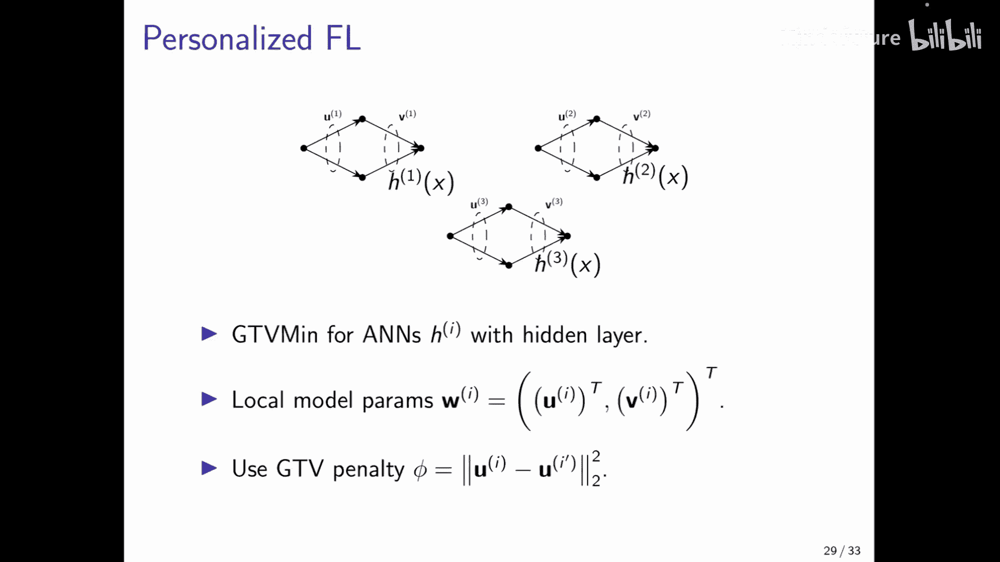
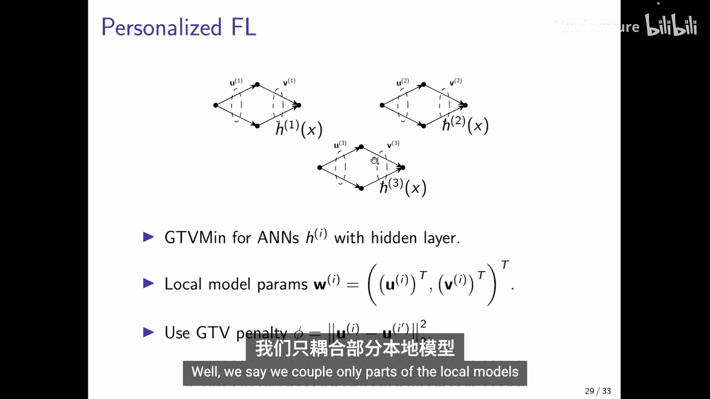
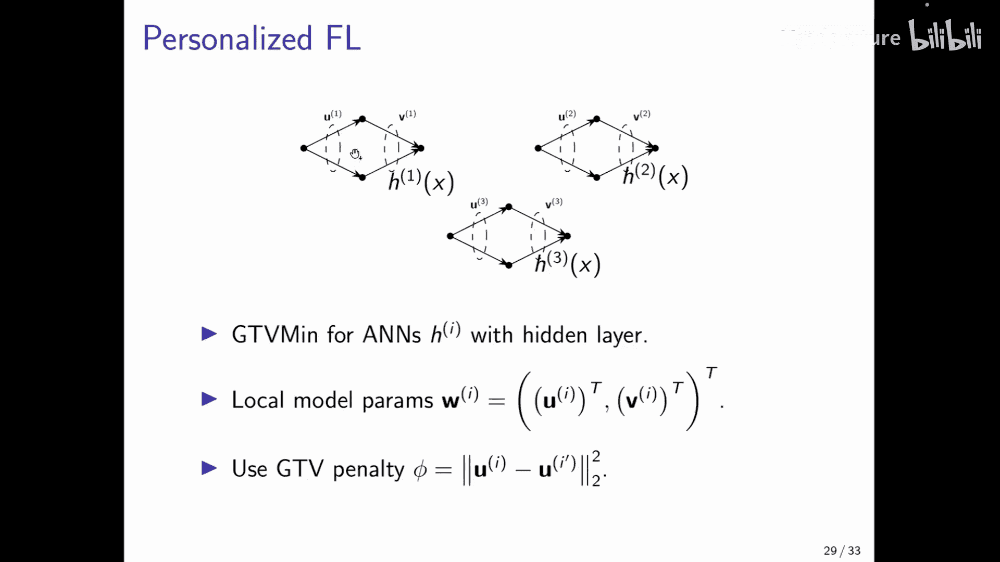
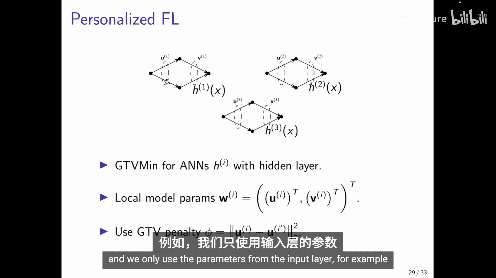
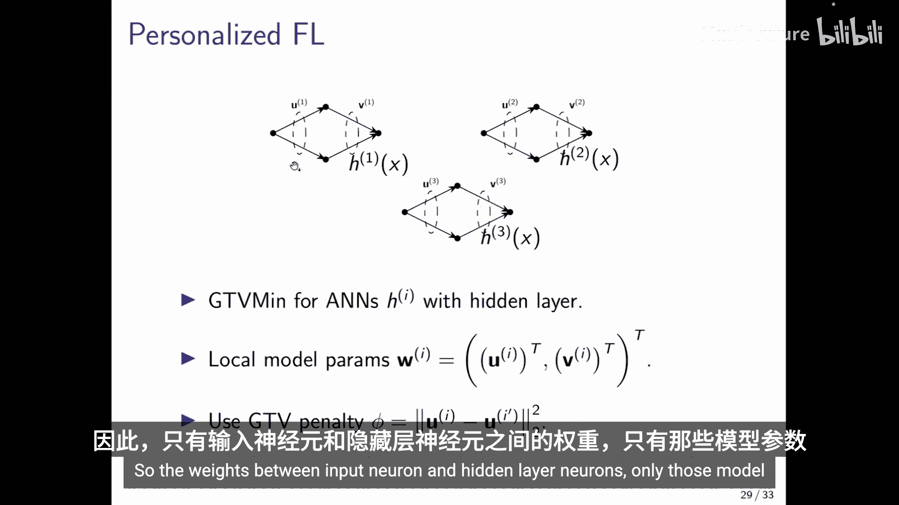
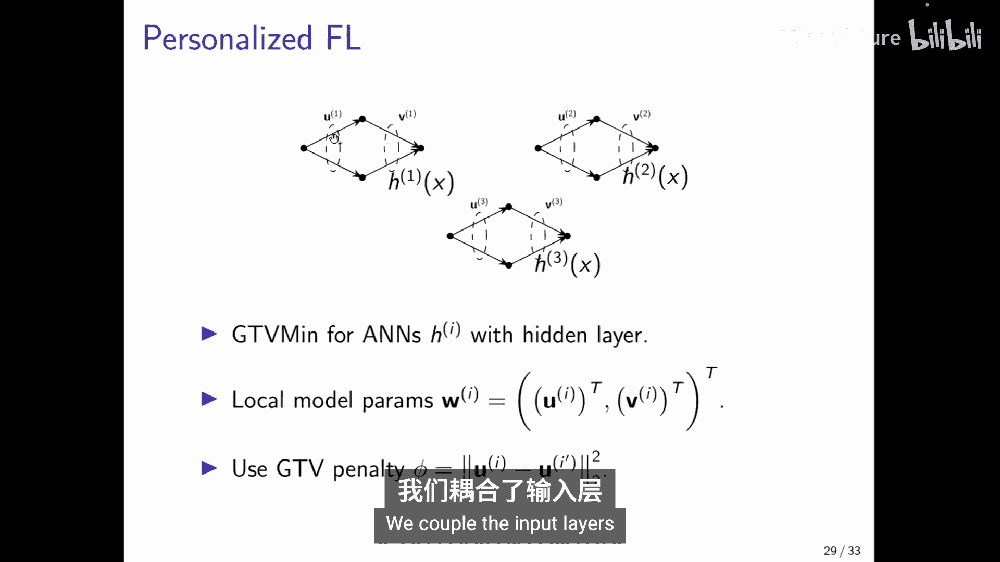
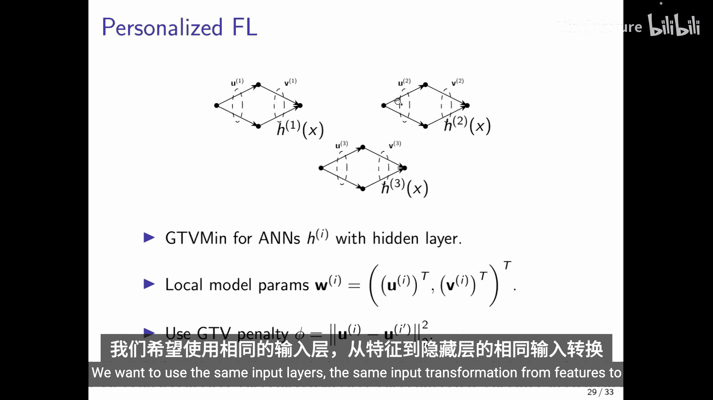
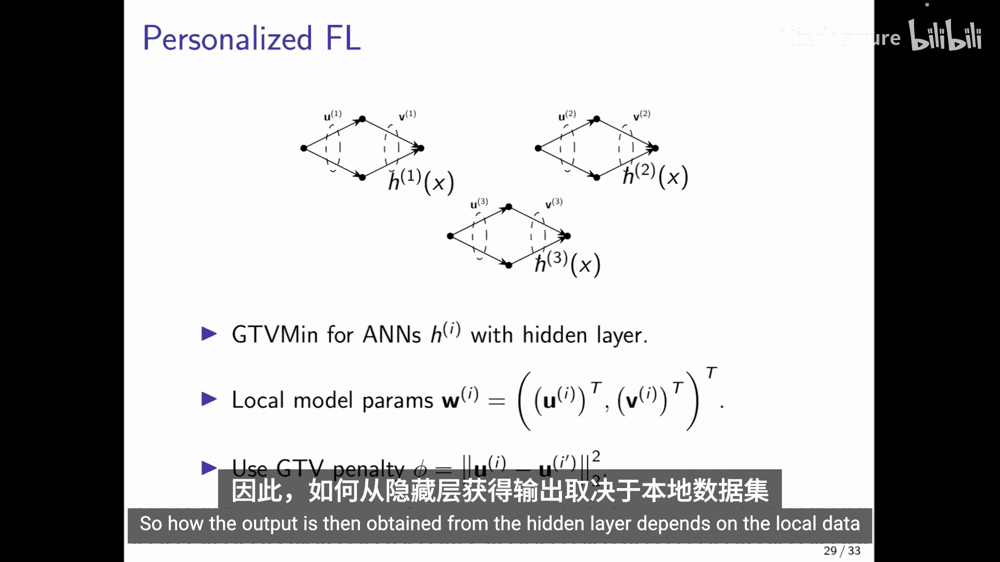
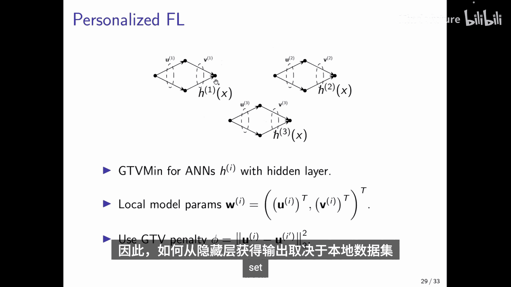
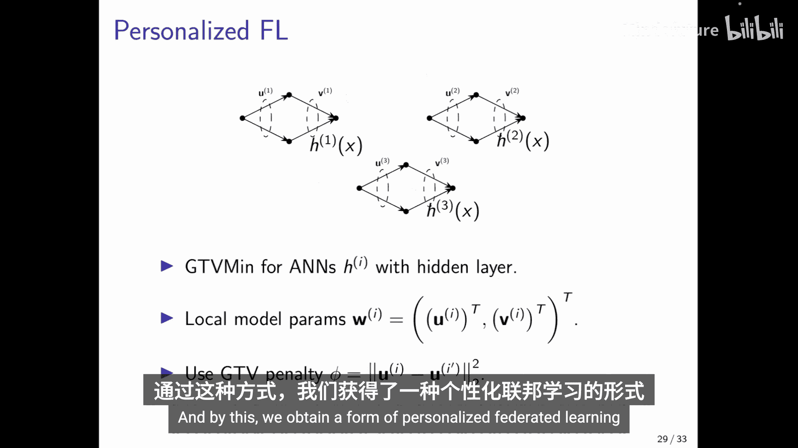

# 【阿尔托大学 - 中英】联邦学习 CS-E4740（Federated Learning，spring 2025） p40 P40 CS-E4740 Personalized FL -BV1cojRzDEfQ_p40-

Very briefly go over the last one， which is personalized federated learning。

 So in personalized federated learning， we allow each local model to be different。

 We do not enforce any cluster structure anymore。 And how do we allow them to be different Well。

 we say we couple only parts of the local models。 So I have shown here local models being an artificial neural network。

 And we only use the parameters from the input layer， for example。

 So the weights between input neuron and hidden layer neurons。

 only those model parameters we use for constructing the tu total variation term。

 we do not use at all the parameters of the output layer。

 So this means we when we use T minimization here， we couple the input layers for example。

 they should be identical， we want to use the same input layers。

 the same input transformation from features to hidden layer， but。

The output layer is free。 so the output， how the output is then obtained from the hidden layer is depends on the local data set。

 on the individual node。

And by this， we obtain a form of personalized federated learning。

