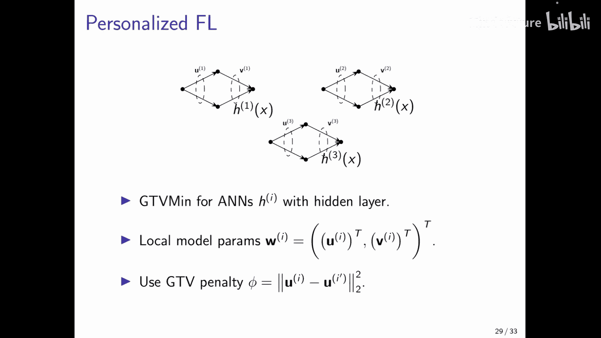
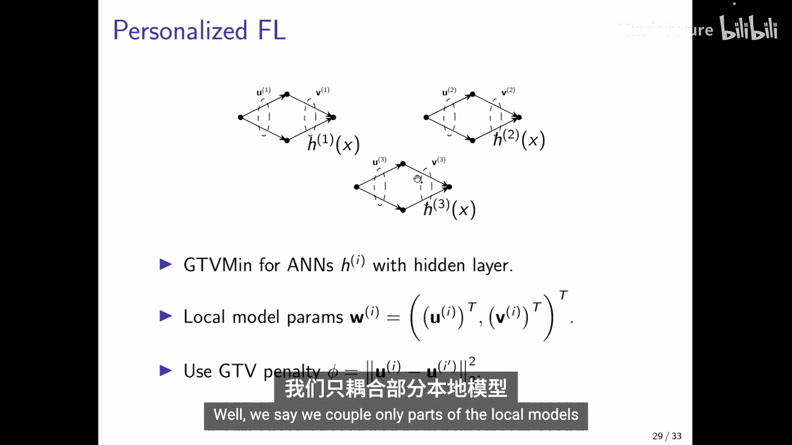
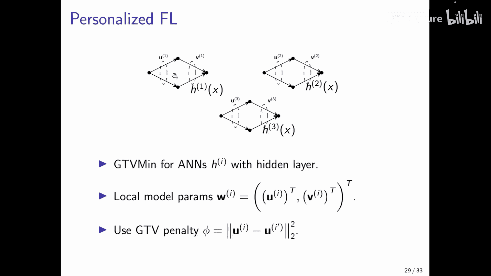
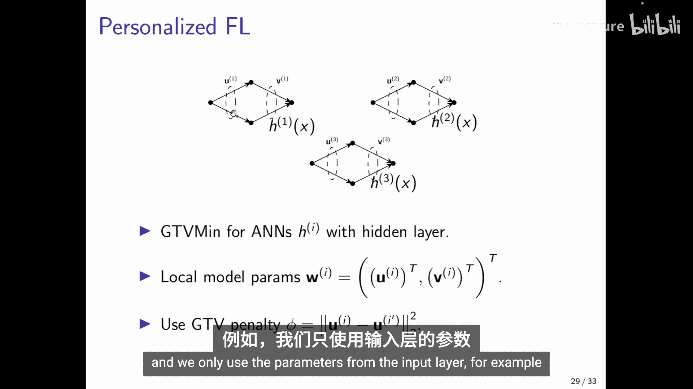
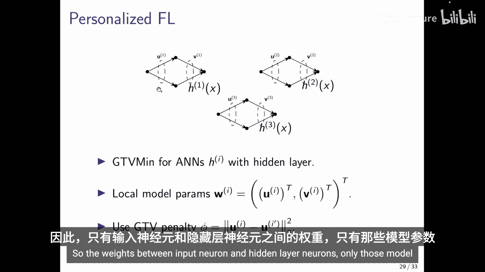
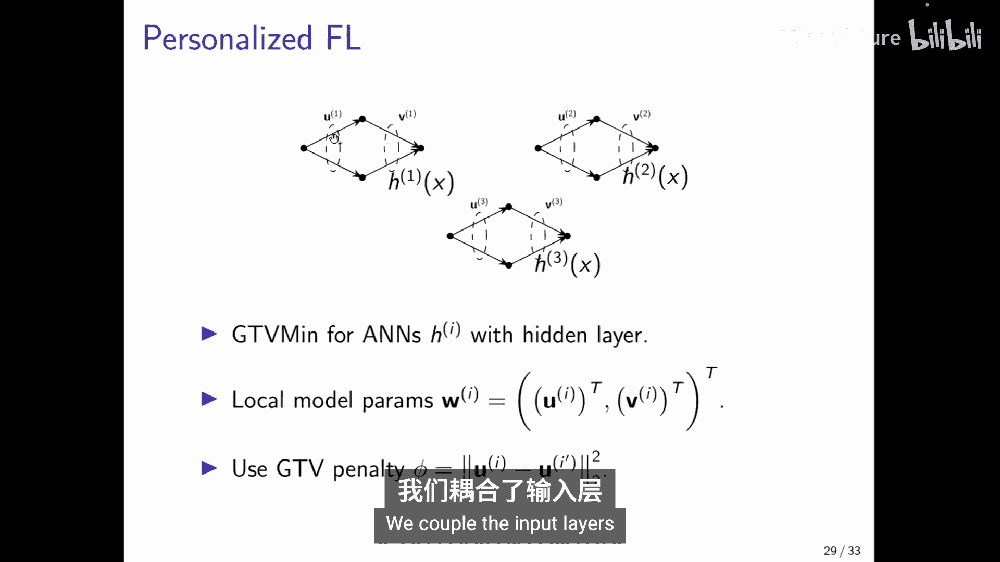
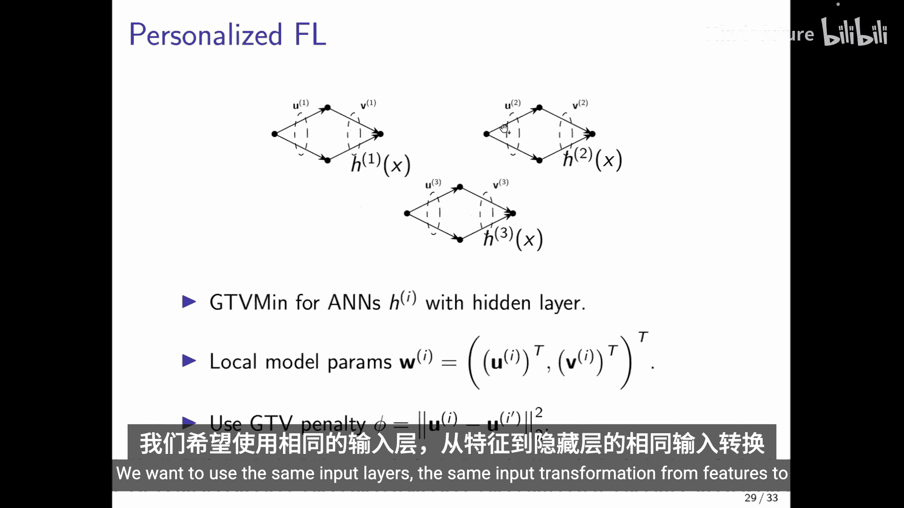
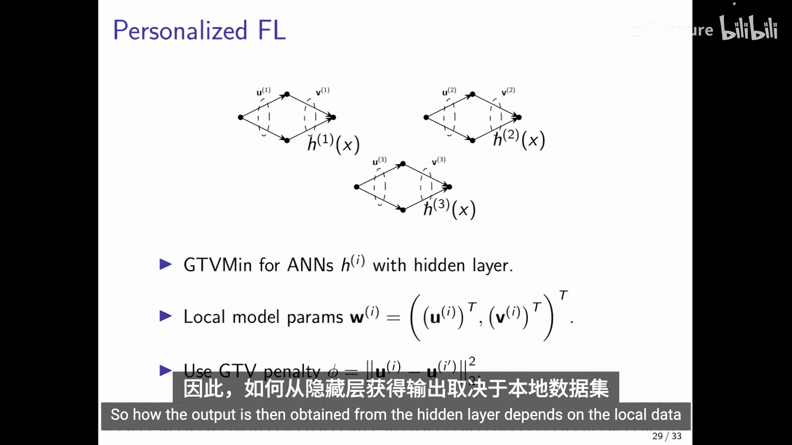
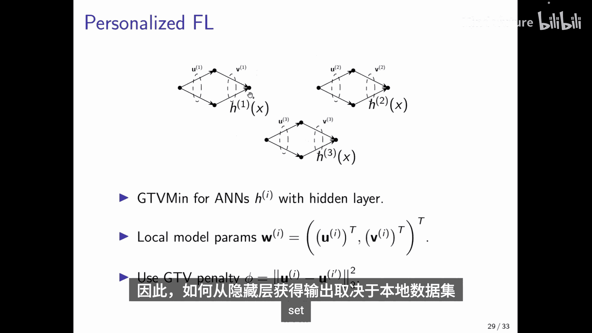
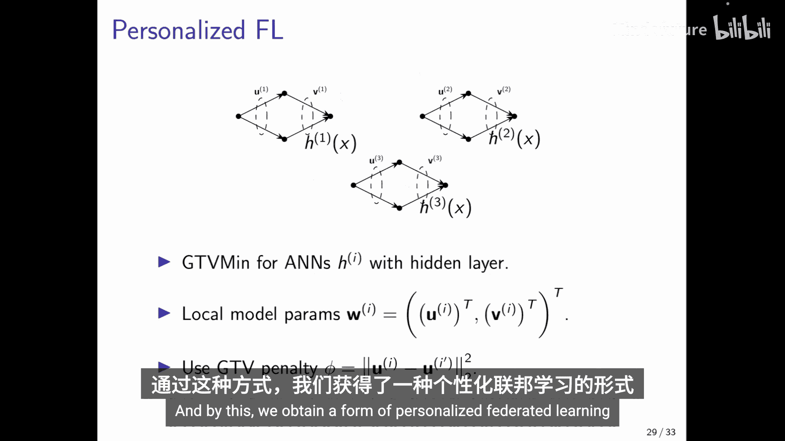

# 联邦学习 CS-E4740：P40：个性化联邦学习 🎯

在本节课中，我们将简要介绍个性化联邦学习。这是一种允许每个本地模型保持差异性的联邦学习范式，不再强制所有模型结构完全一致。

上一节我们讨论了联邦学习的基本框架，本节中我们来看看如何实现模型的个性化。

## 核心概念

在个性化联邦学习中，我们允许每个本地模型彼此不同。我们不再强制实施任何集群结构。实现模型差异化的方法是，我们只耦合本地模型中的特定部分。

例如，假设本地模型是一个人工神经网络。我们只使用输入层的参数（例如，输入神经元与隐藏层神经元之间的权重）来构建总变差项。我们完全不使用输出层的参数。

这意味着，当我们在此处使用T最小化时，我们耦合的是输入层。我们希望所有模型使用相同的输入层，即从特征到隐藏层的相同输入变换。

**公式表示**： 设第 `k` 个客户端的模型参数为 `θ_k = [θ_k^(in); θ_k^(out)]`，其中 `θ_k^(in)` 是输入层参数，`θ_k^(out)` 是输出层参数。个性化联邦学习的优化目标可以表示为：
`min_{θ_1, ..., θ_K} Σ_k L_k(θ_k) + λ * Σ_k ||θ_k^(in) - θ_global^(in)||^2`
其中，`L_k` 是第 `k` 个客户端的本地损失函数，`θ_global^(in)` 是全局共享的输入层参数。

## 实现方式

以下是实现个性化联邦学习的关键步骤：

1.  **参数划分**： 将每个本地模型的参数明确划分为共享部分（如输入层）和个性化部分（如输出层）。
2.  **共享部分耦合**： 在联邦聚合过程中，只对共享部分的参数进行平均或优化，强制它们趋向一致。
3.  **个性化部分独立**： 每个客户端的个性化参数完全由其本地数据决定，在联邦过程中不进行聚合。

因此，输出层是自由的。输出如何从隐藏层获得，取决于本地数据集和各个节点本身。

通过这种方式，我们获得了一种个性化联邦学习的形式。

## 总结

本节课中我们一起学习了个性化联邦学习的基本思想。其核心在于**只耦合模型的部分参数**（通常是底层、通用的特征提取层），而允许上层、与具体任务相关的参数根据本地数据自由演化，从而在保持联邦协作优势的同时，更好地适应每个参与方的数据特性。