# 【阿尔托大学 - 中英】联邦学习 CS-E4740（Federated Learning，spring 2025） p41 P41 CS-E4740 Differential Privacy in FL -BV1cojRzDEfQ_p41-

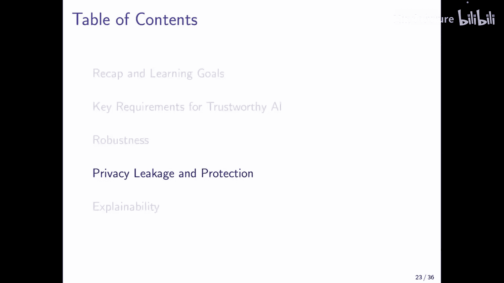

Okay， any other questions， Nothing， Then let's move on to privacy leakage and privacy protection。

Yeah， again， here this basic show here this basic step of the Feerated learning algorithms from the perspective of some node I。

 For example， me， let's say Alex is nodede I。 So I get model parameters from Mico from Mico。

 who has also a smartphone with the federated learning algorithm running。

 And we all of a sudden have a Bluetooth connection。 And then I also get from salvatore。

 I get also his model parameters， and I can use those model parameters to build a regularization term from my model training on my smartphone running Python using Set learn。

😊。

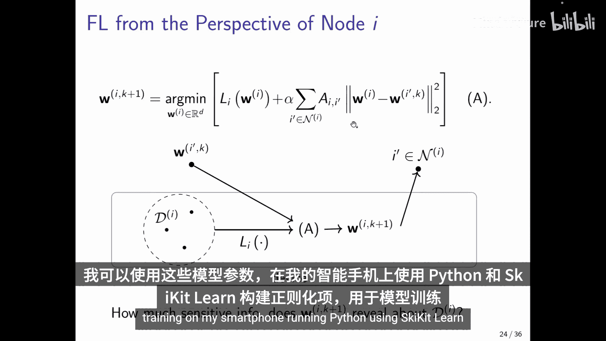

Okay， and then， of course， I get something from my neighbors。 So I should also give something back。

 Of course， I then share my new model parameters with Miko and Salvatoa。

 So they can then in the next round， use my model parameter for regularizing their local model training problem。

😊。

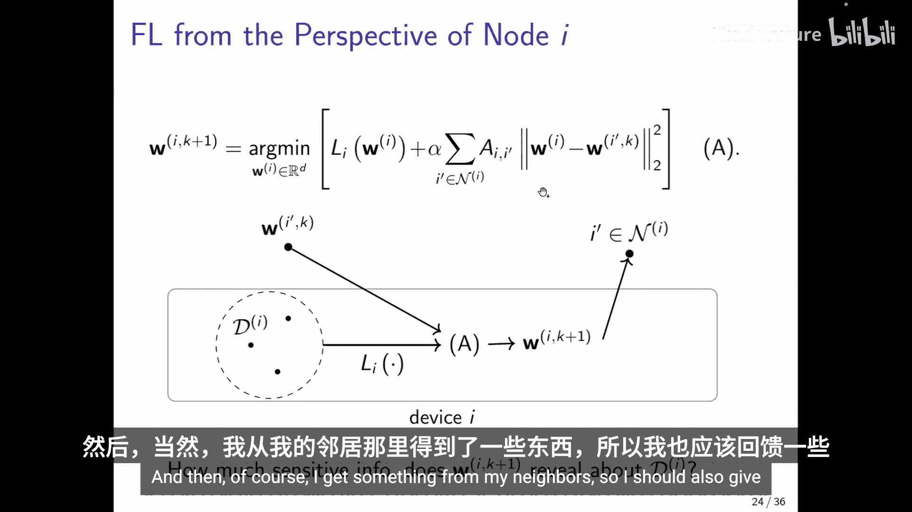

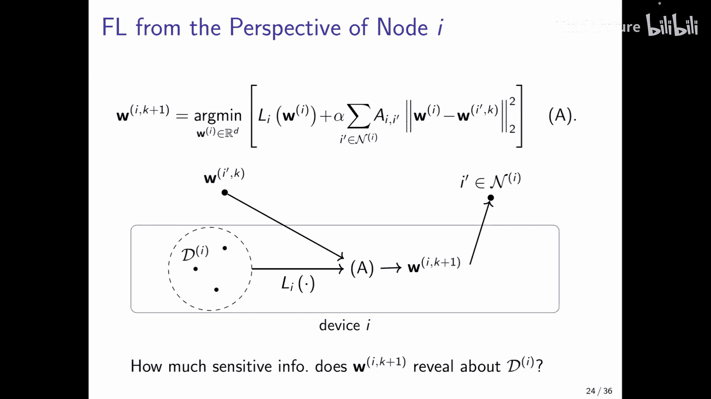

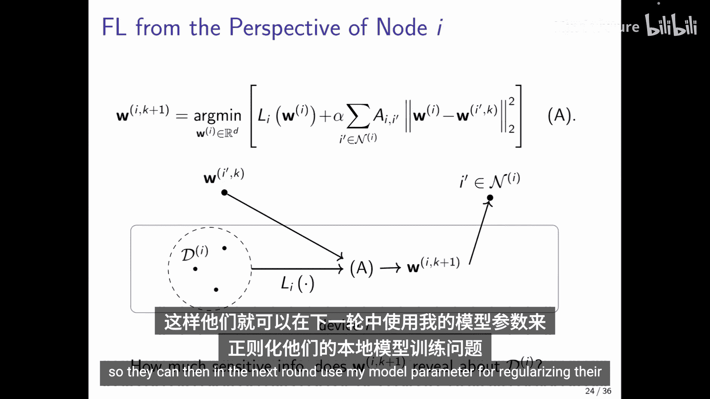

And yeah， it's important to note here that there's an information flow into device eye from the neighbors。

 But from a privacy perspective， what is more difficult or more， more critical is there's a flow out。

 So I send my new model parameters to the neighbors。 So， and at some point， they leave my。

 my safe space。 So to say， which is my smartphone。

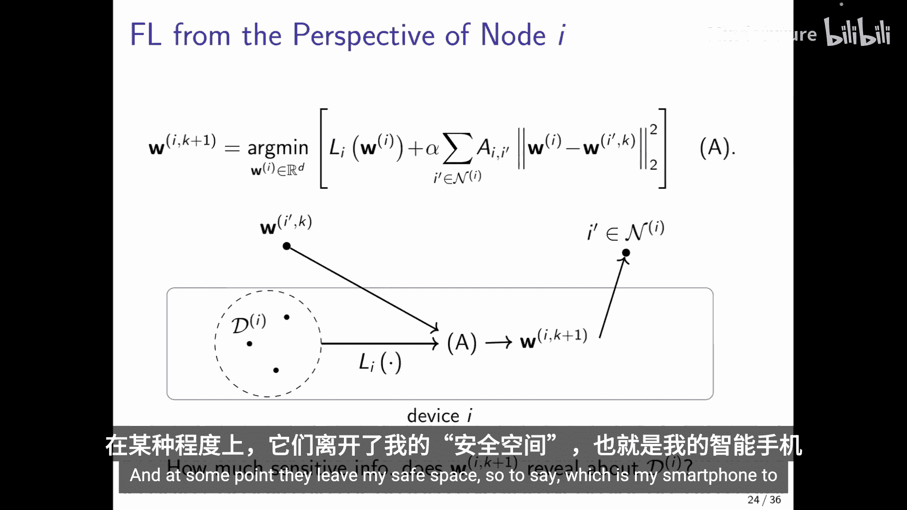

To some extent。So the question is， how much information。

 How much sensitive information about my own data， Let's say my latest blood pressure measurements。

Is leaked to Salvatoromicko。And。

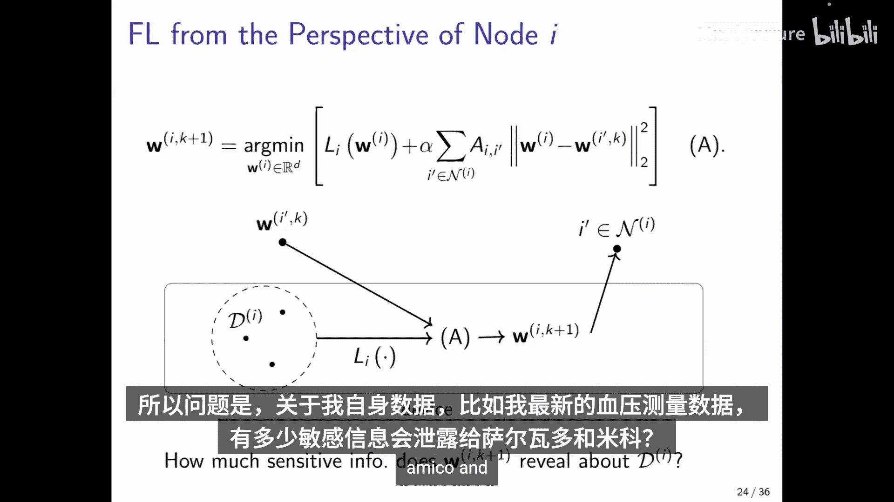

How can we measure this here we again appeal to probability theory So one way to measure or to make this to make this question precise。

 I mean， this question how much sensitive information does this parameter reveal about the data about my data so we need to make this more precise and we need again mathematics for this。

 or we use mathematics in particular， we model we model the output of of this update step at my node。

 So this update at node I produces a new model parameter Wi iteration K plus1 and we model it as a random variable as a realization of a random variable and the distribution is what could what could leak information So based on this distribution So we use many rounds。

 we can then use some estimation methods to estimate。

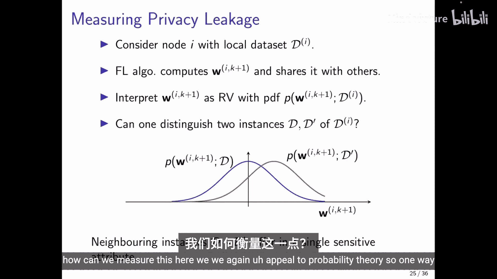

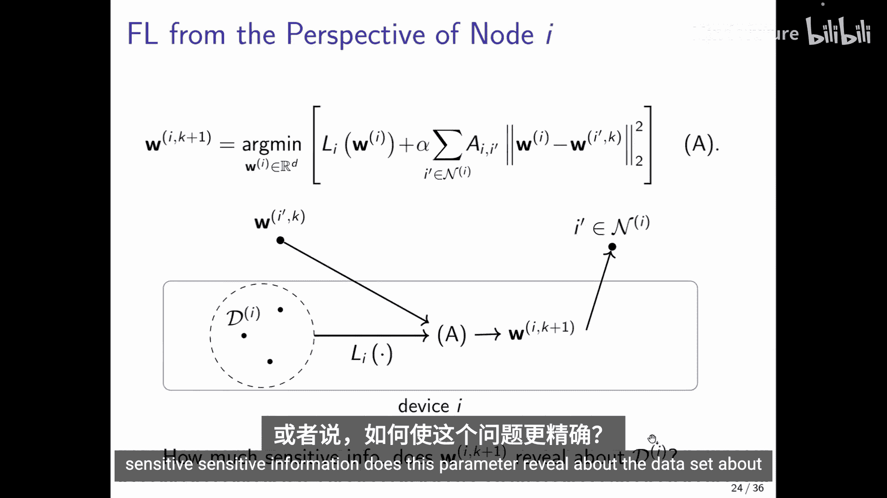

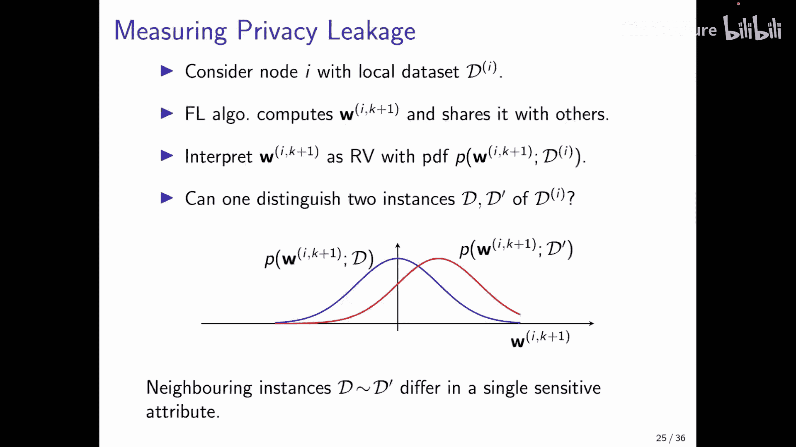

Distribution， a probability distribution of this random variable somehow。

 And this allows Miko a salvatore to somehow infer something about my blood pressure。

Values or measurements。And the question is， how much。And to measure this， we could say we could。

 we could think of an experiment。 So let's say I have two different instances of my local data。

 Let's say my local data set consists of blood pressure measurements of the last 10 days。

And I want to I want to characterize if salvare is able to tell if I have a high blood pressure or not。

 So what I do is I look at two different instances。

 two different possible choices for this blood pressure measurements， D and T prime。

 and they differ only in one value， which is either high or low。

 So high blood pressure or low blood pressure， and these two different instances kind of carry information。

 If salvatore would be able to find out if it was D or D prime， he could infer。

Alex has a high blood pressure or not。So the question is。

 does the distribution of the output of the federated learning algorithm significantly change for these two different choices of the local dataset。

That's the key idea behind differential privacy。 So that that model is known as that's the the mathematical model underlying differential privacy。

 So in differential privacy， we， we want we， we， we， we prefer we。

 we want to ensure that this distributions are as similar as possible。 in particular。

 we want to make sure that there is no， no test， no statistical test that Salvatto could ever use。

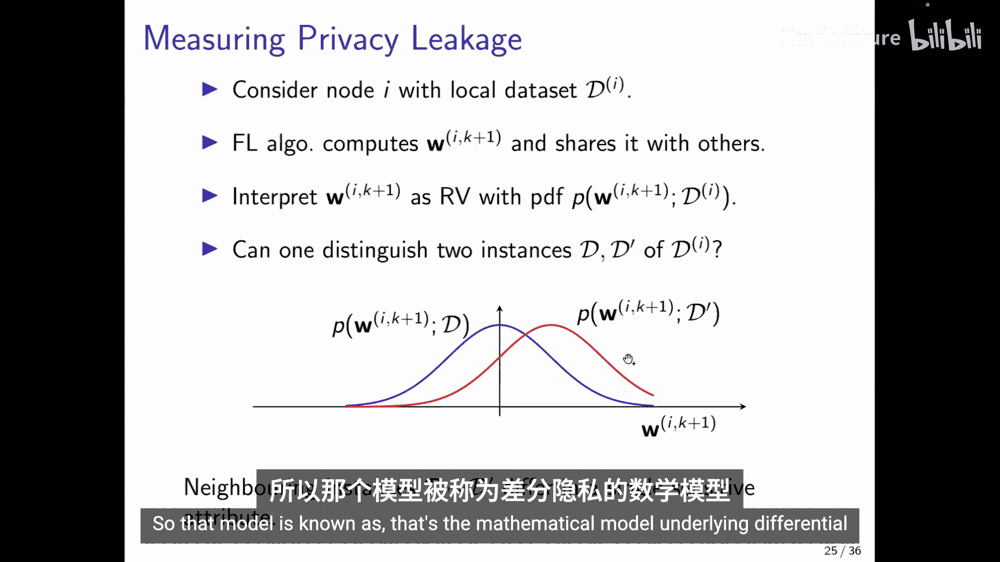

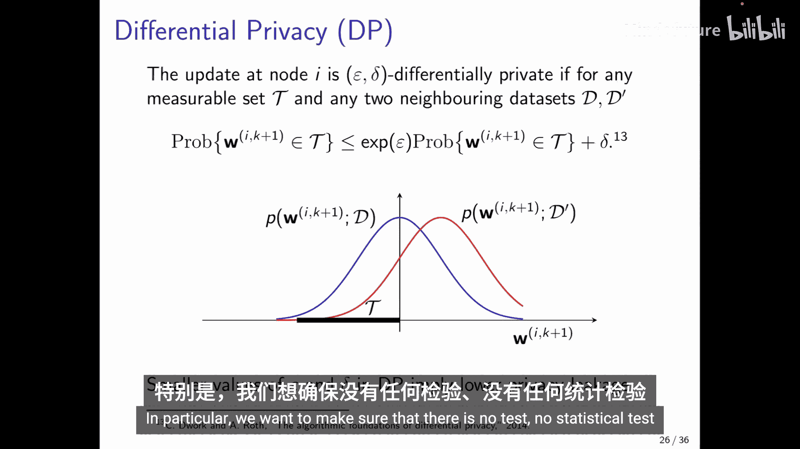

To tell if the data set was D or D prime。Or in other words。

 that Salvatore could tell if the blood pressure was low or high。

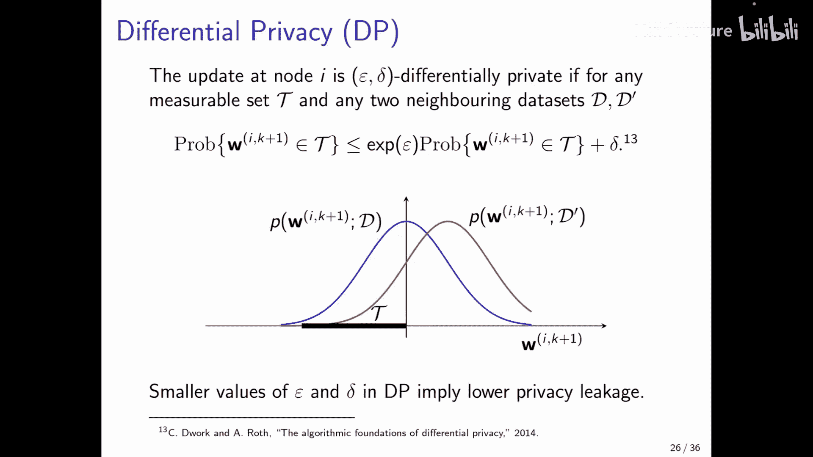

Yeah， I indicate this test， this statistical test here just by some region。 In the end。

 a statistical test is characterized by the region for which it delivers， yes。And if it's， if。

 if the， the， the measurement， in this case， the model parameter is not in this region T for test。

 it says no。

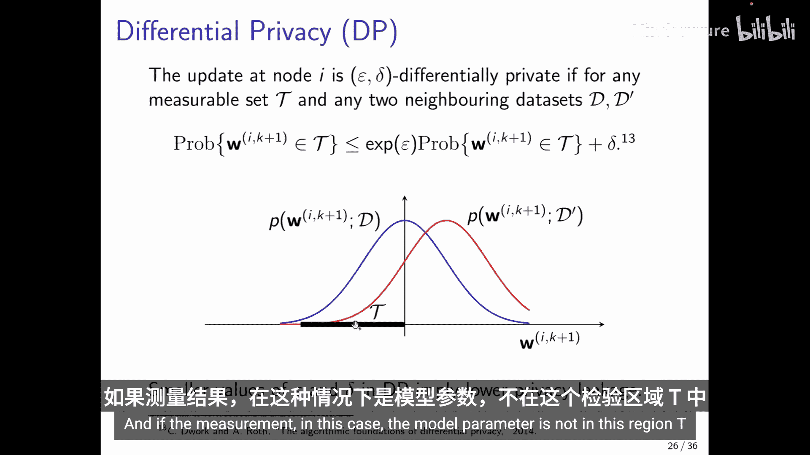

So it's a binary binary hypothesis test。And differential privacy tells that。

Any method you use for this test。 So any choice for this， let's call it acceptance or rejection。

 Its equivalent rejection region for this test， Whatever you use。

 you will get the similar probabilities， similar behavior。 if the local dataset set is D， or if。

 if it's the prime。Okay， that's， that's basically the story behind differential privacy and the advantage is。

 I mean， it's a nice mathematical model and it gives it it allows you to。

 to somehow measure up privacy protection。But the practical relevance， I would say。

 is still debatable so。For example， what， what's the meaning of this epsilon。

 If I tell you that I have a federated learning algorithm that is differentially private with epsilon。

 So smaller epsilon means lower privacy leakage。 So very small， like 10 to the power of-8。

I don't know what this means in practice。 So I still have a hard time to。

 to grasp the practical meaning of this。 Does it mean that Salvatore will be able to tell if I have a blood pressure above 1 hundred80 or does does it allow him to distinguish between blood pressure 140 and 145 and how。

 how， how often do we need to， or how long do we need to use the federated learning app that the chance that he will correctly detect it will be at least 90%。

So very practical questions or practical characterization of differential privacy is。

 is still a bit weak for me。

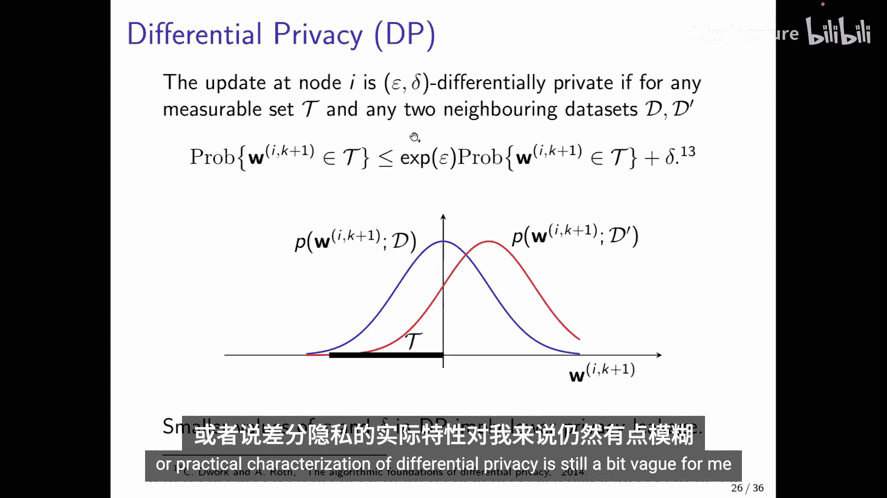

Yeah， so the question was now how can we manipulate epsilon and Dlta and yeah。

 that's the nice thing about differential privacy， you can control it by adding noise so you can you can make you can ensure a certain epsilon and Dlelta by taking the output of whatever algorithm you have that you want to make private。

 privately protecting and adding noise。

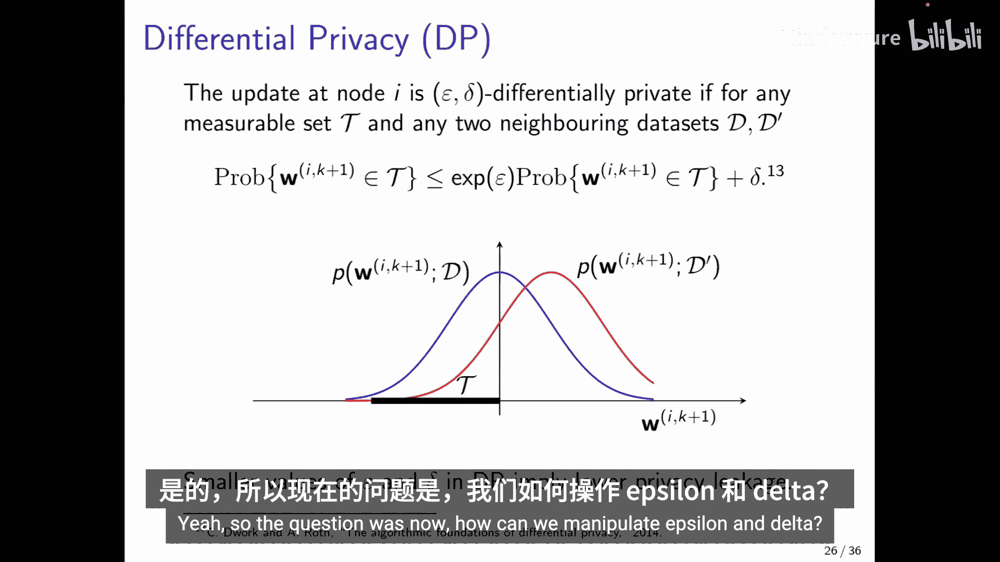

So you just put noise， make the result more noisy。And the。

 the amount of noise depends on this epsilon。 So the smaller you want epsilon to be。

 So you want the differential privacy guarantee with the small epsilon。

 The larger the noise has to be。 And the noise also depends on the sensitivity。

 So the sensitivity measures。 How much does this。

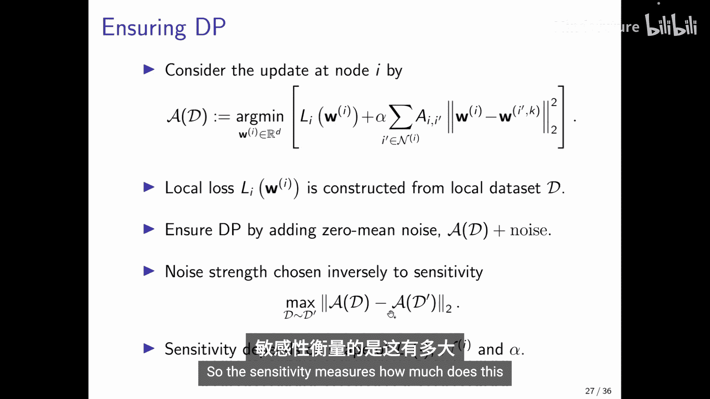

How much does the the model output or the method output change if you change the dataset set a bit。

 I mean， this is clear if， if the date， if the output wouldn't change at all。

 you have perfectly privacy protection because you could never distinguish between a data set having high blood pressure measurements and low blood pressure measurements。

 because the output is always the same。But that's a bit trivial。

 So in order to be perfectly privacy protecting， don't do anything。Don't do any learning。But this is。

 I guess this is not what we want in a federated learning course and what we want to do with the techniques that we learn here。

 So we want to learn from this data set。 And to this end， the， this mapping here from you can。

 you can think of this of this federated learning step as a map it takes in this data and outputs the new model parameters。

 and it will have some sensitivity。 But the smaller the sensitivity。

 the better from privacy protection perspective。

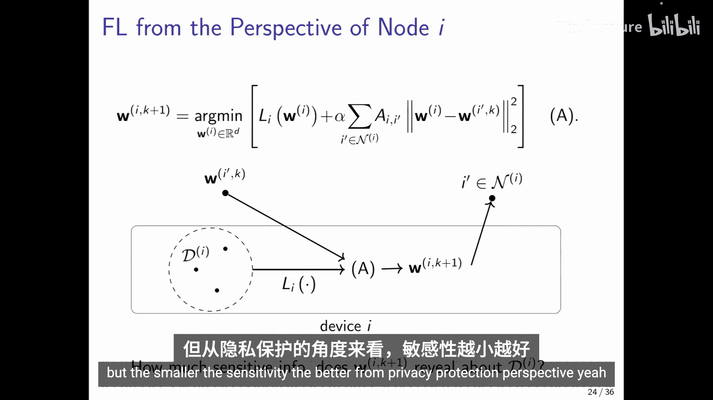

Yeah， and again， how， how can we， how can we tunene the sensitivity。It's again， wire the。

 the choice of local loss functions。 So if you use local loss functions。

 which are very have a high curvature。This might I'm not sure but increase or decrease the sensitivity。

 So this is something one one would need to work out then in detail， but in general。

 you can shape this sensitivity by using different choices for the loss function or adding additional penalty terms like regularization terms that don't use enables。

 but only use the local model parameters in order to make this sensitivity smaller。

 the smaller the sensitivity， the more private algorithms。

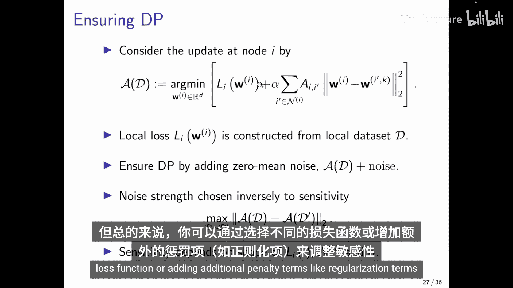

P。ふん。Any questions at this point？So that's about privacy protection， yes。

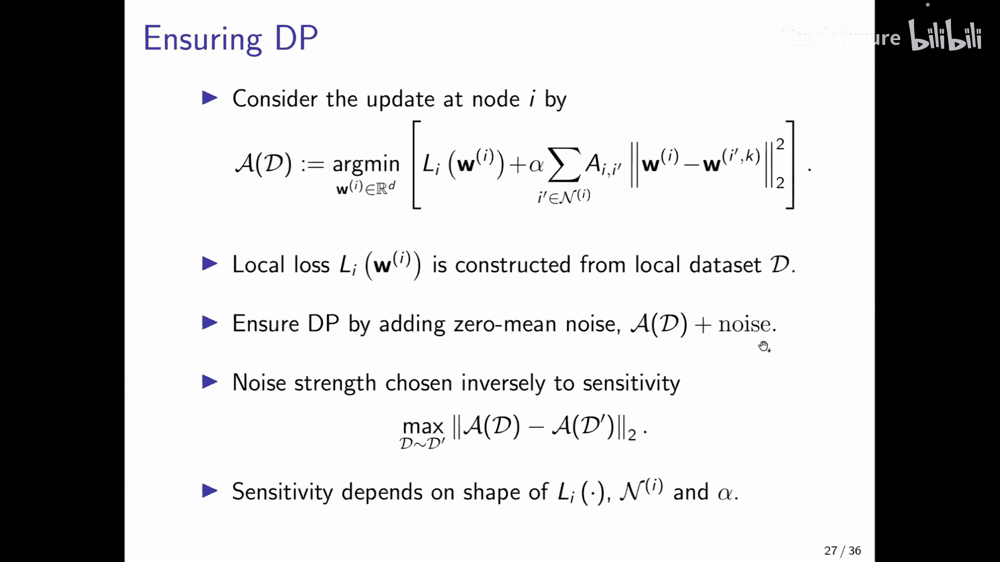

对。Yeah。对。w withエ wに。Excellent， yes。Yes， there's a typo here。

 There should be this probability on the left side is taken with respect to underlying dataset is D。

 And on the right side， the probability is taken when the underlying dataset is D prime。

 So using different local dataset sets induces different distributions。 So we。

 we think here in in this differential privacy model。

 we think of the local data as a parameter of a probability distribution。

 The local data parameters the probability distribution of the， the updated model parameters。

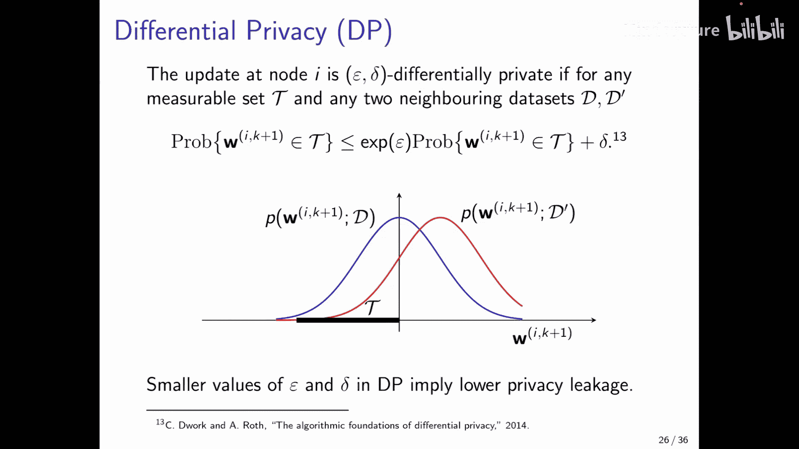

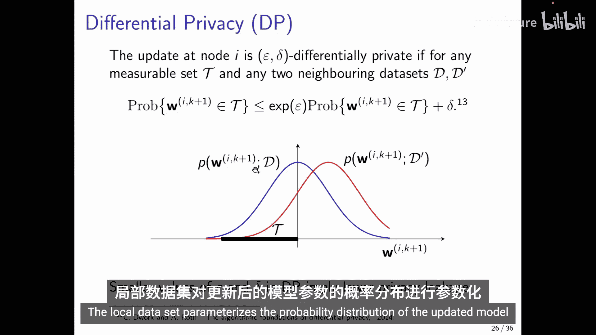

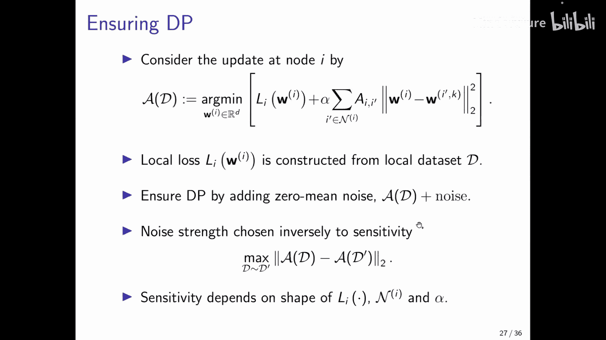

Okay。