# 联邦学习 CS-E4740：P41：联邦学习中的差分隐私 🔒

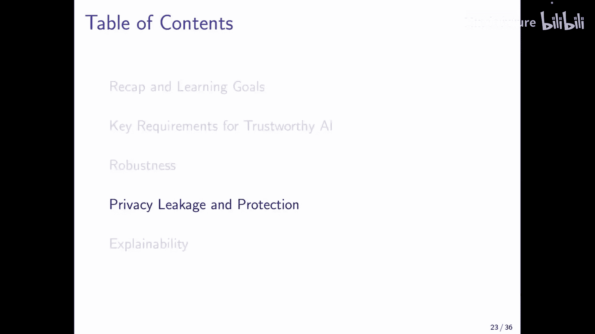

在本节课中，我们将探讨联邦学习中的隐私泄露问题，并介绍一种重要的隐私保护技术——差分隐私。我们将了解隐私泄露是如何发生的，以及如何通过数学方法量化并保护隐私。

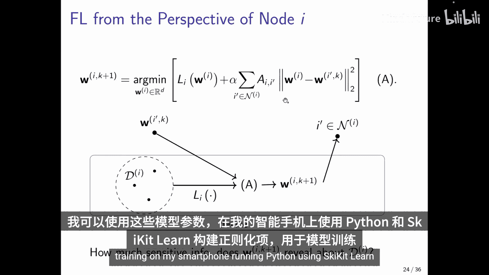

---

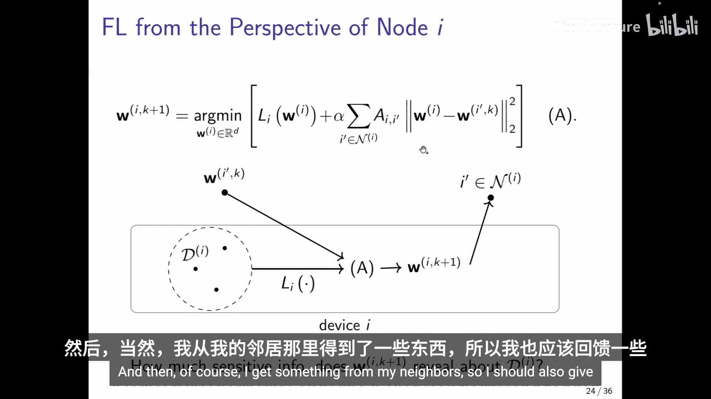

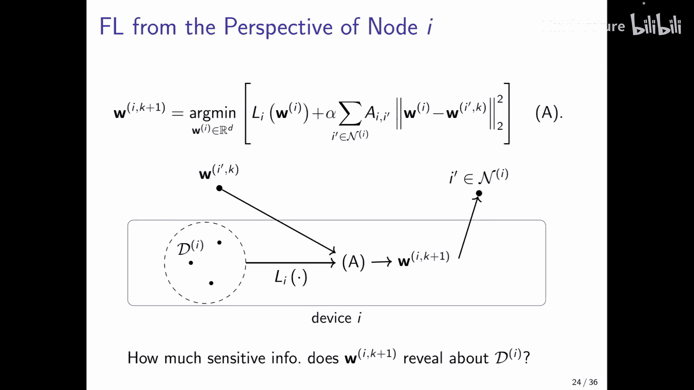

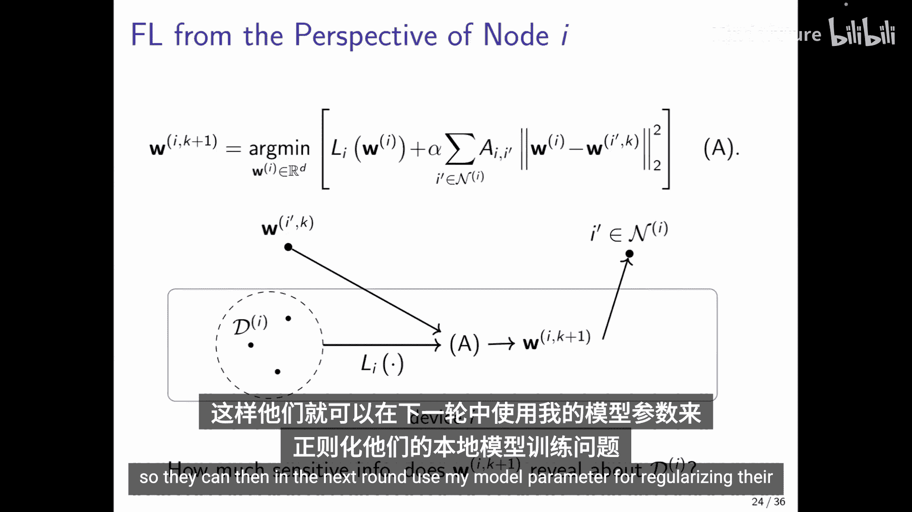

上一节我们介绍了联邦学习的基本算法流程。本节中我们来看看在节点间交换模型参数时可能引发的隐私泄露问题。

以一个节点（例如Alex）的视角来看联邦学习的基本步骤。Alex从邻居节点（例如Miko和Salvatore）那里获取模型参数。这些参数通过蓝牙连接传输。Alex使用这些参数，结合自己设备上的本地数据（例如血压测量值），在本地运行Python和Scikit-learn进行模型训练，并构建一个正则化项。

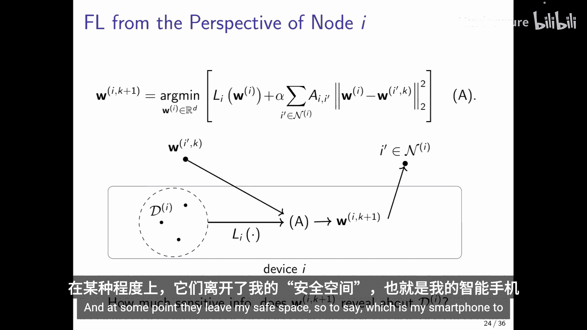

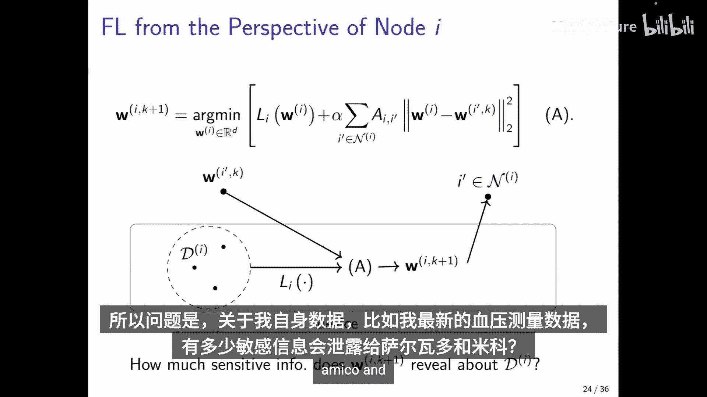

当然，Alex从邻居那里获得信息后，也需要回馈一些东西。因此，Alex将自己的新模型参数分享给Miko和Salvatore。这样，在下一轮迭代中，他们就可以使用Alex的模型参数来正则化他们自己的本地模型训练问题。

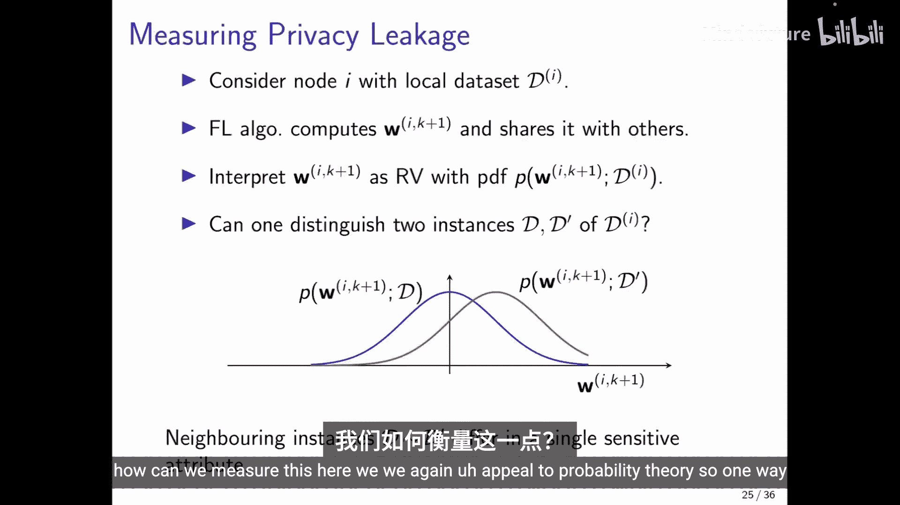

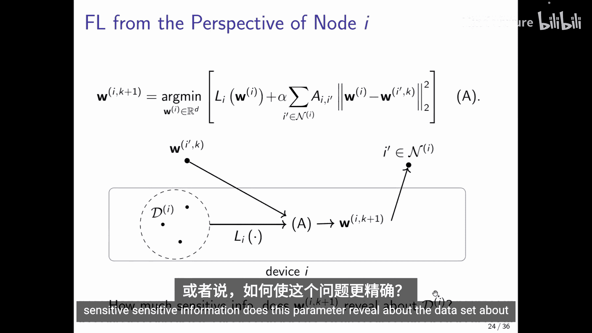

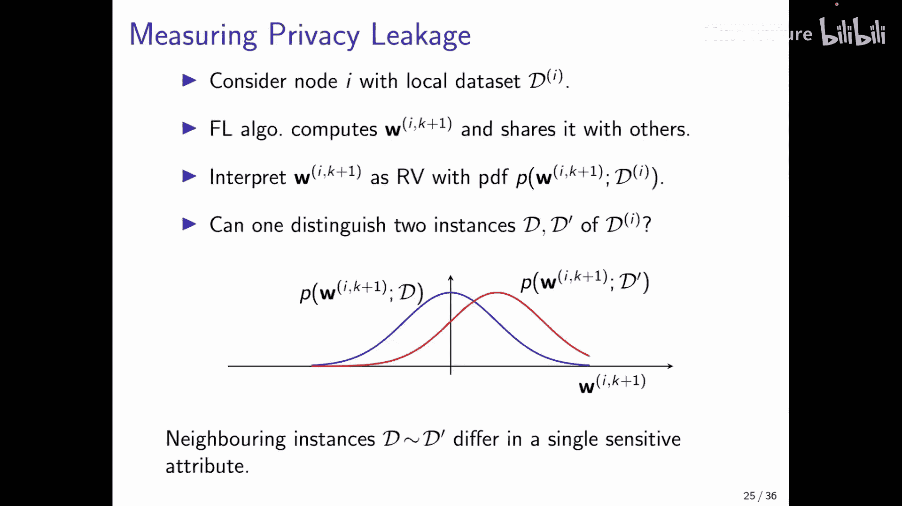

这里需要指出的是，信息流既流入设备（从邻居），也从设备流出（发送给邻居）。从隐私角度看，流出的信息流更为关键，因为这意味着本地数据的信息离开了设备这个“安全空间”。

核心问题是：发送给邻居的模型参数泄露了多少关于本地数据（例如最新的血压测量值）的敏感信息？我们如何衡量这种泄露？

## 量化隐私泄露：差分隐私的核心思想

为了精确地衡量隐私泄露，我们需要借助概率论和数学工具。我们将节点 `i` 在第 `k+1` 轮迭代中更新的模型参数 `w_i^{k+1}` 建模为一个随机变量。其概率分布可能泄露信息。攻击者（如邻居）可以通过多轮迭代，使用估计方法来推断这个分布，从而推测Alex的血压值。

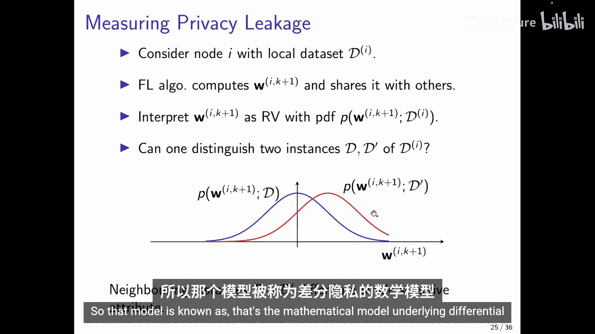

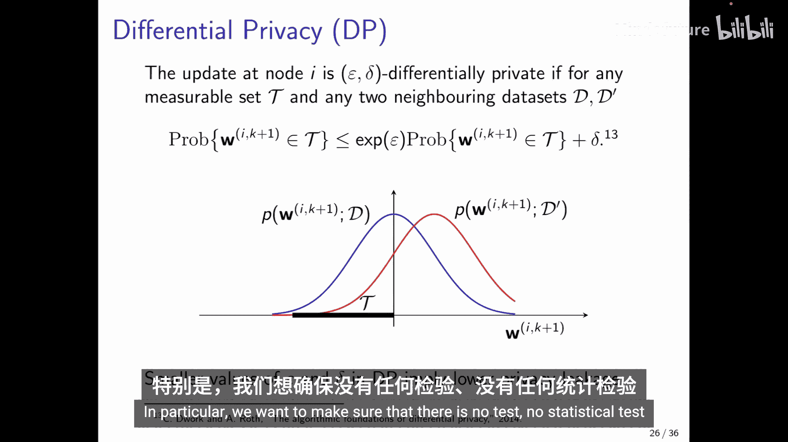

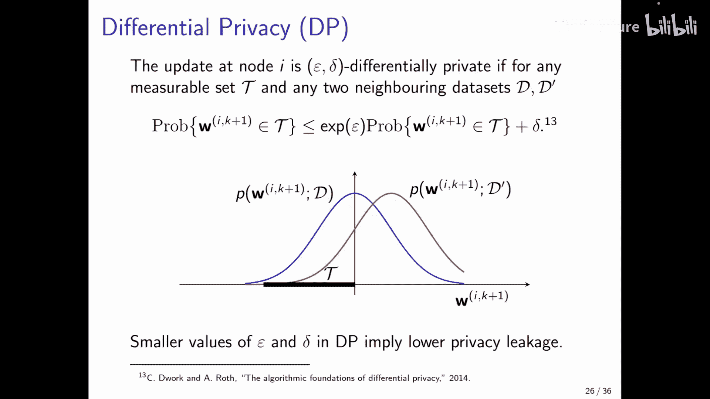

为了衡量泄露程度，我们可以设想一个实验。假设Alex的本地数据集 `D` 包含过去10天的血压测量值。我们关注攻击者Salvatore能否判断Alex是否有高血压。

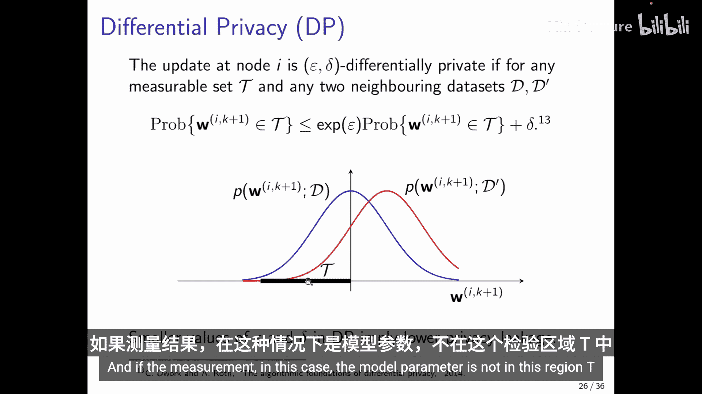

以下是实验思路：
1.  考虑两个仅在一条记录上不同的数据集实例：`D`（血压正常）和 `D‘`（血压高）。
2.  如果联邦学习算法在这两个不同数据集上运行时，输出的模型参数分布有显著差异，那么Salvatore就有可能通过观察输出来区分是 `D` 还是 `D‘`，从而推断出Alex的血压状况。
3.  差分隐私的目标就是确保这两个分布尽可能相似，使得任何统计测试都无法有效区分它们。

具体来说，差分隐私要求，对于任何可能的输出结果集合（统计测试的拒绝域 `T`），算法在数据集 `D` 和 `D‘` 上输出结果属于 `T` 的概率非常接近。这可以用一个严格的数学公式来定义：

对于所有相邻数据集 `D` 和 `D‘`（仅相差一条记录），以及所有可能的输出子集 `S`，满足：
`Pr[ A(D) ∈ S ] ≤ e^ε * Pr[ A(D‘) ∈ S ] + δ`
其中 `A` 是算法，`ε` 是隐私预算，`δ` 是一个通常很小的失败概率。

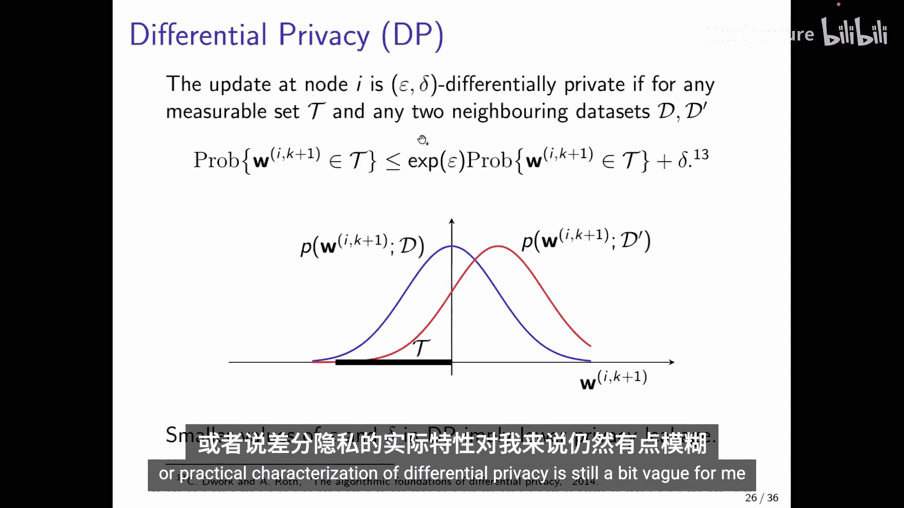

## 实现差分隐私：添加噪声

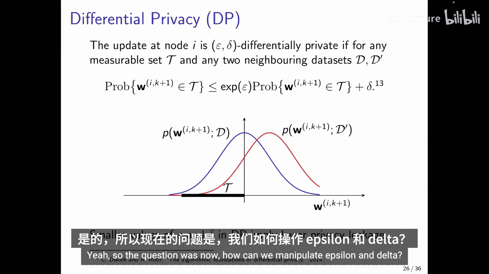

差分隐私的一个优点是，我们可以通过向算法输出中添加噪声来控制隐私保护水平（`ε` 和 `δ`）。

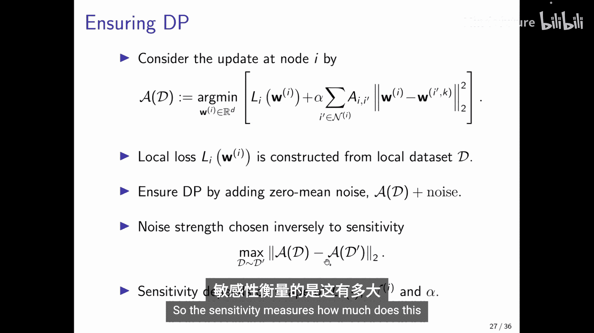

核心方法是：对任何你想保护的算法输出，添加适量的噪声。噪声的大小取决于两个因素：
1.  **隐私预算 `ε`**：你想要的 `ε` 越小（隐私保护越强），需要添加的噪声就越大。
2.  **算法的敏感度**：敏感度衡量了当输入数据集发生微小变化（如改变一条记录）时，算法输出的最大变化量。公式可以表示为：
    `Δf = max_{D, D‘} || f(D) - f(D‘) ||`
    其中 `f` 是算法函数，`||.||` 是某种范数（如L1或L2范数）。敏感度越低，算法固有的隐私泄露风险就越小，为实现特定 `ε` 所需添加的噪声也越少。

## 在联邦学习中调整敏感度

在联邦学习的背景下，我们可以通过设计本地训练过程来影响敏感度。

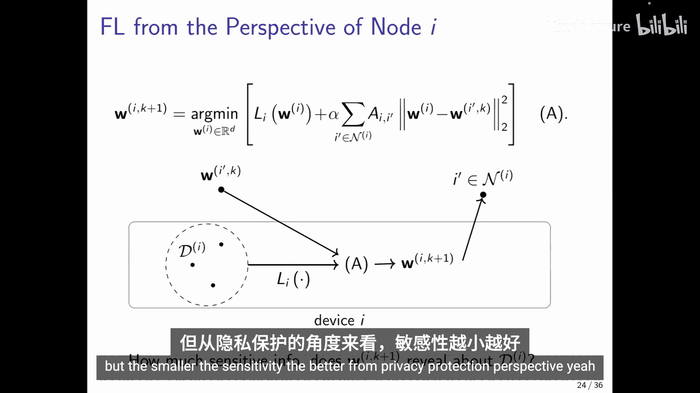

以下是可能影响敏感度的因素：
*   **本地损失函数的选择**：损失函数的曲率等性质可能会影响模型参数对数据变化的敏感度。
*   **添加正则化项**：使用仅依赖于本地模型参数的正则化项（而不是邻居参数），有助于稳定模型更新，从而可能降低敏感度。

通过精心设计这些组件，我们可以塑造算法的敏感度。敏感度越低，在满足相同差分隐私保证的前提下，需要添加的噪声就越少，从而能在隐私和模型效用之间取得更好的平衡。

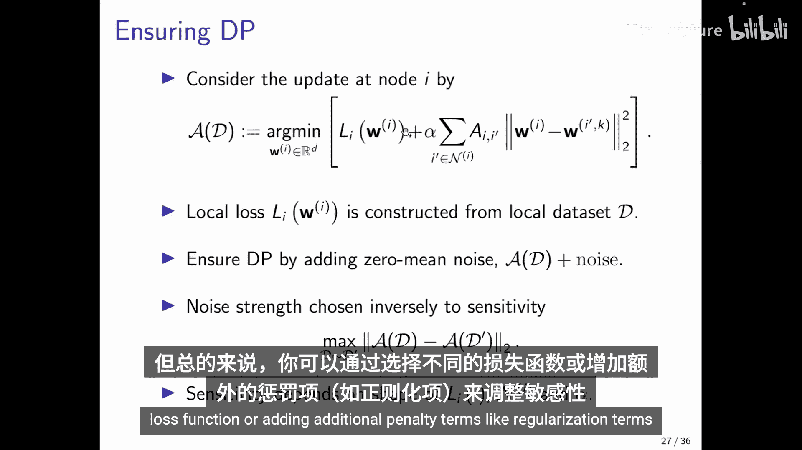

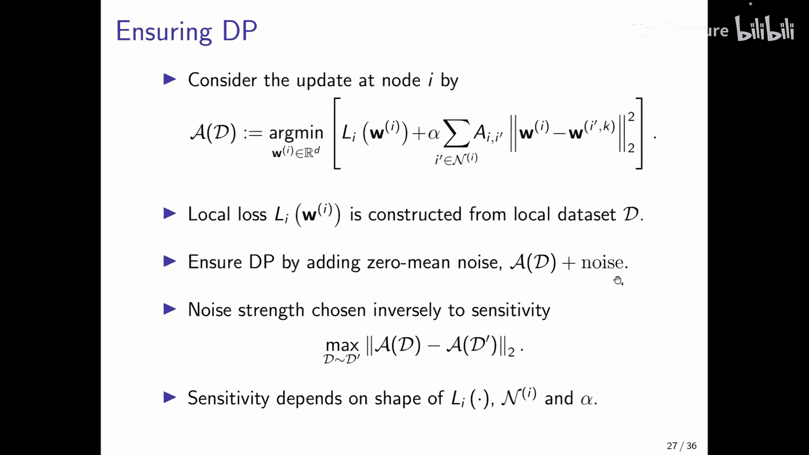

---

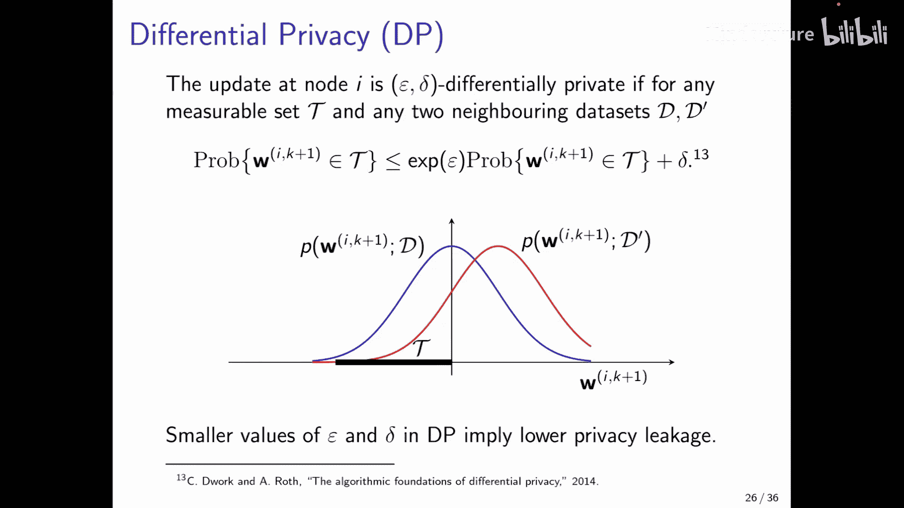

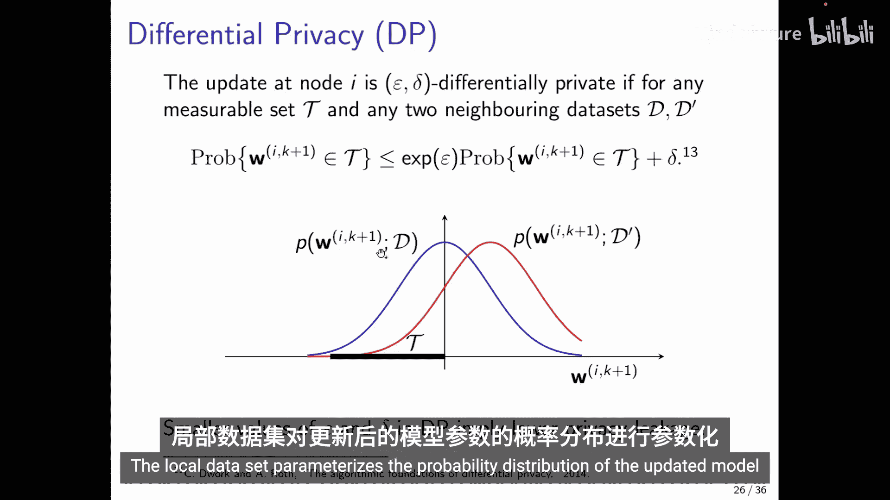

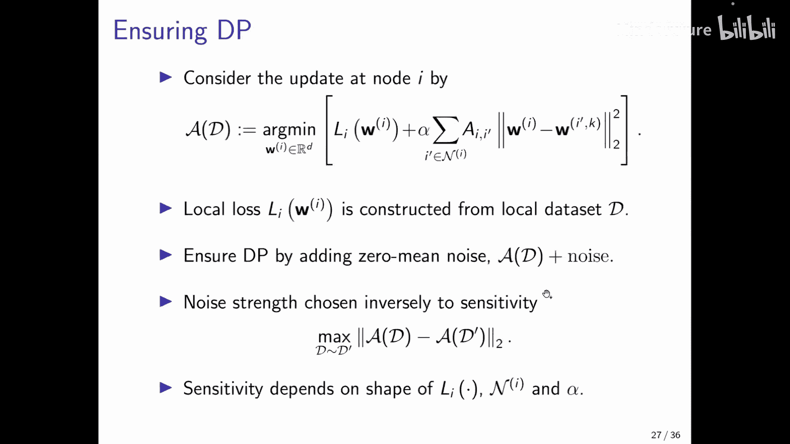

本节课中我们一起学习了联邦学习中的隐私泄露挑战以及差分隐私这一核心保护技术。我们了解到，模型参数的交换可能导致本地数据信息泄露，而差分隐私通过严格的数学定义量化了这种泄露风险。通过向算法输出中添加与敏感度相关的噪声，我们可以实现可控的隐私保护。虽然差分隐私的数学框架非常优雅，但其实际含义的直观解释仍是一个活跃的研究领域。在联邦学习中，我们还可以通过设计损失函数和正则化项来降低算法敏感度，从而更高效地实现隐私保护。