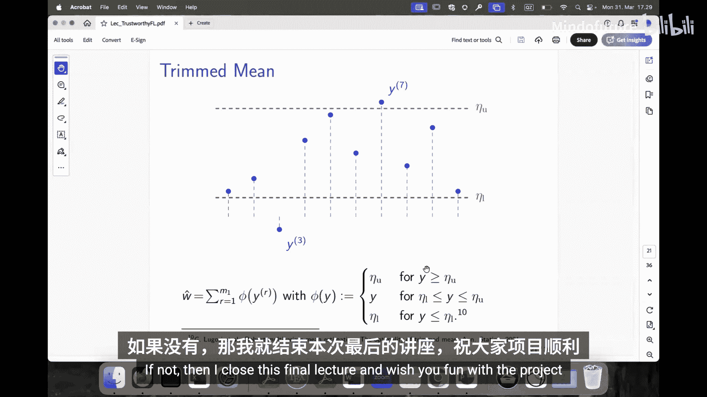
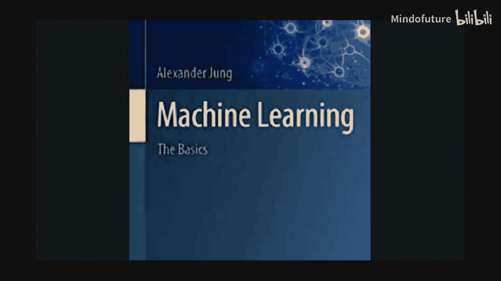

# 【阿尔托大学 - 中英】联邦学习 CS-E4740（Federated Learning，spring 2025） p42 P42 CS-E4740 Lecture 31-03-2025 -BV1cojRzDEfQ_p42-

Yeah， welcome， everybody to the final。Lecture within our course Feerated learning。 Can you hear me。

 please post something on the chat。Very good。So before I start with the actual lecture content。

 again， some organization organization update。Now that we reach the end of the basic modelss。

 like the six modules with lectures and quizzes， our assignments。

You will soon start to work on your project。And let me remind you again。We will have the。

 the following。Format for the project work。So， you will have。To prepare your project report。

Until 30 April。Using this template。 So we will provide you a template。这个。With instructions。

 detailed instructions， how the report has to be structured and what should be the contents。

Of the of the sections， of the individual sections。

 So please carefully read through these instructions。And yeah， I strongly encourage you to use latte。

To prepare the con the， the project report。 So we also prepare the provide the template as a tech file。

 text source code。 so you can directly or maybe even should start from this tech file tech template。

And prepare the report。Yeah， what else？Yeah， I also want to point out that you， you will find。

On this website， the， the review sheet。 So the， the review questions。And it might be a good idea。

 actually， to read through these review questions。 So to。

To prepare your report in order to please the reviewer。So that's the typical motor of Paramdi。

When you have criteria that are used to， to evaluate your report。Then try to。

 to meet those requirements that are。啊。Kind of defined in these review questions。So， for example。

 for the。For the introduction。We， we want you to clearly state the motivation for your federated learning application and to provide some。

Background for this application。Could be for this background Could't include existing。

 existing works or state of the art。 But please keep in mind that this is a project report。

 This is not like I don't expect you to provide a detailed review of the state of the art。

 So this is not like a real conference submission or a real journal paper submission where you have to provide an in depth。

Overview of the state of the art。 You should。 You should also keep the， the workload reasonable。

For this project。 Yeah， but again， I， I strongly encourage you also to。

 to look at this review questions。Which will then be used to peer grade and peer review your project reports。

Yes， any questions at this point regarding the project。

So you will then work mostly throughout April on the project report。

And submit by end of April after that， you will peer grade。

 peer review each other's works and get the。The feedback you so we will then release this peer reviews and peer grading to you and you should usestand this peer review to improve your work。

 That's the typical workflow in academia。 You get review。

 you get feedback and you improve your work based on the feedback。

 So the final submission will be a revised project report along with response letter where you explain where you have to explain how you took into account the the peer feedback or the peer reviews。

Okay， for the submission itself， we will use two different systems， unfortunately。

 I didn't find a better solution for the time being。

 So those who take the course as regular aler students who will get a credits in in the Aler system。

 you will have to use submission via my courses。 so we will prepare。

 It's called a workshop workshop activity。On the my courses page。首 here。

You will then have a section here， federated learning project。

 and here will then be a button where you have to submit by end of April。Okay。

 and also the peer reviewing， the peer grading will be done via this workshop activity。

For those and we have we have significant number of external students， actually， or participants。

 we will use a conference management conference management tool called E chair。

 which some of you might have actually already used for submitting papers to conferences to scientific conferences。

 So I got us I I created here。 let's call it a mock conference FL Alto 25。

 So it looks like submission platform for a real conference。

 but it's now used for our peer peer graded project。😊。

And we will soon send out invitations to the external part participants to join the。

 the program committee。 You need to be a member of the program committee to review other reports。

 And since we do peer gradings。 So we review each other's paper。

 each one of you needs to be a program committee member。

And I'm also happy to invite also regular autoto students to participate in this。 So if you want。

 youre also free to join this submission by easy chair。 However。

 if you want to have a grade at Alto and credit at Alto， you must also submit in in my courses。

 But what could be the benefit。 if you submit it in both， well， you get more， more feedback。

 you get more reviews。 And if you， if you use this project to pilot ideas。

 research ideas or draft for real conference papers。

 you can you get twice the feedback to develop your ideas and develop your papers。😊，Okay。

 but more details about all this nitty grty technical details for this submissions will be We will notify and inform you in。

 in written by email soon。Well we still have some time， as I said， the deadline is only 30th。

 So end of April。Okay， any questions at this point regarding the project。If not。

 then let's start with the actual course lecture topic today。

 which is trustworthy federated learning。Okay。Spkin mode。收。Within this course。

 you learned a simple mathematical model。For federated learning applications。

 And it's based on a network。 So we have nodes in the network which represent devices like a smartphone。

 which can access data like measurements that I generate。And which can train models。

 So we have at each node。 We have a local data set and a local model。And to train the model。

 we have a local loss function。 So those who are familiar with machine learning。

 that's basically all you need to do machine learning。 Give me data。 Or in the end。

 I only need a loss function。 a training objective， give me a model。

 And then I use some optimizer in Python or another programming language to optimize the model pa。

 That's federerate That's machine learning。 And now in federated learning。

 we have a copy of this machine learning task at each node。Okay， so far as so good。

 So what makes federated learning federated is that we couple。

 we couple these machine learning instances at these nodes via edges。

 So we have edges in this in this federated learning network。

 which are undirected and have an edge weight， So the weight a subscript I I prime is the strength of the coupling between the machine learning instance here at node I and the machine learning problem or machine learning task at node I prime。

So how do we do this， How do we couple？ Well， a very natural idea is we， we require or we penalize。

 we penalize。The， the training error that we would get by independently training each。

 each local machine learning model separately by a coupling term。

 And this coupling term is called generalized total variation。Or G TVV。 So in this coupling term。

 we add up the differences of the model parameters across edges。 And in order to make this small。

 the learned model parameters must be similar at well connected nodes。

 So it turns out that the solutions to this optimization problem are approximately constant model parameters over well connected subset of nodes。

So， for example， all these blue nodes get end up with the same model parameters after we solve this G TVV minimization problem and all the red nodes end up again with similar model parameters。

 But they might be different。 So the blue model parameters and the red nodes might be different。

 So in a sense， we obtain class device model parameters。

And we can think of this having identical model parameters as just a dual approach to pooling the local data sets。

 So we could instead of， of forcing these local model parameters to be identical。

By this GTV penalty term， we could also say， well， we know they are all similar and should train the similar model。

 So let's pool together all the local data sets of the blue nodes。 Store them on a hard disk。

 Shi them with a track to some data processing centre。

And this might be the best solution in some applications。 but what could be a challenge。

 what could be a drawback of this solution。🤧嗯。Directly pooling the the local data sets。Yes。Yeah。

 it might incur privacy leakage。 So you have to share all your raw data。

 and this might be sensitive healthcare data with some central processing unit。

 which you might not want to do。So the advantage of these approach of this。

 I call it the regularization approach is that now we can apply dis optimization methods。

 which only exchange updates of bottle parameters。Or， or or related quantities。

 But they do not need to exchange their， the， the local data sets。 And by the way。

 the local data sets do not appear directly here。 I just want to emphasize this。

 All we need to formula to formulate G TV minimization is a loss function。That's all you need。

 It doesn't matter how you construct in， in principle。

 It doesn't matter how you construct the loss function。

 This means that you can use whatever model you want。 You can use C NN。

 You can use transformer networks， and it doesn't matter what type of data you use。 if you use text。

 if you use video， audio。this kind of is all abstracted away， is hidden in， in a sense， in a。

 in a lower level in this G TVV minimization approach， all we look at is a loss function。

 How you get and how you construct this loss function is up to you。 And this， for example。

 is can be very different in your project。And this also allows， for example， to。

 to implement reinforcement learning methods。 So what's the difference between reinforcement learning and supervised machine learning。

The loss function， the reinforcement learning and plain supervised learning。 They use similar models。

 deep neural networks， the difference， the fundamental difference between reinforcement learning。

 which you use to control robots or test self drivingriv cars to control those cars。

 These are reinforcement learning methods。So， these methods。What。

 what sets them apart from a plane linear regression is not the model。

 It's how you get the loss function In reinforcement learning， you。

 you somehow must indirectly estimate the loss function using reward signals like from a collision sensor in a car。

Okay。Yeah， and then so this was the topic of the first two or three lectures。

 we learned how to model how to formulate federated learning application as an optimization problem over a network over a federated learning network。

 And this is what you also have to do in your project report。 So in your project report。

 one big part is to model or to formulate whatever federated learning application you have in mind。

 and there's no limits。 there's no limits to your creativity。

 You can pick whatever federated learning application you want。

 but you have to formulate it using the language that I told you in this course。 That is。

 you have to formulate it as a GV minimization problem。 But as I just try to convince you。

 this is very versatile。 So please please show me one federated learning application that intrinsically intrinsically doesn't fit into this framework。

Okay， and now after you have modeled your application as a GTV minimization problem as an optimization problem。

😊，It's very natural to， to develop algorithms by applying optimization methods。 I mean。

 all machine learning is optimization。And federated learning as a special case of machine learning uses specific families of optimization methods。

 in particular， distributed optimization methods。 And one such distributed optimization method is what I call federated gradient descent。

We， we also learned about other F federated learning algorithms like federated averaging or federated relaxation。

Federators stochastic gradients。 And I think that's pretty much it。

 We didn't talk about too many different ones because they share a lot of common structure。 And yeah。

I want to point out here that all these algorithms actually。

 and maybe I should have made an assignment about this。

You can write as such a a regular regularized machine learning method。

 So all the methods that we looked at in this course。

 they all can be written as node wise implementation。 So at each node for each node。

 you implement this arc min this minimization problem。 And this is nothing actually。

 but regularized empirical risk minimization。 So you can， you can。Craft or。

 or construct federated learning methods by using regularization techniques。

 So the only thing that that sets federated learning apart from machine learning is the way we construct this regularization term。

In particular， in federated learning， we used the， the model parameters of the neighbors。

To penalize the local training loss function。So that's all we need to do to couple the， the。

 the training at each device。OkayAnd that's I would say maybe， maybe the main。

 the main message of this whole course。 So you can implement federated learning by a specific way of constructing penalty terms for。

 for plain machine learning training。 So this， this minimization is exactly what is solved when you use a dot fit function in Python。

 A dot fit function for CNNs for convolutional neural networks。

 dot fit function for transformer networks。 This， this is typically already done for you。

 This is implemented。The， the way you make regular you make federated learning out of it is how you include this penalty term in the loss function。

So who， who of you uses a Python framework where you can easily add， add a term to the loss function。

Yes， which， which framework are you using。that's you， for example。Sk could learn， S could learn yeah。

But in in Set learn， is it easy for any， any model to add a penalty term。

 a free penalty term to the loss function， It's not， it's not， it's a bit clunky。

 So do you know another Python framework where it's easier to， to build loss functions。

 custom loss functions。Pytorch， I think as I understood。

 I don't code too much myself without ch Chiipy。So， but Pytorrch is really convenient in。

 and allows you a very flexible way to build loss functions。 So in Pytorch。

 I think you can build such a， such a penalty term easily。😊，But what if you say， well。

 I know S could learn well。 I don't want to learn pie torch。So is there an alternative way？

To implement such a penalty term in the loss function。Is there some dual way to do this by。By。

By hacking around with the data。Data augmentation。 Yes， and there was one，1 assignment。

 I think the first assignment where you， where you had to implement such a penalty term。

By data augmentation。 So this is the second， maybe the second main message of this course。

 you can implement regularization。Either by adding terms to the loss function， penalty terms。

 or there's often an equivalent way to add data points to the training set， data augmentation。

And it might be easier， for example， if you want to use Kki learnn。Sk it learn。

To use data augmentation。Because I， I， for example。

 I wouldn't know how to build in such a penalty term in a mara perceptron in Sky learn。But I。

 I know how to augment data data sets， manipulate a bit the data sets that are stored in an empirere。

呃。Yeah， so this is what I wanted to show here on this slide instead of adding such a penalty term or regularization term。

 which we need to couple the training between neighbors， you can also use artificial data points。

 like data points where you get the label from the neighbors from the predictions of the neighbors models or pseudo labels。

And use those artificial data points or test to augment your own training set。

 So this is a very elegant way。 because then when you work with this data augmentation instead of。

 of penalty terms。You don't need the parameters anymore。 So this。

 this generalizes easily to nonparmetric models。 because for this approach， you need to。

 you need to use a W。 You need to use model parameters。To implement this penalty term。

 But what if you， you don't know what the W is because you use a decision tree and there's no natural way to define model parameters of a decision tree。

Or you use， for example， you use at one node in your project， you find at one node。

 you want to use a CNN with five layers and another node you want to use a transformer network with 10000 layers。

So you use different numbers of parameters。 You cannot use this anymore here。

But when you use data augmentation and， and in this data augmentation。

 what you use are the predictions of the neighbor models。

 It doesn't matter how many parameters the neighbor uses。

 You only need to know how it predicts on a test set。

So what you learned in this course are federated learning methods that are model agnostic。 You can。

 you can use some of these algorithms， in particular。

 this fed relaxed algorithm for arbitrary collections of， of models。 So the devices， the smartphone。

 Some of them can run linear regression， other decision trees。 Yet another one runs CN NN。

 And still you can couple them via G TV minimization。Yeah have fleshed out this idea here a bit more。

 so what sets machine learning apart from federated learning is that you use the neighbors predictions or the neighbors model parameters to construct these penalty terms。

For your own model training。 But otherwise， it looks pretty similar。

 So I really want to convince you that this is only a small step。 I mean， conceptually。

 it's a big step。 But in practice， it's a very small step that you turn a machine learning method into a federated learning method。

 All you need to do is you need to somehow manipulate or augment the training data using information from somebody else。

And by doing this， you couple the model training at those two devices。 for example。

 here with just an I P address。Again， I want to emphasize that we ignore many details。

 So I just assumed that this device has an I P address。

 But how do you make sure that it's connected to the other I P address。

A lot of details that we silently ignore or proudly ignore in this course。

 So I strongly encourage you to use now this conceptual knowledge from this course and then apply to using the techniques。

 you learn in some other networking course or designing network or how is it called mobile computing。

 Don't know what are the current main courses here。😊，Yeah， okay。

 that was just a quick summary of the whole course， maybe。And today。

 we talk about another component in federated learning。 So so far， we。

 we mainly talked about technical components like the models， the loss functions。

 optimization methods。But in the end， the main component of machine learning in a particular federated learning is the human。

 Are we the human user， So we should， we should take the user into account when we design systems。

 And this is my main message for today。 So I want to tell you at least that you once heard the key requirements for trustworthy AI。

 as formulated by the European Union。And then I want to show you how you can ensure some of these requirements。

 again， using specific design choices for G TVV minimization， for example。

 using specific types of models or using specific network structure that are more robust than others。

Then we talk about differential privacy as a measure for privacy leakage。

 and the final part will be a short brief introduction to how to model explainability of federated learning。

Okay， so let's now start with the key requirements for trustworthy AI。

According to the European Union， why is trust with the AI also relevant for federated learning。 Well。

 federated learning systems， they are， they are kind of the engine or the implementation。

 They are used。 many of them are used to implement AI services。

 and one one such AI service could be YouTube music or some music streaming app。

This is an AI service， and I am the user of such a streaming app， and I consume predictions。

 So how do I consume the predictions well in a very subtle way。

 Because I get feed suggestions or recommendations in my feed。

 And I consume them by either using them， playing the music or ignoring them。

And these predictions are typically delivered by a personalist model。

 So these streaming streaming services， they want to train a model that is tailored to Alex。

 for example， to best know his taste for music。And also to best know how to impress him with new recommendations that he wouldn't know before。

So， but still， yeah， since federated learning is used to implement AI， anything that applies to AI。

 anything regulations for AI also translate into regulations Feerated learning。

And I just listed here these seven key requirements for the sake of you hearing it。

 so there is the first key requirement， human agency and oversight， the second key requirement。

 technical robustness and safety， the third is privacy and data governance。

 the fourth key requirement is transparency， which includes explainability。

 The fifth key requirement is diversity， nondiscmination and fairness。

Key requirement 6 is societal and environmental wellbeing。 and the seventh key requirement。

 which is the most mysterious to me， is accountability。

So how many of you have heard about these key requirements yet。O。

 how many of you have heard about the key requirements， not from me。Okay， very good。Very good。

 So now if you have heard more about these key requirements。 I mean， we。

 we are all all busy with engineering systems， characterizing and optimizing methods。

 making machine learning algorithms faster。 But I think it is more more and more important that we are aware of。

 of some of these requirements to ensure that the systems work for us humans and not the other way around。

😊，呃。Yeah， I just want to point out for those who start again to bash European Union and this feish for regulation。

 there are similar similar initiatives at other places on the planet like Australia formulated  eight。

 eight， one more then7。8 artificial intelligence， ethics， ethics principles。

There's believe it or not， AI ethical principles by the US Department of Defense。Also。

 the UNESCO published recommendations and the OECD。Okay。And I。

 instead of now working through all of them， some of which I don't understand， really。

 or they are not in my in my domain of expertise， like accountability， I focus on three of them。

 which is the robustness， The privacy leakage and explainability is。

 as I'm mostly familiar with them， which doesn't mean that they are the most important ones。

 It's just what I can， what I can offer you。Okay， any questions at this point。Not robustness。

So I would like to， to illustrate robustness， first of all。

 by reducing the complexity of federated learning significantly。

 And I say I have a federated learning network with a single node。

 which means I have a machine learning problem。So any。

 any requirements for robustness in in federated learning implies requirements for machine learning。

 because machine learning is a special case。 and maybe the most simple federated learning or special case machine learning problem is the following。

 I give you a list of numbers。 A sequence of numbers。 And you have to estimate the average。Or I。

 I also tell you that these numbers are drawn from some probability distribution。

 and you have to estimate。The expectation or the average the。

 the expected value or the mean of this probability distribution。What's the best way to do it？

 So this， this is， I would say， the mother of all machine learning problems。

You can formulate this as a machine learning problem of learning a single weight parameter or a single parameter of a linear model where the feature is always one。

So a trivial， a very trivial model。 But you can at least capture this mean estimation problem as a machine learning problem。

 So what's the best way to estimate the mean。Of the underlying distribution， which you don't know。嗯。

What would you do， How would you estimate the mean。Yes。Take the median of means。 Yeah。

 any simpler approach。What would be， what is your first guess when you。

 you have a sequence of 10 numbers and you want to estimate the mean of the underlying probability distribution。

🤧。Take the average。 Yes， yeah， take the sample average。

 Add up all the numbers and divide by the number of numbers。Is this the best approach。Well。

 if you're a mathematician， you would ask， what do you mean by best？😡。

So if you fully trust the data source。And say， these are really。

 These are really exactly with absolute precision。 These are realizations， I I D。

 so statistically independent and identically distributed realizations of one underlying probability distribution。

And if you say if， if you subscribe to this assumption， then the， the average， I think。

 is the best estimator in a very strong sense。The best。But there are a lot of assumptions。And that's。

 that's the， that's a key problem in machine learning。 You， you observe data in the wild。

 Like why are they in scrolling around the Internet， Like。

 I find those numbers somewhere on a data repository hosted by some Austrian。

 So who knows if he's or she' is trustworthy。呃。And this maybe you should do。 I mean， a bit of， of。

 of being careful is is good。 I mean， if you have no trust at all， I think we would not be able to。

 to survive。 So we would not be able to live。 We need some basic level of trust， but。Trust is good。

 but sometimes control is better。So， and here we can use mathematics。 So here we can use again。

 Maematics use a mathematical model to model our lack of of trust。 And we say。

 this Austrian repository there is not really trustworthy。 let's say some we。

 we cannot be sure if a fraction of 10% of the data points are completely arbitrary changed。

 So somebody poison the data。So I have marked your two data points， which I arbitrarily changed。And。

But nobody tells you which data points have been poisoned。 The， the。

 the one who poisons it has great fun in， in hiding these intentions， in hiding the poison。

 the poisoning it， Nobody tells you which one are poisoned。😊，So， if。

 but if we assume now that the data comes from a regular distribution comes from an honest data source。

 but it is manipulated by 10% data points can be changed arbitrarily。 and also this。

 this poison data points can。Can depend， can depend on the statistics of the。

 of the clean dataset set。 So they， they a trans cyber criminal。 So to say。

 can analyze the statistical behavior of the clean dataset to very carefully， very。

 in a very clever way， choose the data points to poison。This is called the， the adversary setting。

This is different from a simpler or a more easier setting from the perspective of defense。

 where somebody can pick randomly does randomly， picking 10% of the data points and changes it randomly。

And this randomness doesn't depend at all on the statistics of the clean data set。

 So it's a bit of a more stupid poisoner from Austria。 He just randomly picks 10 data points。

 and randomly change his step。But here we have a more dangerous。

 a more sinisterister poisoner who can study the clean data set。

 analyze it and somehow anticipate how how would the one who estimates the mean use this data and take this knowledge into account to poison the most the most detrimental data points。

So in this adversary setting， what do you think is the best strategy。

 It's not taking the mean anymore。 I can tell you。What do you think intuitively。How。

 how would you approach this when you say when I give you a sequence of2 for，5，10，10 numbers。

 and I tell you， two of them are poisoned。What would be your intuitive strategy to estimate the mean of the underlying distribution through this distribution。

Yes。Yes， so one one very good comment was a suggestion was to take the outliers into consideration。

And this seems reasonable。 Just I want to point out that。They。

 then asked the Austrian poisoner might know this intention。

 might know this intention and not touched out class。Yes。😊，The mode yeah。 So use use some。

 some other statistics that mean like median or mode。 Yes， yes， also， but still the， the。

 the person I might know this that this is your strategy。嗯。嗯哼。😊，Okay。Yeah。拜拜。Yeah， I mean。

 the only thing they could do with these two data points is to make it very different。

 So to make these two poison， these two red data points very large。But then you would。

 you would succeed in this outlier detection。 So the only way to hide from the outlier from the， the。

 the outlier aware learner or machine learner would be to put them not in the outliers in the middle somewhere。

 But then they don't hurt so much。So this， this hint already that actually it's the best。

 the best approach is to find the outliers， avoid the outliers and take the mean of the rest。

And this is called trimmp mean。The trimmed mean approach and yeah。

 I have shown here included here a reference to a recent paper from 2021。

EAn nice mathematical paper from the Ana of Sta， where you find the proof that this is optimal。

So when you know that a certain percentage， let's say 10% of data points can be poisoned and arbitrary。

Then the best way is to avoid the top 10% data points， the lower 10% data points。

 which could be outliers and take the mean of the rest。

 This is called trimmed mean or variant of the trimmed mean。

 And it turns out this is the best you can do。And this is different。

 but this is a different optimal strategy than from what you should do in in the lazy poisoner scenario。

 So the lazy poisoner doesn't carefully pick the data points。

 but very stupidly just every10th data point or randomly selects 10 data points 10% of data points and changes them randomly without taking into account the distribution of the clean data points for such a more stupid poisoner。

 the best defense strategy is using the median as has already been pointed out。

 So the median is any value such that the number of data points above this is the same as the number below it。

And it turns out that this is much， much more robust than taking the average。Take the median。 I mean。

 you can easily confirm here， for example， if this is the median of this data set。

 and if you pick any of these data points above and make them arbitrarily large。

 it doesn't change the median at all。So the median is completely immune to these extreme values。

However， it turns out to be suboptimal， to be not optimal when this poisoner can analyze the clean data set and try to hide behind the out behind the actual outliers in the。

 in the clean dataset there you should use the trim mean。Okay。So。

How how is this relevant now for federated learning， this simple problem？ Well。

 I have I have this was there also one of the main ideas to， to。

 to break down or to reduce federated learning to this regularized or regularization point of view。

 because this here is nothing you can rewrite this optimization problem actually， as。

A mean estimation problem or for vector value data points。

 And that's how you can basically translate or or you can guide。

 you can inform how you chose this or how you modify this in order to have a similar behavior as for this simple mean estimation problem in particular。

 It's not too difficult to then get the idea to use not the the squared to norm。

 but use the use only the norm。And this， this， this could be motivated by recognizing or by remembering that the median。

 the median is the opt is the solution of this minimization problem。

 So you can write the median as the minimum every absolute error loss。

The minimum average error loss estimator。 So this， this is the same or similar to linear regression。

 Lineal is square regression， except that you use here the absolute value instead of the square of the prediction error。

And similar， we can make federated learning more robust if we use the， the norm， the Euclidean norm。

 instead of the squared Euclidean norm here in this total variation term。Okay。

What could be a disadvantage。 So from a robustness perspective。

 it seems to be not good to use this square Euclidean norm。

 And we should rather use the Euclidean norm。 What， Why， why could it be。

What could be a drawback of using this Euclidean norm instead of the squared Euclidean norm？Well。

 for example， we cannot use gradient Tscent anymore。

 The this Euclidean norm is a non differentiable function。

So you cannot use the the gradient decentscent algorithm anymore。 You must use another algorithm。

 like F Re。Which might be computationally， more costly。

 So you buy or you must invest more computation to get more robustness。Okay。

 any questions at this point。Yes。Yes。😊，要。Yes， so the， the question was， how how。

 how does this translate to nonparmetric methods or nonparmetric models， Well in nonparmetric models。

 we don't use the difference between the weight vectors。

 but we use the difference between the predictions on a test set。

 And then it depends if we use the square of the difference or the absolute value of the difference between the predictions on the test set。

So instead of this W， you have here the， the output of the， of the trained models。

 So you would have here。The current model at Nodi。Applied to some feature vector， in the test set。

And here you would have the current trained model on Enote I prime。Applyed to the same data point。

And then， of course， the question is， how do you compare this， You， You need to get a loss function。

 typically non negative。 So you can either take the square。Or you can take the absolute value。

 And from a robustness perspective， it seems to be better to use the absolute value here。Okay。

 any other questions or comments？So bottom line here is for robustness。

 it might be better to use non differentiable loss functions。

Like the absolute error loss or the Euclidean norm for vectors。And yeah， you get more robustness。

 but it。Computationally more complex。 So I， I also welcome you to。

 to try out compare this least absolute error regression or Huber regression。

 It's also known as Hober regression with least square regression， And yeah， fit。

 fit those models in Python on the same data and take the time it takes for the computation。

 and you will see significant differences。 So here you need non smoothth optimization methods。

 which are typically much slower than methods for smooth optimization， like gradient descent。

 which you can use if you use as squared error here。😊，Okay， any other questions， Nothing。

 then let's move on to privacy leakage and privacy protection。Yeah， again。

 here this basic show here this basic step of the federated learning algorithms from the perspective of some node I。

 for example， me， let's say Alex is node I。 So I get model parameters from Mico。From Miko。

 who is has also a smartphone with the federated learning algorithm running。

 and we all of a sudden have a Bluetooth connection。 And then I also get from Salva To。

 I get also his model parameters， and I can use those model parameters to build a regularization term for my model training on my smartphone running Python using Set learn。

😊，Okay， and then， of course， I get something from my neighbors。 So I should also give something back。

😊，Of course， I then share my new model parameters with Miko and Salvatoa。 So they can。

 then in the next round， use my model parameter for regularizing their local model training problem。

😊，And yeah， it's important to note here that there's an information flow into device eye from the neighbors。

 But from a privacy perspective， what is more difficult or more， more critical is there's a flow out。

 So I send my new model parameters to the neighbors。 So， and at some point， they leave my。

 my safe space。 So to say， which is my smartphone。To some extent。So the question is。

 how much information， How much sensitive information about my own data。

 Let's say my latest blood pressure measurements。Is leaked to Salvatoia ormiko。And。

How can we measure this here we again appeal to probability theory So one way to measure or to make this to make this question precise。

 I mean， this question， how much sensitive information does this parameter reveal about the data set about my data so we we need to make this more precise and we need again mathematics for this or we use mathematics in particular。

 we model we model the output of the of this update step at my node。

 So this update at node I produces a new model parameter Wi at iteration K plus one and we model it as a random variable as a realization of a random variable and the distribution is what could what could leak information。

 So based on this distribution So we use many rounds。

 we can then use some estimation methods to estimate。Distribution。

 the probability distribution of this random variable somehow。

 And this allows Miko or Salvatore to somehow infer something about my blood pressure。

Values or measurements。And the question is， how much。And to measure this。

 we could say we could think of an experiment。 So let's say I have two different instances of my local dataset。

 Let's say my local dataset consists of blood pressure measurements of the last 10 days。

 and want I want to characterize if salvattore is able to tell if I have a high blood pressure or not。

 So what I do is I look at two different instances。

 two different possible choices for this blood pressure measurements。 D and T prime。

 and they differ only in one value， which is either high or low。

 So high blood pressure or low blood pressure。 And these two different instances kind of carry information。

 if salvattoy would be able to find out if it was D or D prime。 he could infer。

Alex has a high blood pressure or not。So the question is。

 does the distribution of the output of the federated learning algorithm significantly change。

For these two different choices of the local data。That's the key idea behind differential privacy。

 So that that model is known as that's the the mathematical model underlying differential privacy。

 So in differential privacy， we， we want we， we， we， we prefer or we。

 we want to ensure that these distributions are as similar as possible。 in particular。

 we want to make sure that there is no， no test， no statistical test that Salvato could ever use。

To tell if the data set was D or D prime。Or in other words。

 that salvatore could tell if the blood pressure was low or high。Yeah， I indicate this test。

 this statistical test here， just by some region。 In the end。

 a statistical test is characterized by the region for which it delivers， yes。And if it's， if。

 if the， the， the measurement， in this case， the model parameter is not in this region T for test。

 it says no。So it's a binary binary hypothesis test。And differential privacy tells that。

Any method you use for this test。 So any choice for this， let's call it acceptance or rejection。

 its equivalent rejection region for this test， whatever you use。

 you will get the similar probabilities， similar behavior。 if the local data set is D or if。

 if it's the prime。Okay， that's， that's basically the story behind differential privacy and the advantage is。

 I mean， it， it's a nice mathematical model， and it gives it， it allows you to。

 to somehow measure up privacy protection。But the practical relevance， I would say， is。

 is still debatable， so。For example， what what's the meaning of this epsilon。

 If I tell you that I have a federated learning algorithm that is differentially private with epsilon。

 So smaller epsilon means lower privacy leakage。 So very small， like 10 to the power of -8。

I don't know what this means in practice。 So I still have a hard time to。

 to grasp the practical meaning of this。 Does it mean that Salvatore will be able to tell if I have a blood pressure above 1 hundred80 or does。

 does it allow him to distinguish between blood pressure 140 and 145 and how， how。

 how often do we need to， or how long do we need to use the federated learning app that the chance that he will correctly detect it will be at least 90%。

So very practical questions or practical characterization of differential privacy is。

 is still a bit weak for me。Yeah， so the question was now how can we manipulate epsilon and Dlta and yeah that's the nice thing about differential privacy。

 you can control it by adding noise so you can you can make you can ensure a certain epsilon and Delta by taking the output of whatever algorithm you have that you want to make private。

 privately protecting and adding noise。So you just put noise， make the result more noisy。And the。

 the amount of noise depends on this epsilon。 So the smaller you want epsilon to be。

 So you want the differential privacy guarantee with a small epsilon。 The larger the noise has to be。

 And the noise also depends on the sensitivity。 So the sensitivity measures。 How much does this。

How much does the the model output or the method output change if you change the data set a bit。

 I mean， this is clear if， if the date， if the output wouldn't change at all。

 you have perfectly privacy protection， because you could never distinguish between a data set having high blood pressure measurements and low blood pressure measurements。

 because the output is always the same。But that's a bit trivial。

 So in order to be perfectly privacy protecting， don't do anything。Don't do any learning。But this is。

 I guess this is not what we want in a federated learning course and what we want to do with the techniques that we learn here。

 So we want to learn from this data set and to this end， the， this mapping here from you can。

 you can think of this， of this federated learning step as a map。

 It takes in this data and outputs the new model parameters。 and it will have some sensitivity。

 But the smaller the sensitivity， the better from privacy protection perspective。Yeah， and again。

 how， how can we， how can we tune the sensitivity。It's again， wire the。

 the choice of local loss functions。 So if you use local loss functions。

 which are very have a high curvature。This might， I'm not sure。

 but increase or decrease the sensitivity。 So this is something one one would need to work out then in detail。

 but in general you can shape the sensitivity by using different choices for the loss function or adding additional penalty terms like regularization terms that don't use enable neighbors。

 but only use the local model parameters in order to make the sensitivity smaller。

 the smaller the sensitivity， the more private algorithm is。P。嗯ん。Any questions at this point？

So that's about privacy protection， yes。Yeah。对。is with in w new。Excellent， yes。Yes。

 there's a typo here。 There should be this probability on the left side is taken with respect to underlying dataset is D。

 and on the right side， the probability is taken when the underlying dataset is d prime。

 So using different local dataset sets induces different distributions。

 So we we think here in in this differential privacy model。

 we think of the local data as a parameter of a probability distribution。

 The local dataset parameters the probability distribution of the the updated model parameters。Okay。

Last last key requirement is I want to talk about this explainability。So， again， you the basic。

The basic federated learning step， we get motor parameters that you can use to predict something。

In your federated learning application。 So how， how can you measure the explainability of a model。

Does any one of you have an idea on intuition how to measure the explainability of a machine learning model。

 not necessarily federated learning。 So anything that has tuniable model parameters。

When is a machine learning model explainable to you or for you。Yeah。

 so telling something about the the working of the model， how how， how it uses the， the features。

 what the weights are for the features。So in general， an explanation is， is。Is some text or。

 some communication， some form of communication that allows you to understand the model better。

 But how could you measure the effect of explain， of an explanation。Yes。😊，一。好的。嗯哼。😊，嗯哼嗯哼。😊，Yeah。

 that's one one popular form form of presenting explanation。

 So one form of communication is shape values。 But my my question now is how。

 how do you measure the usefulness。 So let's say I， I provide you to Sha values for a given model。

And you feel that you understand it better。 But how can we measure this objectively that an explanation was useful。

 And I like， I like it this analogy with teaching。 Like now。

 my job is to teach you federated learning。Or in other words， to explain to you federated learning。

So how do I measure， How do I quantify， how good my explanation that is my teaching was。What's。

 what's the typical way a teacher measures the effectiveness of his or her。Explanations。

And then exam， yes， with a test。And this is what what I use to。

 to develop this concept here of measuring explainability， using a test set。 So you。

 you provide the user， for example， you or me， whoever uses the fedated learning app。A set of small。

 a small set of data points。 like if you want to predict an object or detect an object in an image。

 you present a small test set and let the user label those images。 Is there a cat。 Yes， no， yes， no。

So this， this is what I call the user signal。 And you compare the user signal to the predictions of your model。

And the more you， you resemble your predictions， resembles the predictions of the model。

 the better you understand the model。That's how I， that's one way to， to measure explainability。

And the nice thing here is that's also a subject， subjective a measure of subjective explainability。

 because every user might provide different user labels。😊，On this test。 So you could measure how。

 how much is the bottle expable for you， Bico or for you， Salvatore。And another advantage is。

 if we measure explainability like this。Well， it looks like a regularization term。 It's again。

 as add on to the loss function so we can， we can enforce explainability by adding this discrepancy of model predictions with the user labels on the test set。

😊，So the design choice here we use is basically the loss function。

 instead of the original loss function， we augment to a new loss function that includes also this explainability measure and the explainability measure is nothing but the difference between model predictions and user labels on a test set。

嗯。That was a question or a comment。Yeah， sharp or lime techniques are also widely used for explanations。

Yeah， but my， my interest was into measuring the explainability。 And for this。

 I used this test or a test， similar as I use tests for the students in my course。Well， not anymore。

 I I refrain to use written tests。Okay， any questions or comments at this point。

 I this clear to you now how this works？ok。Yeses。打。嗯哼。😊，Yeah。Yeah。Yeah， yeah， very good。

 So the comment was， how can we in this approach， How can we handle how how is it called to set a specific name？

 So when when a model focus when a object detection model or method focuses on the background。

 like it predicts husky whenever there is snow in the background。

 no matter if there is a husky in the image。Theres a specific name， which I forgot this behavior。

 But how can we， how can we handle this？ Well， it's in how we， how we craft this test here。

So in this test set， you could build in like images where you have the same object lets husky。

 but for different backgrounds。So by carefully crafting this test set。

 you you can mitigate this model behavior。Because then if you integrate such different backgrounds。

 but the same object in the test set and you label it correctly then so you provide the correct labels。

 then you force the model to also follow this correct labeling。Okay， but yeah， I'm。

 I'm very surprised that that you didn't to see not。

 not more confusion now because it seems very abstract in the beginning， this approach。

 So subjective explainability test b， b， bh， bh So how do I do it in practice。

 So that's why I want to show you a very specific example。 And you find also a link to this example。

 Python code for this example here on the slide。And this example is my favorite machine learning problem。

 which is weather prediction in Finland。So you have data points being days in Finland。

 which are characterized by a minimum daytime temperature is the feature。

 This is what you measure in the morning when you wake up。

 you see there's a lot of snow and it's sunny and you want to know the maximum daytime temperature because you want to know if you put on the big wooly pull over or not。

So I have a bunch of data points。 and I fit the model。 This is basic machine learning。

 machine learning， imppeula course， machine learning。

 We train a polynomial regression model on this training set。

 and we are happy because we get almost zero training error。 Do you like this trained model。

 this polynomial model。😊，No， no， why not。Why is it overfited？Yes。嗯，O。辩论这。那然后下。Yeah。对呀。Okay。

 anybody else， why， why don't you like the trained model just from looking at the shape of the model。

😡，Not too flexible。 And also， what I find a bit disturbing is has an area where the max。

 the predicted maximum daytime temperature decreases with increasing minimum daytime temperature。

So my intuition， my the user label would be， or I test it would be if I increase the minimum daytime temperature by plus  one degree。

 also the maximum should change by plus 1 and similar， if I decrease by-1。

 the minimum daytime temperature， also the maximum daytime temperature will be smaller by -1。

And this is how I construct the test set。 So the test set is obtained by cloning each original training data point and adding plus one for the feature。

And then my my user label is also the label should increase by one。And now， all of a sudden。

 I get when I train a model then using this additional term， this explainability term。

 which in the end， is nothing but the average loss on the augmented dataset。 So in the end。

 what I do is data augmentation。I just call it subjective explainability， because it's cooler。

A fancier name。 But in the end， what I do is I use my user signal on my intuition。

To construct to augment a training set。 And now what you see when I train the model again with the same degree。

 it's monot， monotonically increasing。 So at least I got rid of this strange behavior of decreasing maximum temperature when the minimum temperature increases。

And but this was a very simple user test set and user labels。 And there you could。

 you could bring in all the experience。 So when you talk with a guru from the Finnish Meteorological Institute。

10 years old，90 years experience of weather forecasting and temperature。 So they。

 they know in this area when youre in this minimum temperature range。

 you should add plus two degrees for the minimum temperature and plus one for the maximum temperature。

 So here you can bring in all all the domain expertise。But in the end。

 this is what I think what what explainability is about。

 So you make sure that the trained model agrees with your predictions on a。

 on a carefully selected test set。 and this carefully selected test set here was adding plus on-1 degrees to this existing data points。

O。Yes， that's it， that's it with the actual content。😮，So that was the final。

 This was the final of the six lectures。 There was one。Comment。Let's skip this。 Yeah。 And next。

 the focus will be。 yeah， of course， you have to complete the the assignments， I think。

Deadline is today or tomorrow for the current two assignments。Today， today。 So tomorrow。

 we will share the reference solutions with you。 and then you will work on the last two assignments。

T I think in two weeks of the deadline。But in April， the focus should be， of course。

 working on the project。 And yeah， I want to highlight again that we have two project garages。

Scheduled now in Zoom again。Which will be on。14th April and 21st April， at the same time。

 quarter past 4， but then only in Zoom。 So I will not sit here。Any。And yeah。

 please do not hesitate to reach out for help by email or on the slacklack channel for the reports and for the project work。

 And yeah， again， please don't overdo in in this reports。

 It's nice if you're enthusiastic and you want to develop like a first trial for a conference paper。

 but please keep in mind the workload for this course。

 which should be for five credits in total 120 hours of work。And this includes the assignments。

And the project。 Yeah， and also want to remind about the potential substitute task for the assignment。

 So you can also do a paper review so you can choose a paper from this list here。

 I have compiled to a list of relevant papers， and you can develop a a review of this of one of these papers and present the review as in。

 in the form of a presentation。Where's the format。Here's the format。

 So I require them from you a slide deck and a recorded slide talk where you present your review and the talk has to be maximum 10 minutes。

Yeah， the， the deadline is。Ongoing， whenever you want to have the grade。

 send me your review or presentation of the review。Yeah， any question any questions from your side？

No questions。Yes。😊，Yes。Very good point。 So the question is。

 good now that we know what the optimal method is or or the idea of the optimal method is the trim mean。

 but this trim mean needs the maximum percent the percentage of poison data points or an upper pound。

 So you need an upper pound。At least， but what happens if you， if you don't know an up or if。

 if the actual number of poison data points is， is larger， I don't know what， what's then optimal。

 I guess you。Yeah， how， how would you define optimal methods？ But yeah， very good to， to remind me。

 the string mean is optimal， but only optimal when you know the。

 the maximum percentage of poison data points。Then， and only then all the， the， the nice。

 the nice results and performance analysis developed in this， in this mathematical paper applies。😊。

Only Daniela， but nobody in practice， nobody tells you the about。And， I mean。

 there must be trivial there must be natural limits。 if， if all data points can be manipulated。

 there is no way that you can learn anything useful。 That's if everything is manipulated。

 all the training data is manipulated， then。嗯。MaybeMaybe you just change the mindset and you say the manipulated data is the actual clean data。

I don't know。 Yeah， it， it doesn't make。嗯。I would say a natural limit would be 50% if you can change 50% of the data points。

Den。😔，You can never distinguish between two different possible clean， clean distributions。

But that's only speculation， yeah。I， I don't know what the I don't know about precise statements。Yes。

But。Yeah in practice， you always need assumptions for for an analysis for a mathematical analysis。

 without assumptions， it'ss difficult to make useful， useful analysis。P。And。Yeah。

 any other questions。Yeah。We are in the case of a vegetable hacker and ra。Very good point。 Yeah。

 also I think so the question was， how do we know in which setting are we。

 So do we have this totally random poisoning where the median is is best。

 or do we have this adversarial setting where the twin mean is is best and I don't know I think in practice it heart。

 Its hard。 Maybe you can， you can detect， So you can do。

 you can formulate this as a binary hypothesispothesis testing problem。

 Hypothesis one is there is a lazy poisoner。 Hypothesis2 is there is a very sinister poisoner who adversarily changes the data point。

But yeah， that's actually interesting。 I didn't look into， into this， yeah。Thank。

But it's more likely to be not like some actual person。

 but just something random happening problems with the。Let me some yeah。

The system is otherwise secure if you know it may goes through right。

 then we could that there's no actual adversary there's just random there yeah。嗯。

Would be actually interesting maybe for the next course edition to invite somebody from。

 from companies who who work on these professionals like I think F secureure is。

 is a big company here in Finland。But maybe they won't share too much details also。Okay。

Any other comments or questions。If not， then I close this final lecture and wish you fun with the project。

 Thanks a lot。

