# 001：从零实现LLM的强化学习训练

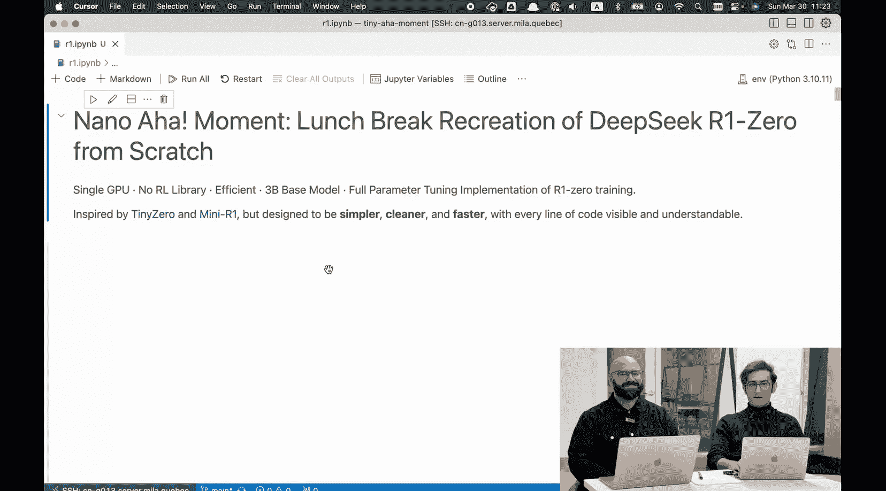


在本节课中，我们将学习如何从零开始，高效地实现类似R1的训练。我们不会使用任何外部库，而是展示如何以非常高效的方式在单文件、单GPU上实现这一过程。我们将使用一个30亿参数的基座模型进行全参数微调，整个过程预计在10小时内完成。

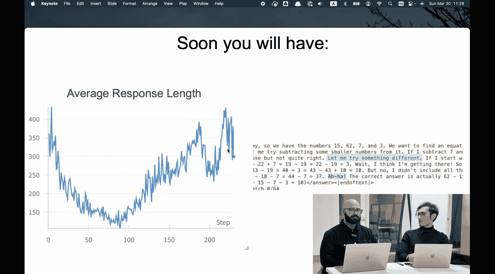

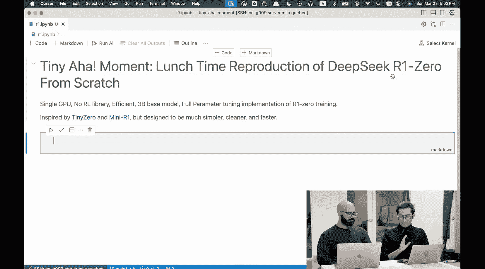

## 为什么需要另一个脚本来重现R1？

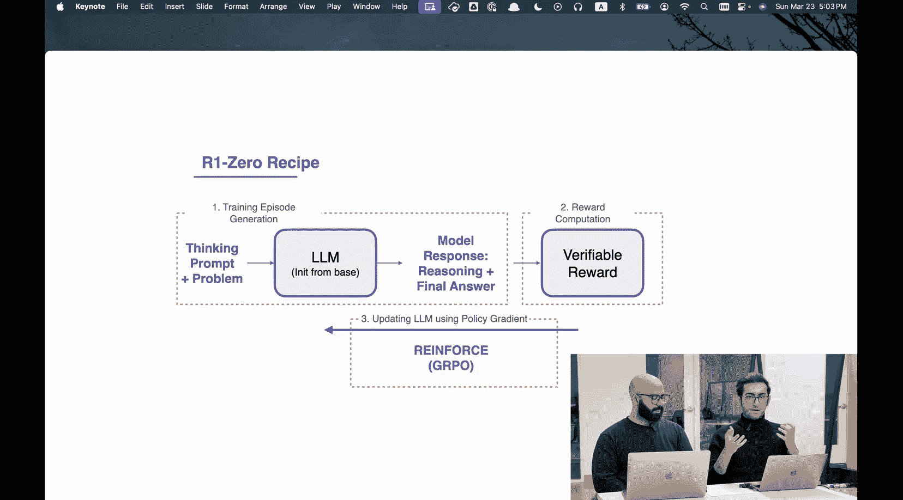

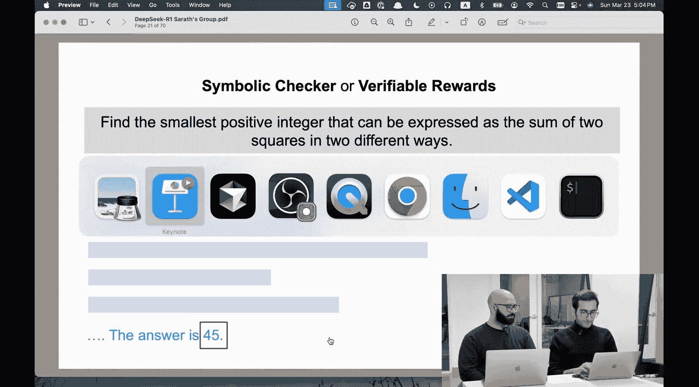

目前已经存在一些实现脚本，但大多数要么从Transformers库导入训练器，导致代码不够模块化且不易修改，要么虽然高效但基于Ray等复杂框架。这些框架对于工业应用可能有用，但对于学术目的来说过于复杂，因为它们需要处理多节点和任务失败等问题，而在单GPU场景下这些问题并不存在，却引入了不必要的复杂性。


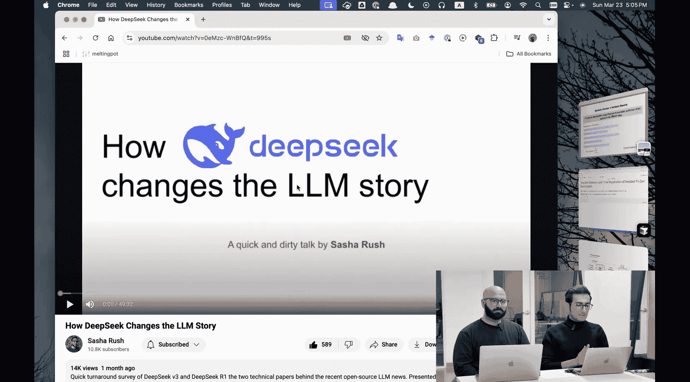

诚然，这些库的存在有其合理性，因为高效的RL训练依赖于高效的训练和快速的推理，并将两者无缝结合以发挥最大潜力，这本身就需要一些优化技巧来实现。然而，在本视频和代码库中，我们将展示RL训练中最具影响力的技巧和优化方法。

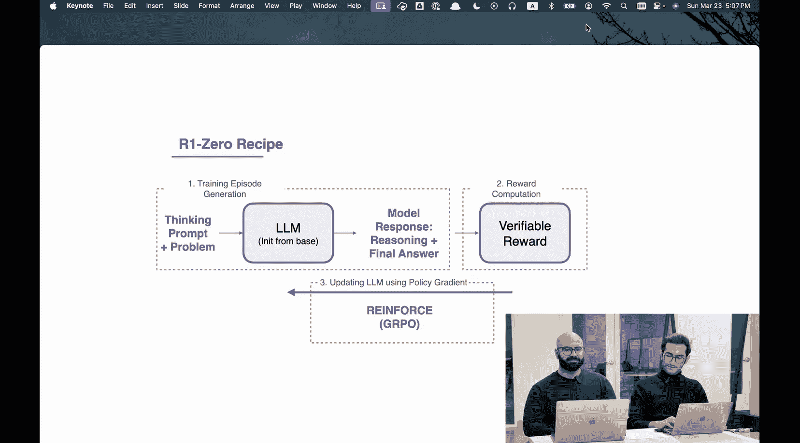

## 本教程的目标

我们将使用Qwen2.5-3B基座模型，在“倒计时”任务上进行训练。这个任务要求模型使用四个给定的数字，通过基本算术运算（加、减、乘、除）构造一个等于目标数字的等式。我们将使用GRPO算法进行训练。

最终，我们将训练出一个模型，它能够重现那些在预训练基座模型上进行纯RL训练时涌现出的有趣模式，例如自我反思、自我验证和回溯等。我们还将看到模型平均响应长度的变化曲线，这是一个在此类训练风格中常见的现象：在最初的几次迭代中，模型会学习遵循格式并理解任务；之后，它会利用其“思考”预算（思考令牌）来实际提高其问题解决或推理能力。

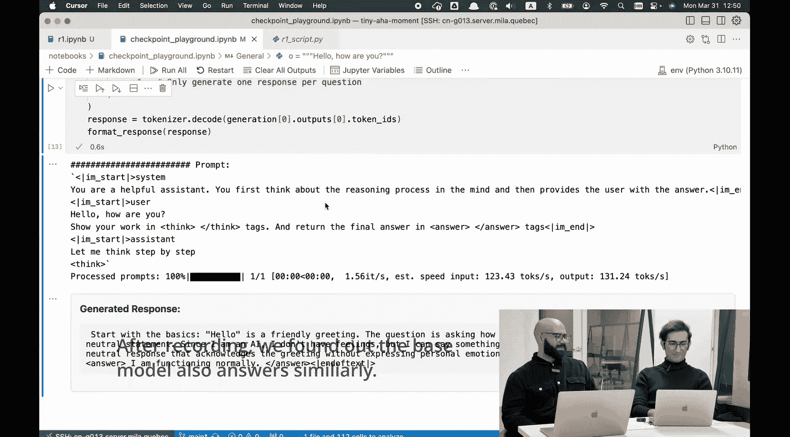

本视频的目标是详细讲解代码实现。我们将从一个干净的文件开始，从头实现所有内容，并确保涵盖每一个有用的细节。这将是一个长达数小时的教程，希望你能从中有所收获。


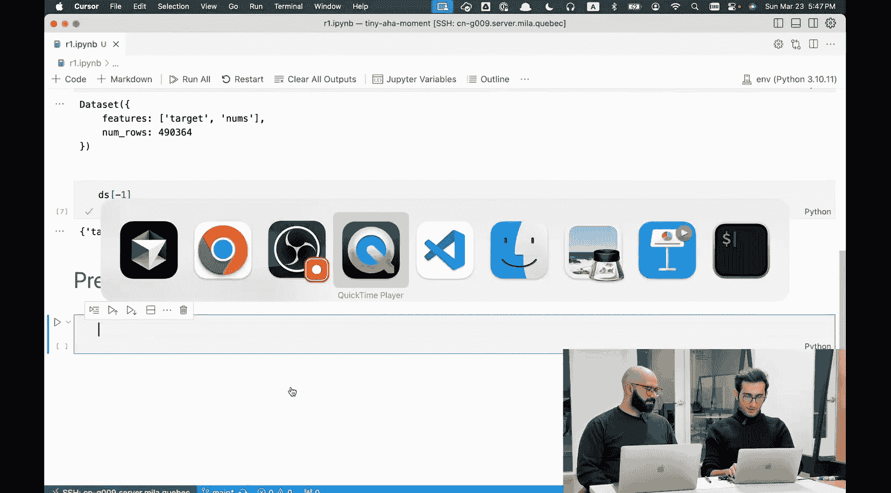

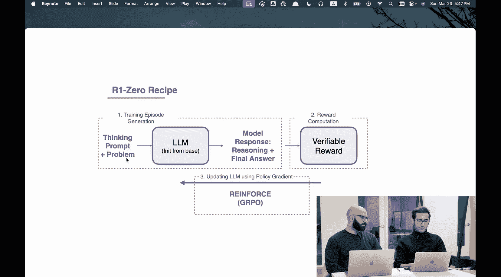

在深入实现细节和代码之前，我们首先介绍R1的训练流程，以确保所有观众都理解其基本原理。


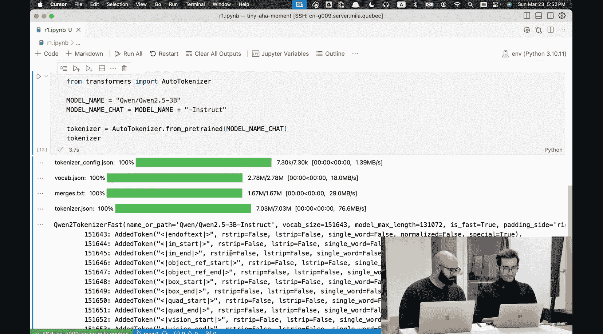

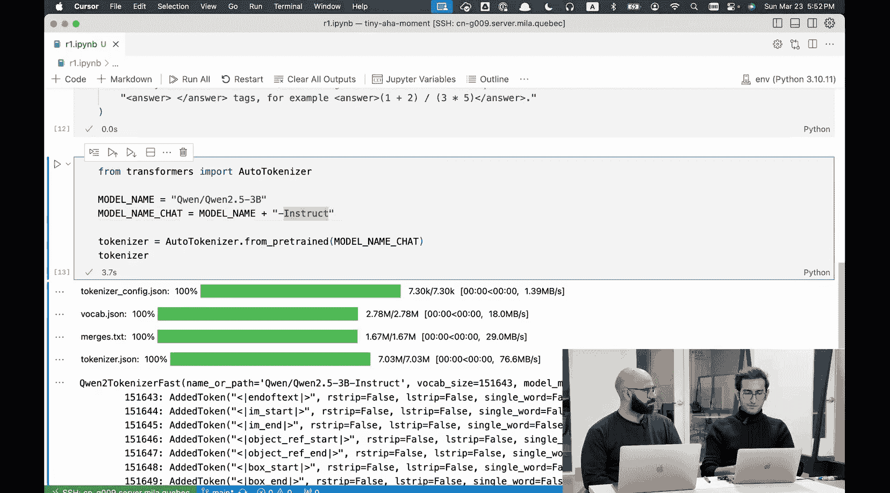

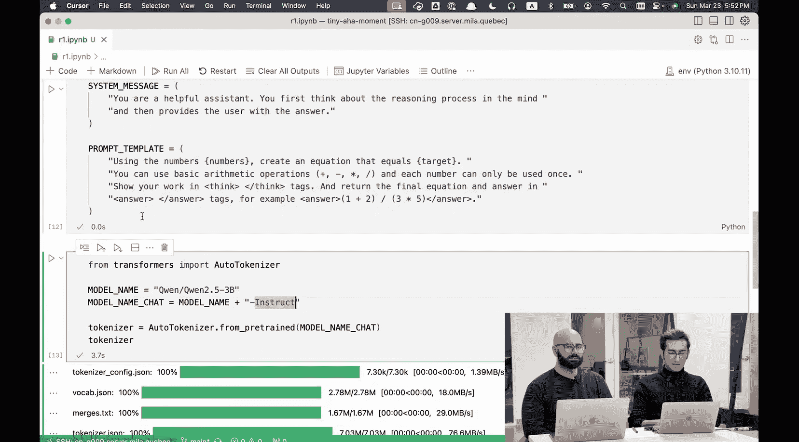

R1的训练流程实际上相当简单，这也是它可扩展且强大的原因。其“零样本”变体从一个预训练模型开始，不进行任何指令微调或监督微调，直接使用原始模型。

流程如下：
1.  使用一个“思考”提示词，将问题定义附加到该提示词后，输入给大语言模型。
2.  让大语言模型生成推理过程和最终答案。我们会强制模型先“思考”，再输出最终答案。
3.  一旦获得响应并提取出最终答案，就使用可验证的奖励函数来检查模型输出的正确性。

可验证的奖励函数将模型的输出答案与已知的真实答案（即问题的答案）进行比较。

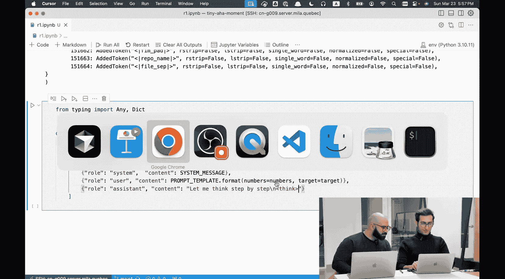


因此，它可以为你创建一个二元奖励，例如0或1。


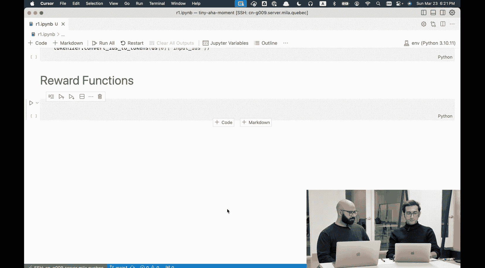

获得奖励后，你可以使用GRPO（本质上是REINFORCE算法的一个简单修改）来更新你的策略。

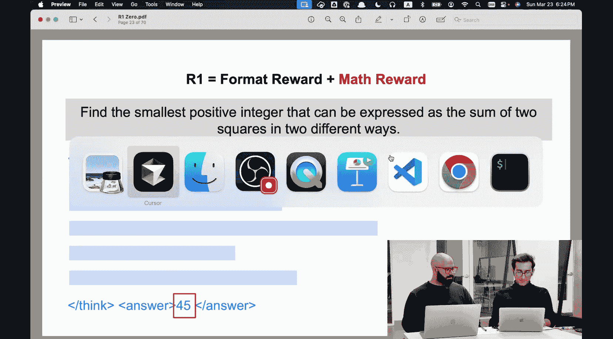

以上三个部分（提示词构建、奖励计算、策略更新）构成了今天将要实现的R1训练循环。如果你想了解更多关于R1、R1-Zero的信息，包括其创建背景、基础模型以及涉及的创新，可以参考Sutskever等人的相关视频。


R1的意义在于，它从一个预训练的基座模型开始，整个过程几乎没有人类监督。预训练阶段是完全无监督的，RL阶段也几乎是无人监督的（虽然需要知道数学问题的真实答案）。总的来说，它不会在模型中强制引入任何特定的思考模式。让模型自己发现解决这类问题的最佳方式，这一点非常令人兴奋。

在OpenAI的O1模型之后，研究社区有许多重现O1的努力，其中许多都涉及向模型强加某种归纳偏置。但R1-Zero不需要任何归纳偏置，训练过程也无需人类监督。最简单的方案反而奏效了。


在开始编码实现之前，我们先展示一下整个训练过程的最终结果，并与之互动，看看它的表现如何。

我们已经将训练好的模型上传到了Hugging Face仓库 `nanoAhaMoment-3B`，它基于Qwen2.5-3B基座模型，使用相同的任务和参数进行训练。让我们加载模型并尝试一些示例。

首先是一个简单的例子：数字 `[1, 2, 3, 4]`，目标是 `10`。模型只需要将它们相加。可以看到，模型正确地进行了思考并得出了答案 `10`。

再试一个稍难的例子：数字 `[2, 3, 5, 25]`，目标是 `64`。模型经过一番思考，也找到了正确的等式。

接下来是一个更难的例子：数字 `[3, 5, 7, 11]`，目标是 `66`。模型尝试后放弃了。这就是本教程结束时你将创建的模型。

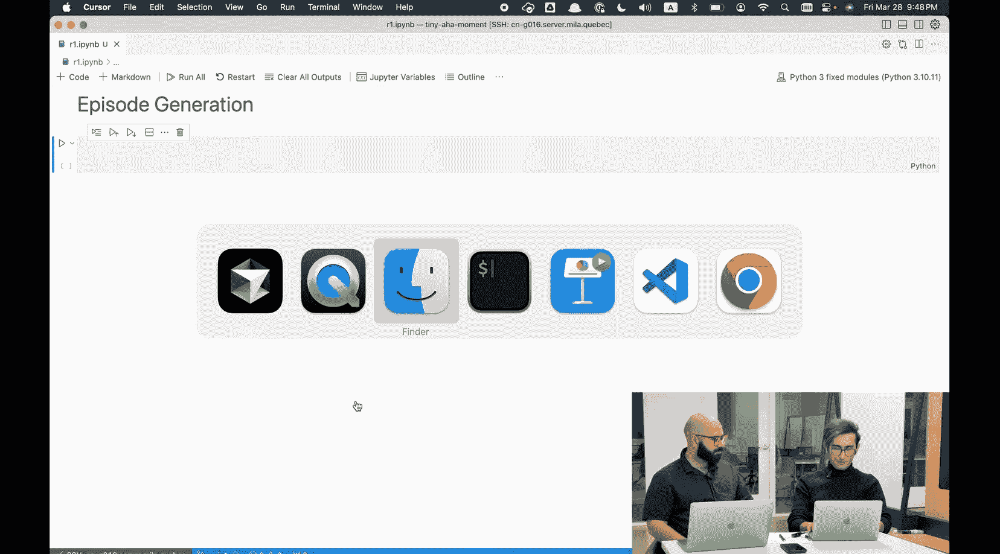

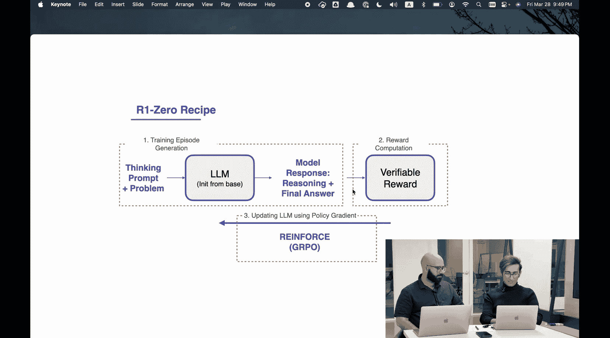

现在，我们测试一个非“倒计时”任务的通用问题。由于这个检查点仅从预训练模型开始，并只在“倒计时”任务上使用可验证奖励进行训练，我们预测它可能会尝试将答案融入“倒计时”任务的格式或思考模式中。

我们输入提示：“你好，最近怎么样？请将你的思考过程放在 `` 标签内，答案紧随 `</think>` 之后并在 `<answer>` 和 `</answer>` 标签内。这主要是为了方便我们从响应中准确提取最终答案。

数学奖励则检查从答案标签中提取的最终等式是否求值得到目标数字，并且是否恰好使用了每个输入数字一次。

首先实现格式奖励函数。由于基座模型和聊天模型的句末令牌可能不同，我们需要确保使用正确的令牌。

```python
# 获取基座模型的句末令牌ID
base_tokenizer = AutoTokenizer.from_pretrained(model_name, trust_remote_code=True)
eos_token = base_tokenizer.eos_token
```

格式奖励函数接收一个完成文本（字符串），返回一个标量数字。它使用正则表达式检查标签的完整性和嵌套情况。如果格式完全正确，奖励为1；如果标签正确但答案内部格式不符，奖励为0.5；如果格式错误，奖励为0。

接下来实现数学奖励函数。它接收完成文本、输入数字列表和目标数字。它首先提取答案部分，然后检查答案中的数字是否与输入数字一致（每个恰好使用一次），并使用 `eval` 计算等式结果（注意：在实际应用中，应对 `eval` 的使用保持谨慎，并采取安全措施）。如果结果等于目标数字，奖励为1，否则为0。

最后，我们定义一个组合奖励函数，将格式奖励和数学奖励相加，作为每个响应的总奖励。


现在，我们进入情节生成部分。首先，需要从大语言模型中采样生成响应。

为了提高效率，我们将使用 `vLLM` 作为推理引擎，而不是Hugging Face的 `generate` 方法。`vLLM` 具有高吞吐量和高效的内存管理，非常适合本项目。其他选项如 `SGLang` 和 `TGI` 也可能更快，但 `vLLM` 在本项目中表现更稳定。

导入 `vLLM` 后，我们初始化 `LLM` 类，并设置相关参数，如模型路径、GPU内存利用率、数据类型（bfloat16）、交换空间大小、启用前缀缓存以及最大模型长度。

初始化完成后，我们可以使用 `llm.generate` 方法进行生成，其API与Hugging Face类似。我们可以通过 `SamplingParams` 控制生成参数，如最大新令牌数、温度、top-p、top-k等。

为了测试，我们输入一个简单的提示，观察基座模型的原始输出。然后，我们输入一个来自数据集的示例提示，观察模型在未经训练时的响应。我们可能会看到各种有趣的模式，甚至包括语言切换现象。


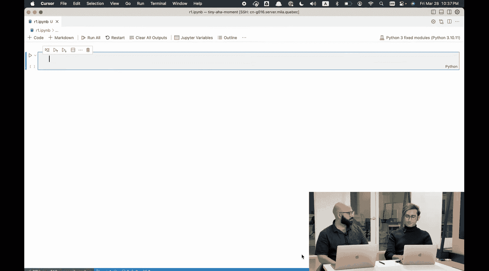

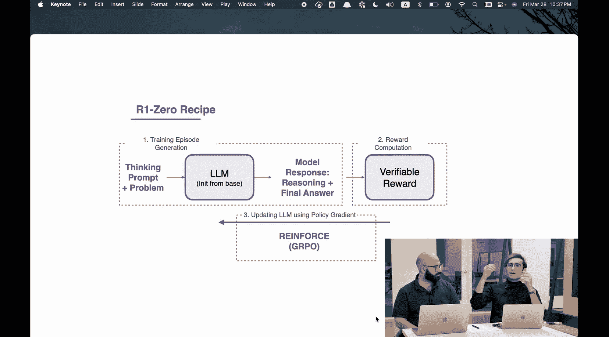

接下来，我们正式实现情节生成部分。策略梯度算法通过从模型中采样生成，并使用奖励来计算每个生成的权重，进而计算策略相对于参数的梯度。

一个“情节”包含：查询（提示）的令牌ID、模型响应的令牌ID，以及每个响应的优势值。直观上，策略梯度算法会增加高奖励响应的概率，降低低奖励响应的概率，而“优势”值控制着响应在模型分布下的偏好程度。

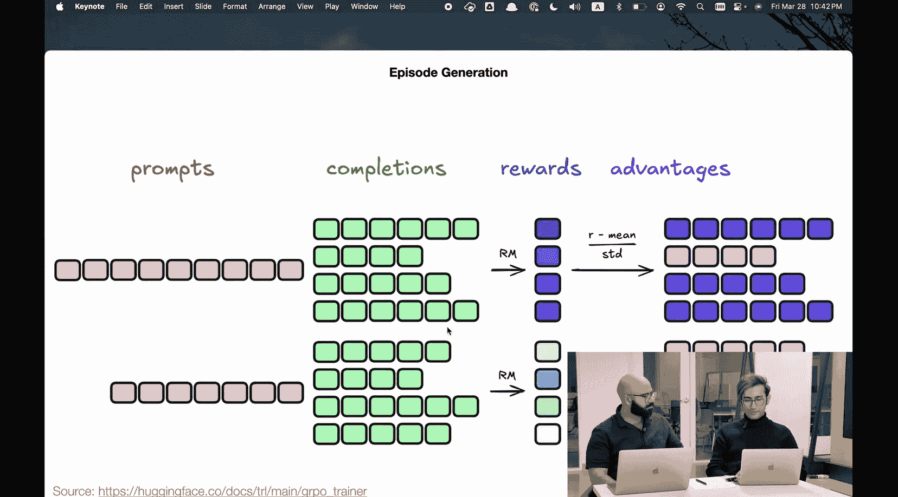

GRPO有其计算优势的方法，但总的来说，优势可以看作是归一化的奖励，这种归一化是在单个查询的所有响应之间进行的。具体公式为：`优势 = (奖励 - 奖励均值) / (奖励标准差 + epsilon)`。然后，这个每个响应的优势值会被复制到该响应中的每一个令牌上。

因此，情节生成组件的输出将是：所有查询的令牌ID列表、所有响应的令牌ID列表，以及每个令牌对应的优势值列表。


我们首先用单个示例手动实现整个流程，然后将其封装成函数。

假设我们有一个示例，输入数字 `[1, 2]`，目标为 `3`。我们手动创建四个模拟的完成文本（令牌ID形式），分别代表不同正确程度的响应。


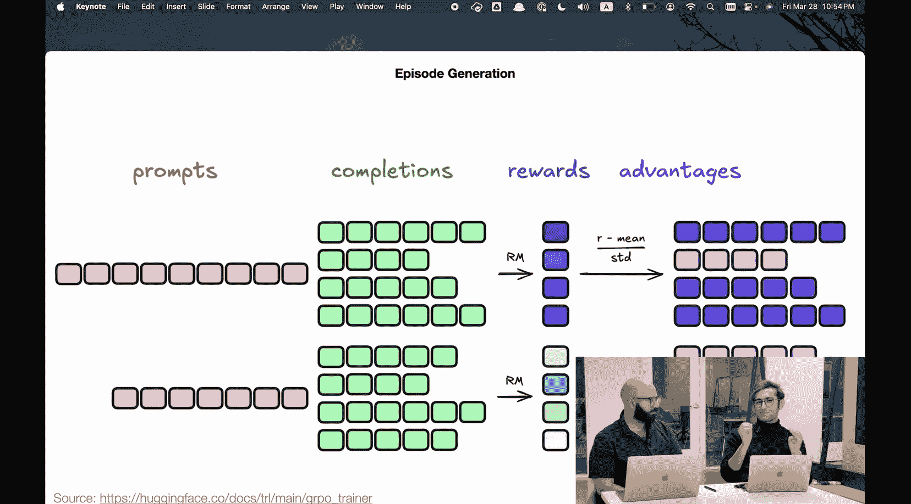

我们将这些完成文本解码为字符串，然后使用之前定义的组合奖励函数计算每个响应的奖励。接着，我们计算这组响应的优势值：先计算奖励的均值和标准差，然后对每个奖励进行归一化。

得到每个响应的优势值后，我们将其复制到该响应的每一个令牌上，从而得到每个令牌的优势值。

最后，我们将这些数据打包：查询令牌ID（每个提示重复对应响应次数）、响应令牌ID和令牌优势值。


现在，我们将上述步骤封装成一个函数 `create_training_episodes`。该函数接收样本列表、所有生成的令牌ID列表以及所有生成停止原因列表。它遍历每个查询对应的响应组，计算奖励和优势，并返回包含 `query_token_ids`、`response_token_ids` 和 `advantages` 的字典。

这个函数将用于后续的策略梯度计算。


接下来，我们进入策略梯度计算部分。在获得训练情节后，我们需要计算策略梯度来更新模型参数，使其更好地解决任务。

我们将使用GRPO算法，它使用PPO目标函数。PPO目标函数包含一个裁剪项和一个KL散度项。

然而，在我们的实现中，由于每个迭代只进行一次梯度更新（即采样一次，更新一次），当前策略和旧策略是相同的。这使得PPO目标函数大大简化。经过推导，在这种情况下，PPO目标的梯度等价于标准的策略梯度（带优势），即 `梯度 = E[梯度(log π(a|s)) * 优势]`。

因此，我们可以直接计算每个生成令牌的对数概率，乘以对应的优势值，然后通过反向传播计算梯度。

此外，GRPO还包含一个KL散度项，用于防止当前策略偏离初始的预训练模型（参考策略）太远。我们使用一种低方差、无偏的KL散度估计器来计算这个项。

最终，我们的损失函数是策略梯度损失和KL散度损失的加权和。


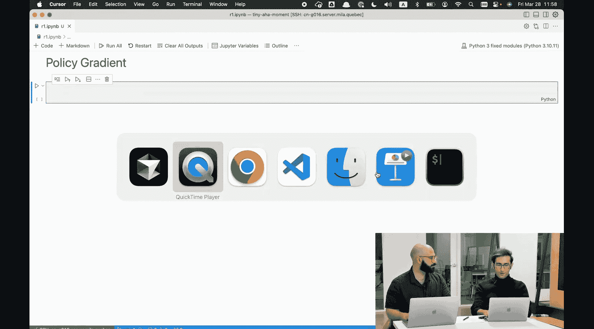

GRPO与其他算法（如PPO）的主要区别在于优势值的计算方式。GRPO为响应中的所有令牌分配相同的优势值，而PPO等算法会进行更细粒度的信用分配，为每个令牌计算不同的优势值。GRPO的方式虽然简单，但在某些情况下可能不够精确，例如当响应中只有部分令牌出错时。


现在，回到代码实现。我们将实现策略损失的计算。首先，我们需要获取模型对每个生成令牌的对数概率。这可以通过将响应令牌ID输入模型，并获取对应位置的对数概率来实现。

然后，我们计算策略损失作为对数概率与优势值的加权和（负号，因为我们要最大化奖励）。同时，我们计算当前策略与参考策略之间的KL散度。最终损失是策略损失加上一个KL惩罚系数乘以KL散度。

我们使用优化器（如AdamW）来最小化这个损失，从而更新模型参数。

以上便是从零开始实现LLM强化学习训练的核心步骤概述。在接下来的课程中，我们将详细实现每个组件，并整合成完整的训练循环。


## 总结

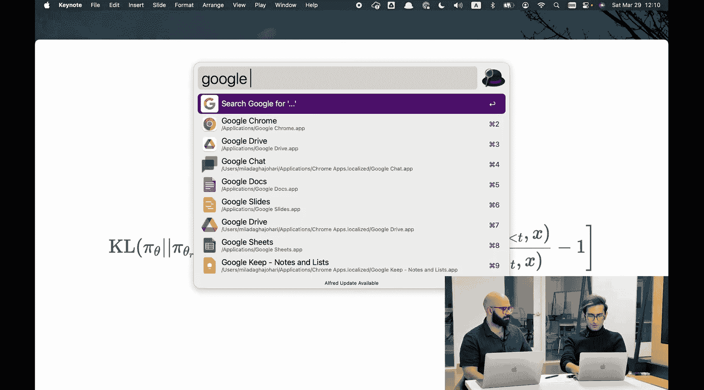

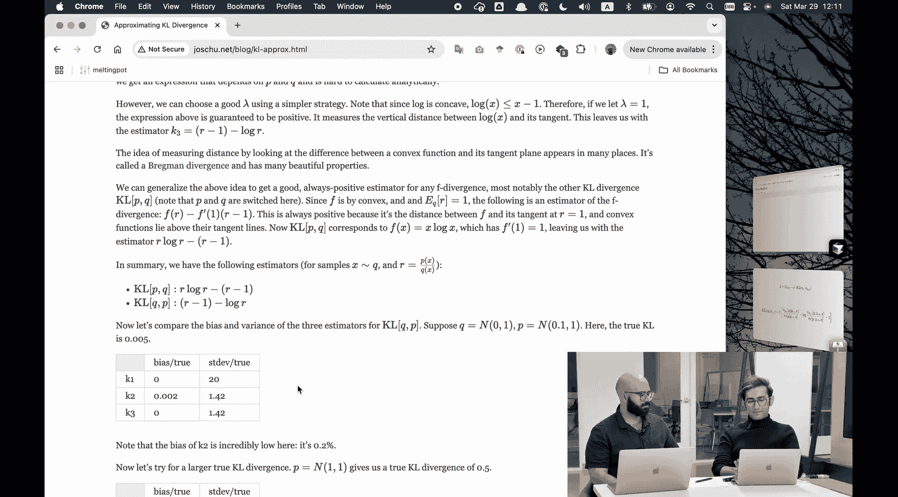

本节课中，我们一起学习了：
1.  R1-Zero训练流程的基本原理：从预训练基座模型开始，使用思考提示和可验证奖励进行强化学习。
2.  数据预处理：如何构建包含系统消息、用户问题和助手引导的提示词。
3.  奖励函数设计：实现了格式奖励和数学奖励，用于评估模型响应的正确性。
4.  高效推理：使用 `vLLM` 引擎进行高速、大批量的文本生成。
5.  情节生成：从模型采样响应，计算奖励，并归一化得到每个令牌的优势值。
6.  策略梯度计算：解释了GRPO算法如何利用PPO目标函数，并在单步更新下简化为带优势的策略梯度，同时加入KL散度约束以防止策略偏离初始模型太远。

通过本教程，你将从零开始构建一个完整的RL训练循环，并在“倒计时”任务上训练一个30亿参数的模型，观察其推理能力的涌现。希望你能从中深入理解大语言模型强化学习的核心概念与实现细节。

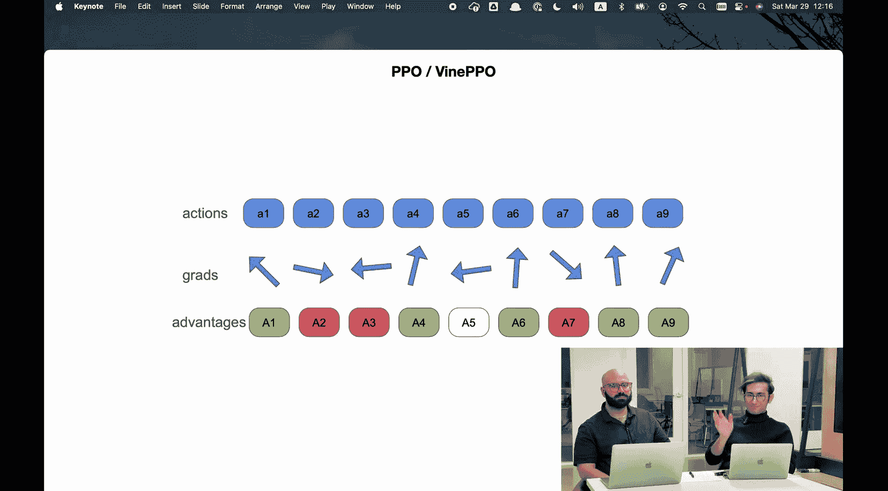


