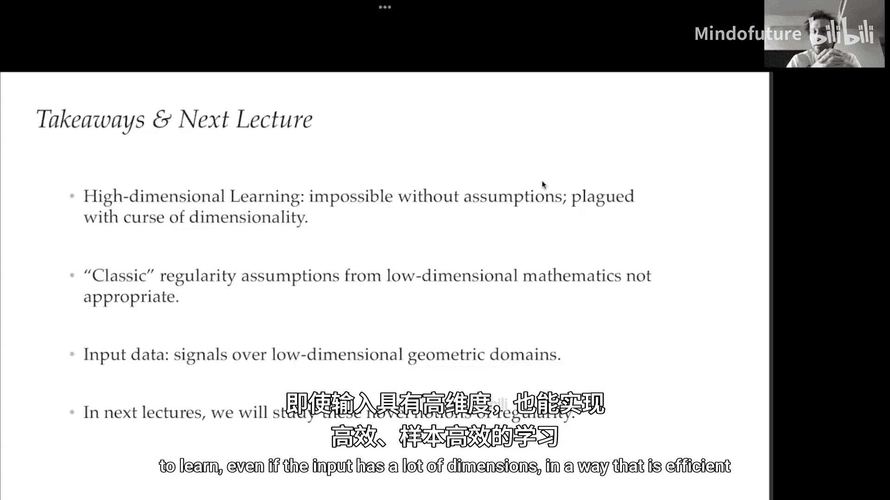

# 002：高维学习入门

在本节课中，我们将学习统计学习的基本框架，理解高维数据带来的“维度灾难”挑战，并初步探讨如何利用数据的几何结构来克服这些挑战。

## 数据、模型与算法

统计学习主要涉及四个核心对象：数据、模型、损失函数和优化算法。

### 数据分布

在监督学习中，数据被形式化为从概率分布中抽取的样本。每个样本包含一个输入 \(X_i\) 和一个对应的标签 \(Y_i\)。我们假设输入 \(X_i\) 来自一个定义在输入空间 \(\mathcal{X}\) 上的数据分布 \(\nu\)。标签 \(Y_i\) 则由一个未知的目标函数 \(f^*\) 生成，即 \(Y_i = f^*(X_i)\)。学习的目标就是估计这个未知函数 \(f^*\)。

### 假设空间（模型）

我们无法在无限大的函数空间中搜索，因此需要选择一个参数化的函数族 \(\mathcal{F}\)，也称为假设空间。例如，这个空间可以是特定次数的多项式集合，也可以是具有特定架构的神经网络集合。

### 复杂度度量

为了理论分析，我们需要一个度量来组织假设空间中的函数，区分“简单”和“复杂”的假设。这个度量记为 \(\gamma(f)\)。例如，在神经网络中，复杂度可以是参数的范数；在非参数模型中，复杂度可以衡量函数的光滑性。值得注意的是，优化算法（如梯度下降）的选择有时会隐式地定义这种复杂度，这被称为“隐式正则化”。

### 损失函数与算法

我们使用一个损失函数（如平方损失）来衡量假设函数 \(f\) 的预测与真实标签的差距。我们真正关心的是**总体风险** \(R(f)\)，即损失在数据分布 \(\nu\) 上的期望。然而，由于我们无法获知真实分布，只能计算**经验风险** \(\hat{R}(f)\)，即在有限训练集上的平均损失。

一个自然的算法是**经验风险最小化**：在给定复杂度约束的假设类中，选择经验风险最小的函数。这可以表述为一个带约束的优化问题，也可以通过拉格朗日乘子法转化为带正则化项的惩罚形式。

## 误差分解与维度灾难

上一节我们介绍了学习的基本框架，本节中我们来看看如何分析学习算法的性能，并理解高维带来的核心挑战。

### 泛化误差分解

对于一个通过ERM得到的假设 \(\hat{f}\)，其总体风险 \(R(\hat{f})\) 与可能的最佳风险 \(\inf_{f} R(f)\) 之间的差距可以分解为三部分：

1.  **近似误差**：由于假设空间 \(\mathcal{F}\) 表达能力有限，即使在其中找到最优函数，与全局最优函数之间仍存在的差距。
2.  **估计误差（统计误差）**：由于我们只能使用有限数据（经验风险）而非真实分布（总体风险）来选择函数，所引入的误差。这要求我们**一致地**控制经验风险与总体风险在假设类上的差距。
3.  **优化误差**：优化算法可能无法在假设类中找到经验风险最小的函数所带来的误差。

理想的学习需要在三者之间取得平衡：增大假设空间可以减少近似误差，但会增加统计误差；反之亦然。

### 维度灾难的体现

在高维空间中，同时控制这些误差变得极其困难，这被称为“维度灾难”。它体现在学习的各个方面：

*   **统计层面**：以学习Lipschitz连续函数为例。在低维空间，我们可以利用函数值的局部平滑性从少量样本外推。但在高维空间，要保证对任意点的估计都准确，所需的样本量 \(N\) 会随维度 \(d\) 指数级增长（例如，可达 \(2^d\) 量级）。
*   **近似层面**：考虑用单隐层神经网络逼近具有 \(s\) 阶导数的函数。要达到误差 \(\epsilon\)，所需的神经元数量 \(M\) 约为 \(\epsilon^{-d/s}\)。这意味着要将误差减半，网络宽度需要增加 \(2^{d/s}\) 倍，这在 \(d\) 很大时是不可行的。
*   **优化层面**：在高维空间中对一个一般非凸函数寻找全局最小值，通常需要以指数级密度对空间进行网格搜索，这同样是指数级复杂的。

## 破局之道：利用几何结构

上一节我们看到了高维学习的普遍性困难，本节我们将探讨解决这些问题的核心思路。

维度灾难的根源在于我们试图在过于庞大和通用的函数空间（如所有Lipschitz函数）中学习。然而，我们实际关心的数据（如图像、文本、分子结构）并非抽象的高维点，而是具有丰富内在结构的信号。

例如，一张图片不仅是 \(\mathbb{R}^d\) 中的一个点（\(d\) 为像素数），更是一个定义在二维网格上的函数。这种“物理结构”——如图像的二维网格性、3D物体的旋转对称性、社交网络的图结构——为我们定义更贴合实际、更易于学习的函数空间提供了线索。

总结来说，本节课我们一起学习了统计学习的基本框架，理解了误差分解的原理，并认识了高维空间中普遍存在的“维度灾难”现象。关键在于，克服维度灾难不能依赖来自低维数学的通用正则性假设（如Lipschitz连续性），而必须**利用数据本身固有的几何与对称性结构**来定义新的、适应性更强的函数空间与正则性概念。在接下来的课程中，我们将深入探讨如何形式化这些结构（如不变性、对称性、尺度性），并利用它们来设计高效、可扩展的深度学习模型。