# 004：几何先验 II

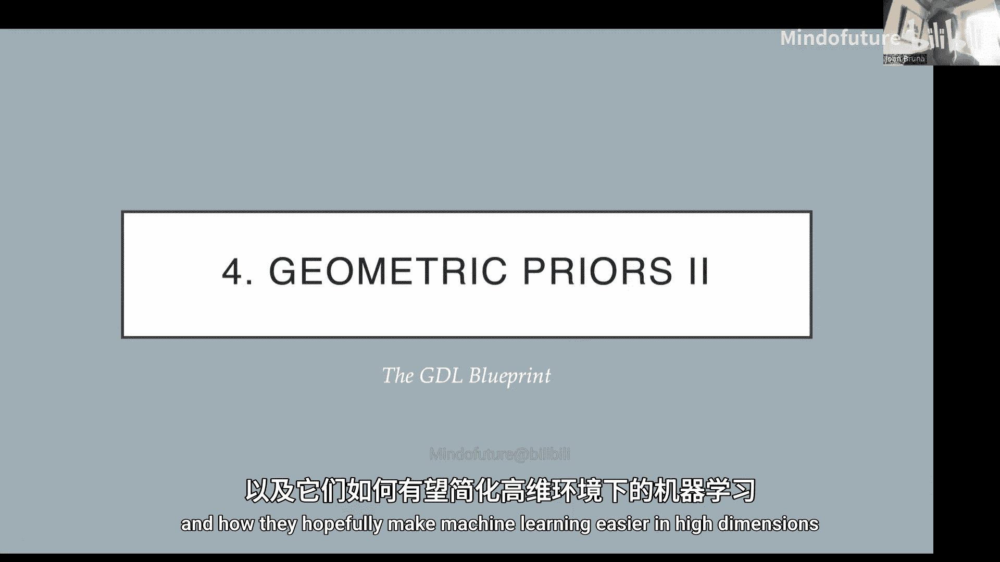

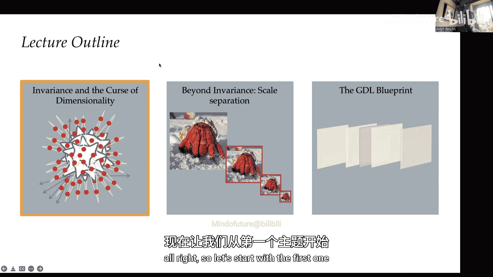

在本节课中，我们将继续探讨几何先验，特别是对称性与不变性如何帮助我们应对高维机器学习中的维度灾难问题。我们还将引入尺度分离的概念，并将这两种先验结合，形成几何深度学习的蓝图。

---

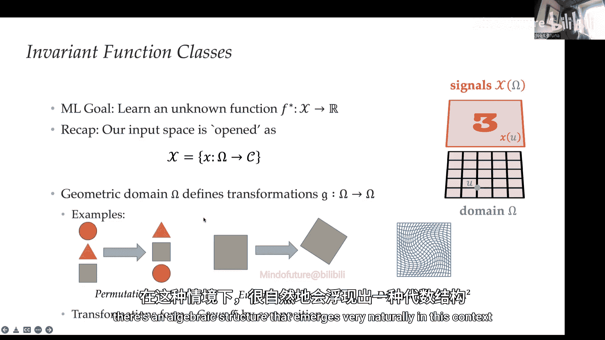

## 从对称性到维度灾难

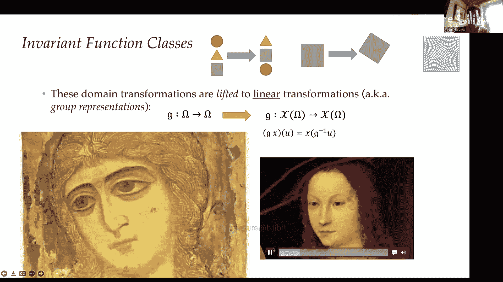

上一讲我们讨论了对称性与不变性。本节中，我们来看看这些概念如何与第二讲中提到的维度灾难问题联系起来。

监督机器学习的目标是学习一个未知函数 **F\***。这个函数定义在一个非常高维的空间 **X** 上，例如所有可能图像的集合。如果我们把输入空间 **X** 当作一个黑盒，那么在高维情况下学习将极其困难，除非我们做出更多假设。

因此，我们需要“打开黑盒”，将输入空间 **X** 视为定义在几何域 **Ω** 上的信号空间。这里，**Ω** 是一个低维空间（例如二维网格），而 **X** 是定义在其上的高维信号（如图像）。这个几何域 **Ω** 带有一类自然的变换，例如平移、旋转或排列。这些变换可以组合，并形成一个代数结构——**群**。

更重要的是，我们可以将这些定义在低维域 **Ω** 上的变换，通过复合的方式，“提升”到高维信号空间 **X** 上。例如，一个在二维网格上定义的旋转变换，可以应用于整个图像。这种提升后的变换是线性的，在数学上称为**群表示**。

---

## 利用不变性改进学习

现在，我们假设要学习的未知函数 **F\*** 对于某个变换群 **G** 是**不变**的。这意味着对于任何输入 **x** 和群 **G** 中的任何变换 **g**，都有：
`F*(g·x) = F*(x)`

这带来了两个问题：
1.  我们如何利用这个额外的假设来改进我们的假设函数类？
2.  这种改进是否足以打破维度灾难？

首先，我们引入**群平滑算子**。对于任意函数 **f**，我们定义其平滑版本为函数在其**群轨道**（即所有变换版本的输入）上的平均值：
`[S f](x) = (1/|G|) Σ_{g∈G} f(g·x)`

如果目标函数 **F\*** 本身是不变的，那么对它应用平滑算子不会改变它，因为它在每个轨道上都是常数。

一个自然的想法是：给定任何假设函数类 **F**（例如全连接神经网络），我们可以通过应用平滑算子使其变得不变。我们考虑新的假设类 **S(F)**，即 **F** 中所有函数的平滑版本。由于目标函数不变，这种转换不会影响**近似误差**。同时，因为 **S(F)** 是 **F** 通过一个正交投影得到的子集，其**统计误差**（与样本复杂度相关）会更小。因此，理论上这是一个更好的假设类。

然而，定量分析表明，对于一大类函数（如Lipschitz函数），即使加入不变性先验，学习率的衰减仍然受到维度的诅咒。不变性带来的改进主要体现在常数因子，而非衰减速率上。因此，仅靠不变性不足以完全解决高维学习问题。

此外，群平滑算子在实践中计算成本可能很高。我们需要一种高效的方法将不变性构建到算法中。

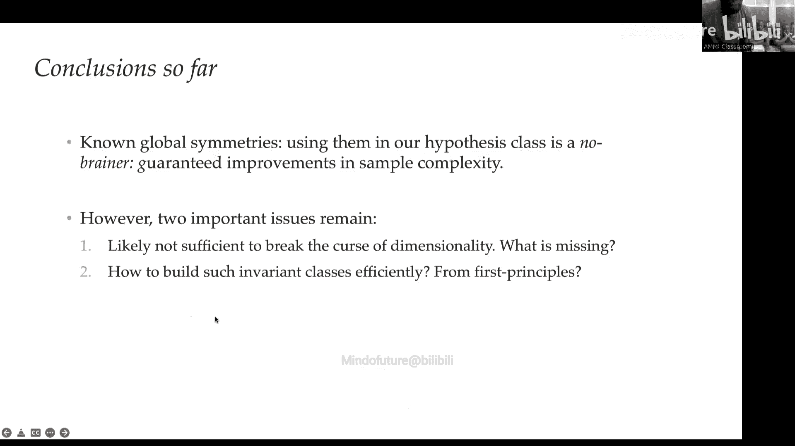

---

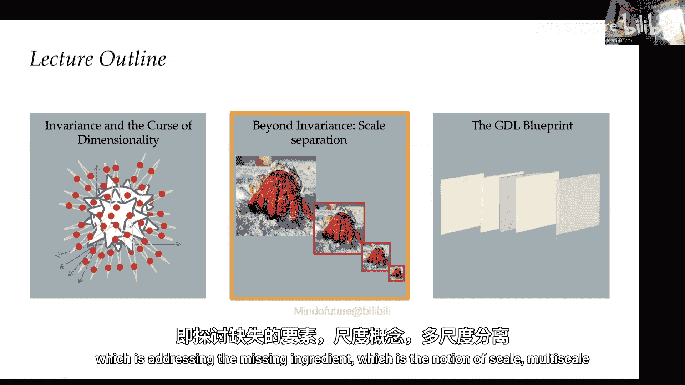

## 尺度分离先验

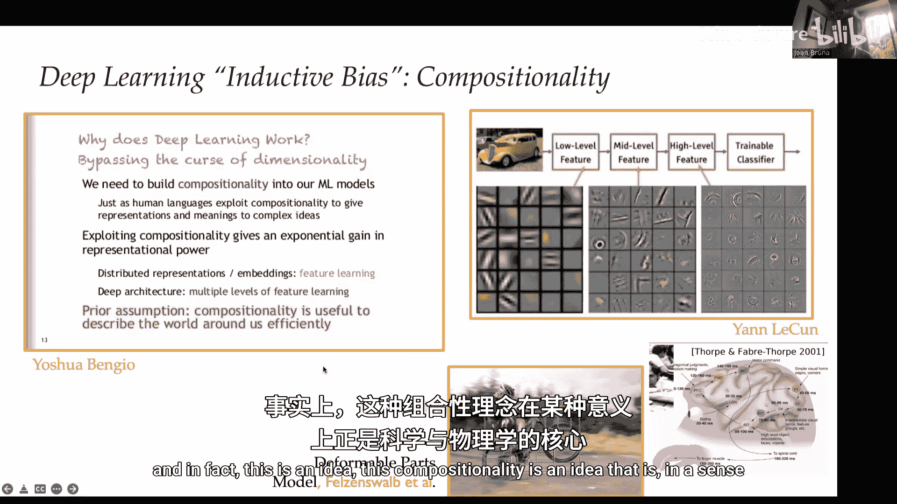

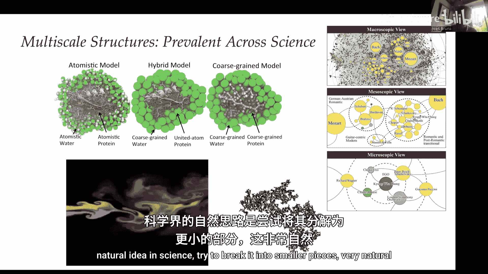

接下来，我们介绍第二个关键的几何先验：**尺度分离**或多尺度结构。这是深度学习成功的一个“秘方”，其核心思想是**组合性**：复杂的整体可以通过逐步组合简单的局部部分来构建。

在科学中，这很常见：从量子力学到化学，再到生物学，我们通过不同尺度理解世界。在我们的语境中，我们可以通过**多分辨率分析**来形式化这一思想。

以二维网格上的图像为例：
*   我们可以将高分辨率图像分解为一个低分辨率版本（粗尺度）和一系列细节（细尺度）。
*   低分辨率版本捕获全局结构，而细节（通常由**小波**捕获）包含局部信息。

这种多尺度视角如何帮助学习呢？以下是几种基于尺度的先验：

1.  **粗尺度主导**：目标函数 **F\*** 仅依赖于输入的低分辨率版本。例如，判断一张图片是海滩还是山脉，可能只需要模糊的轮廓。此时，有效输入维度大大降低。
2.  **局部性主导**：目标函数 **F\*** 可以近似为一些仅依赖于局部图像块（patch）的函数的线性组合。例如，区分砖墙和草地纹理，只需看几个局部小块。
3.  **组合模型**：更一般地，我们可以将目标函数建模为一个**组合**：`F* ≈ F̃ ∘ P`。其中 **P** 是一个**粗化**操作，将输入从精细域 **Ω** 映射到更粗糙的域 **Ω̃**，从而降低维度；然后 **F̃** 在粗尺度域上进行学习。这两个部分都可以是可训练的非线性模型。

组合模型相比单一尺度的模型更高效，这类似于算法中的“分治法”。虽然其理论优势仍在深入研究，但直觉和实验都支持这一点。

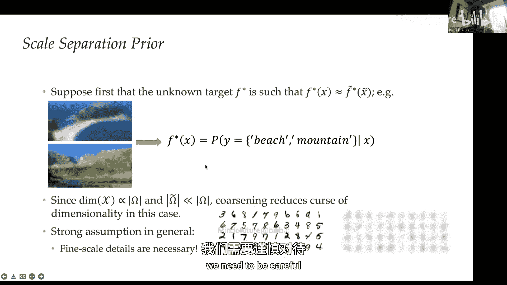

---

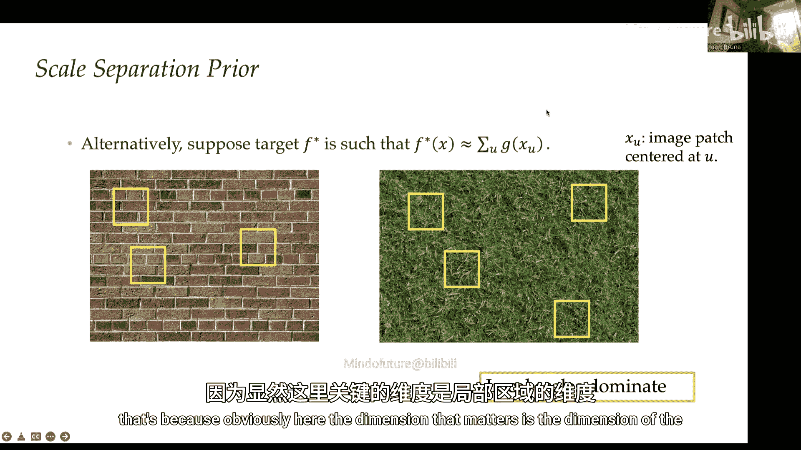

## 结合先验：几何深度学习蓝图

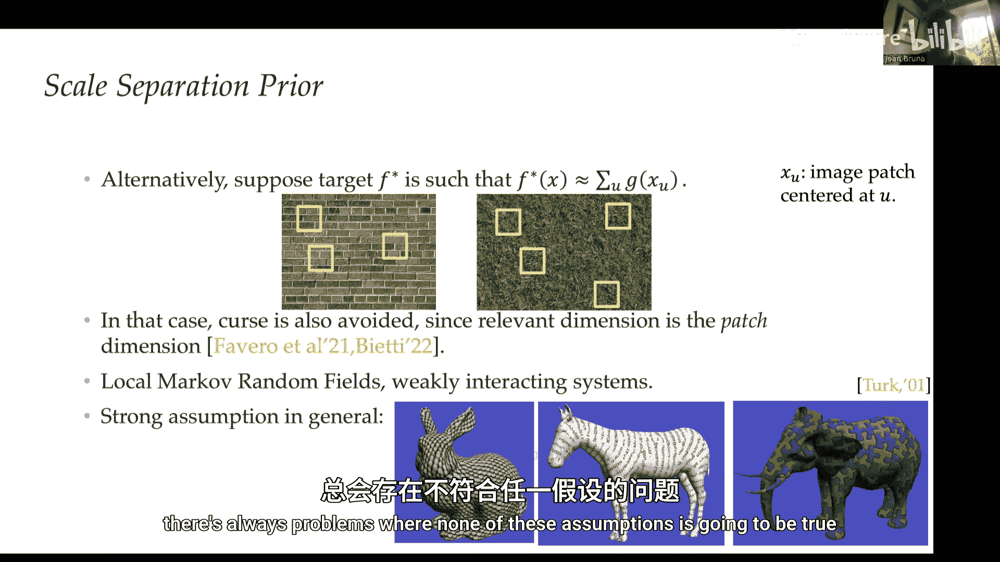

现在，我们将不变性和尺度分离这两个先验结合起来。我们的目标是构建一个假设函数类，它同时满足：
*   **不变性**：对变换群 **G** 不变。
*   **多尺度性**：具有层次化、组合的结构。
*   **表达性**：足够丰富，能够逼近复杂的目标函数。

构建蓝图从线性函数开始：

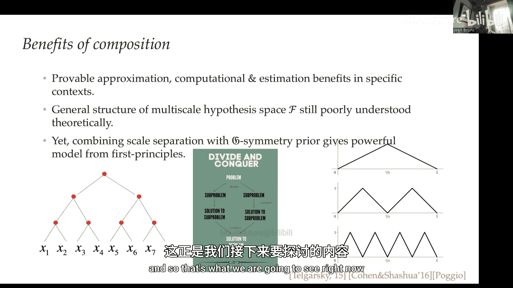

*   **线性不变算子**：唯一线性且对群 **G** 不变的算子是**群平均**（即平滑算子）。但仅靠它，会丢失太多信息。
*   **线性等变算子**：算子 **B** 满足 `B(g·x) = g'·B(x)`，即变换与算子可交换。等变性是比不变性更一般、更重要的性质。
*   然而，单纯组合线性等变算子和线性不变算子，无法产生新的不变函数，结果仍是线性的群平均。

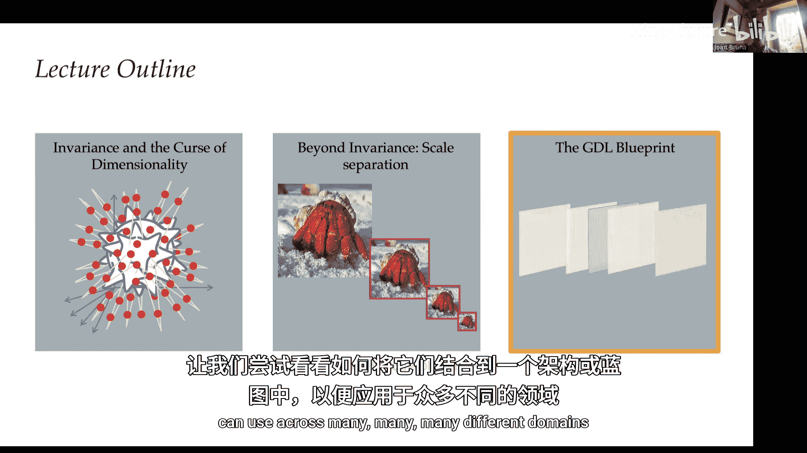

关键的突破是引入**逐点非线性激活函数** **σ**。这种非线性作用于每个特征单独，不混合空间位置。

现在，我们可以构建核心模块：
1.  取一个**线性等变**算子 **B**。
2.  后接一个**逐点非线性**激活函数 **σ**。
3.  这个组合 `σ ∘ B` 仍然是**等变**的。
4.  如果需要不变性，可以在最后加上一个**线性不变**的池化算子（如全局平均）。

通过反复堆叠“线性等变 → 非线性激活”模块，并在最后加上不变池化，我们就构建了一个**深度、等变、最终不变**的架构。这就是**几何深度学习蓝图**。

这个蓝图的威力在于其普适性。对于不同的几何域 **Ω** 和对称群 **G**，我们只需找出对应的**线性等变算子**的具体形式，然后套用相同的“等变层+非线性”堆叠模式，即可得到特定的神经网络架构：

*   **网格 + 平移** → 卷积神经网络 (CNNs)
*   **球面 + 旋转** → 球面卷积网络
*   **集合 + 排列** → 深度集合网络 (Deep Sets)
*   **图 + 置换** → 图神经网络 (GNNs)

---

## 总结

本节课中我们一起学习了：
1.  **不变性先验**：通过群平滑算子可以利用对称性改进学习，但仅凭它不足以完全克服维度灾难。
2.  **尺度分离先验**：通过多分辨率分析和组合模型，可以构建层次化结构，这是高效处理高维数据的关键。
3.  **几何深度学习蓝图**：将线性等变算子、逐点非线性激活函数和不变池化组合起来，形成了一个通用框架，能同时满足不变性、多尺度性和表达性。这个蓝图为不同几何域上的深度学习架构提供了统一的设计原则。

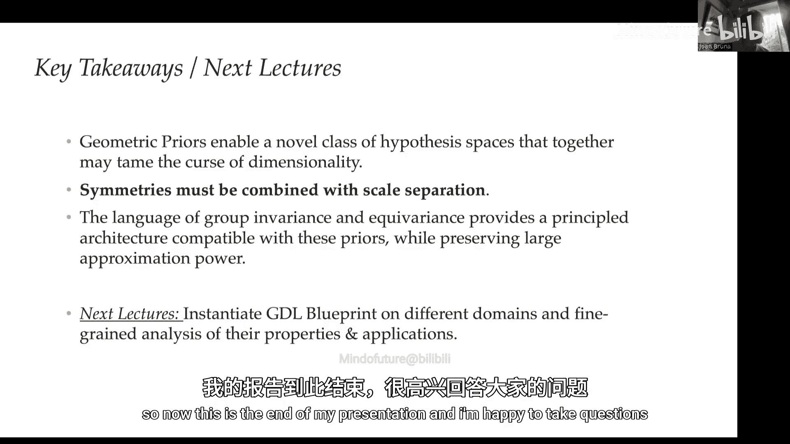

在接下来的课程中，我们将深入探讨这个蓝图在各种具体领域（如网格、图、流形）中的应用，看看不同的几何结构如何催生出各具特色的神经网络架构。