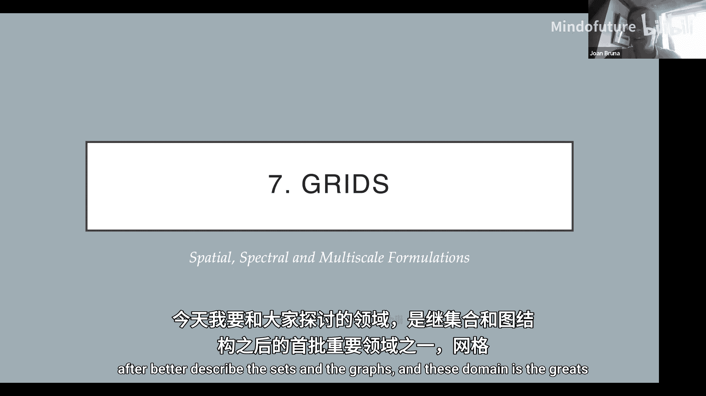
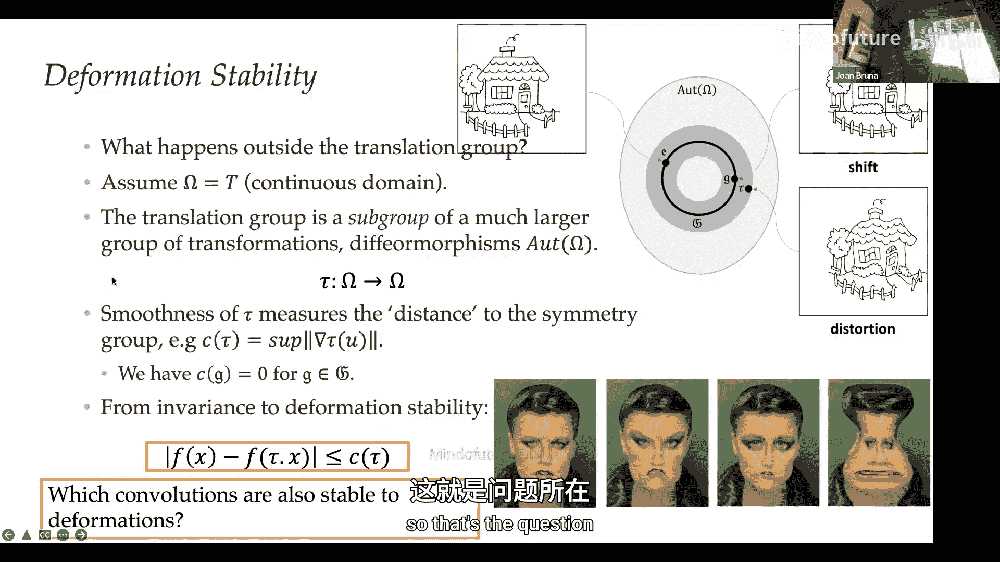
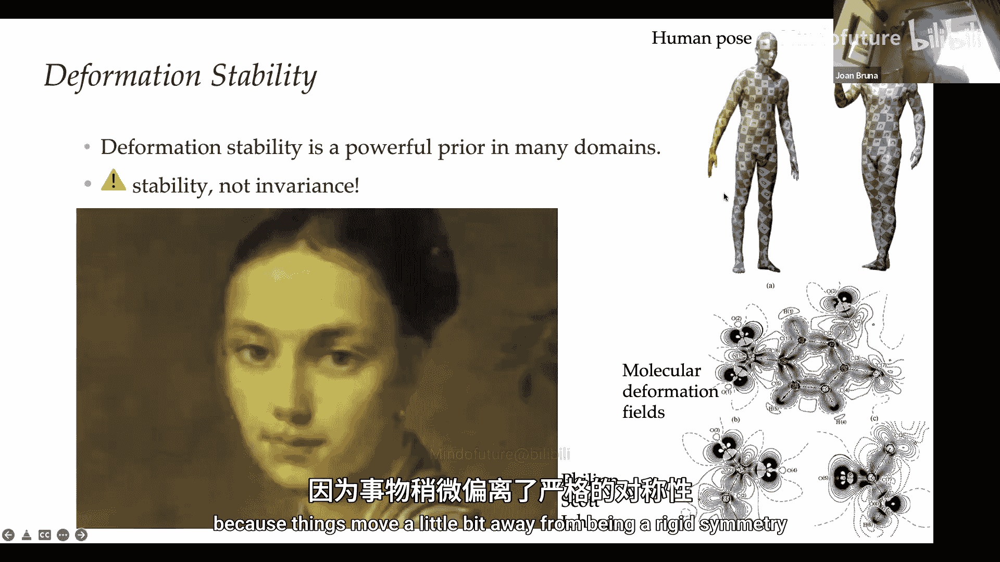
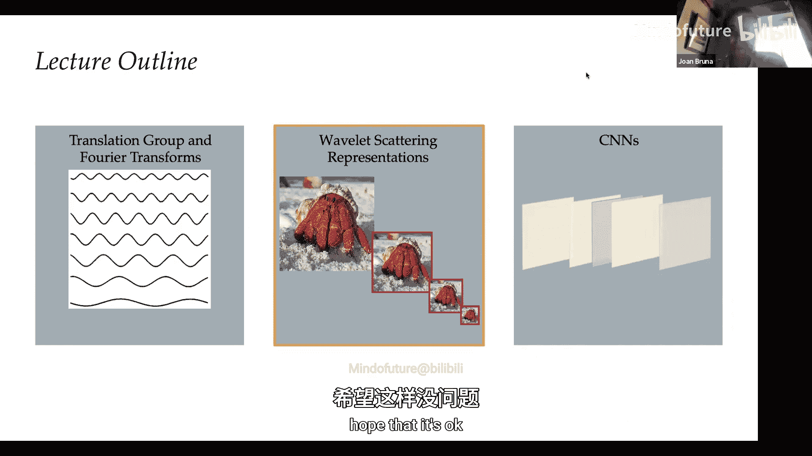
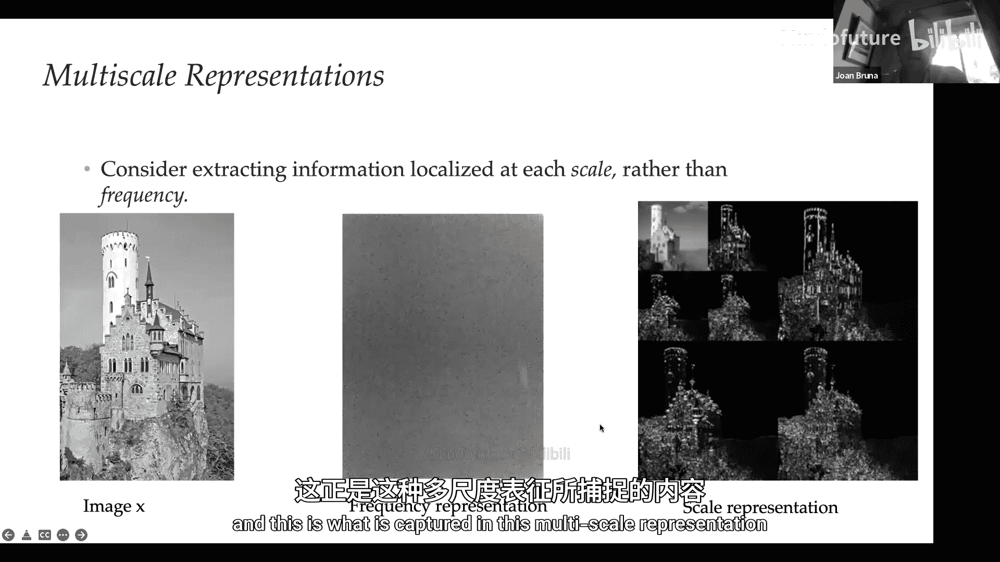
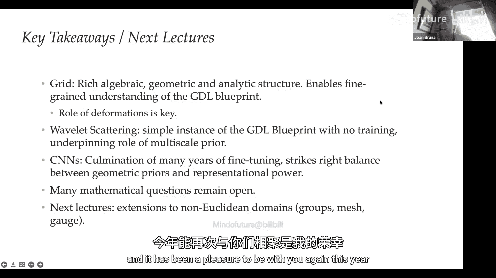

# 007：网格与卷积神经网络

在本节课中，我们将学习网格（Grid）这一特定域，它是计算机视觉和语音处理等领域中许多神经网络成功的基础。我们将从平移群这一自然变换开始，通过傅里叶变换来理解其结构，并基于这些原理构建卷积神经网络。最后，我们将探讨如何从这些基本元素自然地推导出卷积神经网络。

## 平移群与网格结构

上一节我们回顾了集合和图结构，本节中我们来看看网格域。网格具有非常规则的结构，其核心参数是维度。在一维中，网格可以看作是均匀采样的线，用于处理时间序列数据。在二维中，网格是矩形或正方形点阵，常用于处理图像。

一旦定义了物理域，我们需要考虑可以在域内移动物体的变换。对于一维网格，最基本的操作是平移（或移位）。为了方便数学处理，我们引入周期性边界条件，使得域没有边界。这样，当点移动到末端时，它会重新从起点开始。

平移操作可以表示为一个函数 **G**，它将域中的任何坐标 **u** 移动到 **u+1**（模 **D** 运算）。这里的模运算意味着当坐标达到 **D** 时，它等价于 **0**。这个变换的逆 **G^{-1}** 是向左移动。我们还可以考虑变换的幂 **G^k**，表示向右移动 **k** 个单位。

这种代数结构构成了一个群，即循环群 **Z_D**。对于更高维度的网格（如图像），变换群是多个循环群的直积，例如 **Z × Z**。在连续域中，域可以看作是一个环面，变换群是实数模运算的连续版本。

一个有趣的现象是，在这个例子中，域和变换群似乎是等价的，即域中的每个点都对应一个平移变换。但这并非普遍规律，通常变换群和域可能不同。

一旦我们知道如何在域中移动点，就可以用它来移动域上的信号（如图像）。通过复合变换，我们可以将作用于域的变换提升到作用于信号。这种提升后的变换是线性的，可以表示为一个矩阵。

对于一维网格，信号空间可以看作是一个 **D** 维向量空间。平移变换对应的矩阵称为移位算子 **S**。这是一个 **D × D** 的矩阵，除了主对角线上方和左下角有一个 **1** 外，其余元素均为 **0**。这个矩阵的 **k** 次幂 **S^k** 对应于平移 **k** 个单位。

这个群是交换群，即两个变换复合的顺序不影响结果。我们也可以将域视为一个有向图，其邻接矩阵就是这个移位算子。

## 线性等变与不变算子

根据几何深度学习蓝图，我们需要构建对群作用具有线性和等变（或不变）性质的算子。现在我们已经有了平移群，接下来研究如何构建线性不变和等变算子。

首先考虑线性不变算子。这是一个从 **R^D** 到 **R** 的线性映射 **Φ**，满足对于任何平移变换 **G**，有 **Φ(G·x) = Φ(x)**。由于线性映射可以表示为点积 **Φ(x) = v^T x**，不变性要求 **v^T (S^k x) = v^T x** 对所有 **x** 和 **k** 成立。这等价于 **v = S^T v**，即 **v** 是 **S** 的转置的特征向量，对应的特征值为 **1**。

由于 **S** 的特殊结构，满足此条件的唯一向量（模缩放）是全 **1** 向量。因此，唯一的线性不变算子是求和（或平均）：**Φ(x) = ∑_i x_i**。

接下来考虑线性等变算子。这是一个从 **R^D** 到 **R^D** 的线性映射 **C**，满足 **C(G·x) = G·C(x)**。用矩阵表示，即 **C** 与移位算子 **S** 可交换：**C S = S C**。

为了刻画所有与 **S** 可交换的矩阵 **C**，我们需要研究 **S** 的谱性质。矩阵 **S** 是正规矩阵，因此可以对角化。**S** 的特征向量是复指数向量 **v_k**，其第 **j** 个分量为 **exp(2πi j k / D)**。对应的特征值为 **λ_k = exp(2πi k / D)**。

收集所有特征向量构成矩阵 **V**，则傅里叶变换定义为 **x̂ = V^H x**。傅里叶变换是等距的，并且可逆。

线性代数中的一个重要结论是：两个矩阵可交换当且仅当它们共享相同的特征向量。因此，与 **S** 可交换的矩阵 **C** 在傅里叶域中是对角矩阵。即，存在对角矩阵 **Λ**（对角线元素为 **α_k**），使得 **C = V Λ V^H**。

在空间域中，这种算子表现为卷积。具体来说，**C(x)** 的第 **j** 个元素是输入信号 **x** 的平移版本的线性组合，权重由滤波器 **h** 给出：**(C(x))_j = ∑_k h_k x_{j-k}**。

因此，我们得出结论：所有线性等变算子都是卷积算子，反之亦然。

## 稳定性与多尺度表示

我们已刻画了线性等变算子（即卷积）。但并非所有卷积算子都同样好。我们需要考虑对更一般变换的稳定性，而不仅仅是严格的平移。

在现实世界中，许多变换（如物体的非刚性形变）接近但不完全等于平移。我们希望表示对这些“近似平移”的变换也是稳定的，即如果变换 **τ** 接近平移，则 **Φ(τ·x)** 应接近 **Φ(x)**。

为了实现这种稳定性，我们不能只关注频率，而应关注尺度。尺度是一个更直观的概念，它允许我们在不同分辨率下组织信息。

多尺度表示可以通过一种特殊的卷积算子——小波卷积来实现。小波滤波器是通过对母小波进行缩放和旋转得到的，它们在不同尺度和方向上提取信息。

小波具有一个关键性质：它们对形变是稳定的。如果变换 **τ** 接近平移，则小波变换几乎与 **τ** 可交换。这种稳定性源于小波在空间和频率上的局部化特性。

利用小波，我们可以构建一个简单的几何深度学习蓝图，称为小波散射变换。它包含三个构建块：
1.  局部不变性（低通滤波）。
2.  局部等变性（稳定的小波滤波器组）。
3.  逐点非线性（如ReLU）。

通过交替应用小波滤波、非线性和池化，我们可以构建一个对形变稳定的多层次表示。这种表示保留了信号的能量，并在许多物理和视觉任务中表现良好。

然而，小波散射变换在像ImageNet这样的复杂数据集上性能仍落后于深度卷积网络。缺失的关键成分是特征图之间的交互。卷积神经网络不仅聚合空间邻域信息，还通过1x1卷积等方式学习跨通道的特征组合。

将小波散射的空间分解与可学习的跨通道滤波相结合，可以得到性能接近标准卷积网络的混合模型。这表明，稳定性原理为我们理解卷积网络为何有效提供了思路，但并非全部答案。网络优化、残差连接、归一化等机制的作用仍有待深入理解。

## 总结

本节课中，我们一起学习了网格域上的几何深度学习。我们从平移群及其代数结构出发，通过傅里叶变换刻画了线性等变算子，并发现它们就是卷积。接着，我们探讨了对近似平移变换的稳定性需求，并引入了多尺度表示和小波变换来实现这种稳定性。最后，我们看到如何将这些原理组合起来，从小波散射变换自然地过渡到具有跨通道交互的卷积神经网络。网格域让我们能够进行精确的数学表述，但将其推广到更一般的群和域（如流形），将是后续课程的重点。