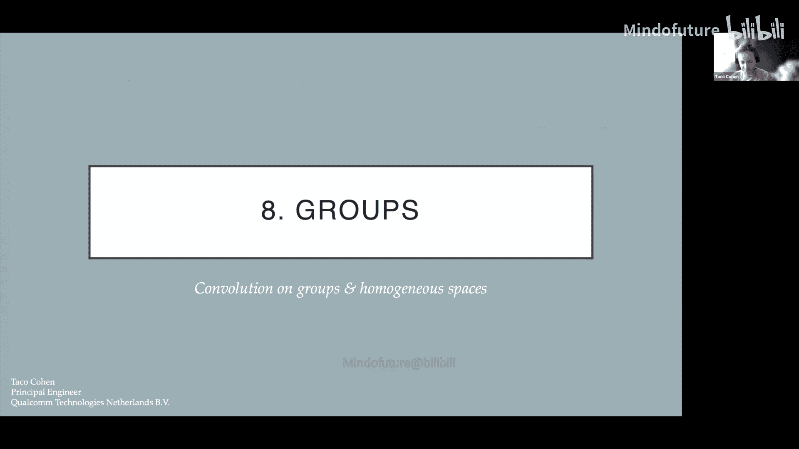
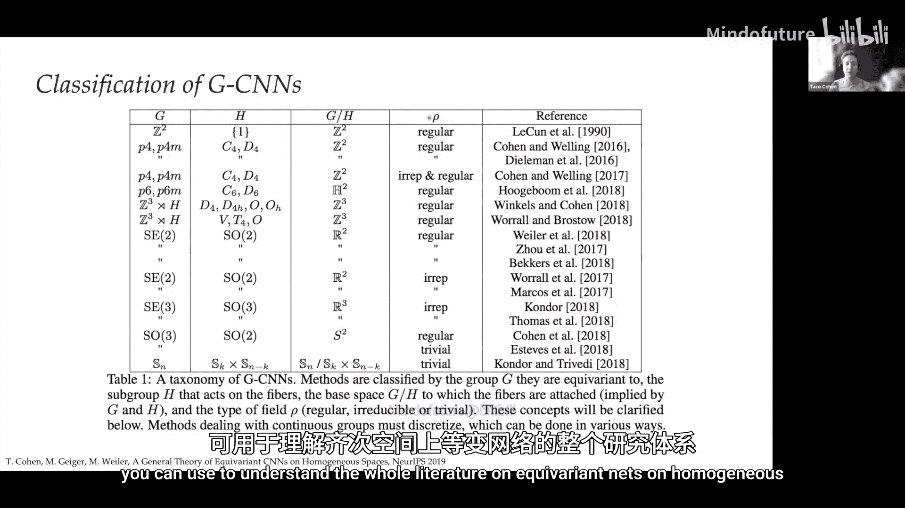
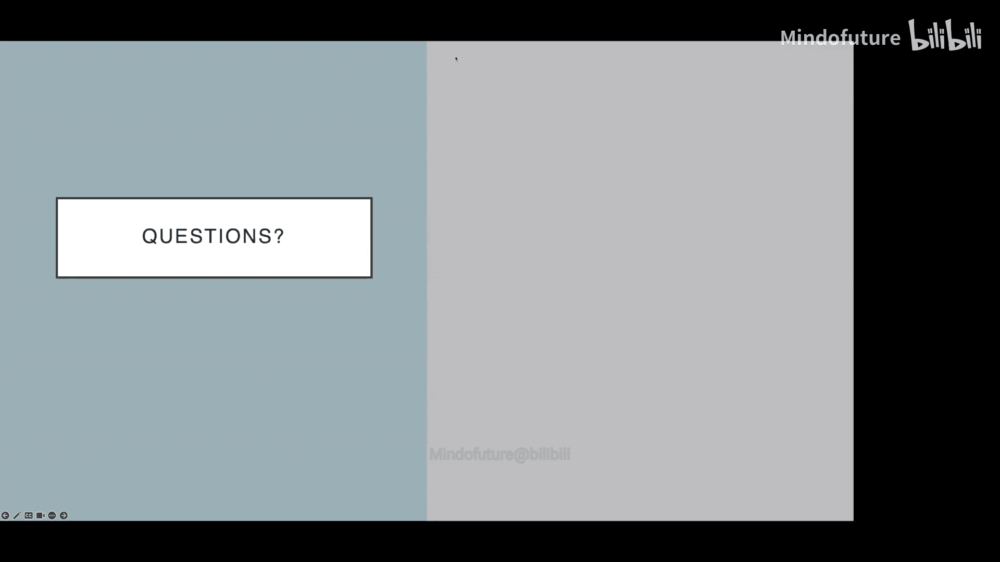
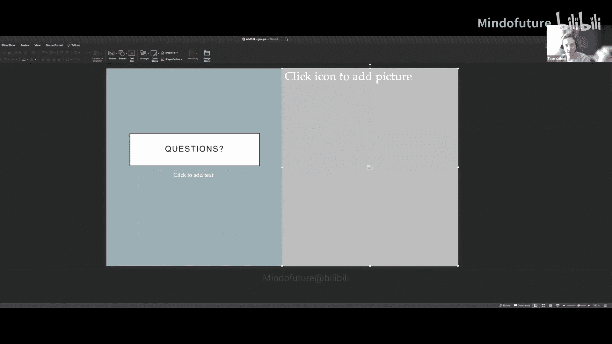

# 008：群与齐性空间



在本节课中，我们将学习如何将卷积神经网络从仅对平移等变，推广到对更一般的变换群（如旋转）等变。我们将探讨群卷积、齐性空间以及诱导表示等核心概念，并理解“卷积即所需”定理的深层含义。

---

## 从平移卷积到群卷积

上一讲我们介绍了网格上的卷积，这是深度学习中最常见的情况。本节中，我们来看看如何将其从对平移等变，推广到能处理更一般的变换群，包括平面图像、三维体素和球面信号的旋转。

我们将通过一些例子，了解为这类卷积网络发展出的一般理论。在本讲最后，我们将讨论一个更进一步的推广——基于诱导表示的Steerable CNN。从几何角度看，你可以将其视为输入、输出以及内部特征空间都是“场”空间的卷积网络，例如向量场、张量场等。

本讲将多次提及“卷积即所需”定理。该定理指出，当你的特征空间是齐性空间上的信号或场空间时，最一般的等变线性映射确实是一种广义的卷积。

### 一个简单的例子：旋转等变卷积

让我们从一个非常简单的例子开始，这也是深度学习文献中最早发表的例子之一。

我们有一张图像。就像在网格和平移卷积中一样，我们可以取一个滤波器（例如一个包含眼睛图案的小块），并在图像上进行平移卷积：我们平移滤波器，在每个位置计算滤波器与图像之间的某种内积（匹配度），并记录响应。在这个例子中，眼睛检测器滤波器自然会在眼睛位置产生高响应。我们可以使用任意数量的滤波器，就像标准CNN一样。

但现在，我们希望增加**权重共享**。我们不仅希望在每个位置使用相同的滤波器，还希望在不同**方向**上使用相同的滤波器。因此，我们希望对滤波器应用旋转。

例如，我们将滤波器旋转90度，得到一个用于检测垂直方向眼睛的检测器。当我们进行卷积时，在这个简化的示意图中，由于图中的眼睛是水平方向的，这个旋转后的滤波器不会产生高响应。同样，旋转180度或270度也不会像原始方向那样产生高响应。当然，如果我们旋转输入图像，那么这些旋转后的滤波器就可能开始响应。

我们首先实现的是增加了权重共享。在标准的平移CNN中，你可能需要学习不同方向的相同滤波器，而在这里，这是自动内置的。在数据具有旋转对称性的情况下（例如医学成像中组织可能以任何方向出现），这已被多次证明非常有用。

我们在本课程中一直强调的是**等变性**。让我们验证一下我们定义的这个操作是否确实是等变的。

我们取图像，应用一个变换（例如90度旋转），然后应用相同的卷积操作（使用相同的两个滤波器，进行平移和旋转）。我们会生成 `2 * 4` 个特征图。可以看到，当我们应用直立眼睛检测器时，它不会响应，因为现在眼睛是侧向的。然而，旋转后的滤波器现在会检测到它。我们看到响应出现在这个方向通道中。

当我们观察从原始图像的特征响应（右上）到旋转后图像的特征响应（右下）的变换时，我们可以将这个向下的箭头描述为两个步骤：
1.  所有通道本身都经历了一个空间旋转（这里是90度）。
2.  此外，响应在四个方向通道之间发生了**循环移位**。原本在 `θ=0` 通道的响应，现在到了 `θ=π/2` 通道。

这是一个我们将反复看到的普遍模式：**特征空间中的群作用方式与输入空间不同**。在输入空间，我们只是独立旋转每个RGB通道，通道间没有交互。在特征空间，通道被旋转，但同时发生了循环移位。这很有趣，也帮助我们理解了几何深度学习蓝图：**每个特征空间有不同的群作用方式**。这里你看到了它如何从一个简单的旋转滤波器的想法中自然涌现。

### 构建更深的网络

我们已经验证了第一层的操作是等变的，现在思考如何用这个基本思想构建更深的网络。

第二层及更高层应用相同的基本思想：我们将取一个滤波器，旋转它四次，然后进行卷积。但现在，“旋转”有了不同的含义，因为特征空间的变换方式不同，与之关联的群表示也不同。

在第二层，一个滤波器（如图中心所示）有四个通道（因为输入特征图有四个方向通道）。我们可以将这样的滤波器与这四张特征图进行平移卷积，产生一个输出特征图。然后，根据与第一层相同的原理，我们将“旋转”这个滤波器。这里的旋转意味着旋转每个通道**并**循环移位它们。这样做，你会得到四个滤波器，从而得到四个输出特征图。同样，你可以验证整个构造是等变的。

最后，你可以迭代多次，进行多层卷积，然后在网络末端进行某种池化。例如，在最简单的情况下，你可以对四个方向通道求和（或平均、取最大值）以产生一个数值。结果，你得到一个通道作为输出。当你这样做时，输出将再次是等变的，但其变换方式将与输入完全相同（即只有空间旋转，没有通道间的循环移位）。这是因为循环移位只是对求和数值的排列，而求和与顺序无关。

### 从蓝图角度理解

从我们的一般几何深度学习蓝图来看：
*   **输入**：我们有一个定义在域 `Ω` 上的信号。这里 `Ω = ℤ²`（网格）。特征图作为**标量信号**变换：每个位置一个通道，旋转时通道间没有作用。
*   **第一层及更高层**：我们的域 `Ω` 现在变成了**群**本身（例如 `P4`，即离散平移和90度倍数的旋转群）。特征图现在是**群上的函数**。它根据所谓的**正则表示**进行变换。
*   **池化后**：我们的域再次变为平面网格 `ℤ²`，我们得到一个标量信号，就像输入空间一样。

---

## 群卷积的数学原理

让我们通过与通常的平移卷积类比来理解群卷积的数学原理。

在平移卷积中，我们有一个信号（如图像）和一个滤波器。我们**平移**滤波器，计算内积，然后将内积结果存储在与所应用平移相关联的输出特征图单元中。

在群卷积中，思想非常相似，但我们用“变换”一词替换“平移”。也就是说，我们不仅应用平移，而是应用来自我们群的任意元素。

我们有一个信号和滤波器。对于群中的每个**变换**，我们将该变换应用于滤波器（例如平移和旋转），计算内积，并将内积结果存储在与所应用变换相关联的输出特征图单元中。因此，结果确实是你的变换群上的函数。

### 核心概念：变换与内积

首先，需要理解应用于信号或滤波器的“平移”或“变换”概念。

对于信号 `x` 定义在域 `Ω` 上，`u ∈ Ω`。平移 `v` 通过表示 `ρ` 作用于信号：`[ρ(v)x](u) = x(u - v)`。

对于一个一般的群 `G`，元素 `g ∈ G` 作用于信号：`[ρ(g)x](u) = x(g⁻¹ · u)`。这只是“移动和旋转（或群允许的任何操作）你的信号”的数学表达。

其次，是卷积定义中的**内积**概念。

在具有 `C` 个通道的离散网格的经典情况下，信号 `x` 和滤波器 `y` 之间的内积通过对所有空间位置和所有通道求和来定义：`⟨x, y⟩ = Σ_u Σ_c x_c(u) y_c(u)`。

一般来说，当我们在某个域 `Ω` 上有一个信号时，我们可以通过在该域上积分（离散域则为求和）来定义此类信号的内积，并在每个点取通道维度上 `x` 和 `y` 特征向量的内积。

### 卷积与群卷积的定义

在深度学习的文献中，大家都称之为卷积（尽管在其他一些领域更常称之为互相关）。

*   **（平移）卷积**：信号 `x` 与滤波器 `ψ` 的卷积在 `v` 处求值：`[x ∗ ψ](v) = ⟨x, ρ(v)ψ⟩`。展开内积定义，即对位置和通道求和：`Σ_u Σ_c x_c(u) ψ_c(u - v)`。
*   **群卷积**：信号 `x` 与滤波器 `ψ` 的卷积在群元素 `g` 处求值：`[x ∗ ψ](g) = ⟨x, ρ(g)ψ⟩`。展开后：`Σ_u Σ_c x_c(u) ψ_c(g⁻¹ · u)`。

在两种情况下，都可以证明这个数学操作是**等变**的：对输入信号应用变换 `g`，等价于先用原始信号进行卷积，然后再变换输出。

一个非常需要注意的点是：无论你的空间 `Ω` 是什么，这个整个设置都有效。特别是，当 `Ω` 是群本身时（正如我们在第一层之后看到的），它也有效。你可以有 `x` 作为群上的信号（此时 `u` 是群元素），信号在群上的变换仍然由上述公式给出，其中 `g⁻¹ u` 现在是群中的复合运算。其余设置仍然有效，仍然是等变的。这正是在数学上说明我们之前以更直观的方式解释的旋转平移群情况的特例。

---

## 正则表示与具体例子

我们研究了群卷积，并提到群卷积网络中特征图的变换方式称为**正则表示**。让我们更详细地看看这意味着什么。

信号是从域 `Ω` 到某个向量空间 `C` 的函数 `x`，它们根据我们刚才看到的公式进行变换。

在 `Ω` 是群本身的情况下（正如我们在群卷积网络的第二层及更高层中那样），你可以将 `g⁻¹ u` 理解为 `G` 在自身上的左作用。如果你有元素 `h` 而不是 `u`，并且你想对其应用变换 `g`，你只需使用群的复合运算。可以验证这也满足群作用的公理。这是一种有效的群作用，并且是框架的一个特例，其中 `Ω` 恰好等于群 `G`。信号的这种变换方式被称为**正则表示**。

我们的 `x` 现在是一个特征图，它是群 `G` 上的特征图（例如，对于每个平移和旋转，都有一个特定的特征响应）。使用群元素 `g` 变换这样的特征图，就是简单地用 `g⁻¹` 索引原始特征图：`[ρ(g)x](h) = x(g⁻¹ h)`。

### 应用于离散旋转和平移群

为了让其更具体，我们将群元素 `g` 编码为矩阵。因为我们这里处理的是离散平移和旋转群，矩阵由旋转 `r`（0,1,2,3 对应 0°, 90°, 180°, 270°）和平移 `(t_x, t_y)` 索引。

矩阵构造如下：
```
[ R(r)  t ]
[  0    1 ]
```
其中 `R(r)` 是旋转 `r * π/2` 的 2x2 旋转矩阵。你可以验证，像这样组合矩阵是组合旋转和平移的正确方式。

在正则表示的定义中，有两种操作起作用：群运算（在这种情况下就是矩阵乘法）和逆运算。

利用这些定义，我们可以推导出，当应用纯旋转 `r‘` 时，变换后的信号由原始信号在索引 `(r - r’ mod 4, R(-r‘)t)` 处给出。这就是**通道循环移位**和**空间维度受旋转影响**的数学来源。虽然这是更复杂的思考方式，但好处在于正则表示是一个适用于许多情况的非常通用的概念，并且有大量的数学文献证明了关于这些东西的各种结果。

### 扩展到其他群：三维离散旋转

你可以将其推广到各种其他群。例如，三维离散旋转群。假设你有一个三维体素网格（如MRI脑部扫描），你可以使用一个3x3x3的滤波器。在3D中，有许多旋转滤波器的方法（实际上是24种）。这带来了大量的权重共享和统计效率。

然而，在3D中，群元素之间的关系模式非常复杂。因此，不是简单的循环移位，对于每个应用的旋转，你会得到一个相当复杂的通道排列。

---

## 等变性证明与“卷积即所需”定理

我们已经从直觉上相信，对于离散旋转和平移的特殊情况，群卷积应该是等变的。现在让我们看看如何在一般情况下证明它。

证明的关键在于：将信号 `x` 与变换后的滤波器 `ρ(g)ψ` 匹配，等同于将逆变换后的信号 `ρ₁(g⁻¹)x` 与原始滤波器 `ψ` 匹配。即：`⟨x, ρ₁(g)ψ⟩ = ⟨ρ₁(g⁻¹)x, ψ⟩`。

利用这一关键见解，我们可以用几行证明群卷积确实是等变的。过程如下：
1.  计算变换后输入信号的卷积：`[ (ρ₁(h)x) ∗ ψ ](g) = ⟨ρ₁(h)x, ρ₁(g)ψ⟩`。
2.  应用关键等式：`= ⟨ρ₁(h⁻¹) ρ₁(h)x, ρ₁(h⁻¹g)ψ⟩ = ⟨x, ρ₁(h⁻¹g)ψ⟩`。
3.  根据卷积定义，这等于 `[x ∗ ψ](h⁻¹g)`。
4.  而这正是输出信号 `[x ∗ ψ]` 经 `h` 变换后的结果：`[ρ₂(h) (x ∗ ψ)](g)`。

因此，我们证明了 `(ρ₁(h)x) ∗ ψ = ρ₂(h) (x ∗ ψ)`，即等变性。

我们已经证明了群卷积是等变的。但我们也可以反过来问：假设我有一个在空间 `Ω` 上的信号，我知道它如何变换；我有一个输出信号空间（可能在另一个空间 `Ω’` 或群 `G` 上），我也定义了它如何变换。现在我想设计一个具有可学习参数的线性层，它应该相对于这些表示是等变的。那么，如果群以我们描述的方式作用于这些空间（通过平移平面上的信号或使用正则表示在群上移动信号），那么**任何**在这两个正则表示之间的线性等变映射都将是群卷积。

这是一个非常酷的结果，因为它告诉我们，在某种程度上，我们不需要想出任何新的东西（至少在基本层面上）。一旦我们决定让特征空间根据正则表示进行变换（即它们是某个空间上的信号），那么**群卷积就是你能做的最一般的事情**。当然，对于非常大的群，在计算上存在一些缺点，我们稍后会讨论可操纵CNN框架来解决这个问题。但知道使用群卷积并没有对我们的线性层施加任何不必要的限制，这仍然很好。

---

## 实现与扩展

### 实现群卷积（以P4群为例）

那么，我们如何实现它呢？让我们以离散旋转和平移群 `P4` 这个非常简单的案例为例。

我们将有一组权重（即处于直立位置的滤波器），然后我们使用一组索引来创建不同方向的滤波器副本。我们创建一个直立方向的副本，一个旋转后的副本（实际上是所有四个旋转方向）。这个操作我们称之为**滤波器变换**。现在我们得到一组扩展的滤波器。

然后，我们可以将这些滤波器输入到标准平面CNN中也使用的 `Conv2D` 操作中，应用于输入特征图，得到输出特征图。

因此，至少对于这个非常简单的案例，相对于标准的2D卷积，计算开销非常小，因为唯一需要做的额外操作就是滤波器变换。当然，滤波器变换会产生更多的滤波器，因此 `Conv2D` 操作会更重，除非你减少使用的自由参数数量（这通常是件好事）。但你也可以选择使用相同数量的参数，得到更多的滤波器，从而以更高的计算预算获得更好的精度。

### 其他方法与案例研究：球面CNN

已经开发了许多其他方法。首先，我们稍后将讨论的**可操纵CNN**，可以解决在非常大的群中遇到的一些计算问题。还有其他想法，如 **B-spline CNN**，它通过李群的切空间上的B样条定义连续滤波器。还有关于尺度等变性的工作。最近，各种等变Transformer相当流行。这只是文献的一小部分。

另一个有趣的研究案例是**球面CNN**。如果你有生活在球体上的数据（例如地球科学中的地球，或机器人上的全向相机），这很有用。球体上的信号，其对称性是三维连续旋转。你想构建对这些旋转等变的层。

你可以定义一个球面上的卷积，它与我们之前看到的平面情况完全类似：你有一个球面上的信号，一个球面上的滤波器，卷积定义为取你的信号与旋转后的滤波器的内积。就像之前一样，输出不是球面上的函数，而是**群上的函数**（这里是三维旋转群 `SO(3)`）。然后，你也可以使用相同的方法为 `SO(3)` 上的信号定义群卷积。

有不同的实现方式：可以使用傅里叶变换（在关于这个主题的第一篇论文中就是这样实现的，但相当复杂）；也可以使用图卷积；或者谱球面CNN。这只是文献的一小部分，有很多方法。

---

## 一般理论：齐性空间与诱导表示

我们已经看了几个例子：上一讲的平移卷积，推广到包含离散旋转，在三维网格中，以及球面CNN。我们看到了一些普遍模式的出现。现在，我将简要概述描述所有这些的一般理论，其共同主题是：你有一个作用于某个**齐性空间**的对称群，你的信号空间是齐性空间上的函数空间，而你感兴趣的等变映射是广义的卷积。

### 什么是齐性空间？

回想一下我们的蓝图：我们总是有一个带有群作用的域 `Ω`。如果这个作用是**传递的**，那么 `Ω` 被称为 `G` 的**齐性空间**。传递性意味着：对于 `Ω` 中的任意两点 `u` 和 `v`，至少存在一个群元素 `g`，使得将 `g` 应用于 `u` 得到 `v`。

例子：
*   **平面**：对于平移群 `ℝ²`，是齐性空间。对于旋转平移群 `SE(2)`，也是齐性空间。
*   **球面**：对于三维旋转群 `SO(3)`，是齐性空间。
*   **反例**：平面，但对称群仅为绕原点的二维旋转群。那么，到原点距离不同的点无法通过旋转相互映射。这个空间分裂成不同的轨道（同心圆），因此不是齐性的。

### 稳定子子群

关于齐性空间的一个非常重要的结构是所谓的**稳定子子群**。

假设 `Ω` 是某个群 `G` 的齐性空间。点 `u ∈ Ω` 的稳定子子群 `H_u` 是 `G` 中保持 `u` 不变的群元素集合：`H_u = { g ∈ G | g·u = u }`。

例子：
*   平面，`G = ℝ²`（平移）：稳定子是平凡群（只有恒等变换）。
*   平面，`G = SE(2)`（旋转平移）：点 `u` 的稳定子是绕该点的二维旋转群 `SO(2)`。
*   球面，`G = SO(3)`：点的稳定子是通过该点的轴旋转群 `SO(2)`。

可以证明稳定子是一个子群，并且任何点的稳定子作为抽象群都是相同的。这就是这些空间被称为“齐性”的原因——每个点看起来都一样。

关键要点是：**齐性空间完全由其对称群和稳定子子群刻画**。

### 从群和子群构造齐性空间

你也可以从一个群 `G` 和一个任意子群 `H` 出发，构造一个称为**商空间**的齐性空间。这需要**陪集**的概念。

子群 `H` 在群 `G` 中的左陪集是形如 `gH = { gh | h ∈ H }` 的集合。陪集将群划分成等价类。所有陪集的集合称为**商** `G/H`。

例如，`SO(3)` 可以想象为拓扑上像一个带有许多圆环附着的球体（圆环对应旋转角度）。如果你取商 `SO(3)/SO(2)`，你“忘记”这些圆环，将它们坍缩成点，结果就得到了球面 `S²`。

高级图景：你的群被划分成这些陪集；如果你将它们商掉，你得到一个商空间，它是一个齐性空间；而群本身可以被认为是一个齐性空间，它在每一点附着了一个你的子群的副本。

### 诱导表示与可操纵CNN

在最后几分钟，我想快速给你介绍一下可操纵CNN的直观理解及其动机。



假设我们有一个齐性空间 `G/H` 上的信号（例如平面，即旋转平移群对旋转群的商）。我们有一个标量场（例如灰度图像）。现在我们想设计一个卷积层，输出也是一个标量信号，并且希望它是等变的。



那么，你可以看到，唯一的方法是使用**圆对称滤波器**。因为如果你使用非圆对称滤波器，旋转图像会得到不同的响应，而由于你希望输出是标量信号，你只能使用一个滤波器，所以它应该是旋转不变的。但问题是，圆对称滤波器不能检测非常有趣的模式。

另一方面，你可以使用完全自由形式的滤波器，但正如我们在群卷积的例子中看到的，你必须将群 `H` 中的每个元素应用于滤波器。如果 `H` 很大（例如连续旋转），这意味着你会得到非常多的特征通道。

我们好奇的是，是否存在介于两者之间的东西：完全不受约束的滤波器（但有很多通道）和高度受约束的滤波器（只有一个输出通道）之间。理解这一点的方法是通过一个称为**诱导表示**的概念。我们之前看到的正则表示是它的一个特例。

基本图景是：我们有一个带稳定子子群 `H` 的齐性空间。我们可以看一个单点，在该点我们有一个特征向量（例如，在离散旋转和平移中，每个点有一个四维向量，代表四个方向通道）。它有一定的变换方式（旋转时循环移位）。然后整个特征图堆栈的变换方式是：每个特征向量被旋转，并且有一个循环移位。这就是诱导表示的一个实例。

我们有子群 `H` 的一个表示 `ρ`（例如循环移位），然后你从它**诱导**出大群 `G` 的一个表示，该表示作用于这些向量场（在这个例子中是四维向量场）上。

另一个极端例子是标量场（如RGB图像）。它的旋转方式是通道上没有任何变化，每个通道独立旋转。在这种情况下，作用于单个RGB向量上的旋转群表示是平凡的（什么都不做）。这是诱导表示的另一个例子。

但还有介于两者之间的东西，例如**向量场**。如果你旋转图像然后进行相同的操作，两者之间的关系是：每个通道独立旋转，并且通道内的向量也通过2x2旋转矩阵旋转。这是诱导表示的又一个例子。

一般图景是：你有一个群 `G`，一个子群 `H`，它们一起定义了一个齐性空间。你有一个子群 `H` 的表示 `ρ`，它定义了几何量将如何变换（是平凡地作为标量变换？还是作为向量场（二维表示）变换？还是作为正则量场（特征向量维度等于子群 `H` 的大小）变换？还是其他？）。然后你有了你的诱导表示，它告诉你这类几何量的场如何变换。

这就是诱导表示的思想。然后你可以问：也许我有一个输入（比如这里的标量信号），我想要另一个标量信号或向量场作为输出。我可以使用什么样的等变线性映射？

在可操纵CNN、Harmonic Networks、Tensor Field Networks 等不同名称下发表的通用答案是：你应该进行一种卷积，其中滤波器以某种方式受到约束。例如，在标量到标量的情况下，你会得到那些圆对称滤波器；在其他情况下，你会得到其他类型的约束。这同样是普适的：**齐性空间上两个场空间之间的任何等变线性映射，都将是一个具有此类约束核的广义卷积**。

这里很酷的一点是，你现在可以通过说明它们使用什么群、什么子群、给出什么商空间以及使用什么特征类型（表示）来分类文献中的许多不同方法。这是一个非常通用的框架，可以用来理解齐性空间上等变网络的整个文献。

---

## 总结

在本节课中，我们一起学习了：
1.  **从平移卷积到群卷积的推广**：通过旋转滤波器实现权重共享，并验证了其等变性。
2.  **群卷积的数学定义**：类比平移卷积，将其定义为在群元素上求值的内积，并证明了其等变性。
3.  **正则表示**：当特征空间是群本身时，其变换方式称为正则表示，我们通过离散旋转平移群的具体例子进行了阐释。
4.  **“卷积即所需”定理**：在齐性空间上，对于正则表示，最一般的等变线性映射就是群卷积。
5.  **齐性空间与稳定子**：定义了齐性空间（群作用传递的空间）和稳定子子群（保持某点不变的变换），它们是刻画空间对称性的关键。
6.  **诱导表示与可操纵CNN**：介绍了更一般的框架，其中特征空间是某种几何量（标量、向量、张量等）的场，其变换由子群的表示诱导而来。最一般的等变线性映射是带有特定约束核的卷积。



通过理解这些概念，我们获得了设计和分析对广泛对称性（平移、旋转、缩放等）具有等变性的神经网络的理论基础。