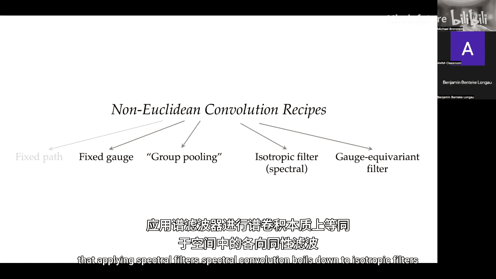
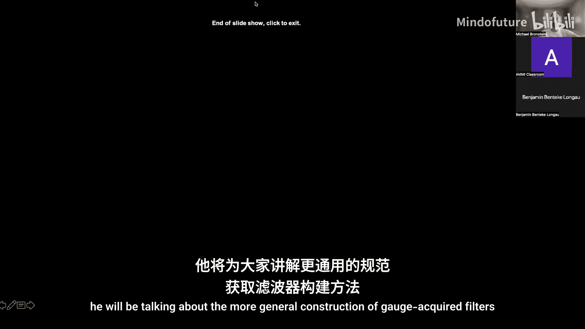

# 009：流形、测度与几何图

在本节课中，我们将学习流形、测度与几何图。这些概念在计算机科学中可能较为陌生，但它们是值得研究的有趣对象。我们将探讨如何将这些几何结构应用于深度学习，特别是如何将卷积神经网络的思想推广到非欧几里得域。

## 概述

到目前为止，我们讨论了几何深度学习的五个“G”。今天，我们将讨论最后一个“G”，即流形、网格和几何图。随后，Taco的课程将讨论“纤维丛”，这是流形的离散化概念。

我们之前通过选择域和对称群，将不同的流行架构定义为几何深度学习蓝图的实例。例如，在卷积神经网络中，域是网格，对称群是平移群。在图神经网络或深度集合中，域是图或集合，对称群是置换群。在本节中，我们将讨论内在或网格CNN，其域将是流形的某种离散化（通常是测度或几何图）。我们将看到，实际上有两种不同类型的对称性或不变性：一种是全局的（关于某些变形的等距性），另一种是局部的（称为规范对称性）。

## 为什么流形很有趣？

流形在机器学习中可能有些“异域风情”。在计算机视觉和计算机图形学中处理问题时，我们试图描述三维物体。在许多情况下，我们可以将它们描述为体积（体素）。然而，如果我们不关心物体内部，只关心外部表面，我们可以将其建模为物体的边界表面，这是一个二维流形，通常离散化为网格。这种表示方式显著减少了数据冗余。

对于可变形物体（如人体或面部表情），我们可以使用微分几何技术来非常自然地描述流形的变形。在蛋白质建模等应用中，蛋白质呈现给外部世界的是分子表面。我们并不十分关心蛋白质内部如何复杂折叠，因此将其表示为表面是一种有效的抽象方法。由于它们在相互作用时会改变构象，因此能够适当地处理这些对象非常重要。

## 流形上的两种对称性

如前所述，我们有两种对称性。第一种是局部坐标系选择中的模糊性，这被称为**规范**。第二种对称性是全局的，即变形。例如，当我们将一个形状变形为另一个形状时，我们可以在局部轻微拉伸或弯曲它，我们希望对这些变形保持不变，或至少近似不变。

在之前的例子中，例如在网格上，卷积的工作方式是我们有一个局部滤波器，在图像上移动，并将该滤波器与图像在不同位置的内容相关联。使我们能够做到这一点的是，我们可以全局移动滤波器。然而，在微分几何中，对于一般流形，滤波器移动的方式取决于我们选择的路径。在平面上，路径无关紧要；但在球面上，路径就很重要了。我们甚至可能遇到一些特殊情况，如不可定向流形（如莫比乌斯带），在这种情况下，不仅旋转不同，坐标也可能发生翻转（反射），从而改变手性。

## 将局部滤波推广到非欧几里得域

有几种方法可以将局部滤波或卷积类型架构的思想推广到非欧几里得域：
1.  **固定路径**：我们可以固定两点之间的规范路径（称为测地线）。
2.  **固定规范**：我们可以预先计算，从而消除坐标系中的模糊性。
3.  **群池化**：如果我们有旋转模糊性，可以对所有可能的旋转进行池化。
4.  **各向同性滤波器**：使用旋转不变的滤波器。
5.  **规范等变滤波器**：滤波器随坐标系的变化以相同方式变化（Taco将在下一讲详细描述）。

我们将主要关注前三种可能性：固定规范、群池化和各向同性滤波器。但在那之前，我们需要一些微分几何的背景知识。

## 微分几何速成课

我们需要讨论三件事：
1.  如何在流形上定义局部内容？我们需要理解**黎曼度量**和**指数映射**。
2.  如何移动物体？我们需要理解**平行移动**。
3.  与流形相关的对称性和不变性。

### 什么是流形？

流形可以想象为球体或二维曲面。从技术上讲，它们是拓扑空间。拓扑与几何的粗略区别在于，拓扑有邻域的概念，但没有距离或角度的概念（没有内积）。光滑流形具有局部坐标图之间的光滑过渡。一个d维流形局部同胚于d维欧几里得空间。对于曲面（二维流形），它们局部拓扑等价于一个平面，这就是我们所说的**切空间**或**切平面**。所有切空间的集合称为**切丛**。

在切空间中，我们有切向量（用大写字母X表示），它们模拟局部位移。重要的是，几何中的向量是坐标无关的抽象结构。要将向量视为箭头，需要内积的概念（希尔伯特空间）。要将向量视为数字数组，需要坐标，即局部基。这种局部基的集合（平滑依赖于位置）被称为**规范**。规范允许我们将向量表示为坐标数组（用小写粗体x表示）。

### 为流形配备几何结构

到目前为止，我们将流形视为拓扑对象，这意味着它是一个非常灵活、无限柔韧的“橡胶”对象。我们需要通过**黎曼度量**为流形配备几何结构。黎曼度量是每个切空间上的局部内积（记为G或带下标U的内积），它允许我们局部测量角度、长度和面积。角度由两个切向量的内积余弦给出，长度由该内积定义的范数给出，面积可以度量为该二次形式G的行列式。

完全用度量表达的属性称为**内蕴属性**。一旦在流形上定义了度量，如果对流形进行某种操作而度量不变，那么用度量表达的一切也不会改变。内蕴属性对于称为**等距**的某些变形类型是不变的。

### 测地线

给定流形上的两点U和V，我们可以定义一条曲线（参数化为t从0到T），从点U到点V。曲线的切向量或速度向量是曲线对参数t的导数，它属于该点的切空间。曲线的长度可以通过对速度向量的范数（由黎曼度量给出）积分来测量。**测地线**是长度最小化的曲线。测地线是内蕴的，因为它们是通过黎曼度量定义的。我们还可以定义**测地距离**，即两点之间测地线的长度。

### 平行移动

平行移动是一种将向量从点U移动到点V的方法。给定点U处的切向量X和连接U到V的测地线，我们可以定义沿该曲线参数化的向量X(t)。如果我们要求沿该曲线的向量长度恒定（由黎曼度量测量），并且向量与曲线切线的夹角也恒定，那么我们说X沿曲线**平行移动**。平行移动也称为**联络**，它是两个切空间之间的映射。在黎曼几何中，存在一个特殊的联络，即**列维-奇维塔联络**，它是无挠且与黎曼度量相容的。

### 指数映射

**指数映射**是一种将切空间局部映射回流形的方法。给定点U和切向量X，我们可以定义一条从U出发、初始切向量为X的测地线。指数映射定义为沿该测地线方向“走一步”（单位长度），将我们带到流形上的一个点。这允许我们在切平面上工作，但获取流形上函数的值。当我们想要定义局部滤波器时，这将非常方便。

## 在流形上定义类卷积操作

我们假设在流形上有一个信号（定义在每个点上的标量函数）。我们在切空间中定义一个滤波器（记为Ψ）。空间卷积的类比是，我们在每个点的切空间上对滤波器进行积分，其中函数的值通过指数映射被“拉回”到切空间。然后我们将其与定义在该空间中的滤波器相关联，从而得到卷积的类比。

问题在于，这些是抽象的几何向量，我们无法直接计算这个积分。为了计算，我们需要定义一个规范，即将向量表示为坐标数组。这意味着我们需要定义一个局部规范（局部坐标系）。问题是这个规范是任意的，我们可以用许多不同的方式定义它。因此，卷积结果依赖于规范的选择。如果我们改变规范（例如旋转局部坐标系），积分结果将会不同。

### 规范变换

如果我们有一个“裸露”的流形（拓扑对象），那么任何由可逆矩阵（一般线性群GL）实现的坐标变换都是允许的。如果我们有一个可定向流形，我们可以讨论GL⁺（正行列式的可逆矩阵）。如果流形具有体积形式，我们讨论的是行列式为1的矩阵（特殊线性群SL）。如果流形具有度量，我们可以将模糊性限制为正交矩阵（保持方向）。如果流形具有度量且可定向，我们可以进一步将矩阵限制为行列式为1（特殊正交群SO）。最后，如果流形具有标架场，则没有模糊性，规范是精确规定的。

在实际应用中，我们通常处理两种设置：具有标架场的流形，或具有SO(2)/SO(3)模糊性的流形（局部保向旋转）。

### 处理规范模糊性的策略

我们有几种可能性：
1.  **固定一个规范**：有技术可以实现。例如，我们可以取一个内蕴函数，计算其内蕴梯度，这给出一组向量。这些向量是光滑的，但可能在少数点消失。如果允许向量在少数点消失，这是一个有效的解决方案。
2.  **群池化**：假设我们使用极坐标在切平面中定义滤波器。我们可以说不知道如何定向滤波器，因此查看所有可能的方向，将滤波器的旋转版本与函数相关联，然后取最大值。这是一种与旋转掩模的相关性。当然，这样会丢弃一些信息。
3.  **各向同性滤波器**：各向同性滤波器是旋转对称的，它依赖于半径而不是角度。在这种情况下，我们不需要做群池化，但会损失判别能力。
4.  **规范等变滤波器**：滤波器随坐标系的变化以相同方式变化（下一讲内容）。

## 变形不变性

我们目前实现的是一个在流形上内蕴定义的滤波器。如果我们变形流形，只要该变形不改变黎曼度量（即等距变形），我们就不会受到变形的影响。我们可以将域变形视为两个不同流形之间的映射。我们需要描述它如何改变黎曼度量。这通过**推前映射**（切空间之间的映射）和**拉回度量**来实现。如果拉回度量与原度量在每个点都一致，则该映射是一个**等距**。另一种定义等距的方式是保持测地距离。在连通流形上，这两种定义是等价的。

这允许我们讨论信号不变性与域不变性。我们希望确保在变形域上计算的函数结果相同。我们可以放松不变性的概念，例如通过测量几何失真来量化变形与等距的差距，从而说明函数是近似等距不变的。

## 流形上的谱方法：傅里叶变换

我们希望在流形上定义类似傅里叶变换的东西。在欧几里得情况下，卷积可以被建模为在具有周期性边界条件的网格上的循环矩阵。卷积矩阵可交换，并且可以被联合对角化。我们可以选择拉普拉斯算子，其特征函数也是傅里叶基函数。傅里叶基可以解释为最小化狄利克雷能量（梯度范数）的正交基，或者解释为与邻居的局部差异。

我们希望类似地定义在流形上。为此，我们需要流形上微分算子的概念。

### 标量场与向量场

*   **标量场**：定义在流形上的实值函数（例如温度）。记为 𝒳(Ω, ℝ)。
*   **向量场**：将流形上每个点映射到该点切空间的函数。可以看作是流形上的局部位移或流动。

我们可以为这些空间配备内积：
*   标量场内积：点乘后积分。
*   向量场内积：使用黎曼度量取局部内积后积分。

### 内蕴梯度与散度

*   **内蕴梯度**：将标量场映射为向量场的算子。在每个点，它指向标量场最陡增加的方向。梯度是微分（线性泛函）的黎曼表示。
*   **散度**：将向量场映射为标量场的算子。可以看作是向量场的“流量”的无穷小源/汇。散度是梯度的伴随算子。

### 拉普拉斯-贝尔特拉米算子

**拉普拉斯-贝尔特拉米算子**（简称流形拉普拉斯算子）是将标量场映射为标量场的算子。可以将其视为点与其邻域平均值之间的局部差异。它是内蕴的、自伴的（对称的），因此具有实特征值。我们可以将这些特征值解释为频率。

拉普拉斯算子在物理学中无处不在，例如热方程和波动方程。在振动板实验中，沙形成的图案对应于拉普拉斯算子的特征函数的零点集（节线）。

在紧流形上，拉普拉斯算子具有可数特征分解。特征函数是内蕴的，因此是等距不变的。我们可以定义**流形傅里叶变换**，即将标量场与这些特征函数取内积得到傅里叶系数。这允许我们将信号分解为正交基，从而可以完全抽象掉底层域，仅处理傅里叶系数。

我们可以定义**谱卷积**，即取信号和滤波器的傅里叶系数的逐点乘积，然后用这些新系数加权特征函数并求和。然而，这种方法有几个缺点：
1.  没有快速算法，复杂度为O(n²)。
2.  滤波器不是局部化的。
3.  滤波器是各向同性的（同心圆状）。
4.  虽然精确等距下不变，但对近似变形不稳定，因为特征基会剧烈变化。

为了提高稳定性，我们可以将滤波器表示为应用于拉普拉斯算子的**传递函数**（作用于其特征值）。这样得到的滤波器是稳定的，并且随表面变形而变形。这种核是位置依赖的，不像欧几里得卷积核只依赖于坐标差。

## 流形的离散化：网格

流形通常离散化为**网格**。网格可以看作是一种“增强版”的图。它是一个单纯复形，包含0-单形（节点）、1-单形（边）和2-单形（三角形面）。流形网格要求每条边恰好被两个三角形面共享，并且每个节点周围的三角形边界形成一个单环。

每个节点可以与ℝ³中的坐标相关联，这称为**嵌入**。我们可以使用欧几里得距离测量网格中每条边的长度，这定义了**离散度量**。任何可以用这些边长度表达的东西都是内蕴的。等距变形要求保持这些边长。在实践中，网格通常是刚性的，因此近似等距的概念非常重要。

### 离散拉普拉斯算子

离散拉普拉斯算子的形式为：`L = D - W`，其中D是度矩阵，W是权重矩阵。它在节点i处的应用是：`(Lf)_i = ∑_j w_ij (f_i - f_j)`。这可以解释为节点与其邻居加权平均值的差异。对于网格，常用的权重计算方法是**余切权重公式**，它完全由边长决定，因此是内蕴的。

如果忽略面，只将网格视为图，则得到**组合拉普拉斯算子**（权重为1）。这等价于图神经网络中一种线性、局部、置换等变的聚合器。

### 谱图卷积神经网络

谱CNN以这种方式操作：将某个函数应用于拉普拉斯算子，然后对定义在网格或图节点上的信号进行操作。早期先驱工作来自离散几何处理。第一个谱图神经网络由Joanan等人于2014年提出，但存在高复杂性和不稳定性问题。

为了处理不稳定性，提出了**多项式谱滤波器**（如ChebNet）。它将多项式滤波器应用于拉普拉斯算子：`g(L) = ∑_{k=0}^K α_k L^k`。这避免了显式的特征分解，只需要计算拉普拉斯算子的幂。由于拉普拉斯算子是稀疏的，计算复杂度约为O(|E|)。这种方法对图变形是稳定的。本质上，它归结为简单的局部平均（拉普拉斯算子平均邻居，其幂平均邻居的邻居），从而具有了空间卷积的特性。

## 总结

本节课我们一起学习了：
1.  **流形的基本概念**：作为局部类似欧几里得空间的拓扑空间，以及黎曼度量如何为其添加几何结构。
2.  **关键几何工具**：测地线（最短路径）、平行移动（移动向量并保持角度）和指数映射（连接切空间与流形）。
3.  **流形上的深度学习挑战**：缺乏全局坐标系导致的规范模糊性，以及如何实现变形不变性。
4.  **处理策略**：固定规范、群池化、各向同性滤波器。
5.  **谱方法**：通过流形拉普拉斯算子的特征函数定义流形傅里叶变换和谱卷积，并讨论了其优缺点。
6.  **离散化**：将流形离散化为网格，定义离散拉普拉斯算子，并介绍了基于多项式的稳定谱图卷积网络（如ChebNet），它将谱滤波与局部空间聚合联系起来。

我们看到了如何将卷积神经网络的思想推广到流形和图上，核心在于利用内蕴的几何算子（如拉普拉斯算子）来定义在域变形下稳定或不变的运算。下一讲中，Taco将深入探讨更一般的规范等变滤波器构造。