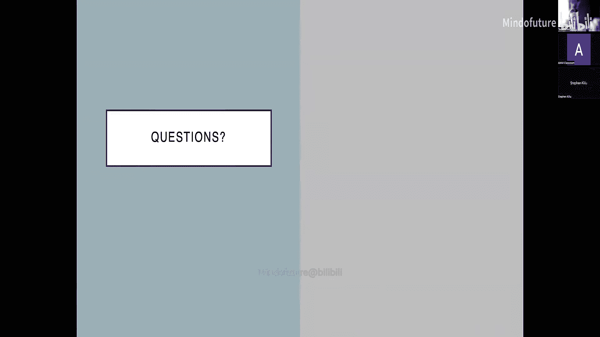

# 010：规范理论入门

在本节课中，我们将要学习规范理论的基本概念，了解它为何在几何深度学习中至关重要，并探索如何利用规范等变性来设计适用于流形等复杂几何结构的神经网络架构。

---

## 概述：为何需要规范理论？

几何数据，例如地球上的风向或大脑中的扩散张量，通常以“特征场”的形式存在。这些数据只能相对于一个参考系（即“规范”）进行数值表示，而规范的选择通常是任意的。同一个物理实体，在不同的规范下会得到不同的数值表示。为了构建能够正确处理此类数据的神经网络，我们需要理解“规范变换”以及如何使网络对此类变换具有“等变性”。

上一节我们介绍了问题的背景，本节中我们来看看“特征场”这一核心概念。

---

## 特征场：超越标量函数的数据

在之前的课程中，我们主要处理定义在域 Ω（如图形、网格或球面）上的信号，这些信号可以看作是 Ω 上的标量值或向量值函数。

然而，有一类更一般的数据称为“场”。在场中，定义在每个点 **u** 上的特征值，并不属于一个全局统一的向量空间 **C**，而是属于一个与点 **u** 本身“附着”的向量空间。

一个直观的例子是流形上的**切空间**。考虑一个球面，在其每一点上都有一个切平面，该点的向量（如风向）就生活在这个切平面中。虽然所有切平面都是二维向量空间，但它们之间并没有一个规范的方式对齐。这些附着在每一点的向量空间，在数学上称为“纤维”。

为了将场描述为一个函数，我们需要将所有这些纤维对齐。这通过在每个点选择一个**基底**（即一个“规范”）来实现。选择规范后，每个纤维就与一个标准向量空间（如 **R²**）对齐，场就可以表示为一个函数。

---

## 规范与规范变换

“规范”一词原指测量仪表（如气压计），仪表读数依赖于所选单位。改变单位（即改变规范）会改变描述同一物理量的数值。

在几何语境下，规范对应于为流形上每一点的纤维选择的一个参考系。例如，在球面上，我们可以选择经纬度坐标系（蓝色）或另一套坐标系（红色）来定义每一点的基底向量。

*   **同一向量，不同表示**：一个几何向量（如绿色箭头）在不同的规范下，会得到不同的数值坐标表示。
*   **规范变换**：从一个规范切换到另一个规范时，数据数值表示所经历的变化，称为规范变换。它可以被建模为一个函数 **g: Ω → G**，为域上每一点指定一个群元素（如旋转）。这与我们之前讨论的**全局**对称性不同，规范变换是一种**局部**对称性。
*   **规范可能无法全局连续定义**：在某些流形（如球面）上，无法找到一个全局连续且无奇点的规范场（例如，尝试在球面上连续定义指向“北”的向量场，在两极必然出现奇点）。这意味着我们通常只能在局部定义规范。

---

## 规范等变性：网络设计的目标

我们希望神经网络层的处理与规范的选择无关。具体来说，如果对输入场进行一个规范变换，然后通过网络层 **F** 处理，得到的结果应该与先通过网络层 **F** 处理输入，再对输出进行同样的规范变换，二者结果相同。

用公式表示，对于规范变换 **ρ(g)**（其中 **g** 是规范变换函数），我们希望：
**F( ρ(g) · x ) = ρ(g) · F( x )**
满足此性质的网络层 **F** 被称为**规范等变**的。

上一节我们定义了目标，本节中我们来看看如何为实现该目标来设计卷积操作。

---

## 流形上的卷积：挑战与方案

将卷积推广到流形（非齐性空间）面临核心挑战：缺乏全局对称性来实现权重共享。

以下是几种尝试方案及其局限性：

1.  **基于全局对称性的卷积**：在齐性空间（如平面、球面）有效，但在一般流形（如人脸网格）上，对称性不足，无法实现充分的权重共享。
2.  **基于平行移动的卷积**：尝试将滤波器从一个点“平行移动”到其他点。但在弯曲空间，平行移动的结果依赖于所选择的**路径**，导致滤波器方向具有任意性。
3.  **各向同性滤波器**：使用没有方向性的滤波器（如高斯核）。这是早期图神经网络的思想，但表达能力有限，无法检测方向特征。
4.  **测地线卷积**：在每个点提取局部块，与旋转后的滤波器组进行内积，然后在方向维度上进行池化。这能检测边缘等特征，但池化操作会丢失方向信息。

---

## 规范等变卷积：一个通用框架

规范等变卷积为解决上述问题提供了一个通用框架。其核心思想是明确承认并利用规范的选择。

*   **特征空间**：每一层的特征被定义为特定类型的场（如标量场、向量场、张量场），并明确其规范变换规律（即群表示 **ρ**）。
*   **卷积操作**：滤波器被定义在切空间上，并相对于局部规范进行定向。卷积运算在由指数映射定义的局部邻域内进行。

关键结论：
*   当输入和输出都是**标量场**时，为保证规范等变性，滤波器必须是**各向同性**的。
*   当输入和输出是更一般的**场**（如向量场）时，滤波器需要满足一个特定的等变性约束条件，这允许滤波器具有方向敏感性，同时保持整个操作的规范等变性。

以下是实现规范等变网络时需要考虑的要点：
*   需要为计算域（流形）选择一个规范场（可能是离散的）。
*   滤波器在切空间上参数化，并满足等变性约束。
*   通过指数映射将切空间上的局部坐标映射回流形上的点。

---

## 总结与展望

本节课中我们一起学习了：
1.  **特征场**是几何数据的一种自然形式，需要在局部规范下表示。
2.  **规范变换**描述了同一几何对象在不同规范下的数值变化，是一种局部对称性。
3.  **规范等变性**是设计处理场数据的神经网络的关键原则。
4.  推广卷积到一般流形面临**路径依赖**和**权重共享**的挑战。
5.  **规范等变卷积**提供了一个通用框架，通过明确包含规范并约束滤波器形式，来构建适用于非齐性空间的深度网络。

规范理论将深度学习的蓝图扩展到了最一般的几何结构上，允许我们统一处理从平面图像到复杂流形上的物理场等各种数据。虽然数学基础涉及纤维丛等概念，但其核心思想——使网络对局部参考系的选择保持不变——对构建鲁棒的几何深度学习模型至关重要。