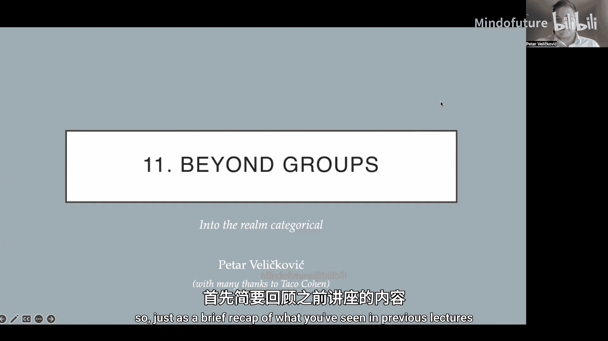
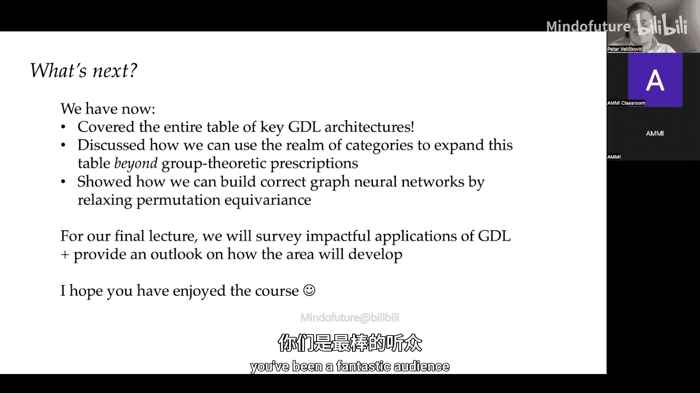

# 011：超越群



在本节课中，我们将要学习如何超越群论的范畴，探索范畴论这一更通用的数学框架。我们将看到，范畴论如何通过放松群论中的某些严格假设（如变换的可逆性和任意可组合性），来建模更广泛、更具表达力的计算和神经网络架构。

在之前的课程中，我们学习了群论和表示论，并利用它们重新推导和分类了许多主流的深度学习架构。然而，当我们开始建模更具表现力或更复杂的架构时，群论可能存在一些限制。本节中，我们将探讨如何超越群，进入范畴论的领域。

## 从群到范畴：为何需要超越？

上一节我们介绍了群论在几何深度学习中的核心作用。本节中我们来看看群论的两个潜在限制。

群必须满足以下公理：
*   **封闭性**：对于任意群元素 `g, h ∈ G`，其组合 `g ∘ h` 也必须在 `G` 中。
*   **结合律**：`(g ∘ h) ∘ k = g ∘ (h ∘ k)`。
*   **单位元**：存在单位元 `e`，使得 `e ∘ g = g ∘ e = g`。
*   **逆元**：对于任意 `g ∈ G`，存在 `g⁻¹ ∈ G`，使得 `g ∘ g⁻¹ = g⁻¹ ∘ g = e`。

其中，**逆元**和**封闭性**（任意两个变换都可组合）的假设在现实中可能过于严格。例如，我们可能关心会丢失信息的操作（不可逆），或者并非所有变换对都能组合的情况。因此，我们需要一个比群论更通用的视角来建模通用计算，而范畴论提供了这样的视角。

## 范畴论基础

为了理解如何超越群，我们首先需要掌握范畴论的基本概念。范畴是比群更通用的结构。

一个范畴 `C` 由以下部分组成：
1.  **对象（Objects）**：一个集合（或更准确地说，一个“类”），记作 `Ob(C)`。
2.  **态射（Morphisms）**：对于任意两个对象 `X, Y ∈ Ob(C)`，存在一个集合 `Hom_C(X, Y)`，其元素称为从 `X` 到 `Y` 的态射（或箭头）。
3.  **复合（Composition）**：对于对象 `X, Y, Z`，存在一个复合运算 `∘ : Hom_C(Y, Z) × Hom_C(X, Y) → Hom_C(X, Z)`，满足：
    *   **结合律**：对于 `f: X→Y`, `g: Y→Z`, `h: Z→W`，有 `(h ∘ g) ∘ f = h ∘ (g ∘ f)`。
    *   **单位元**：对于每个对象 `X`，存在一个单位态射 `id_X: X→X`，使得对于任意 `f: X→Y` 和 `g: W→X`，有 `f ∘ id_X = f` 且 `id_X ∘ g = g`。

范畴的核心思想是**只关注对象之间的关系（态射）**，而不关心对象内部的细节。这使我们能够专注于计算或变换的结构。

### 示例：集合范畴

让我们通过一个具体例子来巩固概念。集合范畴 **Set** 定义如下：
*   **对象**：所有集合。
*   **态射**：集合之间的函数。

在 **Set** 中，我们可以通过态射的性质来“探测”对象内部结构，而无需查看其元素。例如，**终对象（Terminal Object）** 是任何其他对象都恰好有一个态射指向它的对象。在 **Set** 中，终对象是任何单元素集合（例如 `{*}`）。这一性质纯粹由态射模式定义，展示了范畴论的力量。

## 群作为特殊的范畴

现在，我们来看看群如何嵌入到范畴论框架中。这能清晰地展示群是范畴的一个特例。

一个群 `G` 可以视为一个范畴 **G**，其中：
*   **只有一个对象**，记作 `•`。
*   **从 `•` 到 `•` 的所有态射** 对应于群的元素。
*   **态射的复合** 对应于群的二元运算。
*   **每个态射都是同构**（即可逆），这对应于群元素都有逆元。

因此，群是一个只有一个对象、且所有态射都是同构的范畴。这凸显了群结构的特殊性。

## 函子：范畴之间的映射

范畴论的力量不仅在于单个范畴，更在于范畴之间的关系。函子（Functor）是保持结构的范畴之间的映射。

一个从范畴 `C` 到范畴 `D` 的函子 `F: C → D` 包含：
1.  将 `C` 中每个对象 `X` 映射到 `D` 中一个对象 `F(X)`。
2.  将 `C` 中每个态射 `f: X→Y` 映射到 `D` 中一个态射 `F(f): F(X)→F(Y)`。
3.  满足：
    *   `F(id_X) = id_{F(X)}`
    *   `F(g ∘ f) = F(g) ∘ F(f)`

在几何深度学习中，**群表示** 正是函子的一个例子：它将群（视为单对象范畴）映射到向量空间范畴，将群元素映射为线性变换（如矩阵）。

## 自然变换与等变性

我们之前用交换图定义了等变性。在范畴论中，等变性条件被优雅地概括为**自然变换（Natural Transformation）**。

给定两个函子 `F, G: C → D`，一个自然变换 `η: F ⇒ G` 为 `C` 中每个对象 `X` 分配一个 `D` 中的态射 `η_X: F(X) → G(X)`，使得对于 `C` 中任意态射 `f: X→Y`，下图交换：
```
F(X) --F(f)--> F(Y)
 |               |
η_X              η_Y
 |               |
 v               v
G(X) --G(f)--> G(Y)
```
即 `η_Y ∘ F(f) = G(f) ∘ η_X`。

在神经网络的语境下：
*   范畴 `C` 可以是图范畴或群范畴。
*   函子 `F` 和 `G` 是将输入对象映射到不同特征空间（向量空间）的表示。
*   神经网络层 `f` 可以看作一个自然变换 `η` 的分量。
*   **自然性条件**（交换图）正是**等变性约束**。

传统的群等变性是自然变换的一个特例，其中范畴 `C` 是单对象群范畴，且自然变换的每个分量 `η_•` 是同一个函数（即神经网络的权重共享）。范畴论框架允许更一般的情况：`η_X` 可以随对象 `X` 的不同而不同，从而允许更灵活的参数共享模式。

## 应用：超越置换等变的图神经网络

让我们看一个具体应用：构建比标准消息传递神经网络（MPNN）更灵活但仍保持合理归纳偏置的图神经网络。

我们可以定义**图范畴** **Graph**：
*   **对象**：图的邻接矩阵（代表图结构）。
*   **态射**：保持图结构的同构（即可逆的节点置换）。

**Graph** 是一个**广群（Groupoid）**，即所有态射都是同构的范畴。它比单一的置换群更丰富，包含多个对象（图）以及它们之间的同构关系。

现在，我们可以定义函子将图映射到其特征向量空间，并将节点置换映射为相应的特征置换矩阵。一个图神经网络层可以定义为这些函子之间的自然变换。

自然性条件在此产生两种约束：
1.  **自同构约束**：对于同一个图内的自同构（置换后图不变），相关的边必须使用相同的消息传递函数。
2.  **同构约束**：同构的图之间，对应的消息传递函数必须相同。

这允许我们在**不破坏图结构对称性**的前提下，为图中不同的边使用**不同的消息函数**。例如，在一个图中，我们可以为处于对称位置的边（如自同构相关的边）分配相同的参数，而为非对称的边分配不同的参数。这比所有边共享同一函数的经典GNN更具表达力。

当然，完全按此定义的“自然图网络”可能过参数化且难以泛化。更实用的方法是局部化，考虑每个节点或边的邻居子图所诱导的约束，从而设计出既灵活又可泛化的架构。

## 总结



本节课中我们一起学习了如何超越群论，利用范畴论来构建更通用的几何深度学习框架。我们回顾了群的局限性，引入了范畴、函子和自然变换等基本概念，并展示了群和等变性如何作为其特例。最后，我们探讨了如何应用这一框架设计更灵活的图神经网络，其中参数共享模式由图的（局部）对称性自然决定，而非全局强制统一。范畴论为我们提供了描述复杂计算结构和设计新型神经网络架构的强大语言。