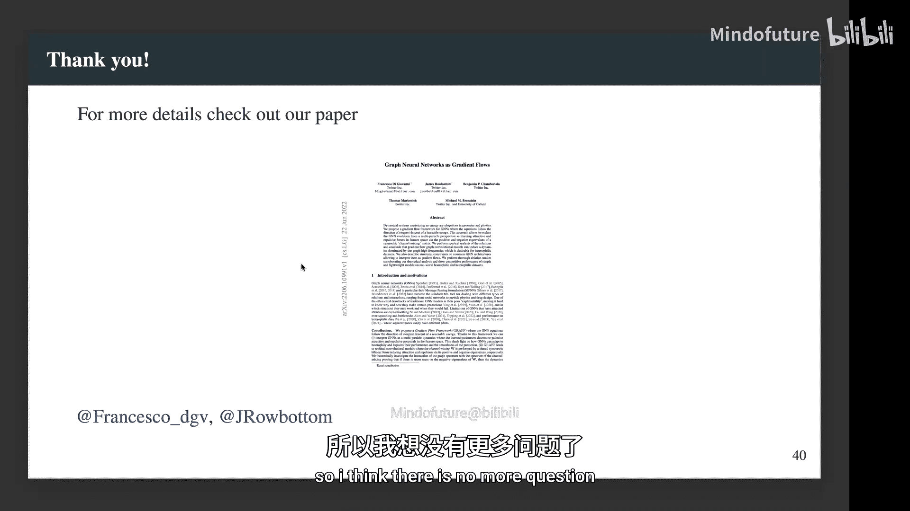

# 013：研讨会1（基于物理的GNN）🧠

在本节课中，我们将学习如何从物理和信号处理的角度分析图神经网络，特别是消息传递神经网络。我们将引入图信号平滑度的概念，并探讨如何通过分析能量函数来理解GNN的动态行为。

---

## 图论基础与图信号 📊

上一节我们介绍了课程背景，本节中我们来看看图论的基础知识。我们考虑一个无向图，它由顶点集V和边集E组成。我们用n表示图中的节点数量。

以下是图论中最重要的两个矩阵：
*   **邻接矩阵A**：一个n×n的方阵，用于表示图中节点之间的连接关系。
*   **度矩阵D**：一个n×n的对角矩阵，其对角线元素是每个节点的度（即连接的边数）。

一个重要的算子是由A和D构造的**归一化邻接矩阵**，记作 `Ā = D^(-1/2) A D^(-1/2)`。在图卷积网络中，这个矩阵被广泛使用。

然而，图论中最重要的算子之一是**拉普拉斯矩阵**，我们将其定义为 `Δ = I - Ā`。拉普拉斯矩阵是一个n×n的对称半正定矩阵。我们可以将其视为一个作用在图信号上的算子。

一个**图信号**是一个映射，它为每个节点分配一个标量值。因此，我们可以用一个n维向量来表示这个信号。拉普拉斯矩阵作用于这个信号向量，其表达式为 `(Δx)_i = x_i - (1/√(d_i d_j)) Σ_{j∈N(i)} x_j`。这个算子类似于欧几里得空间中的二阶微分算子，因此得名“拉普拉斯”。

拉普拉斯矩阵的特征值可以按从小到大排序。两个重要性质是：
*   最小的特征值总是0，其重数等于图中连通分量的数量。
*   最大的特征值（即谱半径ρ(Δ)）总是小于或等于2。

通常，人们将这些特征值称为**频率**。我们将拉普拉斯矩阵的特征向量记为 `{φ_k}_{k=1}^n`，它们也是n维向量。

---

## 狄利克雷能量与信号平滑度 ⚖️

上一节我们定义了拉普拉斯矩阵，本节中我们来看看如何用它来衡量图信号的平滑度。一个重要的度量是**狄利克雷能量**。

考虑一个图信号，例如图中每个节点的温度。我们可以将其表示为一个n维向量x。该信号的狄利克雷能量定义为所有边上信号值偏差的平方和，并进行归一化：
`E_dir(x) = Σ_{(i,j)∈E} (1/√(d_i d_j)) (x_i - x_j)^2`。

这个能量可以写成紧凑形式：`E_dir(x) = x^T Δ x`。利用拉普拉斯矩阵的特征分解 `Δ = Φ Λ Φ^T`，我们可以将能量重写为 `E_dir(x) = Σ_k λ_k |<x, φ_k>|^2`，其中 `c_k = <x, φ_k>` 是信号在特征向量基上的系数。

**狄利克雷能量衡量了信号的平滑度**。能量越低，信号沿边的变化越小，信号越平滑。反之，能量越高，信号越不平滑。人们通常将沿边的信号偏差 `(x_i - x_j)/√(d_i d_j)` 称为该边上的**梯度**。

等价地，信号在低频率特征向量（对应小特征值）上的投影质量越大，信号就越平滑，因为狄利克雷能量会更低。

为什么我们关心信号的平滑度？例如，在图像处理中，图像可以看作是一种特殊的图。模糊操作会增加图像的平滑度，而锐化操作则会降低平滑度。因此，评估信号的平滑度有助于我们理解和设计对信号进行的变换。

---

## 图上的动力学系统与滤波 🔄

上一节我们介绍了平滑度的静态度量，本节中我们来看看信号如何随时间演化。考虑一个随时间变化的图过程，例如图中温度的热扩散。

我们可以将每个时刻的温度表示为一个n维向量 `x(t)`。我们可以将其分解到拉普拉斯特征向量基上：`x(t) = Σ_k c_k(t) φ_k`。现在，系数 `c_k` 是时间的函数。

一个粗略的描述是：
*   如果高频分量（即对应大特征值λ_k的系数 `c_k(t)`）随时间衰减，我们保留低频分量，这实际上是一种**低通滤波**操作，如去噪或模糊，会增加信号的平滑度。
*   如果低频分量衰减，我们保留高频分量，这实际上是一种**高通滤波**操作，如锐化或边缘增强，会降低信号的平滑度。

下图直观展示了这一点，从左到右是拉普拉斯矩阵的前几个特征向量。最左边的特征向量在所有节点上取值相同（非常平滑，低频），越往右特征向量变化越剧烈（越不平滑，高频）。

一个标准的低通滤波（平滑化）操作是**热方程**。假设我们有一个输入信号（如温度），其狄利克雷能量为 `E_dir(x) = x^T Δ x`。如果我们希望最小化这个能量以使信号更平滑，我们可以沿着能量最速下降的方向移动。这导出了一个动力学系统或微分方程：`dx/dt = -∇E_dir(x) = -Δ x`。这就是经典的热方程。

根据设计，由于我们沿着能量最速下降的方向演化，能量会随时间减少。如果我们让热方程无限时间运行，极限解将位于拉普拉斯矩阵的零空间中（即满足 `Δ x = 0`）。关键信息是：如果一个低通动态过程运行时间过长，特征会变得无法区分，因为所有节点都趋向于相同的值。

---

## 从标量信号到向量信号 📈

上一节我们讨论了标量信号，本节中我们将其推广到更常见的情况——向量信号。在GNN中，每个节点通常有一个d维的特征向量。因此，我们可以将特征表示为一个 `n × d` 的矩阵 `X`。

我们可以很容易地推广狄利克雷能量。我们对所有边求和，但现在不是标量偏差，而是向量差的L2范数：
`E_dir(X) = Σ_{(i,j)∈E} (1/√(d_i d_j)) ||X_i - X_j||^2`。

如果我们取这个能量的梯度流（即沿着能量最速下降的方向演化信号），我们会得到热方程，但现在是作用在每个特征通道上：对于每个 `r` 从1到d，有 `dX_{:,r}/dt = -Δ X_{:,r}`。

为了以更统一的方式分析矩阵方程，一个关键技术是**向量化**。给定特征矩阵 `X`，我们可以通过堆叠所有列将其转换为一个长的列向量 `vec(X)`。这样，我们就从 `n × d` 矩阵变成了 `(n*d)` 维向量。

使用克罗内克积 `⊗`，我们可以将向量化后的狄利克雷能量写为紧凑形式：`E_dir(vec(X)) = vec(X)^T (Δ ⊗ I_d) vec(X)`。同样，热方程可以写为向量方程：`d vec(X)/dt = -(Δ ⊗ I_d) vec(X)`。这种形式将矩阵微分方程简化为向量微分方程，更易于处理。

---

## 低通与高通主导的动力学定义 🎯

上一节我们建立了分析工具，本节中我们给出两个核心定义来区分不同类型的动力学过程。考虑一个图上的动力学过程，我们如何判断它是平滑过程还是锐化过程？低频率占主导还是高频率占主导？

关键点是，我们可以使用狄利克雷能量，但必须首先对解进行归一化。考虑一个简单的微分方程：`dX/dt = Ā X`，其中 `Ā = I - Δ`。其解可以表示为 `X(t) = exp(tĀ) X(0)`。通过特征分解，我们发现沿着最平滑特征向量（对应特征值0）的投影分量增长得最快。

这似乎表明这是一个平滑过程。然而，如果我们计算原始解的狄利克雷能量，它通常会发散到无穷大。问题在于我们没有考虑信号的尺度。如果我们对解进行归一化（即除以它的范数），那么归一化解的狄利克雷能量将趋于零。实际上，对于每个特征通道，归一化解都收敛到拉普拉斯矩阵零空间中的某个元素。

基于这个动机，我们在论文中引入了以下定义：

我们称一个初始化为某个输入特征的动力学系统是**低频率主导**的，如果归一化解的狄利克雷能量随时间趋于零：`lim_{t→∞} E_dir( X(t)/||X(t)||_F ) = 0`。这一定义是合理的，因为可以证明，满足此条件的解会收敛到拉普拉斯矩阵的零空间，即最平滑的状态。

类似地，我们称一个动力学系统是**高频率主导**的，如果归一化解的狄利克雷能量随时间趋近于其最大值（定义为谱半径ρ(Δ)/2）：`lim_{t→∞} E_dir( X(t)/||X(t)||_F ) = ρ(Δ)/2`。这同样合理，因为可以证明满足此条件的解会收敛到拉普拉斯矩阵最大特征值对应的特征向量，即最不平滑的状态。

**关键信息**：LFD动力学意味着平滑化过程，使事物越来越相似。HFD动力学意味着锐化过程，增强差异。

---

## 消息传递神经网络与面临的挑战 🤖

上一节我们定义了动力学类型，本节中我们看看为什么这些定义对GNN重要。我们终于可以讨论消息传递神经网络了。

我们有一个图、一些输入特征、一个可选的编码映射，以及每层的更新函数。通常，消息传递神经网络可以写成：`h_i^{(l+1)} = UPDATE( h_i^{(l)}, AGGREGATE({h_j^{(l)} for j in N(i)}) )`。消息传递意味着我们使用给定的图作为计算图来传播信息。

MPNNs相当成功且简单，但也面临问题：
1.  **表达能力**：我们不会在经典的WL测试意义上讨论表达能力。
2.  **低通 vs. 高通**：当我们需要的不只是平滑过程（如去噪）时，MPNNs表现如何？这与**过度平滑**的经典问题相关，即堆叠过多层后，所有节点的表示变得无法区分。
3.  **过度挤压**：由于图拓扑结构，信息流动可能受阻。

本演讲将主要关注第二点。在半监督学习设置中，我们有一部分节点被标记，并希望预测测试集节点的标签。这里有两个常用概念：
*   **同配性**：邻居通常共享相同的标签。标签是平滑的，因此低通滤波是有益的。
*   **异配性**：标签不平滑。此时低通滤波可能有害，因为它会使本应不同的节点变得相似。

这最终回到了最初关于为何关心平滑度的问题。我们关心平滑度是因为，如果一个过程增加了信号的平滑度，那么在同配性图中可能有益，但在异配性图中可能有害。反之，锐化过程在异配性图中可能有益。

---

## 图卷积网络的局限性与我们的方法 💡

上一节我们指出了MPNNs的挑战，本节中我们以经典的图卷积网络为例进行具体分析。GCN的一层定义为：`H^{(l+1)} = σ( Ā H^{(l)} W^{(l)} )`，其中 `Ā` 是归一化邻接矩阵，`W` 是权重矩阵，`σ` 是激活函数。右边的乘法被称为“通道混合”。

GCN非常成功，但在某些场景下表现不佳：
1.  异配性图。
2.  增加深度时的性能下降（过度平滑问题）。

文献中的分析可以概括为：如果通道混合矩阵 `W` 的奇异值足够小（“足够小”取决于图的谱隙等属性），那么GCN解的狄利克雷能量将趋于零。这意味着一个平滑过程，可能会丢失信息。

但这个结论有其局限性，它依赖于通道混合矩阵奇异值足够小的假设。我们能否在没有这个假设的情况下推广该结果？GCN是否注定只能作为低通滤波器？或许我们可以得出一些不同的结论。

为了探讨这些问题，我们采用了一种**多粒子视角**来看待GNNs。我们将节点特征视为 `R^d` 空间中的粒子，并引入一个**梯度流框架**。在这个框架中，消息传递神经网络可以被解释为最小化一个可学习能量的多粒子动力学。

我们方法的概要如下：
*   我们不参数化消息传递方程，而是参数化一个**能量函数**，该能量模拟了粒子间的相互作用。
*   然后，消息传递网络将遵循这个可学习能量的最速下降方向。
*   我们证明，通道混合矩阵 `W` 可以通过其谱学会诱导低频率主导或高频率主导的动力学。具体来说，`W` 的正特征值产生吸引力（平滑），负特征值产生排斥力（锐化）。
*   因此，该框架可以学会适应同配性和异配性图。

---

## 可学习的梯度流框架 ⚙️

上一节概述了我们的方法，本节中我们深入探讨其数学细节。我们可以将残差网络视为微分方程在步长趋于零时的离散化。对于具有残差块和步长的残差消息传递网络也是如此。如果步长趋于零，这就是微分方程的离散化。

已经存在一些连续消息传递神经网络的实例。在这些模型中，你实际上是在参数化方程本身。那么问题来了：我们如何选择这些方程？

由于我们处理的是微分方程和动力系统框架，有一类特殊的方程称为**梯度流**。在梯度流中，ODE实际上是某个能量的最速下降方向。这些方程非常特殊，在物理和几何中广泛应用，因为研究能量本身就能提供大量信息。你知道任何得到的解都在最小化能量，因此你知道动力学试图实现什么。

我们工作的关键动机是：如果我们参数化一个能量函数（即学习一个能量），而不是直接学习消息传递神经网络的方程，会怎样？如果我们这样做，那么我们可以将这个过程解释为：**推广经典的、不可学习的狄利克雷能量，以找到适合当前问题的正确平滑度概念**。一旦我们参数化了能量，消息传递神经网络方程将作为该能量的梯度流自然得出。

让我们更具体一些。如何推广图的狄利克雷能量？假设我们有一个表示度量（欧几里得空间）的矩阵 `W`，它是一个半正定矩阵，因此可以分解为 `W = U^T U`。我们可以通过用这个可学习的 `W` 加权L2范数来推广经典的狄利克雷能量：`E_{W}(X) = Σ_{(i,j)∈E} (1/√(d_i d_j)) ||(X_i - X_j) U||^2`。

假设我们想要最小化这个用 `W` 加权的狄利克雷能量。我们期望每个求和项都被最小化，因此梯度应趋于零，除非它位于 `U` 的零空间中。这正是发生的情况。我们可以将 `W` 视为可学习的权重。

我们可以推导出该能量的梯度流，这是一个相当简单的方程：`d vec(X)/dt = -(Δ ⊗ W) vec(X)`。这类似于GCN，因为我们有一个解，一个消息传递矩阵（这里是负拉普拉斯矩阵），但在右边，我们有这个作用于特征上的通道混合 `W`。

我们的命题（非正式陈述）是：**没有哪个可学习的 `W` 能够区分具有相同度和相同输入特征的节点的极限嵌入**。如果两个节点具有相同的度和相同的输入特征，运行此方程足够长时间后，它们的表示将变得相同，我们无法再区分它们。事实上，如果 `W` 的零空间仅为零向量，那么具有相同度的节点将收敛到相同的表示，这与它们的输入特征无关。这通常被称为**过度平滑**。

关键信息是：如果我们只能控制通道混合矩阵 `W` 的特征值的符号，那么它将总是产生低频率主导的动力学，并最终导致过度平滑。这并不理想，因为在异配性情况下它肯定会失败。

---

## 引入更通用的能量函数 🔧

上一节我们看到了简单推广的局限性，本节中我们对其进行修改以使其更通用。我们有一个用 `W` 加权的狄利克雷能量。我们做的是：将每个 `U^T U` 的出现替换为独立的对称矩阵 `Ω` 和 `W`。对称性是必要的。

这样，能量被写为两项之和：`E_{Ω, W}(X) = Σ_i X_i^T Ω X_i + Σ_{(i,j)∈E} (1/√(d_i d_j)) (X_i - X_j)^T W (X_i - X_j)`。第一项不依赖于边或图的连通性。第二项依赖于边的连通性，因为它是所有边上由 `Ω` 和 `W` 加权的内积之和。

我们可以取该能量的梯度流。梯度流方程将再次变得类似于图卷积模型，因为它是一个微分方程。但我们有一个类似于GraphSAGE的项（通道混合作用于解，不包含图信息），然后是一个本质上的图卷积块。

现在重要的是解释。节点特征是粒子。外部能量不依赖于图拓扑，可以解释为粒子空间中的**外场**。成对能量是依赖于边的势能，可以解释为由 `W` 控制的粒子间的**成对相互作用**。在我们的框架中，`W` 和 `Ω` 是我们要学习的。

由于 `W` 是对称的，它可以分解为正特征值和负特征值部分：`W = W_+ + W_-`。如果我们这样做，我们可以用更明确的方式重写相同的能量。第一项仍然独立于图结构。

但接下来的两项非常有趣。由于我们通过梯度流最小化能量，我们得到：
*   **吸引力**：通过 `W` 的正特征值，因为涉及 `W_+` 的项沿边减少。
*   **排斥力**：通过 `W` 的负特征值，因为涉及 `W_-` 的项在演化过程中增加（它们在能量表达式中带有负号，因此梯度下降会使该项增加）。

因此，我们发现，仅仅通过观察能量（甚至不看方程），我们就知道作为该能量梯度流的任何消息传递网络都将具有两种行为：由 `W` 的正特征值引起的吸引力，以及由 `W` 的负特征值引起的排斥力。吸引力使事物更平滑（拉近事物），排斥力则增强差异（推开事物）。因此，我们期望吸引力诱导LFD动力学，排斥力诱导HFD动力学。

这正是发生的情况。我们的命题（非正式陈述）精确地说明了这一点：如果你有足够的 `W` 负特征值（相对于正特征值），那么高频率将占主导，你的动力学是HFD，你不会过度平滑，事实上你会将事物分开。理论结论是：进入GCN等的通道混合矩阵 `W` 实际上非常强大，其特征值的分布（特别是负特征值相对于正特征值的质量）决定了动力学是LFD还是HFD，从而可以适应平滑或增强。

---

## 离散化、理论结果与实验验证 📉

上一节我们在连续时间框架下分析了能量函数，本节中我们讨论其离散化及主要理论结果。最终，我们需要离散化我们的方程。我们通过引入步长 `γ` 来实现。我们的线性梯度流框架可以简化为以下形式：`H^{(l+1)} = H^{(l)} - γ ( Ā H^{(l)} W + H^{(l)} Ω )`。唯一的约束是通道混合矩阵 `W` 是对称的，并且在所有层之间共享。

我们论文的主要定理本质上是将连续时间的结果转化到离散时间（层）的情况。该定理告诉我们以下几点：

1.  与之前的结果不同，由于 `W` 的负特征值，我们可以诱导高频率主导的动力学。
2.  只要正特征值足够小，对负特征值的大小没有要求。正是 `W` 的正负特征值的集中程度真正决定了MPN内部的动力学行为。
3.  我们还发现，如果**丢弃残差连接**，那么无论 `W` 的特征值大小如何，动力学都将是低频率主导的。`W` 的特征值只有在存在残差连接时才能帮助引导过程远离平滑化，否则它们无法做到这一点。

我们通过消融研究来证实和验证我们的理论分析。我们框架的组成部分包括：
*   一个作用于节点的编码块。
*   跨层共享的对称通道混合矩阵 `Ω` 和 `W`。
*   用于分类的解码块。
*   简单的线性消息传递层（因为是来自微分方程的残差连接）。
*   梯度流块。

关键是如何强制 `W` 的对称性并控制其谱。简单的方法是学习一个 `W'`，然后令 `W = W' + W'^T`，但这种方法无法控制谱。另一种方法是乘积形式 `W = W'^T W'`，但这总是产生相同符号的特征值（全非负或全非正）。最后，我们使用**对角占优**形式，分别控制 `W` 的对角线和非对角线元素，并利用Gershgorin圆定理来监控谱。消融研究表明，这种配置在异配性任务上似乎更有效。

我们的模型（或框架）非常简单，是线性的，没有注意力机制，计算速度比GCN更快，因为我们使用节点而非边进行预处理。

---

## 结论与总结 🎓

本节课中，我们一起学习了如何从梯度流和能量最小化的角度分析图神经网络。

我们首先回顾了图论基础，引入了拉普拉斯矩阵和狄利克雷能量来衡量图信号的平滑度。然后，我们定义了低频率主导和高频率主导的动力学，以区分平滑化与锐化过程。

接着，我们将这些概念与消息传递神经网络联系起来，指出了GNN在同配性与异配性图上面临的挑战，特别是过度平滑问题。

我们的核心贡献是提出了一个**基于可学习能量函数的梯度流框架**。在这个框架中，MPNN的方程是某个能量最小化的结果。我们证明了，通道混合矩阵 `W` 的谱（尤其是其正负特征值的分布）决定了网络动态是倾向于平滑还是锐化。正特征值产生吸引力（有益于同配性），负特征值产生排斥力（有益于异配性）。残差连接对于实现高通动态至关重要。

最后，我们讨论了该框架的离散化、理论结果以及实验验证，表明即使简单的线性模型，通过控制通道混合矩阵的谱，也能灵活适应不同类型的图任务。

**总结**：我们提供了一个框架，将MPNN方程解释为最小化一个可学习的多粒子能量。这使我们能够分析通道混合的作用，以及其可能的负特征值如何影响动力学频率特性。我们从理论和实践上表明，通过对通道混合矩阵谱的“有根据”的选择，可以获得更具可解释性且性能强大的图卷积模型。