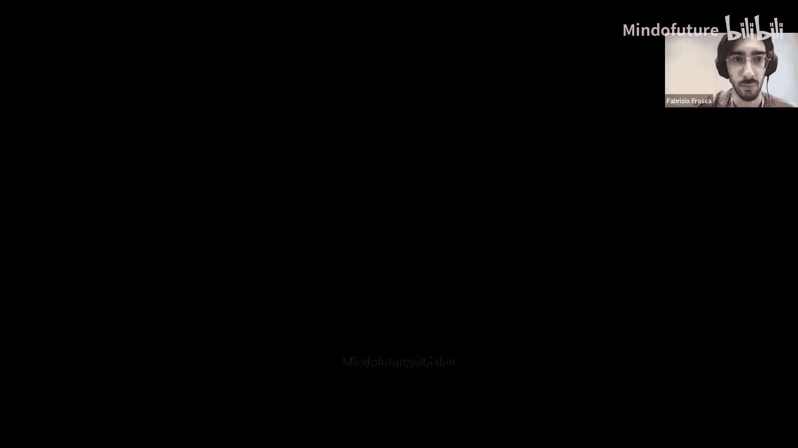
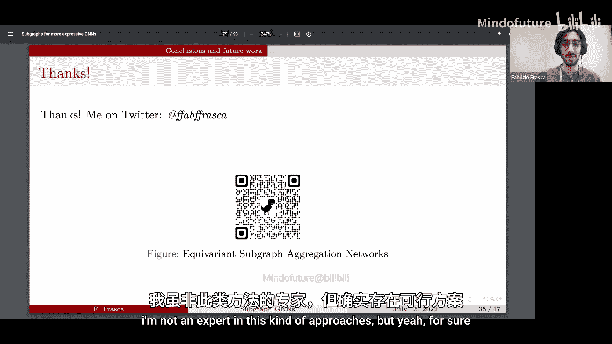

# 014：研讨会2（子图GNN）

在本节课中，我们将学习如何通过子图来构建更具表达能力的图神经网络。我们将首先了解这一系列被称为“子图GNN”的方法的共同主题与动机，然后深入探讨一个名为“等变子图聚合网络”的统一框架，该框架能够概括许多现有方法。

## 背景与动机

上一节我们介绍了图神经网络的基本概念。本节中，我们来看看标准消息传递神经网络在表达能力上的局限性。

图神经网络是一种参数化的图函数，其参数可以从数据中学习。最常见的家族是**消息传递神经网络**。其更新节点表示的方式是与邻居交换信息，公式可表示为：
\[
h_v^{(l+1)} = \phi \left( h_v^{(l)}, \bigoplus_{u \in \mathcal{N}(v)} \psi(h_v^{(l)}, h_u^{(l)}) \right)
\]
其中 \(\phi\) 和 \(\psi\) 是学习函数，\(\bigoplus\) 是聚合操作（如求和）。经过若干层后，通过一个读出操作获得整个图的表示。MPNN的一个重要特性是其**排列等变性**，这是一个非常有益的归纳偏置。

然而，MPNN的表达能力存在上限。研究表明，无论如何设计消息更新函数，MPNN的表达能力上限是**1维Weisfeiler-Lehman测试**。WL测试是一种用于区分非同构图组合算法，其步骤与消息传递类似：初始为所有节点分配相同颜色，然后迭代地通过哈希函数更新节点颜色，该函数将节点当前颜色与其邻居的颜色多重集结合。如果两个图的颜色直方图在某一步出现差异，则它们是非同构的。

问题在于，存在一些非同构图无法被WL测试区分。例如，著名的“谷氨酸”和“双环戊烷”分子，它们具有不同的结构，但WL测试会为它们分配相同的颜色直方图。此外，WL测试无法计数子结构，例如图中的三角形或环的数量。由于MPNN的表达能力受限于WL测试，它同样继承了这些局限性。

因此，研究如何设计超越WL测试表达能力的GNN架构至关重要。

## 超越1-WL的现有方法

上一节我们了解了MPNN的局限性。本节中，我们来看看为提升表达能力而提出的几种思路。

近年来，人们努力设计表达能力超越1-WL的新架构。主要思路有三类：

1.  **模仿高阶WL测试**：例如k-WL测试，它比1-WL更强大。但受其启发的GNN是非局部的，失去了MPNN的局部性归纳偏置，并且当参数k≥3时，计算上难以处理。
2.  **使用唯一节点标识符**：为MPNN提供唯一标识节点的方法（例如随机节点特征），理论上可使模型具有通用性。但由于其固有的随机性，会破坏排列等变性，并已被证明会损害泛化能力。
3.  **利用子结构**：考虑图中那些标准MPNN难以处理子结构，并基于它们进行消息传递或调制消息。这可以看作是我们即将讨论的“子图GNN”浪潮前身。

一个代表性的子结构方法是**结构编码图网络**。其思想是预先定义一个子结构库（如三角形、环），在输入图上匹配这些子结构，并为每个节点计算它属于哪些子结构的统计信息，作为位置编码或结构标识符。这可以打破导致WL测试失败的局部对称性。

该方法的优点是：对于特定的子结构选择，它严格比1-WL更强大；可以注入领域知识（如在分子建模中，环信息很重要）；保持排列等变性；并具有与标准MPNN相同的计算复杂度。缺点是：计数子结构本身可能计算困难；并且如何设计子结构库并不总是明确。

尽管存在挑战，这类方法为接下来要讨论的、在去年集中出现的一系列方法奠定了基础。

## 子图GNN浪潮

上一节我们看到了利用子结构的初步想法。本节中，我们来看看一系列共享“使用子图”这一共同主题的并发方法，我们将其统称为“子图GNN”。

以下是几种代表性的子图GNN方法：

*   **DropGNN**：核心概念是通过“丢弃”节点来廉价地发现重要子图。具体做法是以一定概率独立丢弃每个节点，在得到的子图上运行MPNN，重复多次，最后聚合得到的嵌入。尽管方法简单，但每个节点每次看到略有不同的邻居环境，这解决了导致WL测试失败的模糊性，从而获得了比标准MPNN更强的表达能力。
*   **重建GNN**：其思想基于图论中的一个著名猜想——可以通过“节点删除子图”的集合来重建原图。该方法为原始图生成所有可能的节点删除子图，独立编码每个子图，然后以排列不变的方式聚合这些编码。如果重建猜想成立，该方法将是通用的。但通用编码器本身是难题，因此实践中使用MPNN作为子图编码器，这使其成为对猜想的一种近似。理论证明，删除k个节点的方法，其表达能力可以超越k-WL。
*   **GNN-AK**：其动机是认为WL测试瓶颈在于它只哈希“星形”结构（节点及其邻居颜色），而忽略了邻居间的局部连接。因此，他们提出编码“自我网络”（以某节点为中心、深度为k的诱导子图）。他们设计了一种算法变体，不是哈希节点颜色和邻居颜色，而是直接哈希整个自我网络。同样，哈希整个子图是困难的，因此他们通过在该子图内部运行一个嵌套的WL过程来近似编码。对应的神经架构则是运行一个嵌套的GNN在每个自我网络上，用其输出来更新中心节点的表示。使用更强大的编码器（如3-WL级别的PGN）可以区分更强的正则图。

这些方法展现出一些共同主题：它们几乎不需要预先设计，通过扰动原图让重要子图自然显现；它们仍未完全脱离消息传递的范畴，而是将其作为编码子图的子程序使用；这保留了消息传递的局部性、可扩展性和易实现性优点，同时提升了表达能力。

## 等变子图聚合网络框架

上一节我们介绍了几种子图GNN方法。本节中，我们深入探讨一个旨在统一这些方法的框架——等变子图聚合网络。

ESN不仅是一个模型，更是一个总体框架。它通过对称性的视角提供了额外的理论刻画，并能够统一和推广许多现有方法。

我们的目标是设计一个GNN，它要比标准MPNN更具表达能力，同时尽可能减少人工设计，保持计算可处理性，并且保留**排列等变性**这一重要的归纳偏置。核心直觉与之前一致：即使两个图无法被MPNN区分，它们也可能包含易于区分的子图。

ESN的通用流程如下：
1.  通过一个**选择策略**函数，将输入图映射为一组子图（即一个“子图袋”）。策略可以是节点删除、边删除或提取自我网络等。
2.  以遵循该对象固有对称性的原则方式处理这个袋子。

那么，这个“子图袋”的对称性是什么？它涉及两个层次的排列：
*   **内部对称性**：每个子图本身是一个图，因此需要对节点排列保持等变。
*   **外部对称性**：袋子本质上是一个集合，因此需要对子图在袋中的排列保持等变。

关键在于，由于所有子图都源自同一个图，我们可以在不同子图之间对齐节点。这意味着，当我们对一个子图的节点进行排列时，我们必须以相同的方式排列所有其他子图中的对应节点。因此，这两个对称群通过**直积**相关联。

为了设计一个对这个直积对称群保持等变的层，我们可以借鉴2020年的一项工作。该工作研究了如何处理外部为排列对称、内部为任意对称的集合。它需要两个模块：
1.  **L1**：一个对内部对称性等变的层（例如，对于图像是卷积层），以**孪生方式**应用于集合中的所有元素。
2.  **L2**：另一个对内部对称性等变但**参数不共享**的层，应用于所有输入元素的**聚合**（例如求和）。

将这两个模块的输出相加，就得到了该层的输出。

在我们的案例中，内部对称性是节点排列，因此内部等变层是GNN（如MPNN）。因此，我们得到了ESN框架下的两种架构：
*   **DSS-GNN**：包含两个MPNN。一个MPNN以孪生方式应用于每个子图；另一个MPNN应用于所有子图节点特征和连接关系的聚合（求和）结果。两者输出相加。
*   **S-GNN**：如果我们完全禁用第二个信息共享模块（L2），则简化为在每个子图上独立运行相同的MPNN，子图间无信息交互。

值得注意的是，S-GNN所等变的对称群实际上比我们想要的直积群更大（它允许子图间的节点独立排列）。由于等变约束更强，我们预期S-GNN的表达能力会低于DSS-GNN。

## 表达能力分析

上一节我们介绍了ESN框架的架构。本节中，我们来看看如何从理论上分析这类模型的表达能力。

为了研究DSS-GNN的表达能力，我们设计了一种组合算法，称为**DSS-WL**。它是标准WL测试的变体，但工作在子图袋上。

DSS-WL的节点颜色更新规则如下：
\[
C^{(t+1)}(v, s) = \tau \left( C^{(t)}(v, s), \bigoplus_{u \in \mathcal{N}_s(v)} C^{(t)}(u, s), \bigoplus_{s‘ \in \mathcal{B}} C^{(t)}(v, s’), \bigoplus_{s’ \in \mathcal{B}} \bigoplus_{u \in \mathcal{N}_{s’}(v)} C^{(t)}(u, s’) \right)
\]
其中，\(C^{(t)}(v, s)\) 表示第 \(t\) 轮迭代中，子图 \(s\) 中节点 \(v\) 的颜色。更新函数 \(\tau\) 的输入包含四项：
1.  节点在当前子图中的颜色。
2.  节点在当前子图中邻居颜色的多重集。
3.  **节点颜色**：同一节点在不同子图中颜色的多重集。
4.  **邻居节点颜色**：节点在所有子图中邻居节点颜色的多重集。

我们证明了，对于某些策略（如节点删除、边删除、自我网络），DSS-WL严格比1-WL更强大。如果我们禁用后两项输入（节点颜色和邻居节点颜色），算法就退化为在每个子图上独立运行标准WL，我们称之为**S-WL**。即使S-WL，对于某些策略也严格比1-WL更强大。

进一步，我们证明了DSS-GNN和S-GNN可以分别实现DSS-WL和S-WL算法。因此，存在策略使得DSS-GNN和S-GNN严格比MPNN更强大。

关于DSS-GNN与S-GNN的比较，理论分析和实验都表明，由于节点对齐带来的信息共享，DSS-GNN通常比S-GNN更具表达力，并且在实践中表现更好。

## 策略选择与实验验证

上一节我们从理论上比较了不同架构的表达能力。本节中，我们来看看策略选择对性能的实际影响，并展示一些实验结果。

**策略的选择至关重要**。不同的策略对表达能力有直接影响。例如，在强正则图族（难以区分的图）上：
*   使用节点删除或深度为1的自我网络策略，无法区分它们，表达能力上限为3-WL。
*   使用边删除策略，则能够区分这些图，表明边删除在某些情况下是更强的策略。

在实践中，我们并未观察到策略性能与特定应用领域有强相关性。但**自我网络策略**通常在多种设置和数据集上表现稳定且良好。

以下是部分实验结果：
*   在分子性质预测基准ZINC上，从边删除、节点删除切换到自我网络策略，测试集平均绝对误差降低，性能提升。且DSS-GNN通常优于S-GNN。
*   在一系列小型图分类数据集上，ESN框架取得了与先进方法相当或更优的结果，并且通常优于其基础编码器（即内部使用的GNN）。
*   在OGB分子性质预测基准上，ESN框架是表达能力最强的、领域无关的GNN中表现最好的模型之一，有时优势明显。同时，它甚至能与那些显式注入领域知识（如环信息）的GNN竞争或胜出，这符合我们“减少人工设计”的目标。

## 总结与展望

本节课中，我们一起学习了“子图GNN”这一系列旨在提升图神经网络表达能力的方法。

我们首先回顾了标准消息传递神经网络受限于1-WL测试的问题。接着，我们介绍了几种通过利用子图来提升表达能力的并发方法，如DropGNN、重建GNN和GNN-AK，它们共享“使用子图”和“以MPNN为子程序”的主题。

然后，我们深入探讨了**等变子图聚合网络框架**。该框架通过引入“选择策略”和“子图袋”的概念，并从对称性（直积排列群）角度出发，设计出DSS-GNN和S-GNN等架构，统一了许多现有方法。我们通过引入DSS-WL组合算法分析了其表达能力，证实了其超越1-WL的能力。

实验表明，ESN框架在多个基准上表现优异，且自我网络等策略通常效果良好。DSS-GNN凭借其信息共享机制，一般优于S-GNN。

未来的研究方向包括：探索更多策略及其理论性质；研究子图袋的更丰富结构（如图化）；以及探索随机采样策略以降低计算成本，同时尽可能保持近似等变性。

总而言之，子图GNN提供了一条在保持消息传递优良特性（如局部性、等变性）的同时，显著提升模型表达能力的有效途径。