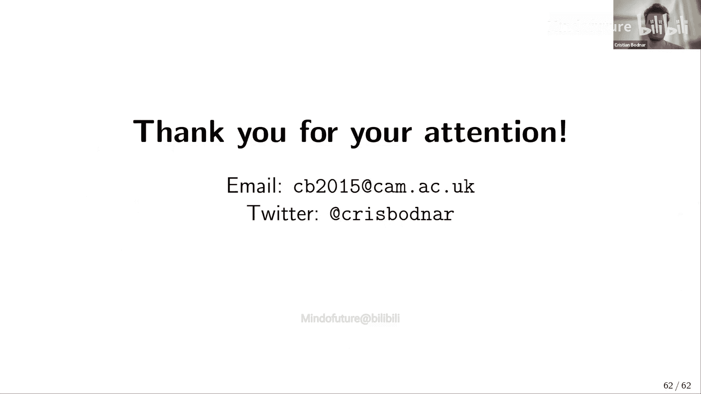

# 016：研讨会4（神经束扩散）


在本节课中，我们将学习一种从拓扑学角度理解图神经网络的新视角，即“神经束”理论。我们将探讨如何利用这一理论来解决图神经网络中的异质性和过平滑问题，并介绍一种基于神经束扩散的新型图神经网络模型。

## 从几何到拓扑：为什么几何有时不够用？🤔

在几何深度学习中，我们处理的数据通常具有几何结构，例如分子、网格和流形。这些结构可以被视为流形，从而应用微分几何的工具。然而，并非所有空间都天然具备进行几何分析所需的结构。

在微分几何和数学物理中，我们有一系列的结构层次。最左边是**拓扑空间**，它只是一个定义了邻域概念的集合。例如，点P周围有一个黄色的邻域。向右移动，我们获得更多结构，例如**拓扑流形**，它要求每个点的邻域都类似于欧几里得空间（如平面或圆盘）。图中中间的映射φ展示了如何将邻域U映射到二维欧几里得空间中的一个圆盘。最左边的空间不是拓扑流形，因为点B的邻域看起来不像欧几里得空间。

但拓扑流形仍然不足以讨论光滑性等概念。从拓扑角度看，中间的表面与最右边光滑的球面是等价的，但显然一个比另一个更“崎岖”。为了讨论光滑性，我们需要**微分流形**（通常简称为流形）的结构。只有到达这个阶段，我们才真正进入几何的领域，可以定义切空间并进行各种几何操作。

然而，许多空间甚至不是拓扑流形，或者即使它们是拓扑流形，也可能无法在其上放置光滑结构。这意味着我们无法总是对任意空间进行几何分析。

## 图神经网络的困境与拓扑视角的引入 🧠

这导致了几何深度学习中的一个困境。正如Michael Bronstein在一篇博客文章中指出，图是几何深度学习中唯一没有连续（流形）等价物的空间类型。网格有平面作为等价物，网格有它近似的流形，但图没有对应的流形，因为图甚至不是拓扑流形。这使得将几何直接应用于图变得更加困难，尽管并非不可能，但可能不那么自然。

本次讲座建议采用一种**拓扑视角**。在拓扑学中，我们研究**拓扑空间**，即第一节幻灯片中展示的带有各种表面的那种结构。

## 什么是拓扑空间？🏠

一个拓扑空间是一个集合X，但它顶部还有一些结构。具体来说，它有一个由X的子集构成的集合D。这个集合D中的元素被称为**开集**。开集推广了开区间等概念到任意集合。这些开集必须满足一些公理：
1.  空集和空间X本身是开集，属于D。
2.  任意两个开集的交集也是开集。
3.  任意两个开集的并集也是开集。

图中展示了一个抽象空间X的例子，右侧绘制了一些开集（如红色的U、蓝色的V以及它们的交集），它们构成了一个拓扑，形成了一个拓扑空间。这些开集可以被视为点的邻域，从而提供了某种意义上的局部信息。

## 将图视为拓扑空间 🔄

我们现在建议从一个新的视角来看待图：将其视为拓扑空间。这意味着我们将图看作一个点集，并在其上定义开集。

例如，对于每个节点V，我们可以使用所有与该节点关联的边以及节点本身来构成一个开集，记作U_V。同样，对于另一个节点，我们可以用蓝色区域表示其对应的开集。根据公理，这两个开集的交集（即中间的边）也必须是一个开集。此外，所有这些开集的任意并集也必须是开集，以满足拓扑空间的公理。

一旦我们建立了这个视角，我们将看到它如何帮助我们理解和开发更好的图神经网络，特别是解决异质性和过平滑问题。

## 问题背景：节点分类、过平滑与异质性 🎯

我们关注的任务是**节点分类**。我们有一个图，目标是分类图中的节点。部分节点带有标签（如图中的红点和蓝点），其余节点未标记。在训练时，我们使用已标记的节点以及所有节点的特征矩阵X。

首先，让我们提及**过平滑问题**。人们注意到，对于某些图神经网络（如图卷积网络GCN），如果堆叠很多层，节点的特征会随着层数的增加变得越来越平滑或相似。这显然不利于分类，因为如果所有特征都变得相似，我们就无法区分不同类别的节点。

第二个相关问题是**异质性问题**。许多图神经网络在异质图（即倾向于连接不同标签节点的图）上表现不佳。通常，大多数图神经网络在同质图（即相同类别的节点倾向于相连的图）上表现良好。图中展示了一项近期研究的结果：在x轴（同质性水平较低，异质性较高）的左侧，GCN的性能很差；随着同质性增加（向右移动），性能提升。虽然已有一些方法在低同质性区域改进了GCN（图中彩色线条），但仍有提升空间。

## 热扩散：一个简单但有问题的过程 🔥

首先介绍一些符号。我们有一个图，有度矩阵D、邻接矩阵A和归一化拉普拉斯矩阵 **Δ₀**，其公式为：
```
Δ₀ = I - D^{-1/2} A D^{-1/2}
```
节点特征记为X。

热扩散是一个非常简单但饱受过平滑和异质性困扰的过程。你可以想象图上的温度分布：随着时间的推移，温度会变得越来越均匀，热区变冷，冷区变热，最终稳定在某个平均温度附近。

你可以看到过平滑和异质性如何在这个过程中出现：如果时间无限长，所有节点的温度会收敛到相同值，这就是过平滑。在异质图中，冷热节点之间的大量连接会使它们的温度迅速平衡，变得相同，导致无法区分不同类别。因此，热扩散可以说是处理过平滑和异质性时最糟糕的模型。

有趣的是，如果我们对这个微分方程进行离散化（使用时间离散），会得到如下公式：
```
X_{t+1} = X_t - Δ₀ X_t
```
进一步简化，提取公因子X_t，得到红色表达式。如果你回想图卷积网络GCN的模型公式：
```
X_{t+1} = σ( (I - Δ₀) X_t W )
```
其中W是权重矩阵，σ是非线性激活函数。通过简单的代数运算，归一化邻接矩阵 `I - Δ₀` 实际上就是前面红色部分。因此，GCN本质上类似于热扩散，只是在其上添加了权重矩阵和非线性激活。从某种意义上说，GCN存在异质性和过平滑问题并不奇怪，因为它的核心构建过程在这些方面表现就很差。

## 核心问题：能否改进扩散过程？💡

我们在这篇论文中试图回答的问题是：**能否使这个扩散过程（热扩散）变得更强大，从而构建出更好的图神经网络？**

答案在于代数拓扑中的一种数学对象：**层（Sheaf）**。

## 神经束简介：在拓扑空间上组织数据 🧩

让我简要介绍一下层。本质上，层是一种在拓扑空间的开集上跟踪附加数据的方式。如图，我们有一个拓扑空间X和一些开集。我们可以为每个开集附加一些数据（例如向量空间），记作F(U), F(V), F(P)等。图中的箭头表示将视图限制到更小区域的方式，即从较大区域的数据观察其在较小子区域上的表现，这确保了数据的一致性。

通过采用我们开始时提到的视角（将图视为拓扑空间），我们可以获得**图上的层**。我们可以为每个与节点和边关联的开集附加一个向量空间，并在这些向量空间之间定义线性映射（即图中的箭头）。严格来说，这还不是一个完整的层，因为我们没有指定所有开集（例如开集的并集）上的情况。幸运的是，存在一种称为**胞腔层**的概念，它已经为图上的层提供了恰当的定义。

## 胞腔层：图上的简化定义 📐

胞腔层的定义更简单。我们有一个图，现在不是将数据放在开集上，而是直接放在顶点和边上，因为开集与顶点和边直接对应。具体来说：
*   对于每个顶点v，有一个向量空间F(v)（例如R²）。
*   对于每条边e，有一个向量空间F(e)。
*   对于每条关联边e的每个顶点v，有一个从顶点向量空间F(v)到边向量空间F(e)的线性映射。

这些向量空间被称为**茎（Stalk）**，线性映射被称为**限制映射（Restriction Map）**。“限制”一词来源于之前提到的“将视图缩小到更小子集”的概念。

## 直观理解：观点动力学模型 💬

Hansen和Ghrist的一篇论文为层提供了一个很好的直观理解，源于观点动力学。你可以将节点的向量特征视为**私人观点空间**。图中的每个人（节点）通过边进行交流。边中间的向量空间称为**话语空间**，是他们观点相遇和讨论的地方。

限制映射（本质上是矩阵）将私人观点映射到话语空间。然后，参与者可以在话语空间中比较他们的观点。在实践中，我们在公共场合并不总是说出所想，我们会过滤自己的想法，这些矩阵所做的正是这种转换：将私人观点转化为公共观点。

## 层拉普拉斯算子：推广图拉普拉斯 🧮

一旦有了层结构，我们就可以构造所谓的**层拉普拉斯算子**。图拉普拉斯算子是层拉普拉斯算子的一个特例。

层拉普拉斯算子是一个矩阵。将其应用于向量x并查看节点v时，其定义如图所示。我们对节点v的所有邻居u求和，然后进行一些乘法运算。括号内的部分实际上是两个邻居的公共观点之差：第一个矩阵乘以x_v是节点v的公共观点，另一项是节点u的公共观点，取它们的差值。然后通过矩阵转置将这些差异聚合回来。

图中下方的图表解释了该矩阵的结构：对角线元素是左侧看到的和，右侧展示了非对角块的样子。这是一个稀疏矩阵，空白区域表示节点间没有边。

我们还可以定义其归一化版本：收集所有对角线块放入矩阵D，然后使用与归一化图拉普拉斯相同的公式进行归一化。重要的是，当维度d=1时（即所有向量空间都是标量），所有块都是1x1，我们就回到了图拉普拉斯算子的公式（即x_v - x_u）。因此，层拉普拉斯是图拉普拉斯的一种推广。

## 另一种视角：离散平行传输 🧳

在微分几何中，如果我们有一个流形，我们有**向量丛**，即在流形每个点上附加向量空间（例如切丛）。然后有**平行传输**的概念，可以沿着边平滑地移动切向量。层中的矩阵乘法可以看作是这种平行传输的离散版本：它们指定了如何将一个向量从一个茎（切空间）移动到另一个茎。图中展示的矩阵表达式正是拉普拉斯算子中的非对角项。

## 层扩散过程：研究表达能力 🔬

现在，让我们开始使用层做一些有趣的事情。我们想要研究所谓的**层扩散过程**的表达能力。其微分方程与热扩散几乎相同，唯一的区别是拉普拉斯算子现在是层拉普拉斯Δ_F，而不是图拉普拉斯Δ₀。图拉普拉斯是它的一个特例，因此这为我们研究各种扩散过程提供了灵活性：通过修改层结构，我们得到不同的拉普拉斯算子和扩散过程。我们的目标是研究不同层结构下会发生什么，以及能否以有用的方式使用它们。

为了可视化这个微分方程中的矩阵乘法：左边是归一化的层拉普拉斯Δ_F，它具有之前看到的块结构。特征矩阵X_t看起来也与经典情况略有不同：每个节点有一个d维向量（因为每个特征都是我们提到的向量空间中的一个点）。我们可以将它们垂直堆叠，形成一个包含所有节点所有特征的长向量。显然，我们可以有多个特征通道（即多列）。每一行是属于单个节点的所有d维向量。

因此，扩散方程现在可以看作是在扩散**向量场**，而不仅仅是标量（如温度）。标量情况是d=1时的特例。

关于这个扩散过程，有一个基本结论：如果我们无限长时间地运行这个扩散，最终会将初始条件（时间0的特征）投影到归一化层拉普拉斯Δ_F的**核空间**中。核空间是指被该矩阵映射为零向量的所有向量构成的集合。最终，我们得到的特征矩阵满足 Δ_F * X_∞ = 0。

## 目标：寻找能线性分离节点的层 🎯

我们想要做的是：**看看不同类别的层能否在图扩散过程的无限时间极限下，线性分离图中的节点。**

用图示来说明：我们从左侧的图开始。在扩散时间0，这是我们的初始条件。节点的颜色表示其标签，节点的位置由其二维特征表示。我们想要找到一个层，使得当我们运行这个扩散过程（如图中所示）到达无限时间极限时，不同类别会形成非常好的聚类，从而我们可以线性分离它们。这对于分类任务来说是理想的。

观察扩散时间14（这已经是无限时间的一个很好近似，因为该过程是指数收敛的），我们可以看到所有不同类别的聚类都形成得很好。

## 理论结果：不同层类别的分离能力 📊

现在让我们具体寻找这样的层。

首先，看一些向量空间仅为实数线R的层，并施加对称约束：对于每条边e，我们希望其两个限制映射（现在是标量）相等。这实际上等价于具有**加权图拉普拉斯**的扩散。我们还限制这些标量不为零。这是非常简单的层类别，它恢复了加权图拉普拉斯。

你可能会想，加权热扩散可能做得还不错。在某种程度上，对于某些设置确实如此。例如，考虑所有具有两个类别（A和B）的连通图，并且满足：对于第一个类别A中的每个节点，都存在另一个相同类别的邻居。这是一个同质性假设。那么，在这个类别中，对于几乎所有初始条件，我们都可以找到一个层，使得扩散后能线性分离这两个类别。

但是，如果我们考虑二分图（两个分区A和B大小相等），这是你能想到的最异质的图（每个邻居的标签都与你不同），那么可以证明，在这个层类别中，**不存在**任何一个层能够对任何这样的图的任何初始条件线性分离这两个类别。这表明，在无限时间极限（即过平滑状态）下，这类扩散过程在遇到异质性时会遇到困难。

然而，我们可以通过考虑更一般的层类别来轻松解决这个问题。

## 解决方案：更一般的层结构 🛠️

现在假设我们有一个具有两个类别的连通图，没有其他假设。我们可以如下构造层：仍然设d=1。对于每条边，如果第一个节点在类别A中，则将其限制映射标量设为 -α_e；如果第一个节点在类别B中，则设为 +α_e（α_e为正数）。

如图中所示，第一个矩阵为负（例如-1），第二个为正（+1）。当进行扩散时，特征会极化：橙色节点在向量空间中具有负特征，蓝色节点具有正特征。因为为了在话语空间中达成一致，由于符号不同，它们必须一个为负一个为正。这样，一个类别具有负特征，另一个具有正特征，很容易用零阈值将它们分开。

因此，这类层可以对任何这样的连通图（具有两个类别）的几乎所有初始条件线性分离类别。我们不需要任何同质性或异质性假设。

## 维度限制与解决方案：增加维度d 📈

但这里仍然存在一个问题，它特定于维度d=1。如果我们只坚持d=1，并且有一个具有至少三个类别的连通图，那么**没有**任何一个层能够对任何初始条件分离这些类别。

原因在于，当d=1时，拉普拉斯算子的核空间最多是一维的。最终你会将所有东西投影到一条线上。在最幸运的情况下，你可能会得到不同类别分布在这条线的不同区域，但你无法用单个超平面线性分离它们（例如，对于中间的蓝色类别，你需要左右两个超平面）。你只能实现成对的线性可分性。

解决方案很简单：**增加维度d**。这也会增加核空间的维度，为我们提供更多空间来移动特征，从而提供更强的表示能力。

一种方法是考虑d维向量空间，并且限制映射是可逆的对角矩阵。那么，对于任何具有任意数量类别C（至少为3）的连通图，如果我们设置维度d至少为C，那么这个层类别就可以在这些图上实现线性分离。因此，通过使d足够大，我们可以轻松找到能够分离任意多类别的层。

你可能会问，这些对角限制映射比较简单，如果我们使用更复杂的映射会怎样？例如，我们可以考虑之前提到的**丛**的情况。在丛的定义中，这些矩阵被限制为正交矩阵。结果表明，你可以更有效地利用空间：如果d=2，你可以分类最多4个类别；d=4，可以分类最多8个类别。图中展示了一个例子：有四个类别，d=2，我们找到了一个层，使得所有类别聚类并能够被线性分离。

## 理论部分总结 📝

理论部分的主要结论是：**不同类别的层在扩散过程中具有不同的能力**。从非常简单的层（产生加权图拉普拉斯）开始，我们看到在该设置下我们相当受限。但随着我们使层变得越来越通用和复杂，我们获得了解决更多种类问题的能力。这有点像在几何中，对于某个流形，不同的几何结构会导致不同类型的扩散。

另一个非常重要的点是：**任何节点分类问题都可以通过使用正确的层进行扩散来求解**。对于任何节点分类问题，你总可以找到一个层，使得扩散后能分离所有类别。这并不意味着找到那个层很容易，但在原理上总是存在这样的层，这是一个有用的知识。

## 实践应用：如何学习层？🎓

现在，我们转向更实际的问题：如何在实践中使用层？

你可能会想，我们从哪里获得这些层？通常，我们拥有的是图数据集，带有节点特征，但没有人会给我们图上的层结构。那么，如何在实际中利用所有这些理论呢？

我们在这篇论文中提出的方案是：**从数据和图结构中学习这些层**。

学习一个层具体意味着什么？本质上就是学习那些限制映射矩阵。我们预先选择一个超参数d（向量空间的维度）。一旦选定了d，剩下的就是决定每条边上这些矩阵应该是什么。

我们可以采用一个参数化函数（通常是一个神经网络）φ，如公式(3)所示。这个函数是矩阵值的。它以节点v的特征和节点u的特征作为输入，并输出一个矩阵，该矩阵将作为边e上从v出发的限制映射F_{v←e}。如果交换两个输入的顺序，它将给出另一个矩阵F_{u←e}。我们对图中的所有边都这样做，插入构成该边的节点的特征，就得到了所有边的所有矩阵，从而构建了我们的层结构。

也许可以更熟悉地思考：这有点像图注意力网络（GAT），在那里我们也有一个类似的函数，但它输出的是标量注意力系数。这里我们将其推广到输出矩阵。

## 模型构建：广义层扩散网络 🧬

一旦我们能够学习层，我们就可以构建一个模型，其中层是从数据中学习的，我们让梯度下降来学习解决任务的最佳层结构。这有点像寻找解决我们问题的最佳“几何”或最佳层结构。

我们使用的模型是一种**广义层扩散过程**。它看起来类似于之前的层扩散方程，但像GCN在热扩散上添加东西一样，我们也添加了一些额外的部分：矩阵W1和W2。实际上，如果你忽略克罗内克积，公式与GCN非常相似：右边是特征、拉普拉斯和非线性激活。主要变化是我们现在有了这些额外的矩阵，因为我们在处理d维向量，可以从左边用矩阵W乘以这些d维向量。

在实践中，我们离散化这个方程，得到一个更像残差网络的架构。这是对先前模型的时间离散化。一个非常重要的区别是，这里的层F也依赖于时间（或层数t）。原因在于，我们在时间t学习的层是图和该时间特征X_t的函数。函数G就是上一张幻灯片中提到的φ函数：取时间t的特征，通过φ函数得到所有矩阵，构建层拉普拉斯，然后使用模型。

## 实验结果 🧪

首先，展示一个合成实验，测试之前提到的观点极化或特征极化。我们有一个二分图，两个分区大小相等。理论表明，加权图扩散无法100%解决这个任务。我们使用一个非常简单的模型（即公式(4)的模型，但设W1和W2为单位矩阵），本质上只是一个学习层的扩散过程。基线是加权图扩散（d=1且每条边限制映射相等的层）。

结果显示，在训练数据上，蓝色基线表现很差，测试准确率也很差。x轴是扩散时间（可视为层数的代理）。随着时间增加，蓝色基线性能变差（过平滑）。但对于橙色线（层扩散），性能随着时间增加而改善，表明我们可以用更多层（更长时间）来解决过平滑问题。绿色线是“预言机”层（使用理论中不同符号的标量层），它表现完美，而学习到的层也跟得很好。

为了可解释性，我们观察学习到的层。图中绘制了每条边上两个标量限制映射的乘积。训练前，这些值围绕零随机分布。在达到100%准确率的时间点，我们看到所有这些乘积都是负数，这意味着两个标量符号相反（一正一负），与理论中的极化层一致。因此，模型学会了通过极化两个分区的特征来解决问题。而其他图神经网络由于隐含地使用了非常基础的层结构，可能在这种设置下会挣扎。

## 真实世界评估 🌍

我们在一些真实世界的节点分类数据集上进行了评估，这些数据集涵盖了从低同质性（高异质性）到高同质性的范围。我们的基线模型用粗体标出。我们有三个版本的模型：学习对角限制映射的模型、学习正交映射的模型以及学习任意矩阵的模型。

结果显示，在几乎所有异质性数据集中，我们的模型都表现得非常好，超越了现有模型（其中许多是专为同质图或处理过平滑而设计的）。同时，在同质性基准测试中（最后三个数据集），我们的模型也表现良好。总体而言，除了CORA数据集，这些模型在几乎所有数据集上都位列前三。这表明，这些有趣的理论见解催生了一些简单但实用的模型，并且在实际中有效。

## 总结 🎉

本节课我们一起学习了：
1.  **从几何到拓扑的视角转换**：认识到将图视为拓扑空间的价值，以克服纯几何方法的局限性。
2.  **神经束理论**：引入了层作为在图上组织数据的数学框架，包括茎、限制映射和层拉普拉斯算子。
3.  **层扩散过程**：探讨了基于层拉普拉斯的扩散过程，并理论分析了不同复杂度层在解决节点分类问题（特别是异质性和过平滑问题）上的表达能力。
4.  **实践模型**：介绍了如何从数据中学习层结构，并构建了广义层扩散网络模型。实验证明，该模型在合成和真实数据集上，尤其是在异质图场景下，具有优异性能。

通过采用拓扑学和层的视角，我们为图神经网络的理解和设计开辟了一条新的途径，能够更灵活地处理图中复杂的结构关系。



