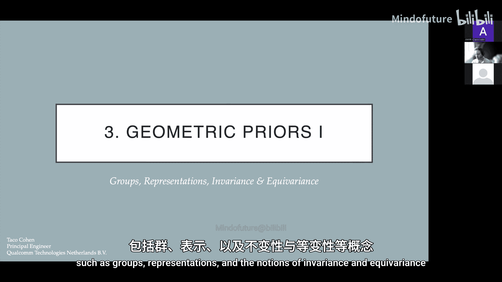
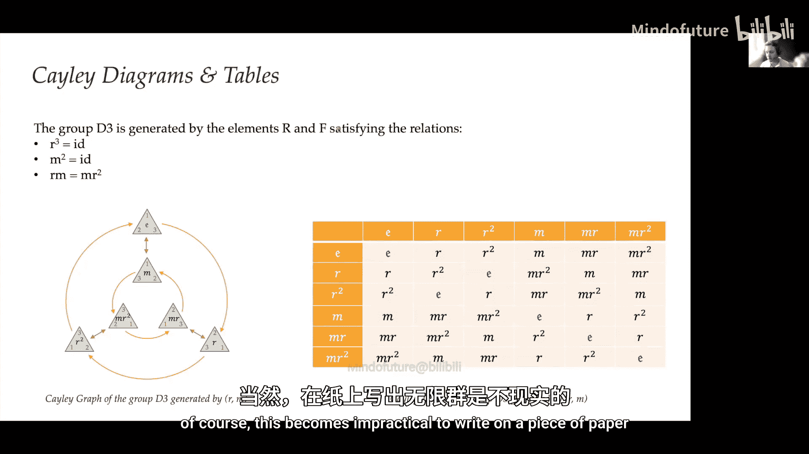
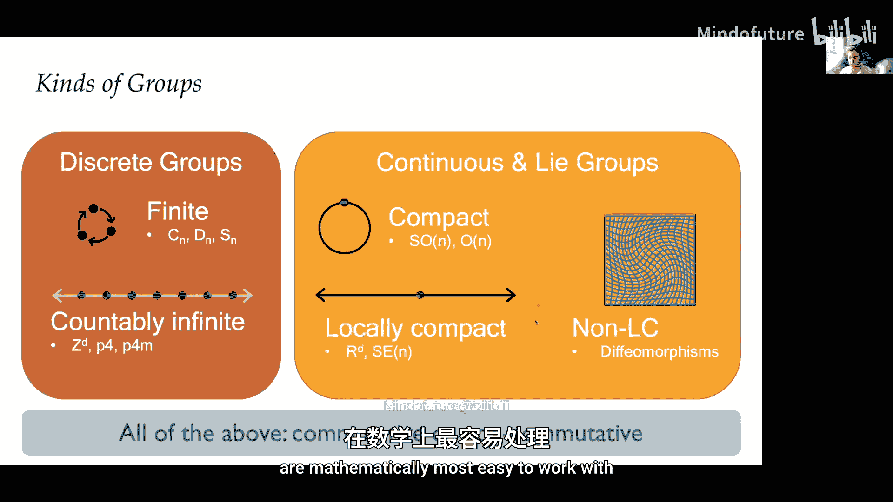
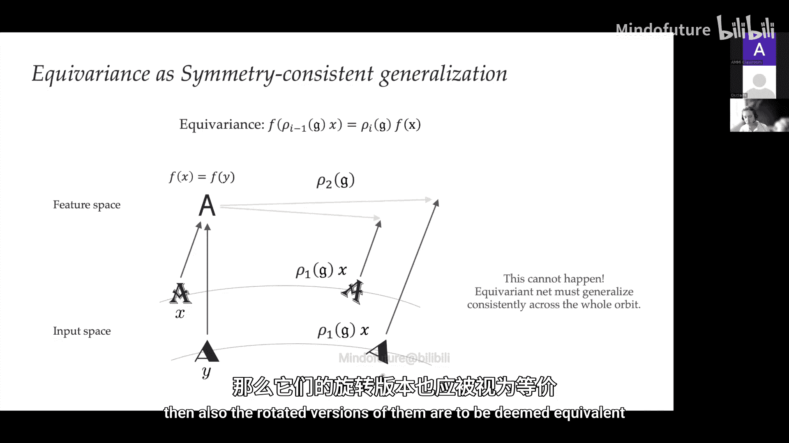
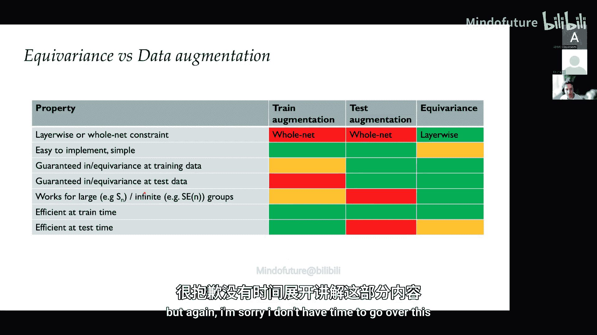
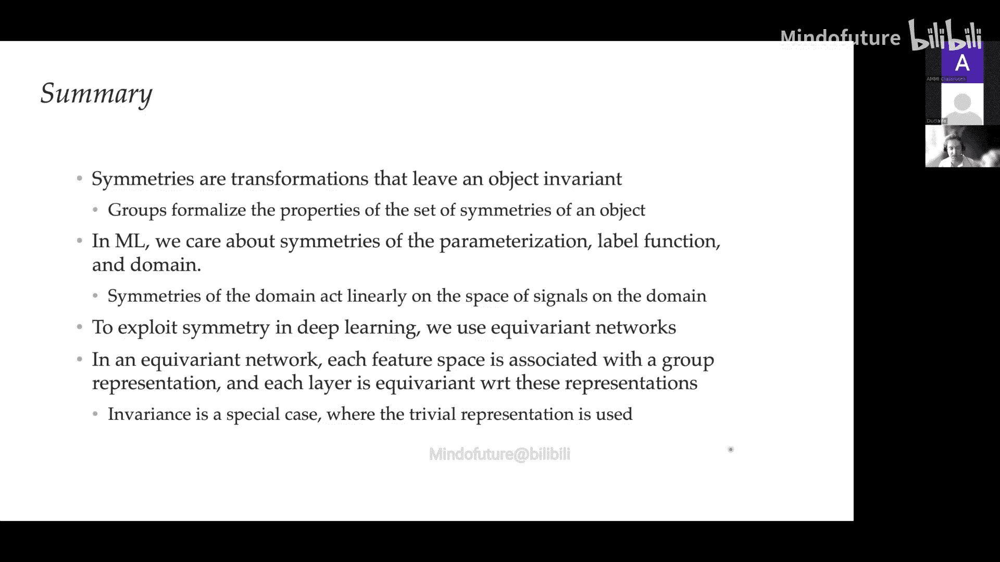
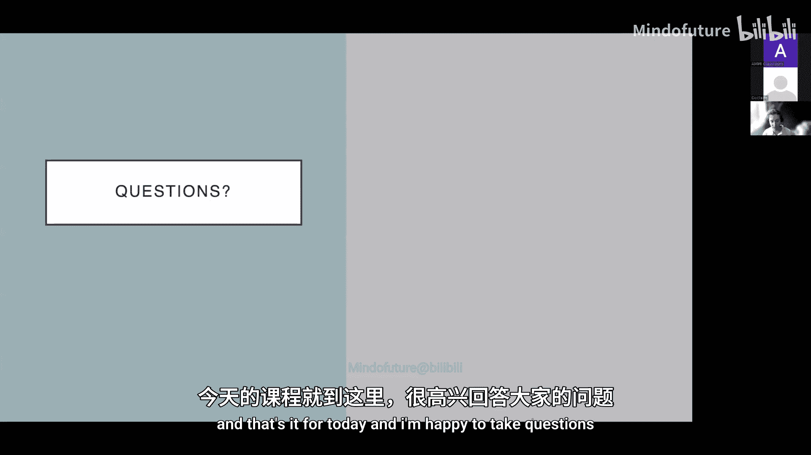

# 几何深度学习 ｜ Ammi Geometric Deep Learning Course -BV1veHgzxELm_p3-

I'm Taco Cohen and I'm going to present。The third lecture on geometric priors so far you've heard Michael give you an overview of geometric deep learning and John explained the difficulty of learning in high dimensions。

 and so in this lecture we're going to start looking at the kinds of solutions proposed by geometric deep learning and specifically we're going to look at this central concept of symmetry and we'll introduce some of the fundamental concepts involved there such as groups representations and the notions of invariance and equivariance。

So here's an outline of the lecture today， so first I will talk about geometric domains signals and fields of geometric quantities。

 so in geometric deep learning the data that we're interested in are signals。

So think of things like images over some geometric domain， for example an image over the image plane。

 but of course in geometric deep learning we're interested in much more exotic kinds of spaces and types of data and even more generally we're interested in something called a field for example。

 a vector field like the optical flow image or a diffusion tensor image that you might record from a brain scan so also we're talking about the kinds of data that we're going to be processing。

And then we'll look at this concept of symmetry。😡，So I'll explain the general idea and how symmetry appears in machine learning in various guises。

Then we'll look at the particular kinds of symmetries that we're interested in geometric deep learning。

 namely the symmetries of the domain。We'll study some general mathematical concepts related to symmetries such as groups。

 group actions， and linear group actions also known as group representations。

And we'll look at the specific way in which the group of symmetries acts on this space of signals that we defined in the beginning。

And then we'll look at the key concept that should help us learn better models。

 which are these concepts of invariance and equivariance。All right。

 so let's do a quick recap of Jean's lecture。😊，呃。In general。

 learning in highal high dimensions is intractable the number of samples that you would need to get a reasonably dense coverage of your input space will grow exponentially with the dimension so if you don't make any further assumptions this is not going to work even even nowadays with internet scale data if you try to classify images with nearest neighbor classifier or some other naive method you wouldn't get very far so in geometric deep learning however。

 as I said before the data are signals on some kind of space or domain so again think of images on a plane you can have signals on a sphere such as weather data you can have data living on a graph and various other kinds of domains and。

Mains typically are fairly low dimensional and they tend to come with certain symmetries that I'll talk about in a minute and these things should help us make learning tractable because we already know something about the structure of the data yeah so in this lecture I'll cover this principle of symmetry and in the next lecture Jean will talk about another related idea called scale separation。

All right， so to continue to recap， as Jean explained in learning。

 there are or one way to think of it is that there are three sources of error。

 you have the approximation error， which means that the true function that you're trying to approximate。

 say a label function that assigns a label to every image in your data or every image in your input space。

 the approximation error relates to the discrepancy between the true label function and the best one that you can find in your function class。

 so if your function class is too small， for example。

 only containing linear functions or only containing very shallow neural networks or neural networks with few parameters。

 then you'll have a high approximation error simply because the class of functions is not flexible enough to approximate the true function。

So this suggests that you want to choose a very large function class。

 you want to use big neural networks。And indeed， of course we've seen over the last few years that that is a very successful strategy。

 however at least the classical theory of generalization tells us that we can then run into an issue where if we choose a very large function class we'll also need a lot of data so if we have a fixed amount of data as we increase the size of our function class or hypothesis class。

 the statistical error will grow and then finally there's optimization error which is related to the fact that even if your function class has a good hypothesis in it。

 you might not be able to find it， this will not be covered very much in this course。😊，Um。Now呃。

What I'm going to talk about today is that using geometric prior。

 so these ideas of symmetry and scale separation， we can decrease the size or complexity of the hypothesis class。

 for example， will only admit equivariant neural networks without discarding useful hypotheses。

So this should then improve the statistical error because we're reducing the size of the function class。

 we're not allowing any more any non-equvariant neural networks。

 while not worsening the approximation error because if we know a priori that the true function that we're trying to approximate。

 let's say the label function of a function that assigns the label to an image should be invariant to various kinds of transformation of the image。

 if we know that a priori then making the hypothesis class smaller by discarding functions that we know can't be correct anyway should not worsen the approximation error。

Okay so let's talk about geometric domains so as I mentioned in geometric deep learning the data lives on a domain which we usually indicate by omega so this domain could be various things but in all cases the domain at the most basic level is a set and the set usually comes with some additional structure so you can have grids for example as in the example of planar images each grid point indicates a pixel location and the structure could be a neighborhood structure so you can say this pixel is next to another pixel or you could have a distance associated with the domain as well saying what is the distance between any two points in the domain you can have more generally your domain could be a homogeneous space we'll talk a little bit about what that means。

And there will be a whole lecture about this later in the course。

 but think of examples like a sphere or a Taurus or some other， there are other examples as well。

Graphs very important， very popular these days is another example here again we have a neighbor structure or a topological structure that says which nodes are connected to which other nodes。

And finally we have manifolds， which to stick with the 5G team we labeled geodesics engage gaugeages。

 and that's another example of it domain。Yeah。So the key message of geometric deep learning is that neural networks for processing geometric data should respect the structure of the domain。

So for example， if we consider， let's say， this sphere。

 then there are certain things that we consider meaningful structure， such as for example。

 the distance between two points and other things that we don't consider meaningful and the neural networks should respect that structure。

So we'll get a bit more precise about what that means in a second all right so as I said。

 the data that we're interested in in geometric deep learning is socalled signals on a geometric domain so what is a signal well it's just a fancy word for a function。

So a signal on omega is a function we label it by x usually from omega to C。

 where C is some kind of vector space and the dimensions of the vector space are usually called channels。

So again the simplest example is a planar image， as we discussed before。

 the domain here is a set of grid points， the locations of the pixels， and for each pixel。

 we then assign a three dimensional vector that encodes the RG red。

 green and blue values of that pixel， and so even though usually we think of maybe in the more practical terms we think of an image as maybe a vector。

 flat vector or maybe as a three dimensional tensor with and height and channel dimensions。

We can also mathematically describe it as a function and that's what we'll do here because that works nicely and generalizes very well Another example would be a graph so here the domain would be the set of nodes which will label by the numbers one through n。

And then a signal on this graph could be。The assignment of a node feature vector to each node。

 for instance， telling you for each atom what type of atom it is， for example。

 each gray node here corresponds to a carbon atom which would be coded by a one hot vector with a one in the C channel and then zero everywhere else。

So we can then consider the space of all Cvalued signals on omega and that's just a set of all functions with omega as the domain and C as the cod and that will be the input space for our neural network but also the feature spaces and perhaps the output space of the neural network will also be of this type。

 so for example if you have an image your input space would be signals with three channels on the plane and then if you apply a convolution layer maybe you have now more channels but it's still going to be some kind of space of signals on omega。

And in the case where you're doing segmentation of the image， signing for each pixel， for example。

 a semantic class， then also the output would be again a signal in other cases where you're doing classification。

 then the output would be maybe just a signal vector。In any case。

 we denote this space of signals by x of omega and C， and sometimes when it's clear。

 we'll leave out the omega and C。All right， so the first thing to notice about these spaces of signals。

Is that they come with what's called a Hilbert space structure it's just a fancy word for the fact that it's a linear space and secondly that we can can define some kind of inner product which allows us to compare patterns so if you have an image you want to for example compare it to a filter by taking inner product so first linearity so what does linearity mean mathematically just to remind you if you have a signal X we're going to think of that as a vector and another signal Y we can form a new signal alpha x plus beta Y。

And since thats signal， this is a function， we can evaluate it at U。

 just like if you had a finite dimensional column vector or something you could index it by the dimension here。

 u plays that role of index， it's a spatial position that you evaluate this function at。

 so how is this linear combination of functions defined。

 well if we evaluate at U we we get the value of x at U times the scalar alpha plus the value at y at u times the scalar beta？

And so visually it looks like this we have here an image X and an image Y。

 and well I haven't shown what it means to scale them， but if you just add them。

 then you superposed of each pixel， you're going to sum the values from the two images。Pixelize Ed。

All right， so that's the conclusion， the space of signals is a vector space and that's pretty interesting because the domain itself。

 omega need not be a vector space in this case we took the image plane and in the image plane there's an operation of addition and scalar multiplication defined as well。

 but if the domain were a graph， then we could still do a nodewise addition of features。

 and so the signal space is a linear space， even though in a graph there's no notion of adding nodes defined。

If the domain has an infinite number of points， then the vector space is infinite dimensional。

 but of course in practice， when we do actual computations。

 we have to somehow discretize to something finite。

And then the second point that really makes this not just a linear space。

 but something called the Hilbert space is that we can define an inner product that we can use to compare patterns and that inner product is denoted by these。

Angular brackets。So the inner product between signal x and a signal y is defined in terms of two things。

 first of all an inner product on the feature vectors。

 so remember our signal assigns to each point in the domain a vector and for those vectors。

 let's say RGB vectors， three dimensional vectors。We should be able to compute an inner product well for our three that's easy just multiply each of the three numbers and add them up the other thing we need is a measure mu on omega that allows us to assign some notion of area to subsets of the domain and this measure in some technical way is used to define a notion of integration over the domain。

And that then allows us to define this inner product or the inner product of x and Y。

Is the integral over the domain of the inner product between the feature vectors at each position。😡。

Now， if omega is finite dimensional or if it's a discrete space。

 then you can use something called the counting measure。

 which basically turns this integral into a sum， and then you can see that this really reduces to theam notion of an inner product where you're sort of summing over all the points in your domain over all the dimensions of your vector essentially and your summing products of x and y。

All right， so that's the conclusion， the space of signals is a Hilbert space and I've denoted here in purple some questions that you can look at after the lecture to test your understanding and you can look up online the actions of an inner product and then verify that indeed the thing I've defined here satisfies those actions。

😊，Now there's so I've said so far that the data are signals on a domain。

 but if we want to be really precise， then we have to generalize a little bit beyond that we won't be talking much about that in the first few lectures only later when we talk about manifolds will this really start to play an important role but in many cases we're interested in a data that forms a field of geometric quantity。

 so you see here a mesh for example and at each point in the mesh there's a little vector that together these vectors form what's called a vector field and now the key thing to notice is that each vector lives in the tangent space at the point where where it's attached。

 so the tangent space you can think of that as the best linear approximation of the manifold at that point and although all the tangent spaces at different。

Points they're so-called isomorphic。 They're all in this case， two dimensional vector spaces。

 They are still different vector spaces。re they're attached to different points。

 They have different orientation。 If you want to visualize it like that。 So to keep things straight。

 you have to say that instead of saying， well， I have a signal or function that maps a point U in omega to some feature vector X in a fixed vector space C。

When you're talking about fields， you have to be clear that you're mapping your point U to a vector in the vector space attached at U that vector space is often called the fiber at U so for example。

 this tangent plane can be seen as a fiber at the point U here。Now again。

 this is technical stuff that won't be so important in the beginning。

 but it's good to be aware of this。Right， so we will work with function spaces for now。

Then there are some cases where。The data isn't naturally thought of as a signal on the domain。

 but as the domain itself， so sometimes for example your data is a mesh such as this picture of a hand mesh and that's what you want to process by a neural network to make some prediction like what gesture the person is making and basically the way we deal with that is with a little bit of a heck by turning the domain into a signal on the domain so for example。

 if your data is a graph。Then you can take the adjacency matrix that has one whenever two nodes are connected and a0 otherwise。

 you can view that as a signal on the domain omega by omega， where omega is the set of nodes。

Or if you have a mesh or manifold， then there's something called the metric tensor that is an intrinsic quantity that you can derive essentially from the specification of the mesh or manifold。

 and that can also be viewed as a signal specifically a tensor field on the mesh。

So we turned the domain into a signal on that domain。Okay。

 so now let's talk about symmetries first I'll talk about the general concept。😡。

So what what is a symmetry so a symmetry of an object is a transformation of that object that leaves it unchanged so here we have as our object a triangle what could be a transformation well it could rotate it and if we rotate it by two pi over three a third of a circle。

Then。The triangle is mapped back onto itself。 So that's what happens if you follow this yellow arrow。

 for example。 and so。Trees， you can flip the triangle， for example。

 along the vertical axis and that's also asymmetry。

 and you can see that these symmetries already for this very simple case start to interact in quite intricate ways。

But that's the general idea。😊，What a symmetry is。Now， how is this relevant to machine learning？Well。

 we'll look at a couple examples， so the first one is symmetries of the parameterization。So。Remember。

 we have our input space X， and we're going to define some layer or some whole network or function on x that outputs。

 let's say， a label y。Now this function also depends， of course。

 on some weights that we'll denote by W， so we have our， for example。

 neural network F that takes this input some some data X and some weights W and outputs a label。

Then we can have a transformation of the space of weights。

And we can say that transformation G is a symmetry of the parameterization， if this equation holds。

 if it's true that applying the neural network with a certain input X and some transformed weights is the same thing as applying the network to that same input with the original weights。

So an example， so okay， so first of all， how does this relate to the definition。

 well here we have our function F and essentially you can think of this function as being unchanged by this transformation G applied to the weights。

So an example of such a symmetry would be swapping all the incoming and outcoming connections of a hidden neuron。

 so we have here a let's say it's this orange and gray neuron and we can swap them along with all the incoming and outgoing weights。

And then if we do a four pass here or four pass here， we get exactly the same result。哎。

I'm not sure if you see my。Pointter， I hope it's。Visible。Laser pointer， okay。嗯。All right。

 so that's a symmetry of the parameterization。Now this is a very interesting example。

 but it will not be the main topic of geometric deep learning。

 I just wanted to show it to you to basically make the point that symmetries appear in all sorts of ways in machine learning。

And you can think of other weight based symmetries， for example， related to scaling of weights。

Then there's the main example we'll think about throughout this course。

 that's symmetries of the label function。 So we have the label function。

 the thing we're trying to approximate。We denote that by L taking input x to level y。

And then we consider a transformation G now not from the weight space to itself。

 but from the input space to itself。So for instance。

 we could have an image and we can apply the transformation of rotating it。

And then we say that this is a symmetry if the label function applied after this symmetry is the same as just applying the label function directly。

 in this case， this is an image of a dog and this is an image of a rotated dog。

 but we just have the label dog so the value here is the same so then we say that G is a symmetry of this label function。

是。No。U。It should be clear that if you know about the symmetries of your learning problem， in fact。

 if you knew all of them。😡，Then learning would be very easy。

 so that's shown by this example here we have a symbolic representation of our input space X by this Venn diagram。

 this gray set here and there are a bunch of points in there and they come into two classes。

 cats and dogs for instance。😊，And by the gray arrows is indicated where a particular kind of symmetry transformation sends each point so this point is mapped to another point and as you can see all the points are mapped to a point in the same class which means that this is indeed a symmetry transformation and now there are many such symmetry transformation so you could draw many other kinds of sets of arrows that map the points in one class to other points in the same class and indeed any invertible map that respect the class boundaries is a symmetry of the label function now if we knew all of those symmetries we would only need one label per class so how do we how do we see that well if we start at any point in our space we can apply。

All the possible symmetries that we know about and we would end up for different symmetries。

 we would get to different points， but they would all be in the same class and indeed we would reach all points in this class and so up to a relabeling or permutation of the labels knowing all the symmetries is the same as knowing the labels essentially。

So what does that tell us well tells us first of all。

 that knowing about symmetries can be very powerful。

 but it also tells you that it's not realistic to expect that for non-trivial kinds of learning problems you actually would know all of the symmetries a priori。

 so what kinds of symmetries can we expect to know about。😊。

And that's where we get to the main kind of symmetry that we're interested in in geometric deep learning。

 namely symmetries that derive from the geometric domain on which the data is defined so again。

 we have our domain omega。And now we're going to consider a symmetry of this domain。

 so now that's a transformation not from the data space to itself， but from omega。

 the space on which the data lives to itself。So what does it mean for that to be a symmetry。

 well symmetry should leave something invariant， but what that something is depends on how exactly you define your domain omega mathematically。

So a general but slightly vague way to say it is that this transformation G。

 the symmetry should preserve the structure of omega。So some examples set if our omega are。

Whether an element is a member of the set or not， but you cannot say anything about the distance between points or any other kind of relation between the elements of the set。

So it's a very minimal kind of structure then any kind of permutation of the elements is a structure preserving map if you have a space where you have some notion of distance like a plane。

 then you can consider the group of isometries of distance preserving maps so in the case of the plane those would be rotations。

 translations and reflections and that if we define omega to have this distance structure。

 then those would be the symmetries。You can take the same space， this image plane and you can say。

 well， we don't really think distances are always meaningful。

 but we still want to preserve somehow the smooth structure of this space and in that case the group of symmetries would be the group of diiomorphisms。

 these arbitrary sort of smooth warpings of your space。And there are many。

 many other examples that we'll encounter throughout this course。Okay， so now we'll study。

some basic facts and general facts about symmetries。

 and the first thing we'll look at is that symmetries form certain kind of algebraic structure called a group。

So the collection of all symmetries of a given object is called a symmetry group so what does that mean while we make a few observations we first note that the identity transformation is always a symmetry right it doesn't change the object at all so it doesn't change the structure it leaves a structure invariant the other thing the second thing to note is that given two symmetry transformations we can compose them doing one thing after another and that will also be a symmetry so if we rotate and the triangle and then reflect it that gives you a rotto reflection that's also a symmetry。

And given any symmetry， the inverse of it is also a symmetry and those are basically the actions of a group。

 so in mathematics it's studied like this you forget about the fact that your symmetries are transformations you just look at a set G。

The elements of which we'll call group elements and we think of them as transformations。

 but they're just for now the way they're studied is there as abstract elements and the group comes with a binary operation that takes two group elements and produces another one that we call the composite。

And that's outed by GH。And it has to satisfy these properties which reflect the observations I made on the last slide。

 so first of all this composition operation should be associative as is thecomposition of transformations in general。

 there should be some identity transformation in the group that behaves like an identity if you do any transformation followed by identity by doing nothing that's the same as doing nothing and then this transformation G or just doing G。

And there should be inverses in the groups so for each symmetry transformation。

 there should be an inverse element G inverse that indeed behaves like an inverse in that if you compose it with G on either side。

 you get the identity if I rotate to the right and then rotate to the left。

 that's the same as as doing nothing。Now， the reason so mathematicians have their reasons for studying groups in the abstract by where they forget about the fact that the symmetries can be thought of as functions transforming。

 say， the input of your。neural network， but for us this is also an important point because you know let's say we're looking at translation symmetryries so we have our images。

 they can be shifted and that won't change the label function well that shift that group of shift transformations will act on the input space。

 but it will also act on the feature spaces and in general it can do that in different ways。

 for example， even quite trivially you might have a different number of channels so technically the group acts in different ways on these different feature spaces。

And that can be encoded via this notion of a group action， which i'll talk about in a second。

 so we have to keep these notions straight， we have the symmetry group that's a group whose elements are actual functions or transformations。

And the group operation then is the composition of maps。

 we can also study the abstract group where we forget about what the G's are as functions。

 they're just elements of a set， but we remember how they compose that you know if I do a certain transformation followed by another transformation。

 maybe that's equal to the identity transformation or something like that。

 we remember the compositional structure。And yeah， then you can study these groups in abstract and then if you want to talk again about how the group acts on data。

 you need something called a group action where you take an element of the group and an element of your domain and you produce the transformed element of the domain。

😊，And we'll study various kinds of group actions， so for example， the group again。

 the group of translations could act on two dimensional points can move a point in the plane。

 or it can move a whole signal， it can move the whole image。

 or it can move a whole stack of feature maps in your neural network。Right。

 so here's a simple example for Euclidean motion acting via matrix vector multiplication。

So what I was explaining here is a bit of a technical point。That we have different kinds of concepts。

 so first we started by saying a symmetry group is a set of transformations so functions G from our domain to the domain。

 let's say rotating a sphere， translating a plane， etc。

And here you have a very concrete meaning of the group elements。

 they are functions and the composition of the transformations is just function composition。

 you can also study groups in the abstract where you forget about what the group elements are they're just elements of a set called the group but you forget the compositional structure so sorry you remember the compositional structure so you remember that which elements compos to which other elements and then if you want to talk about how the group acts on data you need to introduce something called a group action which is a mapping from the group and the domain to the domain so let's say a rotation a point on the sphere and it produces the rotate point on the sphere。

And this is useful for us because we'll have one group。Acting on different types of spaces。

 namely the feature spaces in our neural network。All right。

 so if you want to get an intuitive feel for the structure of a group you can use these tools called Caley diagrams and tables and again I'm using here the simple example of a symmetries of a triangle。

 this group is generated by rotations and reflections indicated by the two colors of arrows that allow you to make any element in this group。

And what you can see read off here is if you have your triangle， you rotate it by third of a circle。

 and then you flip it， that's the same as starting here and flipping and then applying， let's say。

 two third of a circle rotation。Various other kinds of relations between group elements now the same information can be coded in a table where along both the the rows and the columns you list all the group elements。

 so in this case doing nothing rotation。Rotate rotating twice。

 there's no rotating three times because that's again the identity。 there's a mirror reflection。

 mirror rotation， mirror and twice a rotation。 And then you can look at each element in the in the table and you can see what the composition of these elements is。

 So if you rotate twice you compose with rotating once， you get E the identity element doing nothing。

 for example， So this allows you to to get a bit of a feel for the structure of your group at least when the group is finite。

Or an infinite group， of course， this becomes。Imractical to write on a piece of paper。

So there are various kinds of groups that you can look at there are discrete groups and continuous groups。

 so among the discrete ones where we have finite groups such as this example of the symmetries of a triangle。

 there are countably infinite groups such as the group of translations the of a line or like a set of points of the line or of grid in 2D or higher dimensions and there are continuous and lead groups like compact groups like rotations。

 locally compact groups like translations and Euclidean motions and even non locally compact groups like diiomorphisms。

 the exact meaning of this is is beyond the scope of this lecture but basically the finite and compact groups and to some extent locally compact groups are mathematically most easy to work with。

Then as I mentioned these symmetries that come from the structure of the domain they can also act on the space of signals and that's where things start to get interesting for geometric deep learning So if we have an action of a group G on omega for example。

 we know how to permute the the nodes of a graph then we automatically get an action of the same group on the space of signals on the domain and that's defined by this equation we have our signal X and the transformed signal Gx evaluated at a point u is given by the original signal x indexed by the point G inverse u and I think the next slide this slide make。

Clear how that works。 So here we have here we have our or on the right， we have our sorry about that。

 We have our original。Our original signal with the bug here on the left hand side of the image。

And then we apply a translation。So the bug on the left is going to move to the right and to know the value at。

 for example， this point here indicated by the arrow labeled U。To note the GX at U。

 we look at the original signal at x u minus t minus the translation， so we take this point view。

 we subtract the translation and we index the original image and that's what we mean by translating it that's the explanation for why there's this inverse in the equation here。

Why we have to index the image by minus t。So the key point is if we have a group action on the domain。

 we get a group action on the space of signals。Now here's something we can notice about this particular group action on signals。

 it that it's linear， so we noted already that even。

Does have a linear structure because we can add signals and scale or multiply them。

 but this action I've just defined because it just moves points around is also a linear so what does that mean well here we have one image X and we have another image y we can add them then we get this combined image pixel Y defined by pixel Ys edition。

Now what we can do is we can apply a transformation G。

 let's say a vertical translation shifting things down。

 then we come to this image on the bottom right。And you can note that that's the same thing as taking each image X and Y translating them downwards。

 then adding the results up and so that is the definition of linearity。

 so this transformation G is linear because if you apply it to a linear combination that's the same as applying the linear combination to the transformed signals。

And that holds in a very general setup of signals on a domain that has symmetries。

Now a name for such a linear group action is a group representation。

So we say this group is represented in the vector space by these linear transformations now if your vector space。

 if your space of signals is finite dimensional then a linear transformation is just well can be represented by a matrix so that gives us this definition an n dimensional real valued representation of some group G is some mapping indicated by rh that takes a group element and produces an n by n matrix such a assign to each of those elements an invertible matrix that's part of the definition。

And it must satisfy this equation， which says if we compose two group elements。

And then get the matrix representing it that's the same as getting the mates representing the individual group elements and then composing those。

So this is so for example， if you have again， the two dimensional image。

 we have a translation group or a rotto translation group。

 we know how to apply those to points on the plane。

And then we can also get an action on the space of signals， I。e two dimensional images。

 and that's linear so we can represent it as a matrix and that is the matrix representation is a matrix representation of the translation group。

So here's another example for one dimensional signals with cyclic shifts and because lack of time I will not cover this now。

 but I recommend to look at the slides and study this a little bit to make sure you understand the concept。

Another example that's。That's very important going to be very important in this course is the symmetries of sets and graphs so here the domain is a set of nodes or vertices of our graph and the symmetries are all the possible ways to permute those nodes and then we can study three kinds of graph features all of them corresponding to different representations of this symmetry group group of permutations the first one is a very trivial one it's called a scalar feature so if we have a graph and we want to assign for example a label to the graph as a whole。

Then clearly we don't want the label to change if we permute the nodes because peruting the nodes doesn't change the graph。

 and so that can be formalized by saying that the output should transform as a scalar feature as a socalled trivial representation where the matrix that we assign to any possible permutation is just a one by one matrix with a one in there。

Ie。 it's just encoing the idea of invariance you can also have a vector feature where for each node in your graph or set you have some number and the way permutations act is just by permuting those numbers as you can see in this figure and another example could be where you have a tensor or matrix feature。

 for example you might have a number or a bunch of numbers associated with each edge in your graph or each pair of nodes。

And then to permute such a feature means to permute both the rows and the columns of the matrix at the same time。

 And that's another example of a group representation。Yeah。This I'm going to skip as well。Well。

 the example of grids， I think we've covered this extensively。

 so yeah grids also have symmetries like translations， rotations and flips。

And that setup can actually be generalized to something called homogeneous spaces。

 so we'll talk about that in one of the later lectures。

 so a homogeneous space is defined as a space with a symmetry group such that for any two points that you can pick in this space。

 for example， any two points on the sphere， there should exist at least one symmetry transformation in this case。

 a rotation that maps one point into the other。And as soon as you have this。

 you can well you can understand a lot about these homogeneous spaces in general。

 and in particular you can develop a whole theory of equivariant convolutional networks for homogeneous spaces。

 so we'll look at how to develop convolutional networks not just for the plane but also the plane with rotous symmetries or spherical data and other data as well。

 and you can even think of the example of sets as a special case of this as well。

Then there are symmetries of metaphorfolds here we are dealing with something called gauge transformation。

 which have to do with the transformation of the reference frame at each point。

 so we'll talk more about this in a later lecture as well。

Skip this right so now we get to the so we've now studied the notion of symmetry in general and see how seeing how symmetries appear in machine learning in various ways now let's talk about how we can actually use it in geometric deep learning so the first idea that has been around basically as long as pattern recognition and machine learning has been around is this idea of in variant。

So excuse me。So here the idea is that we have our input space and we have some symmetry transformations。

 we have， for example， this letter A in various fonts and we have a symmetry rotation that produces various transformed versions of the same letter and we know those have the same label indicated by the colorer yellow here。

Um。And so one very natural idea is to just say， well。

 why don't we find a representation of our data that's invariant to these symmetry transformations。

 So if we rotate the image。Our representation denoted by this set will not change all the rotated versions of the same letter are mapped to the same point here。

Now here as you can see you have less points， this is a smaller space so it should be easier to do learning。

 there's less distracting variation going on and still can we can perfectly separate the classes as we could before no points from different classes are mapped into the same representation。

Yeah。So that's a natural idea， but you run into a problem when you consider this for the case of deep learning。

And this relates also to the notion of skill separation that John will talk about next lecture。

 so the basic observation is that to recognize whole objects， you first need to recognize parts。

And that's basically where neural neural networks should be deep， right， You first did lower layers。

 detect small edges and then object parts and then whole object and。

If you make the intermediate representation， the representation of the parts。

 if you make that invariant， you will lose critical information as shown in this diagram so here we have an original image of a face sideways we can rotate the whole image but if you just rotate the individual parts we don't have a correct face anymore and so what this indicates is that the relative pose of the object parts contains critical information about what the whole is and so you don't want the representation of the parts to be invariant to transformations you want to you know retain the information about the pose and so it can't be invariant so what can we do。

So the answer that has become very popular is to use this idea of equivariance where you're still somehow respecting the structure of the group of the symmetries。

 but at the same time you can preserve a lot of the pose information。

So what's the general setup here so we have as usual in the neural network we have a number of layers so we have an input space x0 and a feature space x1 x2 x3。

 and we have mappings between them the mappings could be learned layer like a linear layer or convolution layer a nonlinearity I don't know a batch normalization can be anything and we're just going to think of this for now as just a sequence of mappings。

😊，Then what's new is we also have a symmetry group。

I've discussed many examples by now and we have a group representation that tells us how this group acts on each of the feature spaces so maybe our input space is our RGB images and then we know how that transforms or maybe it's a vector field or maybe it's a diffusion tensor image in 3D or maybe it's a vector field on the sphere or whatever。

 depending on what it is we have a different group and with a different way that the group acts on this data。

And then we say that the layer F1 is equivariant， if it's the case that if we apply the layer and then apply the transformation G。

 any transformation from our group in the feature space that should be the same as applying it in the input space and then applying our layer and this should hold for all of the layers of the network and as a consequence then the whole network will also be equivariant。

🤧。So this is what it looks like for 2D if you translate the input image and then you apply a two dimensional convolution with this simple edge detection filter。

 you get the edges also translating so this is an example of equivaris。

Usual convolutional networks that just translate filters are not equivariant to rotations。

 as you see in this image， a rotating input， here's the feature map。

 and if you stabilize it so you back rotate the feature map you see that it's changing as the image is rotating so it's detecting this feature map is detecting different features depending on how they're oriented。

Now you can also develop rotation equivariant networks or what we call group equivariant convolutional networks。

 and there the feature map is truly a rotation equivariant。嗯。嗯。Let's see， yeah， so here's。

Another way to think about what why equivariance is a good idea basically so we have here on the bottom we have our input space and again we consider this problem of let's say simple digit classification。

 we have the digit A in different fonts x and y or2 points in that input space different fonts for the letter A。

 we can transform them， produce rotated versions of that row 1 g of x row 1 g of this should be Y sorry about that and then we have our neural network indicated by these vertical arrows。

And let's say that this network has learned to map X and Y to the same point in the feature space indicated here by a generic letter A that could be useful because it's just trying to recognize the type of letter。

 not the font so we have f of x equals f of y Now if this network F is equivariant。

 then it should be the case that taking x transforming it。

 and then mapping it to the feature space should give us the same result as mapping it to the feature space and then applying our transformation there。

So that already tells us where row 2 of G should send this point。😡，Namely should send it here。

 but there's another constraint。 equivari should hold for every transformation and every point in the input。

 including y。 So if we apply the transformation to y and then maplate space。

 we get to different points。 So it's not clear where row 2 should send this point F of x。

So if your network is equivariant， this situation will not occur and it will generalize in a way that's consistent with the symmetry transformation。

 if these two points are deemed equivalent， map to the same point in feature space。

 then also the rotated versions of them are to be deemed equivalent。

Here's a comparison between data augmentation and equivariance， but again。

 I'm sorry I don't have time to go over this。

But let's look at the summary of the session today。

 so symmetries are transformations that leave an object invariant， that's the general definition。

 this concept appears in many domains from geometry to physics and we've looked today at some examples from machine learning as well。

The algebraic structure that captures all the relevant features of symmetries are called groups。

 they have these properties such as closure under composition， closure under their inverses。

 they have identities and an associative composition。You can study them in the abstract。

 there are many kinds of groups， discrete， continuous， etcter。Now in machine learning。

 we care about symmetries of the parameterization， the label function。

 and in geometric deep learning in particular， we're interested in symmetries of the geometric domain on which the data lives。

So the symmetries of the domain， they act linearly on the space of signals on the domain。

 that's our data or the feature spaces in our network。And to exploit symmetry and deep learning。

 we use equivariant networks， we make sure that if we transform the input。

 then the output of the network or the output of the layer will also transform in the same way that puts a constraint。

On this layer or on the network and thereby reduces the function class。

 which should make learning easier， which should reduce your statistical error。And yeah。

 in an equivariarian network， each feature space is associated with a group representation that is a way in which the group acts and each layer is equivariant with respect to these representations。

😊，Invariance is just a special case of equivariance where you use this trivial representation where every group elements acts by doing nothing。

And that's it for today and I'm happy to take questions， thanks for your attention。

