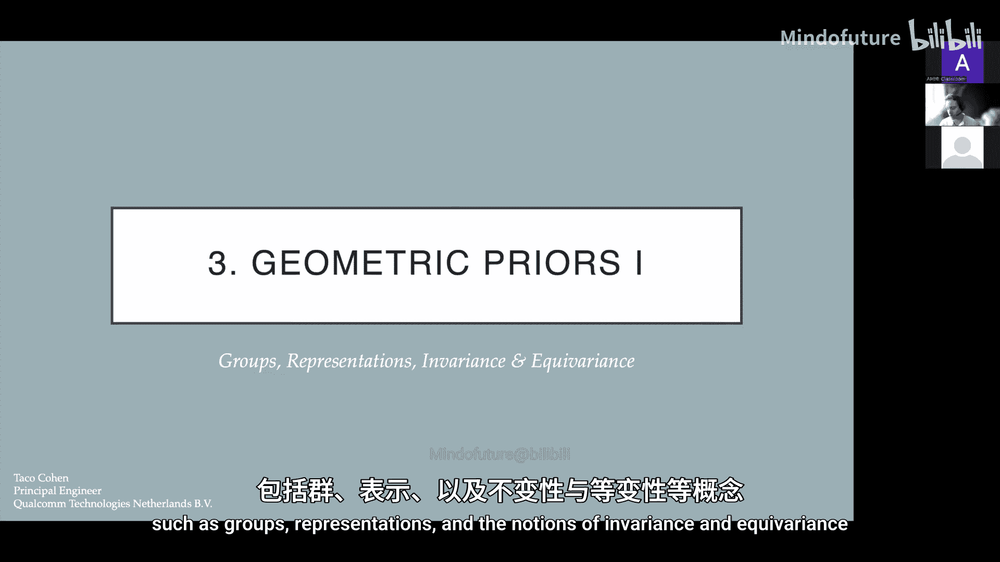
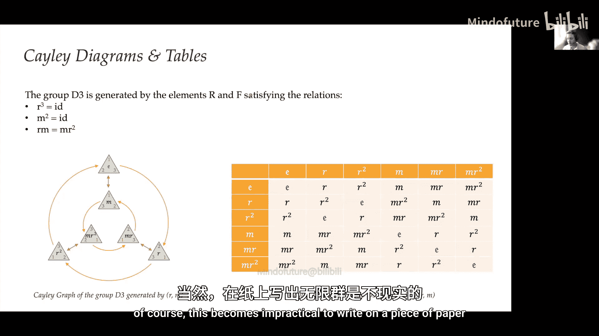
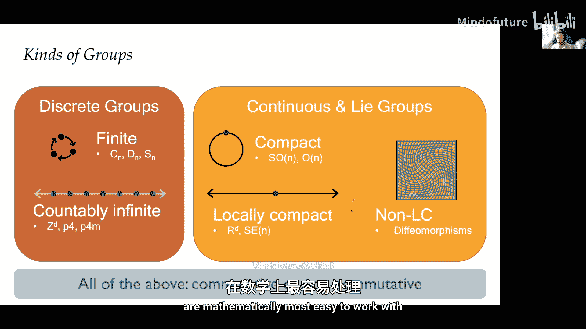
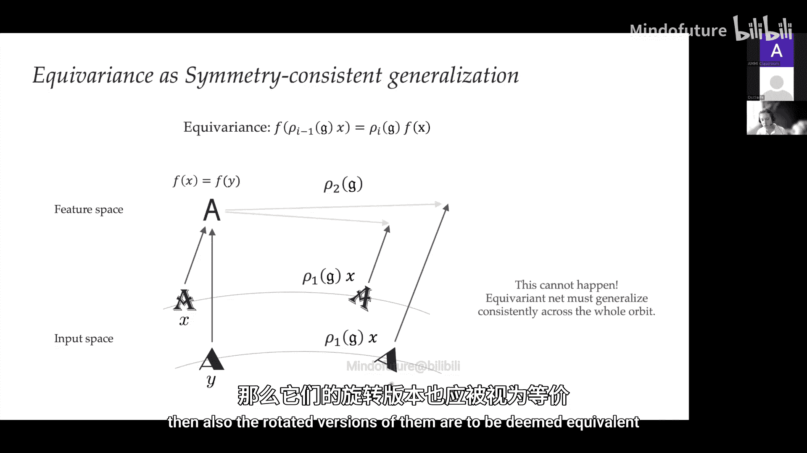
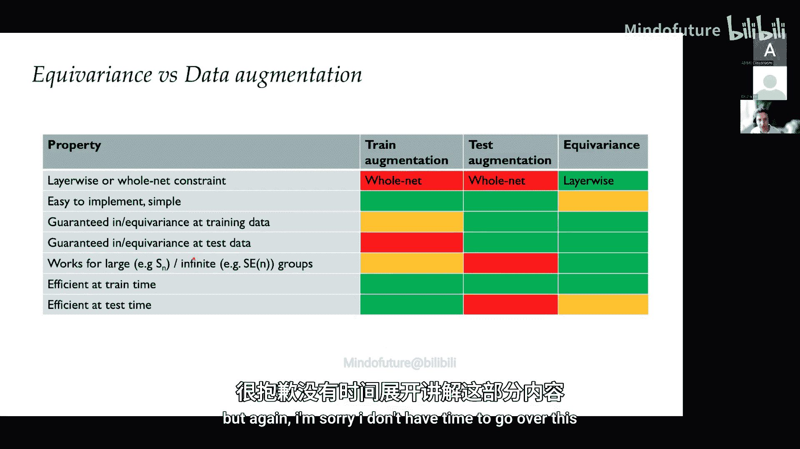
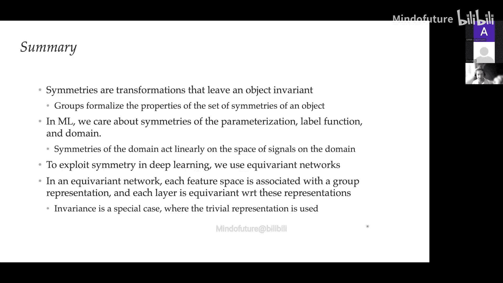
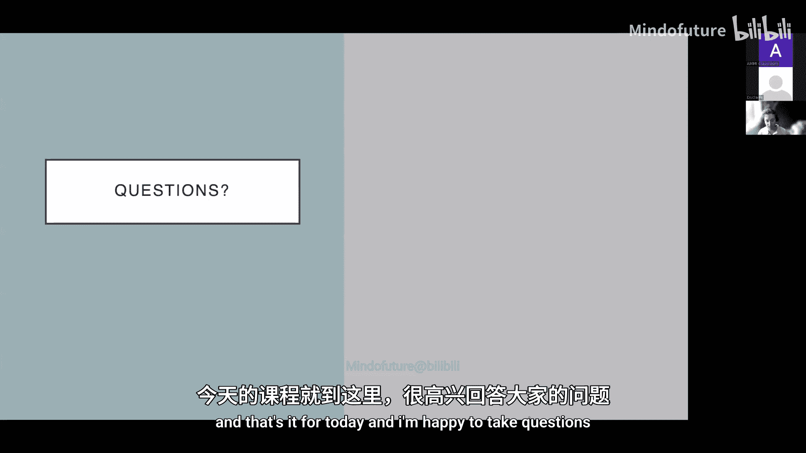

# 几何深度学习：第3讲：几何先验与对称性

在本节课中，我们将开始探讨几何深度学习提出的解决方案，并聚焦于其核心概念——对称性。我们将介绍与之相关的基本概念，如群、表示，以及不变性和等变性。

## 几何域、信号与几何量场

在几何深度学习中，我们感兴趣的数据是定义在某个几何域上的信号。例如，图像平面上的图像就是一种信号。但几何深度学习关注更广泛的域和数据类型，甚至更一般地，我们关注“场”，例如光流图像这样的向量场，或脑部扫描中的扩散张量图像。我们将讨论我们将要处理的数据类型。

接下来，我们将探讨对称性这一概念。我将解释其一般思想，以及对称性在机器学习中以各种形式出现的方式。

然后，我们将关注几何深度学习特别感兴趣的对称性，即域的对称性。我们将研究与对称性相关的一些通用数学概念，如群、群作用，以及线性群作用（也称为群表示）。

我们还将研究对称性群作用于我们在开头定义的信号空间的具体方式。

最后，我们将探讨有助于我们学习更好模型的关键概念：不变性和等变性。

## 高维学习的挑战回顾

总的来说，在高维空间中进行学习是棘手的。为了合理密集地覆盖输入空间，所需的样本数量会随维度呈指数级增长。如果不做任何进一步的假设，即使是在当今拥有互联网规模数据的情况下，这种方法也行不通。例如，如果尝试用最近邻分类器或其他简单方法对图像进行分类，效果不会很好。

然而，在几何深度学习中，数据是定义在某种空间或域上的信号。例如，平面上的图像、球体上的天气数据、图上的数据等。这些域通常是低维的，并且往往带有某些对称性。这些特性有助于使学习变得可行，因为我们事先已经了解了数据的结构。

在本讲中，我将介绍对称性原理。在下一讲中，Jean将讨论另一个相关概念：尺度分离。

## 学习中的误差来源

正如Jean所解释的，学习中的误差可以认为有三个来源：
1.  **近似误差**：指你试图逼近的真实函数（例如，为输入空间中每张图像分配标签的函数）与你在函数类中找到的最佳函数之间的差异。如果函数类太小，近似误差就会很高。
2.  **统计误差**：经典泛化理论告诉我们，如果选择一个非常大的函数类，就需要大量数据。在数据量固定的情况下，随着函数类或假设类的增大，统计误差会增加。
3.  **优化误差**：即使函数类中存在一个好的假设，也可能无法找到它。本课程不会过多涉及此误差。

今天我要讨论的是，利用几何先验（如对称性和尺度分离的思想），我们可以减小假设类的规模或复杂度，例如，只允许等变神经网络，同时不丢弃有用的假设。这应该能改善统计误差，因为我们减小了函数类的规模，排除了所有非等变的神经网络。同时，如果我们先验地知道我们试图逼近的真实函数（例如，为图像分配标签的函数）应该对图像的各种变换保持不变，那么通过丢弃那些我们知道无论如何都不正确的函数来缩小假设类，就不会恶化近似误差。

## 几何域

在几何深度学习中，数据存在于一个域上，我们通常用 Ω 表示。这个域可以是各种东西，但在所有情况下，域在最基本的层面上是一个集合，并且这个集合通常带有一些额外的结构。例如，你可以有网格（如平面图像中的像素网格），其结构可以是邻域结构（例如，这个像素与另一个像素相邻），或者你也可以在域上关联一个距离。更一般地，你的域可以是一个齐次空间（我们稍后会讨论其含义），例如球体或环面。图是另一个重要且流行的例子，这里我们也有邻接结构或拓扑结构来说明哪些节点相互连接。最后，我们还有流形。

几何深度学习的核心信息是：用于处理几何数据的神经网络应该尊重域的结构。例如，如果我们考虑一个球体，那么我们认为某些结构（如两点之间的距离）是有意义的，而其他结构则没有意义。神经网络应该尊重这种有意义的结构。

## 信号与信号空间

几何深度学习中感兴趣的数据是定义在几何域上的所谓“信号”。信号只是“函数”的一个花哨说法。定义在 Ω 上的信号是一个函数，我们通常用 x 表示，它将 Ω 映射到某个向量空间 C。C 的维度通常称为通道数。

最简单的例子是平面图像。这里的域是网格点的集合（像素位置），对于每个像素，我们分配一个三维向量来编码该像素的 RGB 值。尽管在实际应用中，我们可能将图像视为一个扁平向量或具有高度、宽度和通道维度的三维张量，但数学上我们可以将其描述为一个函数，这种方法效果很好且易于推广。

另一个例子是图。这里的域是节点的集合，我们用数字 1 到 n 标记。图上的信号可以是为每个节点分配一个节点特征向量，例如，告诉你每个原子是什么类型的原子。

我们可以考虑 Ω 上所有 C 值信号的集合，这仅仅是所有以 Ω 为定义域、以 C 为值域的函数集合。这将是我们的神经网络的输入空间，同时，特征空间甚至输出空间也可能属于这种类型。例如，对于图像分类，输入空间可能是平面上的三通道信号空间；应用卷积层后，特征空间可能具有更多通道，但仍然是某种 Ω 上的信号空间；在进行图像分割时，输出可能也是一个信号（为每个像素分配语义类别）。我们用 X(Ω, C) 表示这个信号空间，有时上下文清楚时会省略 Ω 和 C。

## 信号空间的希尔伯特结构

关于这些信号空间，首先要注意的是它们具有所谓的“希尔伯特空间”结构。这只是一个花哨的说法，意味着它首先是一个线性空间，其次我们可以定义某种内积，使我们能够比较模式。

**线性性**：数学上，线性性意味着如果你有一个信号 x 和另一个信号 y，你可以形成一个新的信号 αx + βy。由于信号是函数，我们可以在点 u 处求值。这个线性组合函数的定义是：在点 u 处的值等于 x 在 u 处的值乘以标量 α，加上 y 在 u 处的值乘以标量 β。直观上看，对于图像，就是在每个像素上对两幅图像的值进行加权求和。因此，信号空间是一个向量空间。有趣的是，域 Ω 本身不一定是一个向量空间（例如图），但我们仍然可以对特征进行逐点相加，因此信号空间是线性的。

**内积**：使信号空间不仅是线性空间，而且是希尔伯特空间的是我们可以定义一个内积来比较模式。内积用尖括号表示。信号 x 和 y 的内积定义涉及两件事：首先是特征向量上的内积（例如，对于 RGB 向量，就是对应分量相乘再求和）；其次是域 Ω 上的一个测度 μ，它允许我们为域的子集分配某种“面积”概念，从而技术上定义在域上的积分。然后，x 和 y 的内积定义为：在域 Ω 上，对每一点处特征向量的内积进行积分。如果 Ω 是离散空间（如有限集），则可以使用计数测度，将积分转化为求和，这就简化为我们熟悉的内积形式：对所有点（所有“维度”）的 x 和 y 的乘积求和。

因此，结论是：信号空间是一个希尔伯特空间。

## 几何量场

为了更精确，我们需要稍微推广一下“信号”的概念。在许多情况下，我们感兴趣的数据构成了一个“几何量场”。例如，一个网格上的向量场：每个点处的向量位于该点的切空间中。虽然所有切空间都是同构的（例如都是二维向量空间），但它们是不同的向量空间，附着在不同的点上，具有不同的方向。因此，对于场，我们必须明确：我们不是将点 u 映射到一个固定的向量空间 C 中的向量，而是映射到附着在点 u 的向量空间（称为点 u 处的“纤维”）中的一个向量。这是一个技术细节，在开始时不会那么重要，但最好意识到这一点。目前，我们将主要处理函数空间。

## 域本身作为数据

有些情况下，数据本身并不自然地被视为域上的信号，而是域本身。例如，你的数据可能是一个表示手部姿势的网格。我们处理这种情况的方法是通过一些技巧将域转化为域上的信号。例如，对于图数据，你可以使用邻接矩阵（如果两个节点相连则为1，否则为0），可以将其视为定义在节点对集合上的信号。对于网格或流形，有称为“度量张量”的内在量，也可以被视为信号（具体是张量场）。这样，我们就将域转化为了该域上的信号。

## 对称性的概念

**什么是对称性？** 一个对象的对称性是指使该对象保持不变的一种变换。例如，对于一个三角形，旋转 2π/3 或沿垂直轴翻转都是对称性。这些对称性会以复杂的方式相互作用。

**对称性与机器学习有何关联？** 我们来看几个例子。

1.  **参数化的对称性**：我们有一个神经网络函数 F，它接受输入 x 和权重 w，输出标签 y。如果存在一个权重空间上的变换 G，使得对于任何输入 x，都有 F(x, G(w)) = F(x, w)，那么 G 就是参数化的一个对称性。例如，交换隐藏神经元的输入和输出连接及其权重。
2.  **标签函数的对称性**：这是我们本课程主要关注的类型。标签函数 L 将输入 x 映射到标签 y。如果存在输入空间上的变换 G，使得对于任何输入 x，都有 L(G(x)) = L(x)，那么 G 就是标签函数的一个对称性。例如，一张狗的图像旋转后，标签仍然是“狗”。

如果我们知道学习问题中的所有对称性，学习会变得非常容易。理论上，如果知道所有对称性，每个类别只需要一个标签，因为通过应用所有对称性，可以生成该类的所有样本。但这告诉我们，虽然了解对称性非常强大，但对于非平凡的学习问题，期望先验地知道所有对称性是不现实的。那么，我们能期望知道哪些对称性呢？

## 几何深度学习中感兴趣的对称性

我们主要感兴趣的是从数据定义的几何域中衍生出的对称性。我们有一个域 Ω，考虑该域的一个对称性，即从 Ω 到 Ω 的变换 G。对称性意味着它“保持 Ω 的结构”。具体保持什么结构取决于 Ω 的数学定义方式。

一个通用但稍显模糊的说法是：对称变换 G 应保持 Ω 的结构。例如：
*   如果 Ω 只是一个集合（只有成员关系），那么任何元素的排列都是结构保持的映射。
*   如果 Ω 具有距离结构（如平面），那么对称性就是等距映射（保持距离的映射），例如旋转、平移和反射。
*   如果 Ω 具有光滑结构，对称性可能是微分同胚（光滑的扭曲映射）。

本课程中我们会遇到许多其他例子。

## 群：对称性的代数结构

一个给定对象的所有对称性的集合称为“对称群”。我们注意到几个事实：
1.  恒等变换总是一个对称性。
2.  给定两个对称变换，它们的复合也是对称性。
3.  任何对称变换的逆也是对称性。

这些性质正是“群”的公理。在数学中，我们抽象地研究群：一个群 G 是一个集合，带有二元运算（复合），满足结合律、存在单位元、每个元素存在逆元。

我们研究抽象群（忘记群元素是具体的变换），但当我们想讨论群如何作用于数据时，需要引入“群作用”的概念。群作用是一个映射，它将一个群元素和一个域中的点，映射为变换后的点。这对于我们很重要，因为同一个群可以以不同的方式作用于不同的特征空间。

## 群表示

域的对称性也可以作用于信号空间，这对几何深度学习来说开始变得有趣。如果我们有一个群 G 在域 Ω 上的作用（例如，置换图的节点），那么我们自动得到同一个群在域上信号空间的一个作用。定义如下：对于信号 x，变换后的信号 Gx 在点 u 处的值等于原信号 x 在点 G⁻¹u 处的值。例如，平移图像时，为了得到新图像中点 u 处的值，我们需要查看原图像中“倒退”平移量的点处的值。

关于这个在信号空间上的群作用，关键一点是它是**线性**的。因为信号空间本身具有线性结构（可以加和缩放信号），而这个群作用只是移动点，所以它保持线性组合：G(αx + βy) = αG(x) + βG(y)。这种线性群作用称为“群表示”。

更具体地说，如果信号空间是有限维的（n 维实值），那么一个线性变换可以用矩阵表示。因此，群 G 的一个 n 维实表示是一个映射 ρ，它为每个群元素 g 分配一个 n×n 可逆矩阵 ρ(g)，并且满足 ρ(gh) = ρ(g)ρ(h)，即复合的表示等于表示的复合。

## 对称性示例

以下是几个重要的对称性示例：

1.  **集合与图的对称性**：域是节点集合，对称性是所有可能的节点置换。我们可以研究三种图特征，它们对应置换群的不同表示：
    *   **标量特征**：为整个图分配一个标签。置换节点不应改变标签。这对应于“平凡表示”，即任何置换都对应 1×1 的单位矩阵 [1]。
    *   **向量特征**：为每个节点分配一个数。置换作用就是置换这些数。
    *   **矩阵/张量特征**：为每对节点（边）分配数。置换作用就是同时置换矩阵的行和列。

2.  **网格的对称性**：如平移、旋转、翻转。这可以推广到“齐次空间”的概念。齐次空间是指具有对称群的空间，其中任意两点之间都存在至少一个对称变换将一点映射到另一点（例如，球面上任意两点间存在旋转）。基于此，可以发展出一套用于齐次空间的等变卷积网络理论。

3.  **流形的对称性**：涉及“规范变换”，与每个点处参考系的变换有关。这将在后续课程中讨论。

## 利用对称性：不变性与等变性

现在我们已经研究了对称性的一般概念，并看到了它在机器学习中的各种表现形式，接下来让我们讨论如何在几何深度学习中实际应用它。

**不变性**：一个古老的想法是找到数据的一种表示，使其对对称变换保持不变。例如，所有旋转后的字母“A”都被映射到表示空间中的同一点。这减少了数据的变异，使学习更容易，且理想情况下不损失区分不同类别的能力。

然而，在深度学习中，如果强制中间层的表示（对应物体部件）也具有不变性，会丢失关键信息。例如，识别整个物体需要先识别部件，而部件的相对姿态包含了关于整体的关键信息。因此，我们不希望部件表示对变换保持不变。

**等变性**：一个更流行且强大的想法是使用等变性。我们仍然以某种方式尊重对称群的结构，但同时保留姿态信息。

**一般设置**：神经网络由多个层组成，有输入空间 X₀ 和一系列特征空间 X₁, X₂, X₃...，以及它们之间的映射（层）。此外，我们有一个对称群 G，以及告诉我们这个群如何作用于每个特征空间的群表示（可能各不相同）。

我们说一个层 Fᵢ 是等变的，如果满足：先应用该层再在特征空间应用变换 G，等于先在输入空间应用变换 G 再应用该层。用交换图表示即：Fᵢ ∘ ρᵢ₋₁(g) = ρᵢ(g) ∘ Fᵢ。如果所有层都是等变的，那么整个网络也是等变的。

**等变性的好处**：等变性确保了网络对变换的响应是一致的。如果网络认为两个输入在特征空间中是等价的，那么它们的变换版本在特征空间中也应该是等价的。这促使网络以与对称性一致的方式进行泛化。

**不变性是等变性的特例**：当输出空间的群表示是“平凡表示”（即每个群元素的作用都是恒等变换）时，等变性就退化为不变性。

## 总结

本节课我们一起学习了以下内容：

*   **对称性**是使对象保持不变的变换。这一概念出现在从几何到物理的许多领域，我们今天也看到了它在机器学习中的一些例子。
*   **群**是捕捉对称性所有相关特征的代数结构。它们具有封闭性、存在逆元、单位元和结合律等性质。可以抽象地研究群，群有离散、连续等多种类型。
*   在机器学习中，我们关心**参数化的对称性**、**标签函数的对称性**，而在几何深度学习中，我们特别关注**数据所在的几何域的对称性**。
*   域的对称性**线性地**作用于域上的信号空间（我们的数据或网络中的特征空间）。这种线性作用称为**群表示**。
*   为了在深度学习中利用对称性，我们使用**等变网络**。我们确保如果变换输入，网络或层的输出也会以相应的方式变换。这约束了层或网络的设计，从而缩小了函数类的范围，使学习更容易，并应能降低统计误差。
*   在等变网络中，每个特征空间都与一个群表示相关联，每个层关于这些表示都是等变的。
*   **不变性**是等变性的一个特例，即使用平凡表示（群元素不进行任何操作）。

这就是今天的全部内容。