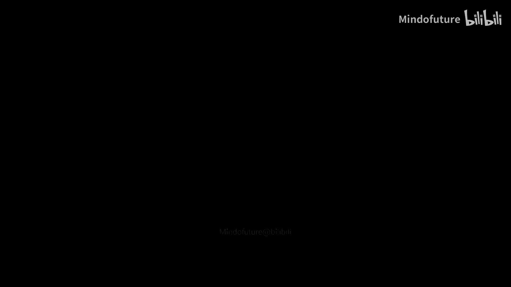
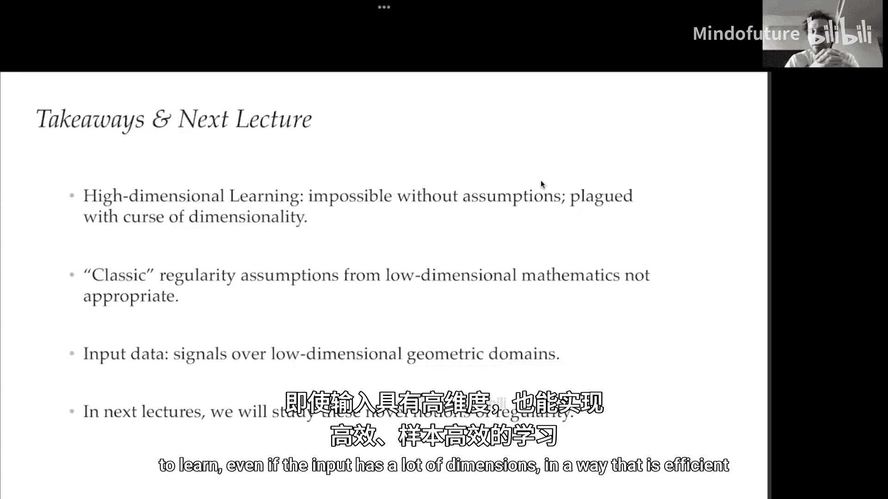

# 几何深度学习 ｜ Ammi Geometric Deep Learning Course p02 P02_第二讲（高维学习）-琼·布鲁纳 -BV1veHgzxELm_p2-

Good afternoon， everyone。

嗯。🎼RightSo very happy to be here， I'm going to hopefully give you a background like from just even just a language。

 like a framework to think about problems， why actually we need all these geo notions that we're going to spend all these lectures talking about and how do these geometric notions fit into the bigger picture of learning stuff。

 learning functions in high dimensions。And so as as happened last year。

 the aim here is to be to go very slow and please if you as soon as you have any questions do not hesitate to interrupt me all right so today we are going the lecture is going to be split broadly into kind of three chapters or like three sections first we are going to really go very slowly introducing the basic elements of statistical learning so whether the main mathematical object that we need to think about the problem of fitting data like basically fitting trying to extract information from data。

Then we are going to spend， we are going to discuss。About the curse of dimensionality。

 which is a phenomena that is kind of pervasive and it's underlying all the things that are happening in deep learning and then we are going to in the third part on the last part of the lecture we are going to see how we can address this curse of dimensionality precisely with the ideas that are specific to this geometric deep learning course right？

Okay so let's get started so if I wanted to just give you the basic object the basic elements of this learning in one slide。

 this is how I would do it right so so for me what we are going focus is mostly like four main objects that are going to be interacting with each other the first one is data right so the way we think about data is using kind of a statistical formalism right so we think about data as being samples from a probability distribution okay so this probability distribution in the case of supervised learning has two components has the input which might be let's say the image like this。

You see here， or it could be you know like a sequence of text and also some labels。

Then we are going to mix this data distribution with a model with an approximation model that is class of functions that are parameterized by our parameters。

That are hopefully trying to fit the input to the output right which is that approximation model。

Then we are going to。Combine like we are going to try to fit the parameters of this model using an error metric like some kind of loss function using an algorithm。

 the estimation algorithm， right so these are the four pieces that kind of constitute the basics of a statistical line。

All right， so the data。So again， we are going to think about the data we are going to define just in terms of notation。

 think about the data in the context of supervised learning as having two components right so XI is always going to denote the input and YI is going to denote the label。

And so here what we see is that we are going to assume or we are going to postulate that the sample that the input to images are drawn from a data distribution that we call new okay and this data distribution is probably the distribution defined over the input space that we call capital X okay so capital x from now on corresponds to the input space of the algorithm of the machine learning algorithm Okay here there's a picture that bought from some of my colleagues of trying to illustrate right that these are kind of the samples that are drawn from from whatever from the space of images okay and then。

For starters for trying to simplify a little bit the exposition here。

 we are going to assume that we have labels that have no noise right so Yi can be obtained can be produced by some unknown function F star right so F star the goal of the game is to estimate this unknown function F star right that is mapping the input to the the input to the right and just some examples。

You can think about F star of x as some some excitation energy of a molecule or some chemical property of some biological compound like some molecular or protein or whatever。

 or if you think about problems in classification， this could be f of x could be the probability that the image X contains a cat。

That could be an example of a function F star that you would like to estimate。嗯。Right。嗯。

And so obviously if I to we want to analyze algorithms and try to reason about why this architecture works better than the other or why this algorithm works better than these other algorithm。

 we need to have some assumptions right there's these important kind oflor folklore result that there's no freelance right in this problem right if I have no assumptions on the data or no assumptions on the target function there's no way I can guarantee that my algorithm is going to work。

Okay， so really all these of course is really about what kind of assumptions are realistic or reasonable for the problems that we care about。

Okay。So now we can discuss about the model like the parametermetric class。

 like it's the choice of the user where we are going to essentially consider a subset of functions that we call capital F。

So these are functions that each function is like in small F that maps the input space。

To the output space here again by simplicity we just assume that the output of the function is scaleal right maybe it's just a logic or some energy right obviously if you think about like the output of your problem to be you know like like like the probability over 100 classes you can replace this R by like the corresponding vector in probability the corresponding to the output space。

Okay， and again， some examples of this hypothesis class。Couldd be， well。

 maybe I could just try to fit the data with polynomials okay so I could just consider that I want to try to learn the input to the output by polynomials maybe fixing the degree。

Maybe two， three you know k could be anything， or I could also use to try to use a model and neural networks where with given architecture okay that's obviously the example that is going to be mostly the focus of this class。

Okay and so there's one element， one object， new object here that is very important from a theoretical perspective and it's also somehow hidden sometimes it's hidden in the algorithmic sense。

 which is the complexity okay， so where is the complexity measure。

So think about the complexity measure as a way to organize。Different hypothesis， right so here。

 for example in the example above， I told you that there's my function class contains polynomials up to the brque。

So maybe you agree with me that within this class， there's easy polynomials and hard polynomials。

 maybe the polynomials of degree one are you know less complex than polynomials of degree two and degree two are less complex than polynoials of degree three and so on and so forth。

So more generally， you can think that for every element in your family。

I can assign a notion of complexity。what that we call this gamma and this is something that we are going to use later on to argue and to think about basically statistical learning right so andm just an example of again of how what this complexity would look like in practice for us maybe you can think about the complexity as being the number of neurons so the number of parameters in a neural network。

This is nots a good intuitive example but it's not always the right thing right but just to illustrate the point we can also think about notion of complexity that are applied in broader classes these are kind of nonparametric classes like so like you know general function that have a little bit of smoothness so there's actually a notion of complexity that measures the smoothness of a hypothesis right so if I have a function a hypothesisses that you know that it looks like for example this is the。

最啲就 the input。And this is the output。Well， maybe this function here over here。

It's going to be less complex than this function over here， right？Okay， so。

 so obviously the this is a。Less complex。And this is more complex。So in this particular example。

 we can measure， we can quantify this this complexity with smoothness。

 right then this no this quantity， if you have ever seen solar spaces is measuring kind of the how large is the second derivative alpha function。

There's one thing also that I want to measure that I want to mention here right it's an important remark that is in particular relevant for those of you who are already being practicing and you know interacting with neural networks is that often this notion of complexity is hidden right in the algorithm it's not something that we can that we explicitly manipulate sometimes we do sometimes we don't and so this is why we call that sometimes there's a phenomena that's called implicit regularization or implicit bias right is that the algorithm that we are going to use right so maybe maybe the gradient decentscent algorithm or the choice that we make in the hyperpermeter of the gradient decentscent algorithm is going to enddirectly define this notion of complexity right that for now for this lecture we just think about this that someone is giving us someone is giving us this complexity right we are just going to use it。

Theoretically writers as a tool to understand when an algorithm works。Any questions so far？2。Good。

 so we have covered the data distribution， we have covered the model。

 let me just mention very briefly， what about the aromamic。Okay， so the error metric just again。

Think for example， thinking in a simplest case of a regression like squared squared loss。

 so given some measure like first if you give me this point was lost like a way to compare two different levels。

 for example， just the square difference， we can now take this function and un build it and upgraded form it into a function that assigns a risk like a loss of a particular hypothesis quite and so the first notion of。

Of error like the first notion of loss is what is the loss that happens on average right with respect that my data distribution。

So this is what we call that population loss or like the test error。Okay， so given a hypothesis F。

R of F is telling us if we just read through this equation， is telling us on average。

 with as spell to the data， like the expectation with as to the data， this is this expectation。

 what is the agreement between the true function and the function that my model has produced。

 why is F？Okay so this is an object that is completely deterministic right you know there's no randomness here。

 but of course it's an object it's a quantity that we cannot measure right because in general we do not have access to the to these objects we don't have access to the population distribution and of course we don't have access to the function that we are trying to learn otherwise there would be no point in trying to solve the problem。

So we resort to kind of an empirical version of these laws。

 which is the empirical laws or also of course， the training area。2 year or 2 years okay。

 I guess all of these things， I guess you are familiar with that but just to so that we can agree on the language right so this is a there is a function that is random right in that case this is a random function。

Why don't this is deter。Okay， so the random this random function is an average over the data。

 the available data， the official data points of the basically is just replacing the expectation by the critical expectation。

Okay， and so you might ask， okay， what is the how are these two functions related to each other？Well。

 they have an obvious relationship， right， is that for any fixed hypothesis。

If I think about that now， if I figure the function F， right， I have here a number。

 so this is a number right， and this is a random variable。喂。

And so it's easy to say that if you look at the expectation of this random variable。

 why is the expectation of our hat。Is precisely art。Right because if I take， this is an average。

For random variables that are independent IID and each of them。

 its expectation is by the definition of R of。All right。

So we can compute easily for a fixed hypothesis F we can easily compute the first moment which is the function that we care about and the second moment right so what it means is that if we think now if I try to visualize these loss functions right maybe I have this function R that does something like this right and so now that so this would be the test error now if I think about the training error well if I fixed any point so this is my space of function right so this is my space of F so if I fixed any function here well this looks like a random variable that is has an expectation here right so maybe at every point I have some。

You know some kind of like notion of function that in the training set does something like this Okay。

 obviously this is an illustration right that doesn't。Doesn't the right， I mean。

 this is just the thing as a sketch。But。The problem， well， the question is。Yeah， we would。

Obviously function the thing that we care about in practicing machine learning is to find a F such that the test error。

 the population loss is small。That's obviously what we want right we want to try to get as as responsible from E the problem of course that we can only access the only proxy that we can use is the empirical loss right so the intuition here is that the closer these two functions are to each other the better my chances are of solving the problem by this like this is really I'm just repeating you know obviously the intuition that you all have that if I have an algorithm that makes that minimizes the training error you expect the test error to also be minimized。

Okay。And for this is important if I want to quantify if I want to try to give some guarantees to understand。

 okay， but how far are these two function？So here， if I fix a point right for any fixed point。

 I can you know by just applying basic。🎼Statistics right the fact that this is an average here of independent n independent random variables。

 I know that the variance right is of the order one over n。

 because if I look at the variance of an average of n I random variables， as you know。

 the standard deviations is divided by one over a square of n， but like the squared at the variance。

 the second moment is divided by n。But here there's a little problem， right and probably。

You know some of you might have already spotted right that here I'm doing a very kind of I'm trying to do like a shortcut right I'm trying to to pretend that the problem is very easy i'm computing the variance。

When I fix the function F right when I fix the hypothesis。

So these arguments about completing these fluctuation of these functions， right？

TheyEssential the underlying assumption， right is that the function F is chosen independent of the data。

 right， they just data fix the function F and look at what the fluctuations like this。Of course。

 the algorithm right， I mean， you in practice， we don't want to do that， right in practice。喂。

We want to adjust the function F depending on the data。Okay， so we are not interested。

 I mean what we need is not understanding well what is the fluctuation that I have for a fixed hypothesis。

 we want something stronger we're going to be able to control the difference between these two functions。

Essentially for any choice of F that we can make that we can possibly make。

And this is what's called a uniform bound right instead of having a pointwise bound basically just looking at the basically the variance of a random variable。

 I need to compute what is the worst fluctuation right what is the worst deviation between R and R hat over a certain classes of hypothesis right this is what's called a uniform bound and probably you have heard you are familiar with。

 for example the notion of rather macro right rather macro complexity is one such class of uniform concentration。

All right， this is the a。O给。😡，So now we are we can now discuss about the algorithm and again here for algorithm it's kind of an algorithm taken in the theoretical sense right it's kind of a meta algorithm。

 it's kind of a principle right so what is the principle for learning in the case of supervised learning。

Well， as I said， our goal is to minimize the risk。But we only have access to the kind of the。

A random， like an approximation of R that is that this training one。

So in order to succeed and to have this hope that optimizing the train error is going to get us something close to the test error to miniizing the test error。

 we need to have some control we need to instead of trying to look at these fluctuationtus uniformly or over all possible hypotheses and so that we need to consider right we need to use in a sense like like a notion of like a limited set of hyposes here for this how do we construct how do we limit the size of the hypothesis set。

 well we just use the notion of complexity that I described before， right？

So we are going to focus over to the hypothesis in our class right so we are going to look at the hypothesis in our class but only those that have small complexity right so we have one hyperparmeter here that is delta right that is kind of the radius of。

You know in this like large space of hypothesis， it would be the maximum size of like the complexity right so in the case of neural networks for example。

 you could say well I only want to try to look for neural networks you know who's not like where the norm of the parameters is not larger than let's say a thought right that would be an example of controlling the size of your set right and then by choosing the maximum allowed norm you can make your hypothesis goes smaller or be。

え？And so once this is established， now there's a very natural algorithm， right， which is， well。

 I'm going to consider an estimator by F hat。Of Delta， which is， well。

 amongst all the hypotheses that has more complexity。

 I'm going to choose the one that has the smallest training error。W。

 that's what's called empirical bra mini music。Right I hope that this is an intuitive algorithm right is essentially the algorithm that any reasonable person would choose right it's like okay。

 I'm going I don't want to have I don't want to have to deal with potentially very very large fluctuation between train and train and test so I'm going to just look for a small like like a producer or hypothesis and amongst those I want to of course choose the one that best fits the data okay because here remember we are making this assumption that there's no no I mean the data here the labels are completely clean。

And so this problem， I stated to you in what we call a constrain form。

 right because we are trying to solve a constrain optimization problem why the constraint is that our family of a function F is in this ball。

Or as you know， constrained optimization is a kind of a close cousin of penalized like we can transform constrained optimization problems to unconstrained optimization problems through what's called a lag multiplies right and so we can introduce a penalty here。

 though like a regularization if you want。Where we add the complexity to the loss right so now our new test objective is the empirical loss that we have before plus a regularization。

诶。😊，And so before in this problem， we have this hyper we have a single hyperparmeter。

 which is delta right， is a scalar。And here now we have another hyper parametermeter that is lambda。

 right， which is the size of the strength of the regularization and these two parameters are in correspondence。

One to one correspond。There's another naturally related regime of ErM。

 which is what we call the interpolation form。Okay。

 and this is a popular in you know neural networks in particular in the regime where they have a lot of parameters and this is really the problem this is really the regime say okay i'm going to。

😊，If I have a neural network that has a lot of parameters。

 maybe I have enough capacity right I have enough expressibility to explain all the data that you're getting right I can fit all the data points。

😊，So and maybe you might you might you might see you might argue that okay。

 but there's not a single neural network that can explain the data， there's many。

 many possible threshold parameters that explains the data but like this is the classical example where。

Let's see。Herear in 1 D， I have a bunch of points， right， this is my points。

 let's say and imagine that your hypothesis class is polynomial。Okay。😊，Just to say something。

 So maybe there's this。This function explains the data， right and this function。Also explain the。

 right， This is the the classical。Example that everyone shows， right？

So amongst all the polynomial genetics that pass through the points。

 what does this ERM tell us they have to choose the one that has smaller complexity。

 for example here would be the one that has smallerest liquid。Yeah。I mean。

 this to me looks like a reasonable algorithm， I don't know for you also the same right for me。

 this just makes a lot of sense。All right。So what can we say about this algorithm， I mean。

 is there how do we argue， how do we start analyzing the behavior like the properties of this hearing？

是。Okay， so let's do it。So first we consider an arbitrary hypothesis class right so this is all very。

 very abstract and very general。Where and I'm considered the ERM like this empirical risk minimization using a and I'm just using the constrained form for simplicity。

 right so I have chosen some amount of some you know size of the complexity and I find the solution。

 the hypothesis that is in that sense。So now I want to compare。

 I want to see how good is this hypothesis right so how good is this hypothesis in terms of what I care about。

 which is the risk， the true risk like the tester。So what I can do is I can compare it with the baseline right so and given you know a choice let's do it with the best of the best right so here I'm saying okay。

 if you were God right and you were giving this function R and you could really look for all all the possible hypotheses in the world that were in your you know in your universe。

🎼how worse do you do versus this kind of omnipotent learn？Well。

 so the first thing that we can do right is that we and now the goal is really to try to understand this error。

 right， like to try to break this error into things that we can interpret and that we can analyze。

The first is that。嗯。The first thing to observe right is that this hypothesis have had。

It depends it involves a certain delta， right， it depends on this quantity number。

RightSo what first we would like to do is to exhibit this parameter that is important in our problem。

Right Mr Dta。So the natural thing that we can do is instead of looking at the inum over all the possible plus F。

 we can add and subtract the inmum over all the hypotheses。

 but now restricted to have complexity det。Right that's the first step that we will right so what we have said like in this step。

 we have just other than subtracted this term， right， so the quality is legit。Okay。

 so now I can think about this regret if you want to like this gap。As the sum of two terms， right？U。

And terms the two terms are non negative right， so here we have a term that is the difference between the best I could do。

Unconditionally。With the best I could do when I restrict the complexity to be deal right that's the grid that's the red term and then I have the other one which is。

The difference population between my hypothesis F and the best hypothesis I could have taken up poster if I had access to the population distribution。

 to the true function R。Right。Okay but this is still of course something that I cannot you know it still is a little bit you know that the first term is something that we don't really understand so let's try to take compos so there's another thing that of course involves F hat right so remember that F hat。

Something that I have obtained by looking at the by looking at the at the empirical say all right so now let's do one as I was saying for the for the algorithm right remember that the algorithm is only looking at the empirical at a training loss right so maybe we want to think about how we can now。

You know，Introduce the training objective in this equation。

So we can do just do exactly the same trick as before we can add and subtract terms that depend on the empirical right so that's what be the next Okay so now we are you know instead using R where we use R hat and of course every time I do a change I need to make sure that you know that I remove it right so here I add。

here after the ice sub。Here I added this new term。And here I you know I put it again with a different with the opposite side right so this is still true right and so now we have something quite interesting because now we have something that we can analyze right？

What is this green term？Yeah。So the gradient term is measuring what is measuring what is the training error of my of my F hat？

My is the best。Hypothes like the you know like the the minimizer of the training laws now this is R hat here right so here we have R hat over the the you know the hypothesis space restricted to have。

Bd out。So if you remember from the previous slide right how did we define the ERM right so if we had used if we could use the actual solution of the ERM。

 this term would be what？Is that with you be。Yes， if you remember the EM right， the ErM is saying。

 okay， I'm going to choose a hypothesis， the solution that minimizes the empirical loss over the ball。

So this is exactly what you have here right， so this thing would be zero right if we were using。

right。It。All right。So the the red term here is exactly the term that we have here right so these are this is just definition and now we have。

Basically the prices we pay like the fluctuation right between the training error and the tester。

 sorry between the yeah between the training loss and the population why if we have a difference between R of my hat and R hat of my hat。

And here we have the difference between the two inmacy。And so we can now control these fluctuations。

 right we can just。Because now everything is measured in the wall， right。

 we can upper bound the sum of these two terms。By just two times the largest possible fluctuation between the two functions。

Right。And so。Now we have something where we have really you know。

 isolated or identified the source of error， right because really now this is a term。

That we call the blue term is what we call the statistical error right so the statistical error is a term that depends on how good is over proxy right so how close is the training loss to the test loss in the sense of in the uniform sense right we measure how close are these two functions with a uniform bound。

Then we have an error that depends on how good。Or a hypothesis space approximates the truth function。

And then we have another an error like that is the green one， which measures how good we are。

Optimizing and solving the optimization problem。 which is something that measures how good。

 you how much， so what is the difference between the empirical loss of our function and the best empirical loss in our set。

Okay， does is it clear is this the composition of error clear okay。

 like the pipeline here is that when we analyze you know the generalization error。Performance。

Of a machine learning algorithm， the error that we make is always a combination of the three errors。

 right there's one that comes from the from the approximation side like the expressivity of the model。

There's another one that comes from the statistics， which is again。

 something that you can control with its uniform fluctuations and then there's another source of error that comes from the optimizations。

Right？Okay， I can also we can now you know just make sure that we understand by having a little diagram。

 little picture together that's something that I myself I like sometimes to just be view with things so here's a you know here's a function right it's a loss so these circles you think about these just from kind of level sets of the function right like this loss。

🤧And so here in the bottom of this landscape， this is the F star。

 which is the best right like the function that minimizes the population f is like the best of the best。

So this function the blue function we don't know right it's an unknown so what we have is another function that the one that the algorithm sees。

 which is the empirical loss like the training loss so I told you that these two functions are you know are supposed to be close to each other but they're not the set right i'm hearing for these purposes of illustration I just put them you know like the level sets are different right？

So instead of looking at this landscape in the overallval space。

 remember that we said is that we just look at this landscape in a ball right that's what the algorithm is going。

 it's just going to focus all of its efforts in a subset of functions right which are this ball right this hypothesis class。

And so now we are what we're going to do is what is what does the algorithm Okay so the algorithm in the ErM。

 we are going to say， okay in the in the yellow ball， I want to find the function whose'。

WhiE Lo is the lowest possible。Okay so naturally what we do is we dig this point， right。

 which is kind of laying at the level set， like the smallest level set that is touching the yellow ball。

Okay， this point here。So I was just trying to illustrate kind of you know visually this decomposition of error。

 let me just maybe for the sake of refreshing you know where we started。

 so that's the population error right that's kind of the true the true game right of trying to get as close as we can from the bottom of this well。

And we are going to， the only way we have it is to go， you know。

 to go downhill in the following the kind of the magenta level set。

 which are kind of the training laws。And we are only going to， you know。

 because we can only control the fluctuation between the train error and the test error over kind of a small size of hypothesis。

 we can just restrict our attention to what happens in the blue ball and so in the blue ball our best estimator is going to be here right just at the intersection right of the ball with the level set of smallest loss right for the training。

And so we would like to understand how far right is the race between these two functions within these two points？

Okay。And so that the composition of error， what it tries to do is to express to break to control this error to up around this error with basically two sorts of error right like just assuming that here we have been able to optimize the ERM right it's just breaking it in two terms right then the two terms visually are now easy to see because they depend on this greenpoint which is what it would be the best test error。

呃。In your ball right and so you know as you can see now if you change the size of this ball right there will be one arrow that is going to become bigger right and one arrow that is going to become small by then obviously if I increase the radius of the ball。

 the approximation error is going to begrades by because I'm going to get closer and closer to the star。

But of course， I need to complete fluctuation over set that it's bigger and bigger。

 right so the fluctuations are going to increase， the statistical error might increase。

On the other hand， of course， if the ball becomes shrink and shrinks。

 the approximationation error will grow and the statistical error will decrease。

I guess this is like intuitive at this point。All right。

 so the bottom line here is that when now we think about problems in high dimensions right where the input space has a lot of is very large like for images or very complicated data。

It's actually quite it's actually a big challenge to control all the years at the same time。

 right and this is what I call kind what we call here the challenge of high dimensional learning。

 okay？And so。诶indy。In high dimensions， the first challenge is how can we control this approximation error right so we need to for example think about constructing spaces of hypotheses that have a lot of expresssivity right that can approximate complicated functions that live in high dimensions right and that's not easy right that we're going to see that that's not easy。

The statistical error by like doing the I mean controlling the approximation error alone indeed is easy right sorry so approximating like making either of these errors small is easy。

What is hard is making all the errors small at the center。Okay。So the statistical error， as I said。

 is something that we can control using basically using the theory of uniform fluctuation like this concentration bound that really give us a very tight result at a not right that really work for any size of the training。

And finally， the optimization error right is something that we also need to we cannot forget。

 right there can be situations where we have a good theoretical understanding on how to make the blue error and the red error small。

But we have no algorithm to find a solution right then in that sense we have a bound that is kind of useless right because we it doesn't explain the reality right it's not something that we can we can execute efficiently with a computer right so it's all a challenge is really about how can we make how can we understand。

At the same time simultaneously how to make these errors small at the same time okay that's the challenge of machine and this challenge is by you know by all measures still open right there's really no closed theory for how to do that with neural life。

Good。And so why is this problem hard in high dimensions？Well。

 the reason or like one of the sort of like diagnostic for is hard is really not something new right it's not specific to neural networks In fact there's many in many situations in science when we increase the size of the input of the problem things might kind of fail like might you like BA right and this is really coined know very not very very famously by Belmon in what he called the curse of the machine learning right in his context it was in the context of dynamic programming right like some algorithms have like quantum complexity that basically grow exponentially with dimension。

 but this phenomena now is very pervasive right it's pervasive in statistics in optimization in approximation right in all the areas in particular that are connected with machine learning。

And so。Maybe one way to motivate and to illustrate this principle like this course of dimensionality is really to relate back to like you know a basic principle for learning。

 right which is something that I think we can all relate to right。🎼Basic idea like of why， you know。

 a machine learning would succeed， like why on earth。

 if I know the value of the function at certain points。

 I will be able to know the value of the function everywhere else。

🎼It really it's really sitting on the property right like look at these pictures right I mean you see here there's a you know there's a orange dots and gray dots right we can all try to it we can all figure out infer that maybe there's a line right I know these dot are really generated by something that you know passes through this points。

and here the same thing right maybe we would not all have drawn the same curve exactly but something that basically essentially is the same object。

 right？And the reason why we are able to do that reliably and without much， you know， you know。

 without being too worried about or whether my model will generalize it or not。

Is because it's really the proximity right we are you know like the empirical density like the sampling the sampling of the dots is not too far right from basically if I know the value of the function at these points I can extend it naturally by by notion of proximity right any point that is sufficiently close to my point right to my training point I can just propagate the value of the function right so this is really a kind of。

🎼One of the cornerstones of machine learning methods right most like you know the used classical idea like this is like kind of a local methods like nearest neighbor or can methods right they are all based on these notions of simul lines。

So the problem of is that what happens with this principle as we go to higher high dimension right if I start to give you this points and stuff the in dimension2 in dimension 200。

 right？Can we still argue the same way？Well that's the problem right that and this is you know like the way this example works right is that the only assumption that make these curves work right it's really like that the function that I'm trying to learn is a little bit con right has a little bit of smoothness right to that every point if I know the value of the function at one point I can kind of like extended around in the neighborhood of the training。

So this is formalized the by the notion of legs right like when I say that my function is legits。

What I'm saying is that if I want to know the value of the function at a certain point x。

And I know that we have the function at a certain point x prime。

To the extent that eggs and X prime are close。🎼You know， I can extend the function by like， you know。

 approximating the value of the function， you know， I can you know if the x and X prime are closed。

 f of x is close to f of x which is like a very national natural notion of smoothness。Okay。

 so this is really a pretty。prettyrety naturalt assumption。

 right that many many functions that you want to learn in life have this property。

 right if you change the input a little bit， the output changes a little bit。

The question is can you learn functions in that class。

 right in all general you know if we could just have an algorithm that would learn in that class。

 right， kind of we would be essentially solving machine learning， right because this is a very。

 very general assumption。Okay， so to formalize， let's assume that my target is a function that is one litits。

And the data point， like the input is drawn from let's say Gasian distribution。

 right in the dimension。And so the question that we are asking。

Is how many samples do you think are needed？If you want to estimate this function up to error absolutely so I would like to produce this so I have a function。

 I have a input of the problem would be Xi and then F star of Xi。Or a number of samples。Okay。

 so I pass it through on algorithm。That produces some hypothesis F had。And what I want。

Is that the expectation over this Bo data， right？Of F。Thanks。M is S star of X。Is。

Smaller constant and absent。喂。So that's what。All right。So。What do you think。

So here the parameters of the problem right there there's basically there's two parameters of the problem。

 right there's the dimension D。But this is the input dimension。Doess the error epsilon。ItOkay。

 this is the target error。And there's a number of database。

So the question really is how do these three parameters， how are they related to each other？I what。

Okay， so this is I was trying to do this an edgeS size right so perhaps what I can do is just give you like a little like a little hint right and I will leave the rest of the argument for yourself right if you want to think about think about it about this problem just to make sure that the concept that we have been discussing so far are well understood。

Okay， so the question really is that we want to understand， you know， and。How should N depend？

And depends。嗯Aentent。Okay。So for the upper one， for the upper one， what I mean is that okay。

 let's first try to give an algorithm， right like an estimator。That。🎼And let's try to you know。

 like to give a number of samples， like there is， even if it's very large。

 that we certify that we can in fact learn these things efficiently。Okay。

 so what is a little algorithm？🤧For learning theits functions Okay so here maybe I can just give you kind of as a hint right so let's assume that we have these points spite of our training points。

drawn from this prescription in the D。RightSo we know the value of the function at the points that I drawn。

Andello。I dont think I can change the color here。叫什么？And now I have a new point， right。

 that is solid。That's it here， right？So here I know x1， these are my training sets。

 and here I have a new point in X。And I want to predict eex。

Okay so what is my estimator what is the best？AF that I can use to analyze right so what I know right is that my target is Li one。

Okay。就。What I can what I can first do is that well， I know by I know that。

know trying to wake up from before， I need to think about complexity right I need to think about the lipss class also defining certain contexts。

Here， if you go back to the definition， right， what do you think is a reasonable notion of complexity for ellip function？

Someone， I don't know if someone wants can answer。That。Okay， I don't see you guys， but。Well。

I assume that there。That you heard the question， so a very perhaps the natural notion of complexity for lipsshift functions is this guy here。

 this constant here right it beta is very small。It means that the function maybe you know cannot change the less right so like the les constant right a is a is in fact a natural notion of complexity for les function in fact。

Not quite exactly， but but essentially it's a norm right so you can you can essentially think about the lips's constant as being the norm of the function。

 right you need to。You need to add some some kind of like supreome of the function， but anyway。

 for us it's going to be good enough right so I could I could just think about this。

I could define my estimator。As the argumentmen。Rs。The arm of the constant。That that。F of X。

It equal to S star X。Whatite bro。So here what I'm saying is that I'm sorry for interrupting you。Yeah。

 maybe because the class is not familiar with lipshift function because they didn't take like optimization class yet。

 so maybe if you could briefly talk about the lipshift function definition。Right， right。

 so here's the okay， so here's the definition of eip sheet function， right。

 so eip sheet function right is a function says that。拜拜。

Change the input a little bit right in the sense that the x minus x prime is small。

Then I can use this distance between the points of input to bound the distance of the function value Okay so let's try to think about an example of a function that is lips shits and then an example of a function that is not lipss right just to make sure that we understand why like a function of a lips sheets function right so for example if I think about okay。

 just to look at an example F of x。个 sign。Of let's say， omega then x， right？

So do you think that this function has that leg its profit？

In the sense that if effectss an X prime are very close。

Do x f of x and f of x prime are also very close right so we can just look at this right f of x energy of x prime。

Yeah。嗯。Okay， what do we think？We can we can do something， right？Here we can use。

 I guess you have taken calculus right so we can use the fundamental theorem of calculus。

Right so we can just think about this as they integral。From x to x prime of the derivative movement。

えフもテデ。Yep。And now we can put the absolute value inside。So it's integral between x and x prime。

Of the absolute value of F prime of T。Dき。But now is what is the absolute value of what is the derivative of f of x right。

 so we know the F prime of。X。It's just the omega minus omega sine of omega x， right。

So what we have here is that this is actually。Controrolll by mega， right times。

The absolute value of sine， the absolute value of signine is always smaller than smaller little than one。

 right， so this is just equal。This is just a control by these times x minus x prime。哎。

So this' an example of a function whose slips its constant now is precisely is mega。Is it beer？

This this is just here。 of course， I'm using。Yeah。Another way to think about it。

 part is if I have a function whose derivative is bounded everywhere。

The bow of the derivative is actually a bone on the lipsitz content。嗯。

An example of a function that is not Lis。Let's try to give an example of a function that is not well that's not not hard because I can just think about like a function like like a step function。

诶。So you think about the step function。Obviously， this is not blood shit， not lipssheds， right。

 because it guys zooming in what happens in this discontinuity。

🎼You know I can I can choose eggs and X prime that are very very very close right one is in one side of the discontinuity the other one is in the other side so f x minus f of x prime is always going to be one right？

🎼Even though so the left hand side is always one and the right hand side they can make it as small as they want。

 right too， as's an example where it's a function that is not。你 there。哦哇。I hope it's clear。All right。

So now and go back to our example， right， so we want to。诶。So we define this estimator。

 which is the function that has the smallest possible which its constant that fits the day。

And so now we would like to understand。So then the question for you right is to computer like to have a sense of。

What is this error？But so， is this function any good？To approximate。What I want right， so I will。

🎼Let you think about it and tomorrow or we can of course iterate on this question just to see how how to see where you're right but the point is that here we are trying to define we are just we don't care about so here we are interested in the upper bond right so we are just trying to build an algorithm that is' going to guaranteed to succeed provided that n the number of frame points is sufficiently large right then we are just going to give some upper bound on the number of n for which this works。

Once you have found this result， you might ask a question， okay。

 but is the number of data points that I found here？

🎼The best I could do right so so do I need as many data points maybe maybe I haven't been smart enough and maybe I could have found a better algorithm right then better solution than this one that would have worked with smaller number。

That's the lower point。And here I'm going to also give you a hint on how to think about the lower bound。

And I will also let you develop present let's try to think about this。

So here what we are going to do is that we are going to build。A target function。

 one specific target function。That is going to be elyians。

And where I claim that unless you have a number of data points that is exponentially large in dimension。

You cannot learn。Okay。So here's the idea。The idea is that I'm going to take my inputs。

IThink about the input spatial of this， the spacing dimension， the spatial of this is R。

So think about RD right and now think about all the possible orthos of the D dimensional liquidity base right so basically what I have so I can think about all the points。

Of the form。诶。Think about all the points of the form Z1 to Z。With ZI that does that is plus minus1。

Okay。So basically these are the kind of the corners of。Kind of a hyper， right？Okay。

 so in dimension three that I'm bring here， I have eight corners。But of course in dimension D。

 how many corners do I have right so this is the let's look at this， let's call it HDd。Okay。

 so obviously the number of points in this hypercu。He's going to be。

But you think about it right so we have you know every coordinate is one bit。

 it's two choices right so I have two times two times two times 30 times， so I have two to the D。

Once， right？And so for everyone one of these points。Right， now I'm going to build a function。

That is going to be。Basically， a linearina combination of box， right。

 so I'm going to build a function F。Star X。That is going to be a sum form all the points that are in the hyperplane。

 that in this hyper cube。And I'm going to choose。Some coefficient， can I call the。C。

 right that this is going to be。Also， plus -1。That was a little bump。center头的地方。就接做噶。

I wish I could erase， I don't to with this。嗯。Well， let me just。Okay。

So what I'm doing here is that I have a little function right that this kind of a bump， right？

I can I can I can place。Around each of the corners of this hyperki， and I can choose the sign。

 right so maybe maybe at this point I upwards at this point I downwards at this point equity downwards at this point equi upwards well。

You see what I mean right so I have a basically a kind of a spin system right so I have two to the de possible locations and for location I can just choose up or down。

Okay。So what I can do is that you can build so fact。We can build。Yeah。It's star。Its that。It is。

Lis to described。诶。So here I have a targeted function that has this possible form。Okay。

 so now the question for you。It you need to show。That。To learn that in order。The learn f。这 that。

In expectation。🤧Or the data。F hat of x minus F star of x is let's say。

 let's say that this needs to be a smaller。Then。One half right so if I if I just want to make sure that I do an error that is kind of a fraction of the energy。

We need。And to be bigger than some constants。ダイムスちょっとで。哎。That's the edge， maybe questionable edge。

She。It the HSI player right so here I gave you kind of I gave you the construction right this is the class of functions that are going to be like a you know like a local box。

And then at every corner of this hypercube， I can choose the sign of the bone。我。

🎼So what I'm claiming is that if I want to learn this function with error that is a non you that is small。

 I need to observe a number of points that is exponential in damage， right？是是。And again。

 if I' happy to follow up on this question after you have some thought about it。喂。Good。Okay。

Now let me also let me briefly tell you that dis curve of dimensionality。

 right that here in the previous example， this curve kind of related the number of points that we need to observe of a function with one learn right。

ItThe sta of curve， why does something that depend on how many observations。

The car also manifests itself in approximation， by the approximation error。

 is also going to be affected by the car's information。

And so an example like the prime example of this course of the nationality in approximation already appears with neural networks that are the simplest one。

 why which are neural networks that have a single hidden layer。Okay。So the neural network。

 you defined a function that is this sum over the neurons and every neuron， right as you see here。

 every neuron has some input weights。As a bias and then an output right that's a neuron you know this neuron has。

It parameterized by these kind of three parameters。

 and then the function is just the sum right over all this number of neurons in the hidden layer that produce the。

So。There's very different ways to measure the complexity on this class one example would be well the width right this is the width of the network。

And the other one is you know like the variant of these are given for example， by the pathal right。

 which is if you're familiar with the weight decay that's the same thing right is' the weight decay like the sum you know it's like the sum of the norms right of the weights。

 you know parameterizing the property。It doesn't matter for。

So we know that there are plasma of neural networks， even in this shallow sense。

If we make the width very， very large， right， if we make the with as large as as we want， in fact。

 we can approximate anything with that。🎼This is what's know captured by what's called universal approximation theory。

 and these are in a sense， these are all like these were developed in the 80s and the 90s。Okay。

And so the way these theorems go is as follows， it says， okay。

 even my activation function role is not a polynomial。Then if I have sufficiently large width。

 I can approximate any continued function。This again。

 is one of these results that potentially are not， I mean。

 they're not telling us anything about whether our algorithm is going to work or not。

But we need to understand is again the rates right so how do the parameters of the problem relate to each other in particular when they involve the that dimension right so how do the parameters of the problem depend on the dimension of the data。

And so。When we look at the rates， the situation again is very bad right because what we see is that if we take target functions that have a little bit of regular。

 let's say that my target is a function that has has S derivatives。Okay。

So the function has S derivatives。Then the number of neurons I need to approximate it well。

Its going to depend right like the error is going to depend basically of something that is。

The rate is going to decay very， very， very slowly the error， right like the error is going to grow。

 it's going to decay at the width to the minus s over d。ok。So what does it mean it？

That if I want to make the error。Why is it small？How much wider do I need to make my net Okay。

 see if I want to reduce my error by two？What do I need to So basically it's here and what I'm saying is that epsilon right is M。

So the minus S over。喂。So if I want to if I invert this equation， right M。Is okay the order off？

Exbsilon。To the minus。嗯。オえ。诶。And so what we see here right。

 is that if I want to reduce my error by two， I need to multiply the number I need to to augment with by a factor that is。

2 to the D over S。Okay， so the S。I's the number of derivative of my function， typically you know。

 in any practical application， okay， s might be one， two， three， four。Right。And你 might be。

And1 million，2 million。Okay， so V over S。Is very large， you know， certainly larger than hand。

So you can see that this is completely cursed， but if I want to keep the same approximation error right as I increase the size of the input。

 it's not going to work right I need to grow my network needs to grow exponentials more than anything that can scale why it cannot scale like。

是。呃。There's a certain maybe these this hypothesis of having S derivatives it's too you know it's too optimistic right that there's okay maybe this space is very hard to approximate indeed there's a there's another regular notion of regular that is more tailored to the shallow neural networks which is called the bar class right and this is a it's another notion of regular that。

Just to， you know， I don't want to go into the details but rather than having something that you know。

 looks at the。Som kind of like al norm like regularities of the function。

 this is basically saying that the function can only needs only to be smooth along certain directions right it doesn't need to be smooth in all directions of the fingers okay。

So indeed， in that sense， now we have no curves， why so like the approximating these functions with shallow networks is efficient。

 right like the number of neurons I need does not depend on dimension。

But of course remember there's no opage right that's the first slide right so if I make a hypo like a target space where neural networks have no curve it basically means that it cannot approximate more thing right so this space in a sense is a is an assumption that is this space is not sufficiently expressive in general unlike like shallow neural networks in general are not sufficiently expressive right in the sense in this right in the sense that that the width that I need to approximate it is going to be is going to be in general very large exponential large。

All right。Okay， and almost on， we also want to discuss about。

You know what can go wrong when dimension increases now in optimization。Okay。

 when we like when we need to think just about the power of optimizing。

So if I give you this function here， this landscape on the picture below， right。

 and I ask you to define the global minimum。Of this function。🎼Well。

 obviously if you look at it like this，s if not obvious at all that following the gradient is going to give you anything good right because there's so many you know there's so many places where this thing could get stuck right there's many。

 many places where where the gradient where the minimize that like a local of minimizes are bad right。

In general， if you want to give me some guarantee that you have found a global optimum。Basically。

 you need to look through all the points， right you need to what we call grid the space you need to。

You know give me the take the input domain and discretize it somehow right and try to visit all the points in this disctization and then evaluate the function in all these points and give me the minimum。

 right？So again， this， as you can see， is not going to scale very well because if I want to grid a ball of dimension D。

 right？With a spacing that is as small as I want， right？How many points are I？

Right this is the same question that we had before right so we have a points in the sphere。

 let's say。And we want the spacing to be， let's say， Econ。喂。

So the number of points I need to read the domain， I mean we can actually be better with the cube right so we think about the cube。

🎼or like you know in dimension two this is you know this is like a this is one and the spacing is epsilon right so here I need one over epsilon squared and in general I need epsilon to the minus by to cover right so the number of points I need is exponential in dimension。

So this problem is very。In general。But how can we overcomeone this curve of optimization in optimization well it's because you know maybe this example I give you here in this picture is。

It's not a practical， it's not the center， it's not the optimization landscape。

That we encounter in practice。🎼Maybe what we encounter in practice is closer to this thank you like of a landscape more like coming from nature right and these landscapes。

 well as you can probably see right， if I just let something fall down like water，Well。

 I mean water is going to you know eventually find itself down to the lake right and that's you know maybe you can argue that there are not so many lakes right in a sense。

 local decent methods。For a for a wide class of landscapes but even though they are non ons like this one。

 they might still give us good Tuition they might give us a good solution for many problems。

Right and this is what we call the problems that have no bad local minima right so all the local minima are global and in fact we know that gradient descent is actually a very efficient algorithm for this of landscape right there's this very you know sharp result you know developed through many many authors like culm culminated by X Jin and others that basically says that I can find。

Basically a you know I could find a minimizer of function right under a certain and smooth assumption with the number of iterations that does not depend on dimension。

Okay， so the key takeaway from this slide， right？Is that when I think about optimizing certain kinds of long mixed functions。

Rian descent has no dependency on dimension right the same way that I told him before that if I want to you know approximate functions in the vron space。

 the number of neurons does not depend on dimension。

And the same way that you know if I want to like estimate certain kinds of function that are very small。

 then I also get I have no dependency on the right so the the you know like the punchline here is that。

For for any problems that we care about in machine learning。

 there's no dependent you know like the optimization side is。In this context right， of course。

 this is a condition that is very strong right。Not always easy to verify。

 but when you have this property right then you can officially find minimizes of function。

 even if you're in high。Okay so like the summary so far is that we have seen that you know like making making the right assumptions like hypothesis about the target function the key is the key right so if I think if I try to learn functions in the Lechitz class。

This is just too large right this example is like think about any function in high dimensions that I'm just as familiar regular like locals movement。

That's too large in the sense that there are too many of such functions right there's no I will need too many samples to learn functions in that。

If I assume more stuff， first of all， I make assumptions that the function has many derivatives。

 or the function has these like bar property。Then these things are too small right like then the thing that is kind of bothering me is no longer the statistical error。

 but it's the approximation error right is this idea that remember that we have this features of error and if you manage to make one sort of error small oh suddenly there's the other one that is becoming becoming large right so for lipst class there's one that dominates for some left class there's the other one that dominates。

So of course， the point that we need to define more adaptive functional space。

 we need to have some alternative to these choices。And how can we find this alternative？

And this is where。Kind of the geometry of the problem， like the geometry like and the whole。

 you know， the whole course and right where this is where where we kind of where we need。To you know。

 in a sense， zoom in and try to understand that we are not trying to solve just the arbitrary generic problem in high dimensions。

 the input space that I told you right this is the space of images right it's a high dimensional space but in fact it's a high dimensional space with a lot of structure。

Right this every one of these images right you can think about it as an image as a point in RD where these is a number of pixels which is very large。

 but you can also think about an image。as a signal， right， so we know that every one of these images。

 right？Is itself a function？Whose domain is no longer very high dimensions。

 whose domain is the grid of the two dimensional grid， right？

And so the whole point right is that by kind of opening the box like that。

 now we can access to a fine grain you know to a better like a more tailored notion of approximate。

 we can build new spaces of functions that are again。

 spaces of functions that have the same input but they leverage the structure。

 the physical structure right that comes from the basically from the problem like in these physical structure。

As we can see。🎼can come from many， many different sources right so this physical that the domain in which the data is like the domain in which the single is so it can be the two dimensional grid for images。

 it could be maybe measurements you know over some sphere， for example， or some like symmetric group。

 if you think about like you know lighter or like as people like doing selfding cars。

It could be measurements that live in a certain graph， right where we have this permutation equis。

 or it could be data that is measured towards these kind of geometric structures like you know like meshes or manifold。

And so the the takeaway so I can basically the motivation for the next lectures right is really the fact is really the following right is that what I presented today is a kind of a。

🎼Almost like the pessimistic view of learning in head dimensions right but what I show what I try to motivate right is that learning in head dimensions is a very tough problem and there's no freelance right like there' you know there's no hope you that you can learn arbitrary functions in high dimension。

So it's all about coming up with the right assumptions。

 right like the right spatial functions that are going to be relevant for us。

So it turns out that the typical the classical spaces that come from mathematics from you know like intuition that come from low dimensions。

 say SoF or Le sheets or you know see infinity or like this notions of regularity that come from low dimensional mathematics do not scalealable。

 right they do not apply， they are not giving us a satisfactory answer either because they are to large like Lehes or because they are not adapt right they are capturing our regularity that is not the one that we expect from the data。

So what we need and scientists is to use the structure， the physical structure of the data。

 like the images are not just high dimensional points。

 but they are signals in a two dimensional grid， et ce。

 we are going to use this physical structure to define new regular items。In in the next lectures。

 we are going to articulate this regular and we are going to hear about invariance， for example。

 we are going to hear about symmetries and we are going to hear about scale。

And these are kind of the key physical properties that will allow us to break the curve dimensional to learn。

 even if the input has lot of dimensions in a way that is efficient， sample efficient。

