# 几何深度学习 ｜ Ammi Geometric Deep Learning Course p04 P04_第四讲（几何先验 II）-琼·布鲁纳 -BV1veHgzxELm_p4-

Good morning everyone， welcome back to lecture the lecture number four of this course so today now today this lecture is going to be a follow up from Taco lecture a few hours ago。

 so we are going to continue discussing about geometric price and how they hopefully make machine like learning easier in high dimensions。

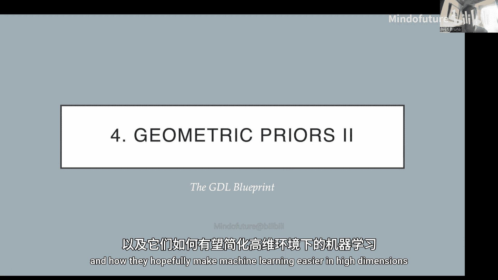

All right， so today， yeah in this lecture we are going to first the first thing we are going to discuss is how these ideas from symmetries and invariances relate to the problems that we discussed in lecture number two that concern the curse of dimensionality。

Then we are going to move from the notions of imvariance to notions of scale separation。

 so we are going to discuss another prior。And then we are going to combine these two priors invari and skill separation into what we call the geometric deep learning blueprint。

Gs so that's what we are going to do in this hour。All right， so let's start with the first one。

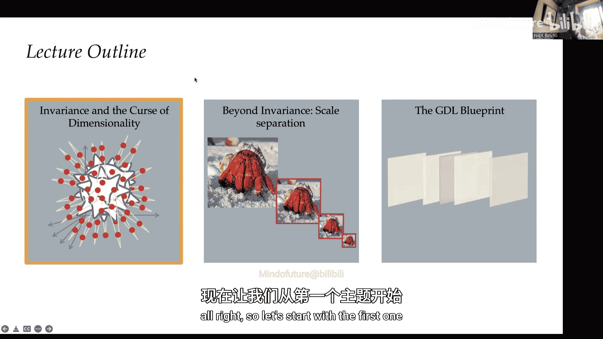

So remember the goal of machine learning in particular， in the case of supervised learning。

Is to learn a unknown function F star， right， so remember。

 the notation is that this function F star is defined over a very， very high dimensional space。

 X would be the space of all possible images， for example。

And so remember that one of the kind of the conclusions that we had in election number two and that Taco started to discuss is that if we just stick with this black box thinking that x is a very high dimensional space well basically there's nothing we can say right learning is always going be fundamentally hard unless we make more assumptions and so in in this context but the kind of assumptions that we make。

 they rely on what we call opening this box right so not treating the input space x as a black box but seeing x as a space of signals a small x that map from a geometric domain omega to some space of channel right and here there's a little illustration what I mean right the domain now becomes here in this particular case a two- dimensional so so that the thing is that here capital x is a high dimensional space。

But the input space here that the geometric domain omega is a low dimensional space right in this particular case it's just two dimensions。

And so once we have this domain this two- dimensionmensal like low dimensionmenal structure。

 or more generally we have like a domain and a mathematical object that is much simpler。

 we can do many things with it right and these thematic domains they come with kind of a natural class of transformation right there's things that we can manipulate like the objects in omega can be manipulated in ways that are very simple for example。

 if I have a collection of elements in a set well there's a transformation that is very natural in a set that is just to shift the elements right to permute the elements or if I have a points here in this grid in theres two dimensional grid I can move the points right I can translate any pixel from one location in the two dimensional space to another location。

Okay and I can do that either with a rigid motion like you know Eccidean transformations here。

 or I can do it even with what we call a warping or deammorphism right so every point every pixel in my domain is moved in another place。

And what Taco discussed this morning is that once I know once I have a collection of transformations。

 well I can suddenly start to do very nice things right I can compose them。

 I can apply transformations one after the other and these transformations they form what we call a group right there's an algebraic structure that emerges very naturally in this context。

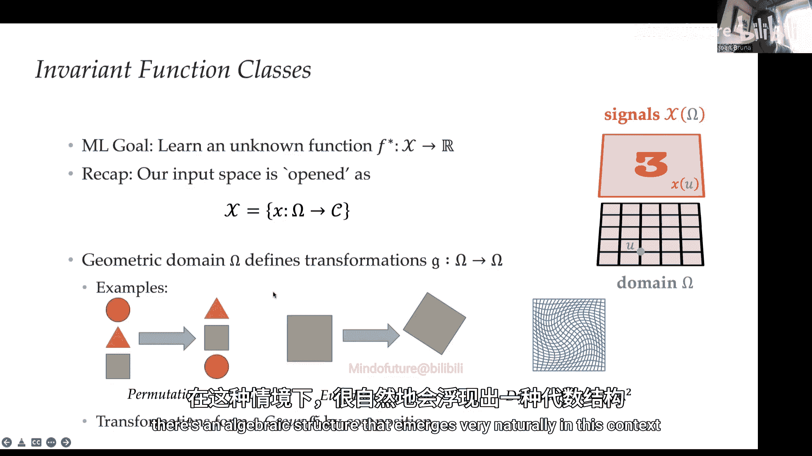

And so here's another very interesting thing that you can do with these transformations。

 and I also think that Taco discussed that is that once I know how to move elements in my geo domain omega right like it might like points in a grid or elements in a set。

 then I can I can upgrade I can kind of，😊，Use these transformations to transform much more complicated objects。

 which are these signals on the domain right like this so in other words I can go from a transformation that moves things in my low dimensional space omega to the same transformation right that move things in a much much higher space right like the space of signals that live in that domain and the natural way to extend this transformations is by composition right and so here the example that you see is like let me see this picture right so if you look at here that the right transformation that is just moving pixels around right if I apply this transformation now when I have images right hopefully you should be able to see that these are some rotation that I can apply to my image or I can apply some。

Some theform readiness as in this in video that you see right so here's an example of a transformation that is defined this two dimensional grid that now I can apply it to transform my input in my high dimensional space okay and this not only is the transformation that I have in this high dimensional space is linear okay and I think that taco maybe gave you you know the right language for that is called a group representation right so this is a transformation here using in the left hand side that is linear with a spec to x。

😊。

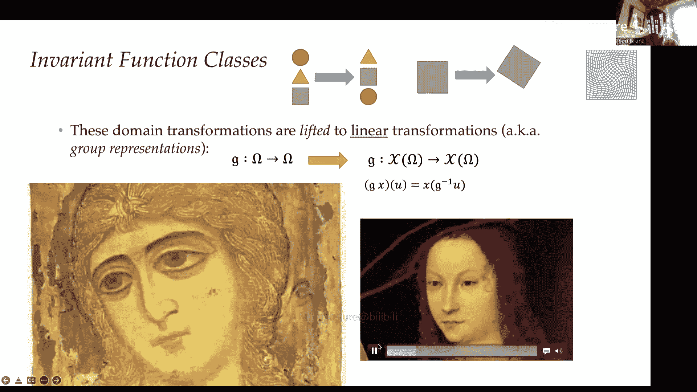

All right。So。So now let's try to like natural first question is， okay， now we have this invariance。😊。

How can we connect the notion of imvariance with statistical learning with a problem of learning that we discussed two days ago？

So remember we have this function that we don't know and we want to learn and we are trying to learn this function within a class。

 why this capital F was a class of function as a class of functions， for example。

 things that we can parameterize with neuralNe。And so here's a promise right。

 so now I assume when we make this assumption that the function that we don't know that we want to learn is invariant with the specsome group。

Right so it means that for any input in our space and for any transformation number group。

 the function is the same if we apply x， if we apply the group transformation to the any input okay so this is an assumption this is a kind of a prior that I promise you right so you know that this is true all the time。

So natural question， if this is true， there are two natural questions right so okay。

 how can we now leverage this assumption in our hypothesisthe class can we do better now that we know this extra information？

And obviously it's like even if we can do better， can we do good enough so that we can break the course of dimensionality。

 right like the major issue that we had where any kind of quantitative guarantee was always very hard to get in high dimensions。

Okay， so is this clear yeah， and again， please do not hesitate to stop me for any questions because I don't see you in the camera。

 so please do not hesitate to interrupt。All right。So these are the two questions that we are going to study now。

Okay， so first， let's forget about the algorithm， let's forget about implementing anything like just think about abstract like theoretical right so how can we now use this imvariance with respect to this group of transformations to do better machine learning right to learn more efficiently？

😊，So the first idea right is to use what we call this smoothing operator。

 like we are going to use the group of transformations to have a way to smooth functions。

🤧And so let's assume for simplicity that the group is discrete。

 but so we can just you know like sum like go through the group by just summing all the elements。

And so given any function F， this is like the target function or like any function that we want to parameterize in our network。

 we are going to define its smooth version as the average of the function over the elements of the group right so in coordinates if you think about what happens here in this equation for any given input X the output of my hypothesis is not going to be f of x but it's going to be the average over the what we call the group orbit。

 what is the group orbit。Is all the possible transformed versions of x right so this is what you have here in the righthand side right so I basically I have any function that produces labels。

 let's say that I have you know like I take you know AlexNe or whatever right like any network and rather than using the output of AlexNe at this particular image I'm going to average over all the predictions that the network does over all the possible rotated versions of this image。

That's where this operator is doing。So now I ask the question。😊。

If I apply this moving operator to my function X star。

 what do I get right so remember that the assumption that we have on F star is that it's invariant。

RightSo remember what is the definition of invariance is that the function of star is the same at x or at any transformation of x。

So this means that the function F star， when I look at it along each of these orbits。

Give me something。 that is。Constant， right， doesn't change。

So what happens if you have a function that is constant and you average it？Nothing changes right。

 so a function that is constant along the orbits， if I do the average， nothing changes。Okay。

So this is a so now let's try to build on this observation。😊，Okay， so now， well。

 if I know that my function target function doesn't change by averaging， here's a natural idea。

 right， given any hypothesis class this could be let's say the family of you know fully connected neural networks。

We can make it invariant by applying the smoothing operator right so any function in my family now I'm going to instead of using it directly。

 I'm going to use the smooth version of this function right？Why because the target doesn't change。

 so I'm going to consider it in my hypothesis class。So here's an example， right。

 so let's consider the domain， you know the discrete domain of d points。

 right like's say one dimensional grid。And here I'm considering as a group of transformations that translation to the shift。

Okay， so so this corresponds to the group that is called thecyclic group of order D right。

 and I assume that you know， once you shift this point， the last point you go back at the beginning。

给。And now I consider as my hypothesis class。😊，All the polynomials that I can build with the coordinates of the Greekky。

And now let me now let's think about what would we get if we take this polynomials and consider the smooth version。

So you know there's a question for you right but think about how you would now take one of any one of these functions and consider it smooth version right so remember that a smooth version right should be invariant right with respect to all the all the translations like all the shifts right so so think a little bit about how would that do and obviously this movinging operator if you change the group right if you let's say replace the group of shifts by maybe a mat larger group like the group of all possible permutations。

Then this function， right the imvariant function class will become small。

RightSo here the bottom line is that if the larger the group of transformations。

 like the larger the class of invariance。The smaller is going to be this set， right？

So there's less and less invariant functions， right， the more the larger the group is。

I hope this is clear。Okay， and these are two little edges that I leave for you you if you want to try to think about the answer。

 I'm ready I'm also of course available in campus wire。All right， so now。

Let's try to to argue the following right， is that the approximation error is not affected by smoothing on the group right。

 so I claim that if now I given a target function F star if I try to minimize。

The error right in my family class， right in my function class cap at the left。

What I claim is that I pay no price if I reduce the set。

 reduce the hypothesisthe space from capital F to its smooth version。Okay， and why is that？Well。

 the reason why is that is that in fact this operator， this smoothing operator is a projection， okay。

 I'm just essentially I'm decomposing the space along the orbits and just keeping the average along each orbit。

So in fact it's an orthogonal projection right and so what I can do is that any error。

 any L to error， I can break it into the error that I make in the range of the operator plus the error that I make in the complement in the orthogonal complement right and this is nothing else than the pitthoral theorem right because this is an orthogonal projector。

And so because now my function F star is invariant right what I see is that because a function is invariant。

 this term disappears right when I replace G by F star this term disappears so my  error that I make right has two components is the error that I make on the invariant part plus。

诶。The the prize how in is。So obviously from this equation。

 you can immediately see that I made it off， just assuming by construction that the yellow term here is zero。

 right that this term doesn't appear。And so obviously I have something that looks like a winning strategy here right because I have a function class the one in green that has the same error。

 the same approximation error， and because the green space is smaller than the blue space because it's a projection I will have smaller statistical error right so have the same approximation error and smaller statistical error so it means that it's better。

😊，But the question is by how much， right， is it actually。

 is it a gain that is minor that is marginal or is it gain that is substantial？嗯。

Any questions so far？O。Okay， so now let's try to do a little bit of quantitative statements here。

 this is possibly the maybe the most technical slide of today so hope bear with me so remember from from two lectures ago the class of functions that were lips right that we're just locally regular right now we are going to。

Yes， so there was the there was a question in campus wire。 Someone was asking， perfect。 Okay， please。

 can you explain， what is the group's missing operator。Okay， yes。

 that's very important to understand the the discount concept of yeah。

 so let me go back to the definition。Good， so the group smoothing operator is an operation that I make to a hypothesis to a function that maps input to my machine learning model to the a and it's an operator that does the following here in this equation or maybe you can look at at this equation that is even more clear is that given an input X。

I'm going to。Consider all the transform versions of x right this is what what we call this orbit look at this picture right so of think it as some kind of data augmentation right so you have all the possible transform version of the input。

Then I'm going to apply my network， my hypothesis F to each of them。

 and then I'm going to take the average。That's the group's movinging operator。Right？

And this group of moving operator has an immediate property， there are two things that are important。

Okay。The first one is that it's an orthogonal projection right so you can think about it that if I apply the smoothing operator twice I get the same thing right you know if I smooth two times I get exactly the same method right because the function dis orbits by the definition of a group right they are the same irrespective of where I start。

And the other property that is important is that when my function F star is invariant in the first place。

Right？Then when I apply this moving， nothing changes right because if I have a function that is already constant along these orbits。

A constant function， if I apply the average at every point doesn't change right because the function is already constant。

Okay， I hope that this is clarifying the definition and the concept of group smoothing operator。

Very good。So now， as I said， I I can consider like， you know， the smooth hypothesis。

 right for question。Yes。So please go ahead我 is thecyclic group。Pych group。

 so that was an example that was the different。Yeah so the cyclic group is a particular group that is think about the the you know like the arithmetic mod of D right so think about like let's say the you know numbers like binary arithmetic right like you have a binary binary numbers right so0 plus zero equals zero0 plus1 equals11 plus one equals zero right so this is an example of a group where I can think about some kind of additive group but the only difference is it has a kind of a periodic boundary condition right I can I can you know every time I arrive at at the largest number I go back to the beginning right that's what's called a cyclic group。

😊，Yep。Any more questions？O。So， you can continue。Continue perfect， good。So I was here， okay？

But so this is this is the setup that we now we are going to try to quantify a little bit this game so remember that we had this space of function that was very very large。

 the space of lipst functions。And the conclusion from lecture2 was that this space of hypothesis was far too large。

 right in the sense that there was no way we could guarantee that we can learn efficient that we can learn functions in this class with a number of samples that is not exponential in dimension right so it's like a massively it's a tool it's a set that is very。

 very large。So now let's try to make it smaller， let's try to add this hypothesis of invariances well let's try to see if we can suddenly start to learn with more efficient。

 like with smaller sample complexity if we add invariance into this slip sheet hypothesis。

So now my hypothesis is that this function F is going to be Les right。

 but also it's going to be invariant with respect to a group of transformations right so it means essentially it means that this function f of x minus f of x prime right if x and x prime are in nearby orbits right then the value of the function doesn't change too much。

All right， that's the notion of lips sheets plus environmentvari。

So here's a result that we worked on with a couple of collaborators from my group that says that okay。

 if we now try to use learn essentially with the optimum model machine learning model for learning lips functions。

 which is kernel methods and we use a kernel that is invariant with the spectral action of G，Indeed。

 we can do better than if we don't use the group invari right so in other words this is the generalization like this is the test error of our learning it's going to have a generalization error that essentially as if the algorithm instead of using n number of samples while using n times the size of the group。

Okay， so in that sense as if the algorithm is better right because as if it was using more data points right there's again in sample complexity。

 which is consistent with the intuition that we have so far right that the approximation error doesn't change and the generalization error has to be better right so that's what we see here。

But there's a big problem， there's a problem here right。

 is that even if this number here that you see in blue is very large。

 we say it's an exponential in dimension。This exponential dimension is going to be killed by this rate right so here you see that the dimension is in the denominator right so if we have something here that is exponential in D this D here is going to be killed by this D here。

Which means that the rate the gains are like the rate in number of samples is not going to change okay so the rate of learning like the generalization rate is still curd by dimension okay so the only thing that imvariance give us in this context is again in the constant right we can do better but the kind of the major problem that we had before still remains right we still have this very bad dependency and dimension for this class of regularite。

Let me also say that you the gains that we see here relative to not using the invariance are real right so if you use a kernel that is not invariant then actually can you cannot reach this gen error right so there there's actually a sharp contrast between invariant and non invariant kernels Okay so but the conclusion here right is that。

If we use them if we use invaris in our networks， we are going to do better。

 that's a guarantee that I tell you， but so there's an improvement in sample complexity but。

There's two things that are you know that we still need to address the first one。

Is that it's not sufficient right it's necessary right but it's not sufficient right we need some other tool to say to guarantee that we can learn with a number of samples that is not that does not blow up with a dimension right there's something missing what is missing。

And the other right is that so far this analysis that we have made right we have made everything from this smoothing operator right and this seems like a kind of a very abstract concept right theres's there's no easy recipe for implementing this operator in practice in your algorithm in your computer right so how can we build this invariance in a way that is efficient right that is you know that we can implement and this thing runs efficiently okay so these are the two important things that we are going to discuss next good time also not to make a pause and that for questions。

😊，Because I cannot access campus wire in real time。

 so yeah if there's some questions either here or on campusus wire， happy to address them now。

Otherwise I will move on。Yeah， please， I think we can move ahead the local question right now。

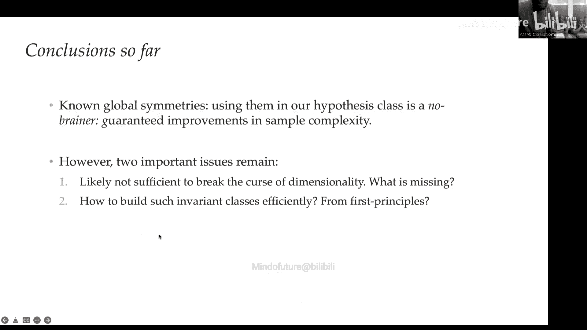

Perfect， thank you。All right， so now let's move to the second part of the lecture。

 which is addressing the missing ingredient right which is the notion of scale。

 multi scale separation。

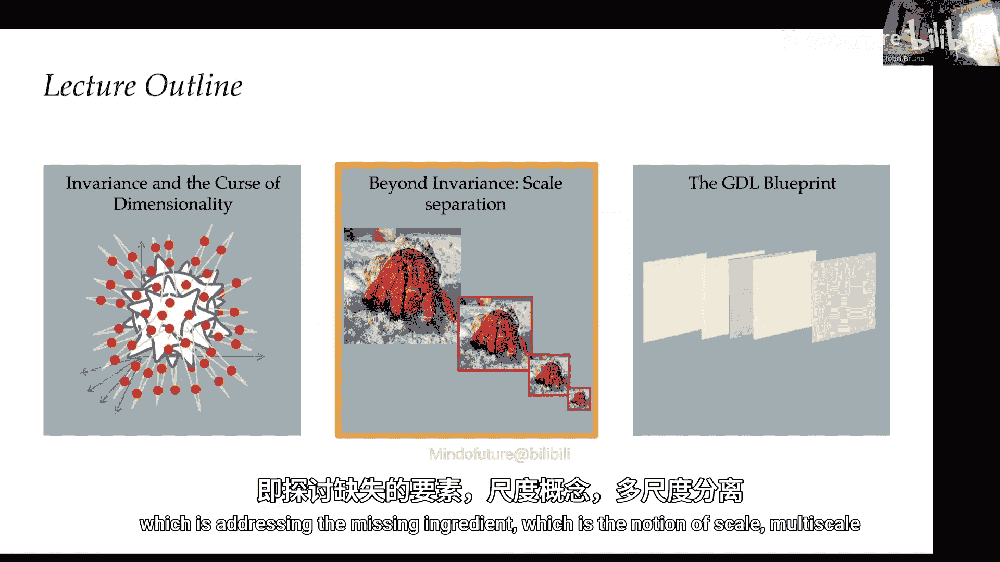

Okay and so if you think about why deep learning works and what is the kind of the secret sauce of these architectures and you go to you know to the lectures of the you know like the pioneers of the field like Yohua Avengjo or Ya lagoon you see that they arguments they all involve this notion of computationalality right like the fact that you can actually break a very complicated input like images that has millions of pixels you can process it in ways that are step by step right so first you can focus on maybe local features right what they call these lowle features then these lowle features are combined into more complicated structures and so on and so forth right and in fact。

This is a very intuitive idea right that it's present in deep learning。

 but of course it was present in many， many other areas before right like even people doing computer vision have explore this idea and in fact this is an idea right there's compositionality is an idea that is in a sense at the core of science on physics right so like the idea that we can process very complicated phenomena by breaking the problem into different steps right like first you know's let's look for example at biology okay or yeah exactly biology or any kind of like a chemical process right so so there's actually ways in which you can first understand how you know how things behave at the level of sub subatoms using quantum mechanics。

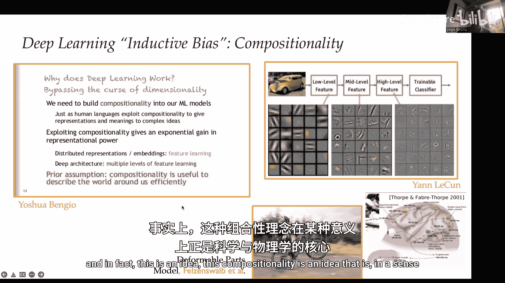

Then at some point you need to understand a little bit of chemistry right maybe at this level and then at some point you need to to start understanding things about biology right like how molecules know become proteins and then proteins become cells and then you see what UC see data right and this idea is present in many。

 many areas of physics like when people study turbulence or when people study like a percolation phenomena。

 critical phenomena， even in know in many areas of data science we also have this idea。Okay。

 so a complicated we have when we are facing a complicated problem that has many dimensions。

 natural idea in science， try to break it into into smaller pieces， very natural。

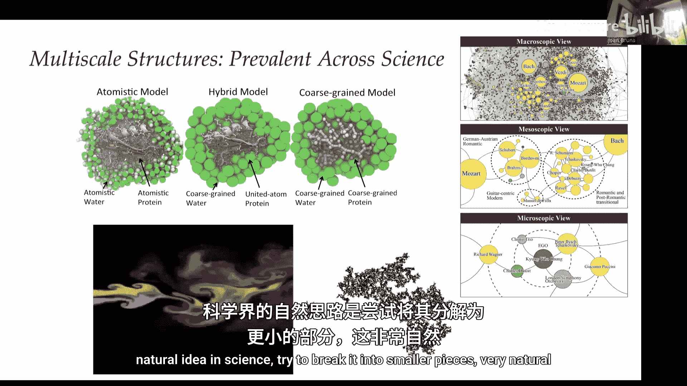

So in our context， right， we need to we can formalize this intuition with what we call the multi resolution analysis okay and for simplicity I'm going to just you illustrate this principle using a two dimensional grid。

 the grid that you see here on the right。Okay。So。😊，I think that the main idea， right。

 is that if I have any signal or any structure that lives in this rectangular grid omega。

There's the idea that I want to communicate that I want you to get like the vision is that I can always change the resolution right I can preserve the information that I see by changing the resolution right you do this all the time when have a you you take a picture with your phone or you know and then you want to send it to your friends。

 you can send it you can change you can choose the resolution right you can either send it in full resolution it's going to be very you know it's going to take a long time it's going to be it's going to take a lot of space or you can compress it and make it smaller。

So this is actually instantd mathematically in what we call a multireolution analysis right so what is a multiresolution analysis like you broadly speaking is that it's a process by which you take any signal like any image right it's like this signal that lives in this two dimensionmenal grid and we can decompose it into a signal that lives in a coars of resolution right like here the idea that I try you to illustrate is this like resolutional in orange has less pixels than than the grid in gray right。

😊，And so I can express an original signal X in terms of the coar version but of course when I take when I go from the gray cell like grid to the orange grid I'm throwing information right I'm using less number of pixels so the multi resolution analysis what it is is that also preserve keep the details at I give a resolution omega that I need to reconstruct so it's really this process where I start from this like original image here and then I break it into the low resolution version that is this one here and then I need to preserve I need to keep the information that that I need to go backwards right to go from the co resolution to the fine resolution so in other words I need to preserve the details right that I encoded in this in this image here and this image here and these details are what it's captured by what we call wavelelets right to wavelelets。

😊，Are essentially a bunch of filters that extract that really do this the compositionposition for you right and this is actually something that we are going to discuss with a little bit more detail in lecture seven when we are going to talk about grids。

😊，But the key property that for now you need know I want you to remember is that these filters。

 right these little these wavelets， they are think about these as little waves that are localized in space。

 right it's very different from a sine and cosine which are waves that keep going， you know forever。

 wavelets have a different properties that there's kind of little waves like waves that are localized in space。

And this is actually a。😊，These web decompositions are very important in many areas of you know beyond computer vision。

 but they are used in many， many areas of science， right？Anyway。All right。

 so what is the link between this thecomposition of you know this way of thinking about images in terms of different resolutions and or learning problem？

So here's an example right and this is really is what we call the skill separation pie okay so let's see how the resolution of the input can give us a different category of price okay so。

First， let's make the assumption that the target function that we don't know write F star。

Has the property has a following property is that the function I need to learn and in fact I could also learn it directly from the course resolution right so I don't need to look at the image at full resolution to understand the function。

😊，So， here's an example。Let's say that we have a problem where F star of x just encode the probability that like whether I'm in a beach or in a mountain。

 right， given the image， I just need to guess whether it's a bit or it's a mountain。

Okay so this seems to be a function F star perhaps I don't need to get all the details I don't need to know you know I don't need to see all the waves in the sea and I don't need to see all the boats in the beach and I don't need to see all the trees in the mountain to know that it's a mountain on a beach right so in other words if now I move the details and I just look at the core scale for here well I guess that we are you can all still tell that in the top we have we have a beach right and in the bottom we have a mountain right so here's an example where the core scales dominate right so here I'm mean a problem where essentially to approximate this function F star I don't need to think about the function x like the input x as being high resolution right so I can you know indeed I can just focus on on the right-hand side and what is the advantage of thinking of the function in terms of the low resolution。

Well the lower resolution has much less pixels right it has a much smaller number of pixels and so in that sense the number of know the number of like the dimension of the input is much reduced right so the course of dimensionality in that end is reduced just because I can replace the input by something that has much smaller dimensionality。

Okay， is this example clear？😊，Okay， here's another example for you and obviously sorry sorry but obviously this assumption right that I told you you know that I can always kill the high frequencies is not true in general right this is only true in certain cases right so so if I think for example as another example recognizing these M digits right so you can all look at the Ms digits here right and probably recognize the digit but if I blur right so if I remove the high frequencies right as I did here in in the right panel you know for me it's impossible to tell what is the digit。

Okay， so what mean is that this assumption that I just made about you know this example of the pe and the mountain is a very strong assumption。

 right I mean this cannot be the basis right of you know geometric deep learning right we need to be careful。

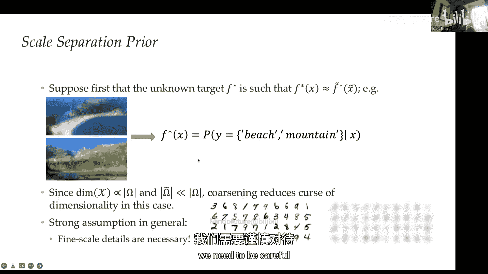

So here's another flavor of these requirements so there's another thing that we can assume right instead that the target function I can construct it I can approximate it in a way that I can think it as a linear combinations of functions G that instead of depending on the full image they only depend on local patches of the input right this is an example of these textures that I showed here right so if you want to you know separate between a brick wall and a patch of grass。

Well， I guess if you just extract a couple of windows from the brick wall and a couple of windows from the patch of grass。

 you can already see right that。You can already see that you know that you can separate these to these two classes right you don't need to see the whole thing to realize that it's a grass or a brick right you can only look at local scale。

Okay， so this is an example， another example where we can still we can also break the course of dimensionality。

 right， that's because obviously here the dimension that matters。

 the dimension that matters is the dimension of the patch or the yellow patch doesn't matter the dimension of the whole thing。

😊。

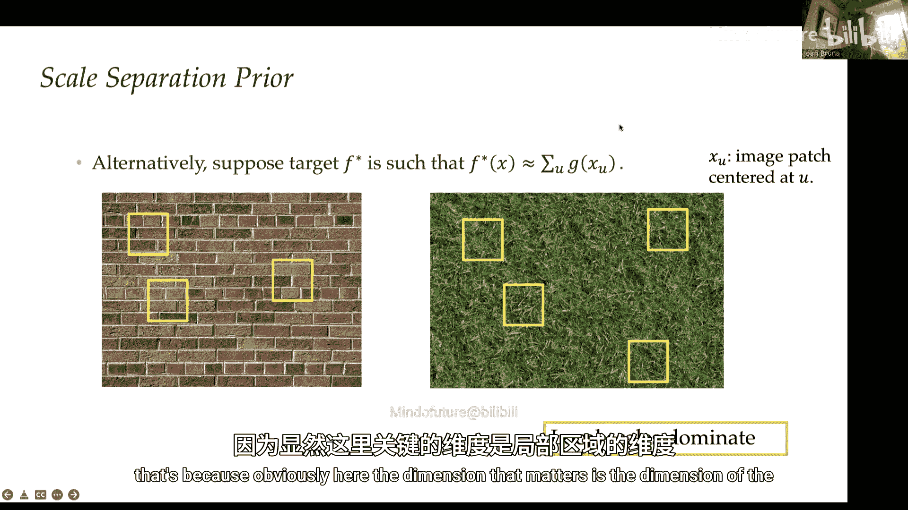

Okay。😊，So here's another example where we can still avoid this course of dimensionality by making this assumption。

Again， is this assumption realistic for any general problem？What do you think？

Well this seems pretty strong right this so this example works for the case of these two classes of these two textures but probably doesn't work in general right here's an example okay so actually sorry before showing the things where it doesn't work this assumption is in fact also quite used in many problems in physics right like this locality right the fact that the local interactions dominate is a principle that is very common right in many areas of science。

But of course it's also strong assumption right here's like a little example that I took from this paper by Turk where you know if you just rely on the texture on local properties right you are missing kind of the global appearance of the problem like you can in a sense build examples where you still need to see all the image at once to realize what happened。

Right so what we see here is that there are kind of different extremes， right like that。😊。

Either we make an assumption that the core scales are the only thing that matters and then we can see that the problem is easy or we can say that the local scales are the only thing that matters and then the problem is also easy。

 but neither of these two assumptions seems to be you seems to be realistic enough right there's always problems where none of these assumptions is going to be true。

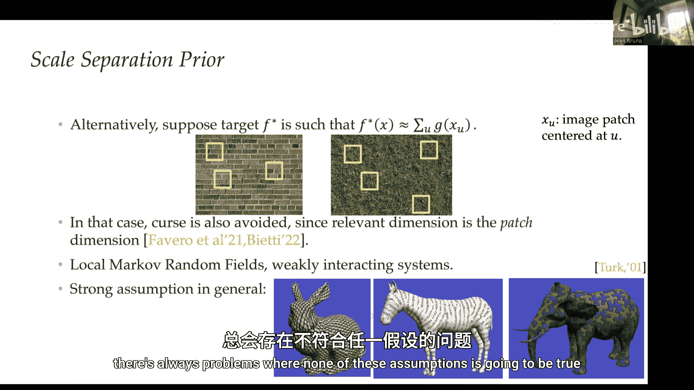

So what we can do is in a sense more generally we can consider this kind of a mix of the two right so we can consider a model that this is like this notion of compositional model right we can try to think about our function F right that we are trying to learn as a composition of two functions。

😊，Okay， so first we have a step that we call this P like a coaring right that is what the role of this step is to reduce the size of the grid right so the reduce the coarson。

 the domain omega。Okay。And then once we are in a coarse domain omega。

 the idea is that we are already in a regime where the course of dimensionality is somehow avoided right so we can now learn in this function of tilda hopefully of with a simple complexity that is not as bad as the original domain。

Okay and the key point right is that in general we need these two guys to be trainable right the assumption that I made before like the two extremes where in one extreme I just told you that this object here this P is actually a linear coing that there's no training that was the first example and in the second example I just gave an example where this ftilda was just like like an average like a global pooling like an average pulling without anything else okay so in general we are going be needing you know nonlinear models that are trainable in both of these steps。

Okay， this， is this a separation， is this skull separation prior clear， any questions？Otherwise。

 I will move on。Okay， so natural question of course， is， okay。

 now we have introduced this framework that is this model to express to learn functions as a composition。

 why is the composition more efficient？Again， this is again。

 the intuitive idea that you know Yahuan Yan and everyone has been developing。

So there's actually several frameworks where we can study this question of a benefit of composition quite precisely。

 okay？So for example， in know dynamic programming we have this framework of divide and conquer quite like this strategy to solve like algorithmic tasks by breaking them into smaller tasks and then aggregating right so this in many。

 many you know for many algorithmic problems you know dynamic programming is an example where where we get basically best you know good efficiency。

There， in fact， but in fact in the context of learning these benefits of composition are。

 I would say it's fair to say that they's still not completely well understood right so we have intuition that these models should be more efficient but we don't have very mature math to explain why okay and this is in a sense a work in progress okay but what we are going we're still what we are going to settle is that in any case this prior of scale separation。

 this view of looking at the problem looking at parameterizing functions as a composition in a sense it can be combined very naturally with the other prior which is the prior of symmetry。

Again， and so that's what we are going to see right now。

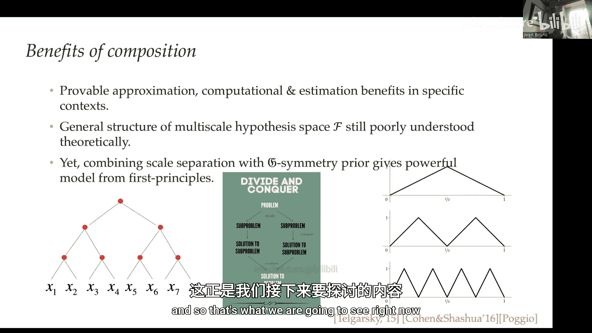

Okay， that's the third part， which is the blueprint， the geometrically learning blueprint。Okay。

 I will pause again before moving into the last part for if there's any question。Okay。

So now we have seen the two fundamental geometric prior。

 like invariant in the first place and then skill separation in the other place。

Let's try to see how we can combine them， into kind of into an architecture or a blueprint that we can use across many。

 many， many different domain。

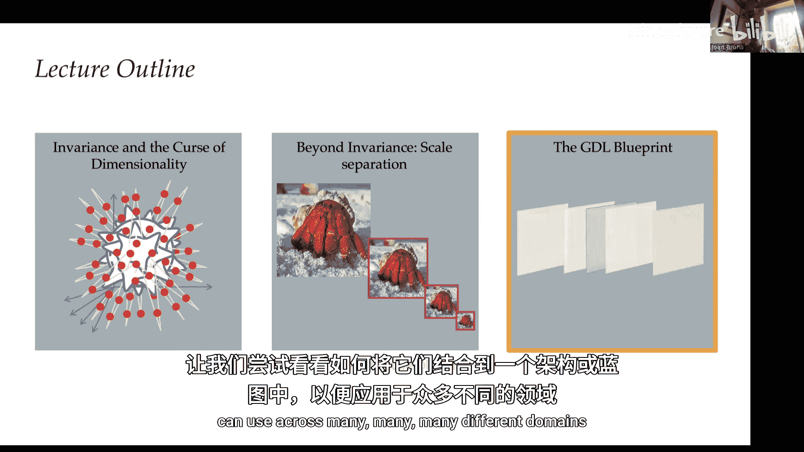

Okay。So remember the wish list that we want right， so we want the or function class to be invariant to the transformations just because we have seen that it always helps。

We want to have multiscale structure because we need it to break their course of dimensionality。

 but of course we want this class of hypothesis to be very rich， right to be very expressive。

 right we want to be able to approximate like a large class of target functions。Okay。

 so how can we build an architecture that satisfies these three properties？Let's start with。

Linear functions。 Why linearvari。So we can first try to understand。

 try to try to enumerate or like to describe all the possible invariance with the spec group。Okay。

 that are linear。So how many are there？In fact， there are not so many。Okay， there's。

Essentially only one operator that is linear and invariant to the group and this is exactly the operator that we just saw before right this is basically the average along the orbit。

Okay。In fact， you can see that any operator， that is any operator M。

That is both linear and invariant。In fact， has to be a function of the group average always。Okay。

 and you can see it here， there's basically two steps here， right， so like in the first step here。

 the first equality we are using the fact that it's imvariant。And in the second equality。

 we are using the fact that f is linear。Okay， so you can see that you know the object that appears here is the group average。

Okay， so the group average。Is basically the only linear operator that gives us an invariance to the group。

But of course this is not an operator that we can use for many things right because it's an operator that is very loss。

 imagine here right in this example of the phases right if I look at the average of all of these faces right across all rotations。

 I'm probably going to be losing all the information I care about。Okay。

 so clearly we need to have something that complements this average。So how can we complement it？

So it turns out that the natural way to complement the right way to complement invariance。😊。

Is by looking at linear equivariance okay and I believe that taco already describe what equivaris mean right but just for for security。

 let me just recall the definition right so if I have a group that is acting on both the input and the output of this mapping right mapping B。

Then this mapping is equivalent if essentially the group action commutes with B right so if I apply the transformation in the input right here and I apply B。

 I get the same thing as if I first apply B and then apply the transformation in the app。

Okay and there's many， many examples， I mean this concept of equivariance is central。

 it's going to be very， very central in this course。

 right we are going to see it again and again and again and again。

So now let's see what I can do with linear equis。Okay， so and for that， you might ask， okay。

 but remember that what we had the goal we had at the end of this is to learn invariant function。

 right that that's that was our wish list right if you go back here。

 the wish list was to get invariance right So what is the relationship between equivariance and invariance。

嗯。So you might say。Okay， maybe I can I can take one of these guys that is equivalent and then compose it。

With the group average， right， do I get something different？

So if I take a linear equivariant and then I apply the linear invariant， does it help。Well。

 you can already see the answer， right， it doesn't help。

Why do you think it doesn't help I combine so I the goal here is to build more invari right and so I suggest that maybe we can look at equivariance。

So if I take one mapping that is equivariant with G。That is linear。

 and I compose it with a linear invariant， the one that you had before， this group average。

Do I get something new， right， do I get like a new invariant that I didn't had before？Yeah。

And the answer。Is not right， just because when I compose a linear equivalentvariant with a linearvariant。

I still have a mapping that is linear， right the composition of two linear maps is still linear。

And we just saw in the previous slide right that basically linear the only linear invariant is the average。

Okay， so if I start composing operators that are linear， I'm not going to get any more expresssivity。

Okay。So the alternative， right then I guess that this is hinting the answer is that I need to go nu nonlinear right we need something that break。

 you know that that we need something that makes the operator nonlinear。But also， of course。

 we need to apply something nonlinear that doesn't break all the other properties that we are trying to build。

 but in particular doesn't break the invariance of the equivariance。

And so what is like the answer here is to consider operators that are nonlinear。

 but that only act elementwise， by so these are transformations that we call role that map images to images。

In a way that the transformed image at Pix U is only a function of the image of the value of the image at Pix U right so here's an example to illustrate what I mean for think about an operator that changes the color of its pixel。

This transformation can be nu nonlinear can be anything you want。

 but of course it's a transformation that only that looks pixel pixel one by one and applies the same mapping pixel after a pixel right it doesn't depend on the ensemble of pixels at the same time。

And so now I'm in business right because now what happens if I take a mapping B that is linear an equi to G。

 and I compose it with one of these guys， one of these elementwise linear mappings。

 I have a new operator， this B Tilda。And I claim that this operator is still equivalent。Okay。😊。

And why would that be？Why is the operator equivari after the nonlinear linearity well because of this property。

 right remember？That an equivariant function right is to verify equivariance。

 I need to make sure that if I apply a group to information on before Bilda。

 I get the same thing as if I apply the group information after Bilda。

But because this operator B is equivalent and this operator role only looks at pixels individually。

 right I get this commut property right and I think this is an important edge size that I encourage you to verify by yourself。

Okay。And so。The point here is that now we are kind of culminating into the blueprint。

He said now we have introduced we have now at our disposal kind of three important building blocks。

 but like just focus on these three for now。Okay， the first one is。

If we can take an operator that is linear and equiant， with a to the sum group G。

Then I can consider a family of operators that are not linear， but element wise。Okay。

And then I have an operator that is invariant with respect to G that can be linear。

 right this global building。Okay so now the point is that if I have these operators。

 I can start building combining them composing with each other so I can start creating a very very rich family of transformations right that satisfy my wishlist okay because from what I said if I take a green that is green and I compose it with a gray that is blue I still get something that is equivalentvari right and if now I compose it with something that is orange I get a new wind variant that is different right from the original pooling because because now the nonlinear linearity is really introducing other information。

OkayAnd the important point that I want to stress here is that the way we define these operations is very general right in the sense that we can apply it for many many versions of this domain right so depending on the domain omega and the group of transformations G right here here's a recipe where the only thing that we need is to understand the class of linear equivariance of that class right so given an omega and a group we just need to understand the class of linear equivals and it turns out that this is something that we can do。

In many， many different domains right this is like a little diagram and here's an example right of the different combinations。

 sorry of the domain omega and the group G Okay， so if we take as domain the grid and we look at the translations。

 the blueprint。You know gives us convolutional neural networks if we take rotations and the sphere we get the spherical networks。

 et cetera， ettera， et cetera， right so the same principle that I describe which is first understand the class of linear equivariance。

And then compose them with element wise linearities and keep composing this gives all these different models architectures here right and they are all following the same principle。

All right。So just to summarize what we discussed today。

 and then we can have spend some minute for questions。So。

What we have discussed is two geometric priors right the invariance with respect to some group of transformations and then the scale separation and these two priors have to be combined right so if we don't combine them。

A priority， there's no hope that we can learn in high dimensions。

OkayAnd so what we have seen is that through this notion of group invariance and equivariance。

 we can produce an architecture that is this geometric this GDL blueprint that is a kind of a first principle architecture right is a way to construct representations that have all the properties that we want namely that they they respect the multiscale prior。

 they are respecting the invariance prior and that they can be very expressive。

 that they can approximate very complicated structures。

So what we are going to discuss in the next lectures by my colleagues by Pe。

 Taco and also Michael and myself is that we are going to now in the next lectures look at these very general blueprint and make it concrete under they different domains and we are going to basically see how each domain brings its own specific properties right so here in other words in the surface you might you might see that all these architectures are the same right there basically have exactly the same structure well because the grid。

 the sphere and and these groups have some different properties。

 these different different in the domain and the group are going to induce different in the architecture and this is what we are going to describe in the next lectures。

So now this is the end of my presentation and I'm happy to take questions。

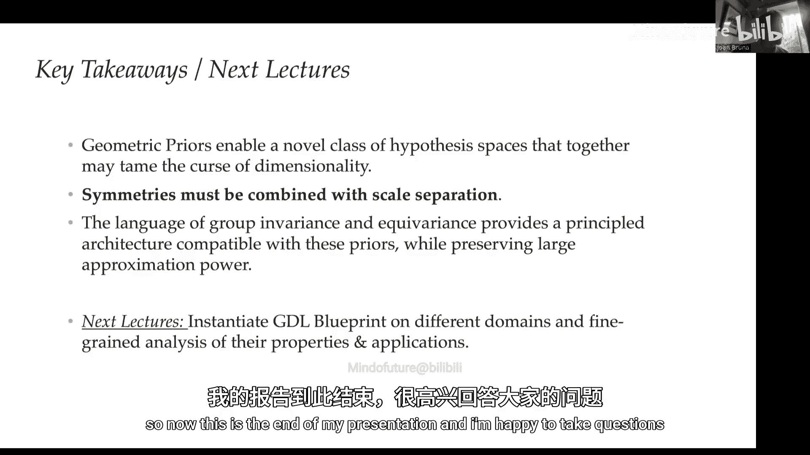