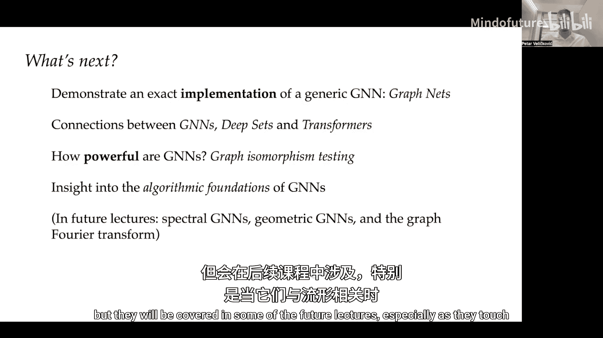
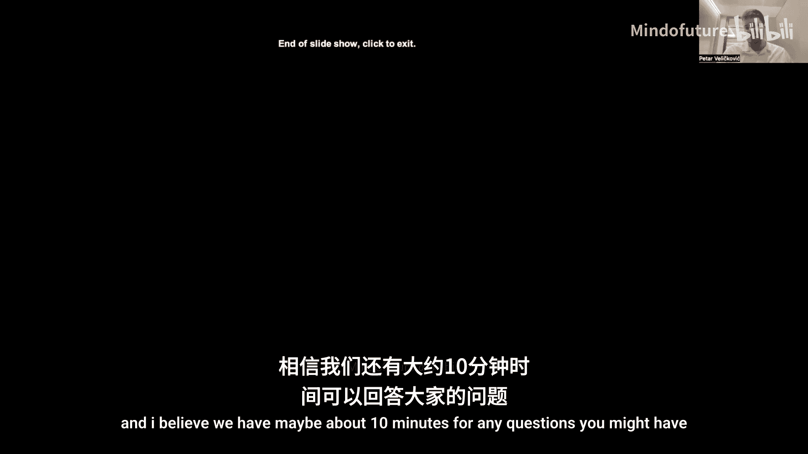
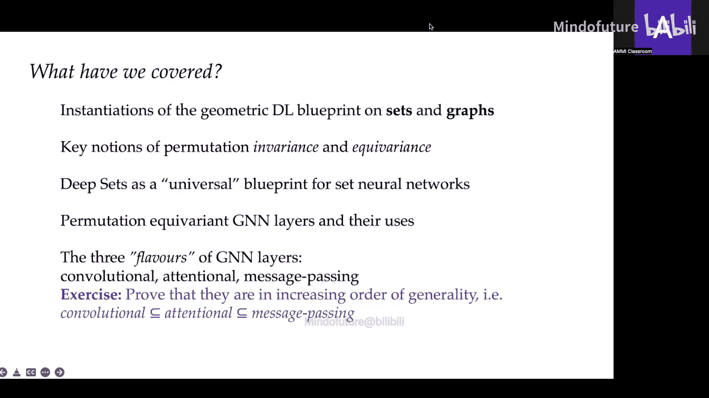

# 几何深度学习 ｜ Ammi Geometric Deep Learning Course p05 P05_第五讲（图与集合）-佩塔尔·维利奇科维奇 -BV1veHgzxELm_p5-

Hi， everyone。It is a great pleasure to be delivering this geometric deep learning course to the African Master of machinech intelligence for a second year in a row you haven't actually had a chance to formally meet me yet my name is Pear I'm a staff research scientist at Deep Mind and an affiliated lecturer at the University of Cambridge。

And during the two lecture Mley that we're going to have today。

 we are going to chat about some aspects of the geometric deep learning blueprint as it applies to broadly speaking graphs and sets。

 but I do hope that throughout my discussions today and maybe throughout some lectures you will see afterwards。

 you will come out having the impression that to an extent whenever we're doing deep learning on classical computers。

 we are always to an extent doing some kind of deep learning on graphs and sets。

 so it's a big ask let's see how far we can take it。

So just to give you a bit of a recap from what you've seen in previous lectures。

We've seen how to take basically a small set of guiding principles like symmetries。

 group equivariance， group invariance， locality and scale separation and broadly speaking use those principles to synthesize and steer the design of deep learning architectures right so previous lectures have hopefully showed you why it's a good idea to do so and maybe on a general level how to do it。

 but we haven't talked about anything specific yet and if you probably remember this figure from the previous lectures which shows that you could in principle construct any architecture that you care about through a combination of equivariant layers non nonlinearities pulling layers and invariant layers if you need to predict something on the level of the entire domain now in our book in our course we claim maybe somewhat bombically that this is all you need to build the architectures that are all you need。

And once again here， you just have a recap of what those elements of the architectures are。

So you have linear G equivariant layers， point wise， non nonlinearities， local pooling。

 andng invariant layers， all of these concepts should be reasonably familiar from the previous lectures。

But specifically what we show and what we hope to guide you through in these lecture series is that you can basically take any of your popular favorite architecture like conves graph neural nets deeps transformers。

 some of which you've probably seen in previous courses in this master series and basically express them using our blueprint just by choosing the right domain and the right symmetry group to be aligned to however obviously we haven't seen any very concrete examples of this yet and in this lecture we're actually going to cover already three of the architectures that you see in the table here well be covering graph neural networks deep sets and transformers which all encode some aspect of permutation symmetry over a set domain or a graph domain as it turns out now some of these things might sound a little bit strange because you might have heard about transformers as a。

model primarily， but I do hope that by the end of today's two lectures。

 you will be able to get a proper feel how transformers fit inside our picture。

So you might also be asking yourself why do we start with graphs right if you've done any kind of deep learning course before this。

 you probably wouldn't expect to start by learning about graphs。However。

 we have very good reasons for why we want to start with learning on graphs graphs and sets provide us a very convenient discrete domain and there's basically very little geometric assumptions on these domains so we just have resistance to permutations this will make it very easy to analyze the architectures and also pretty much everything that follows in future lectures will be expressible using the blueprint you learn today okay。

And it's hard to understate just how close this connection is because for many years when you said geometric deep learning。

 it was basically synonymous with representation learning on graphs。

 so there's a very good historical and generalist motivation to start with graphs and also it's arguably the easiest one to introduce from the perspective of the blueprint because the symmetries are not particularly restrictive。

And there is very good reason why you might want to study data that lives on grass。

 because when you think about it， graph are pretty much all around us。

 we can find them at all levels of organization in the living world。

 starting from the basic building blocks of organisms， the organic molecules。

 which are best represented as graphs of atoms connected together by chemical bonds。

All the way up to the organizations of the neurons in the human brain which guide our cognition processes where you can imagine different neurons connected together in an interconnected network known as the connectome but beyond naturalistic phenomena we can also use graphs to explain all kinds of human and social constructs from transportation networks here you have a slightly outdated visualization of the London tube map where you can imagine nodes as different intersections and edges as different connections between them and also social network like this Facebook friendship graph that's illustrated to the bottom right where you can imagine different humans and users as nodes in a graph and their friendship connections as edges so basically graphs are pretty much all around us and recently especially people are starting to realize just how pervasive graphs are and how they might be the modality that truly reflects the underlying。

that you're trying to deal with and as a result across both science and industry。

 they are starting to become more and more ubiquitous。

 particularly through the graphraph neural network。

 which is the economical method for processing data that lives on graphs and this is just a sample of some of the things that graphph neural networks have been capable of doing。

They have been used to discover powerful antibiotics they have been used to power the next generation of chip design。

 which is quite an interesting meta argument because now AI is being used to aid the process of synthesizing a chip that will be used to execute AI which is a very nice kind of circular argument beyond that virtually all the companies that deal with large scale interconnected data are now realizing the power of graphraph neural networks here I've highlighted only the example of Ubers that use as graphph neural networks to recommend which food you should eat next but beyond Ubers many key industry players like Amazon and Airbnb and Pinterest are using graphph neural networks as well in a nutshell to serve your recommendations。

 which products you should buy next which content you should view next which places you should stay at next so it's kind of a very natural very。

Natural way of analyzing this kind of data。And maybe something that's a bit more closer to my personal claim to fame。

 as I said， you can also view transportation networks as a sort of interconnected graph structure and as part of a team of Deepmind I worked on developing and deploying one of these graphraph neural networks inside Google Maps and it's now deployed worldwide so whenever you asked Google Maps for the optimal route from A to B。

The actual travel time prediction that served to you is computed by a graph neural network that we have developed here at Deep Mind。

And when you really think about it， I've given you many examples of naturally occurring data that's best represented as a graph。

 you might try to extrapolate from there and just say in many ways graphs are the main modality of data that we receive from nature。

 and when you think about it as exemplified by this post from JW Forer essentially you can also think of concepts。

 relationships between those concepts and the processes that lead to us deriving new knowledge as effectively a graph structured reasoning process。

 what this means for us is that if we're ever going to build artificial general intelligence。

 it is quite unlikely we were able to build it without some aspect of graph representation learning simply because how critical it is in expressing the way cognition works。

 so basically speaking no matter what area of science or industry you choose to specialize in。

 there is a good chance you will come into contact with graph representation。

Learning and that's why it's generally a good idea to study it。

And maybe I should also mention that quite recently methods powered by graph neural networks have been able to make significant scientific strides to the point where they have been also featured on the cover of nature I participated in this collaboration alongside several deepminders in pure mathematicians where we showed that these graph neural networks are capable of detecting interesting structure inside complicated mathematical objects and using the structure。

 our mathematician collaborators have been able to derive top tier results in very distinct areas of mathematics such as not theory and representation theory and this achievement was recognized both by nature where it grace the cover page a few months ago and also by many popular press outlets such as the new scientists at this point you might be curious to find out more about the mathematicians' view into all of this and I'm very delighted to say that we have secured Joordy Williamson。

 our math's collaborator from the University of Sydney to give a。

lecture in this course and in my opinion it is not to be missed because it will also offer you a mathematician's very pure view into all of this geometric deep learning stuff that we have been trying to build up over the past few lectures。

So hopefully in these past few slides I've convinced you that it's a good idea to study data that lives on graphs so now that you're hopefully convinced you might be asking yourselves where do we begin。

 how do we begin to build this theoretical framework well I'm actually going to start by a potentially disappointing premise in that I'm going to first look at graphs that don't have any edges between them i。

e unordered sets。And why do we start with just sets Well there's a few good reasons why we might want to do that first of all。

 because we only have to worry about the nodes and not worry about the connections between them sets are going to be just generally much simpler to mathematically analyze however even though they're simpler to analyze once we draw our conclusions on sets。

 most of them will very naturally carry over to graphs so it won't be wasted work to start with sets and even if you restrict yourself to processing data that lives on sets。

 you are still solving problems that could be very practically relevant for example many data that's relevant to computer vision comes in a form of point clouds where you have to classify objects based on their point cloud structure as you can see here on the left but also in many real worldord important applications such as self-driving vehicles you need to make sense of the world around you not from two- dimensionional images but from actually point cloud representations of the objects around you。

So a typical self-driving vehicle will use these LiDAR sensors to compute a bunch of these points of where the sensor bounces off of nearby objects and based on off of those point representations。

 you need to infer what are the objects around the car。

 how fast are they moving and so on so that the car can then make actionable decisions for itself。

So hopefully it's a good enough motivation for us to start this investigation from learning on sets and okay so let's begin we're going to start off by assuming we have a graph with node edges what does this mean from the perspective of the geometric deep learning blueprint our domain omega is equal to just a set of nodes V okay so these are the nodes on which our data is going to live and typically since we're doing deep learning we want to featureurize those nodes so we can say that every single node has some feature vector attached to it we're going to call that vector Xi for the features of node I that are in this case assumed to be k dimensionsional real vectors so what this means is that our feature space C from the geometric deep learning blueprint is equal to R to the K。

And once we have features for every node， we need to find some way to present them to a deep learning model。

 the canonical way in which that is done is to just stack these node features into a node feature matrix。

 so you build a matrix capital X， which is basically a matrix with number of rows equal to the number of nodes。

 a number of columns equal to the number of feature dimensions and then the I throw of that matrix will correspond to the features of the Ith node。

 they should all feel very familiar because it's the standard method in GDL to build a discrete signal。

And one very important thing to note here is that the very act of you doing this like the very act of you stacking node features into a matrix has already done something controversial you have specified and ordering of the nodes right and as we said at the beginning we assume our sets to be completely unordered right so what we really want is the result of any neural network or any function applied to these set features to not depend on the decision you made on how to stack them so let's try to pictorially represent this what do we want so let's imagine I have a set of five nodes and I have features in every single one of them and naturally I might be interested in learning some kind of a function some kind of a neural network that takes this collection of five objects and predict some label right but what I then want is if I choose to change the way in which you see these five objects perhaps by changing their order or something like that。

I would still want my neural network to give me exactly the same answer okay。

 so this kind of rigorous enforcing of giving the same answer。

 no matter how I choose to present you these objects。

 is exactly the symmetry that we want to capture when we build our neural networks for sex in the language of geometric deep learning。

The symmetry group that we care about is the n element permutation group sigma n and the group elements G of this permutation group are permutations now i'll try to elaborate on this a bit further in a few slides time so specifically because we want to talk about being resistant to how these nodes are presented to you what's the order in this node feature matrix。

It will be very useful for us to be able to think about the operations that change the order of the nodes。

And as you might know from combinatorics， these operations are known as permutations for a collection of n elements。

 there are n factorial many of them。And this is just one example of a permutation。

 well one pictorial example and one in text that show how you can take a collection of objects and then apply a permutation transformation which just changes the order in which you see them。

 but fundamentally it is still the same collection of objects。

 and this is a way of saying that permutations can encode a very useful symmetry that we might want to capture。

Now one thing that's very convenient for us is that when you're talking about permutation operations。

 we can actually completely reason about them in the realms of linear algebra。

 which is very useful because deep learning is typically defined in the world of linear algebra。

In fact， every single permutation of n objects defines a unique n by n matrix。

 which is sometimes known as a permutation matrix。And here you can see one example of a permutation matrix for the permutation 2413 and you can hopefully kind of make out what's going on right there are matrices that have zeros almost everywhere they have exactly one1 in every row in every column and the only effect that these permutation matrices have is that when you left multiply them with our node feature matrix as before the only effect it has is to permute the order of the rows so it encodes exactly the operation we want to be resistant to and nothing else now if you can recall what we discussed in previous lectures on the geometric deep learning blueprint you can then immediately relate this permutation matrix as a real representation of the permutation group action or the row of G as it was abstractly discussed in previous lectures so in this case G might be a permutation like 2413 and row of G takes that permutation and gives you a matrix like。

This， which has the appropriate effect when you multiply it with your node features representations。

And now we can basically just directly apply the blueprint of， for example。

 G invari to derive the necessary condition of our function to be satisfactory when working overs right because as we said at the beginning。

 we want functions that operate over these node feature matrices such that they will not depend on the order of the rows。

What does this mean equivalently and following the definition of G invaris when you apply a permutation matrix to the input。

 it shouldn't change the result， and this directly gives us a very useful notion of permutation invari where we say that a function or a neural network F is permutation invariant if no matter what permutation matrix I choose the effect of applying the permutation matrix to the input does not change the output of function F okay？

And you can directly compare this with the graph with the geometric deep learning blueprint where we discuss these G invariant layers or global pooling layers which deal with basically satisfying G invariants。

 so the condition is exactly the same we're just now instantiating it for a very specific group action and the very specific collection of features。

Now of course， this gives you a necessary condition to build a function that is resistant to permutations on sets。

 but that's some particularly useful in and of itself。

 if you want to go ahead and implement a model like this to implement a model you need an actual model equation and the standard way in which we build neural networks overs。

 is by deploying this model over here， which is known as the deep sets model。

 so we compute outputs over an input set given by a note feature matrix X。

By first applying a learnable function psi to every single node feature vector that we have in the set。

 and then we sum up the resulting vectors。And finally to predict our outputs we use another learnable function phi applied over the output of the sum Now the critical part of this architecture is the sum aggregation right because no matter how I choose to permute the rows of X the outcome of suming them is going to be always exactly the same this is the critical idea the sum is what we call a permutation invariant aggregator and as long as it has that property that no matter what order you feed the parameters into the function it will give you the same result it would work so this also means that in principle you don't need to use the sum aggregation depending on the context you might also use elementwise max or averaging all of those functions or permutation invariant depending on the context one might work better than the other and we'll actually discuss aggregators in quite a lot of detail during the second lecture today but what's the main takeaway from this is that generally I don't want you to always。

Imagine a sum in there because it might not always be the optimal way of aggregating information and to be more aligned and generic with what the geometric deep learning blueprint prescribes we're actually going to replace this sum with this O+ and whenever you see an O+ in the equations that I show you today or beyond I want you to interpret this as meaning any kind of permutation andvariant operator so you could imagine O+ being replaced with sum with max with average or anything like that。

Now obviously since you have seen already the discussion on the geometric deep learning blueprint in previous lectures you will know that invariance is not the whole story right G invariance is a good idea when you want to predict an output over the entire domain but very often you actually want to do predictions at the level of individual nodes of the domain right so in this case you'd still want to be able to make a prediction for every single nodes separately and the permutation andvariant aggregator would in principle destroy that sometimes it's possible to recover individual nodes from the aggregation but it's really hard to do certainly much harder than it needs to be so what we want instead for these kinds of problems where we want predictions over each element of omega and not over all of omega itself is to find functions that don't change the order of the nodes right so in this case permuting the input does change the output but it changes it in a predictable way specifically if you have a permutation of your nodes。

It doesn't matter if you do it before or after， and this ensures that you can still identify every single node output as you go along and this basically leads us to an instantiation of the blueprint of G equivariance for the specific case of the permutation group and we say that a function f of x in this case this function is capitalized to the note that it still returns a matrix and we say it's permutation equivariant。

 if no matter what permutation matrix P I choose， it doesn't matter if I apply the P before or after applying the function I'm going to get exactly the same outcome。

And once again， you can take this notion of permutation equivariance and directly compare it with what the GDL blueprint prescribes for a linear G equivariant layer。

 you'll find that the condition bG of x is equal to GB of x is exactly the same。

 we're just instantiating it specifically for the case of sets and for the permutation group。

Now once again， this is not the entire picture and you have seen in previous lectures this idea of it's not just enough to be resistant to a particular symmetry group。

 often in practice nature will corrupt our data in ways that go beyond the symmetry group we thought about so in the case of say images and shift transformations in the real world you might get not always a perfectly shifted image of a house but you might get a slightly distorted picture of a house with this noisy artifacts and basically you don't want your network to behave completely radically when it sees a local distortion like this we want our signal to still be stable and we probably saw some aspects of this discussion in prior lectures。

 but the general finding that we also show in our book is that the way to deal with this kind of stability and keep the signal behaving properly is to actually have a local operation。

That acts only around the neighborhood of a particular domain element。

And then model larger scale interactions by just composing these local operations so this is the reason why when you build convolutional neural networks for example you very often have very small kernels like three by three that only look at a small neighborhood around every pixel but then you make them very deep to allow for modeling a longer range interactions so this general idea is that we would like to support some kind of concept of locality in our layers and now you might be asking yourself what does this actually even mean for sets right？

Well， okay。One way in which we can trivially enforce locality when we build an equivariant set function is just to have some function psi which is applied to every node separately okay this is a trivial way to achieve locality because now you're applying it to every node in an isolated manner。

And then you can also stack these H vectors once you compute them for every node into a new matrix and this gives you the output of the equivariant set function note that so far we've been dealing primarily with these matrixbased operations。

 but it's going to be very useful to also think about the local effects of each function and that's why this H view is going to be very useful especially when we make the move to graphs。

And you might be asking yourself， how does this kind of generalize further？Well first of all。

 let's recall the expression for deep sets that I gave you before and you can recognize this equivariant local function as exactly the component of deep sets which is applied to every element in isolation so these blue parts are basically exactly the same idea。

And basically looking at the function for deep sets。

 you can see that it's a very direct instantiation of the geometric deep learning blueprint because you can imagine the psi function as the equivariant part which is then stacked potentially for multiple layers and giving you predictions in every single set element and then in case you need a prediction on the level of the entire set。

 you can reduce it using this permutation andvariant agregator and the invariant function file and one very important thing to note is that when we say a set is unordered we fundamentally mean it's unordered and we assume there are no structural elements between elements of the set so there are no connections or edges being assumed therefore this is actually typically as far as we can get with sets we cannot get a better local function in a pure set beyond just looking at each set element in isolation this is a very important distinction because the。

you try to put more nodes into Psi other than just Xi at that point you are no longer working with a set。

 you're actually assuming already some kind of a graph structure。

 so that's a very important distinction to make。And you might be also wondering is this really as far as we can get right because just to recap what we've done so far。

 we've shown first of all， that if a function or a neural network over a set is useful then it should be permutation equivariant or invariant with respect to the ordering of the nodes in that set。

 I've showed you deep sets as one way of achieving this permutation invariance by basically directly following the geometric blueprint。

 but you might be asking yourself is it actually the only way？

And it might come as a bit of a surprise that for many classes of input sets。

 the answer to this question is a very decisive yes and what this means is no matter what permutation and variant function you give me and say this is a brand new cool function that models data and sets。

 I will always be able to reexpress that function as an instance of a deepets model so what this means is a nice piece of mind result that we can basically always rely on deep sets when we're dealing with when we're dealing with set data and we can be comfortable knowing that this covers every possible function which is permutation and variant that we might want to build over such sets unfortunately we don't have enough time in this lecture to cover the proofs of this in great detail but I would highly recommend you check out the original deepets paper from Manzela here and others and also this great followup work from Wagstaff Fo and Agelca which extends the analysis to continuous。

Space features。And one very important point to make is that at the beginning I motivated set structure neural networks as a way to more principally deal with point cloudud problems in computer vision and it should be quite interesting to note here that concurrently with the development of the deepets model basically equivalent model in computer vision came out which is known as PointNe and it empirically demonstrated that these kinds of ideas work really well when you apply them on point cloudud tasks and nowadays pointNe is one of the topsed computer vision papers and when you look at its architecture it's basically the same thing as what I just told you with deepets the main difference is that here they opt to use max pooling rather than some pullinging。

And also to show that their network is universal over。

 they actually apply a very similar proof strategy to the Deeps paper and I'll also mention that they also talk about some coordinate transformations which try to preserve the points geometry in 3D space so in this case the set is not purely unordered we won't talk about these transformations very deeply right now but later on in the course we will talk about GNNs that are aware of these kinds of spatial geometries especially when we talk about manifolds and meshes and therefore it's good just keep in mind that whenever your node features have some three dimensionmensal or otherwise coordinate information you might want to encode additional symmetries on top of that。

不是。Okay。So throughout the previous slides we covered。

 we have made a detailed exposition of learning on sets。

 showed these concepts of permutation and variance and equivariance and how they relate to learning good set functions。

And specifically we have showed that there is this model called the deepet model which is universal。

 so any kind of set function you will ever want to care about will be expressible using deep sets and very conveniently deep sets very closely follows our geometric deep learning blueprint so in a way it's our first success story of the day。

But。😊，You might remember that when I initially started this discussion I said our ultimate aim is to learn on graphs and I think now that we've built this mathematical apparatus we can start to extend it from sets to graphs so now we will have a domain that doesn't just have nodes but also edges connecting these nodes so our graphs will consist of a set V of nodes and the set E of edges which is typically the subset of the Cartesian product of nodes with themselves so basically it's a set of pairs of node。

There are many ways in which we can choose to represent these edges just because we've kind of focused on a linear algebra exposition so far I will continue using a linear algebra analogy and I'll say we can express edges in an adjacency matrix a which for now will just assume to be a binary matrix of shape nodes times nodes where the entries are either zero or one depending on whether that particular pair of nodes is connected by an edge there are many other more efficient ways to represent edges and there are also different things you can attach on the edges like distances or edge features those are all possible they do not change the findings but i'm deliberately ignoring them for now to keep the maths a little bit more simple okay very important point to note now the edges are also part of the domain it used to be just nodes now it's nodes and edges so we have to keep track of two objects。

But fundamentally。The main things that we want permutation andvariance and equivaris are still the main things that we want in absence of any additional geometric assumptions over this graph。

 the only thing you can really hope to be resistant to is the ordering of the nodes that you've chosen okay so what's changed really if you remember this picture we talked about what is it that makes a function oversets a desirable function and when we talk about graphs it's really exactly the same picture the only difference is that now besides having these nodes you also have some connections between these nodes and whenever I permute the nodes I need to appropriately permute the edges so when you look at these two graphs here you can see when you stare them for long enough that they're actually exactly the same graph I just chose to present it to you in a different way and my permutation andvariant function that acts over this graph should give me exactly the same result in this case。

So basically the concepts are the same the ideas are mostly the same what's the main difference well now whenever I apply a permutation to my nodes I must also accordingly permute my edges and because I said we represent the edges within adjacency matrix which is of shape nodes times nodes we need to permute both the rows and the columns of this adjacency matrix so when I have a particular permutation matrix p I want to apply this just amounts from a linear algebra point of view to PA transpose you can do a quick piece of linear algebra to convince yourselves that this is true but assuming you believe me that this is true we can now update our definitions of invariant and equivariant functions over graphs it's basically the same idea as before with invariance no matter what permutation we apply to the graph it shouldn't change the output with equivariance no matter what permutation we apply to the graph it shouldn't。

if we apply it before or after applying our function so the main difference here is that now our function which used to just take in node features now also has to take in the adjacency matrix and we assume for equivariance。

 for example， that the edges stay the same and the function just outputs new node features so when we permute the output is just p times the output。

So hopefully you'll see how these concepts are exactly the same as what we did on sets。

 we just have to deal with one extra input to the function。

But one thing that is markedly different from sets is this third idea of locality right we said that locality is a very important property for a successful geometrically stable function and on sets we really had nowhere else to go we could only really enforce locality by dealing with every node separately okay but with graphs we have this idea of connectivity between the nodes so we have a more broad context we have a nodes neighborhood to guide us in terms of locality and there's many ways to define a neighborhood but the most common standard definition is to take a onehop neighborhood of node I which we denote as N and that's basically just the set of all the nodes J which are connected to I with some edge。

And accordingly， once you have the set of neighbors。

 you can also extract the multiet of all the neighbor features， which I call x and I。

 so it's just really a collection of all the Xj vectors for all neighbors J。

 the reason why we have to make it a multiet note the double angle bracket is the fact that we could have multiple neighbors with exactly the same vector and a set would destroy this multiplicity。

 a multiet would not destroy that。And once we have that multi set of neighborhood features。

 we can now define a local function phi which acts on a particular node and the multi set of neighbors。

 which gives us a more proper notion of locality。And once we can build a function like that。

 this phi function。We can now build permutation equivariant functions by just taking this phi。

 applying it to every node's neighborhood in isolation and then stacking the results together in a resulting node feature matrix and it's almost the whole picture。

 one element that is missing is that phi needs to satisfy another condition because phi as you can see it takes this X and I which is basically a collection of all the node features of the neighbors and clearly phi should not depend on the order in which we choose to present those neighbors because then it would be sensitive to however we chose to permute the neighbors so as long as Phi is permutation invariant in the X and I argument。

The whole function f of Xa is going to be permutation equivariant。

 and I think it's a very important and useful exercise to try to prove this by ourselves by basically expanding this rule and trying out the definition of equivaris you will hopefully derive that if I is invariant to permutations of X and I。

 then F will be equivariant to permutations。And now I realize that there is a lot of math associated with everything that I just said。

 but it's always useful to take a step back and look pictorially at what we have achieved right everything that I've told you about so far amounts to what you see in this picture where we have a graph with some features Xi on each one of our nodes and what we really are just doing is we are taking those features on the nodes and we are updating them to some latent-based features H by taking into account the features of that node and all the features of its immediate neighbors which are elements of X and I this is everything that we've built up so far but now we have a very solid mathematical underpinning for why it was built in this particular way。

😊，And how can you then use this for learning on graphs。

 so imagine I give you a graph structured input with node features XI and some adjacency matrix a。

 we can now apply our permutation equivariant layers to gradually update these features to be mindful of the immediate neighbors。

 typically these layers do not change the adjacency matrix。

 although we will discuss during our second lecture today some interesting layers that do change the adjacency matrix。

And then what can you do with these features when you have them。

 well first of all if you're interested in predicting stuff in individual nodes。

 which is known as node classification， you can learn a classifier in each one of the nodes separately。

 so this basically allows you to have an equivariant function through and through and you get predictions for every domain element separately。

You can also do predictions on the level of entire graphs。

 but you need to make sure that the prediction doesn't depend on the order of the nodes so you basically need to apply a permutation invariant tail just as prescribed by the geometric blueprint and specifically you can do exactly the same thing as the final layer of deep sets so you can aggregate all the H vectors together with some permutation invariant O plus and then compute the output based on this and this gives you a graph classifier one thing that's quite interesting about graphs compared to sets is that you also have this new modality which is the edge and often you can predict things on edges and you can also predict whether or not an edge even exists which is a setup usually known as link prediction and you can then build a local equivariant classifier over edges by just taking the features of the two nodes that are incident to the edge and any edge features that you might be given and based on them having your edge classifier。

So this is a general idea of the three principal tasks that you can do on graphs。And okay。

 so I've told you how to build a permutation equivariant function on graphs。

 you need to specify some local permutation andvariant phi that looks at features of a node I and all the features in its immediate neighborhood and then apply that in a shared manner to every single neighborhood and then stacking the results you get a permutation equivariant function now you might come across some papers on graph neural networks and people write these papers from a variety of different perspectives。

And these different perspectives like signal processing， natural language， computer vision。

 they all come with their own terminology， but one thing you can commonly see in literature is that this capital F is denoted as a GNN layer and the local function phi can be denoted either by diffusion。

 propagation or message passing depending on which literature you're reading。

But I haven't yet told you the key detail， right， I haven't told you how to implement the P。

And needless to say， the implementation of P， the local function that underpins the Graph neuralural network is a super intense area of research。

 in my I opinion probably one of the most intense areas of research right now with almost dozens of papers published on a daily basis。

 but fortunately for us， almost all of these can be classified across three distinct flavors of graphraph neural network aggregations。

 and this can be very useful as you try to navigate the field and the various papers published。

In our book we actually propose this for the first time that you can look at the features of a node and the features of all of its immediate neighbors and aggregate them in three general ways。

 convolutional， attentional and message passing as you go left to right。

 the expressive power and the capacity of these models improves， however the scalability。

 and to some extent the interpretability might become harder。

And I'll just briefly survey these models before we dive deeper into some of them for the second lecture。

For convolutional graph neural networks， the way they work is you upfront decide on a fixed weight CJ。

 which tells you how much is neighbor J important for neighbor I and effectively you use these precomputed weights as coefficients in a weighted sum or weighted combination across all the neighbors you can see the formula here on the left so you apply your update function phi over the features of the node itself Xi and the aggregated with O+ combination of all the neighbor features with CJ as the combination weights。

 usually the way in which you compute those weights depends directly on the structure of the graph either it' spectral or random block properties and the specific way in which you derive those features gives rise to different classes of models like chbyship networks。

 graph convolutional networks or simplified graph convolutions because these weights are precomputed and often they amount to some kind of interesting。

Averaging over the graph， they're very useful when you're dealing with homophiluous graphs so your edges actually encode a notion of label similarity and the fact that they' are designed in this way with fixed coefficients means that you can interpret this equation as basically a sparse matrix multiplication for some particular definition of plus in times and this means you can usually highly scale them and as a result。

 especially because most industrial GNNs that you have to work with are very homophiluus so essentially you if I'm friends with someone on a social network it's very likely that you can label me the same way as my friend like friends tend to think in similar ways and as a result you can just get away with applying a homoophilluous averaging based GNN like this one and scale it up vastly in an industrial setting so it's very good for scalability and it's very good when graphs are homophiluous and many graphs in the real world actually R homoophilluous。

However， not always is averaging a good idea， for example。

 I'm very active on the social network Twitter and some of you might already know often I will retweet someone who wrote something on Twitter and sometimes I will completely agree with them but sometimes I will completely disagree with them and go in a very strong rant about what they wrote and basically in those cases you don't want to classify me the same as the person I retweeted because I actually have a diametrically opposite opinion to what they have okay so averaging overall the neighbors is not always a good idea and you might actually want to dynamically learn how much is every neighbor valued and this gives this gives rise to the second class of graph neuralal network architectures the attentional GNNs where we replace this previously you know hard precomputed scalar CIJ with a learnable scalar that comes from this function A so we have a function A that looks at the features of the center。

ode and the receiver node and computes the scalar which will be used to weigh the different neighbors and if you've looked at some related models like this you will know that a function like this that takes two vectors and produces a scalar is often known as an attention mechanism and as a result we call these GNN's attentional GNNs there's many interesting classes of GNs that use this idea maybe some most prominent examples you should be aware of are theix models CNN or the Monet the graph attention network that we propose at our clear 2018。

And its most recent incarnation， the Gatby2， which was published that IC a few months ago。

And there are many good reasons why you might want to build a model exactly like this because it's a nice middle ground with respect to both capacity。

 scale and interpretability Why is this the case because now I can dynamically compute that a neighbor is useless for my representation and I can assign them a very low coefficient so my edge is no longer needs to explicitly encode homophily I don't have to share the same label as my neighbor with a model like this。

 however I'm still modeling the interaction with only one scalar per edge which is still computationally efficient once I compute my interaction coefficients it still reduces to a form of matrix multiplication so it's reasonably scalable and also because now my model is computing a dynamic coefficient for every single one of my neighbors I can also in some cases interpret what my network is doing by looking at these coefficients like it will basically tell me what where the most important neighbors for making a particular prediction which can be quite。

Useful at some cases when doing science with these models。However。

 note that with the attentional models we were still computing a weighted average over all of the neighbors。

 the only difference was that now we were dynamically computing the coefficients of that weighted average。

But in general， for problems where edges do not just encode a method of averaging。

You need something more general than this and the most general thing you can do is the sender and the receiver can collaborate to compute an arbitrary message vector to be sent across a particular edge so note the main difference from this equation in the previous one previously we were aggregating these different psi of X size so basically a neighbor features were aggregated together using the attention mechanism。

But now we have both the sender node and the receiver node collaborating to compute a message vector okay and this general idea has been explored quite a bit in models like interaction networks。

 message passing neural networks and the graphnets model from Deepind and in a way you can think of it as the most generic graph neural network layer because the other ones can be seen as a special case and the edges in this model now don't tell you how to average neighbors rather they give you a recipe for how to pass data along the graph and then the message functions figures out how to pass data on the graph and this kind of this kind of additional parameterization means that this model is the most potent one but also can have problems with scaling up or with learning effectively but conversely it makes it very ideal for the kinds of problems where edges are not to be averaged over but rather to encode a complex process therefore these models are quite popular for computational chemistry tasks。

For reasoning tasks and for simulation tasks。So a brief summary of what we've just covered we've looked at how you can take the geometric deep learning blueprint and deploy it on sets and graphs we studied this through the key notions of permutation invariance and equivariance so specializing Gvariance and Gvariance to the specific case of sets and graphs we saw how deep sets can be seen as a universal blueprint for neural networks on sets and then we looked at how to extend this to build permutation equivariant GnNs and some of their uses then specifically I gave you a quick overview which we will extend in the second lecture on the three flavors of graph neuralural network layers convolutional attentional and message passing and I think it's a very good exercise if you have some time to quickly show that they are in an increasing order of generality so the convolutional neural networks are a subset of the attentional ones that are themselves a subset of the message passing。

What we will see in the second lecture is to have an exact implementation of a generic GN we'll go through the graphraphnets model of Deep Mind then we will explore in depth the connections between GNNs。

 the deepS model we just presented and also the very popular transformer model we will look at graph isomorphism testing as a method to see how powerful graph neural networks are and hopefully there will also give some insight into the algorithmic foundations of GNNs there are many other aspects of GNNs such as spectrally motivated GNs geometric GNNs and the graph Fourier transform which we don't have scope to cover today but they will be covered in some of the future lectures especially as they touch upon metaphorifolds。

And that was actually my last slide， thank you so much for listening and I believe we have maybe about 10 minutes for any questions you might have thank you。

Yes， thank you。 Thank you， Peter。 So there are some questions in campus wire。 The first question。

So I think it's about communication equi。He said。Which operator are we using between P and F for this expression P f of x？

嗯。So could you clarify what the question is because I'm not sure I followed。

So is in the peritation equi。Is us in the boat？Which operator are we going to so are we using between P and F for this expression。

 P FFX？Right so basically when we say Pf X， what this means is you apply the function f over x。

 this gives you since it's equivariant， it gives you a node feature matrix right which is of shape nodes times features。

 and then you multiply that matrix with P okay so here f is a function and p is a matrix which is applied to the output of that function by just matrix multiplication。

我见。The next question。昨天。The next question is， are there three flavor of。

GN N layers based on oriented graph。So I assume here by oriented graph。

 you're referring to directed graphs like graphs where the edges can point in a particular direction。

One thing that's very important to note this is a very common question get is if you look at the function here right and if you look at the functions of the three flavors that are all outlined here。

I am nowhere actually explicitly mentioning。Whether or not edges are oriented okay all I have is this N which is the neighborhood of all the nodes that are sending to node I right so to be able to instantiate each of the three flavors all you need is to specify the neighborhoods of each node right how you choose to specify them is up to you okay so if a graph is directed you may choose to define ni to be all the nodes that are sending into that node or you may choose to make the edges symmetrical and if I points to J make J point to I as well okay this is a design decision you need to make but once you've made that decision these flavors will work directly so there is nothing in these equations that is specific to undirected graphs I guess that's all I want to say。

Yeah， okay， the next question。What is the so in DNA layers。

What is the state of the art in graph neural network layers it's a very interesting question and it really depends on what problem you're solving right so we will talk in the second lecture about what are the most powerful GNNs in terms of expressive power and how we can make them even stronger than that so you'll have to wait for the next lecture to talk about the theoretical boundaries of what they can do when it comes to actual performance on tasks it really depends on the tasks so for some problems even the convolutional GNNs will perform the best even though they are theoretically the least powerful and that is because the graphs are highly homophiluus and it has very low parameters so it can actually learn much better in practice okay and actually when the edges are highly homoophilluous like when your neighbors really tell you a lot about your own label then it has been shown by this SGC。

😊，Model that I'm referencing here that you don't even need deep learning to beat state of the art right you only just need to repeatedly average across your neighbors average average average your features and then at the end just have a logistic regression or some shallow neural network to classify the nodes so all of this extra deep learning stuff like the size the ps the activation function in some cases you can even completely get rid of that if your graph is highly homoophilluous as the graphs get more heteroophilluous so as the edges become more of a you know。

Unclear whether they match the same label or not then attention starts to become more important and we will discuss obviously all of this in the context of the transformer as well in the second lecture。

 but when you move on towards these chemistry reasoning and simulation problems then you really want to model like this for the state of the art so there's a good reason why we have three flavors the state of the art is very much problem dependent right now I hope this answers the question。

Yes， the next question。Canja ask me about。The concept of link prediction。

 could you give some real application。Yes， of course so that's a very good question so i'll just go back to this slide where we introduce link prediction basically I think it's going to be one of the most important industrial problems in future times because it relates quite heavily to knowledge graph inference so what does this mean basically in a knowledge graph you have something that represents all the knowledge in the world that you're modeling and obviously that knowledge is incomplete you won't have access to all the possible pieces of knowledge。

So it might be very important to infer new possible links inside this knowledge graph so that you can more accurately drive decision making and one very common example is in biology so you might have a knowledge graph of drugs and which diseases they're able to treat and if you have a powerful link predictor in this setting you're then going to be able to predict what are some other diseases that existing drugs can treat and therefore you can repurpose drugs that were maybe initially targeted for something like diabetes to be used as an antibiotic so I think the potentials especially in biology are quite huge of link prediction models because you can imagine basically drugs and diseases as nodes in a graph you connect them together if we use drug A to treat disease B。

 but then if we figure out new links in this graph we figure out what are some additional diseases that this drug could treat。

是。嗯。Yes， the next question。嗯。What is size of x computing？Yeah。

 so basically psi of x I believe well it's referred to many times。

 but I guess one of the first places we saw it was in learning on sets here so basically this psi is some function that takes features and outputs latent features so it's like you know a multilayer perceptron the simplest kind of deep neural network you can build so what's its purpose well basically its purpose is to take your input features and map them to some representation that is nonlinear and it will be useful for solving the downstream problem right especially in the case of deep sets such that when you aggregate all of those features together you'll get something that from which you can very quickly predict the label for that particular set using the function phi and the rule is quite similar in the case of graphs the only difference here is that you have a function that。

transransforms each neighbor in isolation to compute some features and then you use those neighbor representations to be aggregated together either with fixed weights CIJ or with learnable weights with the attention mechanism yeah I hope this answers the question。

嗯。So there's another question， is it possible to mix convolutional attention and message passing as one function。

 but with a coefficient for each G which specifies how much it should contribute to the G？

That's a great question and I don't think anybody tried this so if you want to if you're on the lookout for a research project this can be a good idea but yeah I think in principle it can be a pretty good idea because if done properly it might help you decide up front which of the three classes of model you should be using for your problem because that's actually one big issue now right I give you a brand new graph data unless you have a very deep intuition about the problem you typically cannot immediately say which of these three models is the best one to use right so having some kind of a combined architecture that looks at all three of them could be quite interesting once again note that and as I ask you to do in this exercise the message passing is the most general so you can use it to express the other too so technically what you'll build is still a message passing architecture but presumably if trained in the right way it might help you pick apart what's the best inductive bias to use。

So yeah， that is definitely true okay， so I believe we're now past the hour so we should probably stop here and we can continue again。

 well we can continue offline to talk about questions on campus wire if you agree and then we can you know reconvene for the second lecture and talk more about these models。

ok thank住被动。Perfect。Thank you all so much， I hope you enjoyed it and I can't wait to see you again in one hour time。

Thank you。😊，Yeses， thank you。

