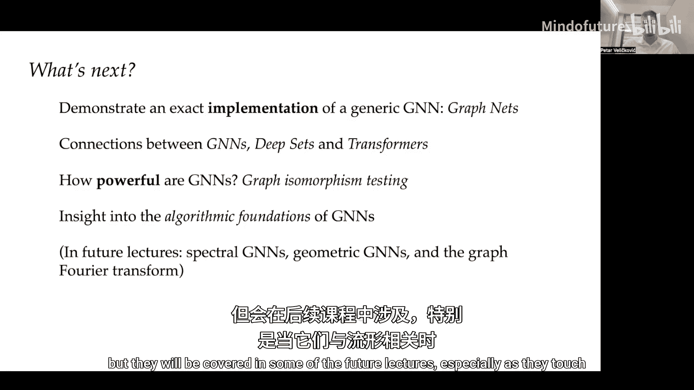
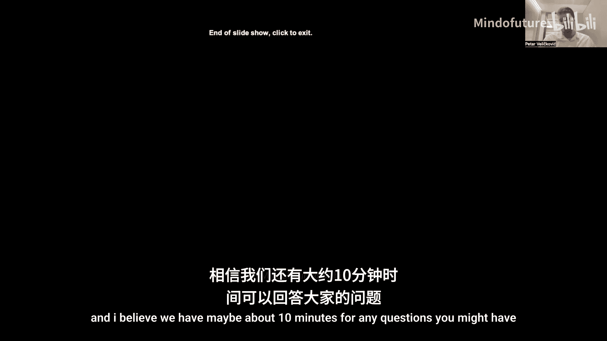
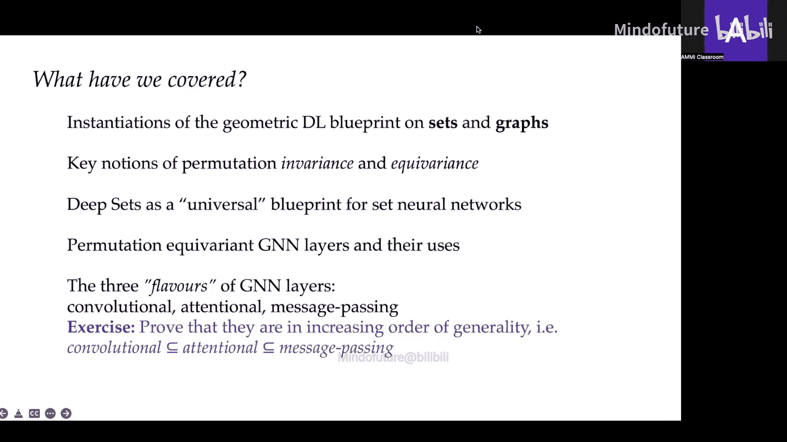

# 几何深度学习：05：图与集合

在本节课中，我们将学习几何深度学习蓝图如何应用于图与集合。我们将探讨处理这类数据所需的核心对称性——排列不变性与排列等变性，并介绍几种遵循此蓝图构建的经典模型。

---

## 概述

在本节课中，我们将要学习如何将几何深度学习蓝图应用于图与集合这类离散域。我们将从最简单的无序集合开始，理解排列对称性的核心概念，并介绍处理集合数据的通用模型——深度集合。随后，我们将此框架扩展到图结构数据，介绍图神经网络的基本原理及其三种主要类型。通过本节课，你将理解为何这些架构是处理图与集合数据的自然选择。

---

## 从集合开始

上一节我们介绍了几何深度学习蓝图的整体框架，本节中我们来看看如何将其应用于一个最简单的离散域：无序集合。

### 集合作为域

我们的域 Ω 是一个节点集合 V。每个节点 i 都关联一个特征向量 **xᵢ** ∈ ℝᴷ。因此，特征空间 𝒞 = ℝᴷ。为了将数据输入模型，我们通常将这些节点特征堆叠成一个节点特征矩阵 **X**，其第 i 行对应节点 i 的特征。

一个关键点是，堆叠成矩阵这一操作本身已经隐含地为节点指定了一个顺序。然而，我们假设集合是完全无序的。因此，我们希望任何作用于该集合特征的函数（如神经网络）的输出，不依赖于我们堆叠节点时选择的顺序。

### 排列对称性

我们希望函数对节点的呈现顺序保持不变。在几何深度学习的语言中，我们关心的对称群是 n 个元素的排列群 Σₙ，群元素 g 是排列。

排列操作可以用线性代数中的排列矩阵 **P** 来表示。排列矩阵是一个 n×n 的方阵，每行和每列有且仅有一个元素为 1，其余为 0。当用排列矩阵左乘节点特征矩阵 **X** 时，效果是重新排列 **X** 的行顺序。这恰好编码了我们希望抵抗的变换。

### 排列不变性

根据蓝图，当我们希望对整个域做出预测时，需要构建**排列不变**的函数。这意味着，无论对输入施加何种排列变换，函数的输出都应保持不变。

一个函数 **f** 是排列不变的，如果对于所有排列矩阵 **P**，都满足：
**f(PX) = f(X)**

这直接对应于蓝图中的 G-不变层或全局池化层。

### 深度集合模型

以下是构建排列不变函数的一个标准模型，称为深度集合模型。给定输入集合的节点特征矩阵 **X**，其输出计算方式如下：

1.  对每个节点特征向量 **xᵢ** 应用一个可学习函数 ψ（例如一个小型神经网络）。
2.  将所有结果向量使用一个排列不变聚合器 **⨁**（例如求和、求平均或取最大值）进行聚合。
3.  将聚合后的结果输入另一个可学习函数 φ，以产生最终输出。

其核心公式为：
**f(X) = φ( ⨁_{i=1}^{n} ψ(xᵢ) )**

其中，求和 **∑** 可以被替换为任何排列不变操作 **⨁**。聚合步骤确保了函数对输入顺序的不变性。

### 排列等变性

然而，很多时候我们需要对域中的每个元素（即每个节点）进行预测，而不仅仅是整个集合。此时，我们需要**排列等变**的函数。

一个函数 **F**（输出仍为矩阵）是排列等变的，如果对于所有排列矩阵 **P**，满足：
**F(PX) = P F(X)**

这意味着，先排列输入再应用函数，与先应用函数再排列输出，结果一致。这允许我们在输出中仍然识别每个节点对应的预测结果。这对应于蓝图中的 G-等变线性层。

在集合上，构建局部等变函数的一种简单方式是独立处理每个节点：
**hᵢ = ψ(xᵢ)**
然后将所有 **hᵢ** 堆叠成输出矩阵 **H**。这构成了深度集合模型中用于节点级预测的部分。

### 深度集合的普适性

一个重要结论是，对于相当广泛的输入集合类别，任何排列不变函数都可以表示为深度集合模型的形式。这意味着深度集合为集合学习提供了一个通用的蓝图。这一结论也体现在计算机视觉中的 PointNet 模型上，它本质上是一种用于处理3D点云数据的深度集合模型。

---

## 扩展到图

上一节我们建立了处理集合数据的理论基础，本节中我们来看看如何将这些概念扩展到更复杂的图结构数据。

### 图的域

图不仅包含节点集合 V，还包含边集合 E ⊆ V × V。我们可以用邻接矩阵 **A**（一个 n×n 的二进制矩阵）来表示边，其中 **Aᵢⱼ = 1** 表示节点 i 和 j 之间存在边。

现在，我们的域同时包含了节点和边。但核心的对称性仍然是节点顺序的排列。当我们对节点进行排列时，不仅需要排列节点特征矩阵 **X** 的行，还需要相应地排列邻接矩阵 **A** 的行和列，即变换为 **P A Pᵀ**。

### 图的排列不变性与等变性

因此，作用于图的函数 **f** 现在同时接收 **X** 和 **A** 作为输入。

*   **排列不变性** 要求：**f(PX, P A Pᵀ) = f(X, A)**
*   **排列等变性** 要求：**F(PX, P A Pᵀ) = P F(X, A)**

概念与集合完全一致，只是多处理了一个邻接矩阵输入。

### 图的局部性

与集合不同，图提供了节点之间的连接关系，这使我们能够定义更有意义的**局部性**。对于节点 i，我们通常定义其一跳邻居集合 **N(i)**，即所有与 i 相连的节点 j 的集合。

我们可以提取邻居的多重特征集 **X_{N(i)}**（使用多重集以保留重复特征）。现在，我们可以定义一个局部函数 φ，它作用于中心节点 i 的特征 **xᵢ** 及其所有邻居的特征多重集 **X_{N(i)}**，来更新节点 i 的表示：
**hᵢ = φ( xᵢ, X_{N(i)} )**

为了保证整个函数 **F** 的排列等变性，这个局部函数 φ 必须对其第二个参数——邻居特征多重集 **X_{N(i)}** ——是排列不变的。然后，通过对图中每个节点独立应用此 φ 函数，并将结果堆叠，我们就得到了一个等变的图函数。

### 图神经网络层

上述局部函数 φ 的具体实现，就是**图神经网络**的核心。不同的实现方式导致了不同类型的 GNN 层。以下是三种主要的类型，按表达能力和通用性递增排序：

1.  **卷积式 GNN**：为每条边预先计算一个固定的权重 **cᵢⱼ**（通常基于图结构），然后对邻居特征进行加权聚合。公式类似于：**hᵢ = φ( xᵢ, ⨁_{j∈N(i)} cᵢⱼ · ψ(xⱼ) )**。这类模型计算高效，适用于同质性强的图（即相连节点倾向于相似）。

2.  **注意力式 GNN**：不预先固定权重，而是通过一个可学习的注意力机制 **a** 动态计算每条边的重要性权重 **αᵢⱼ = a(xᵢ, xⱼ)**。公式为：**hᵢ = φ( xᵢ, ⨁_{j∈N(i)} αᵢⱼ · ψ(xⱼ) )**。这类模型更灵活，能适应异质性图，且具有一定的可解释性。

3.  **消息传递式 GNN**：这是最通用的形式。每条边上的发送节点和接收节点共同生成一个消息向量 **mᵢⱼ = ψ(xᵢ, xⱼ)**，然后接收节点聚合所有传入的消息来更新自身。公式为：**hᵢ = φ( xᵢ, ⨁_{j∈N(i)} ψ(xᵢ, xⱼ) )**。这类模型表达能力最强，适用于边表示复杂交互的场景（如化学、物理模拟）。

### 图上的任务

利用 GNN 层更新节点特征后，我们可以完成多种任务：

*   **节点分类**：对每个更新后的节点特征 **hᵢ** 应用一个分类器。由于 GNN 层是等变的，整个过程也是等变的。
*   **图分类**：为了得到整个图的表示，我们需要一个排列不变的聚合操作（如求和、平均），将所有节点特征聚合为一个全局向量，再输入分类器。这严格遵循了蓝图的“等变层+不变池化”结构。
*   **链接预测**：基于两个节点的特征 **hᵢ**, **hⱼ** 以及可能的边特征，预测它们之间是否存在边。

---

## 总结

本节课中我们一起学习了如何将几何深度学习蓝图应用于图与集合。

1.  我们从**无序集合**入手，引入了**排列对称性**的核心概念，定义了**排列不变性**（用于整体预测）和**排列等变性**（用于元素级预测）。
2.  我们介绍了**深度集合模型**，它通过“独立处理每个元素 + 不变聚合”的结构，为集合学习提供了一个通用且遵循蓝图的解决方案。
3.  我们将框架扩展到**图结构**，指出只需额外处理邻接矩阵的变换，不变性与等变性的定义可直接沿用。
4.  图结构引入了**邻居关系**，使得我们可以定义基于局部邻居的、更有意义的等变函数，这构成了**图神经网络**的基础。
5.  我们概述了三种主要的 GNN 层类型：**卷积式**、**注意力式**和**消息传递式**，它们依次具有更强的表达能力。
6.  最后，我们介绍了如何利用这些构建块来完成节点分类、图分类和链接预测等经典任务。

通过本节课，你应该理解到，对于图和集合这类离散且主要具有排列对称性的数据，几何深度学习蓝图为我们提供了一套清晰、原则性的设计指南，从深度集合到各种图神经网络，都是这一蓝图的具体实例化。