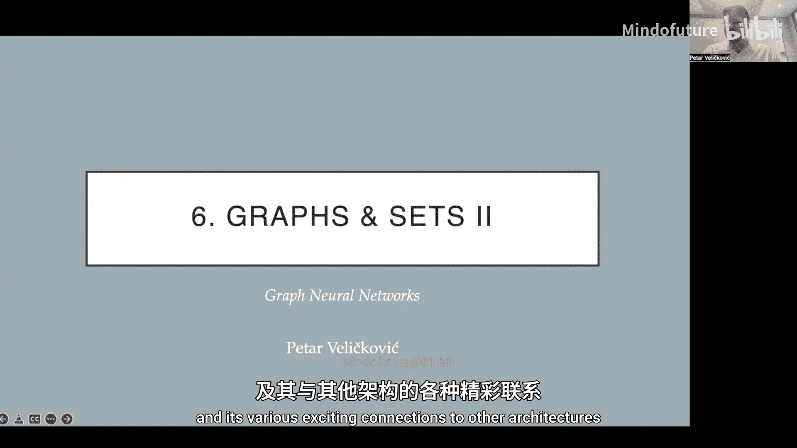
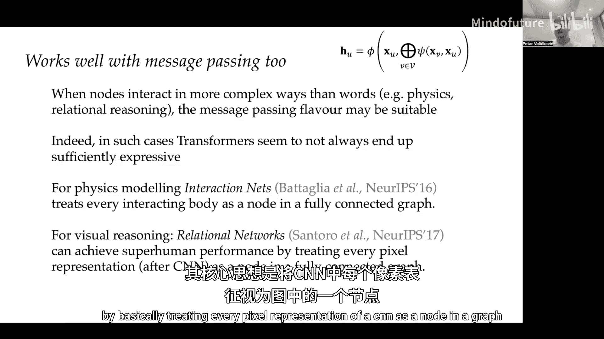
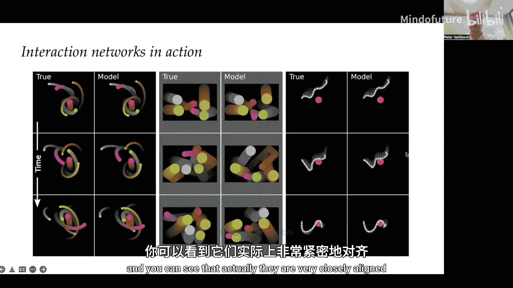
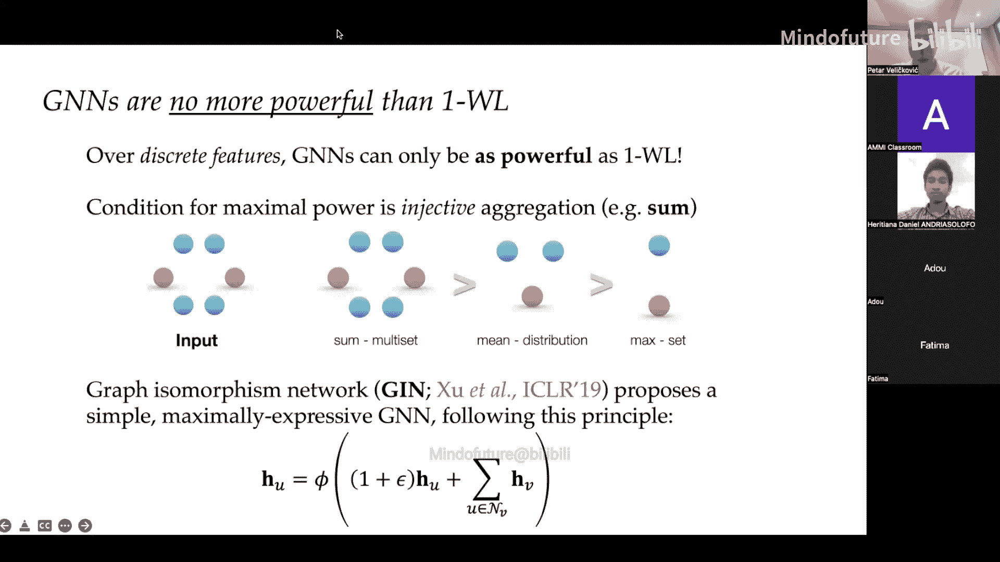

# 几何深度学习 ｜ Ammi Geometric Deep Learning Course p06 P06_第六讲（图与集合 II）-佩塔尔·维利奇科维奇 -BV1veHgzxELm_p6-

Allright so welcome back everyone， I hope you had a nice break thank you all very much for the very fun questions and discussions I really enjoyed answering to some of them and it shows to me that I've hopefully managed to motivate several of you that indeed focusing on representation learning on graphs is a potentially useful and fun thing to do so now that we're hopefully on the same page in that regard and we understand at least on a high level how to build the neural networks that respect the permutation symmetry constraints of graphs and sets let's dive a little bit deeper into our main event for today graph neural networks and its various exciting connections to other architectures。

。So just as a quick recap， we've finally seen for the first time the geometric deep learning blueprint in action on the specific domains of sets and graphs under the permutation symmetry governed by the permutation group Sigma N。

And as a direct consequence of this blueprint， we derived the deepet architecture and we showed it's a universal architecture for modeling set data。

 and we've also shown that using similar concepts， we can extend the deepet architecture into a graph neural network architecture。

 and I showed you a broad categorization into three different flavors of aggregation that you can apply for graph neural network modeling。

 convolutional attentional and message passing。Okay。

So now we are ready to dedicate an entire lecture to some important aspects of graphph neural network design as a quick roadmap of how this is going to proceed。

 we will first study the maximally potent GN flavor。

 the message passing flavor in a bit more depth just so you have a full picture of the most generic data flow that we can have over a particular graph structure and then we will challenge some of the initial claims that were potentially made so we will first talk about this idea of whether or not the GNN should rely on a good graph structure and also some ideas on how to apply graph neural networks without a graph that's known a priori。

And then we will investigate how powerful graph neural networks are from an algorithmic standpoint and illustrate some key ways in which we can make them stronger One point I would like to make right now at the beginning is that we will not be covering any coing layers for graphs if you remember the GDL blueprint。

 we've talked about all the components in that blueprint except for coing and the reason why we are not going to cover that even though lots of very cool research exists on that topic is that basically until now there hasn't really been a state of the art G neural network architecture that relied on these kinds of local pooling methods so the main reason for not covering them is simply that they haven't reached that level of real worldorl global use yet。

 although that doesn't mean that there won't be exciting research in the future that will make it possible。

 but I just chose to。Cut them from this lecture to dedicate as much time as possible on some of the more interesting state of the art approaches that are taking place right now。

So just as a quick recap， the picture you saw towards the end of the previous lecture。

 three different ways to aggregate information in a graph neural network。

 convolutional attentional message passing starting from the convolutional where we fix the interaction coefficients upfront and precompute them based on the adjacency structure towards the attentional mechanisms where we can actually compute and interaction coefficient based on the features of a node and its neighbor and finally the full- on message passing blueprint where we can compute full on message vectors based on the sender and the receiver and as I said we will start our discussion for this lecture by focusing on the message passing GNN specifically and if you remember what we do in message passing GN is we compute arbitrary message vectors to be sent across the edges of this graph and the way we compute them is by using this message function psi which now looks at both the features of the sender and。

feeatures of the receiver when computing the vector to be sent across。

 and this idea has been instantd in models such as interaction networks。

 message passing neural networks and graphph neural nets from Deep Mind。And as mentioned。

 you can think of it as the most generic Gen layer where your edges no longer are a way to aggregate or average neighbors。

 but more a recipe for the passing of data。This means they could have scalability or learnability issues。

 but they also are the ideal choice when you want to model things like computational chemistry。

 reasoning or physics simulation problems。So。One thing that's very important to kind of bring back to the story now is that I said when we started to analyze graphs that I will discard edge features or edge scalealrs or anything we will just think about whether or not the node was connected to another node and that's all to make the mats a little bit simpler well not if we worked out the mats and we want to talk about the most expressive GN we should really to hammer that point home we should bring back the idea that graphs can have rich information at all granularities not just on the node level and now we will actually assume that we have some features on all of the principal components so we have node features as before so XU will be features of node U and in the context of computational chemistry those might be for individual atoms what the type of the atom。

 what' its charged， how many hydrogens are attached to it and so on we might now also have edge features parameterized by pairs of nodes。

And these features could encode in the context of chemistry。

 things like what kind of a chemical bond is it， like is it a single double triple bond。

 is it in a chemical ring and these kinds of things？Lastly。

 you might also sometimes find useful to attach feature to the entire graph。

 so have a flat feature vector Xg for the entire graph and in the context of chemistry this might encode things like molecular weight or molecular fingerprints and things like that。

So then you can use a very generic graph neural network model to then define latent representations on the level of both nodes edges and graphs and I should mention and keep this in mind it will come in handy later in this lecture that it is in principle possible to extend this framework even further to represent things like hyper edges which would have triplets of nodes and stuff like that。

 but one very important point is that such inputs can usually be represented using the language that I just described you so I don't think we actually need to instantiate X UVvW to talk about the hypered we can probably use the edge feature concepts to talk about hyper edges So now under this assumption of having node edge and graph data and we want to compute node edge and graph latent so from X to H we are going to define a general way to build spatial graph。

Neurural networks which generalizes all of the flavors we talked about and specifically I chose to use the graph network model from Deep Mind as the basis because it truly operates over generic attributed graphs and the other two models like interaction networks and message passing neural networks are obtainable from the graph network by restricting its equations slightly and the general data flow here is you first use the graph and the two relevant nodes to compute edge features then using those edge features as messages you can update the node features by aggregating those edge features。

And finally， once you've updated both the edge and the node features。

 you can do a permutation andvariant agregator to combine all their representations and use those to update the graph features and of course because it just helps learning a whole lot especially for these overparmatized models skip connections are utilized quite extensively in this architecture so let's go through what it's doing。

As I said the first step we're going to do is update our edge features so compute the lates HUV and what are all the relevant features for updating the edge well you have obviously the two node features incident that edge so XU and XV and then you also have some features of the edge XUV that are relevant and you have features from the graph which might also be relevant for updating that edges feature so this first step should be fairly straightforward use the relevant two nodes the edge features and the graph features to update the edge features。

Once you have all the edge features you can interpret them as an edge message and based on their aggregation update the features in the nodes so now we can update the features of a node U by looking at that nodes features so X by looking at the aggregation of all of the edges that are sending into that node and finally the features of the graph so this is now a second function that will update our node representations using these edge features and for now you might see that this is really just another instance of the message passing rule we talked about before we just have that extra context from the graph。

And finally， once both the edges and the nodes have been updated。

 we can use the aggregation of all the nodes and all the edges as permutation andvari representations and using them we can update the graph features by the way。

 a very similar formulation can be recovered without explicit graph features by just inventing a new node we call it a master node and connecting it to every single node in the graph。

So let's try to visualize what's going on imagine I have here some feature vectors in nodes UNV and the edge connecting them and I also have some features in my graph what will a graph network model do as we said first we will update the edge so the features of edge UV get updated based on the features of the two nodes incident to it its own features and the features of the graph。

Once we've computed all edge features sending to a particular node。

 we can update that node's features by using the node's previous features。

 the aggregation of all the edges and the graph level features。

 and finally once we have the computed node features and edge features。

 we can aggregate all of them together to update the graph features。Now。

 if you were to color code these edges by whether they represent an equivariant or invariant layer to permutations。

 you'll see that basically all of the ideas from the geometric deep learning blueprint feature quite extensively in graph networks with equivariant and invariant layers applied appropriately whenever you need to reduce something。

And it is a very fun exercise then to try to specify the functions scifi and row。

 the three key functions of the graph network to recover some standard graph neural networks like the GCN。

 the graphph attention network or the message passing neural network。

 assuming I give you also some imaging graph features。

 I think it's a fun exercise to try to complete outside of this lecture。

And before we dive into some of the more advanced topics of today's lecture。

 so this was just to show you a very high level concrete implementation of one particular expressive graphph neural network。

But now we're going to move on to some more advanced topics and before we do that。

 I want to give you just one last thing to ponder。When we've introduced deep sets。

 I've showed to you that we've been able to actually rigorously prove that any set function that works in terms of satisfying permutation andvari。

 I must be able to express it using deep sets and now the question arises。

 can we make a similar generality claim about the graph neural network we just built。

 can we represent any permutation equivalentvariant function over graphs using one of the three flavors that I showed you？

And later today from several angles we're going to ponder this question quite carefully and it will be a useful topic for the practical exercise that you will have shortly as well。

 and yeah basically I just want you to keep this question in the back of your mind and have a thought of are we sufficiently powerful by talking about one H neighborhood aggregation to express anything that we might want to do over a graph that satisfies permutation equivariance？

But before we dive back into this， we are going to move on to a very important topic。

 latent graphph inference， which tackles one very innocent but very important assumption we've been making that we have a ground truth graph and that graph is given to us。

However， it turns out this claim is not so innocent， as it？

And analyzing it in more detail will lead us into latent graph inference。

 which is a key emerging area for graph representation learning and in my opinion also an area of high interest to just performing basic science。

And further， if we study this area further， it will allow us to draw very cool connections between some state of the art models and graphraph neural networks and to give you a bit of a spoiler alert。

 almost everything that we will analyze will turn out to be a special case of a graphph neural network。

😊，So specifically one thing that's very important to note is that even when I give you an absolutely correct input graph which by the way in the real world is quite rare。

 usually the graphs we obtain are a result of some kind of human design heuristic on which edges to draw and what to put in those edges but even when you give me a completely correct graph that does not mean it is the optimal way to pass messages for the task at hand。

 I always like to give a different example for this。

 for example if you want to predict some movements of humans based on their skeleton pose technically if you use the skeleton as the edges in the graph that is a correct graph of the human skeleton。

 but imagine you need to do some kind of synchronized motion with your hands actually this means you should have a direct link between the two hands to model their interactions very closely right but actually in the human skeleton there's no direct connection between two hands。

You have to go through the entire tors so to reach the other hand。

 which means your information must travel anreason long unreasonably long distance and this is as you might imagine a suboptimal way to convey information so even if you have an absolutely correct graph which very rarely happens。

Rewiring it to be specialized for the task you're solving might be a very good idea and we can even take this concept to the extreme right like what do you do when there is not even any graph to begin with but we assume that one might exist okay so imagine for example in the case of physics you have a bunch of particles these particles are interacting with one another but you don't actually explicitly know the forces at play between them right you just see the motion of those particles right and you need to kind of figure out what is going on in between。

So in this generic setting， we assume that we're given a note feature matrix X。

 but no adjacency matrix attached to it， and once again we'll ignore edge and graph features just to keep things a bit more simple。

 it doesn't change our findings。And what can we do well we have actually seen one solution for this problem already right and that is the deeps model in which we basically just assume that there are no edges to begin with right so if no edges are given to us we just go pessimistically and we assume our graph is completely disconnected so we let our adjacency matrix equal to the identity matrix or equivalently the neighborhood for every single node U is just the node U itself。

And as a result， no matter what you choose to aggregate over the neighbors。

 you'll just end up with the features of that node itself。

 so you can easily convince yourself that any graph neural network flavor you run over such a graph will reduce the deep sets。

 so now we have our first interesting result deep sets are basically a special case of a graph neural network where the adjacency matrix is the identity or we assume no edges。

Okay， so。We said that one option is to assume that there are no edges whatsoever between our nodes。

 does anyone have any idea on what could be another possible option？

Maybe we can try to think that there are edges connected to everything Yes exactly so all connected to all as someone also wrote in the in the comments。

And that's exactly the case， so the converse approach is you can take the lazy approach where you just assume everything is connected to everything。

 which in matrix terms means that you set your adjacency matrix to be equal to all ones multiplied by the transpose of all ones。

 or equivalently the neighborhood of every node is all the nodes。😊，ok。😊。

And since we are assuming no additional information about these edges right remember we are supposed to be inferring them as we go along。

 then a convolutional graph neural network would have no other choice but to take simple averaging into account and it's possible to show in this case that convolutional graph neural networks are equivalent to deep sets in the cases of fully connected graphs and it's a pretty fun exercise to prove this and I highly encourage you to try to prove that when you assume full connectivity and you use a convolutional G with averaging that actually you will get the model which is equivalent to deep sets so what this means is with conGNNs we are not going anywhere further than deep sets so we need to try a more expressive flavor of GNNs well as we know the next step up is attentional GNNs so here I put in front of you the equation of an attentional graph。

Neural network where the only difference I'm making is now I'm making the neighborhood of node U be equal to all of the nodes。

 so the aggregation operation goes over all of the vertices and now I compute this attention coefficient between all pairs and I use that to aggregate。

Maybe you know a quick question， does anybody in the audience see this model and think， oh。

 this is something very familiar。不。Are there any natural language people in the audience？Yes。

 exactly， good job Aman， this here should feel a lot like a transformer。So some of you。

 as I said here have probably recognized the famous language processing model in the equation I just showed you。

 but I don't want to start this discussion by saying transformers and like Linked them like this。

 I actually want us to rediscover the concept of the transformer without ever talking about transformers by just focusing on the geometric blueprint I've showed you so far okay so to do this I'm going to send you into a natural language processing realm。

And the reason why this is a good thing to do is generally there's a longstanding alignment between natural language processing and graph representation learning。

 in fact many of the early methods for representing graphs。

 the node embedding methods very much one to one corresponded to traditional word embedding methods in natural language processing。

 even their optimization objectives are near equal once you take into account these equivalences。

And recently， self supervised graphph representation learning methods borrow a lot of concepts from popular NLP methods like BERT。

But what's very important is that we can take this correspondence in the other direction as well。

So in a natural language context， you are typically interested in modeling sentences of words and then doing something over those sentences like translating them or predicting the sentiment。

 is it positive or negative or something like that。

And generally you can observe that words in a sentence interact right so you have subjects and objects。

 you have adjectives that act on the words they act on and so on so there are some very interesting interactions between the individual words in a sentence that modulated the meaning of that sentence or how it should be translated and generally we know that these interactions are not trivial and more fundamentally not sequential so it's not like one word interacts only with two words that are immediately next to it these interactions can stretch across even multiple paragraphs so this means that you probably shouldn't focus on using just a recurrent neural network like an LSTM because what is an LSTM assuming it's basically assuming a grid graph that every word is connected to its two immediately neighboring words and as a result it's using a graph that is in principle correct but suboptimal for the task at hand。

We might actually want to use a more general graph structure between the words to be able to model the meaning of those words。

 but then the big question arises what should be this graph of words okay like there are many different ways to define graphs of words and the problem is not even you know professional human annotators tend to agree what the best graph to use is and often the optimal graph might even depend on what you're doing right the best graph for predicting the sentiment of some sentence and the best graph for translating a sentence to a language might be completely different okay so what do we do when we have this problem of we know there's a complicated graph in there but we don't know what it is well as we just said a very common assumption is to use a complete graph and then let the neural network the graph neural network infer the relations by itself by passings messages along this graph and basically the most popular approach indeed in that case。

iss to take a fully connected graph and then use the attentional flavor of a GNN which then yields one of the most recognizable deep learning models of today。

 which was developed by As Shihiwaswani and others at Npe's and that is exactly the transformer so here I put the equation of the attentional fully connected GNN in the corner and the famous figure from the transformer papers so we can relate some of these concepts but the general idea that we want to make now that we've arrived at the same conclusion is that you know I've reached the definition of a transformer without ever using the word transformer I've just used concepts of graphph neural networks。

 fully connected graphs and attentional flavors therefore we can say that transformers are a special case of graph neural networks under these two assumptions。

And you might wonder because graphph neural networks are permutation invariant what is it that makes transformers specialized to language Well specifically this sequential structural information is fed through the positional embeddings of the transformer which tell you roughly for every word where is it in a sentence but the model is not obliged to use that information in any way it's there just to hint to the model that there exists a structure it is not a rigorous equivariance constraints so from the perspective of a covariance constraints transformers are in the same boat as graphph neural networks and specifically you might imagine the attention mechanism because it gives you a scalar for every single pair of notes as giving you a soft adjacency matrix and therefore letting the graphph neural network choose its own edges this connection of transformers and GNNs is very beautiful and there's a lot more detail I would want to go through that I cannot do in the context of this one lecture so I highly invite you to read this fantastic。

Blog post by Jtanya Joshshi that was published in the gradient。

 which is literally called transformformers or Graph neural networks you'll find a lot more fun insight in that paper。

And another thing that's quite useful to ponder for us is why did the attentional flavor of the GNN work so well here。

 like why not message passing， for example。Well， there's a few important concepts to ponder The first one is that words don't really have any meaning in themselves right words only get meaning when you put them in context with other words right and as a result all of the inputs to a language model are typically just oneho features that tell you which word this is in the vocabulary so they are very rudimentary identifier feature and they're unlikely to give you complex messages right this will no longer be the case when nodes become something more tricky like full concepts so as long as they are words then basically taking weighted combinations of words might be the best that we can do to model semantics so attentional coefficients then allow us to also interpret these learned connections and how a word representation is built in context with other words。

But another thing which is obviously most practical in terms of scaling these models。

 transformers are now used for huge language models with billions of parameters like GPT3。

 and as we discussed before， attentional mechanisms just have more favorable storage complexity than full- on message passing GNNs。

 especially when you use something like a dot product attention like a transformer does。

 because you never actually have to compute edge messages。

 which is a much more costly thing to do from a storage perspective。

 and also because they operate over a dense graph， you can express computations of transformers using pure matrix operations and as a result you'll get something that aligns really well with the computation of GPUs and TUs which are the workhorse behind most of the deep learning progress happening today。

So taking all this into account， you can basically say that transformers are graphph neural networks that have successfully won the hardware lottery。

 they just happened to be the flavor of graphraph neural networks that is easiest to scale on the hardware of today and gives you sufficient modeling power beyond the convolutional GNN which is maybe a bit too rigid if you want to read more on the hardware lottery Sarah Hooker has this amazing paper published last year in communications of the ACM which as I said is highly recommended if you want to know more about why sometimes we don't choose the best model for a particular task because the hardware we have doesn't align with that particular model。

But that being said， the idea of taking a fully connected graph is not something that's restricted to transformers and it works very well with the message passing flavor as well if it's in the right kind of setting so whenever you have interactions between your nodes in more complex ways than words so physics interactions relational reasoning and so on then the message passing flavor might actually be a better choice because it lets you compute a more complex message along every single edge and actually in such cases transformers often do not end up sufficiently expressive it's actually。

One of the rare scenarios where transformers are not state of the art so for some examples in physics modeling。

 interaction networks were one of the pioneering works that treat every interacting body as a node in a fully connected graph and for visual reasoning。

 the relational network model is capable of having superhuman performance or unrelational question answering by basically treating every pixel representation of a CNNM as a node in a graph。

And here you can see some interesting visualizations， both from interaction networks。

 here you can see some rollouts of the interaction network model for predicting end body dynamics。

 both for gravitational interaction on the left bouncing balls in the middle with elastic collisions and strings on the right and you can see for all of the scenarios you see the trajectory that's ground truth and the trajectory predicted by the interaction network。

 and you can see that actually they are very closely， very closely aligned。

But。One thing that I would like to note last year for this course。

 this was actually a full on component nowadays I am cutting it out a little bit to put more discussion on the transformer connection but one thing that I would like you to keep in mind is that the real truth of latent graph inference So figuring out the underlying graph and then using it for a GNN is somewhere in between the two approaches we've seen right we have the option of take no edges at all。

 we have the option of take every pair to be connected right but there is something in between right because the full graph。

 the fully connected graph can be quite hard to scale because you have quadratic space and large neighborhoods but empty graph then ignores a huge wealth of information So ideally what we want is to infer a rigid adjacency matrix a which is sparse and then use that matrix as edges for a G This is what we commonly term latent graph inference and it's a very tricky area that deserves a niche of its own because choosing edges is。

Fundamentally discrete decision and it's very hard to optimize that by back propagation and there's five recently proposed prominent approaches that I would highly recommend you check out if you're interested in this area I highly recommend it I think it's going to be one of the most important areas going forward especially if we want to use these models for basic science because these adjacency links can then be interpreted as the ground truth connections between our objects right and there are many ways including the neuralrelational inference or N model which uses a variational approach the dynamic graph CNNN or DGCNN which basically uses a non-parmetric model with no learning at all but still quite powerful it successor to differentiable graph module which uses reinforcement learning to decide which links to put and then our own pointer graph network which uses direct supervision from a template data structure to figure out how to place the edges。

Most recently at last years Europe's， the Slas architecture from Baharapotammi and others。

 which uses a self supervised approach to significantly enrich these latent touchs that get discovered all of these papers are very much worth a read if you have some time。

But in the interest of maximizing the time and the utility we spend today。

 I'm actually going to pivot this discussion now to talk to you a little bit about how powerful our graph neural networks。

I hope the wealth of practical examples I showed you at the beginning can tell you that graphraph neural networks are indeed a powerful tool for processing real world graph data if you include all of the transformer advancements as GN advancements that list only explodes exponentially。

But they won't solve any task specified on a graph accurately right there's still a polynomial time procedure so they shouldn't be able to help you with say problems that we know our MP complete。

And the canonical example that we use to measure the expressive power of GNNs to see like what they can and cannot do is by looking at the decision of graph isomorphism。

So the main question here is。Can the graph neural network distinguish between two graphs that are not isomorphic so can it attach two different H representations to them okay we know because of permutation equivaris and invaris that GN is guaranteed to put the same representation on two isomorphic graphs。

 so here we're really dealing with the converse case。

And the reason why this is important is because if the graphra neural network is unable to put different representations on two different graphs。

 then any task that classifies them differently is hopeless right so it's a kind of a fundamental measure of how discriminative you are can you discriminate between any pair of your examples。

 so we're going to assess power of GenNs by which pairs of graphs they're able to distinguish。

And to make this truly formal， we will look at a popular graph isomorphism test。

 which is known as the Wphilo Leman test or the1WL。

 which is a simple but powerful way of distinguishing graphs that passes random hashes of sums along the edges and just iterates until those hashes stay stationary and if the hashes are same in histogram terms。

 then the algorithm says these two graphs are possibly isomorphic。

 it was a procedure invented by two Soviet mathematicians Bo is Wefireler and Andre Leman and basically it's a very simple procedure that works remarkably well for most real worldorl graph structures。

So to illustrate what this model is doing we're going to run the wisefire test on this particular graph here that I showed you on some instances before as well how will we do this we're going to represent these hashes as colors which makes sense because inherently they have countable semantics and once we have these colors we will track all possible neighborhoods that arise in terms of different colors and just put different colors to different cases and we stop when there's no new colors to introduce okay so we start with this initial graph where all the nodes are colored blue and we have this particular structure after one step of the wisefa Leman algorithm we have two cases right we have a blue node with two blue neighbors which we decide to color green and we have a blue node with three blue neighbors which we choose to color yellow okay now I have a question for the audience what do you think。

I will be the situation in the next step of the algorithm。Yeah。

I'm guessing maybe looking at the color， coloring with respect to the color of their neighbor。Yeah。

 so how many different colors do you expect we're going to have in the third step？TheB3。

 if we don't consider the numbers like how many you cr and yellow。

 then we just consider green green and green yellow and yellow yellow。

You are absolutely correct and the people in the chat are also absolutely correct in the next step we will have to invent one new color。

Because now we have three cases right we have green with one yellow and one green neighbor those will get one color gray。

 for example， we have a yellow with two green that will get a new color like red and we have green with two yellow which will get a new color purple for example and I hope you can all convince yourselves that at this point there's nothing else to do in the next step we will get exactly the same histogram of colors so the algorithm just stops and outputs a histogram of colors。

 one22 okay and now you can see how if we run the same algorithm on exactly the same graph just presented in a slightly different way we will end up with exactly the same histograms so in this case the algorithm correctly recognizes these two graphs as as isomorphic。

And this idea of passing random hashes along edges makes it a very clear connection to convolutional GNNs and that's been spotted very early。

 even the GCN paper of Ki andwelling has spotted that what their model is doing is maybe a more sophisticated variant of the wise filer algorithm and it also explains why sometimes if you don't even train your GNN like if you just have randomized weights which corresponds to a random hash you can get pretty strong representations however。

 even though this test as I said is very powerful for many graphs in the real world。

 it still fails on some painfully simple cases， this is one case it cannot tell apart a six cycle from two triangles okay so to the naked eye these two graphs are very different but from the point of view of the wise filer test every single node is structurally exactly the same in those two graphs so it has no way of telling them apart。

There are some painfully simple things like usually relating to counting simple substructures that these W filer tests cannot do properly。

 and it might then surprise you to find out that if your features are discrete。

 you can never build a graph neural network that is more powerful than the W filer test。

And this might seem a particularly damning prospect， but actually when you analyze it further。

 you might find that even you need to be very careful with how you design the GNN to even match the power of the wiseF test you know you cannot exceed it。

 but it's also not very easy to match it either and it turns out that the condition to get this maximal power is for your aggregation function to be injective and in this particular case。

 the aggregation function that works well is taking the sum okay。

So why does this work Imagine you have this neighborhood of discrete features like four blue nodes and two red nodes if you take the sum of all of their features you will correctly capture that there are two reds and four blues right if you take the average you're already throwing away information you're only representing like the relative ratio of blue to red which is two to one and that already drops the information how many blues and how many reds there are and if you take max that's even worse because it just reduces your multiet of neighbors to the set of the constituent blue and red okay and the proof that shows that you need the sum aggregation and using that you get the same expresssivity as the wise file test is actually very similar to the proof used to show that deep sets are universal the main difference is that deep sets dealt with sets when we aggregate over graph neighborhoods we now have to deal with multi sets because because。

We can have multiple neighbors with exactly the same feature so using this the authors of the graph isizomorphism network paper or Gin have been able to show that you can compute a you can have a simple GNN which uses the sum aggregation which is maximally expressive so here you can see that you have some component that depends on the center node and it's weighed by this factor of epsilon which is learnable。

And you have also a summation over all the neighborhood features and。This layer。

 the gin model is provably the most powerful GNN over discrete features。However。

Like just because I told you you can never hope to build a GNN that's stronger than the Wfililr test Well what does that really mean That just means that the graphraph neural network is fundamentally incapable of computing certain things so what can we do then we can build more stronger GNNs by giving them that information that they cannot compute okay so there's a huge area which I like to call augmented message passing which tries to build more powerful GNNs usually by looking at the cases where the wisefiler test fails and then finding ways to give the graphraph neural network the context that it needs to solve that problem and here I've given you this example of the six cycle versus two triangles again so that you can so that you can properly properly keep it in the back of your mind while we study this。

So for example。😊，The reason why we cannot tell apart two triangles from a six cycle is because if you look at the receptive field of a graph neural network applied to these constant feature graphs。

 you can see that every node in these two graphs has exactly the same receptive field all the nodes locally look exactly the same okay so do you have some idea of a very simple thing we could do to the input in this graph to fix this problem。

Any ideas？嗯。Sure。Is there anything simple I can do to the notes features to not make them look the same？

Yeah。The idea to add another node Joseph is very interesting and could be quite powerful。

 but let's now let's say for now that I am not allowing you to add new nodes， it is a correct answer。

 but I'm looking for something even simpler。Yeah。Okay。

 it seems like we don't have any takers so let me show you what the answer is you can basically just put a random number inside every single one of those nodes right and now suddenly not only do these neighborhoods look different you can also see yourself a certain number of hops away which tells you hey you've closed the cycle of a certain size right。

So basically the key point here is that if you already augment the graph neural network with something as simple as a random number。

 you can already tell apart some substructures that previously you were not able to tell apart。

 specifically you can tell apart a six cycle from two triangles in this way， okay。

And essentially this is a very powerful idea even though it's remarkably simple and Rayy Ma Sato with his collaborators was able to take this idea and publish it in a top tier conference in the year of 2021 this is just to show you how how young this whole field is and how impactful it could be where you can basically write an entire paper on the theoretical significance of putting a random number in every single node and get that paper published at a top venue okay and this is just one instance in a whole family of approaches that tries to put features in the nodes that compute something that the graphphnet otherwise wouldn't be able to compute so besides putting random features you could also put node identifiers positional identifiers in PGNNs and even if you know which substructures are important you can literally count them and put the features of those counts as your positional features this is exactly what。

Because Buditz as did in his paper it came out in 2020。

This general idea of finding a case where a graphraph neural network cannot deal with one W filer test limitations and fixing it by changing the features or something like this gives you a method that belongs to augmented message passing so there's many of them there's really a lot of them but they can be generally categorized into three groups you can either modify the features of the nodes as we just discussed you can modify the message passing rules so change the message function so that it's more mindful of the structure of the graph the directional graphph neural network or DGN is a very good example of this。

And the last suggestion which aligns really well with what Joseph suggested is you could modify the graph itself to give you clues about the structure。

 and this gives you some models like one，2，3 GNNs， and it further subdivs into various categories like rewiring the graph aggregating over subgraphs or message passing over substructure。

Now one thing that's very important because I'm sure many of you will doubtlessly look into the literature for these kinds of approaches。

 and if you look up the papers that improve on the wise file Leman limitation。

 there's a high chance you'll come across some terms like higher order GNNs or beyond message passing。

I've had a lot of debate with my teaching assistant at Cambridge and external experts on these terms and I've actually convinced myself that it's likely impossible but certainly not easy to truly devise a graph neural network that you cannot express using message passing and actually many of these stronger GNNs that you build are going to be most efficiently implementable using message passing so what's the trick how do you make it work well don't do message passing over the initial graph modify it by introducing for example new nodes to represent substructures as Joseph mentioned and as a result you know you change the graph but the primitive that you use is still message passing over oneh neighbors so therefore I conclude that talking about the term beyond message passing can be imprecise at best and potentially harmful because it might get you to think oh I need to implement this without using any message passing whatsoever when in reality message passing just over a different graph might be the best way to do it。

And this whole story started when I was giving my course on Graph neural networks at Cambridge。

 I made a slide that I also presented to you today on how graph networks can represent hypergraphs and these kinds of things。

 and this caused a very lively debate with my teaching assistant which eventually spiraled into a bit of a long-standing argument。

 the TA who originally reported this issue notly said that he did open a Pandora's box。

And all of that discussion eventually led to me writing this position paper on message passing all the way up where I make a very clear argument for why you should be able to represent everything using message passing neural networks and this work was recognized in the eyeC GTRL workshop where I presented it as a spotlight a few months ago and I had a chance to have many intense discussions with people including some folks from this course like Michael Bnstein on to what extent is thisclaimed true I'll just say that to this point I haven't seen any clear evidence that we cannot express things in message passing is just that sometimes expressing things in message passing might not be the most insightful way of looking at it。

And the other term higher order GNNs relates to usually trying to build graph neural networks that align with more generalized versions of the WFer test remember when we first introduced it。

 I mentioned it's sometimes called the1WL that means that we are keeping representations on nodes which is like one tuple of nodes。

 but it's only a special case of a more general class of wise file tests， the KwlL。

 which track representations for k nodes at once so pairs of nodes triplets of nodes and so on。

 but not all graphra neural networks are best talked about with respect to the wise file test。

 which as we said at the beginning means you're deciding isomorphism over discrete featured graphs very often graphs you will encounter in nature might have continuous features attached to them。

So we set out to study what happens when the features are continuous rather than discrete。

 so we break the first assumption of the gin paper and we actually find that in this case the proof for the gin papers injectivity of the sum aggregation falls apart and I can easily give you examples of neighborhoods that cannot be told apart by the sum aggregation。

 or even the min aggregation or the max aggregation。

 it actually turns out that for some of them like the third one from the left here。

 that only aggregator out of the four we're considering here that will tell them apart is the standard deviation。

 taking the sum， the average the minimum the maximum doesn't tell these two neighborhoods apart。

So this raised a very interesting question， right， since there doesn't seem to be a single aggregator that always works。

 which one is the best？So this prompted us to write a paper on principle neighborhood aggregation。

 the P&A paper and we actually prove mathematically that there isn't one okay so if you have multi sets of n neighbors where the set of features is the real numbers you' are in general going to need at least n aggregators so one aggregator per neighbor to tell them apart to tell the nonisomorphic ones apart in general and if you're interested in the maths behind this I think that the proof of this statement is really cool it relies on the boullam theorem which3 blue1 Brown wrote a very fun tutorial about that you can find on YouTube so highly recommend。

And you might be asking yourself now， you know okay so I told you that to distinguish general neighborhoods with continuous features you need at least n aggregators so do we have any idea on what those n aggregators are well in the same paper we actually prove that the moments of the neighborhoods work so you take the expected value of the n power of the difference between the mean and then take the n square root of that to get the n moment so these functions gradually generate first the mean and the standard deviation the skew the cretosis and so on and so forth。

And it actually also covers max and men because when you take the maximal and the minimal element taken together。

 they give you an estimate of the infinity moment， right the biggest discrepancy in your data set。

Now the important thing to note is that these guys are not always the optimal choice of aggregator there are other bases that might also satisfy the condition of being enough and also there's a problem with them when you take them to end bigger than two so when you move from standard deviation into s and ketosis territory you have to take the n power followed by the n square root and this is quite numerically unstable in practice so what did we do as a result in our principal neighborhood aggregation paper we propose a combination of these aggregators which is shown to be empirically powerful so we take the aggregators that we know are stable like the mean standard deviation and then the max and min which are stable at m infinity and we combine those four aggregators with three different scaling functions like identity multiplying by the degree which allows you to recover some as degree times mean and also logarithm of the degree so these three combinations multiplied by four aggregate。

Give you 12 different aggregators and then you just use this combination as your aggregation function in your favorite graph neural network so you compute all the 12 aggregators and then you concatenate the results and stitch it into your GNN and you're all set it tends to at worst match the performance of individual choices of aggregators and usually outperforms them especially as you need to extrapolate more。

So。That was actually the last concept I wanted to cover for you today so it's good to have a recap of everything we covered we took a deep dive into graph neural networks specifically we looked at the exact data flow of the graph network architecture from Deep Mind over generic attributed graphs once we covered that we unpack the seemingly innocent assumption that the edges given to us are perfect and analyzing the scenario where we don't even have any edges we recovered transformers and deep sets is two special cases of GNN flavors over either an empty or a complete graph and finally we studied in depth the limits of graph neural network expressive power which I hope also addresses one of the questions we had on the first lecture we studied them through the lens of graph ismorphism testing we found that GNNs are fundamentally limited by the Wefire test we found a way to break this limit by giving GNN's data they shouldn't normally be able to compute giving us augmented message passing methods。

And finally， we discussed briefly why just studying effects over discrete features is not sufficient enough in all cases。

 and our analysis into the continuous feature space led us to discover the P&A combination of 12 aggregators。

I hope you found this lecture interesting， especially because now that you're armed with the knowledge of the GDL blueprint on the case of sets and graphs。

 you're ready to move beyond to just simple from permutation symmetry to more complicated geometric constraints and this will lead us to talk about geometric deep learning over grids and groups where it starts to get quite exciting from a geometric standpoint。

I hope you enjoyed this was my last slide and I believe I should have about five to 10 minutes for any questions。

 so yeah hope you liked it。Yes， thank you。So， there is a question。Yes， yes， could you read out the？

So there's a question how to perform back prop through node in GNN。

How to perform backdrop through the nodes of Gen okay that's a good question。

 so I think it will be easiest to visualize it if I show you again the data flow of of the graph network model so this picture here。

So imagine that you know you're predicting something on the level of nodes， edges， and graphs。

 so you have some label for both HV， HUV and HG。The back prop basically just goes in the opposite direction right so these psci Phi and row are simple multilayer perceptrons and any gradient you've computed on the vectors for Hg HV and HUV can then back propagate through those functions into their inputs right and therefore optimizing the weights of those parameters so I hope this I hope this answers the question generally we just look at these data flow arrows and we look at them backwards to back propagates through the functions that we care about。

Okay。Someone is大。 thank you maybe。What for fu。Yes， so， no the question。

What is the main institution of adding epsilon？So I think this epsilon。

 like please correct me if I'm misunderstanding， but I think the Epsilon here refers to this gin formula here where the epsilon is added to the self connection。

So basically， you'll have to read through the paper to truly understand why that Epsilon needs to be there。

 but basically。The idea here is that in their analysis。

 they want something that will take the sum of all the neighbors and then treat the central node in a way that's guaranteed that you can unpack it from the rest of the neighbors。

 okay？And if you assume that the inputs and neighbors have discrete features， one typical way to。

To make sure that this central node is given a special treatment is by multiplying it with some irrational number so in the basic mathematical analysis of this layer epsilon is seen as just some irrational number okay now of course you cannot actually you know represent an irrational number inside a computer so what they do in practice is they make epsilon be a learnable parameter and the hope is that then back propagation will discover an interesting enough rational number to tell apart the central node from all the other ones so that's that's the main intuition basically。

To be able to use some for all the nodes， including the central node without having to use the skip connection concatenation。

Yeah。

