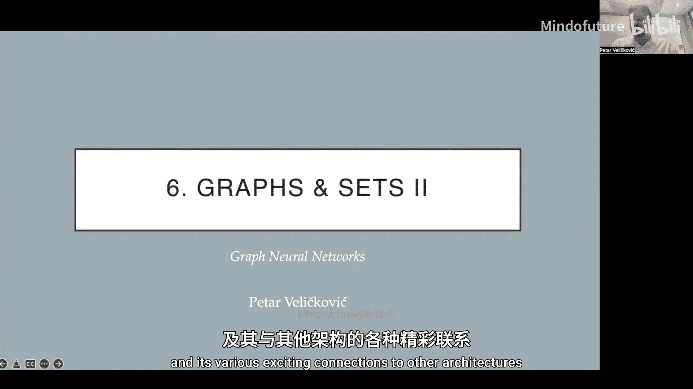
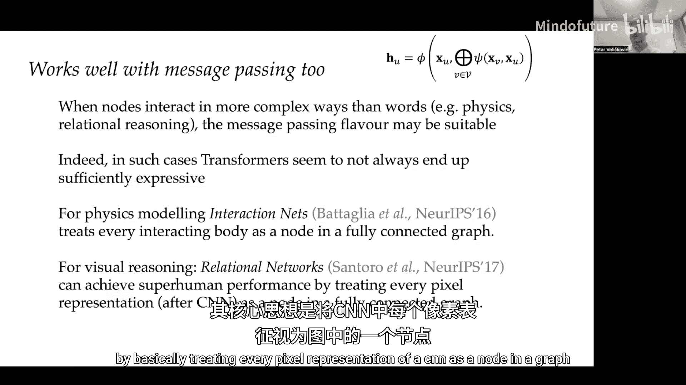
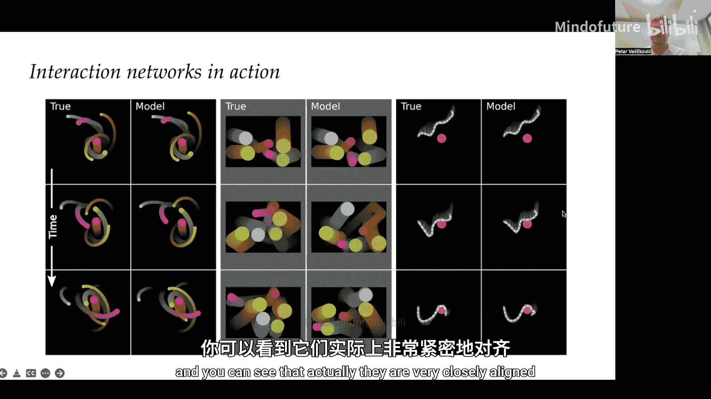
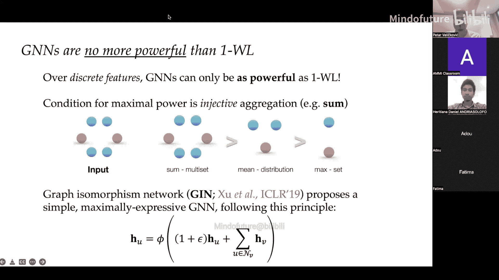

# 几何深度学习课程：第六讲：图神经网络进阶 🧠

在本节课中，我们将深入学习图神经网络，探讨其最通用的数据流形式，并挑战一些基本假设。我们将研究在没有先验图结构的情况下如何应用图神经网络，并从算法角度分析其表达能力。最后，我们将介绍一些增强图神经网络表达能力的关键方法。

---

## 图网络：通用数据流

上一节我们介绍了图神经网络的三种聚合方式。本节中，我们来看看其中最具表达能力的消息传递范式，并以DeepMind的图网络模型为例，展示其在通用属性图上的完整数据流。

图网络模型在节点、边和图三个层级上操作，其数据流遵循以下步骤：

1.  **更新边特征**：每条边的潜在特征 `H_uv` 由其关联的两个节点特征 `X_u`、`X_v`、边自身特征 `X_uv` 以及图级特征 `X_g` 共同计算得出。
    *   **公式**：`H_uv = φ_e(X_u, X_v, X_uv, X_g)`

2.  **更新节点特征**：每个节点的潜在特征 `H_u` 由其自身特征 `X_u`、所有指向它的边特征（消息）的聚合结果，以及图级特征 `X_g` 计算得出。
    *   **公式**：`H_u = φ_v(X_u, AGG({H_uv | v ∈ N(u)}), X_g)`

3.  **更新图特征**：图级潜在特征 `H_g` 由所有更新后的节点特征和边特征的聚合结果计算得出。
    *   **公式**：`H_g = φ_g(AGG({H_u}), AGG({H_uv}))`

该架构广泛使用了跳跃连接以辅助学习。通过为函数 `φ_e`、`φ_v` 和 `φ_g` 指定不同的形式，可以恢复出图卷积网络、图注意力网络等经典模型。

---

## 潜在图推断：当图结构未知时

我们一直假设存在一个真实且已知的图结构。然而，这个假设并不总是成立。分析这个问题将引导我们进入**潜在图推断**这一新兴领域。

即使给定一个完全正确的图，它也可能不是完成当前任务的最优消息传递结构。更极端的情况是，我们可能根本没有初始图结构，只有一组节点特征 `X`。

以下是两种基础的应对策略：

*   **空图假设**：假设节点间没有边，邻接矩阵为单位矩阵 `A = I`。此时，任何图神经网络都会退化为Deep Sets模型。
*   **全连接图假设**：假设所有节点两两相连，邻接矩阵为全1矩阵 `A = 11^T`。

对于卷积图神经网络，在全连接图上使用平均聚合等价于Deep Sets。为了获得更强的表达能力，我们需要使用更灵活的聚合方式。

---

## 从图神经网络到Transformer 🔄

在全连接图的假设下，如果我们采用注意力机制作为聚合方式，会得到什么？

以下是注意力图神经网络的公式，其中聚合范围是所有节点：
`H_u = σ( Σ_{v∈V} α(X_u, X_v) * W * X_v )`

许多听众可能已经认出，这正是**Transformer**模型的核心——自注意力机制。我们仅通过几何深度学习蓝图中的概念（全连接图 + 注意力GNN），就重新发现了Transformer。

因此，**Transformer是全连接图上的注意力图神经网络的一个特例**。其序列信息通过位置编码注入，但这并非严格的等变性约束。Transformer的成功部分得益于其计算形式与当前GPU/TPU硬件的高度契合。

对于节点间交互更复杂的场景（如物理模拟、关系推理），表达能力更强的消息传递GNN可能是更好的选择，例如交互网络和关系网络。

---

## 图神经网络的表达能力与局限

图神经网络虽然强大，但并非万能。衡量其表达能力的一个经典方法是看它能否区分不同构的图。

**WL图同构测试**是一个强大的基准。研究表明，对于**离散特征**的图，任何图神经网络的判别能力都不会超过1-WL测试。而达到此上限的条件是使用**单射聚合函数**，例如**求和**。

然而，1-WL测试也有其局限，例如它无法区分一个六元环和两个三角形。这是因为在这两个图中，每个节点的局部邻域结构看起来完全相同。

---

## 增强消息传递：突破表达极限

为了突破WL测试的限制，我们可以为图神经网络提供其原本无法计算的信息。这类方法统称为**增强消息传递**。

主要思路包括以下三类：

1.  **增强节点特征**：例如，为每个节点添加随机标识符或位置编码，这能帮助模型感知更全局的结构。
2.  **修改消息传递规则**：使消息函数对图结构更敏感，例如有向图神经网络。
3.  **修改图结构本身**：通过图重连、在子图上聚合或沿子结构传递消息来引入新的信息。

一个重要的观点是：许多所谓的“高阶”或“超越消息传递”的GNN，实际上可以通过在**修改后的图**（如添加了表示子结构的新节点）上进行标准的消息传递来实现。因此，“消息传递”本身是一个足够通用的框架。

---

## 连续特征下的聚合器选择

之前关于GNN表达能力的理论多基于离散特征。当节点特征为**连续值**时，情况更为复杂。

研究表明，不存在一个单一的聚合器（如求和、均值、最大值）能区分所有可能的连续特征多集。原则上，区分具有n个邻居的节点可能需要至少n个不同的聚合器。

一种可行的解决方案是使用一组具有原则性的聚合器。例如，**主邻域聚合**方法组合了均值、标准差、最大值、最小值等稳定且具有互补性的聚合器，在实践中能取得强大且稳健的性能。

---

## 总结

本节课我们深入探讨了图神经网络。首先，我们剖析了通用图网络架构的数据流。接着，我们挑战了“图结构已知且最优”的假设，并由此推导出Transformer和Deep Sets都是特定图结构下GNN的特例。然后，我们系统研究了GNN的表达能力极限，引入了WL同构测试作为衡量基准。为了突破这些限制，我们介绍了增强消息传递的多种策略。最后，我们讨论了在连续特征场景下如何选择聚合器。

现在，您已经掌握了处理集合与图对称性的几何深度学习核心蓝图，为接下来学习更复杂的几何结构（如网格和群）打下了坚实基础。