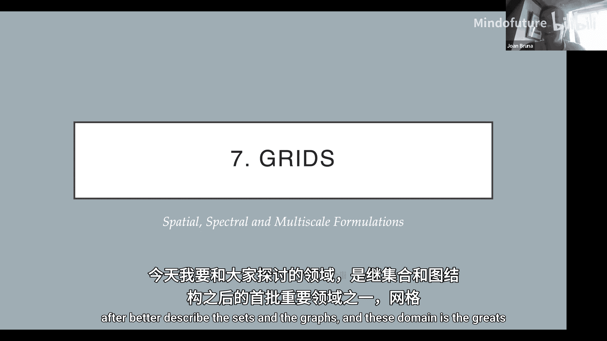
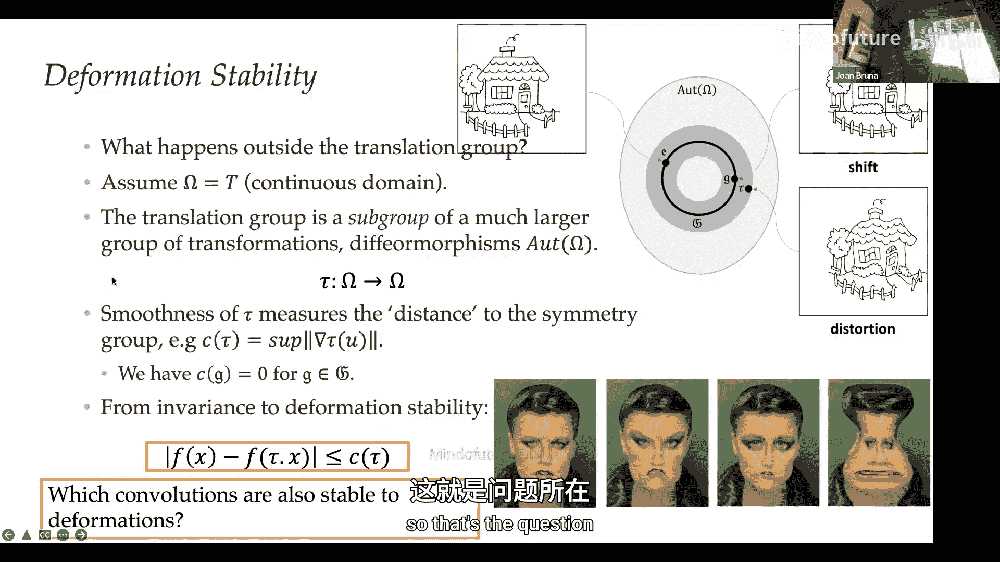
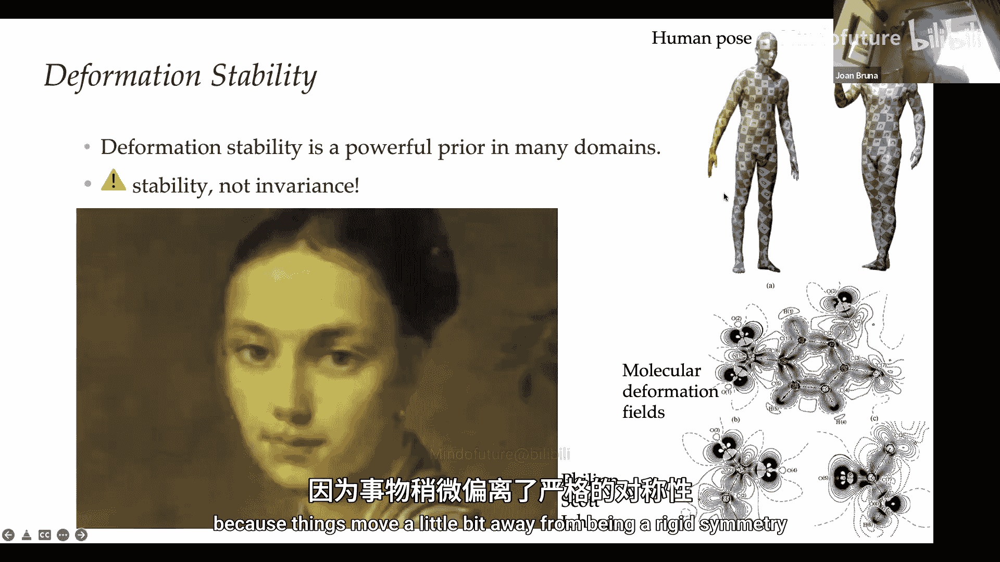
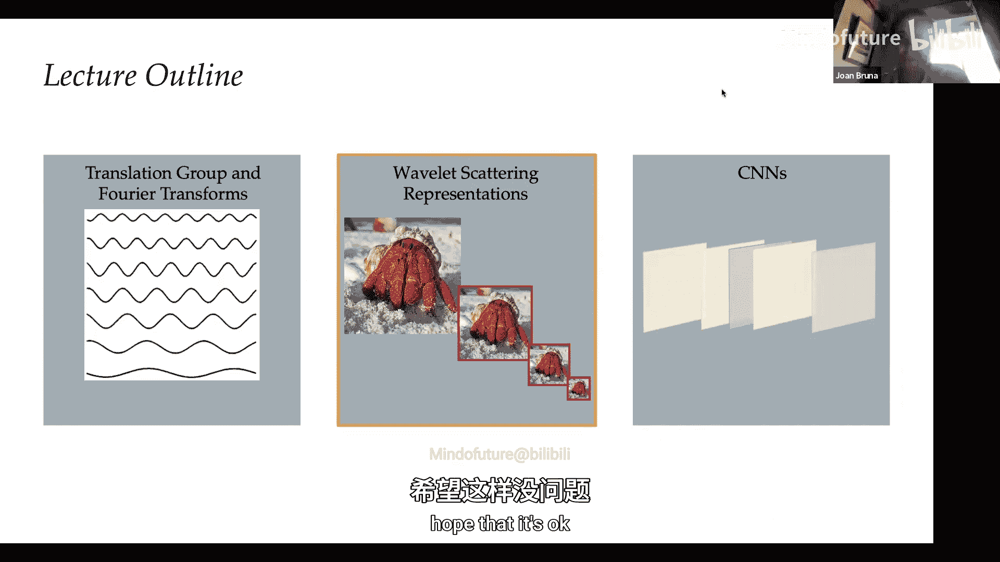
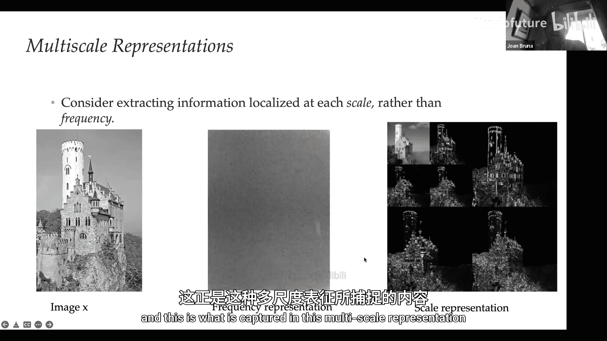
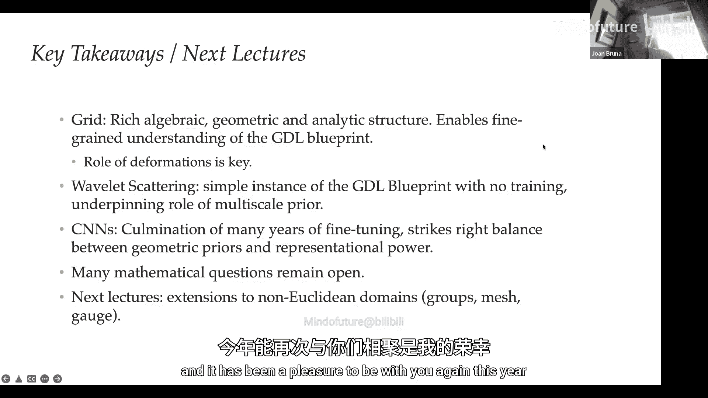

# 几何深度学习 ｜ Ammi Geometric Deep Learning Course p07 P07_第七讲（网格）-琼·布鲁纳 -BV1veHgzxELm_p7-

Good morning everyone so now let' let's get started with lecture 7 already from this course。

 so today I'm going to be talking to you about the domain one of the first domains after Peter described the sets and the graphs and this domain is the great。

And so。Just as a recap to set the tone and to remember where we are coming from。

 so we I mean yesterday you saw or yesterday two ago from Better。

 one of the first ways to think about these blueprint practice when the input has some set structure or some graph structure and we probably have seen that there's many already a lot of different varieties of flavors that appear right and better describe this to you。

So in this lecture， we are going to go and zoom in into the one particular domain that maybe from for historical reasons has been very important and very central。

 which is the great right that is kind of underpinning many of the successes of neural networks in computer vision and speech processing eta。

And we are going to see that in this domain we can say things that are pretty pretty precise and there's a lot of interesting mathematical structure that one can develop in this domain so today yeah it's going to be a pretty i'm hoping to keep things in one hour but it might be like a long lecture so please also like interrupt me if you see that i'm taking too long so we are going to first describe the translation group which is kind of the natural group of transformations that appears in these grades and then we are going to together see how to think about this group through what we call Fourier transforms right so the Fourier transforms we have a good way to understand what's happening with this group。

😊，Then we are going to take some of these like principles and build a convolutional neural network from first principles right without many many bells and whistles。

 this is the scattering wavelet transform and then we're going to see how you from these elements we can now describe and arrive naturally at the convolutional neural networks the last part of the lecture。

😊，All right， so let's get started with the first part of the lecture。

So as you all know like grids are defined I mean they have these very very regular structure and the natural grids。

 grids that you like grids have essentially one parameter which is the dimension in which they live right so in one dimension you have a grid you can think it as' a line that is like sampled in a way that is' uniform so that's the kind of domain that you think when you are describing time series like speech data even text data or financial data in two dimension we have this natural structure it like a rectangular like square latticet that of course is the one that you use for treating images。

And so once I tell you as like an important kind of concept is once I give you this physical domain。

 what is the sort transformation， what are the things that I can do to stuff move things in the domain。

So in a grid if you start with the simplest case that is like one- dimensional grid。

 well basically the only thing that comes to mind in terms of like when I need to move things around is to basically just shift things around right so so the idea is that if I try to think you taking a single point and moving it well the point can move you know from one part of the domain to the other and you the natural thing you might say okay what happens when it and the boundary right so when the point at the boundary it needs to change erect well here we do a little mathematical trick that is okay just for convenience what we are going to do is that we are going to invent what we call periodic boundary condition right so what we are saying is that we are making this domain into something that has no boundary every time so when this point arrives at the end it starts again。

Okay， and so the reason for this is mostly like mathematical convenience。

 as you all see right away because now we can try to to you know。I instantly like to。

 to think about this in intuitively， but now we can also try to。Express it mathematical okay。

 so the operation of moving you know one point around this domain okay can be written in a very in a very natural form right is that I can I can now think about this transformation as a by right so it's a mapping that goes from the domain to itself。

And what it takes is that takes any coordinate in u right so you would be kind of indexing this point here and it just moves it to the right okay and you can see that the only thing that seems like a little bit。

You know nonstandard here is that we look at this we think about this edition in the model or arithmetic right so I don't know how many people here in the crowd is familiar with the model or arithmetic right this is just think about this like integers but once you arrive at you know the Inte number D this is equivalent to zero right so you start it again。

And so you can think these as a function G as a transformation and now we can do many interesting things right so once I have once I know how to what is the transformation that moves everything to the right。

 I can say okay what is the transformation that moves everything to the left right so I can undo the transformation well we write this as G minus1 because it's kind of the inverse right of moving things to the right is moving things to the left and so you can see how nice you know this periodic structure is because now we can just you know just just replace plus one by minus1 right and we take everything arithmetic and you know everything is still well defined and not only we can just consider the inverse we can also。

😊，Can I ask any to mute okay perfect so so I can take the inverse of a transformation。

 but I can also take powers of a transformation right so so maybe maybe you already figure out what it means G to the K right so G to the k means instead of moving things for one element to the right it means it means moving them k element to the right right so like applying the motion K times。

All right。So this is what we call algebraic structure and this is also what Taco captured in his lecture。

 this is really the structure of the group right like these transformations they look like functions right but you can think about these mappings as also living in a group right and so I can take a mapping and I consider it inverse mapping I can take a mapping two mappings from that group and I can multiply them together okay this is what we call this algebraic structure。

😊，Okay， and actually the group we already encountered it before when we were looking at the examples last week。

 this is called the Sly group， okay it's really the group of integers modello。😊。

All right so this is something that you can define for the grid in one dimension。

 but you can also do exactly the same thing when the grid has more dimensions for example when we are dealing with images right we don't have just a single line of pixels we have like a two dimensional array right so in that case the domain is just essentially what we call a product right it's like a tensor product of the two groups that we see before right so here the group of transformations it's just like the product of the two groups right so here the number of copies I put captures exactly the number of dimensions of the domain。

Okay， so if I'm looking for images， my group of transformations would be z times z right and if I'm looking at videos。

 for example， when I have three copy you know like three dimensions and I would have three versions of that。

You can also do the same thing in continuous domain right instead of thinking about your grid like your domain just having like a discrete number of positions like pixels。

 we can think a bit more abstractly and say that in fact you know my data is just living in a continuous grid right so you know I can I can think about images as your eye like your retina right that doesn't have pixels right you know it seems more like a continuous thing so here's the same thing right so the domain。

Is a kind of a Donaldald or like a Tarus？And so the group of transformations of this domain in that case correspond to kind of the continuous version of thiscyclic groupscribe。

 which is just the group of basically the reals with modelmatic well。Okay。

 there's a one curious like a interesting aspect in these examples right is that in that case you can see that the the domain。

And the group of transformations they seem to be equivalent right in the sense that I can you know there's a one to one correspondence between a pixel in my domain and a transformation in this like group of s shifts right this is really this is not the rule this is more like an exception right so you are going to see a next lecture by tackleco that in general it's not necessarily the case right like the group of transformation in a domain and the domain might not be the same you know might not be the same right but this is an important kind of property of grades。

Okay， and so remember。That also what we said is that we once we know how to move things in our domain。

We can use it to move signals in the domain right the idea is that if I now if I know how to move pixels right now you give me an image which would be kind of a map over the pixels。

 I can also move this image。Yeah， and so the way we do it is by basically doing the composition right of what we saw last time。

😊，and one of the one of the important and here of a little illustration that shows you know。

 if I have like some shifts in my in my domain I can use it to move images around right and one of the important features right of these lifting is that now this transformation that acts on the signals。

Is linear。Okay， so this mapping here， G that is now defined over x， not over omega。

 this mapping is linear。So what does it mean if I have a mapping that is linear？😊。

I can think about it right as a matrix， right like you know a linear transformation from one domain to itself。

 I can think it as a matrix， right if。😊，X here， you can think it as a vector space。Okay。

 and so what I mean here is that if now we go back to our case of when we have the grid in one dimension that we had。

The pixels。I can think about the spaces of signals here as having a d degrees of freedom right so I can think it as a vector space of dimension D right which is where I have D pixels。

😊，So。I have transformations that are linear。That take as input the de dimensional E space。

So what I'm saying is that you can think of this as a matrix right so like this transformation that I'm describinging here。

 I can think it as a matrix。😊，So what is this matrix？

So this matrix is what we call the shift operator。Okay。

 so remember this is a matrix that is now size d times d right。

 is' like the number of pixels of the domain。And so it has it's almost zero like zero almost everywhere except for some ones that are just over the diagon right so here I have all these ones。

And then I have a last one here in the corner。Yeah。😊。

So read this one in the corner you know if you wonder why why do we have this kind of little guy here by itself。

 remember this is kind of the boundary condition right so this tells me that when I'm in the you know in the last coordinate right I'm going to be I'm going to send the last coordinate to the first coordinate this is saying that I'm going send the coordinate that is in position I to the position I plus one right that's what we are just above the react。

Okay。😊，And so now we can transform this kind of algebra structure into basically operations with matrices right so you've told you that if I have a transformation right this is the shift operator if I apply it k times。

Well， what is diss metrics is just taking this metrics and multiplying it times k。Allright， so this。

 as you might imagine， is going to shift this diagonal right， it's going to move it above。

 right it's going to move it。And so here's what I just for you is that okay。

 now that I have this representation， I can think about this transformation as applying this matrix。

😊，You can maybe use this fact to show that this group is commut right so if I apply two transformations and I compose them。

 I get the same thing。Okay。You can think about this question。Again。

 and you can use this adjust size here， you can use this property。All right。

And there's another remark if you want to kind of understand why you know where does this object come from is that you could also have seen about the seen this differently by looking at this domain right and now just let's try to think it is as a graph okay so we are going to build a directed graph that basically tells us that this node is mapped to this node right so we put an arrow here。

And if I can draw here， I can draw。Maybe I can try to draw， let's see if that works。No。

Is so I put an arrow here。Then I put another arrow here， right， I put an arrow here， etc cetera。

 right？This is really again illustrating what this transformation is doing right it's just mapping it's just moving things around to in a certain direction right and this guy goes here。

Okay， so if I wrote the adjaency matrix of this graph， I get exactly this。This shifts operate。Okay。😊。

Good， let me continue。哦。Okay， let me just erase this thing， erase。Sorry， Claire。😔，Ok。Perfect。And so。

Now that we have this metrics。Let's go to the kind of the key question right is that and this is really。

It's really you know。Building from the from the blueprint that we described together last week， okay。

 so remember that the geometric deep learning blueprint is really asking us。

it's a procedure that it's going to build very powerful representation like neural networks。

From a very simple structure by understanding the operators that are linear and that are invariant and equivariant with respect to the action of the group right so we need to understand how to compute linear invariant and equivariant。

Okay， so now we have the group， which is the group of shifts right in this domain。

 and so the question for that we are going to study now is how to build linear invariance and equiance。

All right。So again and first simplicity， we are going to consider the case where we have one dimensional grade and we are going to have you know like a D pixel。

 okay， so we are in。So let's start with the linear invariance。Okay。

 so remember what is a linear invariant is a linear mapping that goes from Rd to R。😊。

That has the property that if I apply this mapping linear this mapping to any transform version of x。

 I have to get exactly the same thing。That's the property of being in。

So if it's a linear map that goes from Rd to R。I can always express it as a dot product right it's a definition。

 all the linear forms right are dot products in RD。😊。

And so what it means is that if I want to characterize this linear environmentvari。

 I just need to characterize this vector v right I need to find the vector v so that if I define this dot product。

 I need to have the property right that when I apply my transformation right to that my transformation version mapping to transform version of G。

 I apply the definition so this is just a G times X dot product with V and now by applying the fact that G times X。

 I told you that it's just this matrix up to some power applied to X。😊。

T V and now applying the transpose right so I arrive with a property that a linear invariant is characterized by some vector v such that for any x。

 if I look at the dot product between x and this Sk like this matrix transpose applied to V。

 I need to get exactly x transse x dot product with okay for any x。And for anything。All right。

So if you look at this equation， what can we deduce immediately？

So this puts some very important constraint on V right V has to have this property right that needs to satisfy this for any x so it's not hard to see right that this is only going to happen if and only if v has the property that v equals to s times V。

Okay， and every time I have something here on purple is really meant to be an edge size for you right so and you can see right is that you know because this is true for any x right these two vectors you know this guy and this guy。

Have to be equal for any k in particular for k equals one。Okay。

 and you get you get this basically this property here。Okay， and so when you look at this equation。

 what do you see right I have a， I need to find v such that v equals to S times v。😊。

So if you have seen this equation。呃。So this really is what we call an aigen value problem right we are trying to we are trying to characterize V as being an agan vector of S right the agan vector is just a vector such that S times V is is a multiple of the right。

 so this is the aen vector。Of S that has eigenvalue1。Okay。😊。

And so because this S is a very special matrix， right。

 it's an adjacency matrix of this like acyclling graph。😊，In fact。

 it's not hard to see that the only v that satisfies this equation is the v that is just a constant vector。

 right all one vector。Okay， or any multiple of the all one factor。

And this is really if you have seen a little bit of a markov chain Monte Carlo。

 this is really based on what's called a barron forbius theor。

 right it just it's a very powerful result from linear algebra that characterizes the largest like the eigen vector associated with the largest eigenvalue of a class of matrices right that are basically adjac emitrices of certain graphs。

All right。😊，Anyway， v equals one is the only solution。

What it means that we have basically you know figured out that the only linear invariant right if you know we go back here right what do you get if you just you know have V that is the all one vector a those product with x and all ones vector is just the sum like or the average right so this is a recovering what we suspected right that the only linear invariant to shift is just taking the sum of the average of the vector okay that's the linear invari。

Okay。Now let's go to something slightly more complicated， which is。

The not just characterizing invariance， but characterizing equivariance。

Right any questions so far on what I just described？Okay。

 I see that there's no questions on the chat。Good。O。I see that youre typing。Okay。

 we're going to pause。好 good。啊， let me see。There are questions Campus wire can you。ok。Let's can we。

 can you copy them here for any chance？Let me try to。And I also in parallel。

 I'll try to log into Camp wire。To see if I can do it in parallel。Okay， I will。

 while you try to type the question， I will also try to log into compas wireer。good， there I am。Yeah。

Yeah。嗯。Okay。Yes。Okay， okay， so that's the question in the one degree， how do you compute？G -1。

G minus-1 of the first element。Thank。嗯。Yeah， so if I understood the question correctly is how do you compute the inverse right of a of a shift in the one degree good so the inverse it's really you can really think about there's two ways where you can think about it is that if if you trust me that I can encode you know like this transformation to the right with a shift operator which is this matrix that has one just above the diagonal and then the one last one in the left corner。

Then you can just formally take the inverse of this matrix， right just inver the matrix。

 right the matrix is inverable。That's one way to think about it。

The other way to think about it is well at the end of the day you know deciding to that G is like like you shifting things towards the right and then so you know that the inverse of this is going to be shifting things toward the left right at the end of the day right and left is just arbitrary right so it's just a way to actually draw the arrows in mycyclic in in my under directed graph right so you could also just reverse the arrows right of the shift and then compute the adency matrix of this operator。

So at the end of in any of the two cases right what you would get is essentially the same matrix G minus one is a matrix that essentially has just like like a reversed thing right so like the you know like instead of having one above the diagonal。

 you have one under the diagonal and then the one that is that was's in the bottom on left corner now it's find in the upper right corner right that's G minus one。

😊，All right， and I'm trying to see if I can log into comp wire so that I can also。🎼Ask questions。

 like answer questions in real time。ok。Let's see if I can make it work。😔，是。Well， I'll write again。

 doesn't work。Can you repeat what is S？S1。Yes。Here here in you mean in this， okay， yes。

In this formula， you mean S capital S is this matrix that I have here， I will show you again。

As is these matrix。Okay。So when I say S1 right it means just S right。

 but then the point right is that the fact that I had here right is that any transformation。

 any shift，I can I can view it as taking a certain power of this matrix right just because this is really a property of this cyclic group。

 which is called it's called transitive property right like any element of the group can be generated by taking this kind of so think about this like the basic building block right so if I understand this of this matrix here。

I'm I'm in business because I can then generate any transformation in my group。

 right just by taking a certain part。😊，And I can also take inverts right I can take you know this gay can be negative right and this would be the inverse。

 right？O。Good。So hopefully we are okay in terms of the environmentvari， right， this is just the sum。

Now， let's， high， in which case can we use S to the K。 Yeah， so S K。 So when I say when I say。

You know as to the k right is so it's a matrix right that you can take powers right and and so you are totally safe to use like S to the K transpose right like here the star right corresponds to the transpose right this is just。

😊，You know， in linear algebra when you have a here。

 I don't know if you see my cursor right so when I have a dot product。

And I have some like linear transformation times x with V。

I can view this dot product by sending these metrics here to the other side with the transpose。Okay。

 I put the star just because it's the same it thing so think about these star as a transpose right you can take the matrix and then transpose。

Good。Okay， now lets let's go to the next level， so instead of looking at invariance。

 now we need to look at equivariance。😊，Okay， so now and still like the key point is that we are still looking at just linear objects right we just need to understand what are the linear transforms that are equivalent to translations。

Okay， so now if I have a linear keyvari， it's a mapping the is linear that goes from Rd to RD。😊，Okay。

 so a mapping that is linear that goes from RD to RD。

We have to think about it as a matrix right now instead of being a vector that was like this dot product。

 now it's a matrix that is a D by D matrix。And this matrix has the property right。

 that if I apply this operator to the transform version of x， I want to get。The same answer。

 but then run from right so in other words， the matrix have to commute。With the action of the group。

Okay， and so if we try to think about this as some matrix with some matrix C right。

 so this is the operator that I want to characterize。What I want right。

 is that if I apply this matrix to some shifted version of the input and remember that shifts。

 I can think about them as applying this shift operator for a certain number of times。

That's by definition， then I need to get something that commutes，So again。

 by the same logic as before， this condition is equivalent to asking that this matrix that I'm looking for has to commute。

With a shift right so I'm lucky， I need to find all the matrices C so that c times S is equal to S times C。

Okay is it is this clear I want to make sure that people are happy with this fact because this is kind of an important property right and we are going to spend a few minutes together trying to understand the consequences of that okay so this is really the property of equivariance right that I want to be I want I want to understand。

One of them。Linear transformations like in that case are going to be matrices。

That commute with translations and because translations can be expressed。Through this shift operator。

 this is in the language of matrices， this is just expressed as two matrices that commit with each other。

All right。So now let's try to understand that， right？ok。We need to characterize these matrices。So。

Here。So the question I have really is give， you know。

 I know this matrix S and I want to understand everything that commute with S。😊。

So in terms of for understanding this question， what it turns out that I need to do is to understand。

Kind of the spectral properties of these matrix S。Okay， and so。

Let's try to formalize a little bit this intuition。Okay， so yeah。

 I told you that the I join like the transpose right is acting it looks like it's the actual the inverse right like the transposing S is the same as inverting S。

Okay， so you know， in that sense， it means that if I apply s transpose times S is equal to s S transpose。

 that is the identity。Okay， so this， what it means is that this matrix S is what we call a normal matrix。

 right normal matrixes are have this property right that you can you know S them S transpose equal to the identity。

😊，And so what it means is that I can think I can extract its eigenvectors and eigenvalue。

 right like these causal matrices for these causal matrices I can。

 you know it makes sense to compute the spectrum。So let's try to do that Okay。

 so what we need is that we need to find eigen vectors and eenvalue of s。哦。

So here's a here's a vector for you right'm going to i'm going to define this complicated looking vector right and and I don't know if you can see the picture in the bottom right which is kind of trying to illustrate。

What'm what I'm writing here in equation right so this I'm considering a vector V that has has actually a f of vectors that called VK。

So for HK is a vector in dimension D and is a vector that is very special because it's complex value。

 right it's not a real vector， it's complex value and why do I need complex vectors instead of real vectors。

😊，This is because this matrix S， right， it's not symmetric， right？And so you know in general。

 the eigenvectors and eigenvalue of metrics that are nonsymmetricmetric might be complex right and that's our situation here。

Anyway， it's a vector that is expressed through complex exponentials。

And so complex exponentials is nothing else right than signs and cosines right so basically you know the real part is a cosine here and the imaginary part is a signine right and so what I'm doing is I'm basically varying the frequency of you know every entry right I have D different entries。

 every entry has a different frequency。And this why this is why I'm kind of drawing here right。

 you have to think that each one of these vectors right corresponds to one of these waves right and instead of having just one wave I have you know the real part and the imaginary part are two different waves that are slightly shifted one from each other。

Okay， so now let's try to look at the dot product between the matrix S。And and one of these vectors。

 right So if I look at the dot product between the between you know。

 the J row of s and one of these vectors。This is just basically by definition。

 this is looking at the you know shifting the entry of the vector v by one and so you can write that if you if you shift the you know if you evaluate write this vector at location j plus one right like for example comparing this guy with this guy right you can you can see that this is just。

对。Basically， this is just。Evaluating the vector at the initial location times something that does not depend on J。

This is just like the shift that is here。All right。

 I think there was an error this is just yeah so this is J right so basically I can I can think about this as extracting。

 you know like the entry J here has the same thing， the same argument。

 but instead of having a j it has a j minus one right so I can think about j minus J as you know taking out one。

Element like this times the same thing with a J minus1， right， which is exactly this this term here。

Anyway， so what what I have here is that I can verify that if I take you know。

 if I take this vector and I do s times this vector， I get a multiple of VK。😊，Okay。

 and the eigenvalue lambda K is exactly this quantity that you have here。

 by the eigenvalue is E to the。い to theアイトパイケオバ。Okay。

 so I have essentially given you the eigenvectors of S。Okay if you don't trust me。

 you can try to you can you can do this you know you can verify this operation by yourself。

 but it's really just what is written in this equation okay and in fact these are all the eigenvectors of S right there's no other you know all the eigenvectors of S are really this complex explanations。

Okay。And sos this is nothing else than the Fourier transform right I don't know if you have you are familiar with Fourier transforms but basically if I collect all the vectors that I just given to you and I put them in a matrix V right and now I can define a transformation that is also linear transformation that takes any X and computes all these dot products with all these V case right that's what's called a Fourier transform。

Once to incorporate， I can just look at x dot product with VK for for all the different case right here and I get all this you know funny looking expression。

So this is for your transform。Has many， many cool properties I mean it's really you know a very central tool in many areas of mathematics and engineering okay so if you look at the dot product between two signals after the free transform form you get exactly the same thing as before right that's what's called an isoometry or more you know it also has the name of a perval identity。

We can we can take this transformation and we can invert it by this matrix v here is invertible okay so you can actually invert it very easily and go back from the Fourier transform to the original domain。

 you can go back by this linear transformation as well。😊，Okay。

And you can define it for for all particular setting when you have like a the know D pixels。

 but there's many， many other domains in which you can still define for your transforms。

 right whenever even if the condo is continuous， if the domain is kind of all there real numbers。

 many， many， many， many things。😊，Right。Probably you know you will probably see free transforms for many years to come right if you're still like involved in you know in bridges in many areas and for example。

 just you know not to go very far you know last week there was the Fields medal right the 2022 and amongst the four Field medalists two of them。

You know， are doing kind of central like the central tool that they use is basically Fourier transform。

 Okay， so this is really， you know， something that is still quite important in many。

 many areas of math。Okay， but the question for us is。

How do we care why do we care about this right so what is the link between Four transforms and our problem of characterizing the equivari right like the operators that commute with translations。

Yeah。Well。Let's back to our question right so what we want is to understand operators that commute with S。

Okay， so there's an important pro from linear algebra， right？That I can use to characterize matrices。

 two matrices， commutes。Even only if。They have something， you know。

 there's some relationship between the eggenvectors of one and avectors of the other。

 I don't know if someone remembers that。It turns out that if I want two metatices to commute。

I need to ask them have to share the same een vectors。Okay。

 they can have differentganvalue but they need to share the same vectors right this is an equivalent to asking the two metricric to commit。

Okay， this is a。Kind of an important HSI right in linear algebra。Okay。

 and so what this means for us right is that the the equi maps that I'm trying to characterize are precisely those that whose aen vectors are4 like the the vectors that we just described that were the aen vectors of s okay so in other words。

 or all the matric C that once Im in the Fourier domain they are diagonal。Okay。

 these are exactly the maps。That I'm looking for。Okay。😊，So I can characterize them with some vector。

You knowAlpha that is basically the what is in the diagonal of this matrix。

 so this is complex because we are in this you know complex domain and this gives me all the maps directly。

But what do they you know， what are these maps about right， I mean。

 how can we think about these maps perhaps in the spatial domain， not in the fur domain。Okay。

 so this is really the。One step that I'm going to just do it together， right。

 it's you know maybe it's good to do it at least once。So let's try today Okay。

 here's a here' three equations that I'm going to try to。

To describe to you in a little bit of detail， but I wrote here three equations。

 let's try to understand that。First equation， what does it say？I'm taking I'm just taking x。

 right and I'm writing it in terms of its Fourier atoms。Okay， so here what I'm using right。

 is the inverse Fourier transform， okay， so can I can express x in terms of its Fourier coefficients。

Second equality。Is using the fact that C is linear。Okay。

C is linear so it means that the C applied to a linear combination of vectors right is I can put the C inside。

Go。And the third equation。It's using exactly what we have here right is that C applied to any four coefficient。

It's going to be going so this VK is going to be an egggan vector C。Okay。

 that's because C needs to share the sameomeen vectorctors as S right so that's the third equation Okay so just to to refresh right these are the three properties that we are using so。

Okay。Okay。Now we are almost there， that's two more equations。哦。Okay。

 now let's try to do that now let's try to write what we have in this equation in coordinates right so let's write it in coordinate。

Okay， so let's let's look at the J coordinate of this vector right so the just coordinate of this vector here by this equation it's just basically looking at the J coordinate of VK transpose。

Okay。And so。If you do that and you do some rearrangement right you can write the Jde coordinate by expressing the J coordinate of VK it's exactly this property here right and now I can put the transpose outside right so I can know I can message this thing a little bit and I have something a little bit funny looking here right so I have you know the Fourier transform of x transpose at frequency K。

Multiply by this complex exponential and all this thing transpo all this thing conjugate times alpha k transpo so I can I actually I can write this as a dot product between the Fourier transform like this alpha hat and something that involves the shift of x。

Okay。Of x bar because this is conju okay， but the point is that now we here we have two more properties right is that we are using in this first equation。

 something that we didn't cover here， but it's a kind of also like another elementary property of Four transforms is that if I know how to compute the Four transform of a signal。

Then if I shift the signal， the Fourier transform， the Fourier coefficients are just multiplied by what we call these kind of complex exponentials right here we are just changing the phase right so this is what we have here okay we are you know this quantity here is in fact the Fourier transform of x with applying some shift。

And then the last thing that we are doing right is remember is that the dot products in the Fourier space are equal to the dot products in in the space back the in the original domain。

 okay， this is what we call the parval。And now we are to a point where we can you know can can we look at this equation right and this makes a lot of sense right what I'm saying is that this mapping here C of x at location J。

 I can see it as a linear combination of shifted version of x apply multiply by some filter。

So this might look familiar to you， right？What is this operation。

 right when I'm just you know taking a sum of shifted versions of a signal times some weight？Well。

 that's in the title， right， that's the convolution。All right。Okay， so just to summarize。

What we have done here kind of from first principles。Is just to realize right。

 that any operator that is equivalent right so that commutes with shift。Hes a convolution。Okay。

And in fact。We can say something more than that is that any convolution commute with S right because if I write a convolution like this right。

 and now I apply a shift to the input。I can see that because this thing is linear。

 a convolution is a linear combination of shift。😊，So you know， because the shift is a val group。

 then I'm good right， everything commute， everything is fine。Okay。

So we have essentially characterized all the linear equipment。

It was a little bit you know we had to take a little detour and talk about Fourier transforms。

 but at the end of the day， we end up with something that is pretty digestible。

 which is something that maybe you already knew right the fact that convolutions are exactly the maps that are linear and they' are equi。

Okay and I mean this is a picture， a little diagram that we have that kind of summarizes everything that we just said right is that you know if I think about convolutions right。

 I can think about them in the spatial domain with this kind of matrix right that has this like a top lid or like a band structure and if I view this operator this mapping in the Fourier domain。

😊，Now they need to be diagonal， right， just because the Fourier domain is the one that diagonalizes the shifts。

Okay。Very good， so now I ask the question， well， we have characterized these linear equilibriumarian maps。

 right which are convolutions are all convolutions equally good right is like is convolution everything we need。

😊，Okay， can I take any filter here that I want， right？Good the natural question。Okay。

 so what I'm going to argue now in this slide is that we need to be a little bit careful。

 right it's not as easy。😊，And here's why。Here so far we have just focused on transformations that basically move all the pixels at the same time right when we think about this shift right we are moving everything one pixel two pixels right but all the image right is going to be moved you know together。

Okay。Here's a question that I'm asking is what happens for transformation that are a little bit more general than these kind of rigid translations right and here I try to illustrate these with a little picture。

 right？So think about this little black circle right as the as the group of shifts right this is kind of like acyclic group right so here in in this point I have the identity right。

 this is just not not doing anything and then in this you know these guys represent applying a shift。

My point is that these transformations they exist in a broader context。

 right there's all the things that I can do to my image。That are not in this black circle， right。

 but somehow there are things that I can do that are almost。Sm translation right。

 this is what I try to illustrate with this picture right this like this is a this is the house right it hasn't been completely shifted from the original one。

 You can see that there's a little bit of a distortion that is happening right things have been moved a little bit there's a question。

Okay， there's a question from Benjamin that says， okay， good question， So let's go back to the。

To the previous derivation。So Benjamin is asking about the first step， right。

 like why is this equality here？I guess。Good， this is because of this property right that we know that because because C is an operator that that commutes with a shift。

It necessarily has has eigenvectors， all eigenvectors that are eigenvectors of s right and we have seen that these Fourier atoms。

Our Agan backter's advice。So therefore there are aigen vectorctors of c right so basically c times vk trans suppose is equal to bk transpose times something right and this something is the kind of the eigenvalue of c at frequency k。

I hope that this answers your question， Benjamin， otherwise we can follow up later offline。Good。

Perfect， great。OK。So we are here， right， and I tried， I was trying to argue。That。In this picture。

I't shouldn't think about the translation group as everything there is in my world。

 right I can do things with images。That are not exactly translations， but they are not far。

 right these little guys here。So。In that context。I have to ask the question， okay。

 should I ask some properties right of my representation。

 should they treat these things that are not exactly translations。

 but almost should we try to ask something， right some kind of like a symmetry or like almost symmetry with respect to these guys。

And so the point is that indeed we can we can you know。

 there are a bunch of transformations that are that I can apply to this big group and I can。

I can define or can I can assign some kind of like a distance to the symmetry group right so there are some things that I can do to my image。

 for example， this thing that is really at the corner here。

 which we all agree that is it's a kind of a very crazy distortion right I'm kind of completely breaking destroying the structure of the signal but if I do things that are almost like a shift right because I'm asking that the representation is invariant to shift。

Well， it's natural to say that if something is very close to being a shift。

 maybe the representation should be very close to being environment。Okay。

So that's what we are arguing here， right is that we want to think about this notion of imvariance。

In in a more general sense， right， we want to say that when there's a transformation tau that is now is living in all this like very large space。

If this transformation tau is close to being at translation。

 I would like the function to be close to being invariant right and I can quantify that with you know kind of a cost or I think about this C of tau that measures how close is this transformation to being a symmetry。

Okay， the closer it is from being a symmetry， the smaller I want this difference to be。Okay。

 does it make sense， this is an important concept。Okay。😊。

And it's important that it's very clear for all of us right， that if I have a， you know。

 if I have transformations out there that are almost translations。

I want my representation to be almost environment。Okay。

And this is a very important concept right because now what it means that I cannot just think in terms of this like little two properties that I would describe。

 like it's not sufficient to just ask for。😊，Pure invariant and pure equiance。All right。

So that's not our question。Which convolutions are also going to help me for this new property， right。

 this new property that is a stability to the formations maybe。

Some of these convolution that I describe are indeed， they are equivalentval to translations。

 but maybe some of these convolutions， as soon as I move a little bit away from this group。

 they break down completely right and maybe some convolutions are more stable than others。Okays。

 so that's the question。🎼And for this。

对。🎼Yeah。Okay， sorry that the sound。 So that the motivate the kind of the justification for。

 for this deformation， as you can imagine， it， it appears in many， many areas， right。

 And there's there's you know， examples that you can imagine from computer vision right， where here。

 you know， we are kind of moving through different periods of art by not rigid translations。

 but things that almost look like translation right here。 we are applying smooth deformations。

When we think about like processing shapes like humans。

 humans do not move in a way that is completely rich right。

 there's things that you know that happen between humans that are not exactly translations and yet。

We would like our representation to be stable right and the same thing for molecule for molecules of many。

 many， many areas of physics right I mean what my point here is that the physical world。

Is by construction is' a world that is stable to the formations right you don't want any representation to be broken just because things move a little bit away from being an a symmetry。

Okay。

And so and I have I realized that I'm a little bit late off time。

 but these second and third part are very very quick right so we are hopefully going to be done you in about。

5 maximum10 minutes。 Hope that it's okay。

Okay， and so the key is is that if we want to understand stability。

 we should not get too obsessed with frequency and free right instead we should be looking at representations that extract information through different scales instead of different frequencies。

Okay scale is a very natural， it's a very intuitive concept， right， it's a very intuitive notion。😊。

It's the notion。That you know I can look at this image and organize the information in this image across different resolution right as you have here right and this is something that we touched upon a little bit last week right so I can have a version of these image that is the course scale like a very very small number of pixels and then every time I'm considering what is the information that I lost what is information that I need to go from one resolution to the next right and this is what is captured in this multiscale representation。

😊。

Okay and you can actually implement this Mo scale representation with what we call with the very special kind of convolution operators that are waveleletth convolutional operators right so this is like these are a bunch of convolutions right whose filter is obtained by taking a little wave maybe this one here right and then applying a rotation of this wave right I'm just rotating the filter and I'm deleting the filter right so I have basically extracting information a different scale and orientations。

😊，And it turns out that these Weblets have a very important property right that you don't have in general convolutions。

 which is the fact that now if I applied thislet thisvolution wavelet convolution to a transformation that is not necessarily a translation。

 it's a more general transformation。tThen you get almost commutation right like it's exactly the stability that I described before right so in particular if this tau is a convolution。

 you get exact equivaris as we had before， but now you get something that is much more interesting is that if I have a transformation tau that is almost a translation right measured by the fact that this guy here is very small then this transformation almost commutes。

😊，Okay， this is exactly the stability that we described before。😊，Okay。So the punch here。

 the important point right is that not all convolution operators are stable to the formations。

 we need something special right for this stability that is really brought to us by wave right we have something that in technical terms is called like kind of a localization both in spa and frequency okay this is a kind of an important and nontrivial result。

😊，Anyway， so it turns out that with these wavelelet transforms we can define a very simple geometric learninging blueprint which we call this wavelelet GDL right which really just uses the three building blocks of the blueprint so we have a local local imvariant which is just a low pass filter we have a local equivariant that is stable which is this wavelelet filter bank and then we have an element wise linearity which is wrong and then we just combine this element you know exactly how the blueprint tells us to do right so I have first one element that is just the low path right this is just a linear path which is the one here and I'm going to make it more informative I'm going to make it richer and I'm going to make it richer by all systematically extracting the information that is lost by the low path right so I can make it richer by you know combining this a with wavelelets and I take the the element wise no linearity and then extract new imvariance again。

😊，And every time I extract an invariant， I can recover the information that I lost by a new family of coefficient。

 right that every time that I apply a， then I complement it with you know w times the nonlinear linearity right and I can keep doing like this。

So this representation is very nice because it can has some mathematical properties， for example。

 it can preserve all the energy of the signal。Yeah。

And also more importantly it really has the property that we were asking for right it's stable to deformations in other words。

 if I apply this transformation to some deform version of the signal right so if tau heres a deformation and I compare the difference in the scattering coefficients I get something that is very close right and it depends the distance is proportional to kind of this deformation cost right or how far is this tau from being a translation。

😊，Okay。😊，Anyway， this representation you can use it for solving many interesting problems in physics and chemistry。

 so here I show you some examples of how can you use this wavelelet transform to model like some physical phenomena like build statistical models for physical data so this is data in turbulence that is used for example in you know fluid dynamics this is data that comes from glass like icing models and this is cosmological data so you can get build like very simple statistical models that work very well okay and cosmology chemistry etc。

It can it can also be used for computer vision right and so this is really the like think about this as a very simple blueprint right so here as you can see we just build this blueprint really from first principles right we take this input we apply this blueprint that is the wavelet GL like the wavelet scattering and then we do a linear classification on that。

Okay。And so if you look at the performance of this model you know on different kind of data sets right like if you think about like MIS it works pretty well。

 but if you do it on very more complicated problems like you know like CFFAR or image net。

 you see that you there's a little gap right theres you know the deepnets work much better than this kter right？

And what is missing， of course， is that we are you know we are just extracting information using this wavelet representation right in a sense there's no you know there's no there's no learning here right there's no there were no like parameters that are inside these filters right it's just like completely hard coded welet coefficient。

What is missing is the interaction between feature maps right and this is really the last thing I want to talk to to you about today。

Okay， and so。One way where you can understand like from these like wavelelet scattering the the marginal class which are in fact you know like a convolutional neural networks is a convolution neural networks instead of just looking at you know these wavelelet decompositions and then just passing them so lineararity what they can do on top is to recombine information across feature maps right like a convolutional tensor right is actually doing two things right it's extracting information in the spatial neighborhood right it is kind of the spatial context of the filter but it has it does something much more important which is also to recombine information across the channels right。

So it can learn how to extract information that is kind of shared like spread across different channels right this is not something that you could do with the previous representation right so if you do this right if you if you kind of combine the scatter like the waveleng decomposition and space with kind of a trainable filters in channels like this kind of one by one convolutions。

Then you can see that with this kind of hybrid model， you kind of recover right up the way to INe。

 the performance of， you know like a more complicated completiontion internet。Right。

So the point right is that you know we can。Use these ideas from stability to kind of get get some grasp on why these architectures work well。

 right？Obviously there's many things that we don't know right and these are kind of like the mathematics of neural networks accumulation networks are still pretty much。

Under development， right？There's many things that these networks are doing that are very important for for example。

 for the optimization side like the you know the residual connection。

 the normalization where we have still not very good idea on why how to think about those right obviously there's a you know there's some efficiency aspects right about。

You know。How large do you need to make the network to make it work better and you know here's just a few questions that I think are interesting and still far from being well understood right so in other words the geometrically learning blueprint。

We can use it to think about conventionalvolution neural networks。

 but obviously it's not sufficient to explain all that is to know about conventionalvolutional neural networks right there are still some mysteries that we need to have figure out okay like the role of the。

 even like first of all how it relates to these kind of new architectures that are these performers so these are all like interesting questions。

😊，So with that because I'm already pretty much out of time， I just want to wrap it here， okay。

 so what we saw today is that with the grid we can you know we can really play and have you know like say precise things using kind of the algebra structure of the grid like that is the you know obtained free transform。

We can we can you know derive kind of a convolutional network almost from first principles right。

 but first by understanding you know the structure of linear equivariance and then by building this information stability on top。

But of course there's many questions that are open this is just like one framework to think about this but not the final answer and then in the next lectures what you are going to see most lectures from TaACco Michael and also better is that we are going to exactly basically apply the same principles but on domains that are a bit more general right so we are going to look at these blueprint how it does in more general groups and also in meshes and engaged transformations so with that thank you very much and I don't know if there's some questions that are in campus wirere or somewhere someone has any questions。

That was my last slide。Yeah。Yeah。Yeah。啊， let me check。Yeah。ok。😊。

Thank you all anyway I'll be checking Campus wirere for if there's any other remaining questions and also let me know if someone has any questions with some of the edge sizes that have been kind of scattered through the slides。

Okay。Well， I cannott hear you it。 Okay， anyway， I'm gonna say bye， right， is everything。 Okay， Yeah。

 bye。 And I hope that you enjoy the rest of the lectures。 And it was it has been a pleasure to。

 to be with you again this year。😊。

