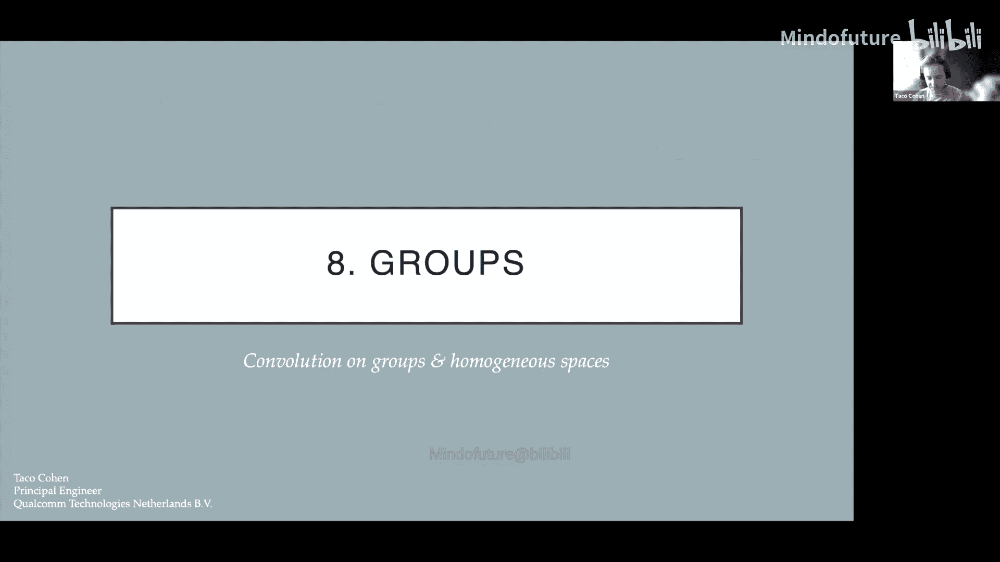
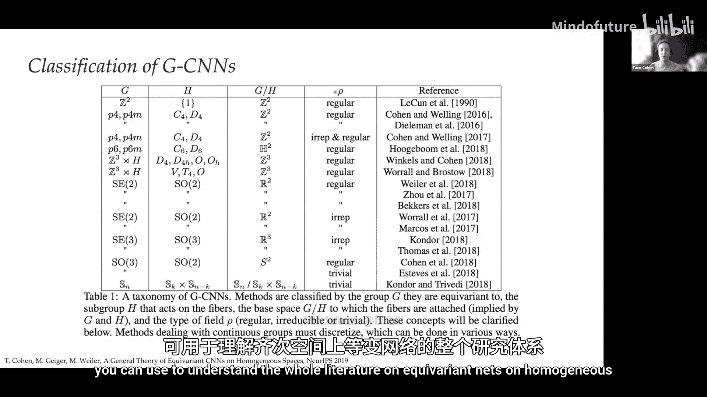
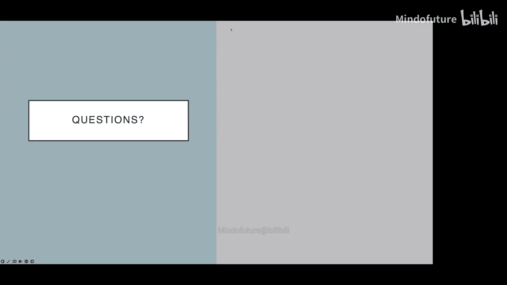

# 几何深度学习 ｜ Ammi Geometric Deep Learning Course p08 P08_第八讲（群与齐性空间）-塔科·科恩 -BV1veHgzxELm_p8-

Hello everyone， good afternoon， I'm back with a lecture on groups or more precisely group convolutions on homogeneous spaces。

 so that's a bunch of jargon right there， but we'll see exactly what this means。

So in the previous lecture， you heard about convolution on grids and that is of course the most common situation in deep learning when people use convolutional networks for images or 3D volumes。

 usually they're doing some kind of convolution， but what we'll look at in this lecture is how to generalize this from convolutions that are equivariant to translation。

To convolutions that can deal with more general groups of transformations。

 including mainly rotations， rotations of planar images， 3D volumes， spherical signals。

 and in fact far more general class of groups and spaces on which they act called the so-called homogeneous spaces。

So after looking at some examples， I'll give you a high level idea of the general theory that's been developed for these kind of convolutional networks and at the end of the lecture I'll talk about an even further generalization to so- calledled induced representations in steer CNNs which。

Geometrically， you can think of as convolutional networks that have as input output and also as internal feature spaces。

 spaces of fields on a on a space， things like vector fields。

 sensorsr fields and so on and what I'll come back to multiple times in this lecture is the convolution is all you need theorem which。

Says basically that when you have a feature space， that's a space of signals or a space of fields on a homogeneous space。

 then the most general kind of equivariant linear map is indeed a convolution of a generalized kind。

Okay， so let's get started and we'll start with a very simple example and also the first one that was published about in the deep learning literature。

😊，So the idea here is， let me get out my pointer。Right， so the idea is we have an image。😊。

And just like in the case of grids and translational convolutions， we can take a filter。

 say this little patch containing an eye like pattern and we can convolve it translationally over our image so we're going to translate the filter and at each position compute some kind of inner product。

 some kind of match between the filter and our image we register a response and in this case you see well this eye detector filter it fires of course in the position of the eyes and that's a translational convolution we can do it with any number of filter so we can have an eye filter and a mouth filter which fires here in the green spot and we can have any number of them just as in a standard CNN。

 but now what we want to do is we want to increase the weight。

SharingWe don't just want to use the same filter at every position。

We also want to use the same filter in different orientation， so we want to apply a rotation。

Oh'm getting。So。That's indicated in this figure here at the top we rotate the filter in this very simple case。

 we'll just rotate by 90 degrees and we get an eye detector for vertically oriented eyes and when we convolve it of course at least in this sort of simplified cartoon picture of what could happen it doesn't fire at all because the eyes here are in the horizontal orientation it's an upright phase so this feature map doesn't give us a big responses as similarly when we rotate by 180 or 270 degrees we don't get any big responses as we did in the upright orientation。

But of course， you can see that when we rotate the input image， then those might start to fire。

So what we've achieved here， first of all is increased weight sharing。

 so whereas in a standard translational CNN， you might need to learn the same filter in different orientations here this is automatically this is built in and in cases where the data has rotational symmetry that's a very useful thing as it has been shown many times in empirical results。

 for example， in medical imaging where medical tissues might appear in any kind of orientation。

Now what we've been emphasizing in this course is of course this notion of equivariance。

 so let's see if this operation that we've defined is indeed equivariant。

 so we'll take our image and we apply a transformation 90 degree rotation again this is just a very simple example。

 we apply an element from our group the 90 degree rotation and then we apply the same operation so again we're going to take our two filters in general could be more but here we have two filters apply them translationally rotate them apply again translationally etc。

😊，And we generate two times four feature maps。Now， what you can see is that when we apply the upright eye detector。

 it's not going to fire because now the eyes are in the sideways orientation。However。

 the rotated filter is now going to pick up on that。😡，We see now firing in this orientation channel。

 as we call it。So when we look at what happened as we go from the top right。

 that's the feature response to the original image to the bottom right。

 that's the feature response for the rotated image， we see that we can describe this transformation。

 this downward arrow here， as in two steps。Basically here we have these responses on a horizontal line and here we have it on a vertical line。

 so the first thing that happens is that the all the channels they will undergo a rotation in this case 90 degree rotation but another thing happened right here we had firing in the theta equals zero orientation channel。

And here we have it in the theta equals pi over2 or 90 degree rotated channel。😡。

So in addition to the spatial rotation， there's a cyclic shift along these four orientation channels so what was originally theta 0 goes to pi over  two or those in pi over two goes to pi what was in pi goes to three pi over two and what was in3 pi over two goes to zero you can try to visualize this mentally or do some calculations on a piece of paper to convince yourself that this is always true。

AndNow this is a very general pattern that we'll come back to again and again in this lecture that the types of group actions。

 which we find in the feature space。Are first of all。

 different from what we find in the input space and the input space we just take the RGB channels and each of them is rotated independently and there's no interaction among the channels。

 what happens in the feature space is that the channels are rotated but there's also this cyclic shift。

And so。That's quite interesting and it also helps to motivate the geometric deep learning blueprint that we've talked about and that is sort of the backbone of the book。

 the proto book that we have on archive on geometric deep learning。

 different group action for each feature space and here you see how that sort of emerges quite naturally from a simple idea of rotating filters。

 same group， rotations and discrete translations， but it acts in a different way in a different feature spaces。

So we've verified that this operation is equivariant， but we've only defined it for the first layer。

😡，So now we we can think about how to create deeper networks with this basic idea。

 So what you see on this figure is essentially the same thing is on the previous slide but visualize slightly differently So here we have again our input image we can also have a rotated version of that input image we have a filter here which we convolve with the image to produce one feature map and then we rotate it。

 produce another one， another one and another one and of course we can do the same for the rotated image and then again you see that the way that two stacks of feature maps are related on the top and bottom is that the channels are each channels rotated and the channels are cyclically shifted Now what we're going to do for the second layer and higher layers is to apply the same general idea namely we're going to take a filter and rotate it four times and then conulve it。

But now rotating has a different meaning because the feature space transforms in a different way。

 it has a different group representation associated with it so in the second layer， first of all。

 a filter indicated here in the center has four channels in any kind of convolutional network a filter will have as many channels as the input feature maps that you conulve with in this case we have four orientation channels so our filter has also four orientation channels。

So we can convulve such a filter translationally with this stack of four feature maps to produce one output feature map。

 but then according to the same philosophy as we used in the first layer we're going to rotate this filter and rotation means rotateating each channel and cyclically shifting them and what you can see is that if you do this you get four filter so four output feature maps and again you can see that the whole construction is equivariant so if you rotate the input feature map。

 you apply the first layer group convolution。And then the second layer group convolution using this procedure I just described。

 you get four output channels which are related to the four output channels produced from the unrotated image in the same way。

 namely rotating the channels and cyclically shifting them。And finally。

 what you can then do is you can do， for example， this is just an example， you can do many things。

 but you can iterate this a number of times， have many layers of convolutions and then at the end of the network you could do some kind of pooling So what you can do is you can in the simplest case。

 you would just sum over the four orientation channels to produce one number or an average or maybe you take a maximum whatever you prefer and as a result you get one channel as output。

And you can， can you can see that when you do this the。Output will again be equivariant。

 but it will transform in exactly the same way as the input。 So no more。

 there's no more cycling between channels。 There's just if you rotate the input image and compute the the output of the whole network after pooling。

You get just the same thing as you get for the original image， except it's rotated。

And you can see that that must be the case because。

Pyclically shifting along the channels will just permute the four values that you're summing and of course the sum adding a bunch of numbers doesn't depend on the order of those numbers。

Okay， so how can we understand this from the perspective of our general geometric deep learning blueprint。

 so in the input we have a signal some on our domain omega。

 which in this case is Z2 that's the the grid extended infinitely consisting of pairs of integers。

Of course， in practice， it's a finite grid， but we sort of imagine that it extends infinitely far with padded with infinite amounts of zeros。

 and so mathematically it all works out。Right， so that's our， that's our base space Oomega and。

As we'll discuss in more detail later， the way that these feature maps transform is called it transform as a scalar signal。

 so we have here one channel。That's a scalar at each position and if we rotate this this channel。

 we don't have any action on the channels， it's just a rotation as you're used to。

And then for the first layer and also higher layers。

The way we can think about this is that our domain omega now becomes the group in this case the group is called P4。

 that's the group of integer translations discrete translations and rotations by multiples of 90 degrees so basically if you look at these four channels every pixel in any one of these channels。

 you can index it by saying well which channel is it so meaning which of the four rotations does it correspond to and then what is the spatial position that is to say what is the translation and so indexing by rotation and translation that's basically indexing into this group p4 and so in a very general case the feature map after the first layer of group convolution will be a function on a group。

So Oomega becomes equal to our group。And then a signal on the group。

Tranform according to what is called a regular representation。

 and we'll look into more detail mathematically what that means。

 But this is just to introduce the nomenclature。And after pooling， of course。

 our domain again becomes the plane or the grid Z two。

 and we have a scalar signal just like in the input space。All right。

 so let's try to understand mathematically how group convolution works。

 and let's do that by making an analogy to the usual translational convolution。😊。

So in translational convolution。The idea is， of course， that。We have a signal， an image， say。

 and we have a filter and we're going to translate the filter and compute an inner product and then we'll store the result of this inner product in a cell of the output feature map that's associated with the translation that we applied if we translate by five pixels along the X axis and 10 pixels along the Y axis。

 compute dot product and we'll take that cell 5 comma 10 and store the output of the inner product there。

In the group convolution case， the idea is very similar but we replace the wordtrans by transformation。

 that is to say we apply a not just a translation， but an arbitrary element from our group。

So we have a signal， our filter and then for each。Transformation in our group。

 we apply that transformation to our filter， we translate and rotate it， for example。

 compute inner product and store the result of the inner product in the cell of the output feature map associated now with the transformation that we applied and so that's how you see that the result should indeed be a function on your group of transformations that you're considering。

All right， so mathematically， we're going to unpack this and the first concept to unpack is of course。

 this concept of translation or transformation applied to our signal or to a filter。So we have here。

 you know， just to remind you of the notation， we have a signal x on our domain omega。

 U is an element of omega so we can index our signal x at the point U。Then we have a translation， V。

 and。You know， this translation acts on the signal via the representation row。

 And if you recall from the from the third lecture， the way that works is that the。

V translated version of the signal X indexed at U is equal to x。

 the original signal indexed at U minus v。And there's a very， you。

 completely analogous equation for a general group。

So the only thing that changes is that now G is an element of our group and when we apply it to our signal and then index a signal at U。

 that's going to be given by the original signal indexed at G inverse U。

This is just a mathematical way to say， you know shift and rotate or whatever the group may be your signal。

Then we have the concept of inner product that we have in our definition of convolution。

 so in the classical case of a discrete grid with some number of channels C。

 the inner product between a signal X and another signal。

 let's say a filter y is given by summing over all spatial locations and summing also over all channels。

The product of。One signal at disposition and in this channel times the other signal a disposition in this channel。

And again， this was already covered in lecture3， but in general。

 when we have a signal on some domain， omega， we can define an inner product for such signals by integrating over the domain in the case of a discrete domain omega that would be a sum in general will be an integral with a certain invariant measure。

And then at each point， we take the inner product of the feature vectors along the channel dimension for x and Y at that position。

 and we integrate the whole thing。And this gives you a valid inner product that we use to do pattern matching and then convolution and group convolution is defined as followed。

I should say that in the deep learning literature everybody calls this convolution。

 even though in some other fields， it's more common to call this a cross correlation。

 but we will not be worrying about the difference here。

So the idea is the signal convolved with a filter ps evaluated at V， so V is a translation。

 so evaluating the output at a certain translation or position in the plane。

 is the inner product of the signal and transformed filter， the translated filter。

 which if we expand the definition of the inner product is a sum over positions and channels of the signal and the translated filter。

And for group convolution， we have something completely analogous。

 we have our signal convolved with a filter evaluated now， not at a translation。

 not at a planar position， but at the group element G。

That's the inner product between x and our filter。Transform by G， which again。

 we can expand the definition of the inner product and the transformation of the filter and we get this equation here。

And in both cases， using completely analogous derivation。

 you can show that this math operation here is equivariant。

 meaning that if you apply a transformation G to your input signal。

Then you get also a that's equivalent to just doing the convolution with the original signal and then transforming the output。

Now one very nice thing to note here is that this whole setup works。

 no matter what your space omega is and in particular it also works when omega is the group itself as we saw happens after the first layer so you could have x being a signal on the group。

 so now u is a group element and then the transformation of a signal in the group is still given by this equation where we now have G inverse u that's now the composition operation in the group。

 and then the whole the rest of the setup still works。

 its still equivariant and indeed that is a mathematical way of saying or let's say this setup specializes to the case I just explained for the rotal translation group in a more intuitive way。

All right， so we' studied the group convolution and I mentioned already that the way that the feature maps in a group convolutional net transform is called the regular representation。

 so let's look more a little bit more detail what that means。

So recall that signals are functions x from omega or domain to c some vector space。

 and they transform according to this equation， we've just seen it on the previous slide。嗯。

And what I was also already mentioning is that。In the case where omega is the group itself。

 as we have in the second and higher layers of a group at net。

You you can take this G inverse U to mean the left action of G on itself。

 so if you have instead of u you have an element H and you want to make you want to apply the transformation G to it。

 you just use the composition operation of the group and you can verify that this also satisfies the axioms of a group action so this is a valid group action and it fits into the framework just a special case where omega happens to be equal to the group G and then this way that the signal transforms is known as the regular representation。

So we have our X， that's a feature map now it's a feature map on the group G， for example。

 as we saw before， for every translation and rotation， we have a certain value。

 a certain feature response。And the way that we can transform such a thing using a group element G。

 so again， a rotation a translation is to just index the original feature map at G inverse x。

So let's look at how that general definition specializes to the case that we've been studying of discrete rotations and translations。

So to make it less abstract to actually be able to do concrete computations。

 we're going to encode our group elements G as matrices。

And because the group that we're dealing with here is the group of discrete translation and rotations。

 the matrices are indexed by a rotation are either 0，1，2， or three corresponding to zero degrees。

 90 degrees， 180 or 270 degrees。And a translation in the grid Z two。

 and the way we construct the matrix like this， we have here in the top left a rotation matrix that rotates by r times pi over 2。

We can also write that here as a two by two rotation matrix capital R of lowercase R。

 and then we have here our translation in the x and y direction。

 which we also can encode here as a two dimensional vector in this block matrix。

 and you can verify that when you compose matrices like this。

 that's the correct way to compose rotations and translations。

You might have seen this in a computer vision class， for example。

And you can also see that if you apply this to a two dimensional vector with an added one as a third to a component。

 this gives the correct way to transform a two dimensional point in the plane。Now呃。

In the definition of the regular representation， we have two kinds of operations that play a role。

 the first is the group operation Well in that case for this encoding of the group elements。

 it's just matrix multiplication and you can do do the linear algebra here and work with some rules for the sine and cosine you can verify that when you compose these matrices you get this matrix so the rotation angles。

 they add up modulo4 because they get wrapped in the sinusoids。

And the way the rotations and translations compose is then that the rotation of the first group element acts on the translation of the second one and then you add the translation of the first one。

 it's just a matter of linear algebra， you can verify this and also verify that indeed if you apply this rotto translation and this rotot to translation to a point that's the same as applying this combined rotto translation。

And similarly， you can do an exercise to verify that the inverse of this matrix is given by this matrix。

 which is again an element of of this group then we look at the definition of the regular representation so now we have our signal signal is a function on the group in this case that means it's indexed by a rotation zero to three and a translation in the grid and let's say we apply just a pure rotation to it with no translation just to keep things simple then you can use these two definitions or these two results here。

For what it means to compose and invert group elements to derive that this transform signal is given by the original signal indexed。

At our minus R prime mod 4。 So that's how your cyclic shifting along the channels comes in。

And how the spatial dimension is affected by this rotation so that's how you know the thing we saw on the very first slide how that emerges as a special case of a regular representation now this is of course a more complicated way to think about it but the nice thing is that this regular representation is a very general concept that applies to many situations and that indeed there's a large mathematical literature that proves all sorts of results about these things so it's nice to see that that the thing we already understood can also be understood in this more general framework。

And indeed you can generalize it to all sorts of other groups， so here's one example。

 the group of discrete rotations in 3D， so let's say you have a three dimensional voxel grid maybe you have some MRI brain scans and you want to do some kind of learning on it to segment different brain regions or classify certain disease states or whatever it may be。

Then you can use say a three by three by three filter in a convolution layer and we can apply the same idea。

 we can rotate this discrete filter using discrete rotations just to keep it simple but actually you see already in 3D there are many。

 many ways to rotate your filter， in fact 24 ways if I recall correctly， and。That is， in a way。

 it's good news because it gives us a lot of weight sharing and so a lot of statistical efficiency we're going to need fewer examples to learn from。

U。Of course， it also has a computational cost that's something we'll talk about in a minute。

 but the other interesting thing I wanted to mention here is that whereas in the simple case of two dimensional。

Dcrete rotations， you get simple cyclic shift along the channels what's indicated by this diagram is that these group elements in 3D are related in a very intricate pattern and so instead of a cyclic shift you get a fairly complicated permutation for each rotation that you might apply。

So the channels undergo this permutation that's indicated by the arrows here。Yeah。Okay， so。

We already sort of convinced ourselves that just intuitively that the group convolution for the special case of discrete rotations and translation。

 that that should be equivariant， but let's verify it mathematically or see how we can prove that in the general case。

So we have our input that's going to be a signal on the space omega 1 could be， for example。

 the plane， or we'll later look at an example of a signal on the sphere。

And we have here again the equation that tells us how this signal transforms。

And we saw that the output of the first layer group convolution would be a signal on the group itself。

 and again， a very similar equation that tells us how such signals transform。In later layers。

 we will want to define a group convolution that takes a signal on G and produces as output also a signal on G。

And we can give a proof that is independent of the specifics of the space， omega and group G。

 the key insight is that matching a signal X with a transformed filter as we do in the group convolution is the same as matching the inverse transformed signal。

With the original filter psi， so thats given by this equation。

 x inner product row 1 g Psi equals rh 1 g inverse times x with Psi。

And this is actually something you need to show and it depends a little bit on the properties of the integration measure where you need to use it one that has some invariance property called the HarR measure。

 but this is all quite technical， we will not go into it here， but if you're curious。

 you can use these words to look it up and also our Proto book has some information on this。

Now using this key insight， we can then show in a few lines that indeed the group convolution is equivariant。

 so we have our signal X， we apply a transformation by H。

 and then we convolve with P psi and we index the output at the element G。Now。

 by definition of group convolution， that's just an inner product between our inputs， the Trans deck。

With a G transform filter ps。And using this result， we can take this H to the other side。

 and now we have that this is equal to our。Signal X。Inter product with the。

Filter transformed by H inverse G。And this is just the group convolution of Psiine x indexed at H inverse G。

 and that is nothing else than the transformed version。

The H transform version of our signal psi involved with x。

So that's the proof that group convolution in the first layer and also the higher layer version of it is equivariant。

To the action of the group G。Now we've shown that group convolution is equivariant。

 but we can also reverse the question， we can say， let's say I have a signal on space omega and we know how that transform transforms and we have an output signal space on maybe another space omega or on the group G or whatever we have a definition for how that transforms and now I want to design a linear layer with some learnable parameters that should be equivariant with respect to these representations。

 and now you can show that you're using if the group acts on these spaces in the way that we' just described by shifting the signal over the plane or shifting it over the group using the regular representation。

 then any such linear equivariant map between these regular representations is going to be a group convolution。

And of course there are many technical details that would have to be mentioned and if you're interested in this。

 I would recommend having a look at the literature cited here at the bottom。

But that's that's a pretty cool result because it tells us that in a way we can we we don't have to。

Come up with anything new， at least at a fundamental level because as soon as we have decided that we want our feature spaces to transform according to a regular representation。

 if we think that they should be signals on some space，Then。

You know the group convolution is the most general thing you can do now there are certain downsides in terms of computation for very large groups for which we've developed this durable CN framework that we'll talk about in a minute。

 but but still it's nice to know that by using group convolution we're not imposing any kind of。

 unnecessary constraint on our linear layers。Yeah。So there's you can then think about okay how do we implement this right so so far we've been talking mostly about the mathematics and I like to emphasize this because the mathematics is still going to be the same in 100 years from now and the implementation details for how you actually compute this is going to depend on the hardware and there's going to be trends and in different ways of doing that that change over the years but still it's very important of course。

 to know about that。So。How can we implement this group convolution for the very simple case， again。

 of the discrete rotations and translation group P4？So what we'll have is。We have a set of weights。

 those are the filters in their upright position and then we have a set of indices that we can use to basically create copies of the filters in different orientations。

 so we create one copy in the upright orientation， one in the rotated or in all four rotations basically。

 and that's the operation we call filter transformation。So now we get an expanded set of filters。

And those we can just feed into the COV 2D operation that you also use in a standard planar CN。

Apply that to the input feature maps and we get our output feature maps。And so。That's a very。 yeah。

 here's a， here's a visualization of how that works。 We have our。

For input channels for the filtered corresponding to the different orientations。

 the filter transformation uses some indices to create the copies of filters rotated and cyclically shift it as you see here in the different rows。

 and then this is a filter bank that we can just apply in co2D。So at least for this very simple case。

 there's very little computational overhead relative to a standard2D convolution because the only extra operation we have to do is this filter transformation。

Of course， if you。This filter transformation does produce more filters and so the CO 2D operation will be heavier unless of course you reduce the number of free parameters that you're using。

 which is often good thing to do so that you get better performance。

 but you can also choose to use the same number of parameters and you have more filters and you get better accuracy at a higher computational budget。

Now there are many other approaches that have been developed。

 so first of all there's the steer CNNNs that we'll talk about in a minute。

 this allows to address some of the computational issues that you run into for very large groups。

There's various other ideas like be sp CNNNs where you define continuous filters via B splines on the so tangent space of a league group。

Lcom， there's a work on scale equivaris and recently what's been quite popular is equivariant transformers of various kinds。

 And I should say that this is only a tiny sampling of the of the literature。

 but there's there's a lot of work that you can you can find on equivarian convolutional networks and other equivariant networks。

So one other case study that's interesting to look at is spherical CNNs。

 so this is useful if you have data that lives on a sphere。

 so for example the Earth and climate sciences， the Earth is a sphere。

 you might have some data like temperature fields or fields of wind direction at every point on the Earth and you might want to apply some kind of analysis。

 some kind of machine learning model to it， or you might have a omnidirectional camera on a robot。

And that's again a signal on the sphere and when you have a signal on the sphere。

 again according to our geometric deep learning philosophy。

 you want to think about what is the symmetry of the sphere while those are three dimensional continuous rotations。

And you want to build layers that are equivariant to those。

Now I'm not going to go into detail here in the interest of time。

 but you can define a convolution on the sphere that is completely analogous to the case of the plane that we looked at before。

 you have a signal on the sphere， a filter on the sphere and a convolution is defined by taking inner product of your signal on the sphere and the rotated version of your filter。

 and now just like before the output is a function not on the sphere， but on the group。

 in this case the group SO3， the rotations in three dimensions。

 which whereas the sphere is two dimensional， this is a three dimensionmensal manifold output feature map is a signal。

 SO3 and then you can define a group convolutions for signal on SO3 as well using again the same kind of recipe。

Yeah， so this is just saying what I just mentioned， different domains。U。

There's ways to implement this using Fourier transform。

 very complicated so I won't go into it and actually this was the way we implemented it in our first paper on this topic。

 but it's quite complicated， so I wouldn't necessarily recommend a spectral approach for this type of method。

 although Viiconar and others have found practical ways to do this。

If you just want to implement a group convolution， I wouldn't recommend this。

 but there are spectral spherical scenes that work well。So yeah。

 many many approaches to spherical CNNNs you can use， for example， graph convolutions。

 the spectral spherical CNNNs that I mentioned and again this is just a small sampling of the literature。

 there's many， many approaches。Okay， so we've covered a few examples。

 we looked at translational convolutions in the last lecture。

 we've looked at how to generalize that to include discrete rotations。

 we've seen that in three dimensional grids and we've seen spherical CNNs and we've seen some general patterns emerge。

And what I'm going to do now in the time that we have left is to just sketch a little bit the general theory that describes all of these where the common theme is that you have a group of symmetries and acting on some homogeneous space。

 we'll say what that means your signal signal space is a space of feature sorry of functions on homogeneous space。

And the equiant maps that you're interested in are generalized kinds of convolutions。

So what are homogeneous spaces？So we recall from our blueprint we have our domain omega that's always a set with a group action。

 so we have a group element G and we we apply it to a point in omega we get in transform point in omega for this to be a group action has to satisfy certain properties that we covered in previous lectures now if this action is transitive。

 then omega is called a homogeneous space for G。 so what does that mean。To be transitive， well。

 if we have any two points U and V in our space omega。

Then there should exist at least one group element G， such that applying G to U gives us V。😡。

So let's look at a few examples of homogeneous spaces then also counter examples。

So if you have our domain omega， the plane。Then if we take any two points。

 let's say this one and this one， then is there a transformation that is to say a translation that takes one into the other and the answer is of course。

 yes， for any point， any two points， there's a translation that maps one to the other。

We can also consider this same example。😊，Or another group named lead group of translations and rotations。

 so we have the same space and it is also a homogeneous space for the group of translations and rotations again because if we have any two points。

 we can find some rotor translation that maps one into the other for example just a pure translation and maybe combined with any rotation around the resulting point similarly for the sphere。

 if we have any two points we can always find a continuous rotation that maps one to the other so the sphere is a homogeneous space for the 3D rotation group SO3 now here on the right you see a counter example。

 if we have the plane but we consider as our group of symmetries。

 only the 2D rotation group so rotations around the center of the plane。Around the origin。

 then of course， if we have any two points that have the same distance to the origin。

 we can rotate one into the other that's indicated here by these circles but points at different distance to the origin。

 they cannot be mapped into each other by a rotation， so this space splits into these orbits。

 these circles， and whereas in other cases there's only one orbit。

 all the points can be any points can be mapped anywhere else in the space by an appropriate symmetry transformation。

So those are homogeneous faces。Now something very important structurally about a homogeneous space is the so called stabilizer subgroup。

 so we have said Oomegan， we assume that this is homogeneous space for some group G。

Then the stabilizer subgroup of a point in omega， let's say this point in the plane。

Is the set H U that's the set of group elements in G that leave U in variance。

 So if you apply G to U， you get back U。 So let's look at examples here we have the plane and if we take our group G to be the translation group R2。

Then it has a trivial stabilizer because any translation that we apply except for the identity will move this point away。

And so only the identity transformation， that's a one element group， a trivial group。

 only that leaves this point invariant。However， if you consider the group S2 that is continuous rotations and translations acting on the plane。

 then the stabilizer is the group S2 the group of two dimensional rotations around this point。

 any translation will move it away， but any rotations around this point will leave that point where it is。

So that's the stabilizer of this point if you consider this a homogeneous space for the group SE2。

Similarly， the sphere is a homogeneous space for the rotation group， SO3。And if we take any point。

 then we get a group of rotations around the axis through that point。

 that's a group called S2 rotation around the axis。

So that's the stabilizer of that group now you can show various things first of all that this is a subgroup that's a good exercise so you look up again the definition of a group and you check that this set satisfies those that the identity is in it。

 composition is associative there's inverses etc。😊。

And you can show that the stabilizer of any point you。

 whichever one you choose is going to be the same as an abstract group and that's also why these spaces are called homogeneous every point kind of looks the same。

Now the key thing to remember is that a homogeneous space is completely characterized by its symmetry group and the stabilizer subgroup and we'll see how that works or yeah well I'll just go over this very quickly。

 but just to sketch the idea。So。Before we defined a homogeneous space in a certain way。

 and then we saw， okay， it has this stabilizer subgroup。

You can also start with a group and an arbitrary subgroup and construct a homogeneous space called a quotient space。

 there's some very subtle differences but I won't go into that。So to understand this。

 you need this concept of a coet and so a left coet of a subgroup H in the group G is a set of this form。

Namely， it's the。Combination of our element G that defines the coset together with every possible element of H from our subgroup capital H So here you see a simple example you have our group of symmetries of a triangle with flips and rotations and we can consider the subgroup H consisting of flips mirror transformation so the identity and the mirror transformation or the mirror combined with rotation or you know。

R squared and。What you see already here is the Coset。Of the identity here， e times H is just H。

 and that's indicated by this green blob。And then there's two other coss， one here and one here。

 and you can see that they partition the group， so every group element， EM，MR squared R， etctera。

 is in one and exactly one coset。So Cosets， they kind of carve up your group into equivalence classes called Coss。

And now the set of cossts is called the quotient， so if I start with this group with six elements and then I forget about all the group elements and just remember which cosss there are。

 I get well in this case three cossts and this space with three points is called the quotient space。

In the case of SO3， you can think of it as somewhat like topologically。

 it's somewhat like a sphere with a bunch of circles attached。

 so a rotation you can think of it as indicated by an axis。

 that's the point on the sphere and a rotation angle around that axis。And then these circles。

 you can think of those a little bit like the coss and if you take the quotient。

 you forget about the circles， you collapse them to a point and as a result you get the sphere。

 so you can think of the sphere as a quotient of SO3 by S2。And yeah。

 you can show that the group G X on this quotient space and this is action is transitive and so indeed G over H is a homogeneous space and that the stabilizer of this action is H the group you quotient it by so the high level picture you can have in your mind is you have your group it gets partitioned into these cosets。

 if you quotient them out， you get a quotient space that's a homogeneous space and yeah the group itself can be thought of as the homogeneous space which at each level at each point a copy of your subgroup or attached。

Allright， so that's the most important information if you're studying a homogeneous space is what is the group of symmetries and what is the stabilizer subgroup and then you basically know everything you need to know。

So on this slide， I was going to take you through an example of how this applies to the case of sets。

 which is a homogeneous space for the permutation group。But in the interest of time。

 I'm going to skip that。 It's still an interesting exercise to to look at。

 So have a look at the handouts later。This also going to skip well。

 this is just to say that you can understand convolutional spheres in this way as well。

Right so in the last few minutes， I want to quickly give you the intuition for Stable CNNNs and also the motivation for it。

So。Yes。Let me see how to introduce this。Let's say we have a signal on our。Hmogeneous space。

 G over H or quotient space， so let's say we're looking at the rotto translation group again and our signal lives on the plane。

 that's the rotto translation group quoed by the rotation group。And we have a scalar field。

 let's say gray scale image。Now let's say we want to design a convolution layer that gives an output that's also a scalar signal。

And we want it to be equivariant， then you can see that the only way to do that is to use a circularly symmetric filter。

Because if you use a noncircularly symmetric filter。

 if you rotate your image you're going to get a different response。

 but since you want it to be a scalar signal you can only use one filter and so it should just be invariant rotations so that's one option and the other option so it's okay so the problem with this of course is that circularly symmetric filters are not very interesting they don't allow you to detect very interesting kinds of patterns。

Then on the other hand， you can use a completely free form filter。

But then as we saw in the example of group convolutions。

 you have to apply every element of your group H to the filter。

And that's fine if there's four rotations in the plane or 24， maybe in 3D。

But if your group H is very large， then this means you get very many feature channels。

And so what we're curious about is if there's anything in between those two。

 completely unconstrained filters， but having a lot of channels or very constrained filters and having only one output channel。

 there should be something in between。And the way to understand this is via a certain concept called the induced representation。

 so the regular representation that we looked at is a special case of this。

And the basic picture is that we have our homogeneous space with a stabilizer subgroup H and we can look at a single point and at that point we'll have a feature vector in the case of the discrete rotations and translations。

 we had a four we had four orientation channels at each point， so it's a four dimensional vector。

And it has a certain way of transforming。 if we rotate it， we get a cyclic shift。

And then the way the whole feature map stack of feature maps transforms is that each of these columns。

 each of these feature vectors is rotated and there's a cyclic shift。

And that's an instance of an induced representation。

 so we have first representation of our subgroup H， let's row， in this case， cyclic shifts。

 but it could be something else， and then from that you induce you build a representation of your large group G that acts on fields of those four dimensional vectors in this case。

Another extreme example is scalar fields， so if you have say RGB image。

 the way it rotates is there's nothing going on on the channels it's just each channel independently is rotated and so in this case the representation of your rotation group acting on on a single RGB vector is trivial。

 it doesn't do anything。That's another example of an induced representation。

But there's something in between， so here you see an example of a vector field。

 you have your RGB image， you can compute you know convolution with a spatial derivative filter。

 you get you know X Y vector for each channel， red， green and blue。😊。

And you can convince yourself if you rotate the image and then do the same operation。

 the two are related by again， a rotation of each channel and a rotation among the channel vectors by you know。

 two by two rotation matrix。 that's yet another example of a。

Of an induced representation is another example so the general picture is you have a group G you have a subgroup H and they together define a homogeneous space you have a representation row of your subgroup H that defines how your geometrical quantities is going to transform is going to transform trivially as a scalar do you have a vector field so two dimensional representation do you have a field of regular quantities where the dimension of your feature vector is equal to the size of your subgroup H or anything else。

 and then you have your induced representation that tells you how a field of such geometric quantities transforms。

And yeah' that's the idea of an induced representation and then you can ask， okay。

 maybe I have an input， let's say scalar signal is here and I want to output another scalar signal or I want a vector field this output。

 what kind of equi and linear map can I use？😊，In the general answer that has been published under different names like Stable CNNs。

 harmonic networks， Tensor field networks， the general answer is that you should do a convolution where the filter is constrained in some way。

 so in the case of scalar to scalar， you would get these circularly symmetric filters。

 and in other case you get other kinds of constraints。And yeah， this is universal again。

Any equivalent linear map between two induced representations between two spaces of fields。

Is on a homogeneous space is going to be a generalized convolution with such a constrained kernel。

And the cool thing here is you can now classify a lot of different methods that you can find in the literature by saying what group do they use。

 whats subgroup， which quotient space does that give and what kind of feature types。

 what kind of representation do they use？So it's a very。

 very general framework that you can use to understand the whole literature on e nets on homogeneous spaces。

That's it a little bit over time。 hope you you got something out of that and yeah happy to take any any questions thanks for your attention。

😊，Okay。Yes， are yes， please。I in full screen， mode say I can't see that right now。

So to read a question No， yes， sorry， I just take a second。 I'm loading the page right now。Lectures。

 lectures channel， right。Yeah， yes， yes。Over rideide， so。Let's see what's the first one。呃。

the first one is the one of my is convolution case of group convol Yes I see。 yeah。

 that's exactly right。 So the standard convolution that you find in well in CNNs as you know first published by Y Laoon in I think in late 80s or early 90s or before that in the neocogniron。

 if you w to be really precise about the history those kinds of operations are indeed group convolutions for the special case where your signal is a function on Z2 on the grid and your group。

Is also said too， It's the discrete translation group。And then yeah， you you turn the crank。

 you use this whole general machinery and outfalls exactly this operation。

 so that that operation of a translational convolution is indeed the most general kind of equivariant linear map。

For this particular situation。And for other groups and other homomodgeneous spaces。

 you get other kinds of convolutions， all of them being some variant of the group convolution or steer convolution。

All right， in the example with rotation， what is omega and C and how is the signal defined？

So well I covered different examples of rotation so so one is where you have a signal on the plane and you're considering translations and cleanerar rotations and the other example is that you have a signal on the sphere。

And you consider rotations of signals on the sphere。And so those correspond to different almenga。

You can have your omega beta plane either discretized or you can mathematically also talk about the continuous plane or continuous Euclidean space of higher dimension like three dimensional。

Or in the case of spherical ses， omega would be a sphere。嗯。😊。

And as I also explained in the higher layers of your conVnet after the first layer of group convolution。

You would have the omega the domain be equal to your group， so for example。

 you could have in the spherical CNNNs first layer is a signal on the sphere second layer。

 your signal is a function on the rotation group。诶。But unless that's， unless you use。

A rotationally symmetric filter， in which case you can take your output to also be a signal in the sphere。

Now see that's the channel dimension and as with any convolutional net also in group equivariant and durable CNNs。

 you can just choose an arbitrary dimensionality for your channel so in a standard coVNe at each position you have a number of feature responses for different filters and you can freely choose that that's just the hyperparameter of your network design that will determine how much how many patterns can you detect how many filters do you have。

And also， of course， how many parameters you' going to have to learn。All right。

 so next question in the case of convolution in the sphere。

 can we use UV mapping and continue with the normal convolution， all right。

 that's an excellent question actually and you know as an implementation trick。

 I think that would you could do it。I should say for those who are not aware UV mapping is basically referring to you parameterizing the sphere。

 so if you have a sphere you could use a latitude and longitude coordinates and then just like a map of the world。

 you can plot it in a square or rectangular piece of the plane and then well you have a signal on the plane and now you can do convolution on that。

The problem with this is that this operation of taking a sphere and turning it into the plane doesn't respect the structure of the sphere and it doesn't respect the symmetries so first of all it doesn't respect the topological structure because you have to cut open the sphere in order to lay it flat on a piece of plane and so two points that are very close together on the sphere if you cut right between them。

 then they will be far away in the plane and again you could maybe do some hacks to get around that like you could do a cyclic convolution but the sphere has a very particular topology so for example at the poles if you make a cut like this then the point at the pole will be represented in。

The whole。Top row of pixels and so so things go wrong topologically that's first of all and also it doesn't respect the distances because there's no way to turn a sphere into a plane without stretching or skeing the plane or at least you're always going to lose some important geometrical。

Information and so what what does that mean， Well， if I。

 if I learn a if I do this planarization and then I learn a square filter。

As I'm shifting this filter translationally over the plane to do my convolution。

That is going to actually correspond to a very weird kind of distortion of that filter on the sphere。

 so what you really want is you want one filter on the sphere and you want to just rotate it over the sphere during your convolution where yeah you really have the same pattern that you're detecting at different positions and orientations。

But if you do it via this two dimensional。Approach implementation strategy effectively you're going to be stretching your your filter and so that's undesirable and that's why you would use the yeah spherical CNM framework。

And then a question about these CNNs so basically so this applies to lead groups。

 so lead groups are groups that are smooth， so there's it's a group that is also a smooth manifold where the group operations are smooth so。

The simple examples include continuous translations and rotations and scaling and such things。So。

You can do essentially calculus differentiation on your group。

So that's where it applies and because you so in a lead group there's something called the Lee algebra。

 which is basically you can think of that as the tangent plane to your lead group so your lead group is a manifold you can think of it as a curved space。

 the simplest case two dimensional rotation it's just a circle in case of SL3 I try to visualize it as a sphere with some circles on top so a little bit misleading but you know you can think of it as some curved space。

And any manifold， any smooth manifold has a tangent space at every point。

 so in the case of the circle you can take a point and you can draw the line tangent to the circle that's the tangent space in a higher dimensional manifold you'll get a higher dimensional tangent space and now there's a very nice way that you can parameterize the elements of your group by the elements of the tangent space at the identity。

And that's what the Bline CNN does， it defines a filter on this tangent space。

 which is a flat linear space using something called the sp and then it maps that to the group or the homogeneous space and does the convolution that way for details how to do that computationally how to implement that。

 I would recommend looking at the paper。So that' it that's the last question in campusus wire。

 if anyone has other questions， also happy to answer those。If not。

 I have to go because actually in 15 minutes I have to give another talk so I would like to take another look at the slides。

😊，So if it's okay with you， I will stop sharing and yeah。

 I'll see you soon at the next lecture and also be on campus wire to check if there's any further questions about this lecture。

