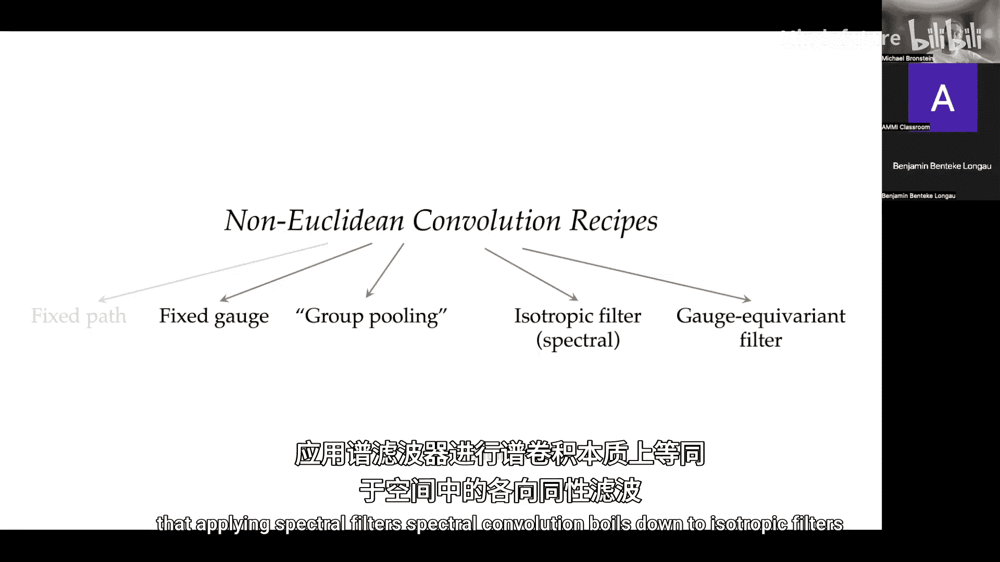
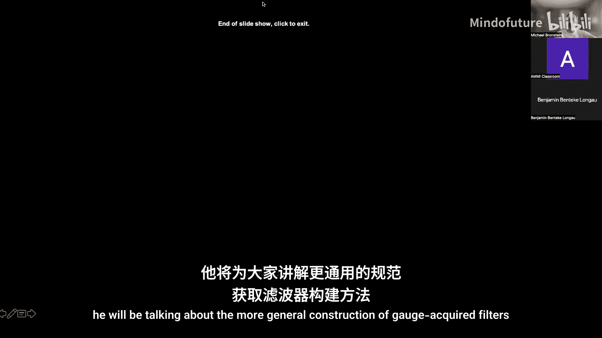

# 几何深度学习 ｜ Ammi Geometric Deep Learning Course p09 P09_第九讲（流形）-迈克尔·布朗斯坦 -BV1veHgzxELm_p9-

And today we would like to talk about manyifolds measures and geometric graphs。

 so this is maybe a little bit more exotic， I think in most computer science programs you usually don't encounter manyifolds。

 so we'll try to convince that these are interesting objects and they're worthwhile to be no willing to be studied。

So this was just a reminder for you。A reminder for you what kind of domains we consider so far so we talked about the 5G of geometric deing and today we're talking the last G so we're talking about manyifolds meshes and geometric crafts and taco after me will be talking about gauges。

 which is edgegerization for manyifolds what is called bundles。

So I remind you also that we could define different popular architectures as instances of the geometric deep running blueprint by choosing the domain and the symmetry group。

And for example， in convolutional neural networks the domain was agreed and the symmetry group was a translation group。

 for example we talked about graph neural networks right or deep sets where the domain was a graph or a set and the symmetry group was permutation so here we are talking about intrinsic or mesh CNNs。

 the domain will be some discretization of a manifold。

 typically a measure maybe a geometric graph and we'll see that we actually have two different types of symmetries or imvaris。

 one of them is global， so we are talking about azometries with respect to some deformations and another one will be local some of this will be what tacoan will expand on will be called engaged symmetries。

So maybe first of all， why et all manyifold are interesting， so these are， as they said。

 a little bit exotic of an object。In machine learning so when we deal with problems in computer vision and computer graphics。

 we are trying to describe three dimensional objects so three dimensional objects in many cases we can describe them as volumes right as shown on the left here so basically instead of pixels you have foxels。

And in this case， if you're not interested in what happens inside。

 the object if you're interested just in the outside。🎼，你心咁。🎼Some disturbance。

 maybe we can turn off your audio， then we can model it。Sorry， Benjamin， I think， thank you。

So an alternative to modeling the volumetric representation of the object。

 we can think of a two dimensional surface that the boundary surface of the object and this is a two dimensional manifold right that is typically discitize as a mesh and as a result we have significantly less wasteful representation So when we are talking about deformable objects like the human body for example or facial expressions so then we can use techniques from differential geometry that allows very nature to think of deformations and describe deformations of manyfolds Now in other applications that we will also see in our gas talk when modeling proteins so proteins are large molecules that they interact with each other and with other molecules in our body。

And the way that they interact they present to the outside world what is called the molecular surface。

 so we don't really care about to a large extended list what happens inside how intricately the protein is folded so a way to obstruct out these internal folding is to represent them as surfaces and again because they change their conform when they interact it is important to be able to treat these objects appropriately so the two types of environments that I mentioned as we'll see so if we have a manifold will need to work with it locally so first type of invari will be the ambiguity in the change of or in the choice of the local system of coordinates that's what will call the gauge。

The second type of symmetry is global， it's a deformation， for example。

 when we deform one shape into another， we can slightly stretch or bend it locally and we want to be invaried to these kind of deformations or at least approximately invariant。

Now what we've seen before， for example when we take the grids as example so convolution in the plane。

 the way that we worked and the way that for exampleable convolutional neural networks works so we have some local filter that we move around our image and we correlate this filter with the content of the image in different locations so what allows us to do it is the fact that we can move the filter globally so we have some global representation of our space and the group that acts globally so we can move this local representation of the filter anywhere in the image。

 this is typically not the case in differential geometry when we have a general manifold then the way that our filter will move will depend on the path we go so in the plane it doesn't matter which way I go on for examplepher it will matter and we can also have some exotic cases such as the non-orientable manifolds the mu surface in which case。

I will not only have a different rotation， but I can also have a flip of the coordinates so I have a reflection I change the handedness instead of left handed or right handed system of coordinates I get the opposite one。

So there are several recipes how we can generalize the idea of this local filtering or convolution type of architectures to non-nucran domains so we can forgot say that we fix the path so there is a kind of canonical path between two different points we'll call it the geodesic so I can go along a certain path。

 I can fix the gauge so I can say that I don't have any ambiguity in my system coordinates because a pre computeutd。

 will'll see that it's in principle possible but it triess certain difficulties。

 we can also say that okay if I have an ambiguity such as rotation。

 let's do form of pooling over all possible rotations。

 then if again I have ambiguity of rotations I can say that I have a filter that is tro so it's rotationally environment and then it doesn't matter how I rotate the local frame and finally and this is what Tcker will be describing in his next lecture。

 we can have a filter that is gauge variant so it will change in the same way as if I change the system。

Of course。so I will focus mainly on these three possibilities of fixed gauge group pullinging and isottroic filters。

 but before that we'll need to get some background about differential geometry and basically we need to discuss three things so first of all。

 how to define local stuff on the manyifolds right so what I said that we have a local filter that in the Euclidean case right and on the grid we just extract a block of pixels from the image and we multiply them by by some some mask so this is significantly more elaborate on the manifold so we'll need to understand what is a remaining metric and for example exponential map in order to do it second question is how to move things around so we'll need to understand about parallel transport how I move things for example how I move a vector on the manifold such that it is I preserve the angle。

And then we'll talk about symmetries and environments that are related to manyifolds and again。

 the vocal version of it will be discussed in the next lecture。

So here is a crash course on manifolds so water are manifolds so it's good to imagine something like this sphere or maybe this kind of two dimensionmenal globe okay so these are technically speaking are topological spaces so the difference between topology and geometry roughly is that we have the notion of neighborhood but you don't have the notion of distance so I can tell who are my neighbors but I can I don't have the notion of how far they are right so I don't have the notion of a distance and I don't have the notion of angles so I don't have inner products so it is a very basic thing basically topology operates with a concept of open sense。

Okay what is a smooth manifold basically we have smooth transitions between what is called local charts right and I have basically a manifold is a topological space that is locally equivalent to the Euclidean space right this is what we call homeomorphic so an S dimensional manifold is locally homeomorphic and S dimensional Euclidean space and since in most cases we'll be talking about surfaces so these are two dimensional manifolds and they are locally topological equivalent equivalent or homeomorphic to a plate okay and this is what we call the tangent space or the tangent plane it is we can think of it as attached to every point and we call the tangent bundle collection of all the tangent spaces so again some。

Technical subtlety so this is what is called the disjoint union so we consider the same spaces differently if they're attached to different points Okay so bottom line we can represent the the manifoldy space around every point but we don't have a global representation for it right so we can work in the tangent space only located it。

So in the tangent space we have tangent vectors so I youote them by capital letters X and they model kind of local displacement right so we then identify them with directional derivatives what is important to understand about vectors in geometry in general is that theyre coordinate free so these are abstract geometric structures and I dont know how we're taught about vectors but often you are said that the vector is an arrow you can think of it as a kind of an arrow or you can think of it as a kind of array of numbers so both use are incorrect technically speaking because vectors are just abstract things and the only thing that you can do with them you can add them and you can multiply them by sc and they satisfy a set of rules so that's how you define a vector space in order to think of a vector as an arrow you need an extra notion that is called the inner product and then you're talking about a space with vector space in the inner product that is called the Hilbert space right so。

It gives you an notion of direction。In order to talk about vectors as a array of numbers。

 you need coordinates， so you need some basis with the spec to which you can represent the vectors and this is the local basis so a choice of s in this case in this figure two vectors that are not coline so linearly independent and they span the tangent space and they can represent with respect respect to these vectors any vector in the tangent space by projecting them on x1 and x2。

And this is what we'll call a gauge， so basically the collection of these local basis that depends smoothly on the position。

 so if I move from point u to a point nearby this choice of basis vectors will not change appropriate okay so this is just a fancy name used in physics for this collection of local reference frames and what the gauge allows us to do with the vector is exactly represented as an array of coordinates so it will denode the array of coordinates that coordinate representation of a vector by small a bold letter x。

ok。😊，Now the fact that we consider so far manifold as a topological object means that it's a kind of very flexible。

 infinitely flexible rubber object right and this joke about a toppo breakfast that they can have coffee from a mug and then deformant continues into a turus into a donnuut and then eat it right so this means that we don't have really any notion of any notion of geometry on this object so we need to equip our manifold with geometry and this is done through an notion that is called the Romanmanian metric so remainingian metric is just a local inner product at every tangent space at every point so it's typically an noted by G or just inner product with subindex U and it allows us to locally measure angle length and area so the angle is just given the a cosine of the inner product between two tangent vectors。

 the length will be just the normal use by these inner product。

area we can measure it as the determinant of this quadtic form G。

 so I can express it as a matrix with respect to subsystem of coordinates and the determinant is coordinate independent。

And we call quantities or properties that are expressible entirely in terms of the remaining a magic intrinsic。

 so once I have defined a magic on the manifold， then if I do something to this manifold。

And the metric doesn't change， then everything that is expressed in the metric also in terms of the metric also doesn't change。

 so intrinsic properties are very important because they're environ to certain types of deformations that we will call ismetries。

So another important notion is the notion of geodessics so if I have two points on the manifold let's call the medium U and v I can define a curve so I parameterize it over some interval between0 and t capital that goes from point U to point v okay and at time t so think of it as time so think of it as some kind of car that drives。

From point Q to point v so at time zero at the starting it's a point Q and the time t that has taken to drive there it gets to point v so we assume that the curve is smooth right so everything is differentiable we can talk about the tangent or velocity vector as the derivative of of this curve with respect to the parameter t right and basically at every point it belongs。

To the tangent space at the relevant point right so if I'm now at point t。

 then the velocity will be a tangent factor in this space that in the tangent space at that point。

So how can we measure the length of the curve， I can just break it into these small intervals and sum them up right so if I take the limit。

 then we get integral over the length right or the norm of the velocity factorss and reminded that the norm is given by the Romanmanian metric and if we integrate it between 0 and t with respect to the time parameter we get the length of the curve。

And geodessic is simply a length minimizing curve， so out of all the possible smooth curves that connect two points UV。

 the one that is the shortest will be the journeyic。So。

What is important to know about geneticsastics is that they are intrinsic。

So they are defined through the remainingmanian metric right and you can see it here in the definition。

 so if I change the manifold in a way that doesn't change the remainingmanian metric you can see from this formula that the length of the curve will not change。

Now， given this， we can also define a geotic distance。

 or I simply say that the way of measuring the distance between two points will be just build a geotic between them and measure its length。

So there is a question about how can we determine the direction of any point on the manifold so it's not the direction of a point it's a direction of a vector right and the direction is relative so if I have two vectors in the tangent plane I can measure the angle between them using themaniummetric right using my inner product so that's how it's determined。

Okay but we don't have a global direction， so this is not something that is defined so it remain metric acts on the locally。

Okay so here is a little bit confusing a little bit confusing choice of terminology is that distances are often also called metrics right so there is a branch of geometry that is called metric geometry that operates with generalization of distances that are called metrics so in order not to confuse the two terms because we also called a metric this be linear quadratic form that the inner product on the manifold so I will prefer to use the term distance so geosic distance again is a way of measuring the distance between any two points on the manifold and it will be just given as the length of the geodessic connecting them what is important to understand that not always in general as you you can assume in a mathematics it doesn't it's not taken for granted that certain thing exists right so when we write a minimum it doesn't mean that the minimum you can find examples of spaces where the minimum is never achieved right？

So we can show that if the manifold is connected， then in other words。

 you cannot represent it as the two coverings that are disjoined。

 we can achieve the minimum of eic and then we call such a magic space complete。

So completeness technically speaking means that every crst sequence converges right and we'll see that in the remainingian geometry there are several equivalent definition of completeness。

Okay what is also important on the geolysic distances are intrinsic。

 so again if I bend the manifold without changing the remaining metric。

 then the geodesic distances will not change。And an important result called the whole pheno theorem establishes the equivalent between magic completeness。

 in other words， that every crot sequence converges in this magic space and geodesic completeness。

 which means that I can shoot a geodesic from any point in any direction and follow it indefinitely so I can create a path and follow。

For it until I'm tired。Now what another thing that geoics allow us to do is to define what is called the parallel transport so it's a way of moving a vector from point u to point view right so let's say I have the vector x at point u right so it's a tangent vector。

In the respective dungeon space。I can define a geodesic that goes from U to V right with these endpoints and now I can define eemial vector。

 I you know them X T right so they're parameterized by this curve by the geodesic。

And I want that along this curve the length of the vector is constant right so that's measured by the remaining magic and then the angle between the vector and the tangent to the curve。

 the velocity vector is also constant so in other words。

 I am moving to vectors such that the angle between them is preserved。

 So if this is satisfied we say that x is parallel transported along the curve okay。

So there is a question here why you define the inner product on gamma T instead of T of gamma T yeah so this is just an notation right so we said that we define the inner product at some point right？

And it's an inner product on the tangent space at that point。

 so it's just to say that the inner product that is on the tangent space at that point and gamma T is a point on the mani right so it's point on the curve。

Okay， so this was just an not。And parallel transport， it is also called a connection。

 basically it's this map between two tangent spaces。

 tangent space at point Q and tangent space at point v。

And basically it's a mechanism to transport vectors between tangent spaces。

 it is also intrinsic so I can express it in terms of remainingian magic only this is how I define it and it amounts to rotation on the manifold where the metric basically what happens to the vector right because we said that the length of the vector is preserved I have a mechanism to measure it what happens to the vector is rotation right so this map just rotates the vector when I move it from one tangent space to that right so it's an element of the special photogonal group。

So I should also say that connection is more general than what I described here。

 we can define it abstractly without resorting to Romanian magic through what is called the covariant derivative so therefore you can have multiple connections defined on manifolds but there is a special one that is called the levici either connection that is torsionfr and compatible with the Romanian magic so if I define basically I can define a connection on a manifold without any Romanian magic but if I give you a manifold with the Romanian magic Romanian manifold then there is a unique connection that is a special one that is the levici connection so in our case because we are talking about many Romanian manifolds we'll be assuming if we are talking about connection right or a parallel transport then it will be this special one but allow me not to go into details what is meant by torsion。

So another important concept is exponential map。And basically， it's a way of。

Metting locally around point you。To the manifold right basically the way that I can do it is if I have a point U。

 I can always define a geotic that starts at point U in some direction right so can you can give me a vector x and I can define a curve for which the tangent factor at 0。

0 will coincide with x okay。And I can follow this geodesic and when this geolysic is defined for anyT right from0 to infinity。

 this is what we call geoic completeness right so it can follow this path indefinitely and exponential map is defined by taking a unit step along a geolyic in certain direction right so geoic exponential map。

 takes us from the tangent space so it takes a unit vector， defines a geodesic in this direction。

 it takes a unit step along this geolyic and it lends us to a point on a meaningful。京。

So thats that's what the exponential map does so basically what it allows us is it allows us to work on the tangent plane but to go into fetch values of something from the manifold right as we will see this will be very handy when we for want to define a local filter I will need to use the exponential map to bring the values of the function defined on the manifold and then now I work in the plane right or in the Euclidean space where it's much more convenient。

So as before it is also intrinsic now what the subtle point is that。

Jodesa complete doesn't guarantee that the exponential map is a global differentformmorphism。

 in other words it's a differentiable objectivejective map with differentiable inverse so we might have some disasters like is shown here so if I extend too much then there will will not be smooth will not be differentiable and the largest radius for which this map is deromorphic is called the injectivity radius so it might be different at every point and usually injectivity radiods of the manifold is the smallest one across all the points。

So this is all you need to know about manifolds about differential geometry。

 so let's now see how we use it to define something similar to convolution。

We assume that we have some signal in the manifold right so it's a function defined at every point so let's say sc function and we define a filter that I did not by like by Psi like before in the tangent space okay so conceptually what will be the analogy of spatial convolution is that I take the integral of the filter right。

And I integrate on the tangent space at every point。

With the values of the function that they bringing to this tangent space through the exponential map okay。

 so I compose here the signal with the exponential map so it allows me to take a vector。

In the tangent space and it will correspond to a value of the function right so it gives me a vocal view on the function around the point view right so this is how it looks like。

And then I just correlated with the filter that I define in this space。

 and they get an analogy of convol。The problem here of course is that these are abstract geometric factors right so I don't really have a way of computing this integral in order to do it I need to define a gauge right so I need to represent factors as a array of coordinates so I can deal with them on a computer and this implies that I need to define a local gauge so a local system of coordinates and the problem is that this gauges arbitrary right I can define it in many different ways so I need to say that the convolution here depends on the choice of the gauge and if I change the gauge I will get a different result right so if I rotate from example by local system of coordinates then the result of of this integration will be different。

So the question is how can these gauge transform right so what is our ambiguity so if we just have a naked manifold so to say so just a topological object then any change of coordinates by an invertible matrix or it's called the general linear group is allowed right so I don't have really any other structure or what I need to to ensure that that it's not degenerate otherwise any linear transformation is possible so any invertible matrix。

If I have an orientable manifold， then I can talk about what is called gelL plus。

And these are invertible matrices with positive determinant。If I have a manifold with a volume form。

 right so I you need to understand that these notions are independent of the metric right。

 so it can define a volume volume form separately from from any remainingian structure。

 then we're talking about。Mitchs with determinant equal to one right so determinant can be thought of as a representation of the volume。

If I have a manifold with a metric， then I have。An ocean of direction right so we can talk about we can restrict their ambiguity to orthogonal matrices that preserve directions now orthogonal matrices can still flip the orientation right and this is what exactly what happens on surfaces such as the mogous surface which is not oriental。

So if I have manifold that has magic and orientation I can also restrict these matrices to have determinant one right so they preserve orientation and we are talking about the special orthogonal group and finally if I have a manifold with the frame field then there is no ambiguity so this gauge is prescribed exactly and here I can see visualization of these ambiguities so this is rotation ambiguity I can choose gauge and I can rotate it and arbitraryrbit at every point what is important differently at every point。

If I have， for example， the mobile strip so it looks like the plane。

 but the only thing that changes here is that when I move from one point to another， I can flip。

The system coordinates and then when I have a fixed gauge， like on this sphere， for example。

 we have some canonical way of choosing coordinates。Then there is no ambi or whatsoever。

Okay so in practical situations we deal with these two settings。

 so we have either manifold with the frame field， we'll talk about it in a second。

 or we have the SO3 or SOSS or S2。Abiguity， so local orientation preserving orientations。

So here as I said， we have several possibilities so we can fix a gauge， we can do group pooling。

 we can do eotropic filters and we can do gauge equivalent filters Okay so the first thing is let's try to fix a gauge so there are actually techniques how to do it so we can take for example an intrinsic function。

And compute an intrinsic gradient of it， we'll talk about it in a second。

 and this gives you a set of vectors。That are。Smooth。But can they can also vanish in a few points。

So if you are happy with the vectors vanishing at a few points， then this is a valid solution。

Okay and another possibility is to have an angle of pulling so let's say that we use polar coordinates to define our filter in the tangent space in the tangent plane。

 so here we can say that I don't know how to orient the filter so let's look at all the possible orientations and correlate the filter with basically rotd versions of the filter with my function and then take the maxim right so it's kind of correlation with the rotating mask。

So of course。This way I throw away some information we can also have isotropic filters so isotropic filter means that now the filter is rotation is symmetric so it depends on wherere on the radius not on the angle and in this case I don't need total do what I have to do previously right but if I lose discriminative power so the filter is and the filter is symmetric。

Now let's talk about deformation environment。And this is what we have achieved so far right so we have a filter that is defined intrinsically on the manifold and if I deform the manifold then I don't suffer any deformations if this deformation is such that doesn't change the Romanmanian magic right what we will call an isome so we can think of domain deformation as a map between two different manifolds right so we have a manifold omega we have another manifold omega wave and I have a map let's call it Eta from omega to omega wave right？

No。What is important to understand is what I need I will need to describe now is how it changes the Romanmanian magic right and usually you would just say that okay if I have a point I have infiniteassimal displacement from this point I can also make an infiniteassimal displacement from the image of the function right and this is what is called the differential so the analogy of is called the push forward map so the analogy of differential in Romanmanian geometry is a map between tangent spaces remember that we said that the tangent factorss a model of local displacement so that's exactly it so if I am a point U and I make a displacement by vector x then I can tell you how this displacement will affect will be mapped by under the map Eta by these by this function that I call the push forward right the Eta that maps。

In that tangent space on the manifold omega。Wave around the point enter U right。

 the image of this point enter enter。And this tells me how exactly I changed。

So I can define the opposite， so if I can define the pullback。

 so the pullback tells me basically how the metric will be affected and this is called the pullback metric so I can take I can measure the distances。

Prite locally， or I can measure inner products。On my original manifold right in the tangngeon space around point Q by going to the other manifold right by means of E。

呃。Taking the magic from there。And defining a new metric on my original name， right， you see it。

So there is a question， do we have a guarantee on manyfolds uniformity。

 because the way we compute the geodaic curve assumes that transition between all the points。

Is the same， so I'm not sure that I understand this question。

 so the transition is defined by the remaining metric。

So any notion of length or a direction is defined by the main magic。

And we are assuming that these are differentiable manifolds so we can make basically we can write limits right so we can take infinitesimmal steps。

 so all properly defined。Right soBut back to the concept of Puek I hope you can understand it right so this is what is denoted by Eta star h so H is the magic on my second manifold and omega wave so I take tangent vectors right so magic takes a pair of tangent vectors x and y。

I map them by they push forward。To the at manifold I take the metric of that at manifold and this gives me a metric on the original manifold right so this is called the metric pullback and if these two metrics coincide right so if the metric is even by pullback on the new manifold coincides with the original one that I don by G for every point then we're talking about a map that is an isometry right so technically it's a diermorphism between the remaining manifolds such that the pullback metric is equal to the original one right so it's a map that preserves remaining metric。

So another way of definingmetry in a different sense is I can say that I have two points U and V they will be mapped to some other points add of U and V right I have the geodic distances that I define right on each manifold so DG and DH。

And if these distances are preserved， right， then I can talk about what we will call a metric is of machine。

Okay， so basically it's a map between metric spaces。

And if this composition is preserved for every pair of points。

 then we're talking about metric isometry okay so one follows automatic from another right so because we define geodesics as intrinsic so there are remainingian isometry preserves preserves distances as a result。

 remaining ismetries the cellimetric isometries and there is a theorem in differential geometry that says that on connected manyifolds the two are equivalent right so there is a single concept of isoometry so if I preserve remainingimetric or preserve the geodesic distances the two equivalent。

And this allows us to talk about what we didn't discuss with I think we briefly alluded to in Joan's lecture signal information versus domain information right so I remind you that what we want。

 for example when we talk about in variances we said that if I have a function that operates on signals on some domain right？

If I transform this signal by some group。And the result of the function doesn't change。

 then we are talking about groupingvari， right？So again。

 the operation here was on signals on a domain。So here we are in a different situation we have a domain information right so we have our domain that we deformed from omega we now went to omega wave and we wanted to make sure that the function that is computed now on this new domain on the signal and the new domain will be the same right so that's exactly what I showed in this slide。

Before this kind of situation， right， so when。I have some filter that is defined this domain and you see that the deformation doesn't change the result of this filtering so that's exactly what I mean by by domain informationform Now same way as we had some relaxed notion of these right so we can say that if I have approximately environmentvari we could measure how far this deformation is from a group and we can bound the change in the value of the function right so that was crucial for conventionalutional neural networks for example。

 we can also do something similar for the domain information so for example I can say how far am I from an isoometry for example by measuring the geometric distortion and this way I can say that my function is approximately isometric environmentvari so all these constructions that I describe before will be invari and isometric deformations and approximately invari under approximately thesemetries。

Okay， any questions so far？Okay， so if there are no questions， let's talk about the。

Spial approach to manyifolds， how to define the Four transforms so we talked about Four transforms talking about creeds so let's talk about the generalization of it right and this will be related to isropic filtering。

So I reminded you that in the Euclidean case。😊，When we define convolution we modeled it as a circle metrics that acts on a domain on a grid with periodic boundary conditions。

 and we've seen that convolutions or circle matchesrices commute and commuting matchesrices are jointly diagonizable。

 in the sense you can roughly say that they have the same eigenvectors and then they can pick up one of the convolutions。

 the shift operator and compute eigenvectors that happen to be the discrete Fourier transforms and you get that convolutions that are diagonized by the Four transform okay。

Now we could pick up here any matrix so for example。

 instead of the shift operator it could pick up the laplian operator so on a grid it looks like this right so this is second auto derivative its eigenves will also be the DFT and then again get the same result。

So。What we see is that the Fourier basis functions right so they are loplian eigenfunction it's also very easy to verify that two dimensional the one dimensional loplian operator is just second order derivative so if it take second order derivative of the exponential get back to the exponential scaled by the frequency squared right so this is the eigenvalue and this is the eigenfunction we can also interpret the Fourier basis as orthogonal basis that minimizes the digital energy so the usually energy will be the norm of the gradient of the function it tells us how smooth the signal is so you can interpret the Fourier basis is the smoothest orthogonal basis to this with respect to this。

呃呃 functional。You can also interpret it as local difference from your neighbors right so if you write the discrete version of Laplaceian on grid right so it will be the sum of the two neighbors minus twice the neighbor in the middle right so if up to normalization right if you divide everything by two this will be how different you are from the average。

Of your papers。So we would like to define something similar on manyifolds and for this purpose we'll need the notions of differential approaches on manyfolds so let's first define a scar field right so sc field is just a real function that is defined on the manifold to every point I attach some value right so think of temperature。

Of some surface， Okay， so I will denote this space by calligraphic x of omega R。

Okay what is a vector field， so it's a function that takes us from every point on a manifold to the tangent space right or the tangent bundle。

 so at every point it assigns a tangent vector at the corresponding tangent space at that point。几。😊。

What is the point to apply for your transform to a manifold， okay。

 good question so we don't apply the free your transform to the manifold。

 we will apply for your transforms to signals on manifolds。

The point I can already anticipate is that once you do the Four decomposition。

 you can forget about the manifold you can work with the Fourier coefficients。

 so that's the power of the Four analysis that you can abstract out completely the underlying underlying domain。

几数俾少你。You have a basis in which you can represent signals。Okay， we'll get to it the second。Okay。

 so these are vector fieldss and we can think of vector fieldss as a kind of local displacement or flow of things on the manifold right so you can think of flow of particles。

 flow of temperature。Now we can equip these spaces with inner products right so again these are not inner products like we've seen before on tangent vectors so these are inner products between functions right？

So the way that I do in a product between two scholar functions is just multipied and pointwise and then integrate okay and this integral is defined so I need to define what is D so the is given by the volume element on the manifold and usually it can just take it from the remaining metric that will be exactly the determinant of the remaining metric've seen before now for vector fields the way that I define the inner product is I take the local inner product using the remaining metric right for every point these are tangent vectors at T right？

And I can take the inner program between them right and this is scholar so then I integrate it on the entire meifold then I get a number right so this is how I take inner products between scholar fields and text fields so I will use exactly the same notation so it will be clear from the context。

On what kind of data this enterprise product is applied。Okay。

 so what is an intrinsic gradient so if I stand at the point right and I have values of a function on the manifold I am interested in the following question what is the direction of the steepest increase of the function at the point here okay something that we are keenly interested in in many applications right well for example we do some optimization。

So we need for these permit to define a directional derivative right so what is a directional derivative so directional derivative will tell you。

That。If I move in the direction why？What will be the value of the function as a result of this mode right so it's exactly given by the differential that we defined before right so it's a map between two manifolds。

 the manifold one is omega， the other manifold is R right so it's a trivial one so it tells us how the the function will change if I make a displacement in the direction y right at every point。

So it is a linear functional right now you need to understand that the linear functional on vectors are what is called dual vectors。

 right？So it's something that takes a vector and gives you a number right and the vector here is why。

And the number is how much the function has changed again I reminded that we cannot say x of U plus D right because this U plus D is not defined so we need to work with these local displaces with differentials defined slightly more complicated than in the Euclidean space。

Now we know from functional analysis that every dual vector has every presentation as a vector。

 this is called the recently representation theorem so basically every linear functional on vectors can be written like this as an inner product right and the inner product here is the Romanmanian metric because we are talking about vectors in the tangent space about tangent vectors so I can write these functional。

As an inner a product of y with something with another vector， so this vector is called the gradient。

Right， so that's actually the correct way of thinking of the gradient。

 So usually you say that the gradient is the the。😊。

They vector basically an array of partial derivative of function。

 so this is not correct definition of the gradient the gradient is a representation of a linear functional it's called the differential that is coordinate dependent right so if you write it in a certain system of coordinates then indeed you can write it as an array of partial derivatives of the function okay but it's an abstract vector it's an abstract motion so that's what we call nala of X at point u right。

Now what is an intrinsic gradient when we apply it to the vector field at every point。

 so this will be a vector field right so it's an opraia that takes us from sc fields to vector fields。

And it tells us what is the steepest increase at every point of the scfield， okay？So basically。

 I start with a sc field and I get into a vector field and every point it points in the direction of theest steepest increase of the sc field。

So the divergence is the opposite so it's an operator that turns vector fields into sc fields and you can think of it as a flow of the field for infiniteassimal bulb okay so how much comes in and how much comes out。

And you can also define right or you can think of it either as a property or as a definition that these operators。

 that the versions and the gradient are a jointin。Jo means that if I take an inner product between the vector field x right and here the inner product will be on vector fields and the gradient of its power field x lowercase。

Then it will be equal to the divergence of the vector field innerpo with the scar field x lower case right and innerpo here is on scar fields。

Right。So basically， divergence is the ajo operator of the gradient。Okay。😊。

Now we can also define the loplian or the loplaceial trim operators。

 it's called the differential geometry， so it's an operator that takes sc fields and spits out scra fields。

You can think of it as local difference between the function point and its average neighborhood value on some infiniteasimable wall right now this is typically not how you are used to the lopa right so lopl for exampleble in 2D is the sum of two dimensional partial derivatives。

And what you get automatically from this definition that it should be rotation invari right so it doesn't matter if I rotate the system of coordinates I will get the same value right so this is not obvious from d squared x with respect to D1 squared right plus d squared x with respect to D2 squared right the second order derivative with respect to to both。

Coords of the function， so actually prove it。That you have this rotational symmetry。

 it's not difficult。Okay what else do we know about the loplace triming operator is that it's intrinsic and it is selfajoin so in other words it's symmetric so basically you can write it as inner product of two gradients right so inner product I should say on vector fields which will be equal right because of the a joint property I can move I can move the gradient to the right-hand side right and it becomes the inner product on sc fields and the divergence of the gradient is exactly how we defined the loplace the loplace triming operator so this is how it's defined and because of its self ajointness it will have real lienvalue which is important we can regard them as frequencies the analogy of frequencies in the free transform。

So the operator is named after Pice1 Laplace and the Ugenio Bellrami。

 so Bell Kmi was early Italian differential geometer that generalized the operator to local coordinates in nonnuclean species。

Now， the lopaian is really ubiquitous as you will find it everywhere in physics。

 and one example where it appears prominently is in heat equations。So heat equations were studied。

 heat diffusion was studied as early as by Sir Isaac Newton。

More than 300 years ago and he came up with a law that is called the newton law cooling that tells you that the rate of change of a temperature of an object is proportional to the difference in the temperatures between the object and its environment right so the diffusion equation is a differential version of this law of cooling so on the left hand side xs the temperature right so it's a sc field on the left hand side they have the rate of change right so how much it changes instantaneously in time。

TheOn the right hand side， you have the Laplian， which measures the difference between the。

The temperature and the point and its environment。And the diffusivity coefficient is some proportion coefficient。

So here' is another equation where it appears is the wave equation。

 so that was formulated by French mematician de Labert。And basically what it tells is that。We have。

You can you can think of a wave as a system of masses connected by springs right so the tiny infiniteassal masses connected by tinyal springs。

 so the acceleration。Equals from Newton law know equals to the the force that acts on these masses。

And the acceleration will be second order derivative， so that will be the displacement of the masses。

And the force here is the local elastic force， this is Holow。So again， given the in this case。

 by one dimensional ultraarin。So this is what you see this is where you see there then。

Theyll they'll last an appear in mathematical physics another experiment that he can do。

 So I'm not sure you will hear the sound， but basically here is a plate with a thin layer of sand on it。

 And if you apply vibrations of different frequencies you see that at some frequencies certain patterns will be forming。

 So this was an experiment that was first done by German physicist called Aaron's Quadney in the 18th century and basically took he tried to visualize how different instrument sound why for3 violin sounds better than a cheap violin that he buy $400 in a violin shop So he put this layer of sand and applied vibrations to the plate right to the deck of of the violin passing a bow in it and he observed and drew this kind of patterns that were forming Now at that time he didn't have a clue why actually this happens so he made this。

Experimental visualizations and he actually toured the courts of Europe and even Napoleon himself was so impressed that he offered a monetary reward for one who would be able to explain why this phenomenon happens so now of course we have an explanation so if we look at the wave equation as we've seen before right so this is what governs the vibrations of the plate so the way that we solve a wave equation is by separation of variables so we have a two dimensionsal function of position and time right so let's say it's one dimensional broad vibrates so I can separate the solution into a product of the spatial part and the temporal part that I know by phi and tau and if I plug it into the equation this is what they get right。

So I can rearrange it and I get ratio of the derivative of tau over tau and the ratio of the derivative of phi over phi。

 so this must be equal for every T and U， so it means that it's constant and what's called this constant lambda。

And you see that the spatial part of the solution are loplace eigenfunction right so I get the loplaceian of phi equals lambda phi so this is what is called the in physics。

 the he counts equation and we can interpret the phis as vibration modes and lambdas the vibration frequencies so were these were exactly。

The kind of the patterns that you observed in Claney's experiment。

The zero crossings of the eigenfunction is where the sand doesn't jump right so where it stays fixed。

And this is what he observed it was the zero level set or the zero crossings of the eigenfunctions of the lolastian of that domain and the frequencies at which these patterns were formed that are exactly lambdas the corresponding eigenvalues of these operator now we can compute the loplaceian on manyfolds in this way right so we cannot put send forgot all the human shape right because gravity will just let it fall back but we can do the same experiment computation is so we can compute these eigenfunction and lopain or on a compact manifold has countable eigenic composition so the eigenvalues are discrete。

And this is how they look like， so the cool and hot colors represent tenative and positive values。

 so the first eigenventor is constant right like the zero frequency， the DC what is called there。

In the infrry analysis and then the first eigenvector is called the feal vector。

 so it tells you the kind of largest variation direction on a manifold and then as you go into higher frequencies then the oscillations right so how these eigenfunctions change from positive to negative values will increase。

What is important is that these eigenfunctions are intrinsic as a result they isoometry environment。

 so if I bend this human， nothing will change right so eigenfunctions will look the same。

And we can define an analogy of the Fourier transform that I can call meaningfulifold Fourier transform by just taking the inner products of my Sch field x with these eigenfunctions so these eigenfunctions are also scholar fieldss right so these inner products give us the Fourier coefficients right or the Fourier transform so this is the analogy of Fourier series and the in Fourier transform because it's an orthoinal basis we just take。

These coefficients and we sum up the basis functions with these coefficients we get back the signal so it allows us to decompose color fields in some orthogonal basis and we can work now with a Four coefficients so basically we forget about the manifold right so I work with these numbers with xk hat I don't know what is omega here I don't care what is omega here right so somebody asked why we need to define the transformable the manifold exactly because of this reason now I can completely abstract out what is omega what is the domain on which I define it as long as I have a way of defining aplace and or this domain that performance its eigenic composition I can forget now completely about these domain。

Now what you also see that unlike for example two dimensional reaction transform。

 we have only one dimensional frequency here at Lada right so we can order the eigenvalues for example an increasing order。

 we don't have two dimensional or three dimensional frequencies so we don't have a notion of direction okay。

And we can define an analogy of convolution that is typically called spectral convolution by using what is a property of classical Four transforms as a definition so remember that we could define convolution by taking the product pointwise product or frequencywise product of the Four transforms on the grid so here we can define our Four transform as I take the products of the Four coefficients of my signal and my filter right and I take now these are the new weighting coefficients by which I wait the I functions and I sum them up right so this weighted combination will give me some signal on the miniifold okay。

So there are several drawbacks。 First of all， we've seen that we have a fast way of doing the creations form。

On grids because we have different types of fast re transforms。

 so here we don't have these possibilities so we need to multiply by basically project on the matrix of eigenvectors that is usually a dense matrix so it incurs n squared complexity。

So another thing that we see is that the filter will not be localized and second thing the third thing is that the filters will be isottroic right because we don't have a notion of directional frequency so the filter will look like this concentric crs essentially。

And we know that it will be isometry environment right so as we change the manifold deform the manifold ismetrically we expect the coefficients to be the same right and the eigenfunction to be the same but in practice it is unstable because we don't really have exact ismetries so even slight changes in thepl when it goes to eigen decomposition will result in significant perturbations of the eigenvectors and a good visualization is this so we have a domain right so in this case it's a manifold representing of course。

We have a signal that looks like these blobs。And let's say that I do some kind of filter so the filter here does some form of edge detection so I can write it as a spectral filter so we have some coefficients these are the four coefficients of the signal X and these are the the。

A thevents， okay？Now， imagine that what I will do is I will use。They。

I will deform the domain and I will use exactly the same coefficients right that are noted by alpha coefficients of the filter on the new Fourier coefficients of the signal that will be obtained in these new basis and you see that the result looks completely differently。

😊，So because the deformation of the domain is not an exact iso， especially at high frequencies。

 I will get differently looking eigenvectors and as a result。

 I will have two bases that are different than the Fourier coefficients so to say don't speak the same language。

 so I cannot apply simply the filter from one domain to another domain。So what we can do。

 we can do something different， we can say that。I can represent my filter as a kind of transfer function that I apply to the plus an operator and the way to apply a function to an operator is to apply it to its eigenvalues right so that's exactly what I do so now I have the Fourier transform of the signal and I apply the transfer function to to the eigenvalues and this is my filter and it's a one dimensional function that will look like something like this right so it might be a low bus filter or maybe a highpa filter or maybe some other function。

And this way I get something that is stable right so you can see here so this will be this function that is localized around the point on the horse and you can see that when the horse is deformed then this this function follows the deformation of the surface so no these has happen now let's write it slightly differently so I can write the inner product right so the inner product is an integral with the spec to V of the signal。

X and the eigenfunction 5hi k。So I just changed the position of the summ and the integration and assume that this is possible right so it is possible when I use the right type of integration Leve integration I can exchange the infinite summation and。

And major girl。And what I see here is。Some functional depends on two coordinates U and V， right。

 and this is what we call the heat kernel。T别克。So it's kernel that is position dependent right so you can think of it as a kind of spatially prime convolutional filter right so in convolution this thing will not depend on the coordinate it will depend on on the second coordinate it will depend on the difference of the coordinates right so on general manifold we don't have any valid way of defining the notion of。

Difference between U and V。 So we have a function of U and V， right？

So let's just make a safety check how it will look like in the Eucclean case。

 so in the Euclan case our basis functions will be just complex exponentials right so because they are complex also in inner products we need to conjugate one of them so that's why one of them will come with plus and because。

Exponentials are associative， I can write it as exponential of u minus v so that's where the standard Euclan case。

 the convolution is a function of the difference between the two points and not of the two points right so is kernel is the same at every point。

几。😊，Any questions so far？So if there are no questions let's talk about discritization。

 so we talked about so far about surfaces so the typical way of discretizing them is using meshes so meshes you can think of them as a kind of graphs on steroids。

Good。So the question is how do we determine the transfer function so that's exactly what you learned so you need to parameterize it in some ways so for it can be polynomial。

I will talk about it in a second and the coefficients of these polynomial are the larable parameters。

So can the steepest increase also be interpreted as the steepest decrease for intrinsic gradient so the steepest decrease is minus the gradient right so the opposite direction？

So what is the link between convolution and the Fourier transform so here there is no obvious link between spatial conversion as we defined it before and the conversion that the spectral convol we defined now so it only appears when uses thetropic filters okay so we can we can we'll talk about it again in the second when we talk about spectral graph con networks okay。

Any further questions？Okay， so I see that I'm slightly over time so let me try to rush through the discreization of manyifolds so we discretize them as measures so a mesh basically is what is called the simlicical complex。

So crafts are sim complex they have slices of dimension zero which are nodes。

 simplicitylices of dimension one which are edges， meshes have also simplicitylicies of dimension one which are triangles。

 triangular faces so this is called defined and in particular we are interested in what is called manyifold meshes so manyifold meshes must be a discrete version of a manifold so the manifoldness means that each edge is shared by exactly two triangular faces。

And the boundary of all triangles incident of each node forms a single loop。

So I cannot have these kind of examples as shown on the right。Okay。

 so the example of the course here that is shown is an example of a discrete manifold or a manifold mission。

Okay so with every point of with every node in this mesh I can associate some coordinates in R3 so this is called an embedding so it's a geometric realization of the manifold otherwise the mesh like the graph is a pure lithological object we can define the discrete magic so I can measure just using the gradient distance the length of every edge in the mesh right and this will be a discrete metric。

And anything that is expressible in terms of these is s is called intrinsic。

 So if I deform the machine in a way that。That this length is preserved then I'm talking about isometric deformations okay now in practice measures appear to be rigid so any deformation usually we don't have a continuous deformation that preserves the magic so that's why it's extremely important to have the notion of approximate these metrics in these cases。

So what is a discrete lopl， so the discretere loplin looks like this。

 so at every point I look at my neighbors right so I have node you in the mesh。I have enable V。

 and I。Look at the difference between UNV weighted by some coefficients and you can see that what it tells you is that it's some kind of difference between the node itself and the weighted average of the neighbors right so it's exactly the same interpretation as we had before so it's how different am I from my neighbors。

I can write it as an n by N matrix that looks like this。

 so the matrix D is the degree matrix and W is the weight matrix so exactly as we've seen in the graph。

and typically it's sparse with order of number of edges and for meshes usually the number of ages is bounded。

 the degree of the nodes is bounded， so it's roughly as the number of nodes the number of known zeros in these metrics so there are several ways of defining lolastian operators on meshes the most common that is used in computer graphics is what is called the cotanium for coangian formula it goes back to the 40s and discrete differential geometries was introduced by。

Pingle and Po here and by Mayer and。Sro than the brand in the late 90s or early 200。

 and basically what it tells the cotangent formula tells you that the weight that you compute these coefficients W will be by averaging the cotangent of the angles that are opposite to the age UVv。

And you divide by the area area element that is formed by this polygon that is constructed upon the very centers of the triangles around the point Q so this is how you compute these coefficients now it's not obvious from here that it's intrinsic but you can rewrite it in this way so you can express the coefficients using the length of the edges。

And you can also express the areas of the triangles using a her semi parametermeter formula。

 so bottom line， this is all expressible in terms of the discrete magic。

 the edge length and therefore intrinsic。So we can also ignore the faces and discretize the mesh as a graph right so I just have my neighbors have just the edges and you can see that that here。

I get more or less the same thing right so the loplacein looks like this so I have the degree of X right if these are just combinatorial loplacein and I just have one as the weight of the HU and V。

And we have the sum of the neighbors so again， so this is a weighted combination。

 so it's the feature vector of the node。Right multiplied by the degree minus the sum of the fissure vector of the neighbors。

 so we've seen this already in graphal networks so it's a linear local perutation environment aggregator right that operates on the multi set of my neighbors right and the fissure vector itself。

And it produces a nodewise permutation equiant linear function。

 right so if I multiply my coordinates right？that are arranged to a matrix X by the oldplian。

 I will get this linear function of this permutation equi if I permute the roles of this matrix。

The results will be pured as well right so it's a particular case of what we've seen in graph neuralal networks with better。

Now， spectral CNNs essentially operate like this， so they apply some function to theplasm that then operates on some signal defined on the nodes of the measure or graph。

And the precursors of these methods actually come from discrete geometry processing as early as the works of V Gabrielbrielle Taubbinin from the 90s or the famous work of Zhi Cardi and Craig Godspan from thousand about Spec measure compression。

And the graph signal processing， so I field that emerged in the harmonic analysis community。

Notably the groups of Pierre Vdergins and Jos Muura in the beginning of 2010。Now。

 the first construction of a spectrograph neural network was done by Joanan。In 2014 in their a paper。

 where they applied essentially the graphph4 et4， which is constructed exactly as they did on many folds。

And this was one of the papers that revived the interesting graph neural networks that were defined before。

 but it suffered from high complexity and stable and instabilities and recurivations。嗯。

So the question is why do we need the loplin in the case of meshes so this is a way so meshes the disccratization of a manifold right so I defined alpl on the manifold and I discretized the manifold as a mesh so the discrete version of the loplin or loplace tri operator is a mesloplin which is a special form of the graraalplin right where these coefficients are computed accordinging some function all of these both the meopplin and the graphalplin are special cases of these aggregation that we've seen in graph neural networks。

停。So in order to deal with this instability that we've seen before with the example of the course。

 polynomial spectral filters were proposed， so that was the Chenet the work of Mi de Ferra。

 Xia Bson and Kvan de Gas。That applies polynomial filters to theplasmin and some other functions。

 of course are possible， so we had a work that we called KylieNe which uses rational spectral filters and also some stability results including the work of a student who now became a professor at the Deph Ron Levy。

With going my works。That proved that such filters are stable。So。Again。

 let me recap how we do spectral filtering on the graph。

or on a mesh right so it's more or less the same so on an undirected graph the graph will pass any issymmetric matrix that has orthogonal eigen decomposition so I can take these metrics and decompose into eigenvectors phi that are orthogonal and an aagongonal matrix phigenvalue lambda。

so the graph freeier transform will be just multiplying by the matrix phi transposed so phi contains as columns the basis spectras。

 it incur n squared complexity inverse for transform is a multiplication by the inverse matrix right that transpose of phi again n squared complexity and then spectral convolution will be just a product of the free transform of the filter and the signal and usually we design the filter in the frequency domain in the in the Fourier space so it will be basically。

A multiplication by Phi of the product right so the inverse transform of the product of the transforms。

Now what Chebochvnet does is applies a polynomial filter to the graph ofplin right so the graph applying a filter to eplian I remind you it incur applying this function to the ion invalue and basically what it amounts to is so take the powers of the loplian and multiply them by some coefficients that are learnable that we know here by alpha and sum everything up。

So you see that we can avoid explicit ic compositionposition whatsoever right they don't really need to compute these phis multiply by the phis I just need to take the powers of the pla。

So what does it take to compute the power of thepl if I have a polynomial of degree R so I need to multiply by a sparse matrix r times。

 so it's order of the number of ages right on or on the mesh it will be order of of and approximately it is stable under the graph formations again and mentioned these results you can look up so we can show that if the mesh is deformed a little bit then the results will be stable。

And basically you can see that even though we started as a spectral filter right that operates on davalue of the laplian。

 it boils down to simple local averaging right so loplian what it does as we've seen it just averages your neighbors so you apply this averaging several times to the neighbors of the neighbors so basically what you get here is the convolutional flavor of a graft。

Okay， so that's how we closed the loop， so we started with we started with with spatial convols then we said that we have。

The ambiguity of the local choice of the gauge so we could use eotropic filters that have come from spectral decomposition and indeed we see that applying spectral filters spectral convolution boils down to eotropic filters in space。

So I will stop here。Please let me know if you have any questions and then with DaACco。

 you will be talking about the more general construction of gauge EQvari filters。

