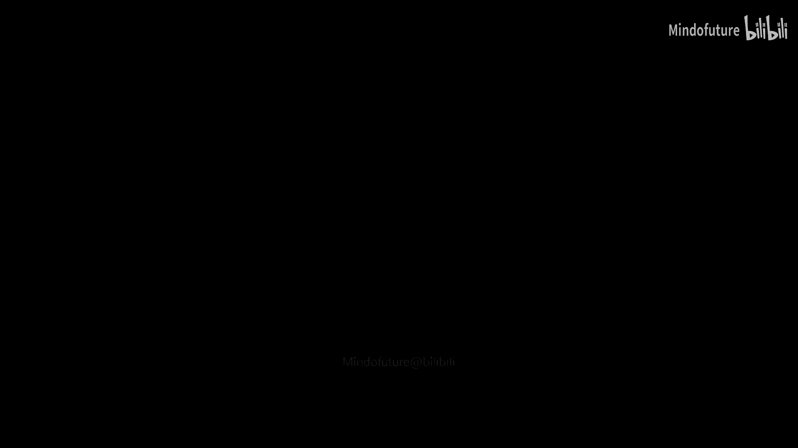
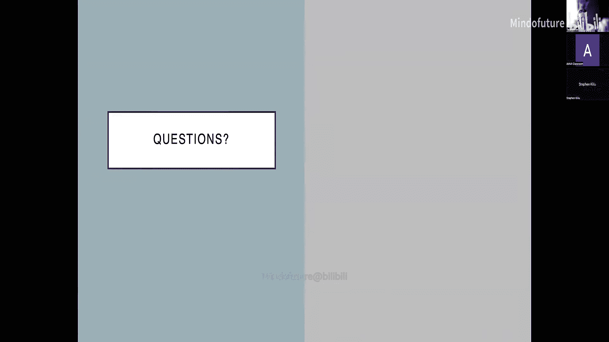

# 几何深度学习 ｜ Ammi Geometric Deep Learning Course p10 P10_第十讲（规范）-塔科·科恩 -BV1veHgzxELm_p10-

Yeah。Yeah。Okay。Okay， welcome back， everyone。 Good afternoon。 I am going to speak today about。😊，Gages。

 whoops。So this is a rather advanced topic， if you go and look at any textbook on gauge theory。

 you'll see probably that the prerequisites include not only group theory but representation theory differential geometry or topology and Lee algebras。

 lead groups， etc， in this lecture I'm not going to go into all these technical things。

 but I'm going to try to show how this notion of gauge which in its essence is not that complicated。

 how that appears in in real worldl geometric deep learning problems and how it informs the design of network architectures。

So I'll start with quite an extended section on motivation covering first the idea of feature fields。

 so this idea that certain kinds of geometric data should be thought of as fields on your domain。

 in the previous lectures we've covered signals on a domain which you can think of as scalar functions or vector valued functions on your domain omega。

 in some cases there's a slightly more general concept that you should keep in mind which is called a field。

 then another motivation for why we need to look at this concept of gauges is if you want to define a kind of generalization of convolution to data that lives on manifolds。

 whether it's a field or just a scalar function。And yeah。

 we'll look at various solutions to that and then introduce gauge equivariate convolution as a sort of a general framework for defining these kinds of convolutions。

Now I do have in this slide deck also a bunch of stuff on the mathematical theory behind this。

 bundles， gauges， gauge transformation， gauge symmetry and equivariance。

 but I will not go into that in this lecture， I do leave them in the slide deck so for those of you who are curious about the underlying mathematics。

 I recommend to have a look there， but this will not be part of the lecture or the exam。So。Just to。

To right away give you sort of a high level idea of what we mean by gauge and gauge transformation I made this slide so the word gauge actually comes from a device that looks somewhat like this。

 it's an indicator of a certain value like let's say a barometer to measuring the air pressure and the gauge tells you the value and clearly the gauge has to have some kind of units right so if you measure a certain quantity in one unit you'll get a different value than when you measure the same physical quantity in different units and that would correspond to different gauges and when you change from one gauge to another then the values that describe the physical quantity will change even though the underlying physical thing remains the same。

Um。Now。When you give this concept to mathematicians they of course immediately generalize it to higher dimensions and the concept becomes quite unrecognizable from the thing that initially you know gave us the word gauge and so here what you see on the slide is a picture of the more general concept so what do we have here we have a manifold M in this case a sphere because that was easy for me to draw but you can think in general about any kind of curved or even flat space for that matter and the on the manifold we see various things so first of all we see this green arrow here which could be a piece of data that we have that we want to process more generally usually will have data that forms a field on this manifold meaning at each position on the manifold we have such a geometrical quantity like in this case a vector。

Now if we。You know， we can picture this and we can think in our head as this vector being somewhere out there。

 let's say it's an actual wind direction somewhere on earth。

 but if we want to represent it numerically in our computer then we need to choose a frame of reference or in other words a gauge and this frame of reference well we could choose it in various ways and how we choose this essentially arbitrary so here what I've drawn in addition is to this data here。

 this green vector is a bunch of coordinate lines， so those are the blue lines for example that gives you the standard latitude longitude coordinate frame on the sphere and then there's another equally good coordinate coordinate system for the sphere given by these red lines。

And using a coordinate system， you can identify a point on the manifold by some numbers。

 but you can also use it to derive a frame for the tangent space， in which this vector lives。

 so here we have our point and we can take two vectors， the red vectors。Sir。

 I'm getting some pop ups here。The red vectors。That are going in the direction of the coordinate lines。

Okay， this is annoying， I cannot move my mouse anymore。😔，My computer seems to be overheating。Anyway。

 the point that I wanted to make here is that we can use the coordinate lines to derive these basis vectors as you see the red basis vectors are derived from the red coordinate system the blue ones from the blue coordinate system in general you don't need to do it that way you can choose an arbitrary coordinate frame at every point and those are equally good and for every coordinate frame that you choose you get a different numerical representation of the same geometrical quantity。

 the same vector in this case and so that's what you see here on the left and on the right you see the coordinate charts with our green vector represented here as a pair of numbers ultimately in this case it's more stretched along the Y axis so maybe this numerical representation here would be you know。

Yeah。Hi， I hope I'm still audible for some reason in my headphones I was getting a terrible noise。

 so I hope we can just continue like this。Let me know if I'm not clearly audible。Anyway。

 as I was saying， we have the same quantity that has different numerical representations in the for the two choices of gauge。

And transforming， if we change the gauge， then we have some transformation of those numerical quantities and that's called a gauge transformation。

F thing that's very important to note here is that the gauge as you can see。

 is not defined on the whole manifold necessarily， in this case we have the blue arrows only in this region here and we have some red arrows in another region here and that's for good reason as we'll see but in general you know you have just these overlapping charts where the gauge is defined and it need not be defined globally。

All right， so that's the general picture， so why is this relevant for geometric deep learning applications？

So the first motivation comes from。ThisThis concept of a feature field。

So this is a type of data that occurs in various kinds of applications， so for example。

 if you are looking at weather data on Earth， global weather data or something coming from a climate simulation you might have among other things the wind direction everywhere on Earth。

So that would give you a vector field at each point in the space you have a。

A vector attached then another example is tensor fields so tensor is maybe a new or a more complicated word but in this case it just means a three by three matrix so it's a second order tensor and what it means is so you have a brain you put it in a scanner and at every point what the scanner registers is how much the water diffuses in all different directions that's summarized using this three by three matrix and if you remember from linear algebra you can think of the eigenvectors or you can compute from this three by three matrix a set of eigenvectors and eigenvalues。

And eigen you can visualize that as an ellipsoid as you see in this picture where the eigenvectors indicate the principal directions in which the diffusion happens in the that's the stretching of the ellipsoid in different direction。

 or sorry the orientation of the ellipsoid， and then the eigenvalues give you how much the ellipoid is stretched or physically what that means is how much diffusion there is in that direction。

And so this is yeah， another example of a field and as we'll see fields have a particular way of transforming。

ThatThat's important and the physical quantities have to be represented relative to a frame of reference or gauge。

So that's the first motivation that we just encountered this kind of data naturally and in order to represent it。

 we can only do that relative to a choice of gauge， which in many cases is arbitrary。

Another reason that we might want to consider kinds of this kind of data is that they。

that fields can be useful as internal representations in a neural network。

 so even if your input data is a scalar signal as or a vector valued signal as we discussed in the past。

诶。It can be useful to have internal feature maps that are transform like fields。

 so one motivation for that if you remember in the lecture on group convolutions。

 if we take our scalar signal and we just apply a group con solution naively。

 then the output is a scalar function on the group G and in some cases that's fine as in the case of planar rotations and translations you have a group with three axes and you can definitely store feature maps on that on such as three dimensional group。

 but in other cases for instance when the group is the group of permutations of n nodes then you have n factorial group elements that's very large or if you talk about continuous transformations。

group has an infinite number of elements and maybe a potentially large number of dimensions。

 and so this becomes computationally infeasible。Now there are alternative approaches that output scalar functions on a homogeneous space。

 which is lower thanal， but this leads to strong constraints on the filters and so by having your internal feature maps as fields you get some intermediate solution where you don't pay the full computational cost of storing a feature map on a group。

And yet you have more expressive features and filters than just scalarrs。

 which you get for scalar fields。And we'll look at more detail at this in a minute。Okay。

 so here just the。Explain in a bit more detail the mathematical concept of the field so so far in this course we've mainly considered signals that we modeled as functions on our domain omega so omega was a graph or a grid or some continuous space maybe a homogeneous space like the sphere and then we had some data that's a function on omega so at every point U。

It returns a set of feature values， a vector in C。C being some vector space with a certain number of channels。

Now the notion of a field is a slight generalization of the idea of a function where instead of mapping every U to a point or a vector in the same vector space。

 you now map it to a vector space that is associated with the point U。

So the most intuitive example of this is the tangent space， so if we have our manifold again。

 just drawing a sphere here for simplicity。You can consider at every point the tangent space。

 which is the best linear approximation to the this point。And the。

As in the example of wind directions on Earth， the wind direction or the vector at that point will lie in this tangent plane。

 at least that's how we model many kindsed data。And although the tangent planes at every point are。

 you know， they look the same， they're all two dimensional vector spaces。

There isn't a canonical way to align all of them and they are really different spaces and you have to choose a different basiss or a different frame or different gauge also works for the same thing for each of those of those spaces so those spaces are called the fibers。

In the mathematical theory of gauge theory and fiber bundles。

 and they can be also more general spaces than just the tangent plane。Again。

 we'll look at more examples of that。Right so I think I've said most of this so to describe a field as a function we need to align all of these spaces so by and we do that by essentially choosing a basis。

 then we can then the space becomes you know aligned with the standard two dimensional vector space r two in this case of a two dimensional tangents plane。

And so that's another way to think about this issue of choosing a gauge。

 aligning all of these fibers。All right， so we have to choose a gauge。

In order to describe a field as a function and in some cases there's an obvious choice and so actually a lot of the time people don't even know that they are doing this and sometimes that leads to problems in other cases it's really not obvious how to choose it。

So if your space omega is the plane。And you're expressing the points in the plane using X Y coordinates with some chosen you know x and Y axiss。

 then it makes sense to just choose to use that same frame at every point in the manifold and even the distinction between the manifold itself in the plane and its tangent space which is also the plane becomes blurry and people forget about this distinction when you go to a space like a sphere then things become a bit more clear so here you know I can choose a frame at one point but yeah how should I choose it it's completely arbitrary and then what it means for the frame at another point to be the same is also not clear and so here you're really faced with this arbitrariiness you just have to choose something and it will affect how your data is numerically represented in your computer but in some sense it's clear that it shouldn't matter and that's why we will get to gauge equilibriumvariance。

Now there's another subtlety， which is that。A global continuous gauge may not even exist。

So if you have a continuous signal on your a continuous field or even a smooth one on your manifold。

 you would like that the numerical representation of that field is also continuous or smooth and for that you would like your choice of frames your gauge to be smooth and it turns out that such things don't always exist so here you see a manifold a tourus which has a property that is called parallelizable。

And what you see here is a single vector field which is defined globally everywhere and it's also everywhere smooth。

And that could， for example， constitute the first basis vector of a choice of frame。

And here on this sphere you see an attempt to do the same。

 namely we want to choose a vector everywhere， and we want it to its direction to very smoothly。

 but we see that at the poles here we get a singularity so there the around the poles。

 the orientation changes very quickly and at the pole there's no way to choose the direction of your basis vector that is smooth because nearby basis vectors are all pointing in completely different directions。

And what that would mean is if you use this kind of non continuous gauge to represent a continuous field。

 then the field would numerically look discontinuous and that can clearly hurt the performance of your machine learning algorithm because it will generalize by you know assigning similar outputs to similar looking inputs and similar here means numerically similar。

 that is unless you explicitly account for the choice of gauge so that's quite important to me。

All right， so the lessons so far geometric data。Often in form of feature fields。

 the geometric data often comes in the form of feature fields and these things can only be represented relative to a choice of gauge and in general there's no sort of natural way to choose that gauge。

So the same field can be represented in many equivalent ways relative to different gauges。

Furthermore， in general， we cannot even use a single gauge to represent a continuous field as a continuous function。

And you need to define your gauge locally。Now I should say that this last point is mainly a theoretical concern。

 the mathematicians care about this a lot in practical applications。

 there are also ways to use disous gauge in particular because we disretize our manifold anyway。嗯。

Okay， so now we get to this notion of。A gauge transformation。So my computer is again freezing。嗯。Okay。

 here we are。So Gatess transformation， I already mentioned this on one of the first slides。

 but here we look at it again and maybe find it a bit more precisely using mathematics。

So what we have on the left is a choice of gauge， it's the obvious one for the plane and then on the right we have very irregular choice of gauge but mathematically。

 equally equally good and as you can see the frames on the left are all related to the corresponding frame on the right by a rotation。

So the way we can model this is to say gauge transformation。

iss a function on our domain omega or more generally on some subset u of omega that outputs an element of a group G which in this case would be the rotation group so this is different from the kind of global symmetries that we've considered before。

 for example， our group G could be you know soO3 rotations in three dimensions that we apply to our whole space omega but we have one we only consider one group element and we apply it to our signal on omega here we have that single。

The analog of this group element is now a group valued function on omega。

 so you have a different transformation at every point。

That's why Gs transformation is also sometimes called local symries。

Now the way that this thing acts on signals is just like we saw in previous lectures is via some kind of representation。

 so G is act directly on the frames but if we have say a vector that will transform in a different way from for example the tensor as in diffusion tensor imaging and yet again different from other kinds of geometrical quantities so that's why we introduce this representation role。

Okay， so here we look at the example of a diffusion tensor image and how that would transform。So。

The diffusion tensor image signal is a function x from R3 that's our the main omega to R3 by3。

 that's our vector space C at each point we have a three by three matrix。

And when we want to you know rotate the eigenvectors or rotate the ellipses that you see here。

 the way to do that is to conjugate this matrix with a rotation。

 so the matrix m is mapped to the matrix R MR trans by some rotation R。Now。

 one thing you could do for this type of data is to build a globally rotation equivariant network as we saw before in previous lectures but this might not be the best idea because this brain data is typically registered which means that it's always in the same upright orientation and it's always centered in the image。

 and so you would never see the same brain globally rotated。But at small scales。

 it can very well be that the same patterns occur in every possible orientation。

 so it makes sense to assume that the local directions should be considered equivalent。诶。

Another way to say that is that all orthogonal frames that you can attach to the local position should be equivalent。

嗯。We can model that by gauge transformations with the values in the orthoal group closely。

If you then impose gauge equivaris， as we'll look at in a second。

 what it would do is make sure that your filters are locally rotation equivariant without imposing double constraints。

So what do we mean by gauge equi convariance， well here we have on the bottom left a vector field represented relative to the standard gauge for the plane and a particular coordinate system。

U we know that it needs to do a gauge transformation that's indicated by the horizontal arrow that we apply an independent rotation to every frame。

And。That will lead to a change in the numerical representation of our vector field。

 even though the vectors themselves remain the same。

Then we can apply a layer of our network indicated here by F that applies some kind of processing on this data here it's of course a very simplistic example。

 we have a vector field pointing in one direction and our layer flips it around to be in another direction of course in real applications so your network would learn to do much more interesting things。

But here， then we can apply a gauge transformation to the output and what we would like is that the gauge transformation of the output is numerically the same as applying gauge transformation to the input and then applying the same network layer F。

If the network satisfies this， we would say that it's gauge equityvari。Okay， so so far。

 we've looked at what are called external gauge symmetries where the frame of reference。

Is a frame for the tangent space of the manifold。And。

When you talk to physicists who are really the main ones who use this word gauge and gauge transformation。

 they typically think about something else， namely internal gauge symmetries。

 and these are mathematically quite similar but still different so in this case of internal gauge symmetries。

 the basis vectors of your gauge of your frame are not related in any way to the directions in the manifold or domain omega。

So here is one example， there are many examples in physics that I don't know that much about。

 but and also they don't play as of yet， a very important role in applications of geometric deep learning。

But。Here's one example， so what we can do is look at a single RGB vector so that's the fiber at a particular point in the plane。

R three and we。We can say that you know we have the RG and B basis vectors and we could， for example。

 permute them by the action of the permutation group on three elements。

And we could call that a gauge transformation if we do that separately at each location。

 then we're changing the numerical representation of the image。

 but if we remember that the order of the color channels at each pixel is now different。

 it's still the same image。And to say that this should be seen as a gauge symmetry means that you get a constraint on your filters that make it so that you get weight sharing between different color channels and all color channels are then processed equivalent。

I hope that's somewhat clear， this isn't to say this is particularly useful。

 but I hope to illustrate the concept of an internal gauge symmetry。

 which may find its application in geometric deep learning someday。All right。

 so we've looked at feature fields as one motivation for looking at this notion of gauges。

 there's another one which is important in geometric deep learning。

 which is when we ask the question how can we generalize this notion of convolution。

 which has been so you successful in in let's call it classical deep learning。

 how can we generalize that to manifolds or other kinds of spaces？

Now we've already seen various kinds of generalizations of convolution and these were mainly。诶。

Following the following philosophy so you define a filter at some position in your space。

 let's say you put a filter on the north pole of a sphere and then you use symmetries from the symmetry group of the underlying space homoga sphere in order to to move that filter over your space so you can do that in the plane shifting a filter over the plane or shifting and rotating it you can do it on the sphere and you can in fact do it on any kind of homogeneous space so what was that again a homogeneous space is a space like the sphere where for any two points。

There exists a symmetry that maps one into the other and so what that means is if you apply these symmetries to your filter。

 you can take a filter defined in one position and move it to any other position and that gives you global weight sharing and something that looks a lot like a convolution。

However， there are plenty of manifolds that are not homogeneous spaces and so you can think of an arbitrary wobbly space or a shape of a human figure or some other mesh or manifold and usually it's not a homogeneous space here you see an example that's kind of in between。

It's a space that has some symmetry， we can apply certain discrete rotations to the Icosoahedron and that will map it back onto itself。

 so those are symmetries。And those would for example， take the filter here。

 the blue one defined on this corner and allow you to map that filter to any other corner of the Ichedron and we could then use that to do weight sharing among the filters on the different corners。

 but since there are not enough symmetries here， we can't use that to map this filter to let's say an internal face or some position on an edge so you don't get enough weight sharing。

In this case， if you follow this strategy and in the general case。

 where there may be no global symmetries， you get no way tear at all。So。

This strategy for generalizing convolutions doesn't work anymore for these non homogeneous spaces。

Then there was another idea which is that maybe we can share filters by parallel transport and this is an interesting idea and one that that nowadays it's still part of the solution people prefer。

 but there are some subtleities associated with so let's say we have a filter defined here on the front of the sphereear where the black arrow is drawn。

And let's say we want to parallel transport it according to either this curve or this curve to。

To place this filter are different positions。What you see is that depending on which curve you choose。

 either the one with the red arrows or the one with the blue arrows。

 when you by the time you arrive on the opposite side of the sphere。

 the arrows are pointing in completely opposite directions。And。So what that means is that。

Just saying that you're going to take a filter to a one canonical position and then parallel transport it to every other position is not enough because you need to now specify again something completely arbitrary。

 which is the path by which you transport it and depending on the path you choose you're going to end up with a filter that is completely arbitrarily oriented。

 depending on which path you choose。So here's another way to visualize this in the classical case of convolution on a flat space。

 we can take a filter defined find here， let's say it called this the origin。

And then no matter how we shift to another position。

 the orientation of the filter is always going to remain the same。

 so that's a property of the parallel transport on a flat space。

 but when you consider a curved space this is no longer true so here you see a cube and you may think it's a bit odd to call that a curved space but you can think of it as a sphere where we squashed all the curvature into the corners。

So in this case， when we take the filter the defined here in the center of the front face and we sort of shift it without rotating。

 that is to say we parallel transport it to this phase here on the right and then to the top。

Or we transform to the top via by just going there directly via this green arrow。

We end up with two filters on the top face that are oriented relatives to each other by or transformed by a 90 degree rotation。

 so again you see that this path dependence becomes important。啊。😊，So yeah， that's an issue。嬲。

One way to address this arbitrariness of the orientation of the filter is to just choose filters that don't really have an orientation。

 so this is an idea that was one of the first ideas on how to do convolution on a manifold that was explored in the geometric deep learning literature。

Yeah， basically the idea is to use isotropic filters like this filters that don't have any directional sensitivity and if you squint a little bit。

 this is also similar to the simplest kind of graph neural networks where you use the same weights for processing messages coming from each adjacent edge。

Then a more advanced idea is what's called geodesic convolution by Musky Boskeni and with Michael Bronstein and pair of Underguidance。

 so here the idea is that at each position P in your space omega。

 you're going to extract a local patch and look at the signal on that patch。

And then you're going to take inner products with rotated copies of a filter。

So that's quite similar to what we saw in the lecture on group convolution， you take a filter。

 you apply you just apply it in every orientation and then you get a whole bunch of responses for different orientations of the filter at each position and in the representation theoretic or steerable CNNM way of looking at this this would we call a scalar to regular operation scalar representation to a regular representation and now in order to iterate this procedure to apply the next layer to apply non nonlinearities and then the next layer of geodesic convolution you would have to do max pooling over orientations。

In order to get to get a quantity that's invariant to the orientation of the original filter。

 which as we've seen has to be chosen in an arbitrary way so that's that's a good idea now we can detect directionally sensitive features like this edge detector here。

But the features that you have after max pooling are still orientation insensitive in that they can only indicate that there is。

 let's say an edge at this location， but not what orientation it has， so it has to。

 you know you're still losing information by cooling。So that's where gauge equivariate networks come。

So here the general idea again follows very much the geometric deep learning blueprint as described in our book。

We first define for each layer a feature space， so we have our space omega。

 in this case typically a manifold and we attach a feature space see the fiber in the mathematical theory of this stuff。

U this。Fibber， this feature space comes with a transformation law or group representation。

 for example， a vector transforms differently from a two tensors as in diffusion tensor imaging and those transform differently from a scalar as in a gray scale image。

And this determines how gauge transformations act on the feature vectors。

Then our feature space is the space of fields of those types of geometrical quantities over over and then we we are looking for a convolution layer that's gauge equity varied so if we perform a gauge transformation for example if we orient our filter relative to gauge we transformed the gauge the filter will be transformed will be rotated for example。

嗯。And we want the output coefficients then change accordingly。

So the simplest case is the one where our input signal is a scalar signal and output signal is also a scalar signal。

 so we have our yeah we have again our signal Xon omega real valued and we have a filter that is defined。

In some well， usually it's parameterized on the tangent plane。

 so it's a function on the tangent plane that's mapped to the manifold by the exponential map and it's oriented relative to gauge。

And then you define the GaEc reant convolution by integrating over the local patch parameterized by the tangent plane coordinates。

Yeah， the product of the signal in the filter Now one can prove that this type of operation is gauge equivariant if and only if the filter is isotropic so that's again an instance of this phenomenon we've observed that if your input is a scalar signal and your output is a scalar signal then the filter has to be isotropic which is quite undesirable in general so then there's a more general type of operation where now your signal is a field represented relative to some choice of gauge you can think of it as a vector valued function a filter is then a matrix valued function and the basic you know the rest of structure is very similar but the basic result now is that this is gauge equivariant if and only if the filter satisfies a certain equivariance constraint and。

meant looking at the literature engagement variant networks。

 if you want to see the details of this derivation。嗯。

Yeah okay i'm going to skip over the implementation details because there are by now quite a lot of different ways of implementing this you know what i've covered in this lecture is mainly the underlying theoretical ideas。

 but when it comes to implementing this there are many choices and there also by now quite a lot of applications so this is one of the early works on applying this to problems in physics。

Sampling using S and gauge at pervari flows。Application to let gauge theories so these are physics application。

诶。And as I mentioned， by now there's a much larger literature。

 so if you're interested in physics applications， check out these papers and also the papers that cite them。

On the theory side， Maurice Weler has an interesting paper on coordinate In convolutional networks。

 which covers a lot of the same material and has a lot of nice illustrations to explain these ideas。

And there are various other works that've also covered this material。So then as I mentioned。

 there is a lot of mathematical theory behind this called the The of fiber bundles。

 which I will not go into now。Okay。Right， but I did want to share with you this slide。

 which hopefully will put the different methods that we've discussed in this course into perspective。

So we all know the good old convolutional network for planar signals or three dimensional Euclidean signals。

And then we looked first at。generalralization called group convolution。

 which we could extend all the way to signals on general homogeneouss。

 spaces where the symmetry group can take you from any point to any other point。

 and we looked at it for scalar signals， so the case where geometric the features attached at each point are not affected by the transformations like RGB vectors。

Then we looked at a generalization called Stable CNNNs where now you're still looking at a homogeneous space。

 but you can consider more general kinds of fields， vector fields， densesor fields， etc ce。

 and then we looked at convolutional nets on manifolds like Romanmania manifolds。

 the we have the geodesic convolution for example， and then we looked at finally gauge CNNs。

 which is a very general framework that can deal with global as well as gauge symmetries on general manifolds。

So that's it for today， thank you for your attention and I'm happy to take questions。

