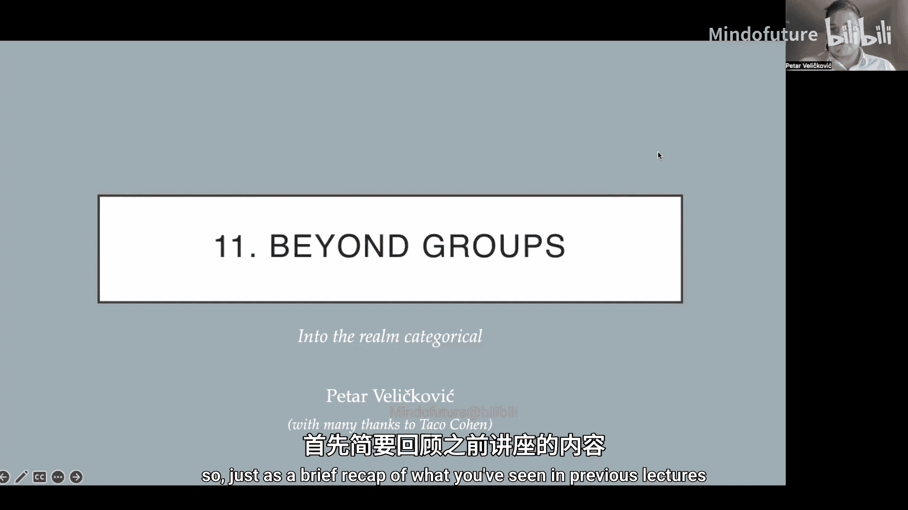
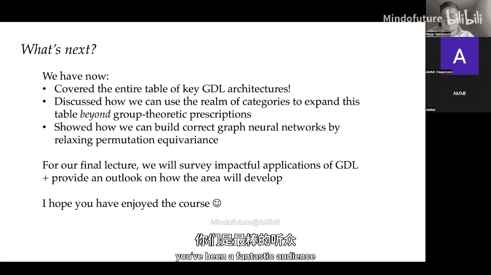

# 几何深度学习 ｜ Ammi Geometric Deep Learning Course p11 P11_第十一讲（超越群）-佩塔尔·维利奇科维奇 -BV1veHgzxELm_p11-

Hi everyone， it is great to see you all virtually again for this well。

 third lecture out of the lectures that I'm giving inside this Gemetric deep learning lecture series。

And for today's lecture， we are going to。Actually try to somewhat escape the realm of what you have been doing over the previous lectures。

 which dealt with group theory and representation theory and how those areas of mathematics can be used to rederve and rediscover many of the influential deep learning architectures that we use today and also how to categorize and organize the plentiful research of deep learning that we're bombarded with every day。

However， there are actually some potentially limiting or restrictive factors with using group theory to。

To model architectural design and therefore especially as we start to model some more expressive or more exotic architectures。

 it might be interesting to also keep in mind what lies beyond the realm of groups so this is what this lecture is all about we will be going beyond groups and into the realm of categories and I just like to say before kicking off this lecture that I'd like to give a great thanks to Taco who has kind of almost co-develop these slides together with me in terms of in terms of content both of us are quite actively working on the research that you will hear about in this lecture so definitely if you have any follow-up questions please don't hesitate to ask either me or Taco we will be very happy to discuss these things so。

Just as a brief recap of what you've seen in previous lectures。

 so you've seen how we can take this idea of geometric deep learning which arises from invariance and equivariants and related locality ideas and as a result of just directly applying the ideas in the blueprint。

 we have been able to redderive and rediscover several popular architectures。

 I've shown you how to reason about deep sets， graph neural networks and transformers in my lecture series。

 there have been several related lectures afterwards that introduce you to some of the other models you see on this slide like Comnets。

 group equivariant Coms， spherical models that work over over the sphere and also various kinds of mesh CNNs。

And this is the table that we've shown several times during this course that shows how you can reerve each one of these popular architectures or even more infamous architectures like the spherical CNN by more or less directly applying the ideas from the geometric blueprint so selecting a domain your data lives on and the symmetry group you want to be resistant to and this is just a kind of color code what you've seen as a function of which lectures you've seen it in so lecture5 lecture6 we've covered graph related neural networks and then going beyond that is what you saw from lecture 7 to10 Now in the previous iteration of this course which you might come across online we have actually also had a lecture on sequence models and LSTMs however for this year we have decided to leave the exposition of LSTMs to the probook if you are interested to learn more about it。

AndInstead we thought it would be more interesting just thinking of the current you know emerging movements in the field。

 it'll be more interesting to show you what lies beyond groups which maybe we collectively haven't understood as well this time last year so we think now it's a good time to also give you some insight on what lies beyond and if you would like to learn more about LSTMs you have last year's lecture and you have the book as well。

You will not get anything LSTM related on the exam for sure。So。

So that we can start talking about going beyond groups it might be good to kind of just do a first step recap on what the essence behind everything that we've been doing so far is and undisputably those would be the symmetries so here you have the familiar example of all the symmetries of a triangle that will be generated by rotations and horizontal flips and if you remember a symmetry is a transformation of an object that leaves that object unchanged for all intents and purposes so here if you rotate and flip the triangle it is technically still the same triangle you're just changing where all the three nodes of the triangle are。

 but from this perspective we assume it's actually the same triangle just observed differently and we want to then potentially build neural network architectures over this triangle such that these constraints are respected。

And based on the idea of symmetry and this idea of resistance。

 we then were able to design one at a time neural networks that were fully resistant to these kinds of symmetry transformations。

 so the two main concepts were invariance and equivariance。

Where invariant models were built such that applying any symmetry on the input does not change the output。

 this is perfect if you want to have predictions on the level of the entire domain and then equivariant predictions which boils down to having symmetries on the input。

 which then will affect the output， but they'll affect the output in a very predictable way。

And it turned out that these concepts were pretty much sufficient to redderive all the fan favorite architectures。

 so that's already a good sign that just focusing on group theory and symmetries is a good idea for studying deep learning but what we want to talk about today is are these symmetries actually the whole story and to kind of ground ourselves mathematically in this question。

 I'm going to just quickly recall the axioms of symmetry groups。

 So this is a slide that you've seen before， I believe in one of tacos lectures。

 which shows you what are all the things that a group has to satisfy so you have just as a recap a group is a set this capital G we typically use for it and the elements of G can compose with one another using this binary operation GH and then that operation has to satisfy certain properties like the composition must be associative。

There must exist in identity for every transformation there must exist in inverse and also as you repeatedly apply pairs of elements you can always compose them to obtain a new element in the symmetry group and here on the right hand side one of my personal favorites。

 the rotational symmetries of the rubikk's cube and if you look at these definitions you can see that there are already some things that are quite strong about assuming a symmetry group and。

Specifically， I've highlighted two of them， we might also want to consider more aspects of it。

 but the two that are particularly prudent are this assumption that every transformation must have an inverse。

 this basically means that all the transformations you care about are never going to lose information。

And the second property， which is this idea that no matter which two transformations I take。

 I can always make a composition of them， which subtly makes the assumption that all of my symmetry transformations must compose with each other and。

Strictly speaking in reality， this is often not the case that all of your transformations will be invertible。

 so it is possible that you might care about operations that will lose some information about your data and the previously studied blueprint will just not work in those cases because it assumes that your data lives in a symmetry group in which case the transformations must be invertible。

嗯。Further， as I said， we are assuming that we can take pairs of transformations and always compose them。

 well in reality， not all pairs of transformations are going to be composable for many realistic scenarios。

So as a result。We might be interested in going beyond the realm of what symmetry groups can explain Now one thing I want to highlight。

 and this is very important， especially for the recent lines of research on very large models is that when you have access to big quantities of data you don't have to be as rigorous about this in the sense of you can either take a close enough symmetry group to approximate these transformations or you can use just straight up data augmentation and make the network learn to be resistance to these kinds of transformations but this is beyond the scope of what we want to do in this course。

 because we're interested in how to take rigorous constraints of。

Neural network architectures respecting certain properties and then actually enforcing those constraints into the architecture right so everything that deals with appxim or augmented approaches to enforcing symmetries is technically outside of the direct scope of this course because effectively talks about pushing the network in a direction of doing something。

 but the network is under no reason necessarily obliged to respect that property。

 especially when going beyond the training set。Now。

 since it seems that at least two fundamental properties of groups such as invertability or composability。

 are potentially not going to be satisfied， it seems like we need something a bit more general than group theory and specifically we might need a perspective to allow us to reason about general computation。

 which might be lossless and which might not necessarily compose。

And what I hope to convey to you during the course of our lecture today is that category theory is a dynamic field of mathematics that might offer us such a perspective。

 I hope I hope you will enjoy this。I hope you'll enjoy this exposition and once again I encourage you if something sounds unclear during the course of this exposition。

 please feel free to ask questions either in the Zoom chat or in campus wire。So。Hey， Peter。

 there is a question okay someone is asking please a group is a set of what functions。

That' that's a good question in the case of what we've been studying in this course group will be a set of functions。

 but in reality there are no constraints on what the things inside the group are。

 we just talk about them as group elements and some binary operations such as composition。

 but for the purpose of this course I think you can almost always safely think of them as functions。

Yeah。Okay， so now what we're going to see is how we are going to transition from the world of group theory into the realm categorical。

 into the domain of category theory。And what basically is going to happen just to give you kind of a heads up and a blueprint of what's going to happen throughout this lecture。

 we are gradually going to take the concepts we used in group theory， such as groups。

 group representations， and then finally the gold Star equivaris from which we derive our architectures。

And we will generalize all of them in a categorical framework。

 so groups are going to become categories， representations are going to become fctorters and equivariance constraints are going to become naturality constraints。

It's totally fine if you don't understand what any of these terms are。

 the point of this lecture is in part to teach those fundamental concepts hopefully in an approachable way。

And what's very critical about these objects， categories。

 functions and naturality is they will give us more expressive power。

 we'll be able to model things that are not as constrained as they would be in a group。

 so for example transformations will no longer need to compose all the time。😊。

And this as a result will allow us to more closely model what are the transformations we want to be resistant to。

 and as a result， we might be able to build neural networks that are better aligned to the problem that we want to solve。

Now one thing that I want to stress on you， it's very important is that some people in the area especially might find category theory to be a bit unapproachable。

 almost a bit like you know dealing with unexpected dragons here in the corner。

 I've asked a version of Dali Min to synthesize a picture of a dragon doing category theory。

 and I think it did it fairly accurately。And that is。

 I think primarily because many of the introduction material you might find on category theory online is geared towards mathematicians if you don't come from a mathematics background。

 I would not recommend you start learning category theory in this way simply because it assumes you know a lot of standard mathematical knowledge which it then uses for analogies there exist many very。

 very good introductions to category theory which are in turn geared towards computer scientists and even machine learners and I would highly recommend when you if you start your exploration inside this field to always be mindful of who that particular content is targeting and basically not to get lost in the dragons。

One of the reasons though， speaking of this older literature which is geared towards mathematicians。

 one of the reasons why we find it quite important to talk about category theory is also that historically it has always been recognized as a natural extension of everything that we've been doing so far so as you probably remember especially from Michael's lectures the foundation behind what we're doing here is the Earll in program of Felix Klein now if you look at the paper on general theory of natural equivalences。

 which is the first paper to introduce category theory concepts in 1945 from Eenberg and McLean。

You can see this passage inside that paper， which says that。

Basically their ideas for category theory can be seen as a more or less direct continuation of Klein's earlying program。

 so the founders of category theory basically say that their entire field is based on the ideas of Felix Klein and as a result probably it will be a natural next step for us to study as we seek to build more general classes of architectures。

🤧う。But once again， I would not actually recommend that you start your journey category theory by reading this paper unless you have some prerequisite mathematical knowledge。

So let's try to demystify what is a category。So that we can start our journey of manipulating categories and relating them together。

So it's actually not that complicated to define what a category is。

To define a category you need to specify something that's called a universe of objects now there's a good reason why I'm using the word universe rather than set of objects and it' will become clear in a few slides time why I have to be careful about how I call this collection。

 but you can imagine it as basically some kind of a collection of objects。

And once you have those objects， you can also draw morphisms between them。

 so amorphism is just an arrow that connects one object to another。

And these morphisms cannot be drawn arbitrarily， they must satisfy a few simple properties。

So for this collection of objects and morphisms to be a valid category。

 you need to satisfy the following for every object inside the category。

 there must be a unique identity morphism for that object。

 so a morphism that maps that object to itself and it's often called ID for that particular object。

Then if I have two morphisms that could compose with each other。

 so I have a F that connects A to B and I have a G that connects B to C。

 then there must exist a morphism that takes me directly from A to C。

 which is the composition of those two。Then it must hold that if you compose anymorphism with the right identity。

 you'll get that morphism back as you might expect。And also associivity must hold。

 so whenever I have threemorphisms， FGNH that could compose with each other。

 it doesn't exactly matter in what order I choose to do with the pairwise compositions。

So it's hopefully a fairly simple collection of rules and here in the bottom right corner you see one example of how we typically reason about what's going on in a category by drawing these kinds of commutative diagrams。

 which are basically to some extent you can imagine them as directed graphs where objects or nodes and themorphisms are edges。

And here you see there's amorphism F from A to B， there's amorphism G from B to C。

 and that means I must have amorphism， which is their composition that takes me directly from A to C。

 and you can see all the three identities associated with every object we won't always draw these identities because they're assuming you're working in a category the existence of the identities guaranteed。

 but sometimes especially for these introductory examples it's useful to highlight them and why do we call these diagrams commutative。

 well basically it's because whenever you take any particular pair of objects。

And you look at any path from one to the other inside a diagram like this。

 this path yields the same function so I can choose to go from a to C by going first F to B and then G to C or I can go straight from A to C by following the composition arrow。

 the commutative diagram property says that these two paths are exactly the same function which is the composition G and F so this is the main concept of category theory。

 I hope like even though material and category theory quickly gets complicated。

 I hope that at least these basic definitions are basically sensible and you can kind of keep them in the back of your minds as we go along。

ok。Now there are few important observations we need to make looking at this collection of definitions。

 the first important observation is that a category indeed generalizes a group。

 so if you look at the axioms for a category and you compare them with axioms for a group。

 you'll see okay I have identityentities still， but now I don't have just one identity for the whole group I have a separate identity for every single object。

 this is very important。And also I am not at all required in these axioms to have an inverse so if I have a morphism F that takes me from A to B。

 there's nothing inside these rules that tells me I must have amorphism that goes back from B2 a that is its inverse that does not have to hold okay so we're already relaxing the group constraints and also quite obviously from the constraint of I can only have a composition when the f and G are composable so basically the endpoint of f must equal the start point of G for me to be able to compose them together and this means that in most categories you won't be able to compose all pairs of morphisms simply because their endpoints and start points will not match so we've already created an object that is more general than a group so that's a good start although it still satisfies very important regularity constraints such as sosociivity and the existence of identities。

But one thing that's very critical to understand is that when you talk about things in a categorical perspective。

 you are literally just looking at a collection of objects okay so when you talk about proofs in a categorical context and the derivations in a categorical context you are usually not allowed to look at what's inside these nodes okay these nodes。

 these objects might be very complicated mathematical structures。

 but you're not allowed to look inside them， you just see them as a right there's an object a and that's it I cannot really see what's going on we'll see concrete examples of this soon。

 but basically this is an important thing to note the main aspect of category theory that we are allowed to study are demorphisms so the arrows between those objects and this is really interesting because it allows you to focus when you're analyzing your models just on the structure of the computations。

 the structure of the arrows and you're not thinking too much about the details of what those。

Errows are doing okay and it turns out that when you abstract away these kinds of details。

 it is really excellent as a recipe for you to discover connections and people who are category theory practitioners are using category theory to basically discover and rediscover connections across all different areas of math which you might not be able to relate normally because they operate on very different types of objects but the way in which they operate turns out to be very similar because of the same morphism structure I heard a ping so do we have a question on campus wire could you read it out。

🎼Yes， there is a question。Yeah。Could you read it to me， please because I don't have two screens？Yes。

 there is a question。So does morphism mean mapping？Yeah， you can think of morphisms as mappings。

 yeah。I would just not think about morphisms as functions because they don't have to be functions。

 but in many cases that will be of interest to us， morphisms will be functions。like for now。

 morphisms are just arrows， so it's something that connects one object to another。Okay。

 so now let's like I hope that this abstract you into categories hasn't been too scary and now we can actually talk about a very concrete category to first try to ground all of these concepts in something that should be familiar to all of us and also there another question yes。

 please go ahead。So someone say we talk aboutmorphisms asarrows。

 So that means they are only applicable in graphs。No。

 this doesn't mean they're only applicable in graphs because you can think about them as computations or transformations that take you from one category from one object to another。

 right？This does not mean that you work in graphs。 We will see some very exciting categories。

 for example， that have only one object， and just morphisms always take you from that object back to itself。

But I mean， if you hold on a bit， I hope to show you specific examples of how we can use morphisms in different places。

So we're going to talk about basically something that everybody who starts category theory。

 especially from the perspective of computer science sees more or less as a first example。

 and that is the set category， the category of sets。So。

One thing that's very important is that when you talk about a category， you always。

 always should start by specifying the details of that category。

 so just make it clear what are going to be the objects and what are going to be themorphisms。

Because that is a necessary theoretical grounding that establishes the constraints of the category and without them it's not very clear what is the setting you're working in。

And for the set category， the objects are going to be sets。

And the morphisms are going to be functions between them。

Now here you immediately see the first example of why when I said when we talked about our collection of objects。

 I had to use the word universe， which is a bit weird right， why didn't I say sex？Well。

 for those of you who have done some aspects of set theory。

 you might have heard of Russell's paradox， which asks， does a set of all sets contain itself。

 and it's a very paradoxical question， which basically means that defining sets of sets is potentially a bit tricky。

And if I were to say that my category has all sets， and I am also allowed to create sets of objects。

 which means I can create sets of sets， I might run into a problem of this paradox and that's why there is this formal mathematical concept of a universe。

 which is， you can think of it basically a collection of items which avoids these kinds of paradoxes。

But it's not critical for what we are going to do so basically you can imagine this category is just a collection of sets and morphisms or functions between them。

 so here on the right hand side of this slide you see one particular example of two objects and amorphism so you have sets A and B。

 and you have one particular function F between them which is amorphism between them。

OkayAnd as you might expect， a function takes elements of the input set and every element of the input set attaches an element in the output set。

Okay。However。As I said， in a category theory perspective。

 we are not allowed to look inside these objects okay。

 so what you will see in a diagram is actually this thing you have a just an object A， you have B。

 just an object B and you have F and arrow connecting the two of them which indicates to you that there exists a function F that maps elements of a to elements of B。

 but you're not allowed to look at what is a， what is B or specifically how F maps parts of a to parts of B。

 you're not allowed to look at that okay。And I think it's a very good exercise for you to do afterwards is to show that if I define my set category in this way where objects are sets andmorphisms are functions。

 that it can be made to satisfy all of the important axioms of categories that I showed you a few slides ago。

 so essentially that you're able to compose these arrows that the order of so that you have asciivity and compositions and that you have a unique identity for every single set。

 okay。Now you might be asking and you know here I've kind of drawn in faded colors the actual contents of A and B so you can see that in reality underneath there's still very rich sets happening underneath these objects。

 you might be wondering okay， but if you take all that complexity inside what's in A and B and you reduce all of that to just a node for A and a node for B。

 doesnn't this drop a lot of data。And I will now show you hopefully a mind blowing result that illustrates why this is actually not quite the case。

 like even though we're not allowed to look inside our sets， we can still say many。

 many things about what's inside those sets。So。😊，We will go through this together。

 we will go through this in a sequence of exercises。And specifically。

 what we're going to first talk about is this special set called a one element set。

Sometimes it's called unit， sometimes it's denoted by these open and closed parentheses which I've deliberately used because it relates to functional programming so for any of you who have done any hasskell or similar kind of language you will see this notation of open close parenthsesis to basically talk about a set with a single element okay and now like you know not thinking about the confines of a category I'm just asking you a question if mymorphisms are functions。

I'm going to take any set A right， with any number of elements and I'm asking you。

 what can you tell me about the functions from any set A to this unit element set like is there anything special about these functions？

And since I don't see anyone like actively in Zoom。

 you can post your answers in campusus wire and maybe you can read out to me what the answers are。

I be there is one answer thing now answer is。Unique unique exactly so when you think of everything maps to1 exactly great so you're still with me and this is exactly what I wanted you to say so there actually exists exactly one morphism from a set a to the unit set okay and that is exactly the function that maps every single element of a to that particular node right？

😊，And actually this property that every single set in my category has exactly one morphism to the unit set uniquely defines the unit set up to isomorphism。

 so every single set with one element will have exactly the same property。

 but only the sets with one element will have the special property okay and when you look at what this looks like categorically。

😊，This is a property that says no matter what set A I choose。

 there will be exactly one arrow from that set to the unit set okay this allows me to just look at the arrows and uniquely identify up to isomorphism the unit set okay and from a category theory perspective this thing is actually called a terminal object so if you have an object in your category such that every other object points to it by exactly one arrow then it's called a terminal object and in the case of the set category the single element set is a terminal object and this allows us to uniquely identify it so we can always without any doubt identify which object is a set with one element but now we're in a pretty magnificent situation because if we know what object has a single element set inside it then we can talk about morphisms from that set to any other set B here。

I have now my unit set that I just discovered on the left hand side and I want to talk about themorphisms from it to any other set B。

 so who could tell me what are themorphisms from the unit to be？Once again。

 please write your answers on campus wire。I I think this time they need your help， Okay， fair enough。

😊，So we start from this one element that is inside unit and what does a function do from that element to a different set B well？

You just need to choose some element of B to map unit2 right So this is the collection of morphisms from unit to B。

 I hope that makes sense。 So every single function from unit to B isolates one particular element of B。

 And that's why sometimes especially in functional programming languages。

 we call these morphisms the constants on B Okay you get one morphism per element of B right I hope this makes sense。

 So in this case where B has six elements。 And I number them from one to6 just for convenience you have a separate morphism G1 G2 G3 and so on that isolates every single element of B And the number of morphisms you have。

 is， as you can tell， probably equal to the number of elements that you have inside B。

 So I hope this answers the question please write on campus wire if this doesn't make sense。

 but what's really。Fantastic about this。 Like if you look at now the arrows going from the unit to any particular set B。

Is that every single morphism here from the unit to B isolates one element of B。

 one unique element of B。 and as a result， taking all these six morphisms together。

 I can tell you exactly what the elements of B are up to isomorphism right So the fact that there exists6 arrows taking me from unit to B immediately tells me that B has the same structure as the set 1。

2，3，4，5，6。So I must stress on you how how epic this result actually is right because we never looked at what's inside any of these sets when we drew these arrows right we just looked at the properties of the arrows。

 the structure of the arrows and from the structure of the arrows alone we were able to reconstruct the elements of any set in our category up to isomorphism right so I've been able to tell you everything about what's inside an object B。

Even though I never actually had to look at what's inside the object B。

 I just had to tell this is the unit and now the unit has six arrows to that particular object。

Was there a question？Yes， there is one question。So under which conditions do we get each element， V1。

 D G2， etc cetera？I mean， there are no particular additional conditions， really。

 so under the constraints of the set category。We shown how we're able to identify the single element set。

 and then we know that every unique arrow from that set to another set tells you one particular element of that set。

 So for all intents and purposes， you can think of the collection of morphisms from units to B as the set of objects inside B。

I hope this answers the question。嗯。Okay， so。The reason why I think this result is quite awesome is because you now have this framework where you're not concerning yourself with what's inside the objects like what's the data you're doing computation over。

You can just look at the patterns of computations， so basically the arrows between these objects that transform them。

And you're able to focus on this to be able to detect patterns across different areas of math。

Without drastically losing information， really， like I've been able to tell you， up to isomorphism。

 what is all the elements inside a particular set just by looking at the arrows？And that's。

 in my opinion， pretty cool， and it will be quite helpful when we reason about how all this applies to deep learning。

Now， one thing that's very important for you to keep in your minds is that all the results we get from category theories。

 such as this great result about you can reconstruct everything inside the set category。

 it's all made under the assumption of what category you're working in so often a very important first step when you do any categorical derivation is to be very clear and upfront about what's the category you're working in and just because you found the result in one category that does not mean that they must transfer to another category and just as an exercise I think could be quite insightful。

 if you look at the category of relations， which we often call RE so your objects are still set but your morphisms now don't have to be functions they can be relations so relations are a strictly relaxed notion of a function where。

 for example， one objects can be related to many other objects in the other set or some objects even do not need to be related to any other objects and so on。

And if now you make an arrow from set A to set B for a relation between them。

What would be the terminal object inside this category I think it's a very important and insightful question and then following up from there can we even do this trickery of discovering a single element set if ourmorphisms are relations rather than functions so have a thought about this I think it's a very instructive exercise and it could be also quite relevant if you choose to take a categorical question in the exam for example。

Okay。Now， sorry， was there question？Yes， there is one question。 What is the meaning of real RL。Yeah。

 so that's that is a category where objects are sets and morphisms are relations。

 they're no longer functions。 So when we looked at set。Morisms were functions。 Now in rail。

morphisms become relations， and this means they are more relaxed， less restricted than functions。

 And now the question is， do you have a terminal object inside this category and if so。

 what is its structure。Okay。So now we have the question of because I said this notion of a category should generalize a group。

So let's think about what would a group look like inside a categorical realm Well。

 what are the things that categories relaxed that groups had very strict first。

 you did not have an identity for every single object right all identities had to be the same。

Then you had to be able to take any pair of transformations which in the context of categories are morphisms so you need to take any pair of morphisms and make them able to compose with one another and also all of our group transformations had an inverse so all morphisms also need to have an inverse okay and it turns out that looking at these properties will pretty much directly tell us what a group looks like in this category scenario。

So basically， if you look at the first two prescriptions。

 then it's a fun exercise to convince yourselves why this is the case。But basically。

If you need all of your identities to be equal and remember I define an identity for every object separately right and you need to make all pairs of morphisms composable so basically the endpoint of every morphism must equal the start point of every other morphism。

 I hope you can fairly quickly come to the conclusion that this means that a category corresponding to a group must have exactly one object。

This object G here， okay？And。The fact that you say your category corresponding to a group only has one object immediately gives you the first two properties right because there will be exactly one identity。

 the identity of G so you've satisfied the fact that there' is a unique identity transformation and also because every morphism will go from G back to itself that means you'll be able to compose it with any other morphism which also takes G back to itself okay so。

After the lecture or if it immediately strikes alarm bells， let me know。

 but basically you should take a moment to convince yourself that if all identities need to be the same and all pairs of morphisms need to compose。

 I can only satisfy this if my category has exactly one object。ok。Now of course。

 it might sound a bit restrictive right if I have a category with only one object。

 but in reality there's still a lot of very rich structure inside these arrows that I can use to study my computation。

 right？And specifically we still have the third condition that every morphism needs to have an inverse。

 so if you remember in the previous picture I had some identity， I had function F sorrymorphism F。

 amorphism G composition of the two now I need to make sure also all of the inverses of thesemorphisms are also present。

And it turns out in order to recover inverses， you need some condition on themorphisms which would sort of generalize a bijection function in function terms。

Specifically， we call amorphism F which takes a to B to be an isomorphism if there exists amorphism G that will take me back from B to a such that no matter how I compose the two I'll get the respective identity right so in some sense we can think of G and f is inverses of each other。

 but in a categorical setting， this is already a bit more general than having invertible functions because as you can see the order in which you compose the inverses gives you a different identity。

 of course in the context of groups we have exactly one object and as a result these two identities will be the same as we would expect but just to say in general categories with more than one object。

 these inverses are not quite inverses。😊，And once we have a notion of inverses we can now finally complete our definition of what a group is inside a category perspective。

 so a group is a category that has a single object G。

 and all the morphisms from G to itself are isomorphisms and I hope this illustrates to you just how much of a special case groups are right it's a very specific category with exactly one element and with a very harsh condition on the arrows and I hope this tells you how if I'm allowed to build more generic categories which aren't having the structure of this group that basically you know you're able to represent far richer classes of computation in this way。

And I think it's also a good exercise for you to look at afterwards to show that if I take a composition of two arrows in the setting where I have inverses。

And take the inverse of that composition， it is the same as inverting the corresponding morphisms and then composing them in the other direction。

 and it's good to try to prove this using only the definitions of categories I've given use so far。

Okay， so was there a question？Yes， there is question。 the question is。

 so a is a group is a set of functions containing one category。 This is a question。

 or this is only referring to this particular case。So what what I just showed you is that。

Groups have to be in a categorical context context， groups have to be a category with one object。

 exactly one object， and then the interesting symmetry transformations inside those groups are morphisms that take that object back to itself。

 which sort of makes sense right because we talked about symmetries as transformations that leave an object unchanged so it makes sense to have one object and then every morphism takes you back from that object back to itself right because it's semantically the same thing。

I hope this answers the question， was there another one？Yes， another question。

 for the condition for a group is that they exist exactly one in bed。

Within our formulation of groups using category theory， we have two identities。How this， how。

 how is that still a group。But you don't have two identities， this is the key thing right。

 because you have a category of exactly one element。Right。😊。

And therefore there exists exactly one identity so in this particular case。

 if I go back to the definition of what an inverse is in a category context here。

 both G and F will have to take G back to itself G the group object right and as a result you'll always get IDG as a result so in this particular case you don't have a problem because there is exactly one identity the moment you put more than one object。

 you no longer have a group and your inverses are not traditional inverses anymore。对。Okay。So。

I hope that。This exposition of what a category is abstractly as you know a collection of objects and arrows that satisfies some simple properties。

 and then the fact we were able to derive sets and groups inside this framework and basically showing how groups are a very special case of what you can do with these interesting arrow collections。

It already shows you that there is some power in category theory to explain things that group theory wasn't able to explain okay but I still haven't shown you the magic hammer right the part where category theory really starts to become powerful and actually category theory gets some of its most powerful results not within a single category where it can still explain a lot of interesting stuff。

 but when you take multiple categories and you let them interact with one another and。

Very often in category theory you're really just trying to redefine a concept you already knew and loved from before and try to make it fit within the category framework right so when we talked about isomorphisms。

 we were really trying to generalize the notion of functions that have inverses right。

And the same way we think about functions between sets。

 when we talk about interactions between categories， we can define a related notion of a fun， okay？

Now what's special about funs is that。They don't just act on objects， they also act on morphisms。

 so to be formal about this， if I have two categories， C and D。

 I can invent a fun capital F that takes C to D， and what does it do？

It maps both the objects in C to objects in D， but also the morphisms in C themorphisms indeed。

And you cannot just do this in an arbitrary way， a functer must preserve structure or well respect structure inside the input category and what does this mean if I take my functer and I apply it to an identity of some object。

 then the morphism I get inside the other category must be the identitymorphism for the object where that a gets mapped to okay。

 so F of the identity of a is the same as the identity of f of a。And secondly。

 the composition structure must be respected as well。

 so if I take any composition of functions F and G and I transform it into the other category using the funter。

 it is the same as if I first transform the individual morphisms using the functer and then compose them in category D so it's a fairly simple collection of just two rules but using those two rules。

 you can basically talk about very intricate relationships between categories。

And just to demonstrate this， so here is the familiar picture I showed you before of a category with three elements and morphisms f and G that compose to get F and G together and every single object A B and C has an identity。

So if I now build a funter from that category into another category。

What I'm really saying is you see here the functer as the dashed to arrow F。

 it maps the three objects I have to different objects inside a different category。 So F of A。

 F of B， F of C。诶。By the way， these don't have to be distinct。

 They could also map to the same objects。 but what is important is that the structure that was there in the first category must be present when you map it with funter to the second category。

 Okay， so you see exactly the same structure of the diagram。that we had on the left hand side。

 which was in category C， exactly the same structure must exist inside category D。

 and it's fun to like ponder this structure that the funter preserves。

 but maybe a kind of a better way to think about it is that whenever you have a good analogy between two concepts。

It's basically something that you can represent nicely using a funter right it's basically saying I have these two kinds of computations in these two different categories。

 but they look basically the same and my funter tells me how to map computations in one category to computations in another okay。

😊，So I hope like the diagram itself might be complicated。

 but in reality it's really just some kind of pattern you see in category C gets mapped to very similar kinds of patterns in category D I hope this I hope this makes sense and by the way this diagram is commutative so any pair of paths you take from any object to any other object should result in exactly the same morphism。

O。So。I hope this makes sense。And now let's talk about how this relates to geometric deep learning right because in order to be able to build strong geometric deep learning models。

 we needed to have useful equivariance constraints right and to get equivariance constraints we needed additionally the concept of a group representation here I have just as a reminder what a group representation is。

 it's this mapping row that takes individual elements in my group and gives me a unique end byn real matrix that has the same effect as the group action but inside the domain of linear algebra which is very helpful because in deep learning we really just care about linear algebra。

And it turns out， as you might expect， we can also generalize this concept of a group representation to categories。

 but we have to use functionss to make that possible because we need to map between abstract group elements and transformations of real vectors。

 was there a question？🎼Yes， the question is， are we looking at the two categories as node in a graph？

You could think about categories even just as nodes in a graph and at this point you talk about the category of all categories where things get a bit wacky。

 but you can also think about each category having its own graph with its own nodes and edges and then a functer maps from nodes of one to nodes of the other。

😊，But yes， you could look at it in that context as well。Now， specifically。

Since we want our fun to produce linear operators， right， so we go from what was inside the group。

which is an abstract object to an explicit matrix we can multiply with to perform the group action。

 we actually need to have a fun which is now row that maps our single element category G which represents the group to the category of vector spaces。

 which we call vector Now once again I have a new category whenever I have a new category I need to tell you what are the objects and what are themorphisms。

So V in particular is a category of vector spaces， which means its objects are sets of vectors。

 and those vectors need to support the usual axioms for a vector space。

 so you must be able to add them together， you need to multiply with scalarrs。

 it needs to be associative distributive in all those standard standard rules。

So those are objects like one object in vector is an entire collection of vectors that satisfies these operations。

And the morphisms between these spaces are linear transformations。

 so think of them basically as matrices you can multiply with these vectors if they are discrete at least to map from one space to another。

 so say a k dimensional real space to L dimensional real space if you have a matrix that multiplies r to the K to r to the L。

 then that would be a morphism between those two between those two objects。

So what does a funter from a group to the vector spaces tell you。

 well it tells you how the morphisms in G， so the group operations。

 group symmetries map to specific linear transformations and because G has only one object from a point of view of objects this funter row basically tells you how these group symmetries act on one particular vector space right and also what it implies is that you can have separate functionss to describe how a group acts on different vector spaces。

So this is what it looks like very concretely in the concept of a permutation group of three elements。

 so hopefully this should now make reasonable amounts of sense after we rediscovered how groups fit within the context of categories。

So if you take a three elements permutation group， it's morphfismms。

 so it's a category with a single object and its morphfisms will be all permutations of three elements。

 right？😊，And now you take a functer which maps that to a vector space well specifically because there's only one object。

 it maps to a particular vector space V and inside that object you also need to map all the morphisms to respect the structure and as you might expect every single functorial mapping of a permutation on the left hand side gives you a permutation matrix on the right hand side。

 so something you can multiply V with to permute the elements of your vectors okay。

So I hope this kind of makes sense how we can talk about group representations in the context of categories。

 It is a fun from a group which is a single element category mapping to mapping to a particular vector space and then mapping all the group morphisms group transformations to a specific matrix representation of that particular group action I hope this makes sense if there are any questions。

 please feel free to ask them and we can we can go through them I will in the meantime proceed to the next slide。

Okay。So once we have this idea of using a funter to talk about group representations。

 we can now generalize what it means for a function or a neural network to be equivariant and if you remember all of this course was basically about giving equivariance constraints and then using them to build all of geometric deep learning right or all of neural networks basically。

So to talk about what this looks like in the context of categories， I'm going to recall this diagram。

 which Taco showed you in a previous lecture that he gave。

 I just slightly renamed some of the things to make it more aligned with what what the notation is that I'm using。

 but basically you know we have these vector spaces V and V prime so for example V can be a K dimensional real vector space。

And our neural network layer is a linear function that maps one vector space to another so it's a morphism like our neural network F is a morphism in the category of vector spaces。

 we'll get to that in a second and then we have a symmetry group we would want this function F to be resistance to so we have symmetry group elements G and we can create its representationations so say specific permutation matrices if G is a group of permutations。

 row v and row v prime which tells you how the symmetry group acts inside the vector space is V and V prime。

And then in general， we say that a function F is G equivariant if we have this commutative diagram right where you can either first apply the function and then apply the symmetry transformation or first apply the symmetry transformation and then the function and you'll get exactly the same outcome So this is the main condition that we want that we want to talk about right and。

I hope you can see how all of these different concepts map quite neatly to categories because you can think of these vector spaces V and V prime as just objects in the vector category。

Is there different vector spaces and your linear functions。

 your neural network layers that take V to v prime aremorphisms inside the vector category。

 right because they take one vector space to a different vector space。And a symmetry group。

 as we discussed previously， is a category G with a single object。

 and its symmetries are morphisms from G back to itself。😊。

And our representations that map a symmetry group operation to a morphism in vector are just functors right so they're a functer that takes a group category and maps it to a particular object inside the V category。

And they map also the objects， the object G to a particular vector space V。

 and then they map everymorphism G to G to a corresponding matrix representation V to V。

 which as we know is amorphism inside the category of vector spaces。

So now the constraint of equivariance tells us that if that we need to have amorphism that somehow connects these two functionss right we have row v and row v prime and ourmorphism F needs to somehow connect them and this connection constraint in category theory is called a natural transformation and it's one of the most powerful concepts in category theory in fact the founders of category theory invented functionss just so they would be able to talk about the naturality constraint and in essence。

 as I said it's a relationship between two functionss so let's take two functionss f and G that both map category C to category D。

And now a natural transformation eta between them operates as follows for every object inside category C。

 we have a special morphism Eta a that maps F of a to G of a so basically the two different outcomes of applying these two functionss and specifically these Etas need to commute with the two functionss like in the condition you see below you。

 I'll show you this pictorially， but it's a very nice kind of commutative square。😊。

So what is this constraint right if you look at it pictorially so at the bottom here you have A and B which are linked together by morphism F inside an original category and now I have two functions F and G which will map my objects and they will also map my arrow okay so I have f of A f of B G of A G of B and I also have F of F mapping a to B in the F space and G of F which maps a to B in the G space right and。

You know， what is then a natural transformation， Well， it's a unique。

Errow from every single object to its realization in a different function such that this diagram commutes。

 so you have this naturality square between F of A， F of B， G of A and G of B。

And one thing that's really fundamental about this is that as you can see。

 we are defining a different morphism for every single object， Ata A and Ata B might be different。

And if you remember in basic equivaris， these two arrows had to actually look the same。

 they had to be exactly the same function and since we will use these morphisms as a way to eventually represent neural network layers。

 what does it mean using using this naturality square we might come up with neural networks that have different weights so different functions depending on which inputs they get and this is very different to the kinds of models we built before where this function。

 thismorphism had to be the same in every single object。😊。

So maybe it's just useful to show how the normal group equivariance is a special case of this so here I've redrawn this diagram for the case where I just have a single object category so G which is our group and I have a particular group symmetry G that I want to get a representation from so this is the lowercase G which maps a single element back to itself and as we discussed we have two different functionsctors row v and R v prime that map G to different vector spaces and also map this symmetry transformation into different morphisms between them。

And then our equivariance constraint is that our neural network F needs to be a natural transformation between them。

 so it needs to map the spaces V and V prime in a way that this diagram will commute so it doesn't matter in what order you choose to compose the arrows。

And you can hopefully see how this is a special case of what I showed you on the previous slide right so now you can compose just a unique function F and use it everywhere because these spaces V and V prime are always the same it is a consequence of the fact that G is a single object category so you can see how it's a special case of what I showed you before where you might have a different transformation in every single element。

 but the square is still closed。ok。And now I will just briefly tell you how you can apply this concept of naturality to graph neural networks。

So previously we defined graph neural networks or GNNs using permutation equivaris and as we usually had it is the same function F applied to every single graph。

 but in principle there is nothing wrong with having different functions for different graphs you just have to be careful about isomorphism structures right and this lines up really nicely with natural transformations and now I'll just quickly talk to you about the category that we can use to represent graphs and the functors that we can use to represent daytime graphs and then the naturality condition will let us define a graph neural network that doesn't have the same parameters for every single graph。

So specifically。There are many ways to think about a category where objects are graphs。

 but one thing that will help us a lot in terms of identifying different elements together is to use their adjacency matrices Now it's not the only way to look at them it's just the most convenient way for us so the objects in this category are adjacency matrices and the morphisms are isomorphisms so permutations that permute frozens columns and by the way this also means that they must be invertible because I can always apply the inverse permutation to get back where I came from。

So。As mentioned， we have objects which are these matrices here I just drawn the graph on the left hand side with the numbers corresponding to different rows and columns in this matrix so you can kind of orient yourself with what this graph looks like。

And now the morphisms in my category of graphs are going to take me from one adjacency matrix to another。

 which is a result of permuting the individual node I so here for example。

 Ive done a permutation that swaps nodes one and 2 and it accordingly permes the adjacency matrix。

 so this is now an isomorphism。Of these two adjacency matrices。

 but it's a way of telling me that these two graph structures are actually fundamentally related and I should process them in the same way。

However， some of these permutations are special。Right。

 if I instead choose to permute by swapping objects sorry nodes two and4。

 I'll actually you can convince yourselve that I'll actually get the same adjacency matrix as the one I started from and these isomorphisms are actually special we call them automorphisms because they will actually give you even though it's a well-defined permutation operation。

 it will leave you with exactly the same structure as the one you started from okay。

So there's a very clear distinction， so not all isomorphisms are made equal when you look at things from the perspective of adjacency matrices。

And in fact， this structure where you have different adjacency matrices and every one of them。

 if you can permute to get from one to the other， has isomorphism so both amorphism and it's inverse so to speak going from one to the other and then also there's automorphisms that map each object back to itself so each adjacency matrix back to itself and obviously there's an identity permutation which is trivial an automorphism you end up with a category that looks something like this so the structure looks a bit like this。

 if you've ever seen equivalence classes in mathematics。

 it's basically something like this so you have collections of objects that are all tightly related to one another and in fact you can think about this as basically a collection of mini groups。

And just for this reason， categories that only have isomorphisms as theirmorphisms are known as groupoids。

 so they generalize groups to a category that might have more than one object。

 but the arrows between them are still isomorphisms so you can still very tightly relate to the different objects to one another so note how this already gives us more processing power in terms of generalization or exclusivity as opposed to using a simple group of permutations which would only have one object right now we have many objects。

 one for every single adjacency matrix we might want to build。

And now we can just take functionsctors that map our groupoid to the vector spaces to represent our you know group actions groupoid actions。

 so to speak。And the specific way in which amorphism。

 which as we discussed is a permutation acts inside that vector space depends on what kinds of features you have in your graph。

 so if you have features over the entire graph like these scalarrs。

 then the permutation operation does nothing to it in the vector space。If you have node features。

 then it permutees the node features appropriately by multiplying with P。

 if you have edge features over pairs of nodes， then it applies the same permutation to the rows and the columns and in all of these cases you can have multiple features by just extending another axis。

 but that axis is not affected by the permutations。And now once you have these objects。

morphisms and functionsctors， you can derive a naturality condition for every single isomorphism and the specific constraints you get are twofold every automorphism will tell you which message functions need to be shared so which pairs of nodes must communicate in the same way and then all isomorphic graphs need to share all these message functions between them So what's the main novelty here basically with standard vanilla GnNs you had to use the same message function for every single edge now a different edge can use a different message function as long as the automorphisms are respected and this obviously makes your graph neural network more powerful right specifically for the graph that I showed you before as an example you can have three distinct message passing mechanisms that respect the fact that two and4 are related by an automorphism so they always need to communicate with the same with the same message then one can use a separate message to communicate with the two of them and then a separate。

Mess to communicate with three， which is kind of unrelated directly to the two and four So this makes you have rather than having just one message function which is which is which is what a standard graph neural network could have。

 you'd have three of them red blue and green applied to different edges。

And it's a good question why can we not use more than three。

 which I'll leave for you as an exercise and now no matter how I choose to permute the nodes in my graph。

 I have another constraint of the isomorphisms that these message functions need to be exactly the same no matter how I choose to permute my nodes。

Now there's a few issues with this， like even though this concept of not having to use the same message function everywhere can be remarkably powerful in this basic way I've presented it to you。

 it is a bit overpowered because you need to specify for every single automorphism class these explicit constraints and graphs which are not isomorphic can have completely different parameters and as a result you don't really scale to large graphs you can never generalized to unseen graphs because unseen graph structures you will never have any training data to train their message functions and also every set of isomorphic inputographs has their own parameters so this global idea of a natural graph network can then be specialized to a local natural graph network which I will not have time to talk about in this lecture but the general idea is rather than looking at the whole graph you look at neighborhoods of every node and edge as a separate subgraph and then think about the isomorphisms of that subgraph and the constraints induced by them using。

sim ideas that we just discussed and it's actually possible when you talk about it in a local manner to satisfy these naturality constraints elegantly without explicitly having to solve for them and if you want more details I invite you to check out the natural graph networks from Pm Dehan and the Taco and Maxwelling for more details。

So。I hope this kind of quick an overview excursion shows you how we can use this idea of generalizing a group to a more complicated object or an object with more interesting structures called the category and how using the categorical observation we could define graph neural networks which do not have the same message function everywhere but still respect the isomorphism structure of graphs so this is a blueprint we can use to build more powerful models beyond group theory it is still a relatively niche area but it is becoming more and more prevalent over the previous years in research so we can expect that it's a very important skill to try to master for the future so now we've covered the table of key GDL architectures we've discussed how we can use the categories and category theory to expand it beyond group thetic prescriptions and I showed you one quick example of how you can build graph neural network that is correct but doesn't have explicit。

fulull permutation equivariance so you can actually unshare some of the parameters across the graph and the final lecture that Michael will give in a bit today will then show how you can take all of these ideas from geometric deep learning and powerfully apply them in various impactful applications。

 also some outlook on how the area will develop and then tomorrow you will have a very special final guest lecture from Rus Bes from the Alpha fold team that shows you how Deep Min use some of these ideas in their protein folding model that won the cover of nature。

So this is it for me。 It's the last time I am lecturing for you in the context of this course。

 I hope you have enjoyed the three lectures I've given you and the whole course in general。

 and we're always happy and open to receive any feedback or any questions you might have。

 Thank you so much。 You've been a fantastic audience。😊。

