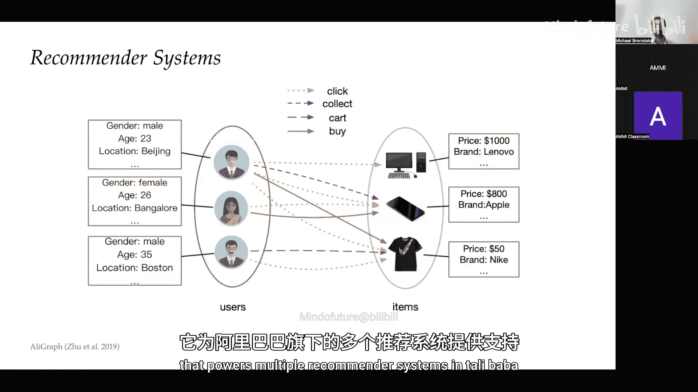
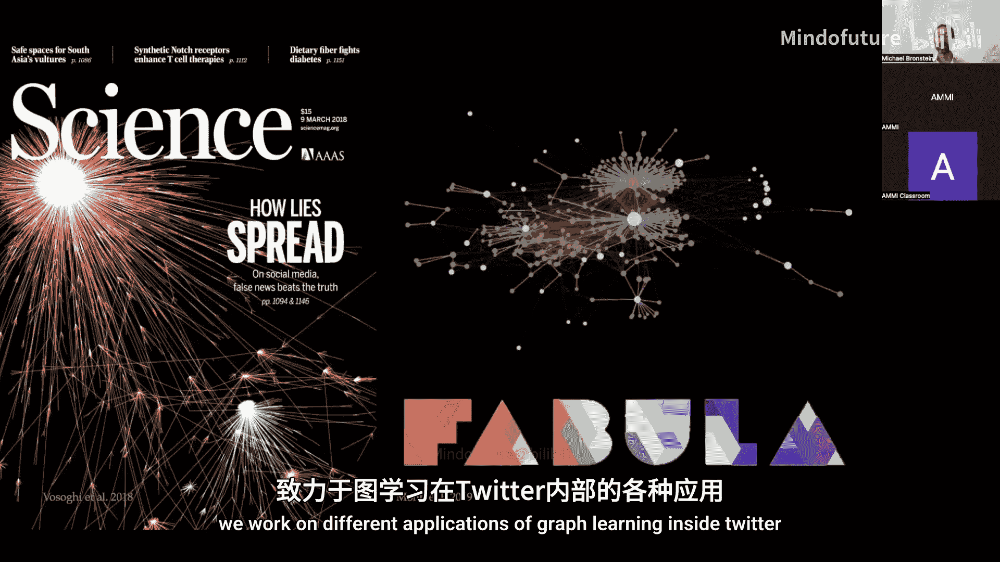
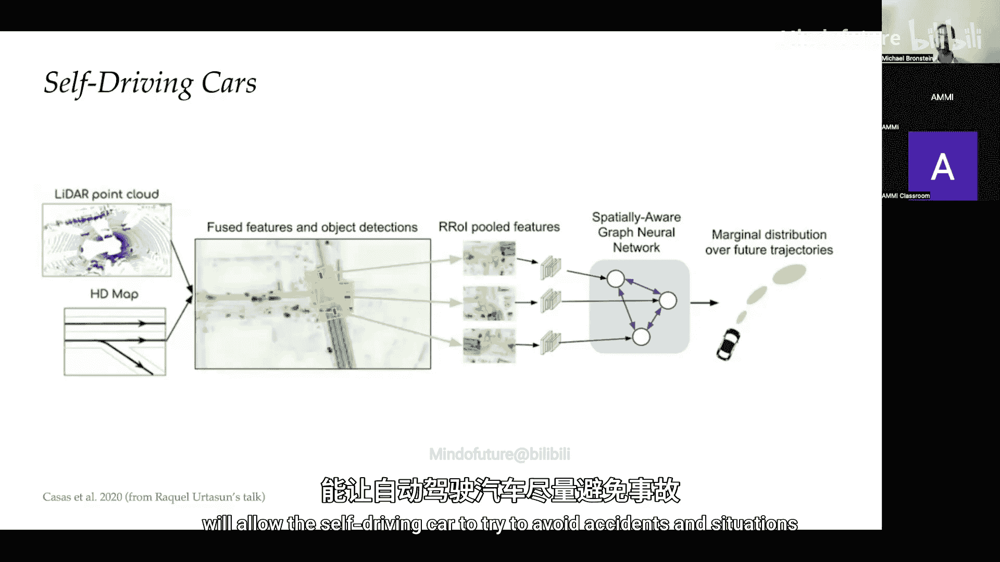
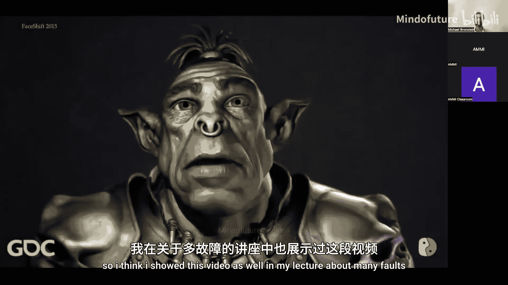
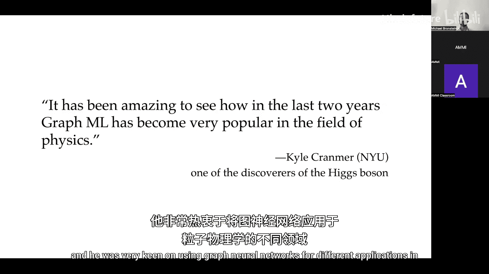
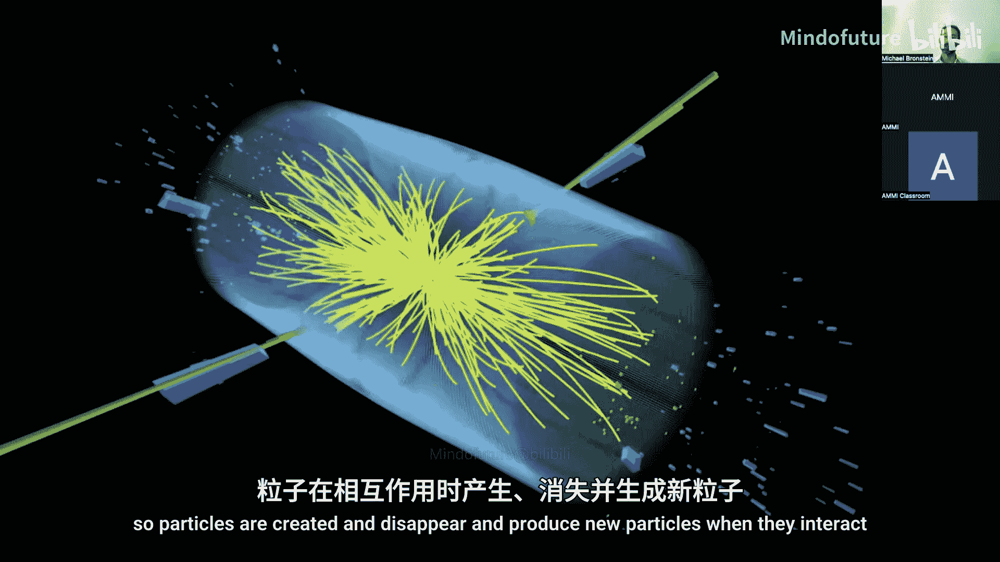
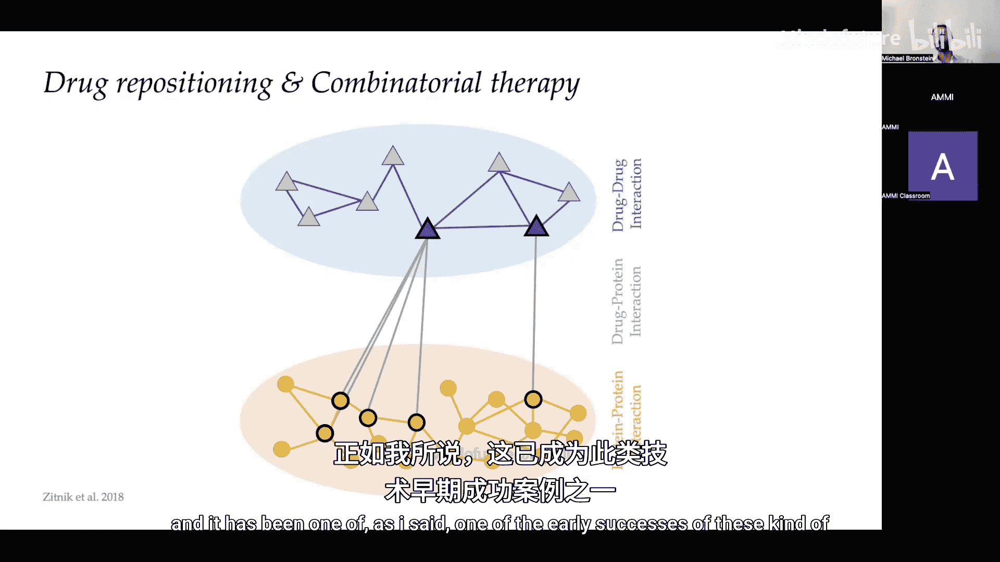
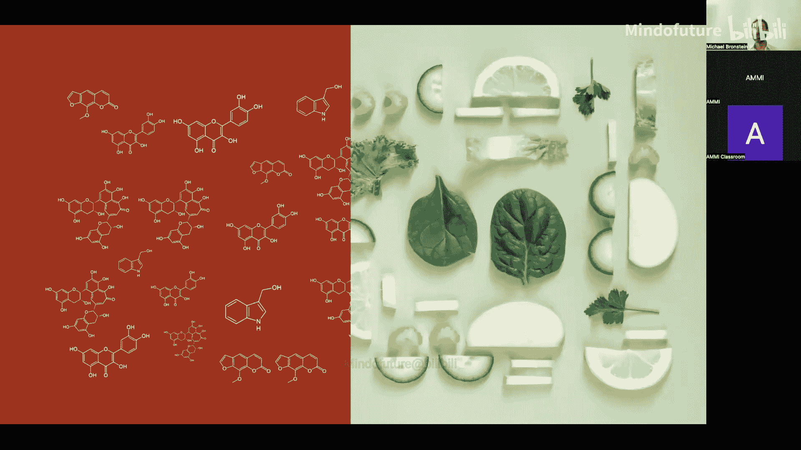
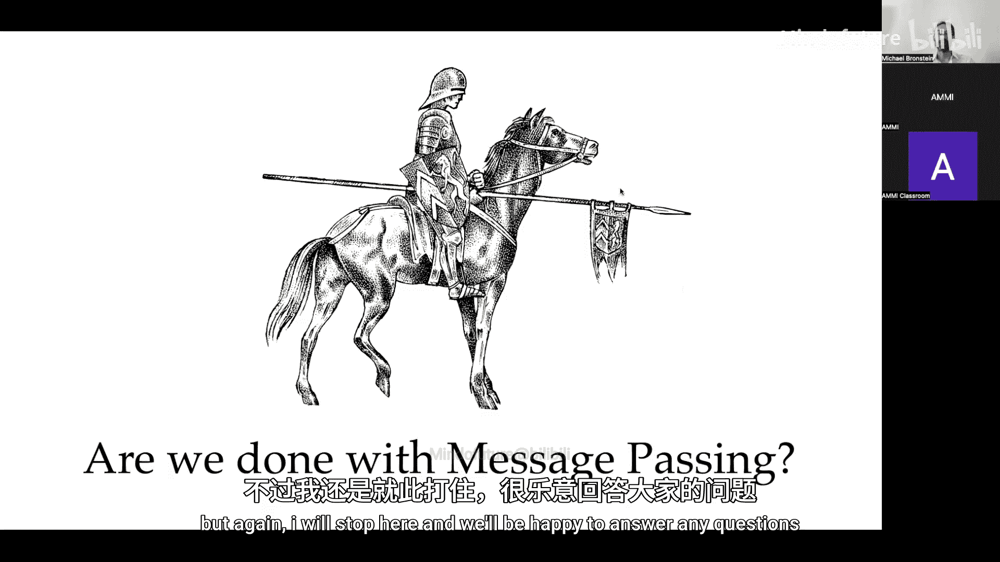

# 几何深度学习 ｜ Ammi Geometric Deep Learning Course p12 P12_第十二讲（应用与趋势）-迈克尔·布朗斯坦 -BV1veHgzxELm_p12-

Wonderful， thank you so we got to the finally to the final lecture of this course after。😊。

Several several lectures， so I remind you that we've seen well。

 the foundations of genetic learning geometric priors and then different domains。

What is crafts grids。And crops and manifolds gauges and then Pat actually didn't talk about。

sequences and time he talked about about categories。

 so today I would like to talk about some of the applications。

 particularly for graph neural networks and then maybe some directions that at least I personally believe to be interesting and promising which are maybe a little bit exotic。

 but that might be a way in which these domain can evolve。

So I remind you that that we started with this quote。

 so I would like to close with this quote about symmetry from Herman Bile。

 that was really one big idea that you can trace back to ancient times in science in mathematics and geometry in particular。

And this is symmetry， and we've seen that we can apply this principle on different types of objects。

 whether it's grids， whether it's homogeneous spaces， graphs， manyifolds meshes。

 and probably even more general and abstract structures。To derive learning architectures。

 the inductive biases that serve the foundations。To some of the most recognized and widely used architectures。

 such as CNNNs， deep sets transformers， graph neural networks。

 different forms of intrinsic and mesh CNNNs， and also while we didn't talk about it。

 but also for some recurrent models such as Eesttium。

You can also derive them from considerations of symmetry。So the question is what's next。

 what will be the next chapter in this field？And together with my authors。

 we've been doing well already second year in a row。

 this kind of predictions or a summary of geometric and Graphaml。In what has been exciting。

 what are the promising directions by basically interviewing some of the prominent researchers。

In these field so we did it last year， we did it this year as well。And I would like to to。

To refer to some quotes and then show how they might be manifesting themselves so this is quote from Will Hamilton so he's mainly known for the graph stage framework and many other papers on the topic。

And he was saying that that we've seen。Minly 020。The field come to terms with the fundamental limitations of the message passing product。

So the fact that for example message passing is clear to the vicepar 11 graphphosismmorphism test shows that certain structures cannot be detected。

And it requires methods that go beyond these limitations so several ways where we talked about some of them I think Chris Boner as well mentioned some of them。

 so one of such ideas would be to go beyond。Proropagation of information between nodes along the edges of the graph and to use more exotic higher dimensional higher order structures such as s or cellular complexes and define maybe higher dimensional。

Aies of the Vipher 11 color refinement schemes for these kind of topological objects and you can show that these schemes are not only more powerful theoretically。

 but also in some applications more naturally model the structures that arise in these architectures and chemistry is probably one example so it's interesting that craft neural networks as I've shown in the introduction lecture。

 it can be traced back to the problems in Cheinformatics and even the Bipher 11 algorithm was inspired by the work of letters who was a chemist and was mainly concerned with the problem of how to organize and retrieve molecules。

Using computational methods， so I'm personally surprised why a chemist would think of a molecule as a graph because chemists now don't think of molecules as collections of atom atoms and。

And chemical bones， they think of them as chemical structures or maybe even reactions。

And therefore crafts are not necessarily the best way of representing molecules。

 they indeed might contain all the information there， but for example。

 if you cannot with vicepher element tests you cannot detect even triangles less alone about cycles and cycles constitute an important structure in organic molecules for structures like aroma rings are extremely important so we want some way of representing structures that capture these prior knowledge or adaptive biases in chemistry and several complexes appear to be such structures so another interesting direction is explainable G so I think this is one of the common criticism for not only for craft neural for deep learning in general is that they are not explainable so are several ways that these explainability can be incorporated so one of them is modeling physical systems。

Is to try to learn message passing functions that are physically correct and interpretable so this is a very nice paper by Cranmer from two years ago where they learned on multipart system genetic message passing function and then they request symbolic equations that essentially give you a close form formula for how the different constituents of such a system interacts with each other another topicic is algorithmic reasoning。

 I think that was mentioned by pet where it's an attempt to marry algorithms with neural networks to take advantages of both worlds in terms of the generalization interpretability and generalization across data and across tasks。

And another interesting topic is causal inference where you can try to build a graph that describes the causal relations between different nodes so this is a very prominent and popular topic now it is in drug discovery where you can now with modern technology you can do high gene perturbations so you can take a cell and modify it and see how it reacts for example to different drugs and from this you can try to build the model of the disease and of the therapy and understanding how different for example malignant cells what is the change in the biochemistry would allow or to design better therapies for these diseases and then of course there is a field of knowledge graphs that I think has historically stood a little bit apart and many models that emerge in these domain where to represent the structure of knowledge graphs that typically common triplets where have two objects and the relation between them。

metethods such as graph be， such as trans E or transR that we didn't discuss in this course。

Or emerged from these to me。Now here's another quote。

 so this is Thomass Kiiff that you probably know from the GCN architecture。

That that mentioned this particularly noteworthy trend in Graphforml is。

The separation of computational and data structure so the graph in graph neural networks。

 at least traditionally has been the same in an input graph。

Use for the propagation of information and we've seen that in many cases this is not necessarily friendly you can get phenomena such as bottlenecks and over scourashing when the graph itself。

Is not appropriate for message passing so it might have some bottlenecks that make this flow of information complicated。

 so there are several works that try to deal with it with graph rewiring。

 so the famous paperdigo from the group of Stephen Guman in Munich we also had a paper a clear earlier this year that was even awarded the best paper on rub mention where we showed that reach curvature could be used to understand these bottlenecks and rewiring that that resembles the reach flow process from differential geometry could alleviate these bottlenecks and make information flow more efficient in graphs。

So there is also interesting topic in more traditional network science。

 so what is called network geometry， trying to think of graphs as discretization of continuous objects in particular of hyperbolic spaces and then along these lines。

The derivation of graphraph neural networks。as a disctization of physical process described by differential equations of Francesca。

 Iiovanni talked about it and I will talk about it today as well。

 so he was talking about how to derive the graph convolutional framework from gradient flow of Britishlet type energies and then basically。

嗯。Giving back the credit to the architecture that somehow the folklore in the field。

Believes that that it was powerful enough。Especially for dealing with heterophiic graphs so what he showed is that this is not true。

 so you need to do channel mixing appropriately in order to make it able to deal with with situations of heterophily。

Then an interesting topic that in many situations， the graph is actually not a static object。

 so if you think of a social network or maybe different types of biological graphs。

 they evolve over time。So dynamic graphs and neural networks to work on this kind of data are also a new。

 relatively new and emerging field of study。And another topic is generative models。

 so generative models have been popularized probably with guns with aresarial neural networks and more recently with diffusion models。

 so now we have some amazing results such as Dli2 models that can generate images that look very realistic and can also respond to to different textual prompt。

So something similar for graphs， in particular in the domain of chemistry for synthesis of molecules。

Is still to be done so it's an open question one of the difficulties there that again the domain itself is what you' are generating and you don't have a canonical ordering。

So you need total some probably different procedures to do it。So in molecules， for example。

 one of the structures that was done is to represent molecules as junction trees and then have some kind of vocabulary of these smaller structures。

Then an interesting topic is standardized evaluation。

 so this was this gave a big boost total machine learning and in particular in computer vision with the imagenet so this is what。

Typically cited as the turning point for the field in 2012 when convolutional neural networks smashed the image that benchmark park by significant margin。

 this is also what happened in protein folding when Al fold was a newcomer that performedform other models that were based on decades of insights and intuition and local so in graph neural networks now there is opencraft benchmarkch that appeared about two years ago and it's already a standard evaluation tool that is used by researchers worldwide。

And then of course industrial applications， so craft neural networks are now broadly used across the spectrum in many different applications。

 so one of them for example was to design new chips as you know it's a combinatorial problem can be formulated as reinforcement learning with the help of craft neural networks。

And then another topic that I should say probably is overlooked in the field is the compatibility。

Of all grids with hardware。So when you implement a graphph neural network。

 so it's very easy and maybe a little bit laziness here to say that let's throw it own GPU and then GPU is powerful enough right。

 it has sufficient memory。To feed the graph and total。Basically， we can， we can work on it。

 The problem， of course， is that。In applications where the graphs are very large。

 you cannot do it anymore， so you need to design algorithms that are aware of the hardware and there are some newcomers that compete with Nvi such as GraphCore with their IPU architecture that is probably more suitable for certain types of graph learning。

 so it's an interesting interaction between hardware and software。

And then of course applications ranging anywhere from self driving cars to protein design to drug discovery or particle physics。

 so let me talk briefly about these， so I will start maybe with social networks I work at Peter。

As by second job so in the social networks graph neural networks have been used primarily for recommended systems。

 so I think one of the pioneers was Pinterest with the pinage so that was an architecture that productionized the sage type of。

Graph neural network architecture， then for example。

 recent works from Uber using G neural network for food recommendations。And in recommender systems。

 typically what you try to do is to do age predictions。

 so you have nodes of the graph for example biite graph that can represent users and items that they buy or they like and based on the edges that exist in this graph。

 you can try to predict the probability of an age between a pair of such nodes。

And this is how most of these architectures work， so this figure is actually from paper on Aligraph。

 which is a commander system or a framework that powers multiple recommend commander systems at Alibaba。

So I myself with my students， we've created a company that was acquired by Twitter and we were using Graph neural networks to try to classify misinformation or so-called fake news from the way that they propagate on the social network and we are now part of Twitter and we work on different applications of graph learning inside Twitter。

 so this is the team as it was acquired。

Three years ago。Now in 3D vision and graphics， so if you look at ways of representing。

Gometric data so obviously there are multiple ways of thinking of three dimensional objects you can think of them for example as volumes and brushize them using boxels or you can think of them as point clouds or you can think of them as discrete manifolds or meshes so this is。

 for example， typical input signal from a lighter so it's specially structured point cloud。

 this is what the sensor on a cell driving car sees and you can use this information for example to predict。

where the cars nearby will be moving right so some kind of predictive capability that for example will allow the cell driving car to try to avoid accidents and situations that might be dangerous to the driver so I think I showed this video as well in my lecture about manyfolds so this is example of motion capture so they here the face of the actor is scanned in real time by 3D sensor this was actually a sensor that I've been developing at Intel。

That was another startuper that we sold 10 years ago that became what was known as the real science technology。

And here the problem is that the motion of the input pose of the a phase is transferred is synthesized in these sh like looking avatar so it's a problem of correspondence and synthesis so you both find correspondence between the noisy input and some canonical phase and then you deform it to repeat the input structure we've been also working on several applications where the input is actually two dimensionmenal image or a video so the encodeder is standard conutional on your network and the decoder is a mesh CNN and in particular my student dominico un workeded on hand pose and shape reconstruction this is difficult problem because hand has a lot of occlusions and obbiguities。

And in cooperation with the British startup IDLAI we showed this application at CPR two years ago where we had real time avaars running on an iPhone with detailed hands that were reconstructed this way and ADL was acquired also almost two years ago by SNAP so now this is part of SNAP technology。

And that incorporates these metal。Now I mentioned applications in physics。

 so this is quote from Kyle Kanmer so he's a professor at NYU。

 I think actually he recently moved from NYU and he was one of the discoverers of the Higgs boson at LHC and he was very keen on using graphal networks for different applications in particle physics and this is LHC so this is actually one of the detectors。

In the Atlas experiment that was used to detect the Higgsposon and the way that the graph networks are used there is you can describe describe interactions of different particles as these kind of particle jet so particles are created and disappear and produce new particles when they interact so this can be described as a graph and then you can use craft neural networks for example both to reconstruct these jets from the observations in the detector as well as classify some events so I myself with jo we had a collaboration with the team of。

Ice cube which is a neutrino observatory in the South Pole。

 it's a cubic kilometer of detectors and why you need such a big detector because neutrinos。

 as you probably know from courses in physics they don't interact with matter so very rarely interact with matter and you know to pick up these interactions you need a very large detector so these detector is actually a very large array of photo multipliers that see light what's called sharing cover radiation when neutrinos interact with they matter。

In this ice and because ice is transparent， you can see this glow。

 it is picked up by the photo detectors and this is an example of a signal that the different energy in different time that is deposited on the detectors and looking at a signal you can try to classify whether this neutrino comes from an astrophysical source somewhere deep and far in the universe or is it some background for example。

Coming from our nearby sun。So this actually has been used。

 the nutrient observatory was used for first multissger astronomy， what it's called。

 so you can detect a source of neutri and point a standard telescope and see actually where it comes from for example Boston supernova explosion。

Then other interesting applications， so I think this was from DeepM fluid simulation。

where different multipart systems where a model is graph neural networks where the edges represent different types of interactions and instead of solving a complicated differential equation that governs this flow。

Of of fluids or or。That is notoriously complicated equations such as navi stocks this can be compressed in a sense by by graph neural networks so in biology and in drug discovery graph neural networks right and more generally geo deep learning techniques have been used also quite extensively so many of the problems again as I mentioned come from chemistry and here in particular we're talking about biochemistry and in particular we're talking about proteins so as you probably know proteins are。

Chemical molecules that are encoded in our DNA， so our life that we know on Earth。

 we don't know any other life formss that is not based on proteins。

So proteins are encoded in our DNA， so proteins are composed of different amino acids。

 so that 20 what is called proteingenic amino acids。

 each triplet of nucleotizing our DNA encodes one amino acid that is then inside the cell using special chemical machinery becomes the proteins so cells essentially are built to produce proteins that make them work。

And basically it's a very long chain of these simple building blocks amino acid that under the influence of electrosic forces falls into complicated structures such as sheets or helices。

 and you can think of these。analogy， the sctuaatory that is one dimensional structure。

 but we can fold this into many different shapes。And the problem of protein folding。

 basically predicting how the structure will look like given a sequence has been a classical problem in structural biology already from the 70s。

 so Kris and An in the 70s conjecture that the folding structure of the protein can be fully determined by the amino acid sequence。

 and there was a kind of image net that was called cuP。

In a structural biology domain that people tried to were competing trying to predict the structure from sequence。

 and in 2018 Al fault from Deep Mind significantly performed。The诶诶。

The competing approaches so that was a kind of image that moment in structural biology and then two years ago Alpha folds2 performed even better and Alpha fold2。

 as we hear in the last lecture by one of the authors。

 is actually a geo architecture and it uses a component that is called invariant point attention。

 which is what we called equivariant graph neural networks for equivariant message passing。

And proteins are really ubiquitous， so any more or less any biological system you pick up whether it's transferring oxygen to our cells or defense against pathogens right antibodies or proteins。

 so a lot of these a lot of these mechanisms are powered by proteins。

 so any chemical reaction that happens in the body is catalyzed by enzymes which are proteins。

 even our skin as its elastic structure thanks to a special protein that is called collagen when we get older we lose it so that's why we have wrinkles on our face。

And proteins， because they are so ubiquitous and they appear more or less in every biochemical system。

 they are standard targets for drugs。So typically the way that it looks。

 you have a protein that that is responsible for something and it has these kind of pocket like structures and the development of drugs tries to find。

A small molecule that will fit into this pocket。and will inhibit the interaction of the protein so it will' block the protein from interacting with some other proteins and as a result certain systems will be activated or disrupted。

 so most of the drugs are actually inhibitors of protein receptors。

And what is shown here is actually it's not a drug well it's a druglike substance。

 it's a caffeine or more correctly one of the substances from the same class that is calledcentenes and this is what happens when you drink your coffee in the morning。

 so this molecule gets into your bloodstream crosses a blood brain barrier and binds to a dosine receptor in the brain。

And this is what makes you awake and happy and soul。

But many targets actually that are now interesting for the biopharmaceutical industry。

They don't have this kind of pocket like structure probably one good example is what is called the program death complex so these are two proteins that interact with each other and their interface is flat so they don't have any pockets and these kind of targetss are considered hard to drug or even undrggable by traditional small molecules because there is nowhere to fit。

These small molecule there and the analogy here that you want to think of is a kind of a walk in the key metaphor。

 so we have complementary geometric structures so not only geo theyre also charged surfaces。

And in this particular example of P1 and PL1。The program that' complex it appeared to have an extremely important role in cancer therapy because basically what it is responsible for is to disabling the immune system from killing our own healthy tissue。

And this is what some types of cancer produce and this protein prevents the malignant cells to be destroyed by the normal action of T cells in the immune system。

 so the idea of immunotherapy or that are called checkpoint immunotherapy is to block one of these proteins PD1 PD1 and it then allows the immune system to take control back。

And destroyed the bit humor， so this was a very important discovery that was more than the Nobel Prize in medicine。

In 2018。Now in order to design this kind of these drugs right。

 so this is a drug of a new type that is called a biological drug or a biologic。

You need to solve in a sense an inverse folding problem so instead of going from amino acid sequence to structure。

 you want to find out what is the amino acid sequence right。

 what is the protein that will fold in a certain way that will have certain geometric structure that will give it certain functional properties so probably at a conceptual level you can say that we go from sequence to structure to function。

And unfortunately this is not a straightforward forward。

 Ss are obviously very easy to analyze in some early works in bioinformatics tried to look at sequences and compare them as essentially strings or substrs now you can find proteins that have very similar sequences in different structures so it might be someone happy mutation just in one amino acid that results in completely different folding or vice versa you can find similar structures that come from different sequences so different sequences will fold in the same way。

 and then you can also find proteins with very different structures that for example by in some molecules so they have the same function but they come from very different structures and this is also happen in what is called convergent evolution so when different organisms evolve separately but you need a protein that that fulfills the same function so you get to it from so say different directions evolutionly。

So what I did with my collabators in Switzerlanditzon。

 so we designed geometric architectures so that will in this case we represented proteins as surfaces and we try to predict where and how they will be binding and this was an important step in designing new proteins what is called denovo from scratch design。

Where the protein。With desired properties from above binding to the oncological P1。

Target is built in this way and that was an architecture that we called Maif。

 we had also several follow up works， including some new designed binders for both oncological targets as well as for the for exampleable coronavirus。

Spike protein solids data driven architecture that significantly like makes a principled rational design of proteins significantly easier task。

 so hopefully at some point it will be used in the development of new the compounds。So I mentioned。

 well， obviously drug design， so in general， the problem of drug design is that it takes quite some time。

To deliver a drug to the market so typically 10 years about $2 billion investment and the reason is that drugs。

Are discarded at different stages of testing so they are subjected to very rigorous testing process clinical trials and one of the issues is that the space of search for different molecules that could be used as potential drug is extremely large so something like 10 to the power 60 so it's combatorial complexity whereas something that you can test in the lab well maybe now with chioid chemistry you can test tens if not hundreds of thousands of molecules but still the gap is huge。

So this gap is typically bridge computationally and that's why you can use different models such as for example molecular dynamics so you can try to solve quantum mechanical systems to understand for example how proteins fold and how they interact with other proteins or with small molecules。

 you can use maybe some approximations such as density functional theory rate so graphra neural networks have actually been reintroduced。

to chemistry from where they originated， in particular the work of Justin Gilmer from 2017。

 exactly as a way of make more efficient these kind of predictions or predicting chemical properties of molecules such as solubility。

 toxicity and so on all the different properties that you need to know in order to choose your suitable candidates for a drug。

And graphicraal networks have made some splash。not only in the machine learning community。

 but also outside of it， even in the popular press with this publication of a paper in C。

 which is one of the major journals in biology where the group at MIT used graph neural networks as part of a pipeline to discover new antibiotic compounds in particular they showed that the drug that was tested against diabetes。

Had very powerful antibiotic properties and could be applied also to antibiotic resistant organisms so as you probably know we already have a lot of bacteria that are resistant total antibiotics that now available and I think the estimate is that more than a million people each year die from these diseases so it's just a matter of time when we have a pandemic on the global scale that will be caused by this antibiotic resistant pathogens so we need very urgently new class of antibiotics。

And this is probably one way of discovering them。Then another way of using new drugs so sort of developing a new molecule that takes a lot of time and a lot of money to develop it can actually take approved molecules that are known to be safe and use them in combination and some combinations actually have an nonlinear synergistic effect。

 some others have antagonistic or maybe side effects and this was one of the first uses of graph neural networks by Meka Zitni who is now a professor at Harvard Medical School so she used graph neural networks to predict。

Interactions of combinations of drugs， so this is also standard way of administering treatments what is called polypharmacy or convenience royal therapy where we use multiple drugs at the same time。

And the way that she considered it is by looking at protein to protein interaction network so that's a graph that represents roughly how the biology of the body works。

 so the proteins there represent drug targets， so this is modeled by drug to protein interaction graph and then she tried to predict ages in the drug to drug interaction graph where you knew the nodes but not the ages so the system was called deagon。

It has been one of， as I said， one of the early successes of these kind of techniques with Michael Bridges at Imperial College we tried to take these ideas to the domain of food and you probably know that。

Food is full with compounds that belong to the same chemical classes as some therapeuticic drugs。

And it's not surprising so many drugs that actually exist in nowadays。

 especially drugs against cancer， they have natural analogs in the plant kingdom。

 so if you take for example， a drug like Camposene so it's a compound that is found in the bark of a tree that grows in China and four of its synthetic analogs are used against cancer is a chotheric agentss。

 and there are many other examples， so probably if you take even a very common drug like epirin sopirin the chemical name is acetylalicylic acid。

And salallyil comes from the name of the willow tree and latent sal chain。

 so it has been known from antiquity for its allgetic properties。

 so bottom line we have a lot of stuff that comes with our food that we have no clue what it does so it's kind of dark matter of nutrition so it's not tracked by regulators right so if you buy packaged food you will see public content of proteins and fats and carbohydrates and vitamins and minerals but not something like flvaoids or indoors。

And so we want to understand basically how these things work。And to do this， we tried to。

To look at the way that that compounds interact with protein targets and if we have some examples of drugs。

 for example， that does's work against cancer so we can take FDA called anticcer drugs and we can train a classifier that predicts anticcer drug likeness from the way that the compound interacts with target proteins and then we can apply to compounds that are found in food and doing this we can construct a map of different foods and way the kind of compounds that they contain and share and well obviously it's slightly more complicated I'm describing so we also sort look at different mechanisms that that would be convincing to biologists and medics。

That really does what is expected， so this way we have to mine automatically medical literature in the cancer community so for example looking for effects such as antiproliferation or anti anti angiogenesis or the growth of blood vessels that is typically associated with cancer and using this we were able to detect these compounds in food that have potentially anticcer byeric properties。

 so what was cool in these projects was collaboration with Chef。

 Ronno Barvarires so he is very famous Italian chef and the judge of master Che Italy。

The TV show and he used the compounds that we identified to present recipes that in this case contained compounds that have potential antiviral properties。

So in the remaining time， let me say a few words about some future directions。

 so this was actually will be。more or less the same talk that I gave here in Paduwa in WCCI conference on Comp intelligence and if we look if we take a step back and look at graph neural networks right as we discuss them。

 so there is a little bit of kind of asymme or injustice in the sense that we typically assume that the data is contained in the nodes and then the edges of the graph are used to propagate this information right in the form of passage passing。

And basically， the structure of the graph is somehow captured by the way that we send information on it。

 so as we know from device for 11 test， right that is equivalent to message passing。

That we can discover certain graph structures basically by sending information to our neighbors。

So I think it's maybe slightly exaggerating we can say that the novel are data and the edges are computation。

And we see two problems in these right， so the problem that we use the same graph。

As a data and the computational object one of them is that some structures cannot be detected by message passing right so here you can see an example that would be deemed equivalent by device vice for element algorithm so in this case we can attach some additional information to the nodes and the edges for example by looking at。

Some substructures like counting for example the number of triangles or cycles in the graph。

 and this is what is typically known as positional structural encoding。

Another problem is that some graphs might be very unfriendly for passing information。

 so think of these graph where you have a bottleneck and you need to squeeze all the information into these pair of node that connect these two communities。

So the standard remedy in the literature is graph worrying where you're allowed to change the graph in a way that will make facilitate the propagation of information。

Now another thing is that if you look at the broader perspective of geometric deepruning。

Then we have different structures such as grids or meshes and in graphs and graphs really stand apart in the following sense that you can think of a grid as a discretization of the plane。

 for example， you can think of a meshhe as a discretization of a manifold。

 so they all have some kind of underlying continuous objects。

 but what is the continuous analogy of graph。So this is something that is not very clear and if we compare the kind of structures right in these objects and the amount of ambiguity so grids are probably the most structured objects we don't have any ambiguity if I look at the neighbors of the node in grid。

 then we have a very well prescribed canonical ordering so I can say that they have a neighbor at the top a neighbor at the bottom and the right at the left。

So there is no ambiguity whatsoever in the mesh we have slightly more ambiguity and ambiguity here is that I cannot I can still choose arbitrarily the first node right but once I choose it then I can order all the rest of the nodes for go clockwise orientation so remember that we talked about gauge gauge ambiguity so the choice of the local system coordinates so exactly here we have this rotation or cycling shift ambiguity when we talk about meshes in graphs on the other hand we have very general permutation so graphs out of these structures I have the least structure right so they have the most ambiguity。

And。What we are trying to say is that。We can take inspiration for designing graphraph neural networks。

From physical systems so we can use a physical system as a metaphor for learning and this is figure from a cool paper that appeared in nature earlier this year where they incorporated。

Real life physical systems such as electronic circuit or an optical setup into deep learning pipelines you can backproagate through this system so this is not where you're trying to say so we want to use metaphorically a physical system as a model for learning and again this is probably not a very new idea so you can think of a system that is parameterized by maybe by a small number of parameters and then you try to reach a certain state by some trajectory in this control in this parameter space。

And this is what。 Yeah， question。 Yeah， there's a question。

Yeah yes so what makes graph unsuitable for message passing so what makes graphs unsuit for message passing so some are not I wouldn't say unsuitable they not very friendly。

So well I have a slide about it， but let me anticipate so what happens is the following situation then when you have。

The structure of the graph is such that it has many neighbors right so technically speaking this is what we call volume growth so when the volume growth is exponential this happens for example in social networks in small world graphs where if you look at the neighbors of the neighbors of the neighbors then the numbers explodes exponentially so we have too many neighbors with their fishes。

And if my problem depends on the information from nodes that are several hops away。

 I get into a situation when I need to squeeze a lot of information into a single feature vector。

 and this is called over caution。So in this case， the graph is not friendly for message passing。

 so it's difficult to propagate information on such a graph。Well。

 I will get to a more formal description of these situation， so bear with me for a few minutes。给。😊。

Any questions Yeah there is another question there's another question applying are turning to the recommendation system is it possible to make a recommendation system based on the similarity of content and users at the same time well so this is more or less what you try right so this will probably be described by some features that you have associated with users and with and with the with content so one of the issues with using graphal networks for。

Recommd the systems is that。Is is structural ambiguity。 So what I mean by this is the following。

 So if we have。Nos in the graph right so if I have。A pair of nodes。

And some structure around it and I have an edge and I'm trying to predict whether this edge should be here or not if I have another part of the graph which structure looks the same then when I'm using a graph neural network to embed the node so usually these kind of recommender systems they represent the graph in some vector space so every node corresponds to vector。

And then these different structures， even though they're completely unrelated and they're located in different parts of the graph。

 will be indistinguishable， so they you have the same vector representation and as a result。

 I will be predicting edges where they shouldn't be edges。

So that's why the way that graphra neural networks are used predict to predict edges in graphs is actually as an edge classification problem or a subgraph classification so you look at the graph that surrounds an edge and you try to classify it right so you say if it's one then the reason edge between two nodes in this graph and if it's zero then the reason edge so this ambiguity actually makes graph neural networks。

Workor problematicly for each position。给。So let's continue so basically we are looking for physical metaphors for physical systems that when discreteretized will give rise to graph neural networks and probably the most obvious thing that can come to your mind when you deal with propagation of information this diffusion equations right so I hope that you've seen diffusion equations in this or another form in some basic calculus or differential equations courses so what is the diffusion equation essentially have some quantity let's say temperature on some domain right on some。

Some medium so let's say in the plane the different colors represent different values of temperature now the difference or the gradient in the temperature at different points create what is called the heat flux so there is a flow of temperature from hot to cold。

RightAnd also temperature unless have sources of heat is not created out of nowhere and doesn't disappear anywhere so there is some conservation condition and this conservation condition tells you that the only reason why temperature changes in time infiniteimally is because there is this heat flux so put together this gives you a diffusion equation so the left hand side tells you that the instantaneous change in the temperature x here know temperature at point U and a time T and the right-hand side is roughly tells you how much heat flux goes through a point and it's also scaled by what's called the diffusivity constant so the diffusivity constant can be a function in general can depend position and orientation in the simplest case it's constant everywhere so then you can take it out of thergence and as you know the versionence of the gradient is the oplastian operator so we call this kind of diffusion equation or onegene isotropic and you can interpret it as a。

In flow the DHL energy， so if you remember for Jesica's lecture， so that's exactly what it is。

 so the DHL energy measures how smooth your signal is。And basically。

 the diffusion equation produces a gradient flow that tries to reduce this energy to zero。

And in the Euclidean case， you can also write it as in closed form its conversion with the Gausian filter。

 so essentially it's a low pass filtering process。And there are obviously more interesting versions of the diffusion equation so you can make the diffusivity position dependent。

 so in this case we call the diffusion nogene or it can also make it not only positioned but also direction dependent and in this case it's called anisotropic。

So isotropic means same in every direction。And these kind of equations attracted a lot of attention about 30 years ago。

 starting from the seminal work of Piro Peron and Jtanromanic。

And what they said is the following thing。 so there is this one to one correspondence between。

Low pass filtering and diffusion equation， so if you take an image。

Isaac Newton in this case and you apply to it a diffusion equation。

 you get low pass filter right so an image in the middle。

And this way you can remove noise from the image right you will average it out。

 but of course this is not an image that you want to see because by doing this kind of diffusion you also destroyed sharp discontinuities that are very important for visual perception so the discontinuity is what is called edges in the image so what they propose is to say let's make a diffusion adaptive so the diffusion will be controlled by some function that is inversely proportional to the norm of the gradient so it's an edge indicator in other words when the diffusion sees that the pixels。

Are different from the pixel which the diffusion kernel is positioned then will slow down or stop the diffusion so the diffusion in other words will not be mixing pixels of different color and this is what happens when you do this process so this nonlinear diffusion on the right you see that it removes noise from continuous regions but it preserves the important discontinuities。

And this has really opened an entire field of variation on PDE based image processing。

 and it was mathematically admittedly very aesthetic and very pleasant concept。

 so you start with a functional。😊，That tells you basically how your image should look like right so functional is a kind of functional of functions right that gives a number of a function images in this case are measured are modeled as functions。

And then you can derive optimal conditions， so these are called oil grandrange equations。

 so it's a partial differential equation that gives you a gradient flows or a kind of minimization process for these functional so you start with an image you evolve it with the PD and then it flows to the minimum of this functional like the di energy and the diffusion。

The diffusion equation。Now why I think it would be fair to say why these methods have almost disappeared in the past years after the emergesnce of deep learninging exactly for the same reason why all the handcrafted descripts in computer vision have disappeared and this is because it's very difficult to design something a priori that will work for any kind of data and for any kind of task and that's where deep learningrunning actually was the monumental difference and what we are trying to do in our work is to reinterpret these methods adapt them to the deep learningning context and apply them to graphs。

So what's the difference between a closed form solution of the heat diffusion and random walks well random walks you can interpret them as some form of diffusion so there are some nuance so usually these are not symmetric but otherwise yeah you can think of random walks as a kind of discrete diffusion process yeah so that's a very good question。

And then basically we can formulate a diffusion equation on the graph。

 so in this case remember that we have basically these three ingredients so we have the gradient so the gradient in this case will be just the difference between the features at end points of an age。

Then we have the diffusiivity function， so it's some nonlinear function that depends that weights every age by something。

 some sc number that depends on the fis at the two endpoints。

 and then we have the divergence that essentially sums all the ages that emanate from a node。

Now pay attention that the time here is continuous so we have a differential equation that is no linear and needs to be solved numerically。

 so now I should say that the difference in terminology between PDs and ODs so this is actually technically speaking a system of coupled ordinary differential equation for each node。

 so audio or PD the only difference is that in PDs you have also disctization of the spatial domain not only the time。

And well we'll get to it in a second， so graph is inherently discrete objects。

We want also to discretize the graph to think of it as discretization of a continuous object okay。

 but here we already get the space discretized we need to discretize time。

And the simplest way is just to take fixed steps of fixed size。

And this is what is called explicit or forward oiler skin。

Where you take just forward differences in time and this is what you get。

So you get a evolution equation of this form so if I rearrange the terms a little bit what surprisingly find that you can interpret graph attention networks that we've seen with better as a particular discretization of this graph fusion equation。

 so what we call attention is actually a diffusivity function that is normalized in a special way。

Okay， and no linearity in this case， and a unit step size。

But of course we don't need to use only an explicit scheme so there is a zillion of different numerical schemes to discreteretize differential equations so we can use implicit schemes you can use same implicit multistep schemes such as onkota so the numerical analysis has probably more than 150 years of experience on these different different discretizations and the way that it works let's say that you are trying to solve a node classification problems so you will start with some initial features maybe after some encoding then you will diffuse them by parametric diffusion equation where the diffusivity function is parameterized。

And then you will read out the resulting node fishes， maybe with some decoor that they know here by。

And basically， in this case， a， the diffusivity function is learnable。

If we make it independent of time， it means that I will have shared weights across layers。

 so now the analogy of layers will be the steps of the iterative solve。

And we don't have the traditional notion of depth。We have now the diffusion type and I can discretize it different I can use for example adaptive steps so I can have bigger steps where necessary and smaller steps where it's required。

And one of the reasons why you shouldn be doing it is， for example。

 in traditional graph neural networks， it's difficult to make them deep。

One of the reasons is that you get。Phenomemenna such as overs smooththing。So in this way。

 you can overcome this phenomenon。So the question is， what is x refers to edges and what is k and R？

So in this case， k is the number of layers。T capital is the diffusion time。 Tau is the step size。

I didn't see the R， this is probably what you meant by tau right yeah tau is the step size。

 so if you make constant steps in time。Now you can think of it maybe you can ask okay why are we doing it so this just looks like a formal exercise and basically you get the same stuff just from different considerations。

 I think it gives in new perspective on classical well-known programs in graph neural networks such as oversmthing and bottlenecks but also not only that you can interpret existing architectures such as gut as discreteization of diffusion equation which is of course nice。

 but also some solvers such as multi-grid solvers or multistep solvers。

 they don't have immediate analogies or immediate instances in the graph learning literature。

 and it means that maybe there will be future architectures that will be exploiting these kind of solvers。

And then of course basically by interpreting graph neuralal networks。

 discreteretized differential equations， you can also leverage huge literature from these domains such as stability and conversion guarantees that are very important total understanding and analyzing the properties of graph neuralal networks and furthermore I will show。

Later in the last slides。It also offers links to other maybe more exotic fields such as differential geometry and algebraic topology that is far less known in the genome and literature and I would say in machine learning in general。

Yes。So let me take you back again to where we started right so we started with diffusion and the analogy was diffusion of images right on grid。

So on grids when you discretize your diffusion equation you have many ways of doing it so in particular let's say that you take isotroppic homogeneous diffusion that involves the opplian operator。

 these are three different ways I can discretize the lolastium right so I can take for example they typically four neighbors or I can rotate everything by 45 degrees and take other four neighbors or I can take more distant neighbors or because the operators are a linear any convex combination of these discretization is also a valid discretization of the opplium so you see that on a grid basically the way the graph that you build to discretize your operators is completely arbitrary。

So it's mainly determined by an numerical convenience so I can change it the way I want。

 I can even discredtize the main difference at every point。

So what I'm trying to say is that we want to think of our graphs in graph neural networks in a similar way。

 so we want to say that I'm allowed to change the graph。And the graph will be changed based on。

Whatever is more convenient for the problem I'm trying to solve。And here again。

 I will appeal to previous works that have been done in the computer vision and image processing community and within've seen this nonlinear diffusion of paramal malic。

Another model that that was developed also in the 90s， actually by my PhD advisor Ron Kimmel。

Was a nonnulidean diffusion so in this case we consider the image as a manifold that is embedded in a joint space that contains positional coordinates and fissure coordinates so in case of an image the positional coordinates will be just the xy coordinates of the pixel and the fissure coordinates will be for example the colors Rg and B colors so with this model the image is considered as a two- dimensional manifold or a surface in r5 right so we have the xy and then Rrg and b and it's a manifold that is embedded or geometrically realized in this high dimensional space so basically we are talking about remainingian manifold so there is a canonical way that we can define a remainingian metric on this manifold by the pullback mechanism remember we talked about it when we discussed manifolds so I have a particular remainingian metric with respect to which I can write derivatives such as the loplace N this is called the loplace trim operator and the diffusion equation on these manifold。

Is actually a gradient flow of generationization of the additional energy that is called the polyov functional。

So it's an energy that is used in high energy physics in string theory so basically how does it apply to graphs so on a graph we can say that now every node comes with two types of coordinates I have the standard featuresure coordinates that I know by x but I also have positional coordinates that I know by U so we embed the graph in some space it doesn't need to be an exact representation from which I can reproduce the graph what I'm using it for is to make some kind of continuous graphy and what I mean by this is that I'm evolving by my diffusion equation both coordinates U and V right as written here so the diffusion equation with learnable diffusivity operates on the joint coordinates z and z right U and X。

Then the evolution of the x component， the fis component is the standard fissure diffusion。

 but the evolution of U the positional component it can bring some nodes closer or further away from each other and if I see that two nodes come close together then I can say okay I will create an edge here right or if they drift the apart I can say I can cut this age because these nodes should not interact anymore so this is a kind of graphicwi that is then continuously on the fly and probably the best way to visualize it with this animation so this is the chograph。

Whi is a small citation network， so the colors here represent different fis。

 a low dimensional projection， the positions of the circles represent a two dimensional position encoding。

And the task here is node classification， so we want to obtain clear clusters and you see that the clusters are obtained both in the fiss and in the positions of the nodes and you see that also that the graph changes as the evolution happens。

 so some of the edges when the nodes become far away are cut。Okay。

 so that's how these graphal tri flows。Now you may find it a little bit disturbing or maybe even bizarre to see at least for traditional image processing。

 so you do filtering or some process on a domain that is changing under your feet so the domain is evolving together with the data on the domain。

But this is actually a very common viewpoint in differential geometry and it's very common in differential geometry take a manifold and evolved by some differential equation and in particular of the metric of manifold or verymanian manifold and the most famous way of doing it such evolution equation is called the reach flow where you evolve remainingmanian metric according to the richci curvature tensor so this is an equation that is shown here G is remember from the lecture manifolds is the Romanmanian metric tensor on the right hand side you have the reach curvature tensor so structure it looks very much like a diffusion equation you have the temporal derivative of something and on the right hand side you have a second order quantity。

 the richche curvature that is a little bit similar to the plus now of course it's only structural similarity because the probability of this equation is very different。

I think there was a question。How to express golf position coordinates in a way that preserves the ins。

嗯。It's a good question， so I don't have an immediate answer to this。

Usually what you will be doing here so these kind of applications。

Assume that you're working on a given graph so you don't want to generalize across different graphs yeah it's a very good question so position encoding has been used in many different ways so for example can use the plus and eigenfunction for position encoding I think a guyron had a paper that looked into a deeper how to basically combine invariant position encoding with equivariant message passing yeah but it's a very good one。

Anyway， so the reach flow works like this and what it takes， for example。

 when you apply it to this double shaped manifold that has negative curvature in the bottleneck and positive curvature in the spheres that comprise it when you evolve this manifold under the reach flow and here I'm showing the backwards。

Flowing time， then this dump will become more sphere like and then will collapse into a point。

And why this is important because this is how we can characterize high dimensional spheres so if you think of a two dimensional sphere right I can take a closed curve on this sphere and collapse it into a point so anything that topologically looks like a sphere。

 if I have a tarus for example or imagine that this is a tarus a curve like this that goes across the donut cannot be collapsed into a point。

And a famous result from Po Poker called the Ponkera conjecture suggests that this is how we can characterize high dimensionmenal spheres and actually reach flows were introduced by Rich Hamilton exactly with the scope of proving the Pokera conjecture。

 he himself didn't manage to provide the full proof this was done byligory per about 15 years ago and that was the breakthrough of the year the proof of the Ponkera conjecture actually more general result that contains the Pokera as a particular case now if you ask what does it have to do with graphs so somebody asked about why and how graphs can be unfriendly for message passing so here's an illustration we have a small world network and the volume in this graph grows exponentially so the volume in this case you can think of it as the sum of the degrees so roughly speaking the number of neighbors。

That I have sorry if I go to the neighbors of the neighbors of the neighbors。

 then their number will grow exponentially and if I have a task where I need to bring information from distant neighbors。

 then I have a problem with the information flow。So mathematically we can describe it as a kind of sensitivity。

 so if we have a multilayer craft neural network， let's say that that the activation functions are lipids continuous。

 then the output at node I will depend on the inputed node S that is distant from it through this Jacob so I can write the derivative of the output of。

The last layer of the neural network。So they input at some node and we showed that that we can bound it well by the lipids constant of the network。

 but also by something that depends on the graph so it will be some power of the adjustment C matrix so you see that that the structure of the graph or the bottleneck。

That might be in a graph is to blame but it's not very clear how it comes across right so it's somehow hidden inside this power of the just matrix and we know intuitively there will be some graphs that are more friendly other graphs that are less friendly so a pathological example is a tree right so as we go deeper than this。

This quantity decays exponentially with the depth。And basically it means that this gradient or this Jacobcoian will be very small。

 it means that the output of the neural network is insensitive to the input。

 it means that we have difficulty to propagate information。On that other hand。

 if we have a graph that looks like a grid we know that on grids this is less of an issue so somehow we need something more nuanced than this power of the adjustmentsymmetrics to be able to distinguish between structures like trees and grids that's exactly what curvature is used for in differential geometry so curvature allows us to locally tell what is the structure of the space so if I take two points and a should geodesics from them remember what geodeics are right in parallel and in the same velocity so I can track the geodeics and see whether they will meet right and in this case I'm talking locally about something that looks like a sphere or positively curved object。

I can then the ges can remain parallel and this means that I'm locally Euclidean or they can diverge and in this case。

 the curvature is negative and they have something that looks like a hyperbollloid。

So the same idea can be applied to graphs so we can take two nodes connected by an edge。

 we can look at the edges that emanate from it and if they tend to form triangles it's the analogy of converging geolysics I am looking at something that looks like a click right if they tend to form rectangles then I look at something that looks like a grid and then if they become further away from each other right so I look at three like structures so this is the analogy of positive zero and negative curvature and we can define a curvature well there are multiple constructions of discrete analogs of。

Reach curvature on graph so this is our construction that we call balance form and curvature that for every edge computes this quantity doesn't really matter what it is。

 but what is important that it reproduces the continuous behavior so in clicks edges will have positive curvature on grades they will have zero curvature and on trees they will have negative curvature。

Now， the main result of the paper is the relation between the curvaion and the Jacobin in the form that tells you that if you have negative recur edges in the graph。

Then you can bound the Jacobian so it will be sufficiently small。

 it means that there is in sensitivity to the input it means that there is oversquaashing phenomenon that is caused by the negatively curved edges and once we know this right so we have this geometric description more nuanced description of the graph then we can try to use something similar to reach a flow to cut out these negatively curved edges and requirewire the graph surgically。

By removing these bottlenecks and as a result， we get a new structure that is not very different from the input graph but is more friendly for message passing so it removes this kind of bottlenecks。

So let me show you just one thing I know that I'm out of time， one thing that that'。

Is maybe even more exotic and I remind you that that in differential geometry。

Manyfold are topological objects right so as we said by this kind of hand waving that they have the notion of neighborhood but not the notion of distance or angle right so graphs are a discrete a version of these topological objects so in a graph。

You do have the notion of neighborhood right so you can say who your neighbors are。

 but you don't have any geometry attached to it right so it's completely abstract。

Combininatorial options。Now in differential geometry， remember that we said that in order to to。

Basically the manifold itself you can bend it in any way you want so if you want to assign a geometry can do it through a metric that induces a way of moving vectors on the manifold parallel transport right and we also said that more generally can define connection or parallel transport independently of the metric so in other words I can define a mechanism that tell me how to move a vector from one point to another right from the dungeon space at point2 and a point view。

So you can design something like Ri on a graph， so you can say that every node has associated vector space right in the edge as well。

 and you have linear maps that take a vector from between these spaces。

These are called restriction maps and these objects of the graph with these vector spaces and the maps between them is called a cell chief。

And it's an object that is studied in algebraicthology and basically the idea here is that we can invent the shift on the graph so you can give me a graph I can build the shift that is the best for certain tasks so we can define some kind of way of transporting vectors between adjacent nodes we can define an analogy of the lopaian right so the lopaan now if you remember what Lopaan did so it averaged the neighbors and subtracted them from the node itself so here when I bring information from my neighbors to my node I will also transform them by some kind of matrix by a linear map right so basically same way as a vector when it moves from one point or another on the manifold it for example rotates here I need to transform the data before I I can use it。

And what we show is that you can always pose a classification problem as a diffusion on a graph with this associated shift structure where you can choose the shift in such a way that you can classify your node。

 so there is a kind of oracle shift。That that you can design and then we can what we can do。

 we can say， okay， I have a diffusion equation on this cell shift with some initial conditions。

I can look at the limit of this equation and I can see what kind of classificationification problems can be solved if I assume certain restrictions on the way that the shift is constructed。

 basically certain class or certain group on these transformations between different nodes and edges。

And by doing this， we can make an analogy or maybe we can replace device Vi for a element。

 which is a purely combinatorial structure by a continuous diffusion equation and we can talk about expressive power。

 for example， by whether we can distinguish certain number of classes in a limit。Of this。

Of this differential equation。So the last thing I would like to show and I will stop here is remember this metaphor of physical system for learning on graphs。

So we don't need to limit ourselves to diffusion equations we can actually talk about for example classical mechanical system when we have。

Oscillators at every node of the graph and they are coupled through the edges of the graph through some function that is learnable and basically it's a more complex model it also has a kinetic term so it has both wave and diffusion behavior so basically the nodes oscillate and there is also some dissipation。

And we can show， for example， that the boys over smooththing and in experimental results performs better than。

Then then other models， so it can be actually thought of as a wrapper around standard。

Convolutional attention。Attention functions。 so that was a work。

that was done by Constantine Rush and collaborators from ETH Tu。

 and it was presented this week at IML。So I will stop here so maybe the last question that I would like to ask and it's maybe a little bit provocative because for example。

 better would probably not agree with me is whether it's still。呃。Valid to call this kind of。

Architectures message passing because they are coming from。

Physical systems where we don't necessarily need to communicate between a pair of nodes so we can have systems where for example there might be multiple node interactions or maybe remote interactions at different distances and by having this continuous objects from which we derive craft neuralal networks by discretizing the differential equations that govern the respective physical system we have a much richer space to draw from and to design these kind of architectures so I consider an interesting research direction that。

Seems promising and also connects the dots into many different domains and physics in differential equations。

 also in high performance computing， because when it comes to for example dealing with very large graphs。

 so the question of hardware， how to implement algorithms necessarily must be taken into account。

But again， I will stop here and we'll be happy to answer any questions。

