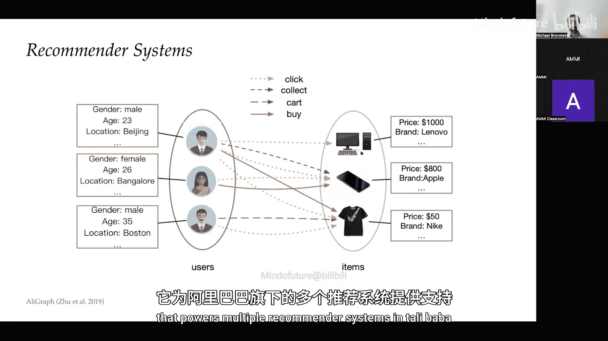
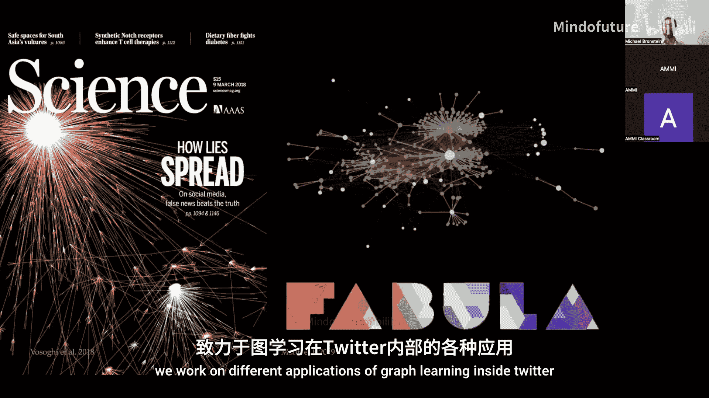
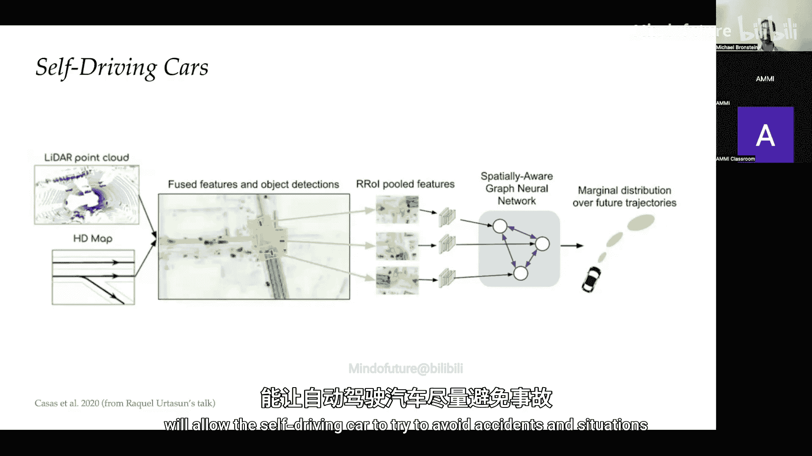
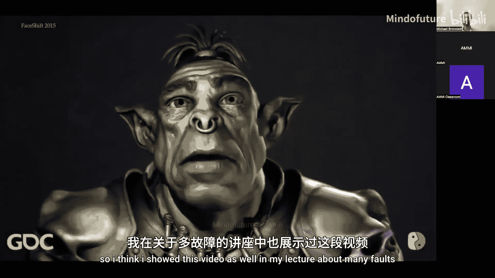
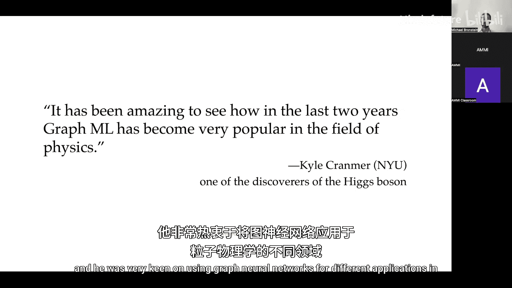
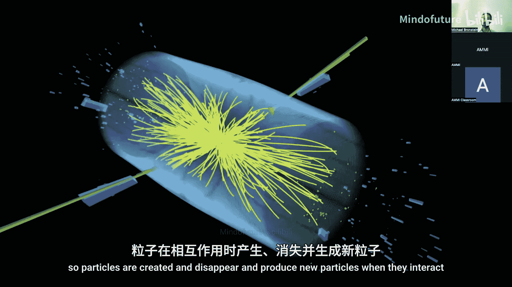
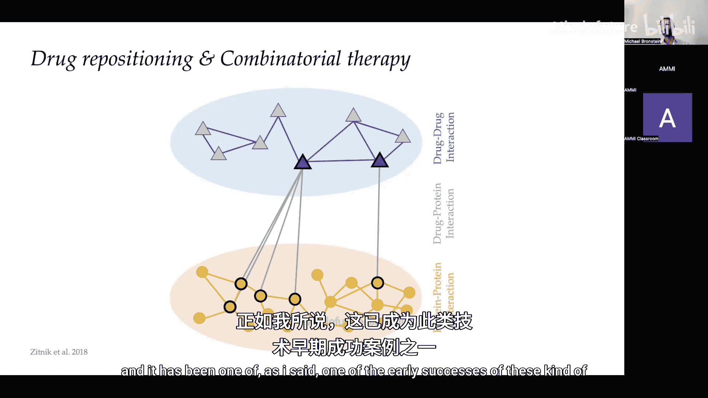
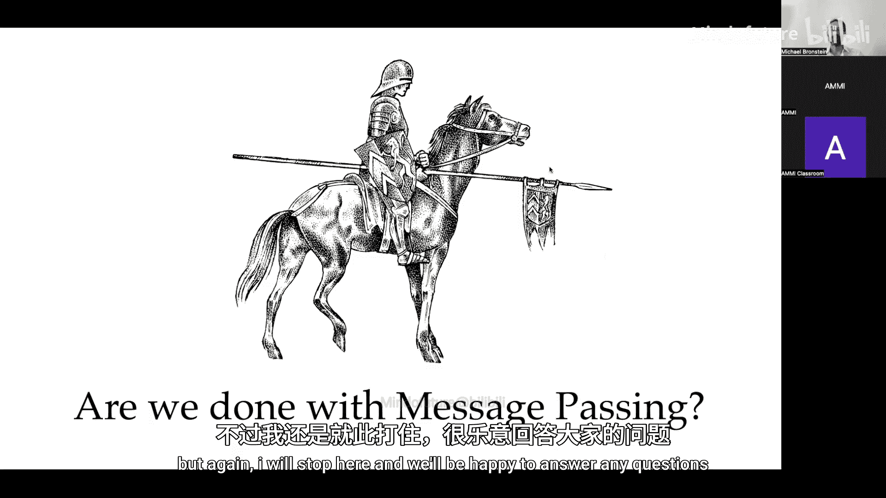

# 几何深度学习课程：P12：应用与趋势 🚀

在本节课中，我们将探讨图神经网络及其他几何深度学习模型的实际应用，并展望该领域未来可能的发展方向。我们将从社交网络、3D视觉到药物发现等多个领域，了解这些技术如何解决现实世界的问题。最后，我们将讨论一些前沿的研究趋势，例如将图神经网络视为物理系统的离散化，以及如何利用微分几何等思想来克服现有模型的局限性。

---

## 应用领域概览 📊

上一讲我们讨论了不同领域的几何先验。本节中，我们来看看图神经网络等模型在现实世界中的具体应用。

以下是几个关键的应用领域：





*   **社交网络与推荐系统**：图神经网络被广泛用于建模用户与物品的交互，预测潜在的连接，例如在Pinterest和阿里巴巴的推荐系统中。
*   **3D视觉与图形学**：处理点云、网格等3D数据，用于自动驾驶中的场景理解、实时动作捕捉和虚拟形象合成。
*   **物理科学**：在粒子物理中，将粒子相互作用描述为图，用于事件分类和重建；在流体模拟中，用图网络替代复杂的微分方程求解。
*   **生物学与药物发现**：这是图神经网络的起源领域之一。模型用于预测蛋白质结构（如AlphaFold）、设计新蛋白质、发现新抗生素以及预测药物组合的相互作用。





---





## 药物发现中的几何深度学习 💊

在生物学应用中，蛋白质是生命活动的核心执行者，也是大多数药物的作用靶点。传统的药物设计耗时漫长、成本高昂，因为化学空间极其庞大（约10^60种可能分子）。

图神经网络在此发挥了关键作用：

*   **分子表示**：分子天然地可以用图来表示（原子为节点，化学键为边）。
*   **性质预测**：模型可以学习预测分子的溶解度、毒性等关键性质，加速候选药物的筛选。
*   **新药发现**：例如，MIT的研究团队利用图神经网络发现了具有抗生素特性的新分子，这对应对抗生素耐药性危机具有重要意义。
*   **食物-药物网络**：通过构建“食物-化合物-蛋白质靶点-疾病”的多层网络，可以挖掘日常食物中具有潜在治疗效果的化合物。

**代码示例：简单的分子图表示**
```python
# 一个简化示例：用节点特征表示原子类型，边表示化学键
import torch
from torch_geometric.data import Data

# 假设一个水分子 H2O
# 节点特征：原子序数 [H=1, O=8]
x = torch.tensor([[1], [1], [8]], dtype=torch.float)
# 边索引：定义原子间的连接 (H1-O, H2-O)
edge_index = torch.tensor([[0, 2],
                           [1, 2],
                           [2, 0],
                           [2, 1]], dtype=torch.long).t().contiguous()
# 创建图数据对象
data = Data(x=x, edge_index=edge_index)
```

---



## 未来研究方向与挑战 🔮


尽管图神经网络取得了巨大成功，但仍面临根本性挑战。信息传递（Message Passing）范式存在理论局限（如无法区分某些图结构）和实际问题（如过度平滑和信息瓶颈）。

以下是几个有前景的研究方向：

*   **超越简单图结构**：利用**胞腔复形**等高阶拓扑结构来表示分子等数据，能更自然地捕捉环状结构等重要特征。
*   **可解释性与物理一致性**：学习符合物理定律、可解释的信息传递函数，例如通过符号回归得到相互作用的封闭形式。
*   **图重布线**：输入图不一定是最适合信息传播的结构。通过计算**离散曲率**识别瓶颈，并动态调整图连接（重布线），可以改善信息流动。
*   **将图视为连续对象的离散化**：为图赋予几何意义，将其视为连续空间（如双曲空间）的离散化，或从物理系统（如扩散方程）的离散化中推导出图网络架构。

---

## 物理视角下的图神经网络 ⚛️

一个新兴的观点是将图神经网络视为物理过程的离散化。这提供了新的设计思路和分析工具。

**核心思想**：许多图神经网络可以解释为**图上扩散方程**的离散化数值解。

考虑各向异性扩散方程：
`∂u/∂t = div( D(∇u) ∇u )`
其中 `u` 是节点上的信号（如特征），`D` 是扩散系数（可学习的函数），`div` 和 `∇` 是图上的散度和梯度算子。

*   **离散化**：使用数值方法（如欧拉法）对时间进行离散化，可以得到迭代更新公式。
*   **与GAT的联系**：图注意力网络（GAT）可以看作是该扩散方程的一种特定离散化，其中注意力机制对应于归一化的扩散系数 `D`。
*   **优势**：这种视角允许我们利用数值分析中成熟的工具（如多步法、自适应步长）来设计新的、更稳定、更深的网络架构，并自然地从理论上分析过度平滑等问题。

进一步，我们可以让图的几何本身（节点位置）也参与演化，实现**联合特征与结构的扩散**，从而在优化过程中动态地进行图重布线。

---

## 曲率、信息瓶颈与图重布线 🔄

在微分几何中，**里奇曲率**描述了空间的局部形状，并控制着测地线的汇聚或发散。我们可以为图定义离散的曲率概念。

*   **曲率与信息传播**：图中负曲率的边（类似于树状结构中的边）会导致信息在传播过程中迅速衰减，形成“信息瓶颈”，使得远距离节点间的依赖关系难以建立。这表现为**过度挤压**现象。
*   **诊断与修复**：通过计算图中每条边的离散曲率，可以识别出这些有害的瓶颈边。受**里奇流**（一种使流形几何变得均匀的演化方程）的启发，我们可以移除或调整这些边，从而对图进行“外科手术式”的重布线，创造出对信息传递更友好的图结构。

**公式示意**：离散曲率 `κ(e)` 可以定义为基于边 `e` 及其邻接三角形、四边形结构的一个函数。信息传播的雅可比矩阵 `J` 的范数可以被曲率所界定，例如在负曲率区域，`||J||` 会指数级衰减。

---

## 总结 📝

本节课我们一起回顾了几何深度学习，特别是图神经网络在多个领域的成功应用，从社交网络到药物设计。我们也探讨了该领域当前面临的挑战，如消息传递的固有局限性和深层网络的训练难题。

展望未来，通过引入更丰富的数学结构（如胞腔复形）、从物理系统（如扩散方程、力学系统）中汲取灵感，以及利用微分几何概念（如曲率）来理解和改进图结构，我们正在开辟新的研究方向。这些努力旨在构建更强大、更可解释、更高效的几何深度学习模型，以解决日益复杂的科学和工程问题。



> “对称性”是贯穿科学与数学的一个核心思想。我们已看到如何将这一原理应用于网格、齐次空间、图、流形等不同对象，来推导学习架构的归纳偏置。未来的篇章，或许在于将这些几何先验与更广泛的物理原理和数学理论更深层次地融合。