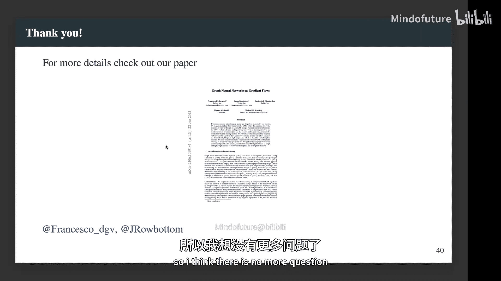
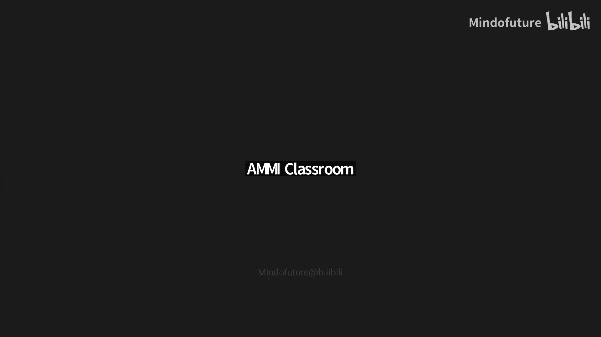

# 几何深度学习 ｜ Ammi Geometric Deep Learning Course p13 P13_研讨会1（基于物理的GNN）-弗朗西斯科·迪·乔瓦尼 -BV1veHgzxELm_p13-

Thanks for the invitation'm really。I'm really happy to be part of this call in this presentation I will be talking about a recent work we have and this is a joint work with James Robbaton。

 Ben Chamberlain， Thomas Mark and Michael Bnstein。And in types of graph net has gradient flows。

The structure of the presentation is actually going to be as follows， so we。

I'm going to talk a lot about graph preliminaries。pecttroized in linear gem graphs and dynamical ecosystem on graphs。

Half of the presentation roughly is going to。比包。Classical tools to analyze signals on graphs。

And dynamic ecosystem on grads。This is independent of message Pass neural networks。

 but this will be hopefully useful to provide a sort of context and some perhaps like lens。

That you can that you can have so which like look at the MPN with some fresh eyes and then。

Dig a little bit deeper into our paper。 I trust that by now， you've， you've seen。Generally。

 what graphion networks are。I'm going to recall that at some point。

 but I will be mostly focusing as I said on these analytical tools and in some regard also s classical tools。

So let me start by setting mostly fnotations， so we will consider always a graph consisting of vertex set V and N set E。

 and I will always assume this graph to be undirected。we have from now on。

 whenever you're going to see the notation n， this will be the number of nodes of the graph。

And we have the most important matrices that are denoted by A and D respectively。

 which are the addiency matrix that represents the connectivity in a graph and the degree matrix。

 which is a diagonal matrix that we get by basically Ros sumine a and so just to set the dimensions。

 both A and D are going to be square matrices of dimension and by n。

An important operator that we can construct out of A and D is the normalized a that we do not buy A bar。

And for people that have already seen graph conversion networks IGCNs。

 this is the matrix adopted in their paper and in that architecture。

 and there are a few reasons for why one would like to have a bar rather than a I'm not going to spend time on this。

 but I want to say that this is a fairly classical construction and in fact。

The arguably most important operator that one can associate with a graph is thelalationian。

That I define as identity minus a bar now。A few things， so first of all。

 I can think of that that remembers a squared n by n matrix。As an operator that apps on signals。

 So a signal is a map that associates， say， to each node， a skill number， and therefore I can。

Represent this signal as an n dimensionsal vector， as I'm going to show in the next slide。

And therefore， I can think of the action of the laplaian matrix on a signal。

 which is an n dimensional vector as an operator acting on the signal and I have in this equation here in this box。

Expression of this operator。And for people that like have some familiarity with that standard laplaian in you know Euclide space。

 you can see why this matrix here， deelta is in fact called the laplaian。

 because there is an a type of property that is sort of similar to the second order operator in Euclide space。

Now this Applaian operator issymmetric and it's also positive semideine so we can have we can you know look at these at its eigenvalues and we can order them from the lowest to highest now two important properties first of all。

The lowest second value is always zero， and in fact。

 the multiplicity of the second value will give you the number of connected components in the graph。

And second， the highest e value， which is also the specs already sub the matrix。

 and I'm using the notation row data is always a number smaller or equal than two。Now。

 usually people refer to this like values as frequencies and I can also use the。

I have a notation also for theigenbacterus of the laplaian， which are these phi delta。

Which are n dimensional vector now， maybe an important observation is that there are other versions of laplaians that one can use。

Everything I'd be saying will。Extend to the unorized lapla 2。

but he will not extend to non sematic applas like the random walk ones。

 and I promise you that by the end of this talk you'll understand why。Now。

How can we use the lapplian so one one important quantity on a graph is a Britishish line entry so SS said consider a signal or feature on a graph and we can think for example the temperature at each node of the graph so we have a temperature for each node of the graph。

And we can think of now of this temperature for each node as a vector where I stack basically each entry and get an n dimensionmenal vector。

 so once now I have a signal as an n dimensionmensal vector。

 I can of course decompose this signal into the basis of aigenvectors of the laplaian。嗯。I see。

 There is。There is no condition denominator orpl equations。Technically， the you would have。

You would have some。Connect connectededness type of assumption。

 so something I didn't want to like stress too much like make the slide to dance。

 but of course ideally one would like to avoid to consider isolated notes。

That would have basically degree zero or you could have isolated nodes with self flus at least they have positive degree so we can think of a graph where we ignore isolated nodes so that that denominator is always well defined。

U so。Now， what I was saying is if we have this decomposition into the aigenvector basis。

 then we can use the laplaian to sort of measure the smoothness of the signal now。The dish laity。

 and a few of you may already know the analogous quantity for Euclidean space can be also defined on graphs。

 and we have this definition where basically with some overall edges。

The deviation of the signal value that node I and the signal value to node J for all edges that connect INJ up to this normalization by degree。

 once again， let's remove isolated nodes。And I can rewrite this quantity and compact form as an inner product between the signal and the laplaian。

 right？And in fact， I can use the eigen decomposition I had upstairs to write the deish energy in terms of the coefficients of the signal with respect to the eigenvector basis of the application so what I want to emphasize here is that the de energy measures the movement of the signal because the lower the dish energy。

The lower these deviations along edges and therefore the smooth filter signal。

 and vice ver of and if the de energy is higher， then the signal is going to be less smooth。

And in fact， people refer to this quantity inside the Lun norm as the gradient of the feature。

Along an edge。AndBut what is important is that equivalently because of these equiities。

 I can measure the smoothness of a signal in terms of the mass that the signal has projected on the lowest frequency aigenvector。

The larger DCL for low well than the smoother the signal because we have lower diminish energy。啊。呃。

Yes。Okay， so I have two questions。嗯。Maybe I have a question for the organizers although like I can try to deal with time a little bit better。

 how much time do I have？所有问牛啊。One hour。 Okay， fine， yeah， so。

Why do we care about this most of the signal so in general。You can think， let's say for example。

 you think of images but and you can think of images as a subclass of graphs， right then。

You want to have some operations on images and these operations for example。

 can be blurring or can be sharpening so these type of operations are blurring that would be like you kind of diffuse the image and this is like increase in the smoothness of the image or you can do sharpening like enhancement which means for example you do some edge detection and you may in fact decrease the smoothness of the signal so。

Assessing how smooth a signal is like for example， colors on an image or an image itself is one way of monitoring what kind of transformations you can do on that images。

嗯。And but you're kind of see in a second why also like we care about that in the context of graphs and graphon networks。

I'm not sure what I should repeat specifically if there's a point I should I have to repeat。

 can I can do that。And if you had a lose。嗯。So the role of slos is actually an topic that is not entirely understood。

I guess the heuristics is at least in the context of gens is that。

If you add a self loop nodes will tend to retain most information about themselves and this will alleviate like mixing too much with the information of their neighbors so in fact it might change information on the graph but in a positive way and especially if we have a roughlyphily rather than themphily but this is terminology that I will introduce later in the talk so I don't want to sort of like confuse you too much at this point。

Right， so this energy is a function that monitors smoothness in the graph。

But I also want to give you a rough picture that perhaps also partly answers the questions about why do we care about smoothness what is telling us about that so consider like a process that changes on time in the graph like for example you can think of temperature on a graph that evolves in time due to some I don't know external factor like heat。

U that is applied to the graph now for each time we can always take the temperature as an end dimensional vector and write this temperature in terms of the eigenvector basis。

 so now the coefficients that with respect to these eigenvector basis will of course be functions of functions of time。

Now a rough description is the following if the high frequency components。

 so by that I mean the coefficients C with L large so the coefficients that multiply the eigenvectors of the lapplian with larger eigenvalues。

 they decrease with time。So I keep the low frequency components。

 but I throw away the high frequency component， then I'm effectively doing some blurring dennoicing type of operations。

 which is what for example also has been studied for images so this will increase the smoothness of the signal right so this is a type of operation that will denno the graph and can be useful many in many situations。

But on the other side， if I throw away the low frequency components and I keep the high frequency component。

 then I say that I have a high pass filtering， meaning that I do the other of the opposite transformation。

 I sharpen the signal and I sort of like enhance the signal now this image is essentially discovery what I just said because you have the same graph。

And what you have is the fifth four eigenvectors of that Applaian now。

You can see how if you move from left to right the aigenvector becomes less and less smooth so in the first case the aenvector takes the same value at each node so you can think of temperature being the same everywhere but then as you move from left to right the signal becomes less and less smooth because now you have temperature that changes in let's say multiple places as as you go from left to right so left is low frequency everything is smooth。

 everything changes very little and then as you increase the frequency you decrease the smoothness and you can have signals that are also more complicated okay。

Now a very， very standard example of an operation that is a low pass filtering so an operation that makes the signal super smooth is the heat equation。

 so remember that I can have an input signal say。Temperature。

And then the Dish energy can be written in compact form as this inner product。

So let's say I want to minimize the this energy in other words， let's say I want to make my signal。

 my feature smoother， I want to do some blurring or some denonccing right what I can do is take infinitesimal steps in the direction of steepest decent of the energy and therefore basically obtain a dynamical system or differential equation where my feature evolves in time in the direction of minus the gradient of the energy but you can see from this equation here that if I take the gradient of that I will just get minus the laplaian times the solution so this is the classical heat equation where we evolve some feature by minus the laplaian of the graph and in fact by design because we are evolving in the direction of steepest descent of the energy。

 the energy will decrease in time and in fact。If I let the hip equation run for infinite time in the limit。

 I'm converging to something that。iss in the kernel of the laplaian as in satisfies laplaian times the limit equals0 so the take of message here is if I have a lowpa dynamic so a dynamics that is moving something that is denno in a signal。

 if I let it run for too long the feature become indistinguishable because everything is becoming increasingly similar to each other up to a point where I can distinguish anything no more as in the picture I was showing you before where the temperature was the same at each node。

Now we've right now we've talked about scalar signals。

 but of course most of the times especially for gens as we'll see later， we have vector signals。

 so for each node now we have a D dimensionmensal vector so we can represent the feature as a matrixs of dimension n by D and we can generalize the divisional energy in this case fairly easily so we again some overall edges but now instead of having the scalar deviation we have theL2 norm of the vectors。

And not surprisingly， as I've shown you before， if you take the gradient flow of that。

 so if you evolve the signal in the direction of minus the gradient of the digital energy。

 you're going to see the heat equation but down on each coordinate or AKA in each feature channel。

 so for each R that goes1 to be。嗯。This is a slide that may sound a bit technical， but in fact。

 it is the key approach that we've used in our paper to analyze mathematically everything in an easy form。

The appshot is if I'm given a feature matrix， I can always vectorize this matrix by stacking all the columns into a longer column。

 right？Now if I do that so I move from n by D to Nd。

 then I can rewrite the British energy in a compact form and you can see now that the heat equation I was showing you above can be nicely written as a vector equation where I have a vector on the left hand side then I have this operator which is basically I'm broadcast in the laplaian on each entry。

 and then I have another vector here， so I don't want you to get too stressed about the details here。

 but and I invite you for example to maybe check out a paper or for the details but the。

Take a message here is that this tensor product or chronicle product forium allows us to reduce matrix differential equations to vector differential equations and vector differential equations are much easier to deal with。

And I'm going to show you now a motivate an example that hopefully will also clear things out a little bit about this stuff with with the cropping so let's suppose we have a dynamical process on a graph and we want to say。

It's this dynamical process？A smoothing process or a sharpening process so。

Are the low frequencies dominating or are the high frequency doating， how can we determine that？

That the。The key point is we can use the digital energy， but we have to normalize the solution first。

 and this motivating example would be to justify that。So。

Let's consider a very simple differential equation we have a feature solution feature matrix that is evolved as normalized aency times the solution and I can always factor that as as I showed you in the previous slide now recall that the normalized aencies it's just identity minus thelaian now this is all a symmetric matrix so linear dynamical equations I can exponentialiate and get my solution so for each for each feature channel I just have to look at the exponential of this matrix times my initial condition。

Now。Exponentency in a matrix means essentially that I have to decompose the matrix using in eigenvectors in eigenvalues。

I can rewrite my solution as a combination。Of the eigenvectors of the lapplian。

 then I have my the projection of my initial condition into the eigenvector。

 and then I have an exponential here that is basically determining how fast or I am growing or how fast I am decaying in time along that eigenvector。

 right？Now recall that the smoothest seconden vector is the one that is satisfied equation delta phi0 equals0 Now if I'm looking at the projection along the secondig vector of my solution at time t then I get this equation so the projection along the smoothest secondgan vector is actually growing exponentially fast and this is the component that is growing the fastest in my equation now if I have an equation and the projection along the smoothest second vector is growing the fastest I'd like to say this is the smoothing process because what is basically driving my equation is the vector that is the smoothest one so I've told you that the digital energy measures the smoothness so is it true then that the digital energy is going to zero as we progress in time。

This is not the case， so the dish energy still basically in almost any case will diverge to infinity so what is happening here I think I have a process that is smoothing but the diminishish energy seem to go to infinity well the point here is that we are not normalizing the solution so if we normalize the solution so we divide the solution by its norm then actually we find that the digitalish energy of this is going to zero and in fact for each channel for each feature channel the normalized solution is converging to something that is in the kernel of the laplaian so satisfy this equation。

So the abstractshot of this motivating example is the digitalish energy is not enough because it does not account for the scale of a signal。

 we have to normalize the solution first and once we normalize now this quantity here is a good measurement of whether might processes becoming smoother and smoother or whether it's becoming like more sharp。

 like less smooth。These are definitions we've introduced in our paper to basically capture that。

We say that a dynamical system initialized at some input feature is low frequency dominant。

 and I will be using this acronym LFT if the diminishish energy of the normalized solution is going to zero for as we progress in time。

And the reason why that makes sense is that one can actually show that if this is satisfied。

 then basically。Up to sub sequenceequences and I invite you to read the appendices for why this condition in fact is necessary you will converge to a solution that is in the kernel of the laplaian so this lamb is essentially telling you yes this definition makes sense the de energy of the normal solution is in fact telling me whether what is the fastest component what is the component that is driving my equation and if this is going to zero then such component would be the smoothest possible one。

And we can have exactly the same definition， but for the opposite case。

 which is the high frequency do， so the diminishish energy satisfied this bound。

 that means that the diminishish energy of a normalized signal is always bounded by the spectral radius over2 the over2 is a convention we use in our paper。

So the very same motivation allows us to have the following definition we say that a dynamicnaal system on a graph is high frequency dominant or HFD if the digital energy of the normalized solution approaches its maximum as we progress in time and again this makes sense because we can show that if this is satisfied then。

The normalized solution is converging into a signal that will be the largest frequencyigve。

 so the least smooth eigen vector of the applaian。Ive give in a lot of information。

 but the take a message is now we have two definitions， LSD N HFD， LFD dynamics means。

At the end of the day， I have a smooth in dynamics。

 something that will make things increasingly similar。HFT is the opposite dynamics。

 is a sharpening dynamics where I am enhancing rather than denoicing。

But why would we need such definitions in the context of GenNs。

 so we finally can talk about MPNs after all these courses。We have a graph。

 we have some input features， we have potentially an encoding map and then we have update functions for each layer that process these features and generally message passing neural networks can be written like this so we have that the representation at each node at layer T plus one is given as a function of the representation of the previous layer and the representations of of each neighbor right so message passing means I'm using the given graph as the actual computational graph to propagate information。

Now message person etos are。You know quite successful in fact， quite simple。

 but we have to talk about problems otherwise we our research will be over so we have problems likely enough and the main ones are expresslusivity we're not going to talk about expressivity in the classical sense of comparison with doubleL test today。

The second problem is what I refer as low versus high paths。

How do message passenger nos perform if we need more than a smoothing process。

 if we need more than dennoicing， and this is related to this now classical problem of oversmthing。

 which happens if we stack many， many layers and at the end we see that the representation of each node are becoming indistinguishable。

And another problem is over question。Also something I worked on and it basically is like。

it's a problem of information flow that can struggle due to the graft topology this is independent of the specific choice of NPn but will be affected by the graph topology now in the rest of this presentation I will be focusing on the second point but of course these are very much related if we have an MPN that can perform not just as a low pass but also as for example as a high pass then of course it's more expressive and just to set some terminology we usually think of a semisupervised setting where we have a subset of the nodes that are labeled。

And we want to predict labels on a test set。Now， there are two notions that usually people now refer to this in this scenario。

 The first one is ophily。A monthly means neighbors。Often share the same label。

 so label starts smooth and therefore low pass is good here because most of the times we just want some denoicing because everything I'm connected to is actually similar to me。

The opposite case is heterophily， so labels are not smooth and therefore we expect low paths to be actually bad and is this finally circles back to the question of why do we care about smoothness that someone asked at the beginning so。

We care about smoothness because if a process is。Increasing the sprintness of the signal。

 then such process could be beneficial if we have them awfully。

 but it could be actually harmful damaging if we have it awfully because we are making things similar when they shouldn't。

So and the dual perspective， of course， this extends also to task like graph classification and graph regression because one can think of oline neopophilly as short range relations。

 I only care about what's connected to me versus longer range relations。

 I actually care about things that are also not connected to me。

The standard example of MPNNs are GCN so graph convolutional networks。

Where a layer is basically given by some linear activation function。

 then we have a message passing matrix that encodes graph information in this case。

 the normalized a agency， we have the solution， and then we have this right inside notplication which is referred to as channel mixing because of course it will acts on the entries of each feature and potentially meet the entries。

Now GCN you are successful are extremely simple， but there have been scenarios where they seem to struggle。

 so the first one is heterotrophiligraphs。And the second one is a degradation when increasing depth。

 so this is the problem of over smooththing and。There's been quite some analysis in the literature about this problem that can be sort of condensed in the following statement。

 so what has been shown is that the diminish energy of a solution of a GCN is going to zero if the singular values of the channel mixing are sufficiently small and the sufficiently small is depending basically on properties like the spectral gap of the graph。

So。This is not okay because we know that if digital energy is going to zero。

 then we have a smoothing process， which of course may not be good and we may lose information。

But this statement is also。Tackling a specific angle of the problem。

 we have this assumption on the channel mixing which is sufficient small in terms of singular values。

Is it the case that we can generalize such result when we don't have this assumption？

Is it the case that sort of graph convolution net are in fact doomed as in they can only act as slow pass。

 or maybe we can say something a little bit different？So。To kind of tackle some of these questions。

 we have。Try to follow it sort of say multipart approach to Gens where we think of node features as particles inRT。

And we have this gradient flow framework， which we term graph where the message passing neural networksos can be interpreted as some multipart dynamics that minimize a learnable energy now on the right just to give it an idea。

 this is a small graph and the actual gradient flow framework that is able to sort of induce attraction on one of the sort of access and repulsion on the other and these are both useful to you know bring things that should be brought together closer but also separate things that are different。

Now， what is the outline of our contribution？As I said。

 we don't parameterize the message Pa networks equations。

 but we do parameterize an energy that models these interactions between particles。

 and then the message Pa network will follow the direction of steepest descent of a learnable energy。

Now， we show that the channel mixing W， in fact， can learn to induce either a low frequency dominant or a high frequency dominant dynamics thanks to its spectrum。

 So the channel mixing， in fact， is powerful enough。

To adaptively learn to do more smoothing or more enhancing thanks to its positive and negative eigenvalue。

And in fact。If you think about the picture I showed you before， in this framework。

 you can think of possibly the negative eigenvalue of w as generating attraction and repulsion so you can think of forces in particular space。

I'm going to address the question in a second， at least I'm going to open the chat now and then this。

Sort of like。Dynamics can induce a framework that can learn to be LFD or HFT so it can adapt to homophiic and enterphiic graphs because in the first case we expect。

 as I said low frequency dominant to be good in the second case we expect high frequency dominant to be good。

嗯。Oh yeah， I mean this is the presentations graph is not going to be over here and now we're going to you know dig into and explain more the role of the channel mixing。

 right？At least in this great framework。Okay， so。诶。Right， I think yes。Okay， so just a recap。

 we're going to look at Genan's dynamical equation。 So remember like。

We can think of residual network renets as discretization of differential equations when the step size goes to zero and this is。

 of course， can be done in the case of residual message plus signal axis2 where we have a residual block we have a step size and then if the step size goes to zero。

 then this is just a discretization of differential equations。

And there have been instances of continuous message passing neural networks。

 I think I have to like you know speed up a bit to go through the end。

 so I'm just going to be saying here that in all of these models。

You actually parameterized the equation， so a kind of question would be。

 how do we choose such equations， right？Now。Since we are looking at the framework called differential equations and dynamical systems。

 there is a very， very special class of differential equations that our gradient flows now gradient flows are equations where the ODE is actually the steepest descent of an energy so you are evolving some equation some function in the direction of minus the gradient of an energy Now these equations are very special they are used everywhere in physics in geometry because instead of basically studying the equations。

 you can study the energy and the energy is already giving you a lot of information because you know that any solution you're going to get is minimizing the energy so you know the dynamics is what it's trying to achieve。

So that the key question that is sort of motivating our work is okay。

 what if we parameterize an energy so we learn an energy rather than the message possible neural axis equations so we can do that and。

If you do that， then you can interpret this process as let's generalize the classical digital energy that is not learnable。

 which it's something that allows us to find the right notion smoothness for the problem。

And now we once we parameter interested that the energy。

 the message passing neural network equations will just follow as the gradient flow of this energy。

 which means as minus the gradient of this energy。Right。

Now let's try to be a little bit more specific about that。How can we。Generalize the de energygraph。

So let's suppose we have a matrix that represents essentially a metricuclidean space so this is a post semidaphite matrix so we can use the teleles composition to write this as double transpose w and what we can do is。

On the left hand side here， you had the classical division energy where with sum overall edges。

 the gradient of the feature squared。And now we can generalize that by weighting this L2 norm with some learnable w。

 so I'm literally waiting the L2 norm。And this would be a reasonable first step。

 I don't have time to motivate this， but in our paper we draw some comparisons with harmonic map flow that we're used in image processing too。

Now let's say I want to minimize the digital energy weighted with w so what do we expect so we want to minimize this quantity but this quantity is a sum of squared function so each sum has to be minimized so we expect the gradient to go to zero except when is inside the kernel of H so except when basically for example w times the gradient is0。

And this is precisely what happens。 So we can treat WS learnable weights。 We can。

Derve the gradient flow of design energy energy， which is a quite simple equation。

 So this resembles GCN because we have a solution， we have a message passing matrix that in this case is minus the applicationian。

But then on the right hand side， we have this channel mix in acting on the features。

And now the proposition， and I'm going to state this informally。

 but we have the specific precise statement in the paper is that。There is no W we can learn。

That will separate the limit embeddings of nodes that have same degree and same input features。

 so you give me two nodes， they have the same degree。

 they have same input features if I ran this equation for too long the representation will become the same I cannot distinguish these nodes anymore。

And in fact， if w has zero kernel， so。The kernel of w is just a zero vector then nodes with the same degree will converge to the same representation。

 This is irrespecively of the their input feature， so this is a。A bad thing and in fact。

 in the context of Gens， this is what people traditionally refer to as overstthing。

 where notes that have same degree will converge to the same representation for getting all the other information features and anything of that sort。

And this is in particular， so this is a little bit more technical but oversmotthing this occurs independently of the spectral register of W so and this is true even for equations that are residual because this is a differential equation so when we discretize we're going to get residual equation so this is different from what was known or studied previously in literature we have no type of assumption of the form we need singular values to be small enough and we are looking at equations that are actually residual so they take a message here is if we can control the sign of the eigenvalue of the channel mixing which is what is acting on the right。

Then this is very powerful and is going to generate the dynamics that can。

Always be low frequency dominant。 And in fact， it will always over smooth in the limit。

 So this is not great。 I mean， we said。If we have something like that。

 it's going to definitely fail if we have a neurophon， right， So how can we modify this a little bit。

To make it more general。Remember that we have the additional energy that is written like this with this weightd w。

 so what we do is okay let's replace each occurrence of w transpose w with symmetric matrices omega W that are now independent and the symmetry is actually necessary here。

If we do that now the energy is written as a sum of two terms， the first one。

 as you can see here has no dependence on the edges， no dependence on the graph connectivity。

 the second one depends on the edge connectivity because it will sum or again overall edges and then we have this inner products that are weighted by omega W so how can we interpret this。

Of course， we can take the gradient flow of that and the gradient flow。Will become again。

 increasingly similar to graph convolutional models because it's a differential equation。

 but then we have a term that resembles graph sage because we have each sort of like mixing of the channels acting on the solution without any graph information and then we have what is essentially graph convolutional block。

 right？Remember that omega W here has symmetric nericosis。

But what I care about now is the interpretation。Not features are particles。

 so the external energy is independent of the graph topology as I was saying。

 so this can be interpreted as an external field in this particle space。

The pairwise energy is a potential energy that does depend on the edges and can be interpreted as pairwise interaction of the particles that are basically governed by W and remember that in our framework。

 W and omega are what we are going to learn， right？

But w is symmetric so w can always be decomposed into positive and negative eigenvalue and I'm using this notation just to mean this positive and negative eigenvalue decomposition now if we do that。

 we can rewrite the same energy in a more explicit way as a first term that is just again independent of the graph structure。

But then these two terms are actually what very interesting because now we have a gradient flow that minimizes the energy。

 so if we want to minimize the energy， what we get is attraction。

And this is through the positive eigenvalue of w， because these terms here。

 remember that theta plus r encoding positive eigenvalue of w is decreasing edgewise。

But we also have repulsion because the negative een valuesage of w are acting now on the gradient and these terms here are increasing along the evolution。

 the reason why they are increasing is because they appear here with a minus sign so if we take gradient descent this last term here would increase。

So what we found is just without looking at equation， just looking at the energy。

 we know that whatever message possible your network we're going to get as gradient flow of this energy。

 it will have two types of behaviors attraction by deposit eenvalue W repulsion by the negative eigenvalue of w。

 but attraction is something that makes things smoother because it pull things together repulsion is something that will enhance it will pull things apart so we expect attraction to be。

Inducing LFT dynamics and reports soon to be inducing HFT dynamics。

And this is precisely what happens。So。😊，I think I have to run a little bit。

 so I'm just want to say that this proposition again。

 I've reported an informal statement is precisely saying what I've just said so if you have enough negative eigenvalue for w and remember w is what you want to learn。

With respect to the positive eigenvalues， then the graph5 frequencies dominate so your dynamics is HFT。

 you are not going to overs smoothoo and in fact you are going to separate things apart remember that picture I was showing you before when you have this separation along one axis so the theoretical upshot is the channel mix in W that enters GCN and stuff like that is in fact quite powerful and the distribution of its eigenvalues in particular how much mass I have into the negative eigenvalues compared to the positive ones determine if the dynamics is LFD or HFT so I can adapt to do smoothing or enhancing。

I'm going to skip this slide， this is just some comparison we do with a few continuous general models by showing that they actually are never HFD so they can never act by a slight high frequency dominated。

 which is a limitation。And then I can move to the discretization of our framework because at the end of the day。

 we want to discretize our equations and of course we do that by introducing a step size and then our linear gradient flow framework can be written like this in a simplified form。

Where the only constraint is essentially that our channel mixing is a symmetric matrix and this is shared across layers。

I think yeah I think I want to like maybe skip the details here。

 but this is so I want to say that the main theorem of our paper is essentially translating the result from the continuous case so time is continuous to the discrete case time is discrete so we talk about layers and this yearem is telling you a few things。

Which I think I can just keep to here to the take our messages because we don't have time。

Once we disretize this gradient flow， we find that first， differently from previous results。

 I can induce a high frequency dominated dynamics thanks to the negative eigenvalue of w and there is no requirement on how big this negative eigenvalue are provided that the positive eigenvalue starts small enough so it's the concentration of positive and negative eigvalue of w that is really determining how the dynamics inside an MPN is going to behave。

Also， we found that if we drop a residual connection。

 then your dynamics is going to be low frequency dominated。

Independently of the and magnitude of the eigenvalue of w。

 so the eigenvalue of w can help you steer in a way to steer away that the process from being smooth in provided that you have a residual connection。

 otherwise they cannot do that。I'm going to finish this presentation by giving you some ablation studies that sort of corroborate and confirm our theoretical analysis and this slide is just to show you that basically the。

The ingredients of this framework are an encoding block that acts not wise。

 we have symmetric channel mixing matrixrices omega w that are shared across layers。

We have a decoding block for the classification， and then we have this simple linear message pass connects。

 start residual because they come from differential equations and then we have this block here where we have potentially a source term and then we have the gradient flow blocks that I was describing with symmetric matrices。

Of course， the key thing here is let's suppose for simplicity that omega zero。

 how do we choose how do we enforce symmetry at the level of w so of course the simplest case would be let's learn w prime and then let's consider w prime plus w prime transpose that' that's simple enough but there is no control on the spectrum here right？

On the other case， we have ways of controlling directly the spectrum by taking what we call prod or neck prod。

 so we learn W prime， but then we take prime transpose W prime and but the problem of this of course is this construction will always give you eigenvalues with the same sign。

 so either or all non negative or all nonpo。And finally we have what we call diagonally dominant。

 I don't think it's crucial here to discuss the details。

 but the main factor here is basically controlling the diagonal terms of w and the off diagonal separately and one can then rely on gas current theorem to sort of like monitor the spectrum and in fact we have some ablation study our paper to show that this configuration seems to be more efficient with respect to the heat and dimension。

An important bit is something that I hope you've already picked up is this model is or I should say framework is quite simple。

 so it's linear。There is no attention mechanism， There is no， you know。

Some complicated stuff going on and in fact it's basically faster than GCN because we are also preprocessing using nodes rather than edges so and disab studies just to confirm this is like essentially a super light framework。

Now。I want to finish this presentation by saying by showing you a few charts。

 but let me recap what our theory basically said， so Oityliggen virus of w。

Induce attraction in a residual convolution model。 This is good。 if you have a monthlying。

Negative eigenvalue of W and use propulsion in a residual convolsution model。

 this we expect to be good on etherphaly。And then if we drop the residual block， then。

There is no w that can steer away the diffusion from low frequency dominance。

 so if we drop the system block， we expect their model to suffer in heterophily no matter the spectrum of w。

And to sort of justify these things， we use this sort of synthetic data sets where we can sort of generate some targets of homophiity by preferential attachment。

The abra study essentially confirmed that， so for example we observed that if we have only negative e values。

 this is going to be much better on low morphphily。

 but it's going to be much worse on higher morphphily because we can only do repulsion and the other way around for product so if we have only positive e values。

And this is important because even if we have a residualcon as our theory was showing that if we only have pro egg values。

 you can only do attraction so you're going to suffer anyway when the Omphily is slow and you can see for example here at the green plot so Prod is a residual model but it's going to be terrible with lowphily because you can only do attraction。

Of course， if we have。Moels that can adaptively learn to be either attractive or repulsive。

 like the sum or diagon do， they tend to be performant。

robust more robustly with respect to the target homophily。

 but they are always better essentially than GCN， which is violet one。

 because GCN is not residual and we know by our theory that it will suffer with low morphphily no matter the spectrum of W。

And we have a similar a， but I think this is actually even more interesting in my opinion because what we do here is effectively explaining the smoothness of the prediction thanks to our analysis because what we do is comparing the omphily of our prediction so we're essentially the smoothness of our prediction versus the omphily that is directly read from the encoding so without any evolution and what we find is again that if we only have negative eigenvalue so we can only do repulsion。

 the smoothness is going to decrease if we only have positive eigenvalue， so attraction。

 the smoothness can only increase neutral variances are of course more robust。

But an interesting behavior is that the encoding seems to learn to compensate for when the dynamics can either do only attraction or repulsion。

 so for example， if you can only do attraction， then the encoding seems to learn to separate things initially a bit because he knows that inside evolution。

 they will then you know get closer to each other。So conclusions。

We have a framework where the message passing neural echoos equations minimize the multipart learnable energy。

This allows us to analyze the role of the channel mixing and how it's possible negative eigenvalue matter in generating a low frequency dominant dynamics or a high frequency dominant dynamics we could refine some existing analysis for MPNs that specific statements are in the paper and from a practical perspective sort of the framework kind of allows for educated choices because we can have a more explainable convolutional model where the spectrum of the channel mixing is directly related to the smoothness of the prediction and we kind of refuse sort of like this idea that graph convolutional models are too simple because if we are residual we have enough negative eigenvalue in the channel mixing we can be dominated by the high frequency。

and some limitations in figure direction， what happens if of course we replace the China mix in W now with a China mixing that is symmetric。

 but is also aware of features and time？This would need to match this efficiency requirement what can we say about dynamics that are neither LFD nor HFT of course these exist and these are maybe actually interesting so what can we say about those and of course this energy formulation in fact points to models that are a bit more sophisticated but also more inspired by physics and this is going to be like a guess future work I thank a lot for your attention I hope that at least。

The first half of the talk， you could bring something with you to like maybe look at Gen or MPN with the eyes of you know dish energy and signal theory and yeah I guess I can take any other question now starting from。

You don't yeah， you don't know if the nodes have pholy， so two points first。

There may be heuristics to estimate that based for example， on the training side。

But what I want to say is the framework does not need to know that beforehand because。

What we observe in this a studies that W will learn to have more negative again values if。Basically。

 this is needed for the graph。 So you don't need to inject this information beforehand is this flexibility that will learn based on the given graph What we did is explaining。

The performance。Depending on the given level of amphiline this is in synthetic experiment and showing that basically。

You can you can literally explain the drop in performance depending on your monthlyly and depending on whether the model was able to learn negative eigenvalues or not。

I have not reported the table here， of course in our paper we also run experiments on real data sets for nodeconification and we found that this model。

 despite being extremely simple， as I said is basically faster than GCN。

 it will be very competitive with way more sophisticated benchmarks that have been specifically designed to tackle it roughly。

Yeah， you're welcome I hope that answered your question。아 그냥度 있지。Yeah， sure。So。Amorphphily means。

That。The edge of a graph。Connect。Things that are similar to each other。So this very much applies。

 for example， to social networks。 So most likely if you are on a social network and。The the。

People that you， let's say， you follow。Are going to be according to some to some rule similar to you。

 perhaps in terms of age， perhaps in terms of interest。

 So the edges of the social network will tend to connect。Items or users， for example。

 that are similar to each other。Now， if， for example， instead you are。You had a graph。

So this is a muly and this is where because of this assumption。

If you want to then classify on the graph， you would expect a。

Sort of operations that dennos the graph and smooth things out to actually help because these operations will increase the similarity between the neighbors。

 the neighbors are actually you know coming from the same latent representations they should have the same label so this is good。

But what happens in the other case， so for example， what happens in now if you have a graph where。

For example， on one side， there are users。But then on the。

 I want to separate users from people that are cheating in a video game。And the edges are。

 if I report a given user that is cheating in words on it， and I'm not happy about it。Now， the。

In this case。The edge is not connecting actually items or in this case of okay players that should be placed together so if you now have a process that smooth things out it makes for example。

 myself increasingly similar to the people i'm reporting then this would be bad I mean i'm not classified correctly so it roughly means you actually want most of the times to separate things that are connected rather than place things that are connected together and give them the same label。

And you can describe that。Using low N frequency because a process that is low frequency dominant。

Place things that are connected together a process that is high frequency dominant will separate things and in the framework I've described this could be like interpreter using the these physics approaches where you have attraction and repulsion so are you going to attract things along an edge aphily or you this would work on aphily or you want to separate things along an edge this would work better on etly。

So。Yeah。If。Okay， so in the first question。I'm not sure if。There is a。

Specific thing you're asking about the applaian， what I can say is。

basicallyically this method is as simple as you gets or this is I mean I call the method but the reality like it's more a framework and in fact I didn't have time but in the paper we explore how this framework could for example。

 support nonlinearities， activations， attention mechanisms and so on but。The specific model。

 the specific like instance of the framework I presented you today is as simple as it gets as in there is a la matrix or a lapf flashian times the solution times the channel mixing and there are actually there is active research to explain how you to justify how you can do that in a very scalable way。

 for example you can separate this was both by some of my colleagues as well this sign where you can for example separate the。

Aggregation step from the learning one so you can sort sort of pre compute for once the laplaian time the solution and then you can learn separately using mP for example linear layers and these can scale to very very large graphs so the the scalability here is definitely not an issue this would answer。

Partly the question about applications as in this can scale a lot。But。The reality is。

 I don't see the paper and the work I presented as。

An application oriented type of paper is more like an understanding of。

What blocks that are basically used inside almost anympN， which is the China mixing block？

Understanding a bit better its role， understanding that if you want to have a grasp of what's happening inside your MPNN。

 in fact， the spectrum of the channel mixing，And how it interacts with the spectrum of the lapplian matters a lot。

 and in fact so much that the distribution of its eigenvalue will determine whether your MPNN will learn to be a smooth in MPN or it will learn to be a sharpen MPN so。

I don't， I think the application of this paper is more about perhaps you don't need to to have super complicated models provided you that the block you use like the channel mixing。

 which is simple，Everywhere present block is。There is more inductive bias there。

 there is more control and this paper explains that。I don't have breakthrough yet。行。Yeah。Yeah。

Fphone截图。Yes， so I think there is no more question。

Perfect， I guess I can stop sharingne。Yes， so if like we have question then we can put it in the Google sheet and share with you。

 Of course， yes， I。Promise you that at least the mathematical details are all in the paper。

And but yeah， let me know if you have any。There there one question。Yeah， so。

I think that the main take home message is。As I said of this paper， it' giving you some techniques。

That you can apply to understand some impence。So you have now a terminology。

That is justified that is this low frequency dominant， high frequency dominant and I。

I think it's actually quite interesting now to investigate terminology that can be more sophisticated as in what if you can。

 you are neither LFD nor HFT。But then you can apply this type of techniques to。You know嗯。Other。

Type of impenence， the heat equation is an impent， but it's like there is nothing learnable there。

But now。I think it' it's an interesting question to understand， for example。

How I can investigate graph attention networks or something that is no nonlinear and has a dependence on the solution via this framework the answer is not always this affirmative the generally graph attention networks are not gradient flows they're not miniizing in energy because they are not symmetric they are row stochastic but they're not symmetric generally almost always never symmetric so if you want to explain some more explainability so to speak in this gradient flow framework this will give you constraints。

In what you can do and what you can have at the level of equation。

 but constraints and most attempts good because it will allow you to have better understanding fewer parameters and。

And if if you give you also like a competitive performance then then that this is all good right at the end of the day。

 you know if you think at least about classical mechanics。

 you always have audioal lagrrange equation so you always have some functional that is some lagrangian that is governing your multipart dynamics and this is。

This describes extremely complicated physical systems。

 so the same sort of intuition is here right so why wouldn't we not have an energy。

Perhaps increasingly more complicated and this is sort of like more future work that could explain and govern my Gen dynamics。

So yeah， some of these techniques for sure can be applied to many other equations。

 but the take of message is not all differential equations are gradient flows。诶。

Some symmetry has to be in the equation for them to be gradient influenceflows。Thanks。

 now I'm embarrassed， but yeah， thanks。😊，是。There is no more question from the audience。嗯。嗯。

So so I think there's no more question。So for like。

 for those who are interested in working on this domain， they can maybe。

contact you maybe by E mail or Linkedin。 if you have some contact with share student。

I think doess put it in the zoo judge。In the Zoom chat， yeah， I mean， I guess what's my。嗯。

I guess you can reach out here and。I should also have a Twitter handle， but which I shared here。

 but I don't remember， so let me check， oh yeah， this one。Yeah， I'm not like。

I'm not much like of a social media person， I guess yeah you can you can reach out to me on the email also I want to I want to also have the。

嗯。If you give me one second I just want to type the right email。

 but I also have my main collaborator that you can also write to him that he's like so they go to person for any question。

 for example， refer you to coding I。So I think I might have link in。

 but it was an old master student account from like five or six years ago now right now I basically don't have linking now。

I'm sorry about that。诶。Okay， so it was it was really nice presenting this this is actually it was the first time presenting this so I apologize。

 but it might have been like okay， it's always rough and you takes's a lot oferations to get to get it good。

 but yeah。Can you share the link already， of course yeah。Yeah， sure。They have it open here somewhere。

啊。Yes， this one。嗯。Yes。ok。呃 thank you so much。

Yeah， of course， good luck and you know， have a good continuation of the school with the other talks and yeah。

 enjoy the rest of the day。