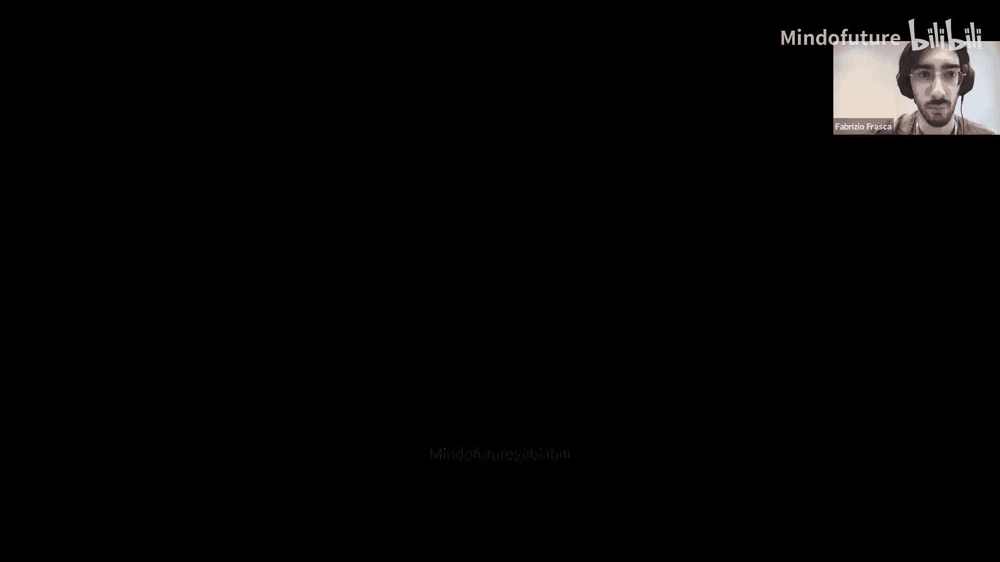
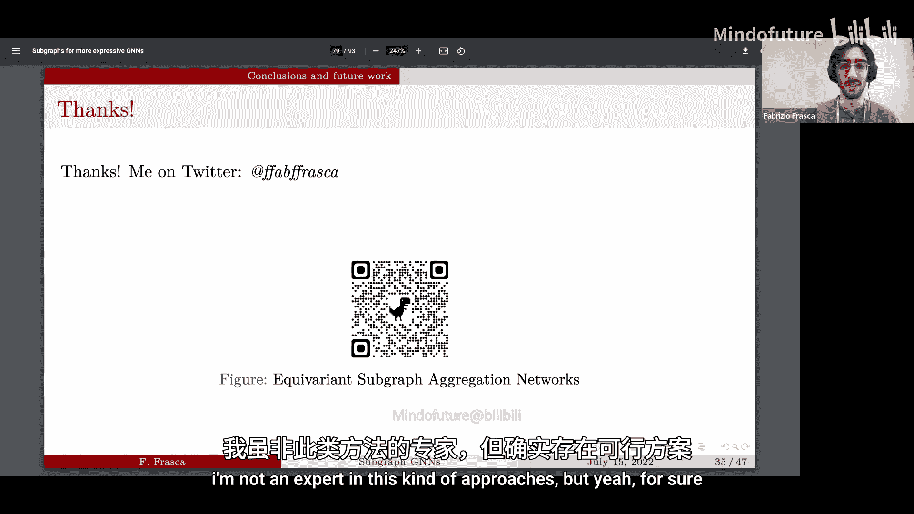

# 几何深度学习 ｜ Ammi Geometric Deep Learning Course p14 P14_研讨会2（子图GNN）-法布里齐奥·弗拉斯卡 -BV1veHgzxELm_p14-

Well first of all， thanks for having me here today。

 I'm Fay Frska and I'm a research scientist at Twitter。

 but I'm also a a PhD student actually at Imperial College London today we'm going to talk about subgraphs for more expressive graph neural networks。

Let me explain a little bit more about it。I would like to talk about what I call the subgraphGNN wave there is advances in more powerful graph networks in the last year。

 basically's where we observed basically observed a search in a series of approaches sharing common themes that is the use of subgraphs all concurrent to each other and we somehow gather them and to to discuss them together as subgraphraphGNNs and so we're going to briefly talk about some of these approaches at the beginning and then in the second part of the talk I'm going to focus on a more specific approach that isvariance of graphication networks。

 this is a framework that seems like to unify the other subgraphGNNs that has been proposed in the past year and it's a concurrent work I ordered last year。

They're amazing collaborators， so the second part of the talk will go more in detail about this framework。

Okay， so let's start with some background and motivation。

I guess at this point of the geometric learning course probably you're very familiar with this so probably yeah I guess we can go a little bit quick on this。

 but in essentially we know what a GNN is right so a GNN is or a graphion network is a parameterized function on graphs whose parameters you would like to learn from data right and probably the most common family of graphion networks is。

that is called message passing your network family。

 that is all those GNNs which update not representations alternatively by exchanging messages with the neighbors。

 we can keep repeating message passing for certain number layers until in the end we can perform a readout operation to obtain a representation for the overall graph in the graph。

And a very strong property and very actually advantageous property of message passing neural networks is that as they were defined in the original formulation。

 the implementation avariant or invariant if you consider the final graph representation。

 this is a very important inductive bias in general。

that we would like to retain right but what's the matter with MPNNs or message passing neural networks so the matter as you may have probably seen during this weeks is that no matter how we design the message update functions still they are bounded in expressive power that is they are not universal models so there are some functions defined on graphs which cannot probably learn with message passing neural networks。

And this has been characterized in terms of not being able to distinguish non isomorphic graphs。

 some of it some niceomorphic graphs， and in particular a series of very interesting papers。

I've shown that essentially the upper bound and expressive power of MPNN is that of the one that real tests。

Which is。or normallyally fast heuristic that has been designed in the graph theory community in the past century to distinguish masssmorphic graphs and the way it works is basically that color refinement steps very similarly to what we do with message passing so initially if say that we would like to distinguish to possibly nonassomorphic graphs we assign the same color to every node and then we keep updating node colors by injectively asshing together the current node color for a certain node along with the multiet of colors from neighbors。

And we keep doing this and at each time at every step， every round as this is called。

 we can gather the colors of nodes into histograms and we can compare histograms between different graphs and as soon as the histograms diverge。

 then we can say that the two graphs are known as amorphic。

So the problem with this approach is that there are some nonymorphic graphs which instead that are not distinguished。

 so they will always be mapped to the same histogram and so。For example。

 this is an infamous pair of molecules that so they are two distinct molecules。

 they real water molecules， they are called the colon and bicycloantal， of course as you can see。

 they have a different molecular structure and a different associated graph。

 but indeed what happens is that they cannot be distinguished by the WL test。

 so they will be assigned the same histogram。And therefore， they will be represented in the same way。

And the related limitations of this test is that it cannot count in nonal patterns such as for example。

 the number of triangles or cycles in a graph cannot really be compute by this approach and so for example。

 in this case the approach is not able to tell well in the first molecule we have to。

We have two six rings， for example。All these limitations， which have real practical implications。

 they are inherited directly by MPNNs because of what has been shown that basically this combial algorithm upper bounds。

 the expressive power of MPNNs。So this is to somehow recap why it is important to study the expressive power of our approaches of GNNs in particular。

And in the past years， there's been a lot of effort in trying to design graphal networks which go beyond the expressive power of this comment algorithm。

Is there any question？Okay， there's no question。Okay， I could hear some noise， but yeah。

 feel free to interrupt in at any time。So it's going on so going on basically， yeah。

 I was saying in the past years there's been a lot of effort in trying to design novel architectures that are probably more expressive than1WL and essentially the first approach is try to mimic either the generalization of this combun algorithm which are called KWL tests。

 they are strictly more powerful than the standard WL algorithm。

But the problem is that essentially the GNNs that are inspired by these algorithms。

 they are nonlocal， so they lose this locality inductive bias。

 which is also a very interesting and important inductive bias in message passing neural networks。

 and at the same time they easily get computationally intractable for K is parameter K greater or equal than 3。

 which is actually what we need to get more expressive GNNs。

So this is not really a feasible approach especially in practice at the other end of the spectrum there are approaches where instead try to get inspiration from algorithms for distributed computing whereas the idea sorry whereby the idea is that we can still use a standard message passing your network but we can provide it with a way to identify uniquely nodes in the graph。

 so the idea is that this models can even，Be made universal if we allow them to uniquely identify centers of these messages during the message processing step and the way you would do this is typically in order to get unique identifiers。

 you use random node features sampled at any inference step。

The problem with this approach is that because of this inherent randomness。

 it's not equivalent permutation。And the implementations and this empirically has been shown that it really hinders generalization。

 so it really creates problems in trying to generalize to test graph and graphs。

Maybe a middle ground could be the following so there are these works which try to basically。

Consider substructures in the graphs， especially those substructures which are not basically to which the standard message passing your networks ob bind to。

 and they either do message passing directly on top of them。

 or they consider the presence of the substructures to modulate message passing between nodes。

Let me start with maybe this particular approach， graph of structure networks。

Which I believe is can be considered a precursor to this wave of subgraph end we're going to talk about in a second。

So， the idea is。Instead of considering random not features as not identifiers。

 what I can do is I can。诶诶。chohoose a bank of substructures。

 for example triangles cycles rings clicks and then I can match them on top of the input graph and for each node I can say。

 well this node belongs to for example one triangle one five cycle and maybe two for clicks for example。

 so all these statistics can be gathered together to form some what we can consider as positional encodings structure encodings or in a way identifiers。

 they are not unique identifiers， of course but they are still able to break local symmetries that would lead basically standard WL test or message passenger networks to failure。

Because basically each node is able to modulate the messages coming from neighbors depending on some features。

 structure of features that standard MPNs would not be able to capture and because of this reason this approach is actually strictly more powerful than one that we have for a certain choice of substructures and other pros are that basically in this way we inject a very powerful bias into the network which can be linked to the domain knowledge we have at hand。

 so for example， if you are working with molecules we are doing molecular modeling we know that rings are very important and so the thought that we counter rings and we know to how many rings are not belong to。

 this becomes a very useful feature to have it retains fer equivariance。Which is very good。

 And it has low message passing complexities。 the same complexity as standard message passing neural networks。

 The problem with this is that。Couning the substructureors in the first place might be actually computationally intractable in some cases。

And of course it's not really clear how to design the bank。

 the substructure bank or which substructure to actually match on top of the input graphs this may depend on domain knowledge。

 but sometimes we don't really have this right so this is somehow problematic to some extent。

But still， nonetheless， I believe this is a kind of we consider a kind of precursors to this wave of approaches which emerged in the last year concurrently。

 and we're going to talk about this now， the common theme is the use subgraphs and we will see in a second how。

 and I've listed here some of them dropout GNNs， reconstruction GNNs， GNNs kernelnel。

 we also have the framework I was talking about equivalent subgraphra aggregation metrics or EN。

There are many others， you can find them in Michael's towards the Science blog posts。

 we coed along with some of the orders of these papers and yeah here I put the link。

 I can share the slides afterwards so you can take a look。

So let's start to take a look at these approaches， let's start from Dropal GNN。Okay。

 so what's the key concept so the concept is that。So subgraphss。

 well substructures we know are important but it might be computationally expensive to mesh them and it's not really clear as I was saying how to sometimes how to choose them right but still what we can do is we can actually find important subgraphs very cheaply by subtraction so what I mean is we might have two graphs which are not distinguishable by the standard WL algorithm or。

 let's say message possible neural networks。But they may contain subgraphs which are easily separated by these algorithms。

 and the way we can expose these subgraphs is simply by dropping some nodes。

Very cheaply so in a kind of almost blind fashion right so what they propose in this paper is you can drop each node independently with a certain probability。

 you run a message passenger network on the resulting graph which is basically it's in itself a subgraph of the original graph you repeat this approach for a certain number of times and then we aggregate the embeddings that we we got。

And this seems to be a very na approach， but indeed what happens is that every node sees a slightly different neighbor each time and this resolves the ambiguities local sea that lead basically WL to failure and the orders show that is enough to。

With some bounds to get an expressive power which is greater than standard message passing neural networks I'm going to just present you the main ideas and then but we can try to formalize this all intuition better later when we talk about the ESN framework so let me directly go to reconstruction neural nets just to you know give the big picture so it's a very similar approach。

The idea is that we can build on top of a famous popular conjecture in the graph theory community that states that it actually that it is possible to recover a graph so reconstruct a graph from the collection of not deleted subgraphs of all not sub graphs so the idea is you take a graph you delete one note at a time and all the connectivity involving that note。

 each of these subgraphs you get they are called cards。

 you can gather all the cards in a back or what they call a deck and if you consider that the deck and you can reconstruct the original graph just looking at the cards in the deck。

So。The orders would basically propose something like this so promise。Yes， yeah。

 there was a question sure。Yes。你饮着。Do some shot。 Let me take a look。

Was  light 11 how do you choose R is it an parametermeter， yes， yes， of course。

It has also an impact on the on the performance and the， but not just on the performance。

 also on the properties of the algorithm itself， you can see it's if R is not。So ifA is actually the。

诶。Large enough you might be guaranteed to sample basically all possible。

 not delete the sg you delete for example one at a time。

 so being it it's a a stochastic process the orders actually show that you can obtain bounds on for example。

 the expressive power of this approach based on the cyber parameter but in practice yesU you will choose them in fact the others suggest that you don't really need a very large R in practice because many times most of the time basically the times you。

It's a sufficient drop of fuels to already expose importance of graphs， but yes。

 in principle it's not up parameter。Doess this answer to the question or。Okay， let me continue。

 but yeah feel free to keep interact with me if there's anything else。

You want to talk about okay so let's get back to the reconstruction neural networks so the idea is I can take a graph generate all the collection of node read subgraphs and code each of these sub graphs independently in an aggregategregatingcodings in a appation invari fashion if I do this given that I have all possible subgras and I aggregateggregatingcoings in aation environment fashion then I have an overall architecture which is actually in implementation variant。

And if the reconstruction construction conjecture holds this approach is actually universal right。

 so you may you may think well but is this really the case that we build on top of a conjecture well the conjecture has been proved for all graph with。

A number of nodes up to I think1 11 and it has been proved to actually hold for families of special families of graphs and what I mean is there is some shared feeling that it may hold but other than this。

 the orders in the paper show that actually you can really extract interesting features by this process of node removal。

There's actually a caveat in these that。YouWell you know point2 in the recipe says encode each of these subgraphs independently but what you would need to do is to encode each subgraphs in a unique way right but encoding as sub graph is as hard as encoding a graph right because it' sub graph is a graph itself so the only way to but the problem is actually that we don't really have a universal encoder for graphs this is the problem you're trying to solve today so what you can do is you can keep doing this recursibly until you get basically subgraphs which are very small and you can enumerate the atomic types in the case yes。

 you may be universal but the problem with this if the re conjecture holds of course but the problem with this approach is that the computational complexity will get exponential right so what the orders propose is well you know what I can actually use an MPNN as a card encoder so to encode the subgraphs。

So the resultingive model only approximates the conjecture regime because as we said already。

 MPNs are not universal right， but yet even if this seems a na heavive approach yet。

 this can be probably expressive and the expressive power of this approach depends on K that is on the number of nodes we retain after the upper prepared version。

So for example， the order proved that if k is n minus1， so if we delete one another at a time。

 we can actually distinguish graphs as the Silcro skip link graphs I have appear here in the slide。

 which cannot be distinguished by standard MPNNs， and so these make along with other properties this make this approach33 more powerful than MPNNs。

And for a k equal to n minus2， so if we delete two nodes of the time。

 we can even distinguish graphs which are not distinguished by 3WL。

 which is even an even stronger generalization of WL。

So you start to see like that amance they can somehow be used as subroutines to approximate some subgraph or somemorphismism but we'll get to this in a second I want to first show you another approach which is slightly different than this it's called GNN kernel。

Okay， so the holders， the motivation is。According to the others is well you know the bottleneck of standard WL color refinement is that this approach works by hhing in a sense hushing stars right so because we take the color of a certain node and the colors of the neighboring nodes。

 but in so doing we completely ignore the local connectivity between for example between the neighbors。

And according to the others， this is the fundamental bottleneck that leads WL to its failures， right？

So what they propose is to shift from encoding stars。

To encoding actually egonets or ego subgraphs that is basically the complete graph obtained induced by by the neighbors of a certain node up to a certain depth for example。

 we can consider what the first hub or like one op neighborhoods or two hop neighborhoods and so on again here we have a parameter K which is actually considered to be another parameter that is the depth of these subgraphs right but okay what do we do with this subgraphs with this egonets So the idea is that we can propose a variant of the standard W algorithm whereby。

We changed the update through right so instead of hushing， as I was saying。

 the current color of a node and the colors of the neighbors， we hh directly the all subgraphra。

Around a certain note。Okay， the problem with this similarly as what we observed before with with cards and x right。

 so the problem is that an injective h of a sub graph is。Indeed。

 as hard as injectively hushing a graph that is as encoding a graph universally。So again。We can。

Approximate this encoding by running an internal inner nested W procedure only on the local subgraph。

So to recover， basically this subgraphraph 1 WL star variant is an approximation of this more powerful subgraphraph 1 WL approach。

Whereby instead of competing an injective ash of an enet， which is very hard。

We run an internal nested WL approach only to encode a desktop graph。

 and we use the the output from this W internal WL approach to actually update the color of a node in this case。

I the red node in the picture and again what we can do is we can design a neural counterpart of this subdraft 1WL star algorithm whereas whereby instead of running WL we actually run an internal nestA GNN。

So how does this work， so instead of doing standard message passing。

 we update the representation of a node by running a a nest GNN on its Enet。

 so what I mean is internally we perform message passing between the nodes in the Snet。

 we compute and readout， we get the representation of the Enet and we use this representation of the Inet exactly to update the representation of the root node of the root of the Inett。

 and we can keep doing this for many layers。And you can see already that there is an interesting。

There's something interesting popping up now that is。

We can parameterize this GenN differently right so for example one thing we can do is we can parameter it with a message passing neural network so as I was saying we do message passing internally in an nest fashion。

And this can be made as powerful as subgraraft1 double star。

 which the authors show is strictly more powerful than W W Well。

 so we get actually more expressive power than standard message passing neural networks by simply running this nested message passing on top of Enet。

And。But but what we can do is we can actually use even more powerful， although more expensive。

 of course， encodes such as PGN from our owns， which is has been shown to be as powerful as3 WL。

 And if you do this， if you use PGN as an encoder for these enets。 you can actually distinguish。

Graphs， which are not distinguished by 3 real so again we have the same in the as example here。

 this two of strongly regular graphs if you consider the red the enet around this red nodes。

This enet can be distinguished by PPPGn， so it means that the two graphs can be distinguished by PVGn as kernel as they call it this overall by level。

 if you wish approach。Let's wrap up a little bit so what will we have so we have that there are some common themes emerging。

We have these approaches with little to no preengineer in a sense that we don't really need to basically select the subgraphs to match on top of a certain graph。

 we can let importance sub graphs directly emerge by perturbing the original graph。

 but in a way that doesn't really require any particular end engineer。诶。Okay， what else？

We still stay within the rem of message passing in the sense that we don't really abandon message passing completely in the past it's being conjectured that in order to really break this bottleneck of expressive power one should somehow abandon message passing completely for different approaches but what we are seeing here is that we are not abandon message passing we use message passing and this as advantages as we know so message passing is local it is scalable in terms of computation and it's very easy to implement but always this used it's used as a sort of subroutine as we saw right so it's often used to somehow approximate subgraphra encoding。

S graph asmorph with feverish and this approach， which to some extent my iste a little bithi is already enough to gain expressive power nonetheless。

Let's jump now into another approach， equiing sub graphification networks more into detail。Okay。

 so this is a work I coed with Spaceim，rinivas， Chennki， Gopin， Balarugan， a lot of students。

 Michael Brasstein andgamarron。嗯。So it's a concurrent work we published last year and more than a model it's an overall framework。

 we can consider it as an overall framework and I'll explain you why in a second。

It provides additional characterizations with the lens of equivalance。

 and I think because of this reason it might be interesting to take a look at this during this course。

And it unifies and generalize many other methodss， for example， the medals we have seen so far。

 I was saying that there were many students in this project because this project actually sparked from a summer school that's London Geometry machine Learn summer School in 2021 basically last year。

 which I invite you to take a look at and possibly apply for for next year。

 it's a great it's a great summer school。Okay， so。Let's re up， so what do we want。

 we want some models or GNN， which is probably expressive。

 at least more expressive than standard1WL or standard MPNNs。

We would like to reduce engineering as much as possible to keep the computational complex moretractable so we don't want to get to you know。

The very high intractable computational complexity by order GNNs。But at the same time。

 we want to retain equivariance because this is a very strong inductive bias when we work with graphs。

 right？And we a up that the main intuition that is the intuition shared by many others many other subgraph GNNs is that even if two graphs are not distinguishable to MPNNs they may contain sub graphs which are instead easily separated so what I mean is for example。

 if we take this pair of graphs here， these two graphs are not distinguished by an MPNN but if we simply remove one edge。

 then we can run an MPNN and they obtain subgraphs and they all of a sudden they become easily they can be easily separated by anmpNN right so we would like to kind of formalize this intuition some。

So the way we can do it is。We can somehow design a recipe that is we take a graph。

 we map this graph into a set of subgraphs， that is a bag of subgraphs with a certain function。

 which we call a selection policy， which decides how to extract subgraphs from an original graph。

 and then we would like to process this back in a principle way that is in a way to respect the inherent symmetries of the subject。

USo possible policies are， for example， not deletion， edge deletion。

 we remove edges one at time instead of nodes， or we can extract thegonnet as engine and current。

 right？But let's get to the probably more interesting part， like what does it mean to。

Keep this equiant。 So what are the symmet of this object， Okay so。If you consider a bag of the graph。

We have actually two symmetries which are related to one another by a direct product and let me explain why so it's a graph in the back。

 of course it's a graph itself right so we would like to be equivalent to node permutation so if we promote the order of the node and sub graph we want to want the output of the network to basically have an equi response right。

So so far so good I mean we are used to this but now we have new access right so we have also that we have different subgraphs in a bag the bag is fundamentally a set so the order of the subgraphs in the bag is not really important right so we would like variance also to permutations of the subgraphs in the back。

So as you can see we have two permutation groups now。

 it's not just simply this one single permutation groups that is like permutation with respect to the order of nodes。

 now we also have permutations with respect to the order of subgraphs。

And the supermutations actually are related to each other in a direct product。

 and this is because there's something which we can really leverage on that is。

All these subgraphs come from the same graph right。

 so it is possible to align nodes between the subgraphs in a way that a certain node I in each subgraph can be traced back to node I in the original graph。

So this means that when we permute the nodes of a sub graph， we are allowed actually to。

Permute the nodes of all the other subgraphs in the same manner。

 so this means that the internal permutation so the permutation on the nodes of each subgraph is the same across the bank and this is a very important intuition and I'll explain why in this next slides。

But first of all we have this direct product between these two permutations groups right so how do we design a layer which is equivalent to this so fortunately there is a work that has been published in 2020 which study exactly the case where you would like to design a layer equivalentvari to a direct product between sorry between symmetry groups where the outer symmetry is actually a permutation so exactly as in our case the internal symmetry so maybe let's recap so in our case we have two symmetryries right so an external one which is we permute the subgrass in the back and we have an internal one that is we permes nodes in the subgras right？

So this work actually dealt with the case where we have an external permutation symmetry。

 as in our case， and an internal symmetry， which can be any actually。In our case。

 this is another limitationmut， but it's our specific use case。So other use cases， for example。

 for this general approach could be you have a set of images and you would like to。

To process the set of the images in an equicovariant way so in that case the internal symmetry would be translation。

 right？But anyway， let's get to the juice， how can we design this layer in a way to be maxim expressive and equivalent to this symmetry group。

 so you need two blocks， you need L1 and L2， you need our first block， which L1。

 which is Siameses component。Equivalant to the internal symmetry， so in the case of images。

 for example， avol convolutional layer and this applied with the same ways to all elements in the set。

 so for example， to all images in parallel。And then you have a second block L2 which is still equivalent to the internal symmetry。

 so it's still for example in the case of images it's still a conutional layer。

 but it has non sharedd weights so it's a different set of weights with respect to the first block and this block is applied to the summation。

 the aggregation of the input elements so in this case the summation of the input images。

And you take the outputs from these two blocks， and then you。Some then together。

 and this will correspond to the output of the layer。So again。

 we have a Siamese component this here in blue。And an information sharing component， if you wish。

 with a different set of parameters， which acts on the sumation of the aggregation of the inputs。

 and we can do the same， so in our case we we won't have convolutional layers of course。

 but what we're going to have is we need a block a layer which is equivalent not to translation but to permutations because we are dealing with subgras and the internal symmetry is sub permutation symmetry right？

So we have something very similar with the difference being that this internal blocks。

 which here we have orange and yellow， and1 and and2， or if you wish mu12。

 they are message passing neural networks or in general GNNs。

 which we know to be equivalent in two vers。So we have basically that we in two GNNs。

One is shirt and is applied in a Siamese fashion subgra to each of the subgraphs in the back。

And we have another MPNN or GNN， which is applied to the summation of this subgraphs。

 where summation means that we aggregate the node features for each of these subgraph along with the connectivity。

So this in a way that basically we get the output from these two blocks from these two distinct MPPNNs and we sum them。

 and this will be the new representation for each node in each sub graph。Okay。

Now we can also do something that is， we can completely disable the second part view too。

 that is this information sharing component， what we obtain with this is an architecture which we call the SGNN also so by the way。

 the first architecture we call the DSSGNN where DSS stands for deep sets of symmetric elements that is the approach we build on top of。

But so what happens if we instead neglect the second component information sharing component。

 so what we get is an approach where we simply run the same message passing neural network on each of the subgraphs independently completely independently without information sharing。

This is something like to some extent reasonable to right it's physical， but it turns out。

That this layer is not equi to the direct product of the two permutation groups is actually equi to another image group which is a superet of the direct product group that we would like to we wanted to actually model right so if you remember I talked about not alignment。

And this is essentially what is not preserved by the RE product by this new larger symmetry group。

 so in the second approach。So what I mean is that in the second architecture。

 the nodes of a subgraphs can be permuted independently with respect to the nodes in the other subgraphs。

And this layer， which does not have this information sharing block。

 would be equivalent to this app permedation group， which is larger。

And in a way to be equivalent to this larger perutation group， the model would be more constrained。

 so we would expect it to be less expressive and we'll comment on this later。

Is there any questions so far， it's a little bit， it's a lot to know， but yeah。

 feel free to ask if you have any question on this。So far so good， shall we continue？Yes， yes， okay。

Let's go。Oh yeah so this slide is to say that this approach as you can see is very general。

 so we have this concept of policy that generates a graph。

 we have this concept of processing this in an equi fashion and possibly also sharing information what we observed is that many of these approaches for example the one we discussed before can be captured by this framework which by the way we called the equience of graph aggregation items。

And so in a sense， this framework pays the way to a unification aization of subgraphph GNNs with bags of subgraphs and this through the lens of the requirementss。

 which I find it to be very interesting。But one of the first。You know。

 starting point for us was you know the issue with expressive power。

 so what's the expressive power of this architecture really design？So in order to study that。

 to characterize this， we took a little the tour and we designed a combuninatorial algorithm that is a variant of the standard WL algorithm that works actually on subgrass and on bagss of subgrass。

The idea so is the following we want to apply color refinement on each sub graph in the back but we don't do this independently again we share information as we know we could do because of this other alignment concept so the idea is that we assign a color to each node in each sub graph and we keep refining the colors by this color refinement step if you take a look is essentially similar to the standard color refinement step in WL but we have two additional inputs this sparkle and green inputs here。

So we don't really have just the color of the current color of the node we are updating。

 we also have as we used to have， the mouth set of colors of neighbors where now the neighbors are the neighbors according to a specific sub graph s in this case。

And then we have these two additional impulse， so the par one CV is what we call a needle color that is we collect the color for the same node but across different subgraphs in the back and again this is possible exactly because we have this concept of node alignment。

And then the fourth， the last input。Is what we callveus in green is actually the multi set of this needle color。

 or we call needle color， basically this purpleer ones， but for the neighbors of the node V。And。

Basically， what happens is that we managed to prove that there exists policies such that this approach。

 which we call the SSWL， is strictly more powerful than 1 WL。诶。

And maybe I can also mention so what you can do is you can also disable these two new inputs and in this case the procedure boil down to a performing standard WL on each subgraph but independently right and this we call it the SWL and even the SWL for certain policies can be shown to be strictly more powerful than1WL and amongst these policies are those the most common policies which we discussed before so for example。

 not deletion edge deletion and Enets。Now okay but what about the architecture so we proved that our architecture DS and DSSSGNN can implement this combinatorial variant this DS and DSSS WL algorithm。

 so this means as a corollary that exists policies。

 for example not deletion edge enets such that DSs and DS SSSGNN are strictly more powerful than MPNNs。

 which is what we wanted to show at the very beginning， right？

So by designing this variant this allowed us to more easily study， compare it with standard WL。

 and that's why we did it in the first place。But this may also be of independent interest for comm algorithms andmorphiccent tests。

So what about the TS versus TsGNN， so we were saying that we would expect DSGNN to be more expressive than the SGNN。

 right？So。Yeah so we found some policies such that exactly this concept of node alignment allows to reconstruct the original graph whereas the SGNN not having alignment between nodes only sees for example number of edges and is not able to reconstruct the original graph so for certain policies we showed that this is actually the case that the SSGN is more powerful than the SGNN and in practicing experiments we have observed that the SSGNN tends to outperform the SGNN in practice and the SSGNN is better than the base encoder 91% of the time the base encode coder is the GNN we use。

As if you remember these equivalent internal blocks。

 so most of the time DSSGNN is better than a standard GNN in practice and the SGNN is better than a base encoder 75% of the time so it's still better just it's more likely that with DSS with this information sharing component in addition。

 we get better results。So another interesting point is that。The policy matters。

 so the choice of the policy may have an impact on the expressive power。

 so what we managed see to show is that on the family of strongly regular graphs。

 which are these very idsymmetric regular graph and very hard cases for graphmorphismism。

If you use node deletion or depth and enets， you're not able to distinguish these graphs so we have the same discriminative power as 3WL。

 but if we use， for example， a deletion。that we suddenly we were able to distinguish this graph and so it seems like elation is stronger as a stronger policy on at least in this family of grass。

 for example。嗯。In practice， we didn't really observe a strong correlation between the performance of a policy and the application domain。

 but the Enett policies seem to work very well in practice like at least consistently across settings and different data sets。

Here we have an example on molecular modeling so this zinc benchmark is about trying to predict constraints probability for molecules modeled as graphs。

 and for example we observe that as soon as we transition from edge detion notletion to egonet。

 the performance increase in a sense that we have a lower mean absolute error on the test set and as you can already see the SSGN seem to work much better than the SGN especially when we use the enet policy。

In general， so on this suite of a small data sets， we observed this approach to achieve good results compared to the state of the art approaches and as we were already anticipating。

 it generally improves on the accuracy of the or the accuracy of the basin code。

 these are other results on other molecular modeling benchmarks from the OGB suite。

I think it's interesting to take a look again at zinc， but compared to other approaches。

 so if we compare the results we got with our framework。

 are the best performing model amongst all probably expressive domain agnostic GNNs， as you can see。

And sometimes by a fair margin。The at the same time。

 we are very competitive and sometimes even better than GNNs which employ directly employ specific information。

 so for example， which include explicitly the information about presence of rings in molecules。

And this was also one of the Zta we have at the beginning right so we want a model to be expressive。

 but not necessarily to really need to inject domain knowledge into the architecture。诶。

Right so let's wrap up， we have taken a look through this family of this wave of new prefer expressive GNNs。

 which we call subgraphGNNs， the common theme is that they leverage subgraphs to uplift the expressive power。

 but still staying within the rems of message passing that is often used as a subroutine， right？

We introduced ESN， that is this framework that seems to unify concurrent works and this is done by studying the emerging symmetry。

 so the symmetry is characterizing this object as bags of some grasss。

The advantage of this approach is that。Well， or in general of some graphGNs。

 the advantages are that they are probably aggressive， they are notly equivalent。

And you'd really need little pre engineering dont you don't really need to。U。Be a domain expert。

To design the architecture。in terms of featured directions。

 I guess it would be interesting to study other policies or a little bit more what's the impact of the policy on the expressive power and on the performance in general。

 other things would be to study structure bags， so at the moment you know bags have been considered to be sets。

 but we can also induce some particular some more structure on it， for example。

 consider them as graph if we come up with aninterest notion of connectivityivity between some graphs for example。

And then yeah， I think there's work to do in studying stochastic policies。

 that is policies which subsample sub graphs because there is this we have this intuition that we can still retain some approximate form of equivariance and this is still very interesting because this would allow us to reduce the computational complexity。

 but by still but still retain some form of approximate equivariance or still this strong inductive bias。

 on graphs。And with this， I conclude the presentation and Im happy to take any questions。

 yeah thank you， thank you very much。Yes， thank you。 Thank you for。 So theres a question in the chat。

Yes， DSSSWL and such methods are they are evaluated Okay， so DSSSWL。

 we didn't really implement it in practice in the sense that it was so it is a commun algorithm we used in in you know on the on the theoretical side to。

Then study the expressiveness of。The neural counterpart and then we of course implemented the neural counterpart and that is the SsGNN and the SGNN and we applied it on a series of benchmarks in particular we focus on molecular modeling so the ideaI is could you model a molecule as a graph and then you apply our method so what it doesn't mean to apply our method on a molecule defined as a graph it means that we take the graph corresponding to the molecule and again as I was explaining we apply policy so we extract subgraphs and we process this subgraphs in an equi way。

And then in the end， basically you have a representation for each of graph。

 you aggregate these representations again in in a well in this case in the end in an environmentvari fashion and then you would like to keep this representation into a classifying to predict。

 for example， molecular properties such as。嗯。Tuxity area and and and so on。

So there are other results on synthetic benchmarks I haven't showed them to you。

 but yeah we also evaluated this approach in terms of like purely in terms of its expressive power。

 so there are synthetic benchmarks where people try to run GNNs in an effort to dis grades graph。

 which we already know they are not distinguish global standardized bus neural network。

So for example， yeah， there are data sets of statistical spling graphs and yeah we actually indeed evaluated DS SSSGNN。

On these benchmarks end in most of the cases， we've got perfect accuracy。诶。Mostly because you they。

I mean， this， this。Basically show that yeah the approach is indeed as indeed more expressive and standard mepo networks。

 which they have random gas accuracy on these benchmarks， but still。Yeah。

 these graph were usually like。3W are distinguishable。 So yeah。

 this experience also why we really managed to get up to 100%。啊。Yeah嗯。

So we did this kind of evaluation if this is what you were asking about the expressive power， yes。

So if we were to go back to the start policy， when you're in the Eastern framework do we。

Go back to W net。 Oh， okay， very interesting。So instead of considering eagerness， you consider stars。

 basically。嗯。Let me think about it。系。So， if you。Yeah， if you don't do anything particular。啊。Yes。

 I guess you would get back to the summer W。Yeah。If it's， for example， just one。It depends also on。

 well， so if you take， for example， PWL。And you extract stars。嗯。

So if stars are just one of stars for each and it's a graph is a one of star and you don't have any information sharing。

Actually， what happens is that。It might even be less expressive than not will。

 because you are not able to。Basically propvoate information from further nodes。

 so the algorithm moods。Would converge very very quickly。 So if the star is shallow。

 it may also potentially lose expressive power。This case if you have a form of information sharing。

 for example， this s needle coloring， maybe you can make do with that and maybe you can get to1 W2 not WL。

 but yes， this as you can see some policies are very trivial and are actually not useful or detrimental。

For example， another one is simply take edges。You have like if a graph is an edge， right。

 So this also a very。Have no useful policy。Yes。But yeah a very interesting question。

 So we have some intuition now to choose the policies in the future。 Yeah good question。

So as I was saying， we do not really want to have pre engineering。

 but theres still some pre engineeringer in a sense that's like， well， how do you choose the policy。

 right？So， in general。As we are saying， the eco policy works very well。啊。De clip。

Seem like comparable or is comparable to notilation or even better。啊。This is an active also area。

 I think。Well， not you know don't see papers exactly on the sign policies。

 but there are new policies emerging in recent papers， for example。

 there are new papers where people try to use node marking instead of node addition and they showed that this basically substitute node edition。

 So the idea is you don't necessarily need to delete a node you can market with a special feature。

And the fact that you mark this with a special feature， actually。

Allow you to this allows you to steal breaky， but without actually。Altering the connectivity。

 And the idea is you can simulate to that with not the anyway。诶。Another thing is。

We now I think we have also a better understanding of what what it means to choose a policy like what's the impact of the policy so。

There's some more recent work。I did， for example， it's。

We we realize you can also gather policies in classes。 For example。

 do you have policies which are intrinsically not based， right？ So if you think of Enet or。

Not marking or no deletion。 You can always find a bi between a node in a neutral graph and a subgraphfuaging rate。

So this actually gives you more structure and you can quickly。

Consider them in a class and study like the characteristic of this class policies and we actually did it and we found out that if you have this kind of policies。

 you always have an upper bound and expressive power。

 if you use a standard MPN encoder which is 3WL so this would you the upshot is that if you want to go beyond 3WL with anmpNN base encoder。

 you need a policy which is not not based， for example。

 something like edge base or you mark two node at a time， you delete one edge at a time。So yeah。

 there's some， at least some recent work with try with Chinese to。

Cracterize these policies into like for example， class them into classes and study the。有啲啊。一点。

Teachers of these classes， these families of policies and their limitations。 So， yeah， for sure。

 there's some， some work。嗯。In general， if you have domain knowledge。

 it's always good to take it that into your account。We designign a new policy， but yeah。

 this is what I can probably answer at the moment。Thank you， thank you for the question。

 very great were really great questions。If there's nothing else。 Yeah。

 I can also mention maybe related to this question， Let me。To pop on this。

I forgot to say there are also works， recent works， very works。We try to learn the policy directly。

 So instead of designing the policy， what you could do is you can learn a end， for example。

 with some。particular approach to back propagate through the know discrete structures so well。

 you could do it for example， with reinforce learning。

 so the problem is essentially that the selection of edge。

 you know these are discrete operations and。It's not really obvious how to better propagate through this。

Through the policy itself。But you can， for example。

 make do with reinforce learning or something which seems to be also very effective。

 That is to use approaches like based on pertuations for like implicitous differentiation and preparationation for discrete discrete structures。

So therapist works with which basically propagate through the combun algorithms and they have been tried like there's been an attempt to use these approaches to learn policies like the policy itself from。

From， from data directly， while like in an internal fashion。

If you're interested in this or there is like this approach this called implicit maximum likelihood estimation。

 IME， which tries to do this kind of thing so the A is， for example。

 you want to be propagate through say an individual linear programming。诶。Problem， for example。

 like or something like， I don't know。Dtra for shorter path。

 It is you can do this with some tricks and。俾什安。Pturb patientsations。 And yeah。

 you can then basically。Learn the parameters of these mixed models and land。Yeah。

 so there's some work on this well。I'm not an expert in these kind of approaches， but yeah， for sure。

There movement on that site as well。