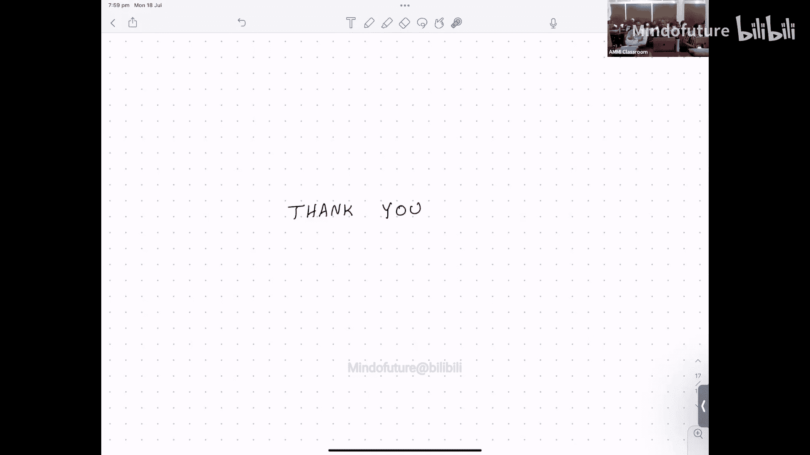
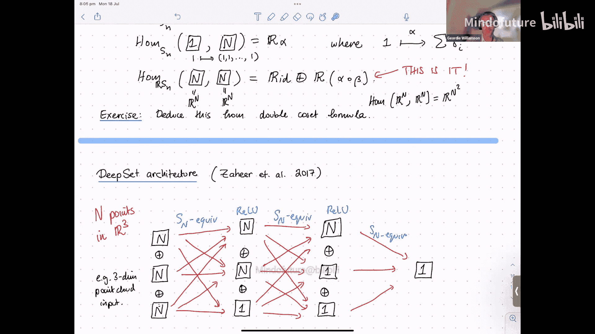

# 几何深度学习 ｜ Ammi Geometric Deep Learning Course p15 P15_研讨会3（ML中的等变性）-乔迪·威廉姆森 -BV1veHgzxELm_p15-

So thank you very much。😊，诶 so。I'm not sure exactly what you've already learned in this course。

But today I'll just be talking about equivariance。In machine learning。Okay， so before I come to that。

 I just wanted to briefly advertise our research institute in Sydney。😊。

So this is a research institute that supports visits to Australia。In mathematics。

 so if you're interested in visiting Australia and working with someone in Australia。

 then you're welcome to apply through our program。😊，嗯。And we'd love to host you。

So a second point is that。😊，I love comments， questions， interruptions et cetera。

 so if you have a question or a comment。😊，Please just ask it。Yeah。O。

So I'm assuming that the background of most of you is more in computer science and less in mathematics。

So I'm going to go over some of the mathematical foundations of what I'm talking about。Okay。So。

I want to start off with symmetry in mathematics。So symmetry is almost as old as the hills。So。

Here's a theorem from。Euclid's elements that was you know， written about。More than about 2。

400 years ago。Or 2500 years ago。😊，So it is the theorem that I'm sure you're familiar with that if you take a circle。

And you are。Consider a diameter。And then you consider any other point on the circumference of the circle。

 and this is a right angle。Yeah。And if you look at the proof of this theorem。So this is a very。

 you know， very fundamental and beautiful theorem that we've known for two and a half thousand years。

😊，But I just want to emphasize the fact that kind of symmetry is。

Already present in this very basic theorem。😡，So if you look at a proof of this theorem， you like。

 you know， for example， in Euclid。Um， you you construct a line here and then you argue about the angle sum of a triangle and things like this。

 but you can ask yourself like。What happens if the point is down here。

 what happens if my point C is down here？😡，And then there's a very obvious thing to do。

 which you can just flip this diagram upside down on this axis of symmetry。

 and place this would get the theorem for the point down there。O。

And so there's a kind of tacit symmetry present in mathematics for a very long time。😊。

And group theory， though this is group theory， is the mathematical theory of symmetry。😊，So a group。

You know， I hope that you've seen this concept before， but i'm just reviewing it quickly。

 so a group is a set with a binary operation so we have a binary operation where we take two elements G。

😊，And G prime。In G， and then we have some operation which produces a new element。

Out of our two elements， so this is our binary operation， our multiplication。😊。

And this satisfies three axiomions。So there's the existence of an element which when you left or right multiply by that element。

 does nothing。Our operation is associative。😊，And there exists in verses。嗯。

So this is a formal definition， but what you should think about is basically that the symmetries of any mathematical object form a group。

 So， for example， if you have a square，And you look at the symmetries of this square。

 there's various things you can do， you could reflect it along this axis， you could rotate it。😊，嗯。

And these axioms will be satisfied。Yeah。So I just want to emphasize， so。

What Galloa pointed out in about 1830？😡，So nearly 200 years ago is that if you consider the set of all symmetries of a situation。

😊，These former group and the structure of this group of symmetries matters。😡，O。So。😊。

It's a kind of meta approach to a problem。 you might， you start with a problem。

 You notice that it has a whole lot of symmetries。And in the example of Euclid。

 we use these symmetries kind of one by one to simplify our problem。😊。

But it was Galawar that first said that the set of all these symmetries together and the structure of that set of all symmetries is fundamental to mathematics。

😊，O。And Klein explained。That。Geomeries， for example， projective geometry， Euclidean geometry。

 et cetera， are determined by their groups of symmetries。

And Lee developed the theory of continuous groups， league groups。

 and it's interesting that Klein and Lee were actually very good friends and they were very inspired by Goa theory。

😊，And they apparently would meet every day and discuss mathematics。

And it was only after they separated， so Lee went back to Norway and Klein went to Elingan that they developed two beautiful theories of mathematics that were somehow related。

😊，对。And then for venius in 1899， so this was the beginning of representation theory。

 and then many others shore Burnside Nta vile power， many others develop representation theory。

 which is how might G act linearly on a vector space？😊，Okay。

So we want G to act via linear transformations on a vector space， so this is the same thing。I asking。

 how might G？What are the maps from G to GL？And so this is the。Group。Of end by N。Invertible。

Marices with。Real coefficients。Okay so this is a very concrete problem， so I have a group。

 so this this consists of a collection of elements G and a multiplication rule。

 and then what I'm doing in representation theory is studying matrices which satisfy the same multiplication rules as the elements of G。

😊，Okay， so invertible matrices， which satisfy the same multiplication rules is the elements。😊，Of G。

So I'll just give you two examples of representations。😊，So here we take， in my opinion。

 one of the most beautiful objects in mathematics， namely the Ichosoahhedron。

 the regular ichocyahedron。😊，And now if you consider a symmetry of this icoahhedron。

 you can represent it as a matrix。Okay， so if you imagine the， you know， for example。

 this icoaahhedron may have certain rotational symmetries， these symmetries are given by a matrix。😊。

And hence we get a representation， so this group of isoomeries of the ichothedron is naturally represented by matrices。

😊，Another example is if I take。The vertices are the triangle like this。So here's E1， his's E2。

 his's minus E1 minus E2， you can write down so there's six symmetries of the triangle。😊。

So any permutation of the vertices is possible。And so we get。Six matrices， so this is， for example。

 the identity。😊，So this is what I was calling one before。And then， for example。

 you have the symmetry that interchanges these two。

Elements and fixes this element and that's given by this matrix。😊，And similarly。

 the element that fixes this one and interchanges this one is given by this matrix， etc。😊，Okay。

 so these are examples of representations。And I just want to emphasize the following extremely important point。

😊，Probably so I tried to motivate group theory via symmetry。😡，And so it's very natural。to。

I think group theory is very natural， we have symmetrical situations so we should understand the symmet preserving。

😊，But what is not so obvious is studying representations， you know， I said。

 let's look at all homomorphisms to matrices。😡，And you're totally justified in thinking。

 why on earth did this person want to study homomorphisms to matrices？😡，But。

The 20th century has shown us that such study is useful。诶 sir。

Just two examples so the standard model in fundamental physics and the Langlelands program in mathematics。

😊，Have representation theory at their core so this is an incredibly inspiring paper about the kind of remarkable appearance of symmetry and for example。

 the standard model。😊，And here's in number theory。You have an article about the role of representation theory and number theory。

So this is meant to be about machine learning， so why the hell am I talking about groups in symmetry？

😡，So I just want to give you two examples where we might launch an invariant projection。

So this is a totally beautiful picture in my opinion， so this is a flock of birds。😊，嘅。

And you'll notice。That these birds， as they fly， they form some very interesting structure。

 so they form a kind of a circle here and you might you might pose yourself the task of using machine learning to understand this structure。

So there's a comment in the chat。Can you still hear me？Okay。嗯。Okay。I Judy yes。

So just create the the Excel sheet for question。吓哼。😊，Yes， I put the link in the Zoom chat。Perfect。😊。

O。So does anybody have any questions at the moment？Okay。

So if you have question so I'll sent you link， just put your question there。Yes。Yes。

 so that will be adding the question。In this fight。Sure。见再见说一见公诉人。ok。诶。Yeah。Okay， so。

Now imagine that you want to， for example， examine the structure of this flock of birds。

What you might。The way that you might encode this flock of birds into a computer is there's a whole lot of numbered。

😡，A whole a list of vectors。Okay， this vector， vector， this vector vector， et cetera。Um。

 but notice that when we look at this， we don't care which bird is number one and which bird is number two。

 we just care about the birds without their ordering。😊。

So this is an example where we would like to make an invariant prediction。So sorry。

 invariant prediction。Okay。Another example is here I've tried。

 I tried to find an image on the Internet of a heat distribution on a sphere。Okay。

 so this is meant to be a sphere。😊，And on this sphere。

 you have areas that are very hot and you have areas that are cold and you could imagine that you want to。

 for example， train a neural net to predict the evolution of this heat。😊，Distribution。Now。

 the evolution of the heat distribution would presumably be in the equations determining the evolution of the heat distribution would presumably be invariant under rotations of ourus sphere。

😡，Okay， so， you know， if if， for example， this。This area here moves across the here as the system evolved and then we move the sphere we expect be how to predict。

Where the moved distribution， how the move distribution will evolve。Okay。😊。

So of evolution of this is an example of a prediction that we expect to be invariant。😊，Okay。

So how does one build invariant or equivariant？Yourit。

So maybe I just noticed there was a question in the。U。So the question is。In some group action。

 some literature include closure as the force that actxioms。Yeah， so that's a good question。

 so if we go back to the definition of a group。😊，So here I say here we have a definition of a group。

😊，And then I'm implicitly， say there's some people would include a fourth one， namely closure。😊。

Which is that G and G prime in G。Implies GG prime。InG。

But this is implicit when I write the multiplication in this way。😡，嗯。So， I'm kind of。Secretly。

 including this axiom by writing the definition in this way。😊，So thanks for the question。Okay。

 so how do we build invariant or equiant neural nets that's the question that we want to ask。😊，Now。

And I should say that there's quite a lot of literature on this so there's this paper for example on steerable CNNs group evariant convolutional networks this book or the draft of the book which I think you've been following in this course which is geometric deep learning grids groups graphs geodesics and gauges okay so all I'm doing today is I'm basically giving a survey of this this work many references are missing and I'm not claiming that。

😊，That any of what I'm saying is original。😡，I'm just trying to explain what's going on and what I think is a very beautiful set of ideas。

😊，So what I find remarkable about geometric deep learning is that it kind of it gives you various a very structured way to build a neural net。

😊，Which makes a whole lot of choices that might appear very tricky when you're actually making your neural net。

 it makes them kind of automatic。😊，Okay。So I hope you've seen convolutional neural nets。So this is。

 so I'm assuming。😊，That you've seen convolution on your own。😊，And so， and what I want to view。诶。

I want to consider a periodic image， so this is so Zbo H said squared is a grid。😊，hoops。

So here I have a grid。So this would be。H。So it's an H by age grid。😊，And。

So that's what Zed Moache said looks like。😊，And what I'm looking at is a function from Z mod H said squared。

 so from this grid to the real numbers。So that means what I associate， I associate every point here。

 a real number which I can interpret as being a grayscale value。

 so here's an example of what a periodic image would might look like。😊。

And I call this a periodic image rather than an image because kind of。😡，Like it kind of wraps around。

 it's more like an image on a tarus。And what we seek。😡，Is some function。

That takes in a periodic image and spits out a real valued， a real number， which is， for example。😡。

It's positive on tigers and negative on non tigers。😡，For example。

 and also we expect that it's kind of very positive if we're sure that the image is a tiger and very negative if we're sure it's not and zero if we're not so sure。

So this is what we're seeking to do so this is a。😊，AClification task， which I hope you've seen。

In other lectures。And here is a schematic of what happens in a CNN。😡，So we have。This is our input。

And then we apply various filters。So here are our filters。And this would be our first hidden layer。

And then we apply again another set of filters， and this would be our second hidden layer。

And then we might do some kind of pooling operation。Where we， for example， we might do max pooling。

 for example， which would take these and then replace it by the maximum entry in each one。

And then basically， in what follows， I'm kind of going to ignore this bit。😡，就。And then finally。

 we do some fully connected layer down to R。ok。So this should be。

 I hope that this is a reasonably familiar picture for you from SanNs。Yes。So convolation on ur。Now。

 I just want to look at this situation through the lens of group theory。😊。

So this is what I've just explained， this is the structure of a convolutional neuralna。😊。

And I just want to point out， so this is a group。And。

This group acts on the set of functions via translation。😊，So if you take F。

 which you regard as a periodic image。And then you take an element G。

 it just kind of shifts your image， you know， up into the right or something like that。😡。

And the really important thing to notice。😡，Is that convolution？Is gamma equivariant？

So what that means is that if you。Translate and then apply a filter that's the same thing as applying the filter and then translating。

And there's a nice little exercise in。😊，In representation theory。Which is that if you look at the。

That equivari functions between。Like these spaces of functions。so。You know。

 I hope it's clear but fun。Said what H said。Squared is the same thing as。Real valued。

functionsction on z。Yeah。What I should squid。So basically。

 convolution is the only equivariant thing that I can do between these function spaces。😊。

So applying a filter is the only equivariant thing that I can do。Okay。😊。

So the first observation is that we often want a gamma invariant answers so。Like。

 imagine that our question is， recognize a tiger。And we have a tiger in the bottom left。

 if we move the tiger up to the top right， it's still a tiger。😡，So that's the statement that。

We seek a gamut invariant prediction。The other important point。😡，Is that convolution。

 So this is also known as applying a filter。And also。Reue。So。😊。

The rectified linear unit are gamma equivariant。And another thing that we often require is that these filters initially are local。

 so that means that， for example， as we're going across our image， we're only。

We're only applying a filter to a small region of our image。

And locality is the same thing as that the filters are supported near the identity in our group。😊。

Okay so they don't change our picture very much。Now， what I find remarkable。

Is that these three properties？Namely gamma invariance， gamma equivariance and locality。Basically。

 force the answer to look like this。So if you。😊，I don't know。 The first。

 first time I saw a convolutional neural net， I thought。😊，It's a bit of a strange definition。

But if you just make these simple assumptions that it's gamma invariant。

That theSo we want the prediction to be gamma invariant。

 we want each of the layers to be gamma equivariant。And we want locality。

 then basically convolutional neural net have to be the way they are。😡。

So just see if there was any questions。So someone asked。

 what may be the motivation for studying the shape of birds in the figure you had？

So I'll go back to that。Yeah， so that's a good question so why might we be interested in。😊。

In studying the structure of the birds。嗯。Yeah， I guess my honest answer would be it's probably very interesting and it's yeah I'm not sure another example might be that you might have some population for example and。

You might consider their age and their income。😡，So you might have a whole。

A whole puppy you might have。Age and income。And perhaps you might expect。

 so let's say that this is age 20 and this is age 50 and maybe you expect that。😊。

Income increases and then perhaps decreases。So this might be a rough plot。

 but then you might there might actually be some like interesting hole here so people。😡，Um， you know。

 it might be the case that people of age 40 either earn。A large amount or a small amount。

 but no one kind of earns in the middle。So that might be something interesting to observe in your data。

and that that would be an example of some kind of prediction that we might be interested in making and just as in here in the in this bird flock。

 we have this kind of hole here， which might be interesting for various reasons。😊，回嘅。

But I guess the important point up here is that as in the birds， we don't actually care like。😊。

We're we're trying to look at this data without remembering which point corresponds to which person we're trying to look at global features rather than。

Rather than specific things associated to a specific person。Now， this is an extremely important。😊。

Kind of technical point。So I'll come back to the questions in a second。

So let's say I assume you've learned what a fully connected neural net is。😊。

So here's a fully connected neural net。😊，Which？So imagine that this has input layer dimension L1 and this layer dimension is L2。

Now we have L1 times L2 parameters。So this， even in simple examples， this could be enormous。😊。

For example， if this is 10 to the six， you know， like in a typical， in a typical image。😊。

You might have 10 million pixels。So this could realistically be something like 10 to the seven。

And then if you put 10 to the seven here。That means you have。10 to the 14 parameters。

Which is an enormous number for。😊，You know。Even even a good computer。

Whereas imagine the first layer of a one dimensional convolutional neural net。😊，Okay， so here I have。

嗯。So here I'm kind of imagining like a one dimensional image。😡。

So if I impose equivariance and locality， then regardless of the dimension。

 I just have three parameters here。😊，So we have three parameters totally independent of the size。😊。

Which is really remarkable so you know 10 to the 14 versuss three it's a big advantage Okay so I'll just address the questions now。

😊，So please， what is gamma？So sorry， yeah， so gamma。😊，So gamma is。Z mod H said squared。

The image should always be periodic。😡，So this was another question。😊。

So basically the period the assumption that the。Image is periodic is this is a simplification。😡。

Okay so this assumption allows one to see clearly what is going on and then once you've seen clearly what's going on。

 then it can be dropped。So this is not， you know， in normal neural net architectures recognizing images。

 you don't assume that the image is periodic。😊，But it really simplifies things to do so。😊。

Could you explain that graph above related to convolution and gamma invariant？Yeah。

I'm not sure I understand the question。嗯。If you could clarify the question， I can try to answer it。

Okay， so that's really， really important， this massive drop down in parameters。

When you you look at a CNN。嗯。So now we look at the general case。

So someone also asked where am I now so I am。I am currently in Sydney。In well， near Sydney。

 I' am two hours from Sydney in Australia。This is a question that's easy to answer。😊，对。U and。嗯。

Please explain the formula for the periodic image you draw an H by H matrix。

 but the formula has Z mod H said squared。Yeah， so。不。Here。Oh， sorry。I'm sorry。

 this was a typo I meant to write Z what H said squared。Okay， sir。嗯。Yeah。

 so Z mod8 squared is the numbers zero up to。Up to h minus one so this is what I've listed along here zero up to h minus1 and then when I take the square I get an array。

And then I'm viewing a periodic image as being a real valued function on this array。

So what makes the dimensions remain constant in the place of locality and equivariance？So。

Maybe I can try to explain that in the following way。So imagine。

So I'm just going to move up a little bit and I'm going to take this。

So imagine he is fully connected。So here we have 36 dimensions。And here we have 36 dimensions。

And so here we would have。嗯。to the 36 times 3 so we'd have 36 times 36 parameters。Which is enormous。

I mean， not that enormous， but。But it's still rather large。

But if you think about what happens in a convolutional neural net。Then the value of this pixel。

Is determined。By the values of these pixels。Sorry。And moreover。

 this value here depends on these in exactly the same way as for example。This pixel determines。嗯。

And so here you would only have something like nine parameters。Okay的。

So here you see that the number of parameters changes as my image gets larger。You know。

 if I increase my。Image to like to seven or something。

 then this would be out of a 49 out of a 49 and then I'd have 49 times 49 parameters here。

But here it doesn't change， I always just have nine parameters。😡，OK。😊，So thank you for the question。

😊，I hope I unett it。All the questions in the question sheet， but if I didn't just ask more questions。

Yeah。啊。Okay， so now I just wanted to present the general blueprint。So this might seem very dry。😊。

But it's incredibly powerful and I hope to give an example of why it's powerful at the very end。😊。

I also think that in some sense it's like its power has not yet been really appreciated。

 and so I think that there's many interesting examples still to be done。😊。

So if we consider a transitive gamma set。😊，So this means so gamma is now any kind of group。

And what we want to do。 So you should think about the the the。The example。

Is when gamma is said what H said squared？And you should think about this example as being the kind of extremely simple。

😊，嗯。Example， and I'm discussing。😊，Potentially much more complicated situations。

 but keep this example in mind。😊，So what we want to do is learn some invariant or equiant function from functions on x to R。

Now， one of the things that's very nice。Is that。If our action is transitive。They're the only linear。

The only linear gamma invariant function is just given by the integral of our function or the sum of our function。

 So this is the same thing as the。Some of the values of it。X in x， if X is fine。Okay。

 so mathematicians often just write integral and when the set is finite。

 they mean some and when the set is infinite they mean the integral in the sense of，😊。

Calculus or differential geometry。So the point of this exercise is that there's not very many interesting gamma invariant functions。

😡，If they're linear， so we're definitely learning a non linear function。Yeah。And basically。

 what we do is we write down exactly the same structure as before。So。We consider functions on x。

 and then we consider functions on transitive sets。Transitive demos。Link them all up in this way。😊。

And now the important thing to。The important question to ask is what are the filters？

Or what are the possible convolutions？😡，And there's a very important formula in representation theory called the double Coset formulaula。

 which gives you an answer in terms of group theory for what these convolutions are。😊，可以。😊。

So maybe I'll just see if there's more questions and then I might。嗯。😊。

So how is it connected to lower graph？I'm not sure I don't understand the question。

 how is it connected for lower G？Okay， so I might just skip over the next bit。嗯。

And I just want to give an example of。啊，比如。elloHello。Yes。

 I was talking in a few minutes to explain something that was read to dimensions how the parameter might change。

 but below dark questions there was some graphic right to conly explaining it so we want to kind explain that graphic theory because it's harder to learn that things once we don't have many explanation of that graph。

So which one， can you tell me which one you mean？So there is a thread where explaining how the parameter change when you try to go from one in two layers。

Yeah， this one。A yes， here。Okay。嗯。And so is not what would you like me to explain here？This graph。

 which is below okay， this shamem of CNN。ok。So。So generally。So imagine that we have a。So typically。

 what will happen in a CNN？Is that this。So。So this is part of input image。Okay。

 so imagine that this is like a small part of a big image。😊，And then I have a filter。

 so I have something like。😊，If。Yes。So this is my。P准。And now the formula for what happens in a CNN？

Is that。A value here so。And I get a complicated。And this value here。Will be equal to。嗯。This summer。

Okay。😊，So maybe I can try to find a talk where this is shown， so I'll just see if I can。Yes。

 so here's an example of the filter。😊，Okay， so here's my what。Here's my filter， so it's minus1。

 minus1， minus1， minus1， minus1 minus1， minus one， and it has an eight in the middle。😡。

And now I take this image and for every for every。Nine by nine pixels inside here。

 every tiny little box of nine by nine pixels。I I apply the formula that I just wrote。

 so this means I take the nine by9 grid and then I take the dot product with these numbers。

And then I get this picture。And notice how this picks out these kind of outlines。行。Whereas。

Areas where there's not much change in colour， when there's a stark change in colour， for example。

 here， this really shows up after applying the filter。😊，Whereas here。

 where there's not much change in color， I just get darkness。😡，Yeah。😊。

So this is an example of applying a filter。Did that make sense？

So the really the point that I'm trying to get across here is that。Like in this neural net down here。

 you would have several of these layers， but each one of these， these arrows。😡。

Would just requires nine parameters or something， so it just requires these nine parameters。

 so we do the same thing across the whole image。😡，So these。These numbers determine this map。

Across the whole image。😡，So there's 9 parameters that determine this。It's meant。O。😊。

So I'll see if there's any more questions。ok。So yeah。

 the basic point I'm trying to make is you get this。Much less parameters。

 so it's much easier to train。And the other point is that some kind of group theoretic。Nots。

Exactly tell you kind of what to do here， so the group theory is a very powerful tool to learn what's going on here。

😊，Okay， so I'll just go to the example of deep sets and then we'll finish。😊，Okay。

 so in this particular case， we have a point cloud。😊，So this is like the birds earlier。😊。

And we would like to make some kind of prediction based on this point cloud。对。And there's many。

 many situations in machine learning where such a prediction is necessary。

 so you have a large number of points， but their ordering does not matter， that's the key point。😊。

你 order啦。So for example， in the swarm of birds， you do not care which bird is which。😊，Yes。

So many problems can be seen as learning。嗯。So we have our collection of points。

So this is end points in R to the D， so this would be for example。

 10000 points in R3 so here we'd have r3 to the 10000。😊，And now we can。We can view this instead as。

D points in R to the end， where we like first look at the first coordinate。

 then the second coordinate， et ceter。😡，H。Now notice that Rn， so this is Rn。😡，Is a representation？

Of SN， the symmetric group。Yes。And what we're saying is that we don't care。

 we want this to be an SN invariant prediction， so what that means is that if we reshuffle our points and relabel them。

 we don't want the measurement to change。So now I employ the following notation。

 so big N just means functions on this big set。😊，And one means the trivial representation。

And now you can work out， it's not difficult。To work out the SN invariant maps between these representations。

3。嗯。So basically， this is determining the kind of number of parameters。😊，嗯。In your neural net。

 So from the layer， from a one dimensional vector space to a one dimensional vector space。

 there's only one。 We're used to that。 But if you look at an S N invariant map from N to the identity。

 there's， in fact， just one。 And that's this averaging operator。And similarly， you can work out this。

And this is the deep set architecture， so this is of。😊，Zahia at Al。So here would be my input。

 so this would be an example of a three dimensional point cloud input， so I'd have end points。😊。

This would be endpoints。You know three？And then I choose a few units。

And then I know exactly what I can put on these edges thanks to the formulas that I gave on the previous slide。

😊，O。😊，And again， we get this massive reduction。In the number of prims。嗯。Okay。

 so here are some questions if you're an expert about these things and thank you。😊，Okay。唔系。Yeah。这ます。

Thank you thank you。贵咗。HiI think there is one question on the file。About Lidar。Yeah。

 I think there is one question remaining that you didn't answer。Yeah， so I think the question is。

 oh so is the point cloud similar to LiIDA？😊，I don't really know what LiA is。

So I'm not sure。😊，Probably some of you know much better than that。

 so please explain second last slide。😡，Is this。Is this what you mean by second last slide？Oh， whoops。

 I should share。Is that the second last slide or is this the second last slide？

So could you go down for the next slide？This one。😊，嗯你个空调。Okay。系。系。He slide before this one。This one。

😊，嗯。Oh。Okay， so。What went so this is。This is determining。Crameters in our neural network。

So this is saying。That。So。😊，Like， let's take this example。😡，So what we're asking is how many。

So if we just view this as a vector space， so this is。As a vector space， this is just R to the end。😊。

So if we look at vector based homomorphisms from R to the N， the dimension。Is r for the n squared。

Okay， so this is an enormously large space。😊，But now if we look at those maps。😊，From here to here。

Which are equivariant for SN。That it turns out。That there's not very many of them。😡。

So one example is I could take the identity。嗯。😊，Another example is I could take all of my coordinates。

 I could sum them up。So that's this map here。And then I can send so heres here's another example。

 so from R to R to the end， the map that sends one to one one one。one。ThisThis map is SN invariance。

😡，Because if I act by SN on this， if I permute the coordinates， it stays the same。

And so basically there's two ways that I can go in and SN invariant ways from here to here。

 I can do the identity map or I can go from end to the identity n to the one dimensional space and then back again。

 and this is it。😊，So that's the important point， this is it。So by imposing the symmetry。

 you cut down this n squared dimensional space。😡，Down to a two dimensional space。

I hope that was helpful。Yes， so I think there is another question of the file you can。Yes， so。Yeah。

 so what is the general intention？呃。嗯。Yeah， I mean。in some sense。

 it's difficult for me because' I don't know what you know and what you don't know。😡，嗯。

My intention is just to present something that I think is， is beautiful and useful。嗯。And yeah。

 I hope that you have some picture of what a convolutional。

Neural net is and how it can be viewed for a group theory。And I also hope that。嗯。

You're aware of the fact that like these kind of equivariance considerations can help you design neural net。

Yeah，I think there is one last question also on the file。

啊哼。😊，Yeah。

What other properties we are looking for on the sphere？

Yeah， it depends like you might be you might be trying to predict。

For example， you might like take the surface of the earth and you might be out trying to predict the weather or you might have a ball and you're trying to predict the heat。

The heat distribution on this fall in 10 minutes， or there's many different problems that could occur on the scene。

Do。

Okay， so thank you。 Thank you。Have a good morning。

