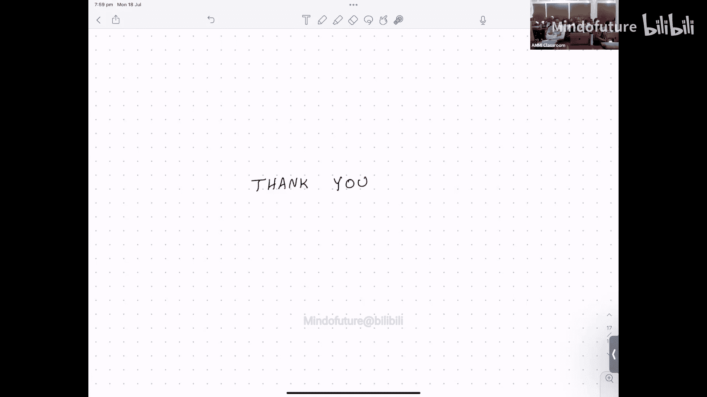
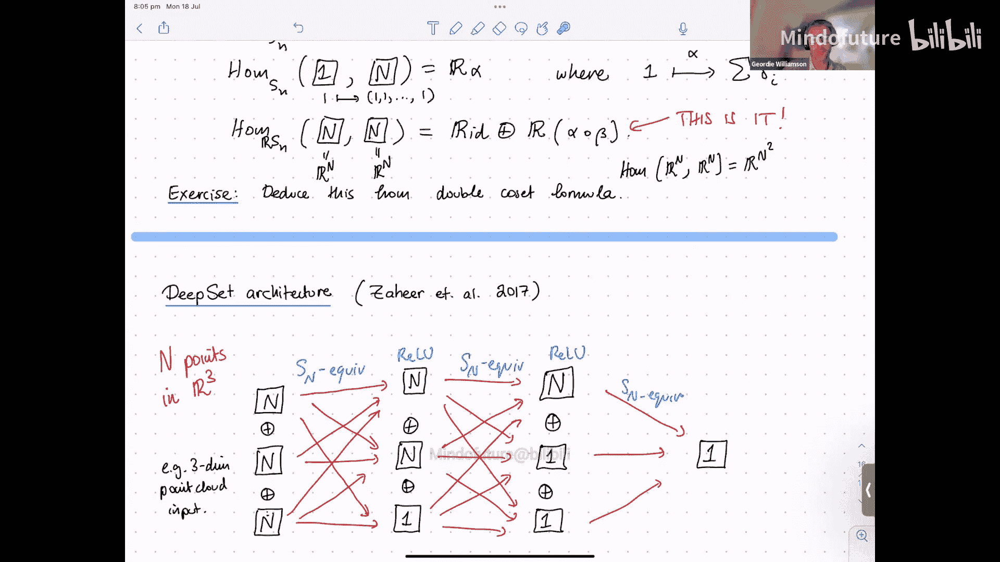
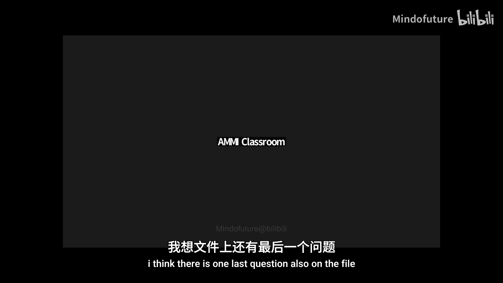
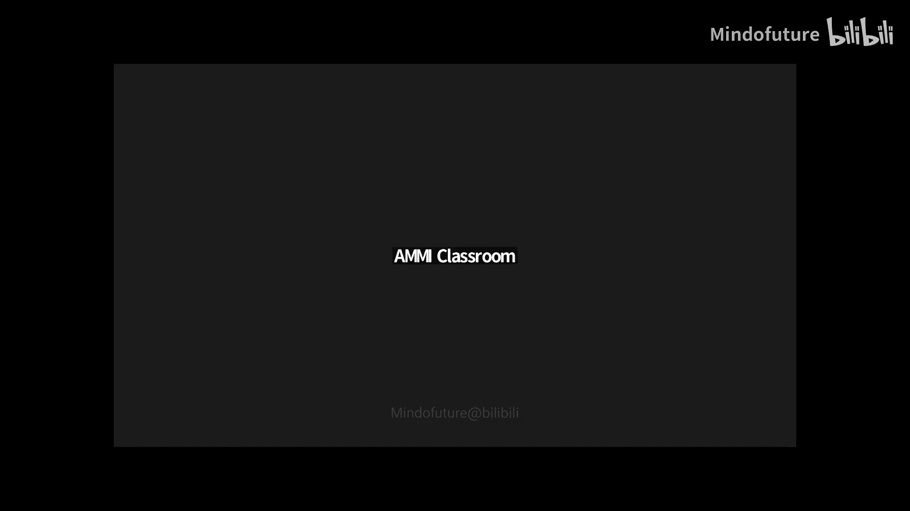
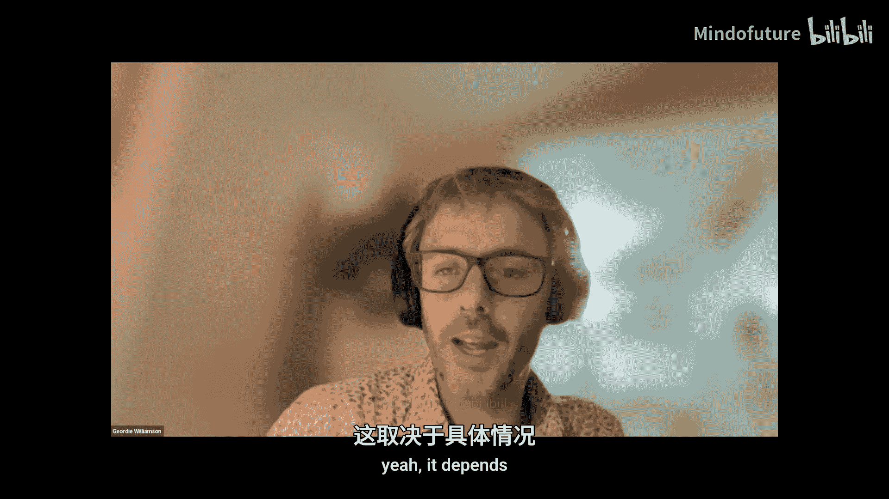

# 几何深度学习：P15：机器学习中的等变性

在本节课中，我们将学习机器学习中的等变性概念。我们将从数学中的对称性讲起，探讨群论如何为理解对称性提供框架，并最终展示如何利用这些思想来构建具有等变性的神经网络架构，例如卷积神经网络和深度集合网络。

## 对称性与群论

对称性在数学中有着悠久的历史。例如，欧几里得《几何原本》中的一个定理指出：圆上任意一点与直径两端点连线构成的角是直角。证明这个定理时，我们可以利用圆的对称性：如果将图形沿直径翻转，定理对于圆上对称的另一侧点同样成立。这种对对称性的隐含使用在数学中已存在很长时间。

群论是研究对称性的数学理论。一个群 `G` 是一个集合，配备了一个二元运算（通常称为乘法），并满足以下公理：
*   **单位元**：存在一个元素 `e`，使得对所有 `g ∈ G`，有 `e * g = g * e = g`。
*   **结合律**：对所有 `g, h, k ∈ G`，有 `(g * h) * k = g * (h * k)`。
*   **逆元**：对每个 `g ∈ G`，存在一个元素 `g^{-1}`，使得 `g * g^{-1} = g^{-1} * g = e`。

任何数学对象的对称性都构成一个群。例如，正方形的对称性（旋转和反射）就满足这些公理。

伽罗瓦在19世纪30年代指出，一个问题的所有对称性构成的集合（即其对称群）的结构对于理解该问题至关重要。这是一种元方法：从问题出发，注意到其对称性，然后研究这些对称性构成的群。克莱因随后指出，几何（如射影几何、欧氏几何）由其对称群决定。李则发展了连续群（李群）的理论。

## 表示论

表示论研究群如何线性地作用在向量空间上。具体来说，我们研究从群 `G` 到一般线性群 `GL(n, ℝ)`（即 `n×n` 可逆实矩阵群）的同态。这意味着我们寻找一组矩阵，其乘法规则与群 `G` 中元素的乘法规则相同。

以下是两个表示的例子：
1.  **正二十面体的对称群**：正二十面体的旋转对称性可以用三维旋转矩阵表示，从而给出该对称群的一个表示。
2.  **等边三角形的对称群**：等边三角形的6个对称性（顶点置换）可以用 `2×2` 矩阵表示。例如，恒等变换对应单位矩阵，交换两个顶点并固定第三个的对称性对应特定的置换矩阵。

表示论在20世纪被证明极其有用，它是粒子物理标准模型和数学中朗兰兹纲领的核心。

## 机器学习中的对称性：不变性与等变性

那么，为什么在机器学习中要讨论对称性呢？我们来看两个例子。

1.  **鸟群分析**：我们可能想用机器学习分析鸟群飞行的结构。我们将每只鸟的位置编码为一个向量，得到一个向量列表。但我们并不关心哪只鸟是“第一只”，哪只是“第二只”，我们只关心鸟群的整体构型，而不关心其顺序。我们希望模型的预测是**不变**的——即对鸟的重新编号不改变输出。
2.  **球面上的热分布预测**：假设我们有一个球面，上面有冷热区域分布。我们想训练一个神经网络来预测热量随时间的演化。支配热量演化的方程应该是**旋转不变**的。也就是说，如果我们旋转整个球体，预测的演化方式也应该相应旋转。在这种情况下，网络的中间层变换应该是**等变**的——先旋转再处理，应该等于先处理再旋转。

## 构建等变网络：卷积神经网络的视角

卷积神经网络是等变性思想的一个成功范例。考虑一个周期性的 `H×H` 灰度图像，可以看作定义在群 `Γ = ℤ/Hℤ × ℤ/Hℤ`（模 `H` 的整数对）上的实值函数 `f: Γ → ℝ`。这个群通过平移作用在图像上。

CNN的结构通常包括：输入层、多个应用滤波器的隐藏层、池化层以及最后的全连接层。从群论视角看，有三个关键观察：
1.  **预测不变性**：对于图像分类（如识别老虎），我们希望最终预测是平移不变的（老虎在图像中的位置不影响分类结果）。
2.  **层间等变性**：卷积操作（应用滤波器）是平移等变的。即 `(平移 ∘ 滤波) = (滤波 ∘ 平移)`。事实上，在函数空间之间，卷积是唯一的线性平移等变映射。ReLU激活函数也是平移等变的。
3.  **局部性**：滤波器通常只作用于图像的一小片区域，这对应于滤波器在群 `Γ` 中的支撑集靠近单位元。

如果我们要求网络架构满足**最终预测的平移不变性**、**中间层的平移等变性**以及**局部性**，那么其结构几乎必然类似于卷积神经网络。这种约束极大地减少了需要学习的参数数量。

## 参数效率：全连接 vs. 卷积

全连接神经网络的参数量巨大。如果输入层有 `L1` 维，下一层有 `L2` 维，那么它们之间的连接就有 `L1 × L2` 个参数。对于百万像素级的图像，参数量可达 `10^14` 级别。

相比之下，在一维卷积神经网络中，假设滤波器大小为3，那么无论输入图像有多长，这一层都只有3个参数。这是因为等变性和局部性强制所有位置的滤波器共享相同的参数。从 `10^14` 到 `3`，这是一个巨大的优势，使得模型更易于训练。

## 通用蓝图与深度集合网络

我们可以将CNN的构造推广到更一般的群和集合上。基本蓝图是：我们有一个群 `Γ` 和一个其作用的集合 `X`（称为`Γ`-集合）。我们希望学习一个从 `X` 上的函数到实数 `ℝ` 的映射，该映射是 `Γ`-不变或等变的。

一个重要的例子是处理**点云**数据，例如之前的鸟群。我们有 `N` 个 `D` 维空间中的点，但点的顺序无关紧要。这等价于说，我们的预测应该对 `N` 个点的置换对称群 `S_N` 保持不变。

我们可以将 `N` 个 `D` 维点视为 `D` 个 `N` 维向量（每个坐标轴对应一个维度）。`S_N` 群通过置换坐标作用于这些 `N` 维向量。利用表示论，我们可以计算出 `S_N` 等变映射的可能形式。

例如，从 `N` 维空间（表示 `N`）到一维平凡表示 `1` 的 `S_N` 不变线性映射，本质上只有一种：对所有坐标取平均（或求和）。从 `N` 到 `N` 的 `S_N` 等变线性映射，基本上只有两种：恒等映射，以及“先取平均，再广播到所有坐标”的映射。

基于这些约束设计的网络架构就是**深度集合网络**。其结构包括：处理每个点独立特征的层，接着是聚合所有点信息的池化层（如求和），最后是决策层。这种结构强制网络对输入点的顺序保持不变，同时极大地减少了参数量，因为等变性条件严格限制了层间连接的可能形式。

## 总结

本节课我们一起学习了机器学习中的等变性。我们从古老的对称性思想出发，介绍了群论作为对称性的数学语言，以及表示论如何描述群在向量空间上的作用。我们看到，将**不变性**（输出对变换保持不变）和**等变性**（变换与网络计算可交换）作为设计神经网络的约束，可以带来巨大的优势：它不仅使网络具有我们期望的对称属性，还能**极大地减少模型参数**，提高数据效率和泛化能力。卷积神经网络和深度集合网络是这一思想的两个典型范例。几何深度学习提供了一套系统性的蓝图，利用群论来自动化网络设计中的许多关键选择，这是一个强大而优美的框架，其潜力仍有待进一步探索。