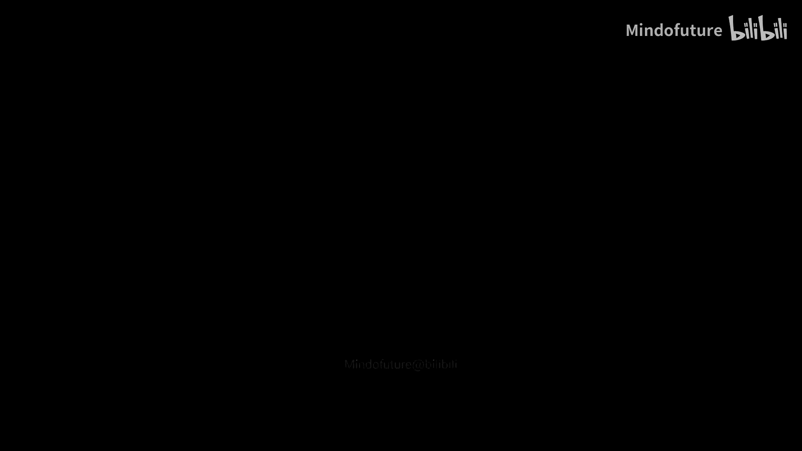
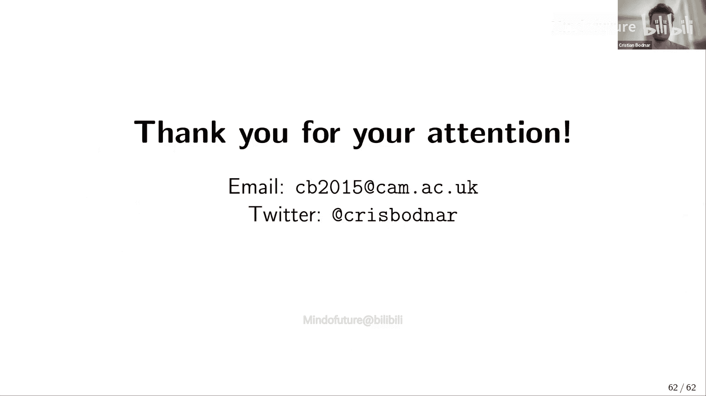

# 几何深度学习 ｜ Ammi Geometric Deep Learning Course p16 P16_研讨会4（神经束扩散）-克里斯蒂安·博德纳尔 -BV1veHgzxELm_p16-

Cool， okay， yeah， so as you're aware， there's been lots of kind of great success stories for geometric deep learning and that's been kind of driven by the many sort of domains where data kind of can live on so stuff like molecules。

 meshes， manifolds and all sorts of things。But in this talk but I sort of want to challenge the kind of idea that geometry is enough so why am I saying that in in kind of differential geometry in like mathematical physics we have a whole bunch of kind of structures and there's a whole structure here so。

Kind of on the left side we have what's called like a topological space。

 so this is just a set where we also have some sort of notion of neighborhoods so for instance this point P see on the left it has this kind of yellowish neighborhood around it and that's all we kind of know about this about this sort of structure and moving kind of to the right we kind of have more structure so we can have。

Some restriction where we also have these neighborhoods around each point that look like a flat space like Euclidean space and this is what this kind of map file is showing it's kind of mapping this neighborhood u to something like a circle or something like that like a disk sorry in in our too so luckly everything kind of looks like Euclidean。

And you can see the first structure we were talking about so at the point B。

 there's no actually no neighborhood that looks Euclidean just because it looks very strange and basically the space on the left is not the topological manifold but the space in the middle is' called the topological manifold because it has this properties but now these topological manifolds actually these structures still not enough because for instance if we want to talk about kind of things like smoothness so when kind of a surface looks smooth clearly the thing in the middle doesn't look smooth kind of these topological properties or structures are not enough to talk about these things because topologically you can show the thing in the middle is equivalent to the surface you see on the very far right。

😊，But clearly one is much more sper than the other so if you want to talk about these things you need even more structure and what we kind of end up with is what's called like a differential manifold or simply what people usually call a manifold and it's only at this stage when we're kind of on the far right of this diagram that we actually have you know like where geometry kind of starts once we're in this space we have like tangent spaces that the manifold and we can do all sorts of geometry but many spaces actually they're not aological manifolds or even if you're a topological manifold there are some very kind of strange looking spaces where you can't put these kind of smooth structure on top。

I see there's a question。Is the arrow in the third diagram pointing inside or along the plane so here that the arrow is just meant。

Oh you mean like the tangent space once so yeah， like if you if you mean about this kind of red area。

 that's kind of just a tangent vector and the red area is just the plain tangent at that point basically。

 which's just the tangent space， all the vectors are kind of tangent to the surface there。

That's what it's meant to show。Anyways， these kind of mathematical leaders are not super important。

 the big point is that you cannot always do geometry on any sort of space because you need to have all these structures and sometimes it's very hard to get or it's even impossible。

😊，And this actually led to some dilemmas in geo deep learning。

 so Michael Bnstein was remarking in a blog post that。😊。

Graphs are kind of special because theyre the only kind of space that shows up in geometric deep learning that doesn't have like kind of like a continuous equivalent like a manifold equivalent so if we talk about grids we have like just the plane as an equivalent if we have like a mesh we have the corresponding manifold the matchsh approximate but if we have a graph you know what's the manifold and there is no manifold because graphs are actually not even like topological manifolds and talking about small structures even further from that so you know like what should we do and this is kind of like a limitation of geometry in some sense because it's much more difficult to apply geometry on graphs I'm not saying it's kind of impossible and there's lots of interesting research for that but it's not like it doesn't it might not come naturally just because of these constraints。

And what i'm suggesting in this talk is to take a topological perspective。

 so what does that precisely mean so in topology we talk about these topological spaces so the sort of things you saw in the first slide with various surfaces。

So the topological space is just a set， but it has some structure on top。

 so it also has this collection D of subsets of X。And these elements of this collection we call them open sets so basically we just define some sort of open sets that kind of generalize the notion of like you know an open interval or things like that but to kind of arbitrary set and these open sets they must satisfy some axioms so the empty set and the space itself are open sets and they're part of this collection D and the second requirement is that if I take like two open sets and I take their intersection that should also be an open set and also if I take two open sets and I take their union then I also get an open set and here's like an example of a space X that's kind of abstract and I've just put here like just a bunch of open sets on the right and that actually forms topologies so that forms a topological space so there's this open set U that looks like these reddish color there's this open set V and then there's their intersection and obviously。

There's also the whole space that is an open set。And the intention is that these open sets if you think of them as neighborhoods。

 they kind of provide some sort of local neighborhoods in some sense。😊。

For the points inside them so we can talk about the neighborhood around the point by kind of identifying some open sets around that point。

Okay， and what I'm suggesting now to do is to look at graphs。

 perhaps in a new perspective that you have not encountered before as topological spaces。😊。

So what does that mean is we're going to kind of if we just think of the graph as like a set of points。

 we can put some open sets on top so for instance， for each node V for instance like here。

 we just use all the incident edges。And the point of the node itself and that will form like an open set so this UVV similarly for the other node here we have this kind of blue region that will be the open set corresponding to that node and then for this edge in the middle where these open sets intersect if you remember from thisaxxiom the intersection should also be an open set so this edge in the middle will also kind of constitute an open set。

嗯。😊，And yeah， once we have this， we also need to specify that all the unions of these things will also be open sets because otherwise you know we break the assumptions we were mentioning so that's the perspective were taking and in what follows we'll see how this perspective can help us understand and develop better graph neural networks。

And in particular we're looking at how we can use this perspective to bring some new insights and solve some problems regarding to heterophily and oversming and graphno networks。

 and that's something I'm going to explain in a second。

So the setting we're looking at is node classification。

 so essentially we have a single graph and we want to classify the nodes of this graph。

 some of the nodes are labeled so we have these red and blue nodes that are labeled but there are also some nodes that are unlabeled and we want to label those basically but we want to in training will' use those that are labeled and all the features of all the nodes which leaving this feature matrix X just kind of the classic setting。

😊，And first let me mention this oversmotthing problem so what is that essentially people notice that for certain types of graph neural networks。

 for instance graph convolutional networks， if you just stack many layers on top of each other。

 you'll see that as。😊，The features kind of evolve from one layer to another。

 they are getting progressively smoother or more similar to each other and that's obviously bad because we want to classify these node so you if everything becomes very similar to each other we can you know we can't separate these features because they all look kind of the same so we can't distinguish the classess anymore。

And there are some kind of groups for that happens， but anyways， we're going to look more into that。

😊，The second problem which is related to some extent is the heterophily problem so it was observed that many graph neural networks actually don't do that well when the graph is what's called heteroophilic so that means the graph tends to have connections between nodes that have different labels and in general like most graph neural networks they work well when you have the opposite so kind of nodes in the same class are tend to be connected but different classes tend to be less connected and here's a diagram from a recent paper where you can see that GCN for instance when the homophily levels of that thex axises。

low homophily and high heterophily so that's the left side the performance is pretty bad but as you go to the right the performance increases has increased homophily performance gets better and there's already some existing methods that have been kind of improving over GCN and kind of doing better in this kind of low homophily regime and these are kind of the color lines you see here but there's still kind of a gap to be to be filled all right now let me tell you a few words about heat diusion so first just some notation。

😊，So we have a graph， we have a degree matrix， we have adjacency matrix and the normalized lapplian。

 which is just that formula you see there， so identity minus the normalized adjacency。😊。

And the node features as usual now。What I want to mention is that heat diffusion is a very simple process suffering from oversmmothing and these heterophily settings so why is that I don't know if you ever saw like a visualization of heat diffusion but what you can imagine is kind of like you have some temperatures over your graph and what happens over time these temperatures kind of become more uniformform as time progresses so like hot regions will become colder and cold regions will become hotter and kind of everything stabilizes around like some kind of average temperature。

😊，And you can see why oversming and heterophily show up in this process right like if iron run is infinitely long everything will converge to the same temperature and everything looks the same so that's exactly what happens in overming and with heterophily if you have lots of connections between kind of hot and cold node you see their temperatures kind of balance out very quickly and they become kind of the same representation so you actually make things in different classes to have the same kind of temperature and you can't distinguish that anymore so it's kind of the worst model that you could think of if you really want to kind of you know have problems with oversming and heterophily and。

😊，Let me show you something very interesting， so if we disparitize this differential equation。

And we just use like a time departization we obtain something like here so the features at time T plus one are the features at time t minus these lapplian times the features at time D now we can also simplify this a bit further by just using the fact that x is a common factor here and we obtain this expression in red now what's very interesting is that if you remember the graph convolutional network model which I think was in previous lecture but in any case it looks like this so that's how it combines the features and the adjacency in this formulation and w here is just the weight matrix sigma the sigma is just an only guarantee actually by just using just a simple algebra these normalized the adjacency just from the definition it's actually the red part we were seeing before so this I minus delta zero so you can see that graph convolutional networks essentially they are like heat diffusion or very similar to。

diffusion but we've just put some extra elements on top like this weight matrix and the sigma so in some sense it's not really surprising that graph convolutional networks have you know a problem with heterophi and overmoing because they're actually built around this process that's doing very badly at these things。

😊，嗯。Now the question we are trying to answer in this paper is can we make this diffusion process so hit diffusion。

 can we make it more advanced and then build like a better graph revolutional network or something of that kind。

 so how can we make this diffusion process more powerful？

And the answer lies in these mathematical objects that come from algebraic topology and they're called shes。

So let me give you just kind of a very brief introduction to this we're not going to go in any details。

 but essentially Shis are just a way of keeping track of some data we attach to the open sets over topological space so if we have a topological space like here this text we have some open sets in this space and what we can do essentially we can just include some data for each open set so we have this F of X F of V F of P and so on。

So yeah just imagine this kind of flags as some sort of data like a vector space or something of that kind and then what we have if we follow these arrows is kind of a way to restrict our view to like smaller regions right so I have this data over this big region but if I have some subset let's look at how that data looks in that smaller region so you kind of have this way of kind of ensuring data consistency and looking at smaller regions。

😊，That's kind of the the idea and it just as what I've just said anyway。

 so now what we can do is by just adopting the perspective I was mentioning in the beginning where we think of the graph as a topological space。

 we can obtain。A sheaf over graphs， so what we can do is for each of these open sets associated with the nodes and edges that I was mentioning。

We can just put the vector space so just kind of stick a vector space on top of each of these open set and then what we have between these vector spaces these are the arrows you were seeing in the diagram before we would just have some linear maps so that's all we have so whenever there's kind of like a node or like this open set。

That's bigger and we have like an open set that's smaller like the edge open set。

 we would have one of these linear maps for instance。Now strictly speaking。

 this is not yet a shift since we have not specified what happens on all the open sets so these are just kind of some of the open sets of this space。

 remember that we can also have unions of these open sets。😊。

And we haven't actually said exactly how these vector spaces look like and how these maps look like and that。

That's kind of an entirely different story， but fortunately there are these things called cellular shes so these are kind of a you know some unthoughaught about these kind of things and they actually already defined properly sheavs over graph and they kind of look like this so we were just these was just kind of a way to motivate this definition but from now on just kind of think about this definition and you know you can forget about kind of these shes I was talking about before so。

😊，Whatat are these so essentially we have a graph and now instead of just putting things on the open sets because these open sets were in kind of direct correspondence with the vertices and the edges we can just put them on top of the vertices and the edges so it's kind of much simpler right so yeah basically what we have is a graph with some extra structure on top so for each vector So for each vertex B we have a vector space FO V so in this case this vector space is just like the real plane so R2 that's what these boxes are meant to show then what we have is another vector space for each edge so that's the vector space you see in the middle of this diagram and for each。

Vertex incident to an edge， we have a linear map between these spaces so the vector space of the vertex to the vector space of the edge and we have that linear map there and the terminology is that these vector spaces are called stops and these linear maps i'll call restriction map so the name restriction maps comes from what I was saying before it's kind of like zooming in on some smaller subset and you restrict your view to that so that's where the word restriction comes from。

😊，嗯。So these are these are shiftavs and i'm going to explain a bit further the intuition behind them so there's this very nice paper by Hanton and Grace where they provided a nice mental picture about these objects that comes from opinion dynamics so essentially。

You can think of the vector features of the nodes as a space of private opinions。

 so each node in this network is like a person right and when there's an edge between them these people communicate so person V and person you communicate in this case。

And the vector space in the middle is called a discourse space。

 so it's kind of the space where their opinions meet and they start discussing。

And how this works is basically these linear maps we have， which are essentially just on matrices。😊。

They map a private opinion in the discourse space for each of these two distinct input in this case and then these participants can kind of compare their opinions in the dispers space right so essentially these linear maps are kind of explaining how the private opinions of these people manifest in the discourse space and that's kind of a big like in practice right because in public we don't say always what we think and we kind of filter our thoughts right and this is what these matrices are doing they're just transform the private opinions into public opinions。

All right。And once we have this sort of structure， this sort of she。

 we can construct what's called the sh lapplian， so I believe you're probably familiar with the graphflplian and actually the graph lapplian is a particular case of of sh lapplian。

 but let's talk about the sh lapplian and see how it looks like so。

If we kind of so it's just a matrix and if we apply it to a vector x and then we look at node view what happens。

 it's defined as you see in this diagram。So we just go for all the with some of all the nodes year that our neighbors of V that's what that notation says and then we do this kind of very potentially weird multiplications what's actually not that weird so if you look at what's going on in this bracket that's just kind of the difference between the public opinions of the two neighbors right so the first matrix time Xv is just the public opinion of node V and the other term is the public opinion of node view and they just take the difference so how different are opinions and you do this along all the edges or all the neighbors U around V and then you aggregate them back but you transform them through these kind of matrix transpose。

And the diagram below kind of explains how this matrix looks like。

 so if you look at the diagonal elements， you will have these sum you see on the left。😊。

And if you look on the right， you see this how these non like a typical non diagonal blocklets like。

And to note also that this is a sparse matrix， so we have just zeros。

 these blank regions are just places where there's no edge between the nodes。Something。

We can do is we can also be like a normalized version of this lipplusian。

 so we just take all the blocks that are diagonal here。

 we put them in this matrix D and then exactly like with the how we normalize the graphalplusian we normalize this thing it's the same kind of formula and importantly as I was saying when D is one so D here is the dimension of these vector spaces。

I should have mentioned， so all these blocks are D by D if so for instance， before we had our two。

 so these blocks would be two by two。But if these one。

 so all these vector spaces are just kind of a scalar basically we're back in kind of the usual setting so each of these blocks just becomes one by one and essentially we obtain the graphloplian so if you look at the formula in the definition if all these matrices you see here if they're just a scalar one you just get xv minus xu which is exactly the formula for the graphloplian。

So you can see how we can kind of get more general things in the formalism。

And here's another way to kind of think about these things， so in differential geometry。

 if we have something like a manifold。We have what's called like a bundle so this is kind of a vector bundle so this is just a way to put some vector spaces at each point on the manifold and one example is just the tangent bundle so essentially you put all the tangent spaces at each point and you kind of stick them to the manifold。

And once you do that there's this notion of power transport in differential geometric so what's that essentially if you have a tangent vector at a point like here so if you look in the kind of bottom left of the diagram at these vertex W so we have this kind of relatively vertical tangent vector if we do parallel transport we can sort of move it very smoothly along this edge and move it up in this other vector space and from that vector space we can move down again and so on so it's a way to transport tangent vectors and what these matrices are doing in the chief you could think of。

Just think like a discrete or like sampling some points on this manifold and these vector space are kind of like these tangent spaces and these matrix multiplications are just moving are just moving a vector space from one tangent space to another so it's kind of like a discrete version of parallel transport so just a way to move things from one tangent space to another and if you look at these kind of matrix expressions you see in this diagram they're actually exactly like these nondiaagonal terms you have in the Laplaceian so essentially these nondiaagonal terms are just specifying away to move vector from one stop to another one tangent space to another depending on how you think about okay that's just to give you some mutationation it's not like super important if some things are not very clear here。

Okay now let's actually start using these shifts and some interesting things and what we want to do is study the expressive power of these what's called a sheep diffusion process it's exactly the same differential equation we have before like it looks almost identical the only difference compared to heat diffusion is that the lapplian is different so now we have a shift lapplian instead of the graph loplian but remember the graphus is just a particular case so this gives us some flexibility to study all sorts offfusion processes so by just modifying the ship structure but you have different lapplians and different diffusion processes and what we aim to do here is to kind of study what happens when we try different shapes there and can we use them in a useful way and just to kind of visualize how these matrix multiplication lookss like in this differential equation so on the left we have this minus delta f the normal。

😊，Lusian， it has the block structure we were seeing before。😊。

Now our feature matrix looks a bit different from kind of the classic case。

 so we have these block these blocks that are kind of de dimensionional so each because each feature is kind of a point in these vector spaces we were mentioning so if our vector spaces are the dimensionional then we have the dimensionional vectors。

😊，And that happens for all the nodes in our graph， so if we can just stack them vertically and that's a single stack vector containing all the features of all the nodes and obviously we can have multiple feature channels so that's kind of going from left to right we just have multiple columns and each column is a different feature channel and each row are all the de dimensionmensionalal vectors is belonging to a single node so now the diffusion equation is a bit like if you think about these vectors。

 these de dimensionsal vectors like vector fields instead of kind of diffusing scalarrs so before we just have like a single scalar like the temperature or something like that now we kind of diffuse vector fields which is much more interesting right and you could think of the scalar case as a particular case like when these vector vectors have dimension one so they just become scalarrs。

😊，So that's kind of the intuition and there is kind of like some minimal thing we can say about this diffusion process because it's kind of like a plastic result。

 so if we just run this diffusion infinitely long what happens is essentially we project the initial conditions so what we have at time zero into the kernel the of the normalized lapplian so remember from the algebra product kernel of the matrix is just all the vectors that that matrix maps to zero so basically in the end we end up with this feature matrix that when we multiplly by delta f we get zero so all the columns multiplied by delta f yield zero so that's all that means。

😊，Okay， any questions so far？All right， I'll just go on anybody yeah。

 feel free to interrupt if you have questions。All right， and then what we want to do is。

We want to see how different classes of shifts can linearly separate the nodes of a graph in the infinite time limit of their diffusion process。

 so just to kind of illustrate that with the picture we start with the graph like you see on the left so if you look at diffusion time zero basically so that's just kind of our initial conditions right so we have these graph the colors denote the labels of the node。

And the position of each node is kind of its features so each node has2D features in this case and I've put each node at the position indicated by the features right and what we want to do is find a shift such that when we run this diffusion process like you see here in the infinite time limit these classes becomes very nicely clustered then we can linearly separate them so that's great right because it's kind of like a。

😊，What we want to achieve， we want to classify these nodes in this graph so we can find these sort of diffusion processes that help us do that。

 so if you look at what happens at diffusion time 14。

 for instance which is already a good approximation for what happens at infinity because this process converges kind of exponentially。

 we see all these clusters are very nicely formed of different classes。All right。

 now let's just do that so first let's look at some shifts where these vector spaces are just。

The real line so just R and we also impose some symmetry constraints So basically for each edge E we want these restriction maps to be equal along that edge so remember for each edge we have two matrices one on the left and one on the right one for the first node one for the second node and we just constrain out well no there are scalars because we work in dimension one right so we just want these scalarrs to be equal and you can show this actually equivalent with kind of having weighted graph loplians so these are just lapplians where you put some edges some weights on top of your edges and the weights here will be just the product of these two scalarrs so you can show that I'm not doing that here but just to give you an intuition of what we're looking at we also constrain these scalars to be different from zero so we don't want to have zeros there just to start with so this is kind of very simple tasks of shapes and they recover weighted graph。

iansSo yeah think of these as diffusions with weighted graph lapians and you know you might think okay I've said in the beginning that you know this hit diffusion was kind of very limited you can't much but you know maybe you think okay if I put some at least some weights on the edges and we make it a bit more general like this weighted hit diffusion it might do reasonably right and to some degree it does well in some settings so for instance if we can sit they're all connected graphs with two classes so just A and B two sets of these joint sets with two classes。

And we have this property that for each node in the first class a there exists another neighbor in the same class so we just assume in one of the classes any node we look at we can find a neighbor in the same class and that's kind of like a homophiia assumption right we expect to have at least some degree of homophiia we can always find another node with another label in our neighborhood。

It's not a very strong assumption but it is like some degree of homophily that's assume then we say that this class has linear separation over all the graphs in this class so what does that mean it means for any graph you give me in this class I can find your shift in this class we defined above we do diffusion and we always separate the classes for almost any initial condition so almost virtually any initial condition you pick will separate the class so essentially this model can kind of do perfectly on these types of graphs。

Okay， but。Here's something else that happens if we just have bipartid graphs with two partitions A and B and we also contrain these partitions to be equal so this is the most heterophiic graph you can think of right because every neighbor is has a different label from you right like because in bipartid graphs you are connected to things in the other partition and basically everything around you looks different from you has a different label then you can show that there' is no shift in this class that can linearly separate the classes of any graph that looks like this for any initial conditions so whatever graph you give me from here whatever initial conditions I cannot find a shift in this class that can separate the classes so you can already see that this kind of diffusion processes are already kind of struggling whenever we have heterophily in the infinite time limit so if we diffuse infinitely long so in this kind of oversmotthing sort of regime。

Now we can actually fix this quite easily by considering more general classes of sheets。😊。

So how does that look like so now assume we have again a connected graph with two classes。

 so no other assumptions， just any graph that's connected。And we can construct the she as follows。

 so still like we're still with D equals one so that didn't change。And first。

 basically for each so for the first scalar along each or matrix。

 here's a one by one matrix just to kind of make sure we are on the same page。

 just set it to minus alpha E， so alpha E is just some constant your pick page edge E。

And if the first node is in class A。And choose alpha E if the nodeier is in class B。

And this will look kind of like with alpha E being positive So okay。

 what does that mean so we're kind of like in this diagram you see here where the first。

Kind of matrix is negative so I just put alpha E to be one in this case right so we have minus one and1 and what happens when you diffuse you will reach like a state where these features are polarized so that's kind of what diffusion will do will kind of polarize the features so this orange node。

Will have kind of this feature that's negative in this vector space and the blue node will have this feature that's positive because they need to agree in the discourse space so what diffusion kind of does is as you diffuse these nodes start to these people start to agree in the discourse space and because of this kind of different signature the only way for them to agree that these first space is going to have negative features and the other positive features so because of this polarization you'll have one class have negative features one class have positive features and it's very easy to separate them right you just look at you know zero is zero fresh right if it's less than zero it's in one class if it's more than zero in the other class so this is kind of the intuition for this result。

So this type of shift can linearly separate the classes of any such graph so connected with two classes for almost any initial conditions。

 so we can already see like it doesn't matter we don't need any homophily。

 heterophily assumptions or anything of that kind， whatever graph you give us。

 we can solve this problem。😊，All right now there's still kind of an issue here and that's kind of specific to having these dimension ones so so far we only looked at kind of one dimensional vector spaces so our lapplians were kind of you know just regular matrices theyre not block mates so far。

 but if we just stick with this we have some problems so。

And we have a connected graph with more than three or at least three classes。

And if we set all these vector spaces to have dimension one。

 then no shift can separate the classes for any initial conditions。

And why is that essentially you can show that what you end up with is kind of like a one dimensional。

Kind of a kernel right so we said we converge into the kernel of the lapplian and you can show when D equals one the kernel is at most one dimension so essentially you're projecting everything on a line and in the most fortunate case you're going to end up with something like this where kind of a different classes are placed in different regions of this line。

 but still you cannot kind of separate them linearly like at least not with a single hyperplane right you would need multiple kind of hyperplane or multiple thresholds so for instance for the blue class in the middle you would need kind of a hyperplane on its left and a hyperplane on its right to separate them。

So you're kind of a bit limited or you need slightly more complex decision boundaries so you can only achieve this kind of pairwise linear seability in the most fortunate case。

 so the solution is simply to increase D and use basically that will also increase the dimension of the kernel space so essentially we kind of have more room to kind of move in in the infinite time limit。

And that kind of extra room offers us some representational width the more interesting things。😊。

So one way to do that is to look at the dimensional vector spaces and for these matrices。

 these restriction maps， now we're just going to consider some very simple class。

 so we say they're invertible and diagonal so just just diagonal matrices essentially and。

Now we have these results， so again we can have any connected graph。

 but now with any number of classes see that let's say it's at least three as before。

Then if we just set this dimension to be at least C。

 then this class has linear separation over these set of graphs。

 so basically if we make the big enough we can easily find shifts that can separate even more than two classes so any number of classes we have so we also solve these problems so essentially we can kind of you know find shifts for pretty much any problem。

Now question you might have is that these diagonal restriction maps are you know kind of simple so you know what happens if we perhaps use some more complicated maps so for instance something we could do is consider these bundles I was mentioning so in this bundle case when you have these discrete vector bundles you restrict by definition that's what it means to have these matrices to be orthogonal matrices so these are D by D matrices that are orthogonal。

😊，And again what you can show here is you can kind of make more efficient use of your space so if you have D thats2 and4 then you can classify up to 2D classes right so you can kind of use less space to classify more classes and to give you like an example again here's an example of the fusion process here we have four classes and we're in 2D right and we can find a shift that kind of clusters all the classes like this and we can linearly separate all these four classes if you look at the lost picture so that's kind of like let's say a visual proof of this result at least for d equals two。

All right， so that's kind of the end of the theoretical part and my main takeaway from here is that different classes of shes in diffusion processes with different capabilities so we sort of see how going from some very simple shes that kind of you know give us weighted graphloplians or very simple things like that。

 but those very simple things are commonly used in practice。

 we can see that in that setting we're quite limited。

 but as we make these shes increasingly general and more complicated。

 we have kind of more power to do other things and to solve other kinds of problems。😊。

So this is a bit like in geometry where if you have like different geometries for some manifold or whatever。

 you have kind of different types of diffusions on that manifold， so that's kind of the intuition。

And also something very important to mention is that essentially any node classification problem can be reduced to performing diffusion with the right shift right so basically for any node classification problem you have on a fragment graph I can always find a shift that will kind of solve that classification problem I just put the shift over the graph right diffusion I can separate everything this doesn't mean it's easy to find that shift but in principle you will always have such a shift which is something useful to know。

😊，Okay， now we're kind of moving on to more practical things and seeing how we can actually use the shapes in practice。

So something that。You might wonder is you know like where do we get these sheets from or no one gives us a sheet right like we never have a shift data set like we always have graph data set so someone gives us a graph withs some pictures on top but no one's ever going to give us a shift structure on that graph in general right so。

😊，Then there's an natural question， how can we actually make use of all these things with that limitation in mind and what we are proposing in this paper is to learn these shapes so we just learn them from the features and from the structure of the graph。

So how do we do that and what does it exactly mean to learn a achieve so what it means to learn a achieve essentially is just learning this matrices right like for the vector spaces you just pick some d like beforehand like a hyperparameter so again in this image d equals two because these are kind of two dimensional boxes vector spaces right and。

😊，Once you pick yourD， all that's left to do is decide what these matrices should be。

So this FVE and this FUE for each edge E right and what we can do is we can just take a parametric function and it will be a neural network in general so。

Like this phi here that you see in equation three and this is matrix value so and what what it's going to do first it takes as the first input the features of node V and as the second input。

 the features of node V and it will produce you a matrix。

And that will be the matrix on the left so this FVE if you swap the order of these two things it will give you the second matrix。

 the matrix on the right so these F triangle E and that's it right like we can just take these function and we go at all the edges in our graph we plug in the features of the nodes that form that edge right on the boundary of that edge and we just get all these matrices for all the edges and that's it we have our shift structure and perhaps one way to think about this in maybe more familiar terms it's a bit like in graph attention metrics if you're familiar with that model so there we also have a function like this here but it's just scalar value so it gives you the attention coefficient instead of a matrix but we kind of generalize gap in some sense to matrices right so now we output matrices instead of scalarrs so that's kind of the inition。

And once we do that， what we can do is we just build a model where these shifts are learned from data and we just let gradient descends to learn what's the best shift for us to solve the task so it's kind of like what's the best geometry or what's the best structure shift structure we can put on top of the graph to solve our problem and what we use as a model。

Is a kind of generalized shift diffusion process， so this looks a bit like what we saw before with the shift diffusion equation we've just put some extra stuff on top similar to how GCN was adding some extra stuff on top of key diffusion so we put some matrices this W1 and this W2 and。

Now actually if you just kind of ignore this chronicronre product in front of the matrix Xt。

 it's exactly like GCN is the same formula right we have just the matrix on the right features and the low plusn and the nonlinear linear I think so all that kind of changes is that we also have these kind of additional matrix and the reason we have it there is because now if we work in some dimension D we have the dimensionsional vectors and we can also multiply those de dimensionmensional vectors with this matrix w on from the left so that's all that's doing so its us that like a slightly more complex linear transformation for the features but that's pretty much like it's very similar and in practice we discretize this equation so we just work with kind of this more kind of residual network type of architecture again this is just a discretization in time of the previous model and it looks very similar and so basically the features at layer t plus1。

A the features at layer T minus this expression we had before now the very important thing to notice here where this kind of sheet learning part mentioned shows in。

There's another difference with regard to the shift diffusion equation。

 you can see that this F also depends on time or on the layer and the reason for that is because we learn the shift at time T as a function of the graph and the features at time T and this function G is actually what we saw on the previous slide so essentially you just take the features you have at time T you plug them through this function file I was showing you before we get all the matrices once you have all those matrices you can build a shift Laplian and then you can kind of just use this model so that's the big picture okay so let's look at some results。

So。First let me show you a synthetic experiment where we kind of test this opinion polarization or like feature polarization I was showing you before。

 so we have a biparttheite graph again with two equal partitions and we saw that in this setting。

Weighted graph diffusion cannot solve this task so at least not with 100% accuracy it might do well but not 100% accuracy so that's the theory and what we're doing here we are just considering a very simple model so actually we just use like the model from equation for here but we just set these matrices W1 and W2 they have been set to identity so basically just get rid of them and let's just kind of have like a shift diffusion process where the shift is learned that's all we're doing here so kind of a very simple version of our model。

And for the baseline we have this weighted graph diffusion， so similar model。

 but we just picked these shifts， we were saying in the beginning that you d equals one and you have this equality for each edge just so we get like a weighted graph and a weighted graph lapplian so that's the line you see in blue for the weighted graph。

And you can see that on the training data， the blue baseline is done pretty badly and also in terms of test accuracy is also done pretty badly and the axis here is diffusion time。

All right， and you can also see like with more diffusion time performances to get worse for the blue baseline。

 but for the kind of ship diffusion baseline this orange。

Line you see here you can see that performance improves as time increases。

 so you could think of time here as a proxy for the number of layers right so with kind of deeper times we have like kind of more layers in some sense it's kind of like a continuous layer。

嗯。And we can see that we can sort of address at least in this setting this oversmothing problem right like we can we just stack so many layers like more time essentially and performance get better it doesn't get worse and what we're also showing here in this green line it's what we called an oracle sheeps so that's just using a shift like in the result we saw before where we used like a different sign for the two scalrs so we know that kind of sheep solves this task but because we have this result。

😊，So we can just plug it in in our model so instead of learning the shift let's just use this ideal shift and we can see it obviously does perfectly and better but the kind of learned version is' actually also kind of keeping up pretty well with the the green line so the green line is kind of like the ideal scenario so we can see with learning we can do pretty well as well and also to kind of look at kind of the interpretability side of things and seeing what sort of lapplian that we learn here what sort of shift basically we learn here is this kind of matching orientation in the lost figure I'm just plotting。

😊，Basically just the product between those two matrices you have at each edge in this case they are scalar because d equals one so i'm just plotting that product now before training you can see because of how these weights are initialized and everything they are sort of flued around zero and you have kind of like a typical histogram you see for kind of randomly initialized values but after training and we look here at this time that got like 100% accuracy just seeing what happened there you can see that all these products are negative which means that they have opposite signs right so like one。

😊，One scalar is positive the other is negative like we saw in one of the drawings before and we saw they actually recovered this in that we had so essentially what the shift is doing is learning to polarize the features of the two partitions so it's actually doing exactly what we would expect it should do and it can very easily solve the problem by figuring this thing out and。

Other graph neural networks can kind of struggle in this sort of setting just because kind of their kind of underlying shift structure that's implicit。

 they use these very basic shifts that we saw in the beginning， they can't solve it。Okay。

 and we also have some real world evaluation where。😊。

Essentially we look at a bunch of not classification data sets ranging from very low homophily on the left。

 so very high heartphily basically to very high homophily on the right or very high low heterophily and oral baselines are。

Kind of highlighted in bold here and we have three version of these models I've seen I've shown you so we have first a model that learns these diagonal restriction maps we have a model that learns orthogonal maps and we also have a model that just learns any matrix so just an arbitrary matrix we don't restrict it and we just plot here kind of the result so the best result is in red the second best is in blue and then the red best is in this purple color。

诶。We can see that in pretty much all the heteroophilic data sets。

These baselines these models are actually doing very well and outperforming existing models。

 many of them have been designed for hydrophilic graphs actually。

 and others have been designed for kind of oversmthing and these sorts of things and。

At the same time we're also kind of doing reasonably well on the homophiic benchmarks so those are kind of the last three benchmarks where the homophily level is quite high and in general I think these models are in the top three models for pretty much all the data sets except for CORA so these kind of very interesting theoretical insights have led to some very simple but practical models that actually work in practice。

All right so that's all I had to say I also have a bunch of references here for if anyone wants to kind of check you know the details of some of the papers behind this work I guess I will have a way to disseminate the slides later and you can check this out so yeah that's all I had to say thank you for your attention and for the invitation to speak and yeah if you want to reach out offline to me here on my contact details I'm also very active on Twitter and you know happy to take any questions you might have right now。

