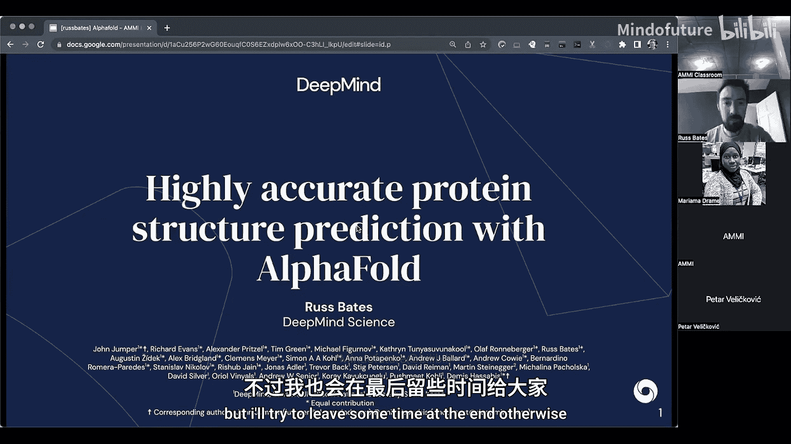
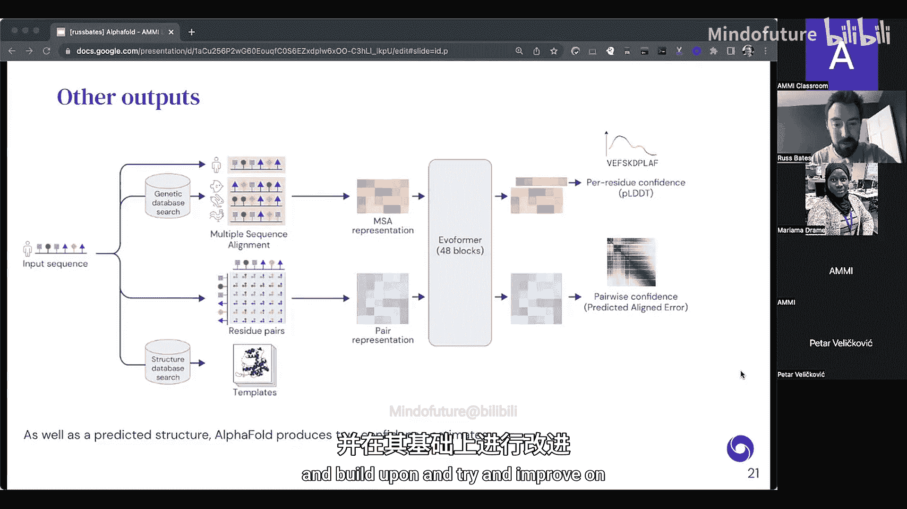

# 几何深度学习 ｜ Ammi Geometric Deep Learning Course p17 P17_研讨会5（AlphaFold）-拉斯·贝茨 -BV1veHgzxELm_p17-

Okay， yeah， yeah， thank you for having me to come and speak to you today。Yeah， my name is Russ。

 I'm coming from Deep Mind science team and today we're going to be talking about the work done with Alpha fold。

 which you may have heard of， which is our way of our method for solving the protein structure prediction problem。

Yeah and so we're going to cover some background on proteins because yeah I won't assume that anyone knows you know what proteins are or how they work or why they're interesting so we'll do a bit of background on proteins and the physics of that and then dive into some of the machine learning components that make Al fold work yeah and chat about them a bit and yeah maybe then later look into some of the results and interpretation of that and some of the impact yeah and I think Al fold is a super interesting case study for I guess what you've been learning about already because I guess it's a sort of non-standard machine learning architecture but also incorporates these ideas of sort of geometric deep learning which I know you've been learning about and yeah and it's also it's also something that has。

So an example of deep learning that's had practical impact out in the real world so I think they're always the most interesting things to learn about Oh yeah and please feel free to interrupt with questions but I'll try and leave some time at the end otherwise。

嗯。嗯。Cool， so yeah， I think we'll first start by talking about proteins in general and why they're interesting and why we would like to use machine learning to learn about them。

So yeah， to first start by explaining what really proteins are is you should。

I'm sure everyone's heard the word protein but we should frame it as you know if an organism wants to do something within its cells or within the body generally how they'll do that is by having a protein which is specialized to that task so really you can think of them these little molecular machines that are essential for life and for doing all sorts of the processes so but and really these processes can span all sorts of things so for example it might be structural so you know it might be making up your hair or something or it could be do with your immune system even so I'm sure more recently everyone's heard around the sort of the coronavirus lots of talk around the spike protein and this is a protein of the virus which is important for sort of gaining access to a cell so proteins are really important for all these different kinds of functions across life。

And yeah， proteins are large molecules， obviously made of atoms。

 but in a sort of higher level of actually abstraction of that。

 there are these long chains of amino acids and we're talking to what that means exactly。

 but so we can imagine a big long chain of amino acids almost like beads on a string。

And due to physics， the forces of physics， these things will jigglele around and fold up until they create some kind of 3D molecule of the kind you can see on the slide here。

And so this exact 3D shape， which the protein ends up folding into。

Determines things relating to the function of the protein。And yeah， so for example。

 what it might do and what its purpose might be。So yeah to expand on this idea of proteins as a collection of amino acids we can dive into what that means and so we have all these little these molecules which is sort of connected together one after another as I say like forming a string and so if we're thinking like computer scientists we can imagine that we can describe a protein basically as a string of letters in an alphabet of 20 or sometimes 21 that being the sort of the number of different amino acids so we can almost think of it as like a。

Like a word where where each letter designates an amino acid and they're sort of ordered and connected together like that。

And you should also be thinking that this is pretty much what your DNA sort of encodes for。

 so some section of your DNA， a gene is basically going to tell you the recipe for what order together to put together some amino acids to make a specific protein。

And yeah。But so what is it that actually makes these amino acids， the makeup of the protein。

 what is it that actually makes them different and why is it meaningful to have different orders of amino acids？

And the reason for that is that all of the amino acids are made up of different collections of atoms is they're sort of slightly different molecules and so as you can see on this on this slide on this poster。

 here's examples of all of the different possible amino acids and they all have different chemical properties let's say so some of them maybe sort of have be electrically charged or some of them might be。

Hydrophobic， so they really dislike being in contact with water。

And also you can see from here that they have sort of quite drastically different sizes just in the kind of the the number of atoms almost so you can see that tryptophan in the bottom right。

Has this really big loops of these rings， whereas alanine in the bottom left is really quite small。

 so yeah this is even going to give sort of physical constraints of where these molecules want to go。

And so as I said， the amino acids were all sort of linked together in a line almost。

 so we have this chain of amino acids and they all connect together along this sort of shared backbone that they all have running along the middle and the differences are actually in what's called the side chains and are all these these different kinds of atoms sort of hanging off the backbone and what gives different amino acids。

 they're these different chemical properties。And so if you imagine this is kind of what a protein would look like if you just had a protein that had one of each different kind of amino acids。

 you kind of have this contiguous backbone which connects together in a chain all the way along and then you have the different side chains hanging off where so example hisadine has a certain height side chain and cystistine has a different one。

And yeah， when these will fold up to create different 3D molecules。不。

And yeah and the 3D molecules which the 3D shape which the protein falls up to form is exactly what we want to try and predict with alpha fold and yeah and why do we want to try and predict that。

 why can't we just sort of measure it scientifically？

And the reason for that is we do have ways of trying to measure this scientifically。

 they're just extremely difficult and time consuming。

 they can take months or even years to solve the structure of a single protein。

And that's because the methods which can do this， for example。

 things like X ray crystallography have many stages and many ways in which things can go wrong。

So for example， if I had a new protein， I wanted to solve the structure of say for example， some。

Yeah， hemoglobin。And I wanted to learn its structure。

 I would have to go through all of these steps on here I would need to make some DNA that codes for the protein。

 I would need to put it into some cells， maybe some yeast or some E coli。

I need to grow those cells so it produces the protein。

 I need to smash the cells up to sort of extract the insides。

 purify the protein so I only have my protein of interest and not all of the other proteins that are going on inside the cell。

I then need to sort of grow these crystals， which is famously difficult to do。

So crystals of pure protein。Then I can do what's called x ray diffraction using some sort of high energy。

Xrays usually it was called a synchrotron again very expensive and difficult and then interpret the data and then maybe at the end then now I can solve a protein structure from that but there's a lot of different steps and can be very difficult so what we would like to do is basically skip all of those steps with machine learning and just go from step one straight to step eight and predict the protein structure in Mongo。

So that's what we're going to try and do。But as you'll know。

 we can't do machine learning without data， so we need data to learn from and train our models。

 but luckily the structural biology community has been collecting this data for a long time。

 running these really difficult experiments and solving the 3D structure of many， many proteins。

It's not the world's largest training set of all time， but there is something like 200。

000 solved protein structures out there and very conveniently they're all nicely logged away in what's called the protein Databank。

 the PDB， and yeah the community has been really good in making all of this data publicly available if anyone to do research on which is really great from a sort of yeah machine learning point of view to have access to all of this data。

Yeah， so this is the sort of starting point for us of what is our training set。And it's the 200。

000 protein structures that have already been solved by the community。对。

So yeah often already in this deck I think we've shown some illustrations of the 3D structures of proteins。

 but obviously these aren't things that you can see with your naked eye they're sort of down at the atomic scale and so the visualizations are always going to be a bit of a representation and there's always a few different ways of showing these。

 so on the left hand side you can see the visualization of the protein with all of the atoms visualized so the lines between the sort of blobs。

 the green blue and red spheres or individual atoms and the lines between them are showing bonds between the atoms and so in some sensess sort of showing everything。

But in other sense it's very hard to pass this， you know it just looks like a big blob of atoms it doesn't seem to be that much structure inside it。

So commonly what people will do， which is this picture on in the middle is just show this sort of cartoon representation of the protein。

 which is just showing the backbone and ignoring all of the side chains and in this one we can quite clearly see or much more clearly see that it's in fact is like a string a single string that's folded up。

And also what we can see is some common motifs， so for example we see these these helices which call alpha helices and we can see some of these arrows。

Wwhich are there as well which get called beta strands or beta sheets and these are sort of common motifs that often are made up of proteins。

 but obviously it's just a sort of artist's impression basically。And yeah。

 and I think this middle representation is what we'll tend to be looking at most commonly。

And obviously on the right， we've just got the two overlaid over each other。

 so they're kind of showing the same thing just with different levels of detail。Cool and then。

It's important for us to think about what are the different causal relationships in sort of thinking about proteins because it happens on a few different levels。

So we're currently thinking about the protein being defined by its amino acid sequence。

 as we've said， this like this chain of amino acids and the order in which they exist on the chain。

And so that's sort of one level to think about it。But we know that when that gets turned into a protein sort of when your body actually makes it。

We end up with this 3D structure， 3D molecule and it's there's a sort of causal relationship there that the physics sort of causes that molecule to take on a certain shape。

But obviously then that molecule then has a role within within your body。

 so for example it might you know as I said it might be making your hair and then how strong your hair is might actually be important for you as an organism or it might be to do with your immune system and how intact your immune system is might affect how successful an organism is so this obviously then affects evolution a species level so having a protein which is kind of gone wrong or has a mutation in it could fundamentally affect the sort of trajectory of how this species goes on to evolve。

And that's actually a key insight which we can use in protein structure prediction because we can look at what is the evolutionary history of a single protein and we can actually use that to infer back in the other direction to try and learn something about the structure and I'll try and explain some intuition around how that works on the next slide。

So yeah， if you see these sort of little cartoons， let's say。

 about the sequence where we imagine sort of the various different arrows are different amino acids。

We can kind of think of the sequence that a protein has so for example again let's think of say hemoglobin。

 but we can think of the hemoglobin sequence in lots of different species so in like humans or cats or dogs and so all of these are going to be kind of evolutionary even evolutionarily related。

And that means they're all going to be quite similar and hopefully are all going to do the same thing inside the body。

 but the sequences all might vary quite slightly just due to random mutation and evolution。

But if we look through the sequences， we might notice that certain mutations seem to happen sort of in tandem with each other so for example these these sorry I don't have a pointer I don't think do I have a pointer。

Oh yeah， maybe hopefully hopefully you can see this pointer。

So these these sort of these two green green guys here at some point in the other species switch to these red guys。

 but if I look over at this position these red guys switch to green guys and that could just be random chance or it could be the fact as we see here that in the 3D structure。

These two amino acids are interacting with each other and so if one mutates the other one has to mutate sort of to accommodate for that so there can be some signal which says that。

Yeah， if amino acids tend to mutate together in evolution。

 then they must be sort of related to each other in the 3D structure of the protein and we can use that signal to or we can hopefully use that signal to try and deduce something about the structure when we're trying to predict it using alpha fold。

Cool， so hopefully that was a useful but whistle stop introduction to proteins and what we're trying to do here。

Now I'm going to talk about the actual machine learning side of things。

 so how we're going to use deep learning。And ideas from geometric deep learning and all sorts of things。

To try and build a model that can take the sequence of amino acids of a protein。

And try and predict its 3D structure so literally try and predict XY Z coordinates of all the atoms in the protein so it can give us one of these these nice 3D models。

So as you'll know， like when we're thinking about deep learning and different neural network architectures。

 there's all sorts of different considerations for different types of models and they all have different inductive biases。

 AK they're all sort of designed for different types of data and baking in different sort of symmetries or whatnot and so yeah we have convolutional networks。

 which I guess we usually think of in computer vision so we're thinking about data that exists on a grid for example。

 a regular grid and the information flow might be between neighboring pixels and yeah。

 which makes a lot of sense for images for example， and that was actually the basis of Alpha1。

 the original version of this model。We also can think of recurrent networks like RNNs or LSTMs and these usually for thinking about data in ordered sequences。

 whether it're kind of progression of time or causality and in some ways that makes a bit of sense for proteins because we're thinking about things in you an ordered list almost。

 but actually I think this information flow only going in one direction kind of doesn't fit our problem too nicely。

Yeah we can also think of things like graph networks which I imagine you might have come across which yeah we can think about the information flow similar to in a convolutional neural neural network but over a more sort of general graph topology and yeah that makes a lot of sense for proteins because we have this sort of weird spatial graph almost。

 but the problem is we don't know what the spatial graph is until we've predicted it and that's the sort of the problem we're trying to solve sort we kind of presupposing the problem there。

And yeah， finally we have these sort of attentionbased architectures like used in language in transformers。

 and here we're thinking about the data as being a sort of unordered set of entities。

 which all may want to communicate with each other and whether or not they do communicate with each other is this kind of dynamically driven process through our key inquiry attention which is sort of learned and dynamically updated throughout the network and I think that really fits our that really fits the problem the best as far as we're concerned。

So if we think about which of these fits onto the domain of proteins。

 firstly we want an end to end system which can kind of take in an amino acid sequence。

 so basically language。As an input。And can produce 3D XY Z coordinates as an output that's already kind of a weird setup for deep learning so we're already going to have to do something a bit random。

But yeah thinking about those inductive biases we want residues which are close to each other in space sorry I should clarify when I say residues I mean that interchangeably with amino acids。

 so essentially these individual entities which make up the protein I'd call them either amino acids or residues。

嗯。So yeah we kind of want to deemphase the fact that only neighbors can speak to each other because really sort of the protein can like bend round and different bits can all be in contact with each other so we kind of want to have a dynamic way of communication to happen like that so attention sounds perfect。

We also want to reason quite a lot about sort of pairs of amino acids and how this and this interact with each other。

So we often start thinking about things in terms of this pairwise representation so how does residue I communicate with residue J and this starts looking a bit like say like an affinity matrix for a graph so it's not too dissimilar to sort of graph neural networks in that sense。

Okay， so I want to do a quick run through of what the sort of， yeah。

 the entire system looks like for Al fold， but yeah， this might be a bit whistle stop again。

So as I mentioned， we first have the。The input sequence。

 the amino acid sequence which is what comes in at the very bottom and yeah we talked a bit about the ability to use evolutionary history or genetics to infer something about the structure so in order to do that we first take the initial input sequence and look up in some genetics databases a whole set of sequences which we think might be evolutionary related to our protein of interest yeah we can do that with existing tools for the database lookups and ideally for our initial input sequence we'll find。

Say 30 to 100 or more related sequences。And that can kind of be the proper input to our network。

Then as I said， we want to initialize not just a sort of a feature for each input sequence for each input residue。

But actually a feature for each pair each pair of residues， so rather than sort of M input residues。

 we have n squared pairs of residues。So this is going to be our powerwise future。

And then kind of as an additional input， sometimes we'll look up for if any if we think there's any similar proteins to this that have already been solved。

 and we can use that as kind of clues for the network to work on。

 but I think that's a less important part of the architecture。

Yeah so as I said we have these two different representations。

 one of them is to do with the evolutionary history and that's what we'll call the MSA's on a multiple sequence alignment and the other is to with the pair representation and that's going to tell us something about the structure of the protein so how do each pair of residues relate to one another and actually what we want to do is we we want to be taking information from here which we know exists sort of hidden in this data and we want to be sort of feeding it into this which is our hypothesis about how the structure looks or or what the 3D structure of this protein is and trying to sort of decode that from this。

Then finally once so we saw yeah， we put this through a very deep neural network。

 which we call Evaformma， it's a kind of transformer。

And then ultimately these feature representations， which are still sort of abstract features。

 go into what we call the structure module， which is where these abstract features get converted to something concrete an actual 3D structure that you might recognize as a protein。

 something with X， Y， Z coordinates， which we could say is a protein。And yeah。

 the final sort of interesting thing we came across in developing this is that we're actually able to take our final predictions from the network and then kind of feed them back in at the beginning of the network again sort of ask the network to try again。

 and to sort of iterate on its own prediction and see if it can improve it and we call that recycling and it's actually quite a general trick and it actually seems to work pretty well you can I guess you can think of it as a sort of sneaky way to make your network deeper because you're really just sort of stacking multiple versions of the network together but yeah。

I， I agree we won't go much further into that。Oh yeah and then another thing we produce as well as the。

As well as the structure itself is we ask the network to estimate its own uncertainty or predict its own loss which we can actually use as a measure of confidence and I think this is another general thing that you could use in other domains which actually works surprisingly well。

 it's kind of surprising that the network would be particularly good at estimating its own uncertainty but yeah it seems to work very nicely so we actually use this as a kind of confidence measure for our predictions like how well does the network think that is done。

Okay， so now I want to dive slightly more a a bit more technically into what does it and what do each of these individual layers do because we talked about how it's kind of like a transformer like architecture but what does that mean so I'll dive into the sort of main layer of the network which is we call the Eform。

So as I mentioned we have these two different sort of parallel tracks of features we have the MSA feature and the pairwise feature and these are actually going to update each other update themselves via self-attention so I'm not sure if you've covered much on sort of transform- based architectures before。

 but yeah we maybe don't have time to go into it so much in this talk unfortunately but yeah these features are basically going to sort of update themselves via self-atten but also we have some novel mechanism by which we can sort of crossta these features。

 so while the MSA feature is doing self- attentiontention on itself。

 we can kind of bias that process by our current understanding of the structure here so we can sort of imagine the information is crossing across the streams。

And we can also do the exact same thing in the other direction and if anyone wants any would' like any more details on yeah exactly how this process works。

 maybe yeah we could cover it in the questions。But for now we can kind of think of it as yeah。

 these channels are both updating themselves through self- attentionten。

 but there's kind of a crossta mechanism between the two of them and yeah in order to make one compatible with the other we have for sort of an outed product operation here。

Yeah， and then the pairwise feature， which is yeah trying to represent the structure as we've established。

 then goes on to refine itself through what we call the triangular interactions。

And I'm going to dive into that a bit more because I think that's one of the more interesting contributions of the alpha fold paper is a sort of and also I think interesting for this course because it's very sort of geometrically motivated。

Right right so yeah I think the triangular operations we have here offer for is one of the key architectural contributions of the paper and really we're sort of taking something that's working entirely on abstract future space like self attentionten and trying to reinforce that it's talking about some spatial things so it's about 3D objects in space what that means is that we need some notion of consistency so if all of these entities represent relationships between two pairs of objects then ultimately they all have to be selfconsistent with each other so for example if you look at this if this。

If this element represents this green arrow going from A to B。

 and this element represents this red arrow going from B to C。

 then that kind of constrain what this element should be telling us about because that's supposed to take us from C back to A and in a sort of consistent world these things are all sort of self-constraining you can imagine something like the triangle inequality that gives us some bounds on these kinds of things or even if you know the vector。

Directly， then you're sort of fully constrained。Yeah， but。

So in order to create this sort of cycle consistency， we have a couple of different mechanisms。

 one of them we call triangular attention， so if you imagine if we're doing regular selfat and yeah and this residue this entity is attending to this one。

There's actually a third。Edge that's being missed from this calculation which is this one。

 so we basically have a mechanism to sort of in all of our pairwise attention operations to sort of incorporate this third missing edge into the into the equation so to sort of make sure that it's always being considered in terms of cycles then we have another one which we call the triangle multiplication。

Which basically averages embeddings for a given edge over all of the length three cycles。

 which is a partc of。And yeah， I think the intuition for this can be kind of tricky so I would if you're interested highly recommend looking at the supplementary information in the Alpha fold paper because yeah I think there's some quite nice explanations of what's going on here and yeah yeah thinking about how this enforces some spatial consistency。

U。Yeah， so the next thing I wanted to talk about is。What we call the structure module。

 so this is the part of a network which。It takes the abstract feature vectors that we talked about。

And transforms them actually into physical 3D coordinates。

It's really a concrete realization of a protein。Now as we've said the amino acids in the protein backbone are sort of contiguous and connected together to form a chain。

 but we actually don't ever tell the network about that。

 we basically just say okay here's a set of amino acids and you can sort of orient them as a translation and a rotation to sort of form like a reference frame in space and then basically give the network the ability to sort of freely move all these things around in space and sort of place them to form the protein and this is how we sort of create this 3D structure by taking this sort of gas of residues and allowing the network to assemble them and iterly update them and that's what you can kind of see in this animation is the network's attempt at making the structure sort of being iteratively improved。

In in terms of thinking about the sort of geometric side of things。

 because each residue has not just a position， but a whole reference frame。

 we can do all operations of our spatial attention in the sort of local reference frame of each residue。

And yeah， this naturally gives us a sort of， yeah SC3 equivarian transformer without the sort of。

 yeah， I know there's quite a few different other variants of these invariant transformers around now。

 but so this is how we've done it by basically just doing everything in the local reference frame for each residue。

 which is a nice property。And yeah， so this is the stage of the network that kind of iteratively updates and refines the protein structure into something that we recognize as a protein。

Yeah and yeah I won't dwell on this too much just because in the interest of time。

 but another thing that we did is try to make use of lots of the。The unlabeled data we have。

 so as well as having 200，000 solved protein structures， we also have millions and millions。

 even billions of protein sequences for which we don't know the structure。

And we wanted to know if we could actually make use of that for training。

 so we used what's called noisy student self distillation。

And what that means is we train an initial model based on just all of the labeled data。

So there are 200，000 protein structures。Then what we can do is we can take that trained model and make predictions on all of the unlabeled data so basically you try and predict labels for all of the unlabeled data。

Because we have our confidence estimates for the network。

 we can say we can take just the really confident predictions from all the unlabeled data and then retrain a model using this much bigger training set。

And obviously the data isn't as high quality because it's predicted。

 but we actually found that this helped us in yeah， in training a， much better model。And yeah。

 yeah you can find these figures in the paper， but actually rather than there being a sort of single idea that really helps the performance of Alphafold。

 it's really the sort of sum totalal of lots of different ideas。

 and I think that's a useful learning for lots of different sort of machine learning systems that lots of different ideas can compose。

对。Cool and so we've talked about it a bit in a sort of theoretical sense。

 sort of how does a fold work， but it can be quite interesting to take a look at what the networks actually doing throughout all of the different layers。

So in order to do that we looked at you know this big stack of 48 transformer layers and thought what's the network's best guess at the protein structure at each individual layer and sort of ask it to predict the structure after each layer in the network and you can see some really interesting things so this is like as you go through the depth of the network what's the best guess of this protein structure and you see it's really trying lots of different things until it converges on。

On the correct answer， actually after hundreds of layers。And even for some really big proteins。

 you can see there's quite a lot of variability happening。

Quite deep into the network and obviously right at the start you start with something that doesn't look like a protein at all but。

Yeah， you see lots of sort of coordinated movement and always it sort of looks like a real protein more or less。

 which I think is quite interesting。Yeah and yeah another thing we observe is that as you go through the network。

 the accuracy pretty much always gets better， which is what you'd expect。

 but you notice you often make as you see with the green line here。

The network often makes some discoveries more or less some big hops up in accuracy when it sort of figured out something better。

And pretty much never pretty much never sort of gives those accuracy gains up。

 which I think is quite interesting。😊，Cool so now I'd like to talk quickly about some of the results we had and how we knew we'd sort of built quite a good system and yeah how we sort of evaluated this after all the training。

So the main way in which we evaluated the model when we thought we had something that was good was we entered what's called CAP。

 the critical assessment of protein structure prediction。

 and this is a blind assessment that happens every two years for the protein structure prediction community。

And it's pretty much impossible to cheat on which is great because you submit your predictions for a protein structure and then they actually go away and solve the protein after you've submitted your prediction so there's。

There's kind of no way you can cheat， which is really great。

And yeah so we came away from this with a really great set of results which we yeah which we believed were actually competitive with experiment according to the CAS organizers which is really amazing and so we're pretty sure that we have something that would be very useful for the community so went ahead with trying to yeah open source the model so this model's fully out there open source anyone can pick it up and use it for free even for commercial applications and publish a paper on it。

But we also know that not everyone has the sort of the resources or the time or the ability to run all of these predictions themselves。

 so have released a giant database of predicted structures。

And yeah this what we call the Al fold database it's currently online you can look up all sorts of proteins and find our predictions for them at the moment we have the full set of proteins for 21 organisms so I think there's maybe about a million proteins there currently。

But very shortly， we'll be updating it to approximately 100 million new proteins。

That's going to be very exciting and yeah， anyone can anyone can visit that right now and。😊。

Explore all of our predictions。嗯。Yeah， I think I'll just skip this just for time。But yeah。

 so we also noticed that others in the community had started picking up Al fold。

For to help them with their experiments， which is a very cool sort of closing of the loop so we found that people who've run experiments often their data can be noisy or quite inconclusive and by looking at our predicted outcomes for the structure it can sort of help them help them resolve their actual experimental results which is a really nice thing to see and yeah hopefully so we we can help experimentalists do better experiments。

 which is definitely the aim。Another great thing we observed。

 which is something that we've not aimed for at all was actually。

Whenever we've been presenting these protein structures in this presentation。

 we've essentially assumed that it has some fixed 3D structure。

Yeah nice some nice solid confirmation， but actually in nature proteins are often quite disordered and just sort of floppy and waving around in space and that's actually really hard to measure with experiments because you kind of require it to be fixed in place。

But what we started observing is that sometimes alpha fold is very uncondent in its predictions and we'll just create these big sort of yeah create these big sort of chains of spaghetti almost and you know originally people were thinking that that was maybe the algorithm just being bad here but it turns out that often when alpha fold is very unconfident it's actually because the protein in nature is unstructured and yeah it's actually a disordered protein intrinsically and so it turns out alpha folds confidence is a very good predictor of whether or not the protein is actually naturally disordered which was a really cool discovery for us and yeah hopefully useful for the community。

Cool， yeah， I think I've just got one last small section。So。Yeah。

 everything we've talked about so far has basically more or less been proteins as these sort of single entities that kind of float around in space as a blob。

But in the real world， pretty much every protein like in order to do something in order to affect some change has to interact with some other molecule。

 maybe another protein or maybe a small drug or maybe DNA or something like that。

 so pretty much the world of proteins is all about interactions。

And we found that once we open source the model， the community found all kinds of ways to take our sort of single chain model and sort of hack it so it could make predictions about multiple chains together and think about protein protein interactions。

 which is very cool， they mainly did it by adding sort of big linker regions between two proteins to sort of pretend that they're a single protein。

But that was a very cool thing to see。嗯。Yeah， and then， yeah。

 we said we followed up with that because we know that it's a。

It's a super useful thing for the community we followed up with that by training our own version which can deal with multiple protein complexes。

 so now we can say things about sort of big assemblies of proteins which is super important for。Yeah。

 learning about how proteins work actually in nature and in the real world。

So hopefully that's something we can do much much more of proteins actually all across nature make some absolutely giant assemblies and that's the things that we we can't really say much about yet。

 but that's largely just due to due to engineering constraints so definitely something that we can sort of be thinking about more in the future。

And yeah， something that came out very recently was a huge collection of teams as a special issue in science where various structural biology groups have solved the structure of the nuclear pore complex。

 which is a very important large protein complex within your cells and they actually without us being aware。

 had made quite a lot of use of alpha fold in solving doing this amazing work。

 so yeah if we've had some tiny contribution to that that would be absolutely incredible。So yeah。

 exciting times ahead for yeah， protein structure prediction， obviously would。

Cool yeah and I think that's everything I had to say hopefully we've still got a bit of time for questions if there are any but yeah I just wanted to add that all of this work is yeah a huge team effort and I think that's some of the best ways to do machine learning so yeah thanks to all of these great collaborators and yeah hopefully that was yeah an interesting interesting talk for you yeah thank you。

Thank you very much， Ross for the interesting talk。

I think we can take the questions on your document yeah， sure， yeah。口安。Com。Okay。

 so the first question relates to slide 21， I think。

It says what is the information we get with the residue pairs？What I assume you might mean is。

What is this yeah my guess as to what the question is is is this what is the input input information about the residue pairs and yeah I guess that's slightly confusing because we actually have no input information about the residue pairs this really you could think of as kind of like an initialization we want to know something about the residue pairs and we want the neural network to discover something about the residue pairs but the initial point we know nothing so you can imagine this being initialized as an array of zeros or something and hopefully the neural network will paint in information there to maybe give some intuition about what the kind of information that might be is so firstly I'd say these are kind of feature vectors so it's very difficult to say anything with certainty about it but what you could imagine is rather than feature vectors if for example the network was able to give you a scalear value for each race。

you pair which might be say the distance between each two to say like oh this is 10 angstrronoms from there and this is 10 angstroms from there and this is 50 angstroms from there you in principle could then do some sort of constraint satisfaction some kind of optimization process to try and turn that into a 3D structure and that's basically what the original alpha fold did in this one because we're kind of talking fully about sort of deep learning there's maybe not such a there's maybe not such a interpretable way of thinking about it but I think those are kind of good ways those are kind of good sort of approximation is to think about it that。

It's possible from information about residue pairs to try and then find a structure that satisfies all that information and that's kind of what we're trying to go for there it's about kind of。

Trying to sculpt the neural network in such a way that the correct answer is sort of deducible from it。

So hopefully that's helpful。The next question is how do we know that the output protein is the one we want is a good one and yeah that's that's a very important question so I guess the I guess we can't know that for sure how we know it in practice is two ways one of them we you know do a classic train test validation split of our training process so we can say okay so we've trained the network now we can take a held outet of data predict the structure and then measure against the true one and see how well we've done。

And so obviously， that's something we can do， you know， while we're training the model。But obviously。

 for any practical application of this。We kind of can't know the answer。

 right because if we the only way we can find that answer is by doing the experiment and the entire reason。

 the entire point for doing this was to not have to do the experiment。So actually。

 this is where the confidence prediction comes in。So now we feel pretty good that if Alpha fold has a very high confidence in its prediction。

 it's extremely likely that the answer is correct and we can sort of cross validate that on held out data and then we can sort of。

Hopefully trust that for predictions on new data。So yeah， hopefully that's good。U。NumberNext one。

 by transforming the molecular structure into triangles。

 we emit some atoms and the link between them， don't we lose， sorry I'm just scrolling。

Don't we lose I guess that says information oh yeah don't we lose information yeah。

 it's a very good observation so actually。The backbone of each amino acids is made up of three atoms。

And those three atoms are always arranged in the same way for each amino acid。

 so actually with three atoms like this， we can uniquely define a reference frame， aka， a triangle。

USo actually we because we have some assumptions basically about how long the bond lengths are here。

We can actually。Have a one to one relationship between the backbone and the triangles basically without losing any information。

 but that's because we know something about protein structures。

 APA how long the bond lengths are and not going of thing for the backbone for the side chains I didn't really talk about that because of time but we also represent those in the network as well and yeah we also use things we know about how proteins are structured through that so yeah it's possible to do this without losing information but if certain things weren't true about proteins APA the bond lengths being constant etc then you would lose information you're right。

Why do we use transformers instead of other architectures like CNN and GNN yeah so Id say the original version of Alpha fold so the one from 2018 basically did use CNNs the reasons why we wanted to switch to attention based things are essentially because。

We want residues to be able to。Well we want at least the bias to be not just that we think locally and expand outwards。

 we kind of want it to be super easy for this residue to talk with this one because maybe in the structure it's really closed the reason we can't do that with a GNN like you might do with sort of small molecules or something like that。

I's because we don't actually know this graph。Upfront with with regular with sort of。

More general molecule stuff， it's quite possible you already know the connectivity graph of the molecule or you almost certainly do know it。

So you can kind of bake that into your graphnet for us。

 we use attention because we basically want to start with a fully connected graph sort of everything talking to everything and then learn which things actually should talk to each other so you can think of the transformer here as a sort of soft relaxation of a GNM。

诶。Wwhichhich metrics do we use to evaluate the model so there's various sort of protein specific distance metrics basically some called GDT some called LDDT which are basically sort of yeah protein specific ways of comparing two structures and looking at the distance between them you could just look at something like an RMSD between all the coordinates but there's some and we do also do that but there's some there can be some issues with that which make it less useful。

诶。Next question， the predicted structure is a unique and new one， yes and no。Yeah， in principle。

 you would expect。In principle， you would expect the structure from a new sequence to be not fully identical to。

An existing protein but often structures are very similar to other existing ones。

 so for example the example I gave of like a hemoglobin protein in a dog a cat a human or whatever all the sequences to these might be a little bit different。

But the structure might ultimately be extremely similar because it still trying to do the same thing in nature and so evolution will basically have conserved to say like okay this sequence can maybe change a bit but it shouldn't change the resulting structure because we want this molecule to do the same thing so I'd say you know down to atomic levels of detail the structure is unique but quite often you see things that are。

Quite often， you see the。对。Similar things oh okay I see the question has changed but yeah so in principle yeah there should be more or less there's some subtlety to it but a single sequence as far as alpha fold is concerned a sequence uniquely mapped to a structure but in nature these things aren't just fixed blobs they might move around a bit and have some dynamics and so that's not something that alpha fold captures。

啊。Another question。呃。I did not clearly understand how the amino acid sequence is passed onto the models。

 is it as an image graph text。诶。打。Sorry， one say。Oh right， so so yeah， so the amino acid sequence。

 you can think of it past as。Yeah as text essentially so you can imagine it basically as a set of tokens like with text and we can pass as。

As a like as a one heart basically untext。If that makes sense so one hotencoding of the amino acids is the input did you include African DNA in your experiments yeah so so pretty much all of the data set we use is the sort of some total of all sequenced DNA across you know not just across humans but across all sort of species all of nature so in general weve just try to use as much of the sequenced data that exists i'm sure that there exists biases within what kind of sequencing has been done historically but as far as we're concerned we just use all available data。

Next question。Why do we need the triangleular inequality constraint So I'd say it's not so much that we need it。

 but I would say it's it's something which seems to make sense in terms of trying to enforce。

Trying to force the network to think in a certain way almost to think about the representations that it makes should be yeah self consistent and I mean I guess the true the true answer to this。

 which is true of lots of deep learning stuff is。That it worked better。

 we tried and increased the performance。And I think that's true of。I think that's true of， yeah。

 almost everything in deep learning。Why do the multiple sequence alignment matrix entries like columns and rows have different functions？

嗯。So in principle。In principle， the I'm not sure exactly what you mean by different functions。

 but the idea is kind of that all of the rows should have the same function and that all of the rows should correspond to like the same protein in a different species or some like small mutation of the of the original thing。

 so the idea is。The idea is that we align them as well。

 so each column should represent like should be aligned to the input sequence。And so the rose。

 the column should basically like， how does this residue vary？In evolution。Yeah， sorry。

 maybe that's not so helpful， but I think I quite followed the question。And yeah， this next one。Yeah。

 sorry， I don't quite understand the question here is the way of encoding the sequences？Oh so yeah。

 maybe you mean the same as this question of above how do we encode the sequences and yeah this is basically just done with a sort of one hot encoding similar to how you might do it in natural language except your set of tokens is just your amino acids rather than letters or white pair encodings or something。

What is the difference between Al and Al2 in model structure？So with the original alpha fold。

 the model was basically a big convolutional neural network。

And what it did was predict the pairwise distances between each residues。

 and then there was an optimization phase which produced a 3D structure sort of separate from the neural network。

With Alpha fold 2。The model is sort of end to end a big sort of transformer style model。

 so we've gone from convolutions to transformers and we've also gone from a sort of two step approach to just a single model。

And yeah， I think both of those two things were very important for the big sort of change in performance。

Yeah， really great questions， thank you O。Yeah， yeah， new question。

Is there a new model that performs more perfectly perfectly more than Al fold2 as far as I'm aware no I think as it stands there's you know I don't think anything has done better than Alpha fold too yeah you know I'm sure in the future we'll see more improvements and it would be great great to see that but as far as I'm aware nothing has nothing has outperformed it so far but I mean you know we've fully open sourced the code and the weights so it's there for anyone to try and build upon and try and improve on so we'd love to see that。

