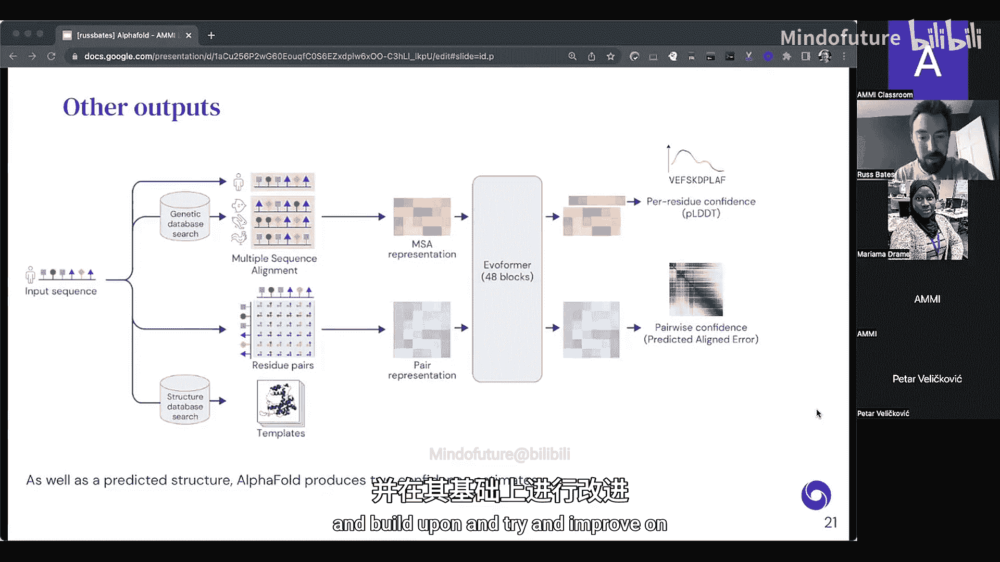

# 几何深度学习：P17：研讨会5（AlphaFold）-拉斯·贝茨

在本节课中，我们将要学习DeepMind的AlphaFold系统，这是一个利用机器学习解决蛋白质结构预测问题的前沿方法。我们将从蛋白质的基础知识开始，了解其重要性，然后深入探讨AlphaFold中使用的机器学习组件，特别是与几何深度学习相关的概念，最后看看其成果和影响。

---

## 蛋白质基础与问题背景

蛋白质是生命活动中的关键分子机器，负责细胞内的各种功能，例如构成头发或帮助病毒进入细胞的刺突蛋白。它们由长链氨基酸组成，这些链在物理力的作用下折叠成特定的三维结构。这个精确的三维形状决定了蛋白质的功能。

蛋白质可以抽象为由20种（有时是21种）不同氨基酸组成的序列，就像一串字母。DNA中的基因编码了合成特定蛋白质所需的氨基酸序列。每种氨基酸具有不同的化学性质（如带电性、疏水性）和物理尺寸，这些差异决定了蛋白质如何折叠。

确定蛋白质三维结构的传统实验方法（如X射线晶体学）非常耗时且困难，可能需要数月甚至数年。AlphaFold的目标是利用机器学习，直接从氨基酸序列预测其三维原子坐标，从而跳过这些繁琐的实验步骤。

---

## 数据来源与表示

机器学习需要数据。幸运的是，结构生物学界通过实验已经解析了大约20万个蛋白质结构，并公开存储在蛋白质数据库（PDB）中。这构成了我们的训练集。

蛋白质结构的可视化有多种方式。最详细的是显示所有原子及其键连的“全原子模型”，但这通常显得杂乱。更常用的是“卡通模型”，它仅显示蛋白质的主链，忽略侧链细节，可以清晰地展示α螺旋和β折叠等常见结构模体。

理解蛋白质的因果关系层次很重要：DNA序列决定氨基酸序列，物理力决定其折叠成的三维结构，而该结构又决定了其在生物体中的功能，进而影响物种进化。这种进化关系为我们预测结构提供了线索：如果两个氨基酸在进化中倾向于协同突变，那么它们在三维结构中很可能存在相互作用。AlphaFold就利用了这种进化信息。

---

## 机器学习架构选择

在构建预测模型时，我们需要选择适合数据特性的神经网络架构。不同的架构具有不同的归纳偏置：

*   **卷积神经网络（CNN）**：适用于网格状数据（如图像），信息在相邻像素间流动。这是初代AlphaFold的基础。
*   **循环神经网络（RNN/LSTM）**：适用于有序序列数据（如时间序列）。蛋白质序列虽有序，但信息单向流动的假设并不完全适合，因为折叠后序列远端可能空间邻近。
*   **图神经网络（GNN）**：适用于图结构数据。蛋白质折叠后可视为空间图，但问题在于我们**在预测前并不知道这个图的结构**。
*   **基于注意力的架构（如Transformer）**：将数据视为一组无序的实体，它们之间通过注意力机制动态决定如何通信。这非常适合蛋白质问题，因为它允许序列中任何位置的氨基酸直接“交流”，并且天然适合处理氨基酸对之间的相互作用。

因此，AlphaFold 2 选择了以注意力机制为核心的架构。

---

## AlphaFold系统总览

以下是AlphaFold系统的整体流程：

1.  **输入**：目标蛋白质的氨基酸序列。
2.  **进化信息提取**：在遗传学数据库中搜索与目标序列进化相关的同源序列，生成一个多序列比对（MSA）。这提供了关于哪些位置在进化中共同变化的线索。
3.  **特征初始化**：系统初始化两种并行特征表示：
    *   **MSA表示**：包含进化信息。
    *   **配对表示**：一个N×N的矩阵（N为序列长度），旨在编码每对氨基酸之间的结构关系。初始时，这个矩阵可能信息很少。
4.  **核心网络（Evoformer）**：这是一个深层的类Transformer网络。它通过自注意力机制更新MSA和配对表示，并引入创新的**交叉注意力**机制，让两种表示相互交换信息，从而将进化线索注入到结构假设中。
5.  **结构模块**：将抽象的配对特征转换为具体的三维原子坐标。它将每个氨基酸视为一个具有位置和旋转的刚体（参考系），并在其局部坐标系中进行操作，这自然保证了**SE(3)等变性**。该模块迭代地优化这些刚体的位姿，最终组装成蛋白质结构。
6.  **回收机制**：将最终预测的结构作为额外输入，反馈给网络起点，让网络进行迭代优化，这相当于一种使网络更深、提升性能的技巧。
7.  **置信度预测**：网络同时预测其自身输出的置信度（不确定性），这可以作为评估预测可靠性的指标。

---

## 关键技术：三角相互作用

三角相互作用是AlphaFold论文的一个核心架构贡献，它旨在为抽象的特征空间注入几何一致性。在蛋白质三维空间中，如果知道从A到B的向量和从B到C的向量，那么从A到C的向量就受到约束（例如三角不等式）。

为了在网络中实现这种循环一致性，AlphaFold引入了两种机制：

*   **三角注意力**：在进行标准的配对注意力计算时，显式地纳入“第三条边”的信息，确保始终在三角循环的背景下考虑关系。
*   **三角乘法**：对给定边的嵌入向量，在所有长度为3的循环上进行平均操作。

这些操作强制网络学习到的配对表示在几何上是自洽的，从而更准确地反映空间关系。

---

## 训练技巧与网络行为

除了架构创新，训练策略也很重要：

*   **噪声学生自蒸馏**：首先用20万个已解析结构（有标签数据）训练一个模型。然后用这个模型对海量未标记的蛋白质序列进行预测，只选取高置信度的预测结果作为“伪标签”，与真实标签数据混合，重新训练一个更强大的模型。这有效利用了海量无标签数据。

观察网络内部行为很有趣。如果让网络在每一层后都尝试预测结构，会发现其猜测在早期层变化很大，随着层数加深逐渐收敛到最终答案，且预测精度几乎单调上升，有时会有明显的“顿悟”式跳跃。

---

## 评估、结果与影响

AlphaFold通过**蛋白质结构预测关键评估（CASP）**进行盲测。参赛者在实验解析结构前提交预测，确保了公平性。AlphaFold 2 的表现被评估为与实验方法“竞争”，这是一个里程碑式的成就。

随后，DeepMind开源了AlphaFold的代码和模型权重，并发布了**AlphaFold蛋白质结构数据库**，免费提供数百万个蛋白质的预测结构，极大地方便了全球科研人员。

一些意想不到的发现也凸显了其价值：
*   **辅助实验解析**：实验数据有时模糊不清，AlphaFold的预测可以帮助科学家解读和验证实验结果。
*   **预测内在无序区域**：当AlphaFold对某段序列的预测置信度很低、结构像“意大利面”一样松散时，这往往意味着该区域在天然状态下就是**内在无序**的，而非网络失败。因此，置信度本身成为了预测蛋白质无序性的工具。

---

## 超越单链：蛋白质复合物

在现实中，蛋白质很少单独工作，它们通过相互作用形成复合物来行使功能。开源后，社区通过“连接”多条链等技巧，将AlphaFold用于预测蛋白质-蛋白质相互作用。DeepMind也跟进开发了专门处理多链复合物的版本，这对于理解真实的生命过程至关重要。最近，多个团队在解析巨大的**核孔复合体**结构时，就大量使用了AlphaFold的预测，显示了其巨大的实用价值。

---

## 总结

本节课我们一起学习了AlphaFold如何利用几何深度学习和先进的注意力机制，从氨基酸序列预测蛋白质三维结构。我们了解了其系统流程、关键的三角相互作用设计、训练技巧以及它所产生的广泛科学影响。AlphaFold是一个将机器学习成功应用于重大科学问题的典范，展示了组合多种创新想法可以带来突破性进展。