# 1：0_课程导览与安德鲁·梅纳德 🧭

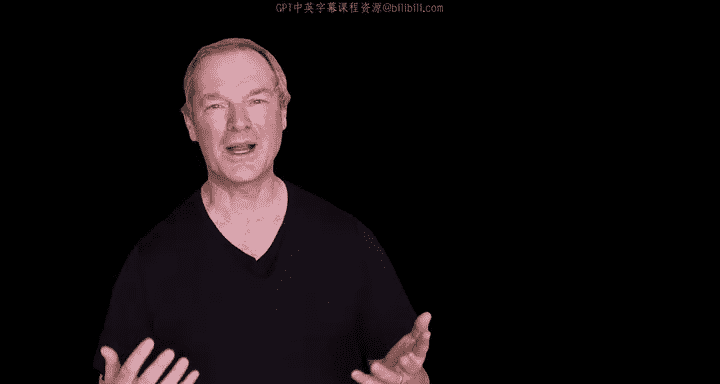

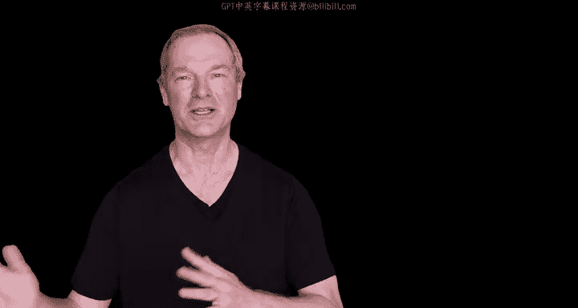

在本节课中，我们将学习本课程的整体框架、核心目标以及“提示词工程”的定义。我们将了解如何通过本课程掌握与ChatGPT等平台交互的关键技能。

通过本课程，你将围绕使用ChatGPT及类似平台时，如何设计和构建有效的提示词，发展一套基础技能集。

这套技能在专业环境中将是无价的。当然，这些技能在你使用ChatGPT的任何地方也都非常有用。

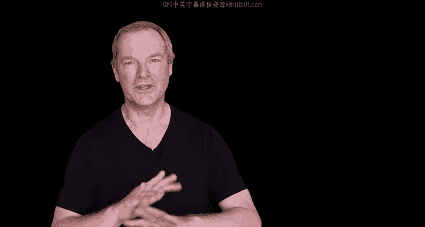

## 什么是ChatGPT？🤖

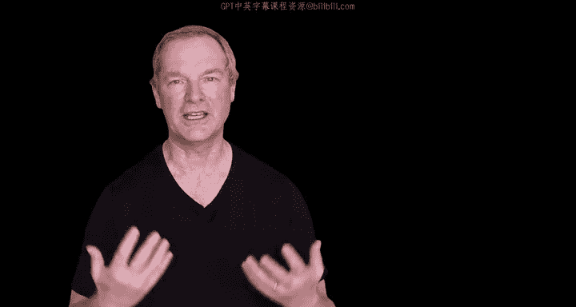

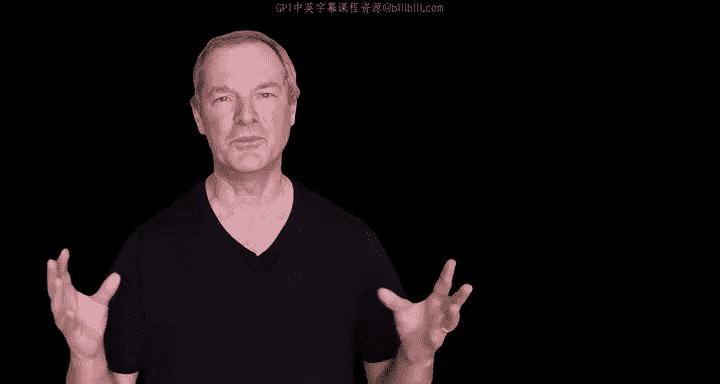

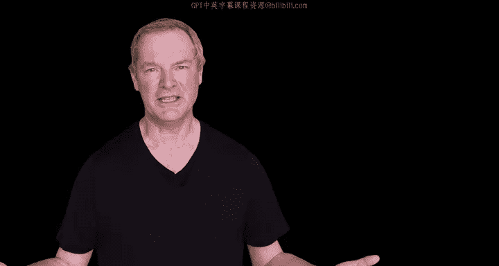

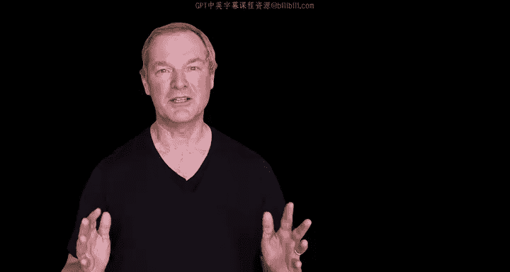

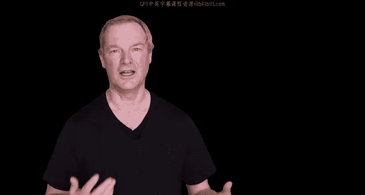

在深入探讨如何有效使用之前，我们有必要先了解其底层技术。本节我们将简要介绍ChatGPT及其背后的核心技术。

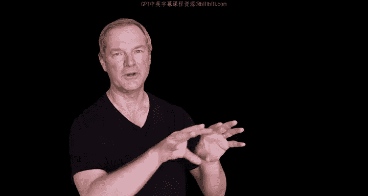

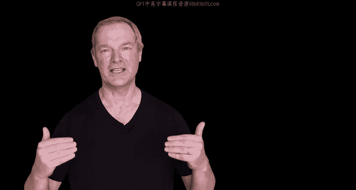

ChatGPT是由OpenAI组织开发的一款AI聊天机器人。它基于一项名为**大语言模型**的底层技术。简单来说，这是一种让计算机（机器）能够根据你输入的文本，预测最可能出现的后续文本的模型。

其核心机制可以概括为：你输入一个提示词，模型会计算出人类可能如何回应这个提示。这是一项极其强大的技术，而ChatGPT就是让你能够访问这项技术的接口。

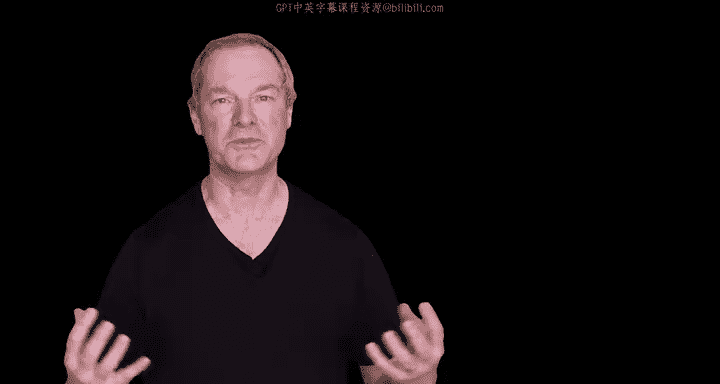

这项技术正在改变世界，人们开始意识到可以用它来处理任务、解决问题、进行头脑风暴、激发创造力，以及完成各种奇妙的事情。它正在改变一切，这也是我们开设这门课程的原因。

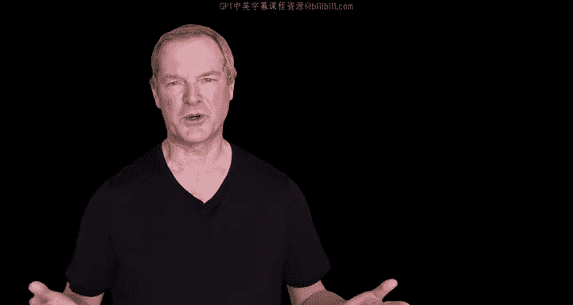

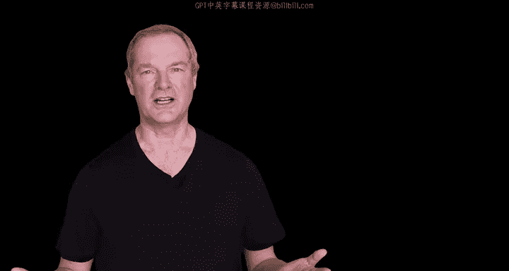

## 重新定义提示词工程 🛠️

上一节我们介绍了ChatGPT是什么，本节中我们来看看本课程的核心视角——提示词工程。

需要认识到的一点是，我们正从“提示词工程”的角度来探讨如何使用这项技术。

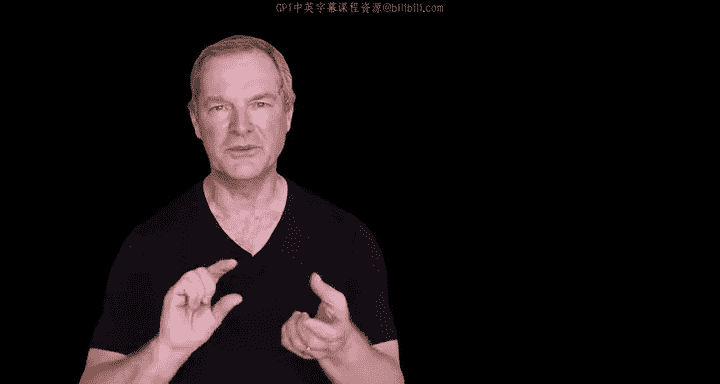

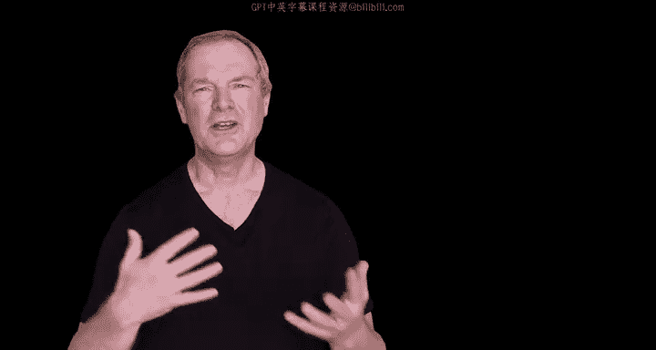

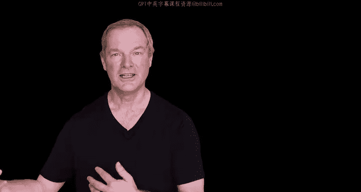

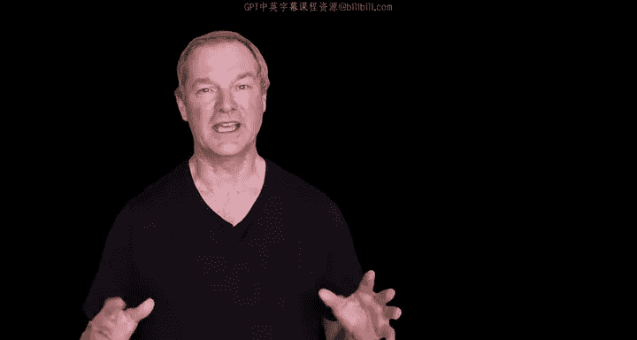

如果回到不久以前，问别人什么是提示词工程师，他们可能会说这是程序员或计算机科学家做的事情。事实上，“提示词工程”这个术语过去指的是那些微调这些大语言模型的人，他们确实是程序员。

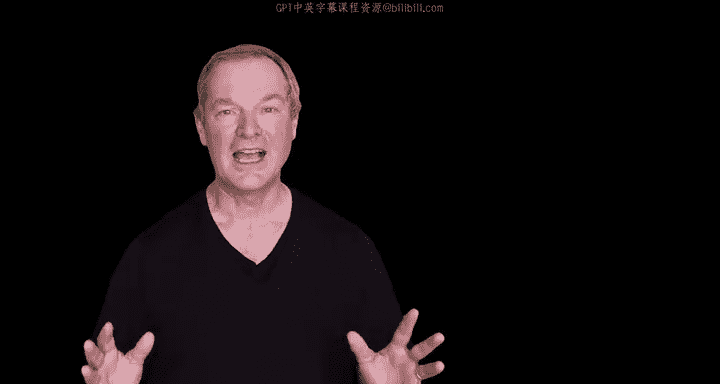

但随着ChatGPT的发布，人们意识到，设计这些提示词以从平台获得最佳效果是一门艺术。因此，我们看到“提示词工程”的含义发生了转变，从程序员的工作变成了平台用户（尤其是那些擅长使用日常语言来最大化ChatGPT效用的人）的技能。

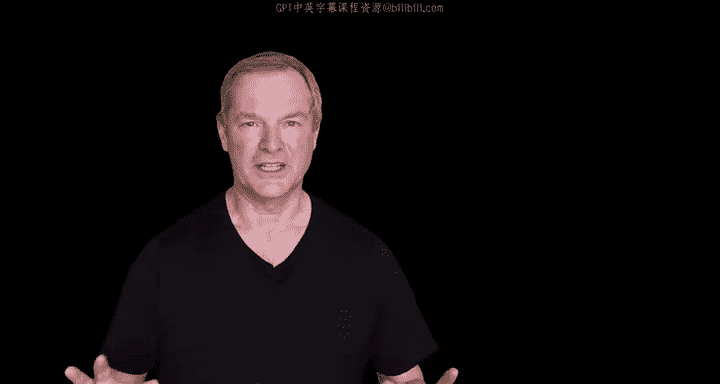

因此，在本课程中，我们将采用一个非常具体的“提示词工程”定义：

> **提示词工程**是一门艺术和技能，涉及**设计、优化和运用日常语言**，以有效利用大语言模型和AI聊天机器人的能力和潜力，使它们在广泛的专业和个人场景中变得有用且易于使用，同时确保产出准确且有价值的结果。

## 课程学习目标与结构 📚

基于上述定义，本课程设定了几个具体的学习目标。以下是本课程六个模块的主要内容概述：

1.  **模块1：理解底层技术**。我们将从理解底层技术开始，具体了解大语言模型是什么，以及如何有效利用它们。
2.  **模块2：提示词构建与优化**。我们将深入探讨提示词的构建与优化，并通过一系列练习来培养这些技能。
3.  **模块3：开发与使用提示词模板**。我们将扩展这些技能，学习如何开发和使用提示词模板。这是利用和扩展ChatGPT能力的一个极其强大的工具。
4.  **模块4：提示词与回复评估**。当然，仅仅写出出色的提示词是不够的，你还需要能够评估这些提示词的质量，更重要的是评估ChatGPT输出的质量。
5.  **模块5：前沿应用探索**。我们将探讨使用ChatGPT和大语言模型的前沿领域。这是一个快速发展的领域，可以保证的是，当你实际进行练习时，可能实现的功能将与现在有所不同。
6.  **模块6：负责任地创新**。最后，我们将深入探讨在使用ChatGPT时，“负责任地创新”意味着什么。这一点至关重要。这是一个如此强大的工具，如果你不了解如何负责任地使用它，最终可能会造成很多伤害。

## 总结 🎯

本节课中，我们一起学习了本课程的概览。我们了解了ChatGPT是基于大语言模型的AI聊天机器人，并明确了本课程对“提示词工程”的定义：即运用日常语言有效驾驭AI能力的艺术与技能。我们还预览了课程的六个核心模块，从理解技术基础到学习构建、优化、评估提示词，再到探索前沿应用和负责任地使用。

完成本课程后，你不仅应该能熟练掌握如何从ChatGPT中获得最佳效果，还能以负责任的方式做到这一点。你将拥有一套适用于几乎任何工作场所和任何使用ChatGPT处理任务的技能集。

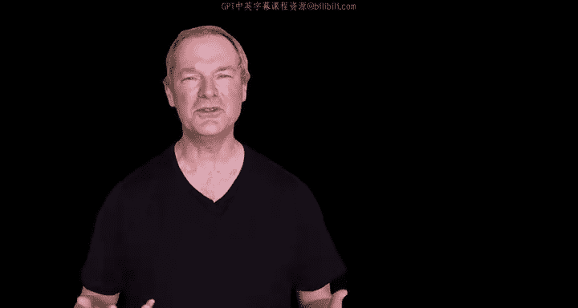

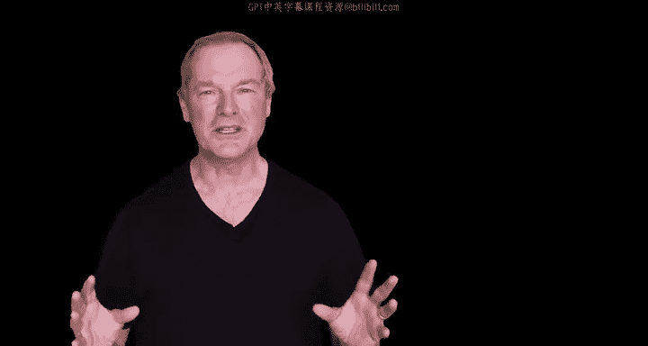

接下来，让我们直接进入模块1，深入了解其底层技术。