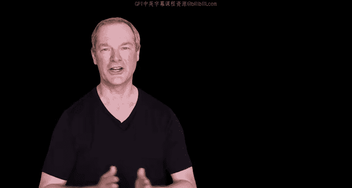
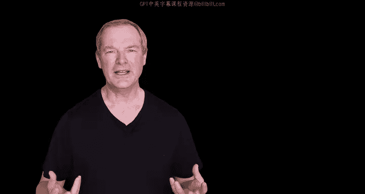
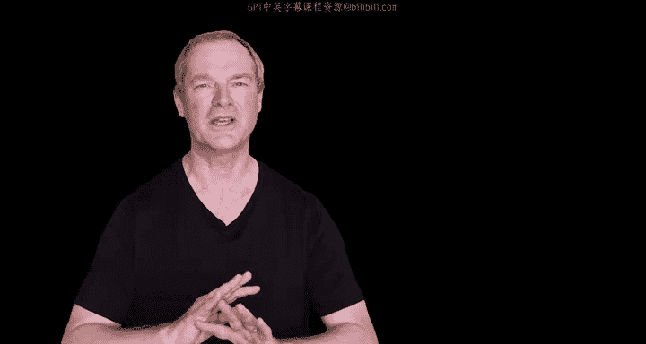
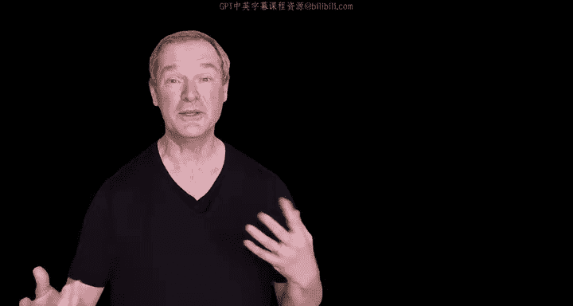
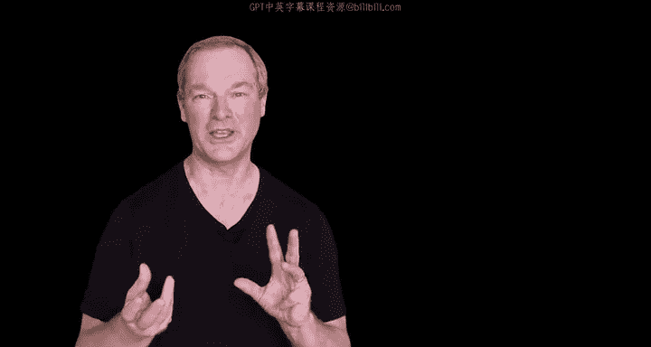
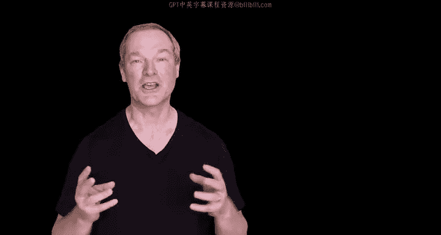

# 7：6_课程总结与展望 🎯

在本节课中，我们将对《ChatGPT提示词工程入门》短期课程进行总结，并展望如何负责任地运用所学技能，以创造性的方式影响世界。

## 概述

本节是课程的最后一讲。我们将回顾整个课程的核心收获，并探讨如何将提示词工程这项强大的技能应用于现实世界，同时强调负责任地使用人工智能技术的重要性。

## 课程核心收获

上一节我们探讨了提示词工程的高级技巧，本节中我们来对整个学习旅程进行总结。

通过本课程的学习，你掌握了一套深入且实用的技能组合。这套技能使你能在各种不同情境下，以新颖和创造性的方式运用这项具有深远影响的技术。

## 技术的潜力与责任

我承认，我认为这是一项不可思议的技术。这是过去几十年来，我们所见过的**最强大、最具变革性的技术之一**。

它将会改变我们的世界。如果我们运用得当，它会让世界变得更好。现在，凭借你新掌握的提示词工程技能，你将通过设计和构建出色的提示词，成为用ChatGPT创造更美好世界这一进程的一部分。

因此，我希望当你完成这门课程时，不仅能更好地理解和重视这些技能，还能懂得如何负责任地运用它们。

## 对学习者的寄语

这是一项如此强大的技术，如果我们处理不当，确实有把事情搞糟的风险。希望你已掌握了平衡之道，能够理解如何利用它让世界变得更美好。

基于此，希望你能够找到运用这些技能的真正具有创造性和创新性的方法。希望你继续发展、使用这些技能，并锻炼你的ChatGPT提示词工程“肌肉”。

## 总结

本节课中我们一起学习了如何总结课程收获，并认识到将提示词工程技能用于积极创造的重要性。我们了解到，ChatGPT是一项变革性的技术，而通过负责任的、有创意的提示词工程，我们每个人都能参与到让世界变得更美好的进程中。请勇往直前，用ChatGPT去改变世界，让世界变得更美好。