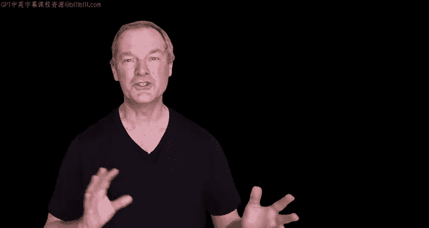

# AI基础：ChatGPT的提示词工程｜P1：欢迎来到ChatGPT与RACCA基础

在本节课中，我们将要学习如何充分利用ChatGPT。第一步是理解其底层技术，包括这项技术的能力与局限。这正是我们将在本模块中通过一系列练习所要掌握的内容。

## 理解ChatGPT的基础

上一节我们介绍了本课程的目标，本节中我们来看看ChatGPT究竟是什么。随着你深入这些练习，你会发现我们将广泛使用ChatGPT来帮助你发展专业技能，并锻炼你的提示工程能力。

到本模块结束时，你应该能够完成以下几件事：

以下是本模块的学习目标列表：
*   描述什么是ChatGPT。
*   描述什么是**大型语言模型**。
*   描述GPT代表什么。这里给你一个提示：它是 **Generative Pre-trained Transformer**（生成式预训练变换器）。这是ChatGPT背后的底层技术。

## 认识技术的优势与局限

理解了基本概念后，我们还需要客观地看待这项技术。因此，你还应该能够描述这套特定技术的一些潜在优势，以及该技术的一些局限性。

## 掌握有效使用的初步技巧

除了对底层技术有基本了解，你还应该能够阐述一些有效使用ChatGPT的初步技巧和窍门。当然，这将是我们在整个课程中持续发展的能力。

完成本模块的学习后，你不仅会对底层技术有基本理解，还将为模块2的学习做好完美准备。在模块2中，我们将开始深入探讨提示词的构建过程。

本节课中我们一起学习了ChatGPT的基础概念、其背后的GPT技术原理，以及初步认识其优势、局限和使用技巧。这为我们后续深入学习提示词工程奠定了坚实的基础。