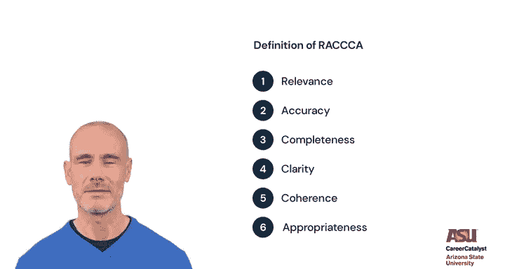
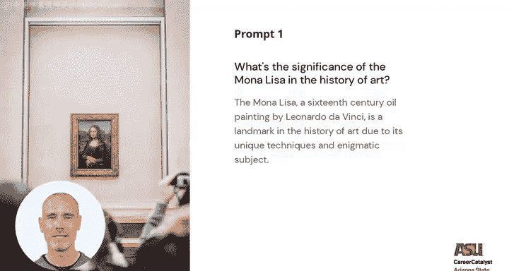
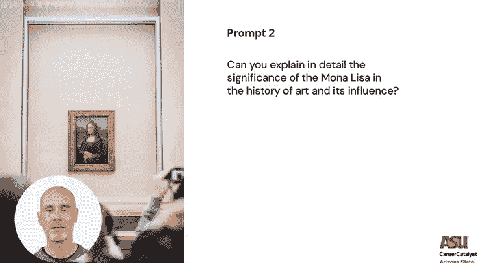
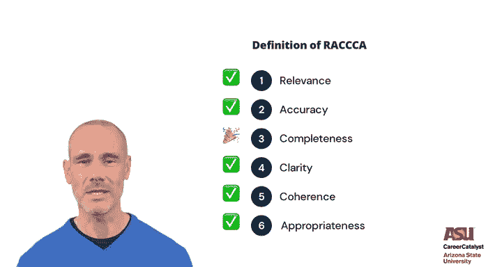

# AI基础：ChatGPT的提示词工程｜P3：2_RACCA框架体系 🧠

在本节课中，我们将学习如何评估大型语言模型（如ChatGPT）生成的回答。我们将重点介绍一个名为 **RACCA** 的评估框架，并通过具体示例演示如何运用它来分析和改进提示词，从而获得更高质量的回复。


## 概述：什么是RACCA框架？



RACCA框架是一个系统性的评估工具，用于衡量AI回答的质量。它包含六个核心维度：
*   **相关性 (Relevance)**
*   **准确性 (Accuracy)**
*   **完整性 (Completeness)**
*   **清晰度 (Clarity)**
*   **连贯性 (Coherence)**
*   **恰当性 (Appropriateness)**

接下来，我们将通过一个具体的例子来逐一解析这些维度。



## 初步评估：一个基础示例

首先，我们来看一个基础的提示词和ChatGPT生成的回答。

**提示词：**
```
What's the significance of the Mona Lisa in the history of art?
（蒙娜丽莎在艺术史上有什么重要意义？）
```

**回答：**
```
The Mona Lisa, a 16th century oil painting by Leonardo Da Vinci, is a landmark in the history of art due to its unique techniques and enigmatic subject.
（《蒙娜丽莎》是列奥纳多·达·芬奇创作于16世纪的一幅油画，因其独特技法和神秘的主题，成为艺术史上的一个里程碑。）
```

现在，让我们运用RACCA框架对这个回答进行评估。

以下是评估的六个方面：

1.  **相关性**：回答是否直接回应了提示词？**是**。它讨论了蒙娜丽莎在艺术史上的意义。
2.  **准确性**：回答的事实是否正确？**是**。《蒙娜丽莎》确实是达·芬奇在16世纪创作的，并以独特技法和神秘主题闻名。
3.  **完整性**：回答是否涵盖了提示词要求的所有核心方面？**不完全**。它没有深入探讨蒙娜丽莎为何重要，以及它如何具体影响艺术史。
4.  **清晰度**：回答是否易于理解？**是**。回答清晰简洁。
5.  **连贯性**：回答的逻辑结构是否合理？**是**。从介绍画作到阐述其重要性，行文流畅。
6.  **恰当性**：回答是否适合受众和语境？**是**。它提供了信息且措辞得体，适合寻求艺术史知识的用户。


通过这个评估，我们发现回答在**完整性**方面有待改进。

## 优化提示词：获得更佳回答



上一节我们识别出回答在完整性上有所欠缺。本节中，我们来看看如何通过优化提示词来引导模型生成更全面的回答。

我们可以尝试一个更具体、要求更详细的提示词：

**优化后的提示词：**
```
Can you explain in detail the significance of the Mona Lisa in the history of art and its influence?
（你能详细解释一下《蒙娜丽莎》在艺术史上的意义及其影响吗？）
```

**新的回答：**
```
The Mona Lisa, created by Leonardo da Vinci in the 16th century, transformed the art world. Its unprecedented realism and attention to human emotion introduced a new level of depth in portraiture, which had lasting effects on Western art. Its unique sfumato technique, the enigmatic smile and the intricate detailing of textures and light became a model for future artists. Furthermore, the controversy around its theft in 1911 and its popularization in pop culture amplified its status as a universally recognized masterpiece.
（《蒙娜丽莎》由列奥纳多·达·芬奇于16世纪创作，改变了艺术世界。其前所未有的写实主义和对人类情感的关注，为肖像画引入了新的深度层次，并对西方艺术产生了持久影响。其独特的“晕涂法”技巧、神秘的微笑以及对纹理和光线错综复杂的细节描绘，成为后世艺术家的典范。此外，围绕其1911年被盗的争议及其在流行文化中的普及，进一步巩固了它作为举世公认杰作的地位。）
```

现在，让我们再次应用RACCA框架来评估这个新的回答。

以下是针对新回答的评估：

1.  **相关性**：回答明确回应了优化后的提示词。
2.  **准确性**：提供了关于《蒙娜丽莎》的事实性正确信息。
3.  **完整性**：这是我们第一次提示时发现的问题。这次回答是否更好？**是**。回答更全面地阐述了《蒙娜丽莎》的意义，包括了具体的艺术技巧和文化影响。
4.  **清晰度**：回答详细且易于理解。
5.  **连贯性**：回答逻辑清晰，从绘画技巧自然过渡到文化影响。
6.  **恰当性**：回答依然得体且尊重，同时提供了与修订后提示词相匹配的更深入信息。

可以看到，优化后的提示词显著改善了回答的**完整性**，为我们提供了更全面的信息。

## 总结与核心方法



本节课中，我们一起学习了如何使用**RACCA框架**来评估和优化大型语言模型的回答。

通过这种方式运用RACCA框架，你可以**迭代式地优化你的提示词**，从而从大型语言模型中引出更有效、更有用的回答。请记住，这个框架并非评估回答的唯一方法，但它提供了一种全面的途径，以确保你的提示词及后续回答保持高质量。

**核心公式**可以概括为：
```
高质量回答 = 明确提示词 + RACCA框架评估 + 迭代优化
```


通过不断练习这一过程，你将能更有效地与AI协作，获得更符合你需求的输出结果。