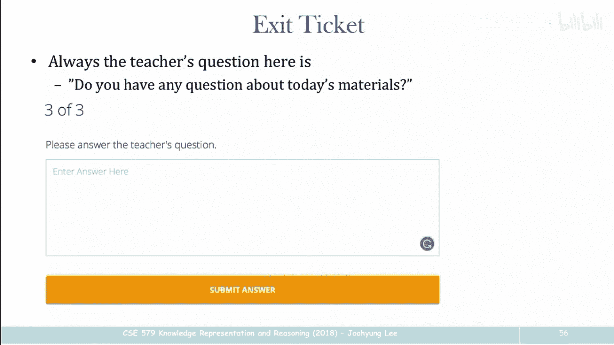

# 001：课程介绍与知识表征概述

在本节课中，我们将学习《知识表征与推理》这门课程的整体安排，并对知识表征这一人工智能核心领域进行初步了解。我们将探讨什么是知识表征，为什么它很重要，以及它与推理的关系。

## 课程概述与安排

我的名字是朱雄利，是计算机科学系的副教授。欢迎来到CSC 579知识表征与推理课程。

课程大纲已上传至Blackboard平台。今天我们将讨论课程的后勤安排，并对课程内容进行简要介绍。

### 课程资料与评分

本课程没有指定的教科书。我们将阅读一些论文和专著。课程材料不得分发或在线上出售。独立思考和解决问题是学习的关键。

我们将涵盖以下主题：经典逻辑、基于知识的声明式编程、本体论、概率图模型、马尔可夫逻辑以及神经网络与表征。课程将平衡成熟领域与新兴领域的内容。

评分标准如下：
*   出勤率占10%。
*   两次期中考试分别占15%和20%。
*   作业占25%。
*   期末项目占30%。

成绩等级划分大致为：87分以上为A（包含A+和A-），90分以上为A0。

### 课堂参与与学术诚信

出勤通过Socrative平台记录。课堂参与很重要。

课堂讨论问题设有额外加分。成功在课堂上展示解决方案并在Piazza上发布解答，均可获得加分。

作业为个人任务。允许与同学讨论课程材料，但最终的解决方案必须独立完成。抄袭与合作有本质区别。首次抄袭行为将被报告至院长办公室，该作业成绩为零，且总评成绩降低一个等级。

助教Ewa Wang是计算机科学专业的博士生，也是知识表征领域的专家，主要负责作业和项目的评分与指导。

课程项目允许最多两人组队。项目包含初期提案、中期进展报告和最终报告三部分。该项目可用于满足MCS作品集要求。

我们将使用Piazza页面进行课程讨论，使用Blackboard发布课程材料和重要通知，使用Socrative进行课堂互动。

关于评分疑问，请在作业返还后一周内提出。

## 什么是知识表征与推理？

上一节我们介绍了课程的后勤安排，本节中我们来看看知识表征与推理的核心概念。

人工智能包含许多领域，如机器学习、机器人学、约束满足、规划等。知识表征与推理是人工智能的核心领域之一。

智能的一个定义是：学习、推理、理解以及类似心智活动的能力。另一个定义是：应用知识来操纵环境或进行抽象思维的能力。这些定义中的关键词——推理、理解、事实、意义、知识——都与本课程高度相关。

因此，人工智能可以描述为通过计算手段实现智能行为的研究。而知识表征与推理则可视为研究如何表征知识，以便决定做什么。我们关注的是知识，而不仅仅是数据。

### 知识的重要性

在开始用知识进行推理之前，首先要表征知识。但有趣之处在于推理过程，因为这使得系统能够决定做什么。

人工智能有两个侧面：学习侧和推理侧。粗略地说，**学习**是从数据中学习模型或知识。**推理**是操纵这些模型和知识，以推导出数据中未明确包含的新信息。理想情况是机器从数据中学习知识，然后操纵知识去做新的事情。但目前的学习与推理之间仍存在鸿沟。

考虑一个没有知识的AI系统。当前的计算机视觉系统可以识别图像中的物体，例如人、狗或椅子。但如果我们问一些需要常识的问题，例如“你可以坐在哪个物体上？”、“哪个物体最可能咬人？”、“如果房子着火，你会救哪个？”，视觉系统则难以回答。没有知识的AI系统可能是危险的。

神经网络是当今的关键技术，但它存在可解释性问题。如果神经网络将一张图片识别为猫，我们无法解释它为何如此判断。如果它识别错误，我们也很难修正。当AI系统做出错误决策时，我们需要理解其原因并与系统沟通以修复问题。没有知识，这项任务非常困难。

人类善于通过知识进行交流。我们传递的是概括性的规律，而非原始数据。例如，在烹饪场景中，机器可能学习到一个奇怪的步骤序列（如先煮沸再削皮），因为它缺乏“削皮应在煮沸之前”的常识知识。

### 知识的表征与推理

那么，什么是知识？我们将其理解为关于世界的各种事实。最简单的知识是真或假。在本课程中，我们将重点研究知识的表征。

一个例子是符号与其所指代对象之间的区别。符号“John”是一个字符串，它指代一个叫John的人，但符号本身并不包含关于John的所有信息（如身高、长相）。同样，“John爱Mary”这个命题为真或假，但其中“爱”的具体含义我们暂不深究。

我们假设这类对象可以用符号表示，然后操纵这些符号。我们希望这种映射和操纵过程不会偏离实际理解太远。

**知识表征**是研究如何表征智能体所相信的命题的领域。**推理**则是操纵这些符号以产生新信息的过程。

类比算术运算：二进制数`1011`（代表11）加上`10`（代表2）得到`1101`（代表13）。给定符号，我们可以进行操作。推理也是如此，只不过我们操作的是命题或知识事实。

如果我们知道“John是Mary的父亲”，即使原句未提及，我们也能推断出“John是一位成年男性”。我们可以从基本知识出发，组合知识以推导新信息。因此，推理是对代表命题的符号进行计算的一种形式。

## 逻辑与推理形式

上一节我们探讨了知识表征的基本概念，本节中我们来看看如何用形式化逻辑进行推理，并了解几种不同的推理模式。

### 演绎推理示例

让我们看一个简单的推理例子，并用命题逻辑来表示。

> 如果火车晚点且车站没有出租车，那么John开会就会迟到。
> John开会没有迟到。
> 火车确实晚点了。
> 问：车站有出租车吗？

答案是：有。

我们可以用命题逻辑将其形式化：
*   设 `P` 表示“火车晚点”。
*   设 `Q` 表示“车站有出租车”。
*   设 `R` 表示“John开会迟到”。

则知识库可以表示为三个公式：
1.  `P ∧ ¬Q → R` （如果火车晚点且没有出租车，则John迟到）
2.  `¬R` （John没有迟到）
3.  `P` （火车晚点）

结论是 `Q`（车站有出租车）。通过逻辑推导（如反证法：假设`¬Q`，则会推出`R`，与`¬R`矛盾），可以证明该结论成立。

值得注意的是，这个逻辑结构与另一个故事完全相同：“如果正在下雨且Jane没带伞，那么她会被淋湿。Jane没有被淋湿。正在下雨。问：Jane带伞了吗？”一旦用符号`P`、`Q`、`R`表示，知识库完全一致。这说明逻辑推理关注的是形式结构，而非具体内容。

### 为什么知识表征有用？

基于知识的系统有以下优势：
1.  **可理解性**：我们可以通过系统拥有的知识来理解其行为，从而解释其决策。
2.  **行为生成**：例如在规划中，系统可以根据关于行动效果的知识来制定计划。
3.  **声明性与灵活性**：声明性知识（描述“是什么”）与具体使用方式分离，不同于过程性知识（描述“怎么做”）。前者更不易过时，能处理未预见的情况。
4.  **易于调试与扩展**：如果系统失败，可以检查并更新知识库。

以一个Prolog程序为例，第一个程序直接列出了每个物体的颜色。第二个程序则定义了规则：“如果物体X由材料Z构成，且Z的颜色是Y，那么X的颜色是Y”。第二个程序更具通用性，添加新物体或复杂物体（由多种材料构成）时更容易维护，并能进行简单的推理（例如推断草的颜色是绿色，尽管知识库中没有直接声明）。它体现了知识表征的威力。

### 不同类型的推理

形式逻辑为我们讨论不同类型的推理提供了框架。

1.  **演绎推理**：从给定的显式事实集合中推导出隐含的事实。这是逻辑上可靠的推理。
2.  **模型寻找/可满足性**：给定一组约束和目标规格，寻找满足所有约束的解决方案（可能不止一个）。这与从描述中推导出唯一结论的演绎推理不同。
    *   **示例谜题**：一个物体要么是圆形要么是方形；要么是红色要么是蓝色；如果它是红色且圆形，或者蓝色且方形，那么它是好的；如果它是蓝色，那么它是金属的；如果它是方形，那么它不是金属的；如果它是红色，那么它是方形。问这个物体是什么？可能存在多个满足所有约束的赋值（如“蓝色、圆形、金属”是一个解）。
3.  **溯因推理**：推断最佳解释。常用于诊断任务。
    *   **示例**：背景理论：地震`→`警报响，盗窃`→`警报响。可假说：地震，盗窃。观察到：警报响。可能的解释是地震或盗窃（或两者）。
4.  **默认推理**：在信息不足时，跳到可能为真的结论。如果后续没有相反证据，就假定其为真。
    *   **示例**：“鸟通常会飞。Tweety是一只鸟。”我们默认推断“Tweety会飞”。但如果后来得知“Tweety是一只企鹅”，则需要收回之前的结论。这种推理并非绝对可靠。
5.  **认知推理**：关于知识本身的推理。
    *   **示例**：泥孩子谜题。父亲告诉孩子们：“你们中至少一个人额头上有泥。”每个孩子能看到别人但看不到自己。父亲依次问每个孩子是否知道自己额头有泥。前几轮孩子们都说“不知道”，但几轮后，某些孩子会说“知道”。这个推理涉及每个孩子对其他孩子知识状态的认知。

## 课程结构总结

本节课中我们一起学习了《知识表征与推理》课程的基本框架和核心概念。

我们首先介绍了课程的后勤安排、评分标准和学术诚信要求。接着，我们探讨了知识表征在人工智能中的核心地位，理解了没有知识的AI系统的局限性，以及用符号表征知识和进行逻辑推理的基本思想。最后，我们概述了几种主要的推理类型：演绎推理、模型寻找、溯因推理、默认推理和认知推理。

从下节课开始，我们将深入技术细节。课程主体将分为三大部分：
1.  **基础部分（重点）**：涵盖经典逻辑、基于知识的声明式编程、本体论与语义网（RDF, OWL）、概率图模型（贝叶斯网络、马尔可夫网络），以及结合逻辑与概率的马尔可夫逻辑。
2.  **前沿部分**：简要介绍神经网络与知识表征交叉领域的最新趋势。

请登录Blackboard查看课程日程和阅读材料（首先是《知识表征手册》第一章关于经典逻辑的内容）。课件将在课前发布草案，课后发布最终版。

下次课我们将从命题逻辑开始。