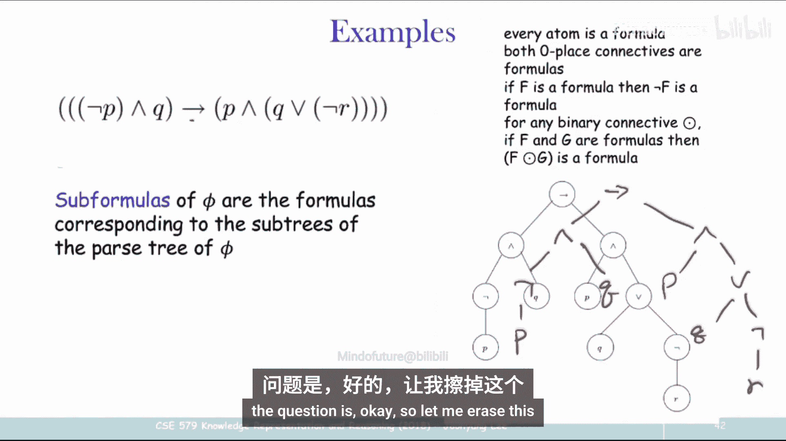
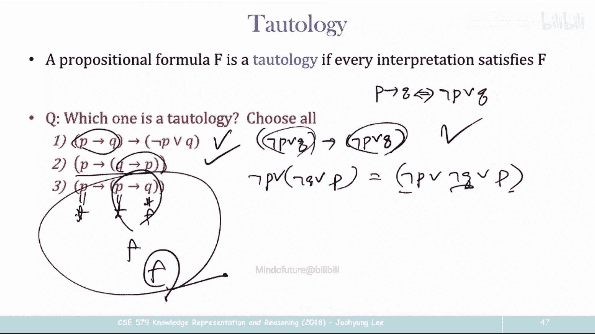

# 002：课程概述与命题逻辑基础 🧠

在本节课中，我们将首先完成对整个课程的概览介绍，了解后续将学习的核心知识表示形式体系。随后，我们将开始学习经典逻辑的基础——命题逻辑，这是构建后续所有复杂理论的基石。

## 课程结构概览

上一讲我们简要介绍了知识表示与推理领域。本节中，我们来看看本课程将深入探讨的具体内容。

课程的核心结构围绕几个关键的形式体系展开。虽然经典逻辑并非本课程的唯一重点，但它是许多知识表示形式体系的基础。因此，我们将首先学习它。对于之前修过逻辑学或人工智能导论课程的同学，这部分内容可能会有重叠，但我们会以更形式化的方式进行，以便在这些经典逻辑之上构建我们的理论。这是一个很好的复习机会，对于初次接触此内容的同学，现在正是学习的好时机。

在经典逻辑之后，我们将进入逻辑编程，特别是**答案集编程**。接着，我们会讨论**本体论**。

之后，我们将转向概率论基础。然后，我们会探讨如何将逻辑基础与概率基础相结合，并介绍另一种源自马尔可夫逻辑和答案集编程的逻辑与概率集成方法。如果时间允许，我们还将讨论神经网络本身，以及如何将神经网络与知识表示相结合。这是一个非常前沿的领域，近几个月涌现了许多有趣的想法，希望我能介绍其中一些，或许你们中有人会想以此为主题开展项目。

蓝色部分是我们将重点关注的领域，绿色部分我们也会大致涉及，但由于时间有限，无法深入细节。如果你希望深入研究，我可以提供更多参考资料，你也可以选择这些主题作为项目。

## 经典逻辑简介

那么，什么是经典逻辑？如前所述，经典逻辑是基础。逻辑被称为计算机科学的演算。实际上，数学家、哲学家甚至计算机科学家发明了许多逻辑体系，我们不会一一探讨，而是专注于最基本的经典逻辑，即**命题逻辑**和**一阶逻辑**。

还有其他逻辑，如二阶逻辑、三阶逻辑和模态逻辑，它们都是有趣的思想，某些知识表示领域严重依赖它们。然而，本课程不会涉及这些内容。如果你感兴趣，可以将其作为项目进行探索。

经典逻辑的主要思想是研究数学中的证明。当人们撰写证明时，什么才是有效的论证？为什么有人说从这个和那个论证可以推出这个结论？我们如何知道这是一个可靠的推理？这正是逻辑学家和数学家感兴趣的领域。

所以，它并非为人工智能而发明，但人工智能从一开始就接纳了逻辑，因为它也是人类进行推理的方式。一个流传多年的典型例子是苏格拉底三段论：“人皆有一死，苏格拉底是人，因此苏格拉底会死。”这自古希腊时代就已知，也是人类推理的基础。但我们也讨论了其他一些例子，表明这种数理逻辑无法形式化某些人类层面的推理，例如我们讨论过的非单调推理或默认推理。一些对人类来说非常简单的问题，在逻辑中并不容易处理。

## 知识基础的声明式编程

为了克服这类困难，有一些提案，其中之一是**基于知识的声明式编程方法**。这里我们将讨论答案集编程，它大致上……我不知道它与Prolog是否有相似之处，但那只在语法层面，语义层面实际上非常不同。

这是一种适用于知识密集型和常识推理问题的声明式逻辑编程范式。你们在这里可能会遇到的一个挑战是需要学习一种称为**稳定模型语义**的新模型语义。如果初次学习，这并不容易。这就是为什么我想花一些时间在经典逻辑上，以便当你们从经典逻辑过渡到稳定模型语义时，可能会更容易。

经典逻辑的问题在于它无法表达人类推理中许多有用的概念，如默认、递归定义、聚合和偏好。我们可能更喜欢这个而非那个，但在经典逻辑中，每个模型都差不多，你无法真正区分哪个逻辑模型更好。

这类问题可以通过调整经典逻辑的语义来克服，这就是所谓的**稳定模型语义**。因此，起源是经典逻辑，但你必须知道如何调整它。你们将要探索的想法是：你想解决某个问题，基本上需要知道如何用某种形式体系表示问题，然后使用名为**clingo**的工具来寻找解决方案。如果你从clingo中找到了解决方案，那将正是你从原始问题中寻找的解决方案。

以下是一个解释此想法的图表。当你想解决问题时，这类似于第一堂课中看到的图片：我们用符号对世界建模，并通过操作符号来推导信息。同样地，如果你想解决当前给定的问题，你必须将这个问题输入计算机，计算机输出结果，这就是你得到的解决方案。这就是你现在在传统或声明式过程式编程中所做的。将问题转化为程序的部分称为编程，你知道如何编写程序将问题编码成某种可执行形式。当然，执行程序以生成输出的过程称为执行。然后，你将输出解释为解决方案。

那么，像答案集编程这样的声明式编程有何不同？它类似，但问题将被建模，那就是表示。我们将表示问题。这里的区别在于，我们不一定给出解决问题的算法，我们只是描述问题。我们将问题表示为计算机可以理解的格式。但一旦我们这样做，好处是即使你没有给出解决算法，背后也有一个通用的求解算法来寻找解决方案，它产生输出，然后你从输出中解释解决方案。这是在经典逻辑之后你们首先要学习的内容：在不给出算法的情况下，如何解决这个问题？如果你能以计算机可以理解的正确方式表示问题，那么你的工作就完成了，剩下的由计算机完成。当然，在课堂上，我们将看到这在一般情况下是如何实现的。

## 关于动作的推理

关于动作的推理与答案集编程部分放在一起，尽管它不一定必须如此。实际上，可能有一门单独的课程专门教授关于动作的推理。在这里，我们将使用答案集编程来建模关于动作的推理。这是答案集编程的一个典型应用，用于建模动态世界。如果你想对系统中的某些变化建模，例如机器人执行动作后状态改变，从这个状态可以发生其他动作并转移到另一个状态，然后你想看看可以执行哪些动作序列以达到目标。这被称为**规划**，是关于动作推理领域中的一个问题。你也可以讨论诸如“如果我做这些动作会发生什么”这样的问题，即结果预测。例如，“如果我吃了这个并且不做运动，我会有麻烦吗？”你可以处理这类时间投影问题。

我们将在这里学习这些方面，其思想是开发用于描述动作及其效果的形式体系。我们将讨论**动作语言**，它建立在答案集编程之上，但层次更高，为我们提供了描述瞬态系统的简洁方便的方法。我们将在后面更详细地讨论变化系统。

## 本体论

下一个主题是本体论。这是一个有些不同的领域。当我展示这张图时，这些领域实际上并不相互包含。这是知识表示中一个不同的部分，人们对本体论感兴趣。本体论是一个非常哲学的术语，但在计算机科学中，它基本上是对对象的概念化。我们讨论这个对象属于这个类，或是这个类的成员，如果这个类具有某个属性，那么子类也继承相同的属性，诸如此类。

人们在开发非常庞大的本体方面做了大量工作，它们实际上捕捉了人类知识的各个领域。这确实被用于应用程序中。为此开发了许多语言，但近年来，在旧思想的基础上，出现了更实用的语言，人们实际上就标准达成了一致，从而推动了本体构建工作的发展。

你可能见过像IBM Watson这样的系统，它在《危险边缘》节目中击败了人类冠军。Watson的知识实际上来自一些大型知识库，可能是DBpedia或维基百科，或者是非结构化和结构化的知识库。这里的想法接近于语义网的努力。Watson本身没有使用语义网语言，他们使用了专有格式。但后来当人们试图复制Watson的工作时，他们实际上使用了标准的RDF或语义网语言。

因此，这实际上不是传统的语义网层次结构，而是一种更新后的版本。我们不会涉及语义网的所有内容，这不是一门语义网课程，但我们将讨论**RDF**，它是语义网中的数据交换模型，以及**SPARQL**，它是一种查询语言。我们还会简要提及RDFS和OWL。这些都会在本课程中提到。

如果你还没见过RDF，它基本上是一个图形化的知识库，节点大致表示实例（对象），边表示对象之间的关系。例如，你可以说“安妮·海瑟薇嫁给了莎士比亚，莎士比亚住在斯特拉特福，斯特拉特福在英格兰，英格兰是英国的一部分”。这些知识可以编码在图形结构中。一个RDF三元组基本上就是这条边，包含**主体**、**谓词**和**客体**。

SPARQL是RDF的查询语言。如果你熟悉SQL，它与SQL非常相似，但也有一些不同。客体可以是任何对象，所以客体也可以是抽象事物，如“爱”，或者是一个特定的实例，或者是一个类。

事实上，正如你从这个层次结构看到的，RDF本不应是非常富有表达力的语言，它更像是一个数据模型。但本体的更多概念本应由更高层次的语言（如OWL和规则）来表示。问题是这些标准化工作被延迟了，人们发现RDF经过RDFS的轻微更新后，足以表示轻量级本体，并且取得了成功，在许多领域都取得了成功。在某种意义上，这是一种被过度使用的语言。

这是用RDF编写的DBpedia。当然，你无法在计算机中轻松表示这个图，你必须将其转换为计算机可以理解的某种格式。它基本上类似于数据库表，其中“主体”是安吉丽娜·朱莉，“属性”或“谓词”是“出生日期”，“客体”是“1975年6月4日”。因此，正如你所见，有许多可能的事物，但实际上可能更多。所以，有很多知识你可以从中看到，可以提出什么样的问题并得到答案。我们必须讨论这些内容。

现在，**网络本体语言**建立在RDF的数据模型之上，旨在进行更具表达力的本体推理。RDF和RDFS基本上只做简单的类成员关系推理，但它不说明这个类和那个类是否不相交，或者这个类是否是另一个类的子类。RDF在本体推理方面有很多限制。OWL是一种格式，这里有一个具体的例子是关于如何描述“辣味牛肉玛格丽塔披萨”。在英语中，它是任何含有番茄配料、马苏里拉奶酪配料和辣味牛肉配料的披萨。这可以用这种奇怪的格式表示，但你会学到为什么这有意义。

OWL的基础是**描述逻辑**，它实际上在这些语义网语言出现之前很久就被发明了。你将看到的是描述逻辑中的逻辑符号。你可以将“快乐的男人”定义为：是一个人类，不是男性（即女性），并且嫁给了一位医生，并且他所有的孩子都应该是医生或教授。你不必同意这个定义，但这是一种定义“快乐男人”的方式。第二行是说每个医生都是人类。第三行是说这是“与人类结婚”的对象类。第四行是说，任何有孩子（且孩子是人类）的对象，其本身必须是人类。

正如你所见，这类知识必须以某种方式编码，以便计算机能够理解，这就是它在OWL语言中的设计方式。令人惊讶的是，这基本上只是你们即将学习的一阶逻辑公式的简写符号。我们不直接在这里写一阶逻辑公式的原因是因为它看起来太复杂，而且它是不可判定的，所以我们不能直接使用它。我将在后面更多地讨论复杂性和可计算性问题，但这里的基本信息是：这是一阶逻辑的一个受限子集。这就是为什么我们要在本学期初学习经典逻辑的另一个原因。

## 概率论基础

之后，我们将把视角转向概率论基础。如果你修过人工智能导论或其他课程，你可能见过**贝叶斯网络**，它在深度学习时代之前一直是人工智能的驱动力。贝叶斯网络基本上是图论和概率思想的结合。这里有一个图，表示这些组件之间的关系。例如，地震导致警报，火灾导致警报或火灾导致烟雾，警报导致离开，离开导致报告。这里存在某种已知的关系，并且每个节点都有一个相关的概率表，用来表示并非所有警报都必然导致离开，警报可能导致离开有一定的概率。

实际上，我用的词“导致”可能不太准确，贝叶斯网络试图表示的并不完全是因果关系。贝叶斯网络的发明者朱迪亚·珀尔后来转向了另一种称为因果网络的形式体系。但无论如何，我们这里不研究那个。但这实际上是一种广泛使用的形式体系。

在本课程中，我们将更多地讨论**马尔可夫网络**，因为我们将以此作为后续马尔可夫逻辑的基础。马尔可夫网络类似于贝叶斯网络，只是图是无向的。所以这个图中没有箭头方向。另一个区别是，在贝叶斯网络中，这些是概率。在马尔可夫网络中，这些只是任意势函数值，不一定是概率。

## 马尔可夫逻辑

之后，我们将讨论**马尔可夫逻辑**。其思想是结合一阶逻辑和概率图模型的思想。在整个学期中，你会看到每种形式体系都有其优点和缺点，而这一领域的努力一直在持续：我们如何结合不同的形式体系来克服各自的不足？

一阶逻辑的局限性是什么？它太脆弱了。我们上次讨论的例子是，即使陈述有一个例外，整个推理也会失败。例如，“我走向汽车，通常汽车不会消失”，但如果汽车有可能消失，我就无法证明汽车会留在原地，因此无法证明我的计划能够成功。即使是单个例外也可能使整个公式无效。这正是问题所在。

马尔可夫逻辑试图做的是克服这一点，即对公式进行加权，使得权重较高的公式更可能为真，但公式为假也是可以接受的。这实际上将知识表示和机器学习领域联系起来，因为问题在于权重从何而来。你如何知道这个公式比另一个公式更真？在人工智能的早期，当人们开发所谓的专家系统时，也存在类似的想法。我们想说，当你诊断某个病人时，并非所有患有疾病A的病人都会表现出症状B，更可能表现出症状B，但并不总是如此。我们如何对这种关系进行加权？如果你有更多这些症状的证据，那么你可以说这个人患有这种疾病，但并非所有患有相同疾病的人都表现出相同的症状。

他们所做的是对这些规则使用某种权重。问题是，当领域变得非常大时，维护这些权重非常困难。如果有新知识加入，人类必须找出我对这条特定规则的权重是多少。如果我改变这条规则的权重，作为后果，它也会改变所有其他东西。维护这些系统中可以进行的可靠推理非常困难。

这里的区别在于，马尔可夫逻辑的思想是从数据中学习这些权重，因此人类不必担心设置什么权重，权重是从数据中学习得到的，这实际上是双赢的局面。另一个好处是，逻辑推理非常精确，但缺点是复杂度太高。即使对于命题逻辑，你也知道可满足性问题是一个NP完全问题。但如果你放宽要求，转向概率推理，虽然你的答案可能不准确，或者不是100%正确，但可能99%正确，而且速度要快得多。因此，这种抽样方法或概率推理在这方面具有某些优势。

## 概率逻辑程序

LP^MLN是另一种语言，它实际上源自动作逻辑和答案集编程。我们不会在这上面花太多时间，因为如果你已经学习了答案集编程和动作逻辑，这会很自然。LP^MLN可以克服动作逻辑的某些限制。

我没有关于神经网络的幻灯片，但我们也会涵盖一些这方面的材料。特别是，最近的发展方向是**知识图谱**。人们试图将像RDF图这样的知识图谱转换为神经网络，即在向量空间中，然后在那里进行推理，而不是使用SPARQL这样的查询搜索。

## 课程概述总结

好了，这就是课程概述的全部内容。到目前为止有任何问题吗？我们准备好开始了吗？内容……我们还有大约30分钟。这足够吗？好的。

我知道有些人可能两者都……但无论如何，我希望我们能有一种统一的语言，这样以后就不必担心了。

## 命题逻辑基础

**命题逻辑**实际上是逻辑中最简单的一种。当然，逻辑在计算机出现之前就已经存在了。与计算机科学相关的是命题逻辑中的可满足性问题，这是第一个已知的NP完全问题。如果你不知道什么是NP完全，可以稍后问我，或者你可以谷歌一下，也可以在Piazza上提问。

基本上，NP完全问题的概念是：它们非常难解。如果你想解决它，除非P=NP，否则在最坏情况下将需要指数时间。然而，这对于知识表示中的许多问题来说并不一定是坏消息。实际上，有些问题比NP更难，比如Σ2^P、Σ3^P等等。所以NP对于知识表示来说是恰到好处的问题复杂度。实际上，有许多高效的SAT求解器可以解决命题逻辑中的可满足性问题，它们已被广泛应用于计算机科学的许多领域，不仅限于人工智能，还包括硬件验证。他们使用SAT求解器来验证某些硬件或软件系统的属性。

那么，什么是命题逻辑？它有许多不同的名称，但我们只用命题逻辑。你可以把它看作是布尔代数或布尔逻辑，这是一样的。

在命题逻辑中，有被称为**原子**的东西。原子是我们赋予真或假含义的基本单位。成为原子的一个要求是它必须能评估为真或假。例如：
*   “数字三和五的和等于八。” 这可以是一个原子吗？可以，因为它可以为真或假。它是真还是假？应该是真的。
*   “简对杰克的指控反应激烈。” 这可以是一个原子吗？可以，它是真还是假？这取决于，因为我们不知道简和杰克是谁，但如果存在这些人，在特定情况下，这是你可以检查真或假的事情。
*   “每个大于二的偶数都是两个质数之和。” 这可以是一个原子吗？可以，它是真还是假？嗯……这是哥德巴赫猜想，世界上还没有人知道答案。所以，我们还不能说是或否，但它要么为真，要么为假。定义说它可以是真或假，但不能既真又假。所以这被假定为一个原子。

像“请把盐递给我”或“愿原力与你同在”这样的祈使句，不是我们可以赋予真或假的东西，所以它们不是原子。我们不会在命题逻辑中研究这些句子，只研究蓝色的部分（即陈述句）。所以，我们可以说是真或假的句子将被称为原子，这是命题逻辑的一半。另一半是，一旦你有了原子，你可以使用一些逻辑运算符（称为**合取**、**析取**、**蕴含**和**否定**）来组合含义。

以下是正式定义。命题公式来自一个**签名** Σ。签名基本上是一组原子。给定这个签名，你可以以递归的方式构建公式：
1.  签名中的每个原子都是一个公式。假设我们的签名是 {P, Q, R}，那么每个符号 P、Q 和 R 都是一个原子，也是一个公式。
2.  还有两个指定的符号，它们不在签名中，但像原子一样工作，称为**底**（⊥）和**顶**（⊤），它们分别代表假和真。
3.  递归情况：如果你知道某个东西是公式，你可以在它前面加上否定，那也成为一个公式。所以如果我知道 P 是公式（情况1说每个原子都是公式），那么我可以在它前面放否定，所以 ¬P 是公式。一旦我知道 ¬P 是公式，我也可以在前面放另一个否定，这也是公式，我可以一直重复。
4.  最后一种情况是关于二元连接词：我将其表示为 ◦ 作为二元连接符，但有合取（∧）、析取（∨）、蕴含（→），有时还有等价（↔）等等。所以如果我知道 F 是公式，并且知道 G 也是公式，那么我可以用合取或析取或蕴含将它们组合起来，这些也都是公式。一旦你有了这些，你也可以在前面加上另一个否定，或者与另一个组合，所以那也是公式。

关于零元连接词（⊥ 和 ⊤），它们就像原子，目前这只是语法，还没有含义。它们大致对应于假和真，但我可以只写 ⊥，这就是一个公式。我可以在它前面加上否定，这也是公式。含义将在下一张幻灯片中解释。它们被称为连接词，但不连接任何东西，只是两个指定的符号。

## 公式与子公式

我们清楚了吗？好的，那么让我们看一个例子。`(¬P ∧ Q) → (P ∧ (Q ∨ ¬R))` 这是一个公式吗？是的，这是一个公式。理解这个公式的一个可能帮助是**解析**这个公式。你知道解析是如何工作的，对吧？这里的根节点是什么？蕴含（→）。所以这实际上是根节点，左子树代表 ¬P ∧ Q，右子树代表 P ∧ (Q ∨ ¬R)。让我们一起来解析。在左边，你看到 ¬P ∧ Q，那么那个子树的根节点是什么？合取（∧）。然后是 ¬P（否定节点）和 P（原子），以及 Q（原子）。右边是 P ∧ (Q ∨ ¬R)，根节点是合取（∧），左子节点是 P（原子），右子节点是析取（∨），其子节点是 Q（原子）和 ¬R（否定节点，子节点是 R）。如你所见，叶节点要么是原子，在这个例子中没有显示，但也可以是零元连接词如 ⊥ 和 ⊤。非叶节点可以是逻辑连接词，如合取、蕴含和否定。

我们清楚了吗？那么问题是，什么是公式的**子公式**？一旦你有了这个公式，子公式就是包含在公式中的公式。在解析树方面，你可以将其与子树联系起来。那么，一个公式是它自身的子公式吗？是的，因为任何公式都是它自身的子树。有多少个子公式？让我们实际列出子公式。这基本上就是计算子树的数量。P 是一个子公式，Q 是一个子公式，R 是一个子公式，¬R 是一个子公式，P ∧ Q 是一个子公式，¬P ∧ Q 是一个子公式，Q ∨ ¬R 是一个子公式，P ∧ (Q ∨ ¬R) 也是一个子公式，最后整个公式 `(¬P ∧ Q) → (P ∧ (Q ∨ ¬R))` 也是一个子公式。我想这就是全部了。如果有重复，它不会计算两次，但在这个例子中没有重复。这在你以后做稳定模型语义时会很有用，你会看到很多需要找到的子公式。

## 解释与赋值

让我们谈谈**解释**。什么是解释？它是对原子进行真值赋值。当我有一个像 {P, Q, R} 这样的签名时，P 是真还是假？Q 是真还是假？R 是真还是假？我们不知道有多少种可能性。如果你有 P, Q, R，你可以给每个分配真或假，有八种可能性，这意味着实际上有八种解释。解释是一个将签名映射到真值的函数。真值就是假和真。我刚刚问你有多少种真值赋值是可能的，同样的问题可以表述为：对于签名 {P, Q, R} 有多少种解释？有八种解释。所以解释基本上是一个映射到真值的函数。如果这个签名是有限的，你实际上可以画出真值表，这应该很熟悉。P, Q, R，这是一个特定的函数，它将 P 映射为假，Q 映射为假，R 映射为真。你也可以用更熟悉的图示法来写：P 被映射为假，Q 被映射为假，R 被映射为真。我们刚刚回答了这个问题，有八种解释。

原子的真值由解释（真值表）控制，但一旦你固定了原子的真值，那么使用逻辑连接词组合这些值就没有歧义了。逻辑连接词是固定的，它们是定义良好的映射。所以如果你有假，并对其应用否定，它会翻转值。如果你有合取，当两者都为假时，假与假的合取将是假。真与真的合取实际上是真的。析取也是如此。但与合取和析取不同的是，当其中一个为真，另一个为假时，合取为假，析取为真。这并不奇怪，因为“与”和“或”有自然的含义。可能对你来说不直观的是**蕴含**。这是我必须要求你现在记住的东西，有时它符合预期，但有时不是。对于蕴含，当第一个参数（前件）为假时，它总是为真。当第二个参数（后件）为真时，它总是为真。蕴含为假的唯一情况是当真蕴含假时。请记住这一点。最后一个是等价，当两个值相同时为真，否则为假。

公式的**求值**可以递归定义。这是正式定义：如果你给定一个原子，符号 F^I 表示公式 F 在解释 I 下的真值。因为当你看到 P 作为一个公式时，你不能说它是真还是假，但如果你给定一个解释，告诉你 P、Q、R 的含义，那么你可以通过查看解释（真值表）来说 P^I 是真还是假。特定的符号 ⊥ 和 ⊤ 实际上有固定的含义：⊥ 总是求值为假，⊤ 总是求值为真。否定是递归进行的：如果你想求值形式为 ¬F 的公式，那么首先在相同的解释 I 下求值 F，然后应用否定，这意味着这将返回真或假，然后翻转那个值。对于二元运算符，情况类似。

一个我想在这里介绍的重要符号是**满足**。当公式在解释下求值为真时，也写作 I ⊨ F，这就是满足。所以当公式在解释下求值结果为真时，解释满足该公式。同一个公式可以真也可以假，取决于你应用哪个解释。

让我们看一个例子。这是你之前看到的公式。让我问你，如果 P 为真，Q 为真，R 为真，那么这个公式的真值是什么？它是真还是假？递归定义可以很好地……从我们的角度来看，图片比那里的定义好得多，对吧？你该怎么做？你首先固定叶节点。P、Q、R 都是真。所以让我们把它们固定为真、真、真。然后让我们求值这个。如果你从因为解析而开始，这很自然，对吧？如果你这里有 P，那么否定节点将得到值：假，因为 P 是真。这是假，假和真……是假。好的，所以我必须这样做。我可以停在这里吗？右边的值是什么？真，因为当第一个参数为假时，蕴含总是真。所以我们完成了，很好。

实际上很难在……之间切换。让我们做下一个例子。如果 P 是假，Q 是真，R 是假呢？如果 P 是假，那么 ¬P 是真。真和真是真。现在我们可以跳过，我们必须转到右子树，所以 Q 是真，¬R 是真（因为 R 是假）。真或真是真。真和真是真。假蕴含真是真。所以这是真。等等，我好像算错了。我们仔细算：左子树 ¬P ∧ Q：P假，所以¬P真，Q真，所以合取为真。右子树 P ∧ (Q ∨ ¬R)：P假，所以合取为假（因为合取只要有一个假就是假）。现在根节点是真 → 假，根据蕴含定义，真蕴含假为假。所以整个公式是假。好的，所以同一个公式，只是不同的解释，可以使其为真或为假。

最后一个例子，我把它作为练习。

## 重言式

接下来，我们将使用满足这个概念来构建其他概念，比如**重言式**。我们说一个命题公式是重言式，如果无论应用什么解释，这个公式都为真。所以对于所有解释，比如 P, Q, R 有八种解释，当你对每种解释求值时，这个公式总是为真，那么我们说这个公式是重言式。哪个是重言式？让我们看看这里的情况。

实际上，我们必须穷举所有可能性。一个更好的方法是尝试证明这不是重言式。你能找到一个使公式为假的解释吗？实际上……好的，让我关闭……让我们看看你的答案是什么样的。实际上只有20个答案。所以我不知道为什么，但这也会告诉我谁在认真听讲。正确答案是1和2。让我们看看为什么。如果你熟悉经典逻辑或命题逻辑中的一些变换，这实际上很好。我向你提到过，为了理解 P → Q，你可以把它想成 ¬P ∨ Q。当 P 为假或 Q 为真时，整个式子为真。所以这实际上是等价的。有了这个变换，第一个式子实际上是说 (¬P ∨ Q) → (¬P ∨ Q)。我不需要知道这个 ¬P ∨ Q 是真还是假，但它总是说：如果真蕴含真，或者假蕴含假，它总是真的。所以这实际上是一个重言式。

下一个，如果你应用这个变换，这是 ¬Q ∨ P，然后你有另一个 ¬P ∨ …，使用一些代数，你可以看到这实际上等同于 ¬P ∨ ¬Q ∨ P。你不需要担心优先级，P 和 ¬P 在同一析取式中意味着这是一个重言式。我不需要关心 Q，因为 P ∨ ¬P 与任何析取式在一起总是真的。所以这两个实际上是重言式。

但最后一个不是重言式。我甚至不需要写出它，我只需要一个解释使它为假。那个解释是什么？P 为真且 Q 为假。如果 P 为真且 Q 为假，现在我不想为你画图，你应该在脑子里做这个。真蕴含假是假，对吧？所以这是假，并且真蕴含假又是假，所以这是假。你找到了一个不满足这个公式的解释，所以这个公式不是重言式。

## 总结

本节课中，我们一起学习了课程的整体结构概览，了解了从经典逻辑到概率模型，再到逻辑与概率结合的前沿方向。随后，我们深入探讨了命题逻辑的基础，包括原子命题、逻辑连接词、公式的解析与子公式、解释与赋值、公式求值以及重言式的概念。命题逻辑作为知识表示的基石，其形式化定义和语义为我们后续学习更复杂的知识表示形式体系奠定了重要基础。