# 003：一阶逻辑语法与语义入门 🧠

在本节课中，我们将学习一阶逻辑的基础知识。一阶逻辑是对命题逻辑的扩展，它允许我们谈论个体对象以及它们之间的关系。我们将从如何用一阶逻辑表达知识开始，然后深入探讨其语法结构，最后初步了解其语义解释。

## 用一阶逻辑表达知识

上一节我们回顾了命题逻辑的局限性。本节中，我们来看看如何用一阶逻辑表达更丰富的知识。

我们希望在逻辑中表达以下知识：“没有书是气态的。词典是书。因此，没有词典是气态的。” 在命题逻辑中，我们想要进行概括，区分个体和关系。个体（有时称为对象或宇宙的成员）与个体之间的关系（有时称为适用于个体的谓词）是不同的。

为了表达这个想法，我们需要引入一些符号，它们将成为**签名**的一部分。例如：
*   `B(x)` 是一个一元谓词，当 `x` 是一本书时为真。
*   `G(x)` 表示 `x` 是气态的。
*   `D(x)` 表示 `x` 是一本词典。

我们可以使用量词将这些英文句子翻译成公式：
*   “没有书是气态的” 可以表示为：`¬∃x (B(x) ∧ G(x))`。意思是：不存在一个个体 `x`，使得 `x` 是书并且 `x` 是气态的。
*   “词典是书” 可以表示为：`∀x (D(x) → B(x))`。意思是：对所有个体 `x`，如果 `x` 是词典，那么 `x` 是书。
*   我们想要推导出的新知识是：`¬∃x (D(x) ∧ G(x))`，即“没有词典是气态的”。

另一个例子是：“每个孩子都比他的母亲年轻。” 我们可以用 `C(x)` 表示 `x` 是孩子，用 `M(x, y)` 表示 `y` 是 `x` 的母亲，用 `Y(x, y)` 表示 `x` 比 `y` 年轻。那么这句话可以表示为：
`∀x∀y ((C(x) ∧ M(x, y)) → Y(x, y))`

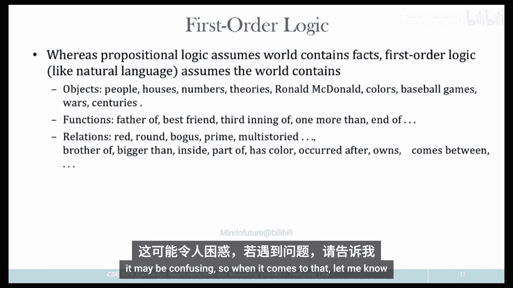

或者，我们可以使用**函数**来简化表达。定义一个函数 `m(x)`，返回 `x` 的母亲。那么上述知识可以更简洁地表示为：
`∀x (C(x) → Y(x, m(x)))`

使用函数的好处是使公式更易读、更简短。例如，要谈论“母亲的母亲”，使用函数可以嵌套：`m(m(x))`；而使用谓词则需要更长的合取式。

## 一阶逻辑的语法

理解了如何表达知识后，现在我们来正式学习一阶逻辑的语法规则。

在命题逻辑中，我们有原子命题。在一阶逻辑中，我们需要区分几种基本元素：
*   **个体**：宇宙中的实体或对象，可以是人、数字、颜色等。
*   **函数**：应用于个体并返回另一个个体的映射。例如，`father(john)` 返回约翰的父亲。
*   **关系（谓词）**：描述个体之间成立的事实，其值为真或假。例如，`Red(x)` 判断 `x` 是否为红色。

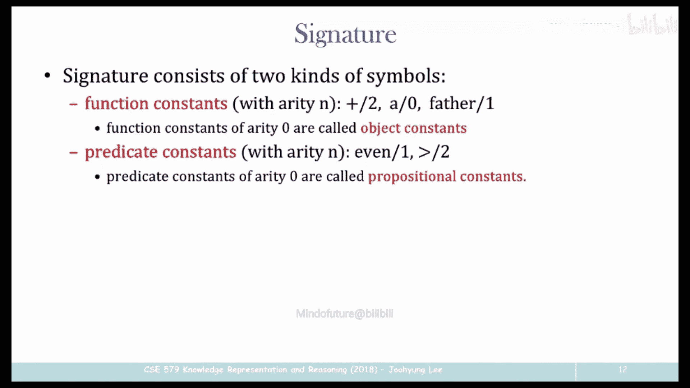

初学者可能会混淆函数和谓词。关键区别在于：**函数返回一个个体，而谓词返回一个真值**。

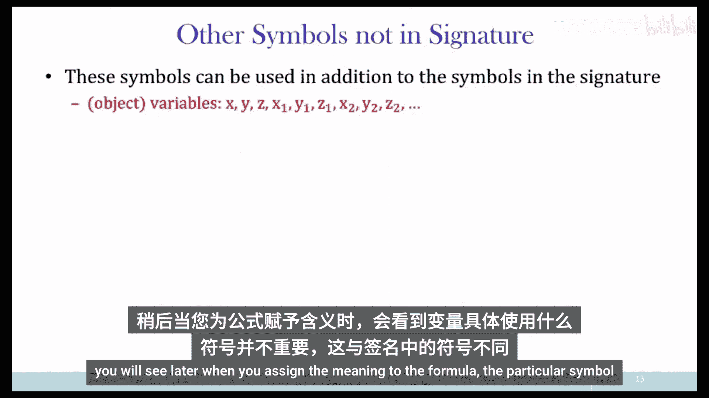

### 签名

在书写公式前，我们需要约定使用的符号集合，即**签名**。签名包含两种符号：
1.  **函数常元**：包括零元函数常元（即**个体常元**，如 `john`, `a`）和多元函数常元（如 `father(x)`, `plus(x, y)`）。
2.  **谓词常元**：包括零元谓词常元（即**命题常元**，相当于命题逻辑中的原子命题）和多元谓词常元（如 `Even(x)`, `GreaterThan(x, y)`）。

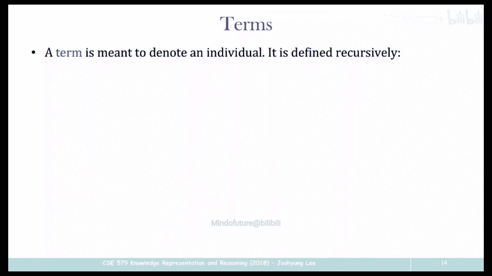

签名之外的符号（如逻辑连接词、括号、变量）有固定含义，可以自由使用，无需在签名中声明。

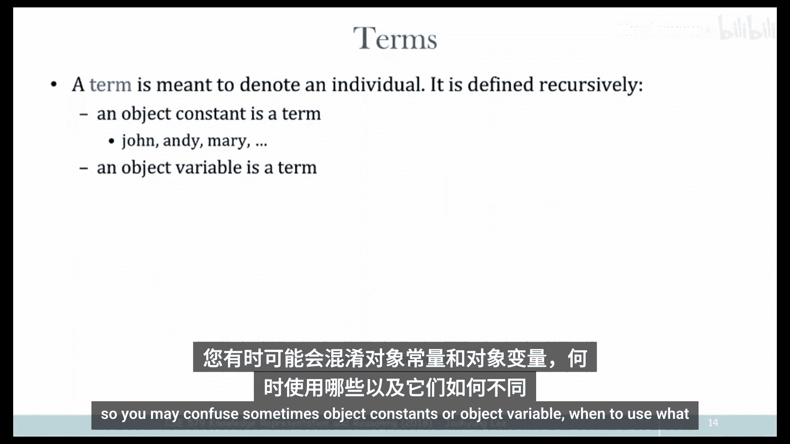

### 变量与公式

除了签名中的符号，我们还需要：
*   **对象变量**：如 `x`, `y`, `z`，用于表示任意个体。有无穷多个变量可用。
*   **逻辑连接词**：与命题逻辑相同，如 `¬`（非）、`∧`（与）、`∨`（或）、`→`（蕴含）。
*   **量词**：两个新的符号 `∀`（全称量词，“对所有”）和 `∃`（存在量词，“存在”）。

现在，我们定义如何用这些符号组合成有意义的表达式。

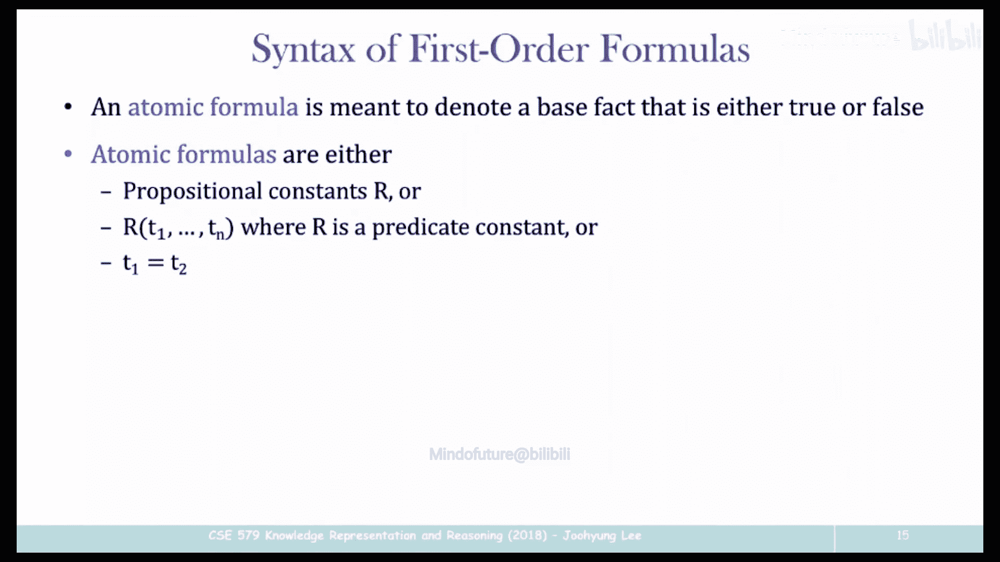

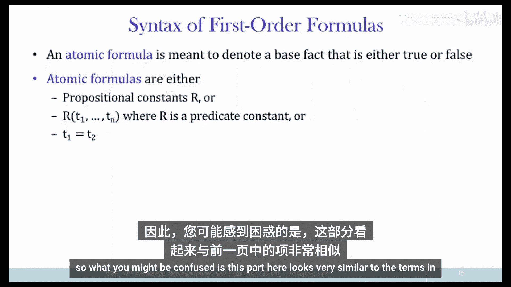

#### 项

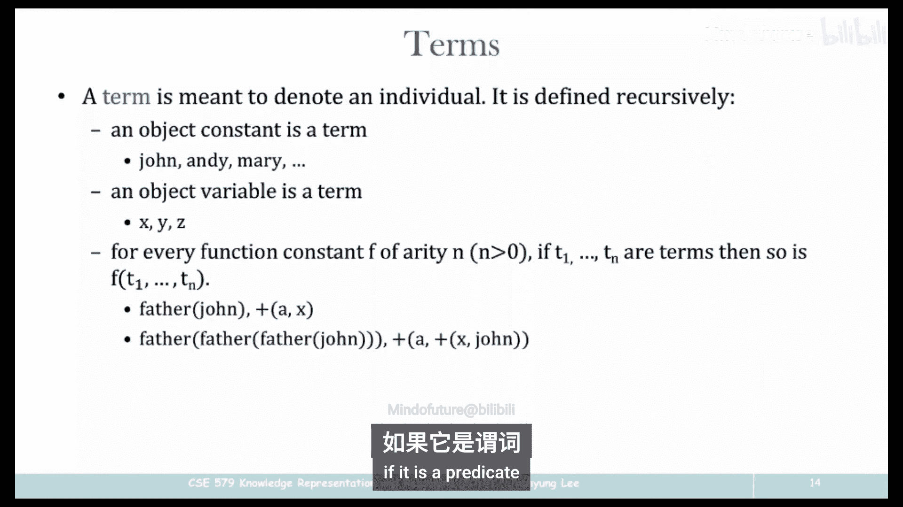

**项**是表示个体的语法对象。其递归定义如下：
*   任何个体常元是项。
*   任何对象变量是项。
*   如果 `f` 是一个 `n` 元函数常元，且 `t1, ..., tn` 是项，那么 `f(t1, ..., tn)` 也是项。

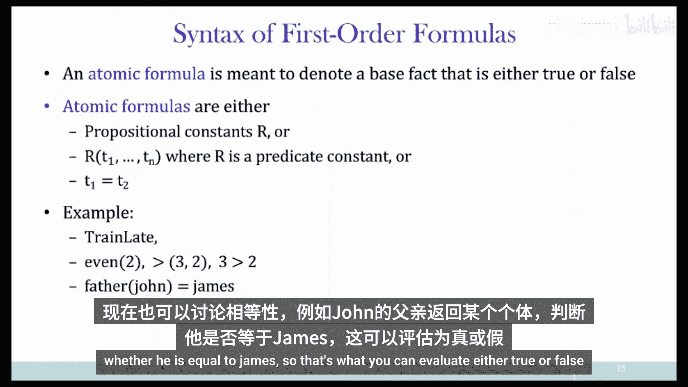

例如，`john` 是项，`father(john)` 是项，`plus(a, x)` 也是项。函数可以嵌套，如 `father(father(john))`。

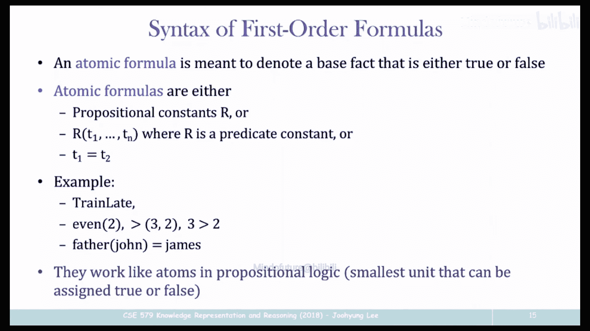

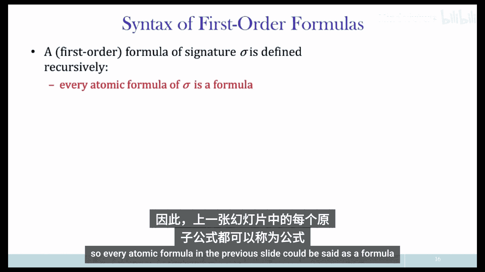

#### 原子公式

**原子公式**是能判断真假的语法单元，是构成复杂公式的基础。其定义如下：
*   任何命题常元是原子公式。
*   如果 `P` 是一个 `n` 元谓词常元，且 `t1, ..., tn` 是项，那么 `P(t1, ..., tn)` 是原子公式。
*   如果 `t1` 和 `t2` 是项，那么 `t1 = t2`（相等）是原子公式。

注意原子公式 `P(t1,...,tn)` 与项 `f(t1,...,tn)` 在形式上相似，但本质不同：**谓词返回真值，函数返回个体**。

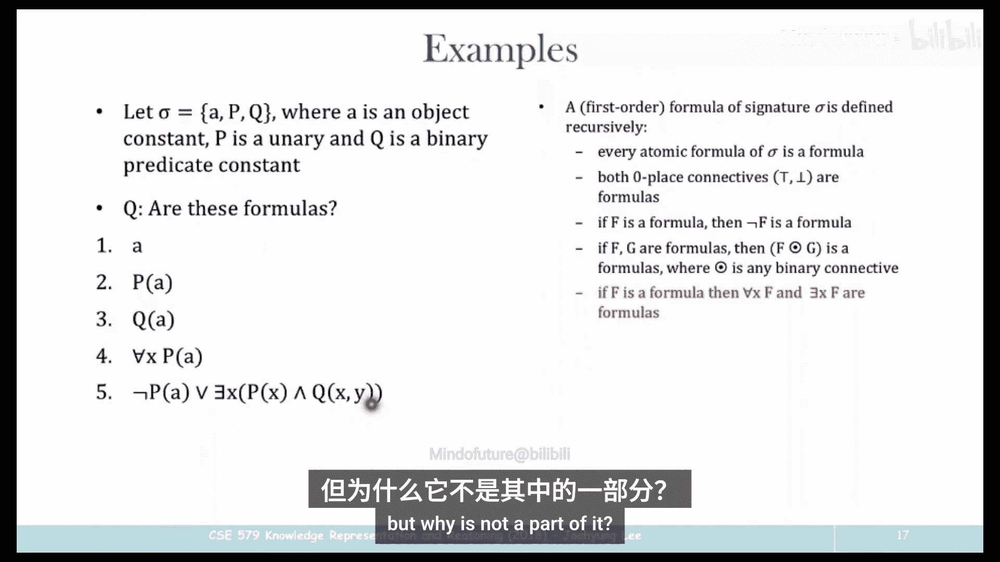

#### 公式

**公式**由原子公式通过连接词和量词递归构建而成：
*   任何原子公式是公式。
*   如果 `F` 是公式，则 `¬F` 是公式。
*   如果 `F` 和 `G` 是公式，则 `(F ∧ G)`, `(F ∨ G)`, `(F → G)` 等是公式。
*   如果 `F` 是公式，则 `∀x F` 和 `∃x F` 也是公式。

### 练习与核心概念：自由出现与约束出现

让我们通过练习巩固对公式结构的理解。给定签名：`a`（个体常元），`P`（一元谓词），`Q`（二元谓词）。判断以下是否是公式：
*   `a`：不是公式。`a` 是项，不是原子公式。
*   `P(a)`：是公式。
*   `Q(a)`：不是公式。`Q` 是二元谓词，需要一个参数。
*   `∀x P(a)`：是公式。虽然量词 `∀x` 未在 `P(a)` 中使用 `x`，但语法上允许。

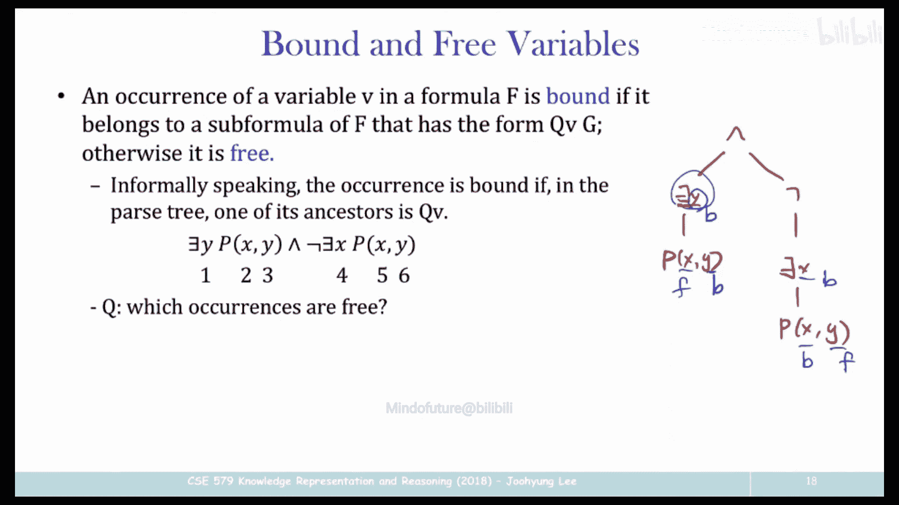

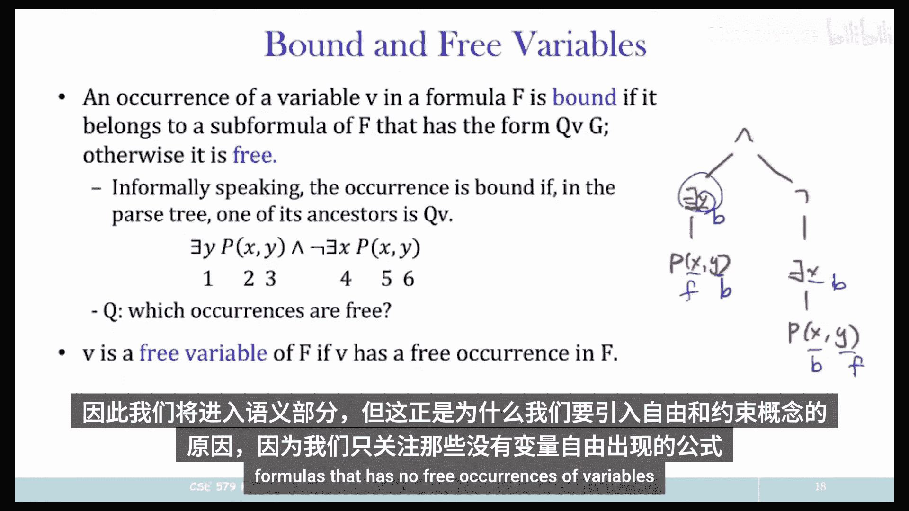

在公式 `∃y P(x, y) ∧ Q(x, y)` 中，变量 `x` 和 `y` 的出现情况不同。这引出了**自由出现**和**约束出现**的概念：
*   如果变量的一次出现位于某个量词（`∀v` 或 `∃v`）的**辖域**内，且该量词绑定的变量就是 `v`，则这次出现是**约束的**。
*   否则，这次出现是**自由的**。

在示例公式中：
*   第一个 `y`（在 `∃y` 后）被存在量词约束。
*   第一个 `x` 是自由的。
*   第二个 `y`（在 `P(x,y)` 中）被约束。
*   第三个 `y`（在 `Q(x,y)` 中）是自由的。

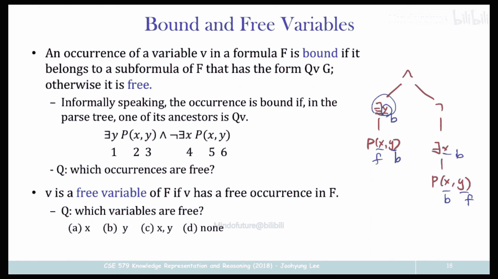

如果变量 `v` 在公式 `F` 中至少有一次自由出现，则 `v` 是 `F` 的**自由变量**。一个**句子**是**没有自由变量**的公式。只有句子才能被赋予明确的真值。在实践中，对于有自由变量的公式，常默认对其所有自由变量进行全称量化（称为**全称闭包**）。

**约束变量可以重命名**而不改变公式含义（如 `∀x P(x)` 与 `∀y P(y)` 等价），但**自由变量不能随意重命名**。

## 一阶逻辑的语义简介

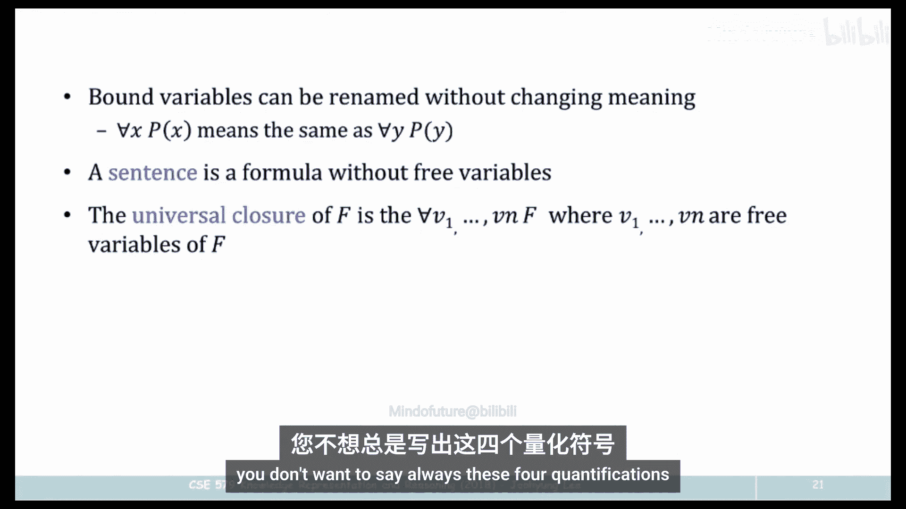

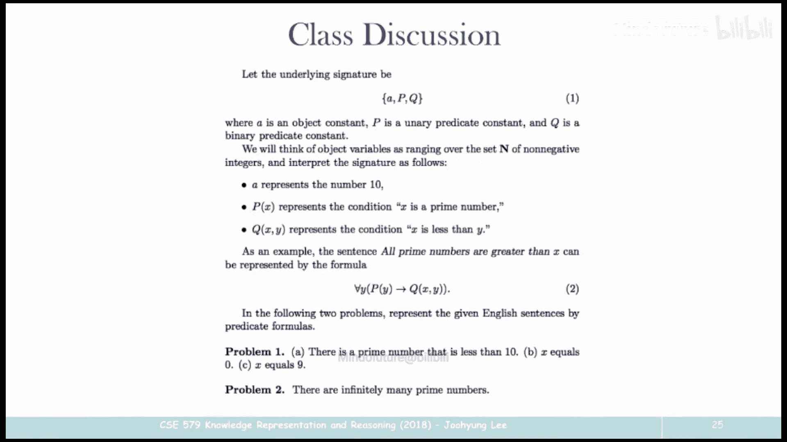

最后，我们简要介绍一阶逻辑的语义，即如何为公式赋予含义（真值）。这类似于命题逻辑中的解释函数，但更复杂。

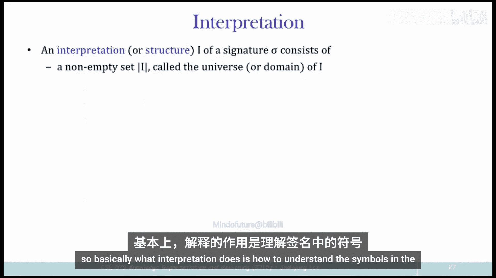

一个**解释** `I` 需要指定以下几点：
1.  **论域（宇宙）** `D`：一个非空集合，个体变量的取值范围。
2.  **对签名中符号的指派**：
    *   每个个体常元 `a` 被指派到 `D` 中的一个元素 `a^I`。
    *   每个 `n` 元函数常元 `f` 被指派到一个从 `D^n` 到 `D` 的函数 `f^I`。
    *   每个 `n` 元谓词常元 `P` 被指派到一个从 `D^n` 到 `{True, False}` 的关系 `P^I`。

例如，假设论域是非负整数集，解释 `I` 为：
*   `a^I = 10`
*   `P^I(n)` 为真当且仅当 `n` 是质数。
*   `Q^I(m, n)` 为真当且仅当 `m < n`。
*   `succ^I(n) = n + 1`（后继函数）。

在解释 `I` 下，**项**的语义（所指代的个体）可以递归计算：
*   个体常元 `a` 的语义是 `a^I`。
*   变量 `x` 的语义需要额外的**变量赋值**函数来指定（此处略过细节）。
*   复合项 `f(t1, ..., tn)` 的语义是：先计算 `t1, ..., tn` 的语义得到个体 `d1, ..., dn`，然后应用函数 `f^I` 得到结果 `f^I(d1, ..., dn)`。

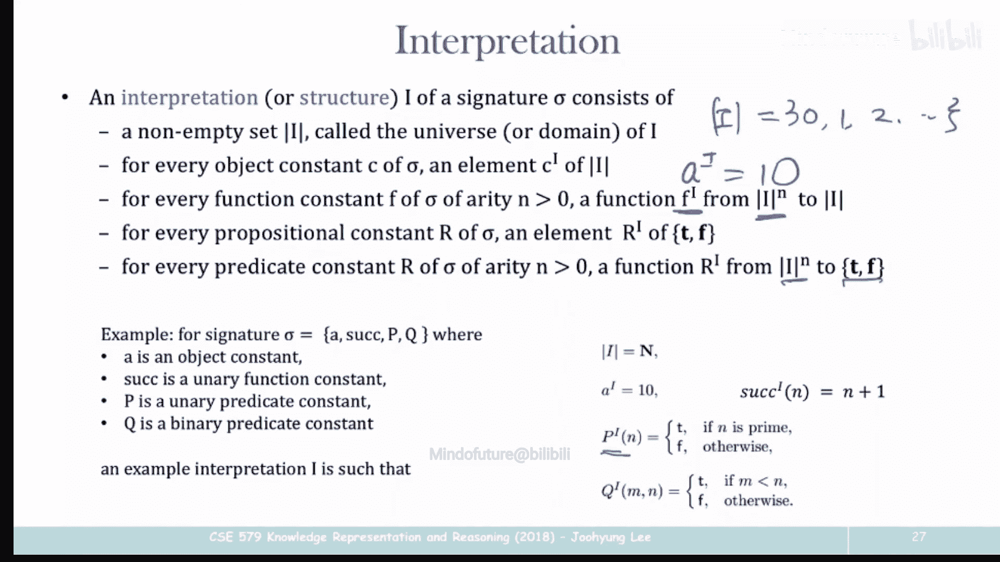

例如，项 `succ(a)` 在解释 `I` 下的语义是：`succ^I(a^I) = succ^I(10) = 11`。

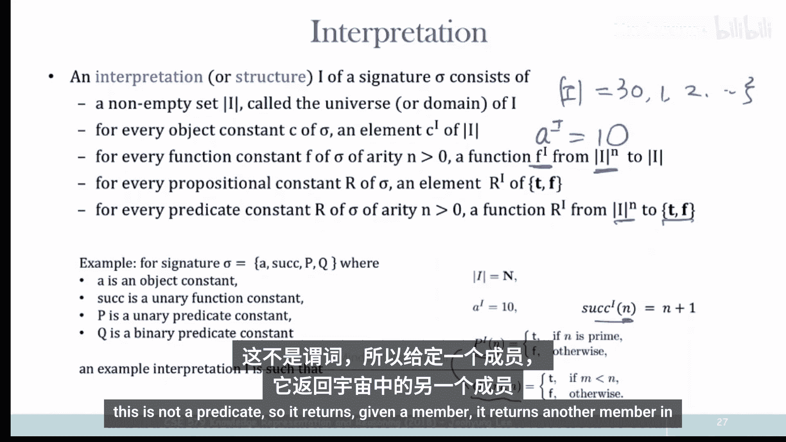

**公式**的真值在此基础上，通过递归地应用逻辑连接词和量词的规则来计算。量词 `∀x F` 为真，当且仅当将论域 `D` 中的每一个个体代入公式 `F` 中 `x` 的自由出现后，`F` 都为真。`∃x F` 为真，当且仅当存在至少一个个体代入后使 `F` 为真。

---

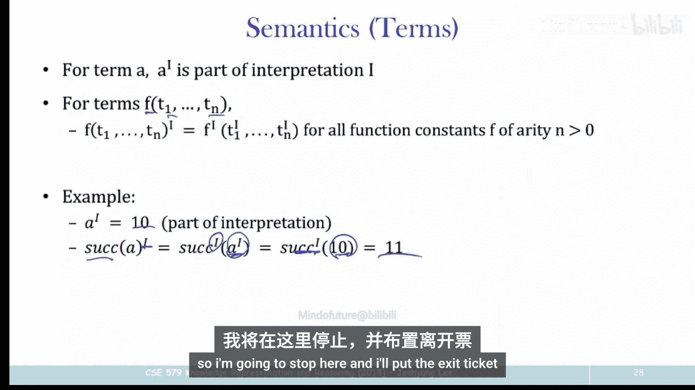

本节课中我们一起学习了一阶逻辑的基础。我们首先了解了如何用一阶逻辑的谓词、函数和量词来表达日常知识。然后，我们深入探讨了一阶逻辑的语法，包括签名、项、原子公式和公式的递归定义，并重点区分了自由变量与约束变量。最后，我们简要介绍了一阶逻辑的语义，即通过解释为公式赋予真值的基本思想。理解这些基本概念是后续学习一阶逻辑推理、证明和更复杂知识表征的基础。