# 004：一阶逻辑语义与ASP编程简介 🧠

在本节课中，我们将完成一阶逻辑语义的讲解，并开始介绍下一个主题：答案集编程。我们将首先回顾一阶逻辑语义的正式定义，理解其与命题逻辑的差异，并探讨其计算上的局限性。随后，我们将引入答案集编程作为一种更实用、表达能力更强的知识表征方法。

## 一阶逻辑语义回顾 📚

上一节我们介绍了公式的语法，它由项和原子公式递归构成。与命题逻辑不同，一阶逻辑的解释概念更为复杂，因为原子公式包含了对象个体以及个体之间的关系。

### 解释的构成

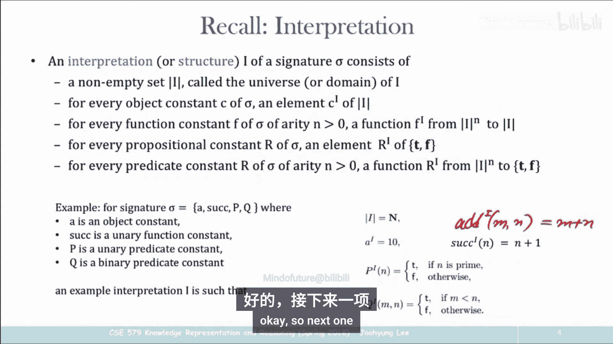

解释 `I` 为未赋值的常量赋予意义。我们从论域（或域）开始，用符号 `D^I` 表示。论域定义了我们要考虑的个体集合，例如人、数字等。

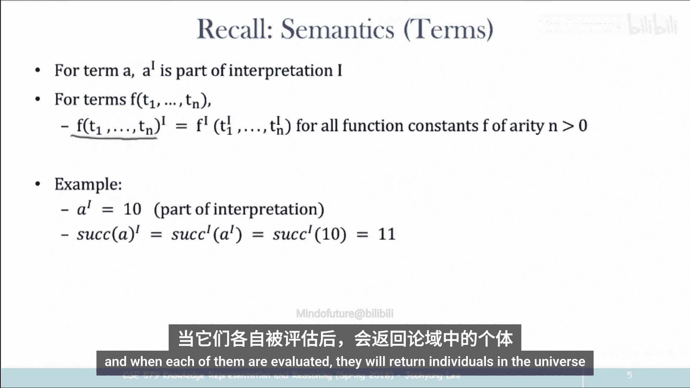

以下是解释如何为不同符号赋予意义：

*   **对象常量**：对象常量 `c` 表示单个个体。解释 `I` 将其映射到论域中的一个具体元素，记作 `c^I`。例如，常量 `a` 可能被映射到数字 `10`。注意，`a` 是语法的一部分，而 `10` 是语义（论域）的一部分。
*   **函数常量**：函数常量 `f` 接收一些项作为输入，并输出另一个个体。解释 `f^I` 是一个函数，它接收论域中的元素，并返回另一个元素。例如，后继函数 `succ` 接收一个数字并返回下一个数字。
*   **谓词常量**：谓词常量（包括零元的命题常量）被映射为真或假。解释 `P^I` 是一个函数，对于给定的论域元素（作为参数），返回真或假。例如，一元谓词 `Prime` 判断一个数是否为质数；二元谓词 `<` 判断第一个参数是否小于第二个参数。

### 项与公式的求值

在给定解释 `I` 后，我们可以对项和公式进行求值。

**项的求值**：对于函数项 `f(t1, ..., tn)`，我们首先递归地对每个子项 `ti` 求值，得到论域中的个体。然后，应用函数 `f^I` 于这些个体，得到结果个体。

**公式的求值**：我们考虑没有自由变量的公式（即句子）。其真值在解释 `I` 下定义如下：
1.  **原子公式** `P(t1, ..., tn)`：求值每个项 `ti`，然后应用谓词函数 `P^I`，得到真或假。
2.  **逻辑连接词**（`⊥`, `⊤`, `¬`, `∧`, `∨`, `→`）：与命题逻辑中的求值方式完全相同。
3.  **量词**：这是新的部分，也是需要精确定义的关键。
    *   **全称量词** `∀w F(w)`：直观上，它表示对论域中所有个体，公式 `F` 都成立。
    *   **存在量词** `∃w F(w)`：直观上，它表示在论域中存在至少一个个体，使得公式 `F` 成立。

然而，直接使用“对所有个体”或“存在某个个体”的直观定义在形式化时会遇到问题。

### 量词的形式化定义及其修正

最初一个有缺陷的定义是：`∃x Q(x, a)` 为真当且仅当 **存在某个对象常量** `c`，使得 `Q(c, a)` 在解释 `I` 下为真。

**问题**：假设我们的签名中只有一个对象常量 `a`（它被解释为数字10），并且 `Q` 表示“小于”。直观上，公式 `∃x Q(x, a)`（存在一个小于10的数）应为真。但是，根据上述缺陷定义，我们只能检查 `Q(a, a)`（10<10），它为假，从而导致整个公式被错误地判定为假。问题在于，对象常量的数量可能少于论域中的个体数，我们无法为所有个体命名。

修正后的定义是：`∃x Q(x, a)` 为真当且仅当 **存在论域中的某个个体** `d`，使得 `Q(d, a)` 为真。

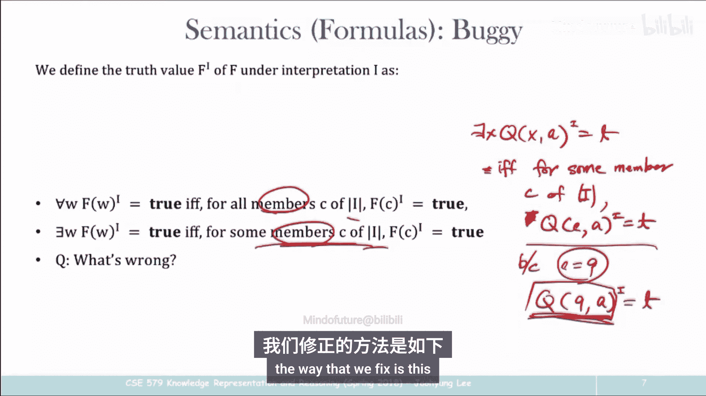

**新问题**：`d` 是论域中的元素（如数字9），但 `Q(d, a)` 并不是一个合法的公式，因为 `d`（数字9本身）不是签名中的符号，不能直接出现在公式里。

最终的解决方案是引入**扩展签名** `σ^I`。它为论域 `D^I` 中的每一个个体 `d` 引入一个新的**对象名称** `c_d`。这些名称仅在定义语义时使用，知识工程师在编写公式时仍然使用原始签名。

基于扩展签名，我们给出量词的形式化定义：
*   `(∀w F(w))^I = true` 当且仅当 对于论域 `D^I` 中的每一个个体 `d`，`F(c_d)^I = true`。
*   `(∃w F(w))^I = true` 当且仅当 存在论域 `D^I` 中的一个个体 `d`，使得 `F(c_d)^I = true`。

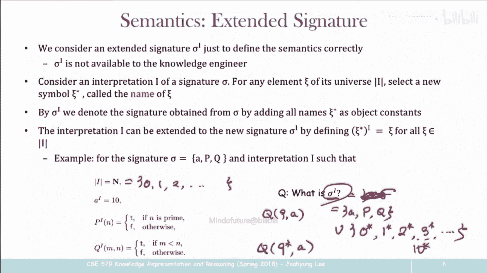

这样，对于 `∃x Q(x, a)`，我们可以找到个体 `9` 对应的名称 `c_9`，并检查 `Q(c_9, a)` 是否为真（9<10），从而正确判定原公式为真。

## 一阶逻辑的局限性与答案集编程的引入 ⚠️

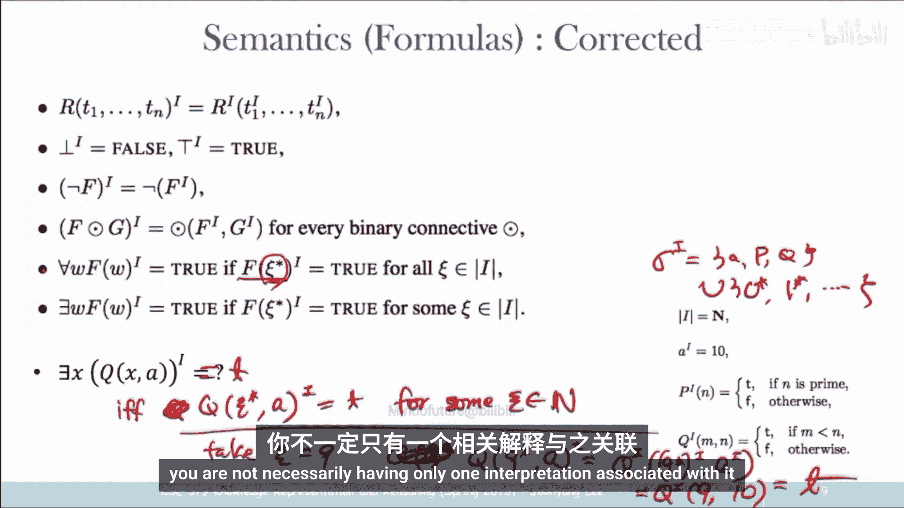

在定义了可满足性、逻辑有效性、等价和蕴涵等概念后，我们触及了一阶逻辑的一个核心计算问题。

### 判定问题的不可判定性

一阶逻辑的**逻辑有效性判定问题**（给定任意一个一阶逻辑句子，判断它是否在所有解释下都为真）是**不可判定的**。这意味着不存在一个通用的算法能对所有一阶逻辑句子正确回答“是”或“否”。由于可满足性、不可满足性、蕴涵等问题都可以转化为有效性判定问题，因此它们也都是不可判定的。

这个性质对知识表征构成了根本性挑战：即使我们能将问题形式化为一阶逻辑公式，也可能无法通过计算自动得到答案。

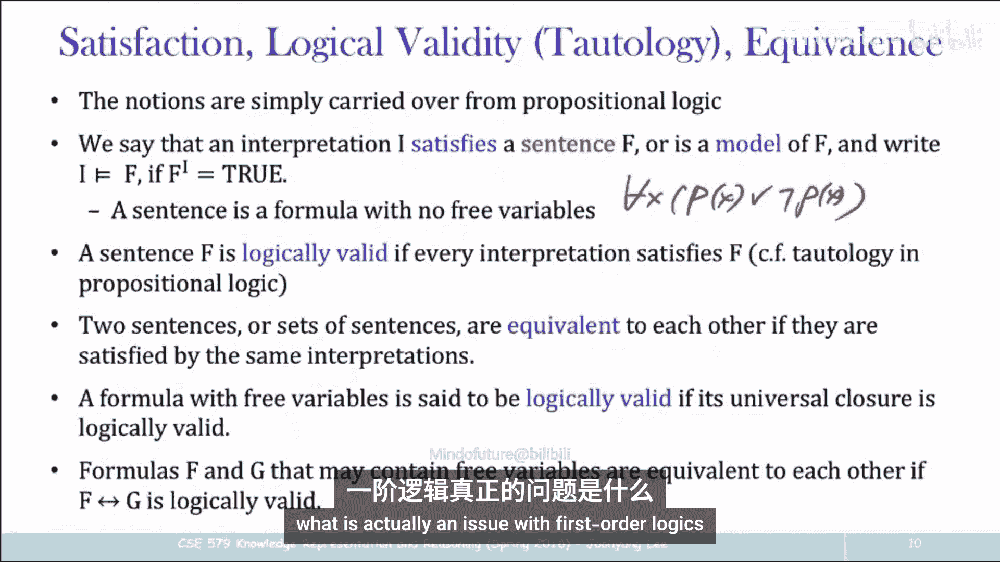

### 其他不直观的特性

一阶逻辑的通用性也带来了一些在常识推理中不直观的特性：
1.  **唯一命名假设不成立**：不同的常量可能被解释为同一个个体。例如，“Paul”和“Quentin”可能指向同一个人。要强制它们不同，需要显式添加 `Paul ≠ Quentin` 这样的公理。
2.  **论域封闭假设不成立**：解释的论域可以包含比签名中命名的个体更多的元素。要限定论域仅包含已知个体，需要显式添加公理，如 `∀x (x = a ∨ x = b ∨ x = c)`。

这些特性使得直接用一阶逻辑进行知识建模有时会显得繁琐和不自然。

## 答案集编程简介 🚀

为了克服一阶逻辑的上述限制（特别是可判定性问题），并更自然地表达诸如默认推理、递归定义、聚合和偏好等概念，我们引入了**答案集编程**。

答案集编程是一种声明式编程范式，其理论基础是**稳定模型语义/答案集语义**。它的核心思想是：**将计算问题建模为一组逻辑规则（称为逻辑程序），然后寻找这些规则的稳定模型（即答案集），答案集即对应问题的解**。

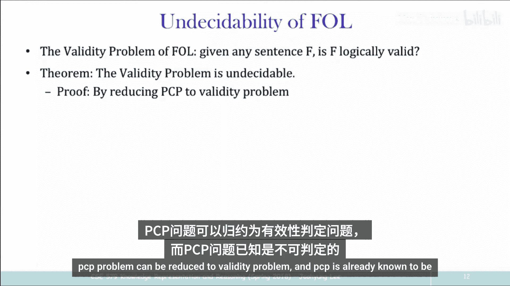

### 与传统编程的对比

*   **传统（过程式）编程**：程序员需要详细描述解决问题的具体步骤（算法）。
*   **声明式编程（如ASP）**：程序员只需描述问题的**约束条件**和**需求**（即“是什么”），而不指定“如何做”。求解器（如Clingo）会自动寻找满足所有约束的解。

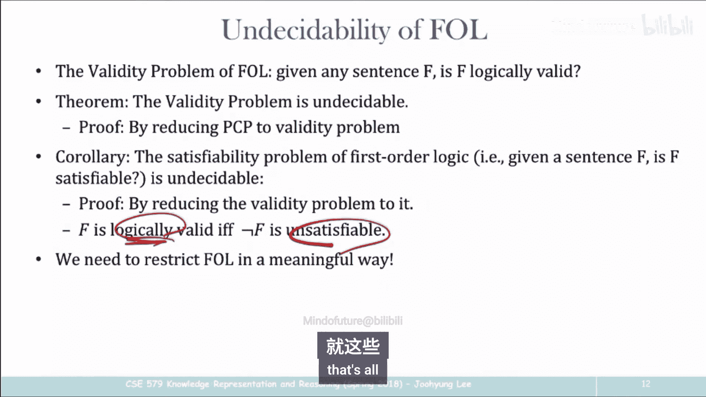

### ASP工作流程

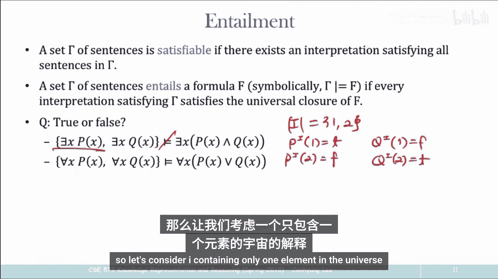

1.  **建模**：将待解决的问题用ASP的规则语言进行形式化表述。
2.  **求解**：使用ASP求解器（如Clingo）处理逻辑程序，计算出所有答案集（稳定模型）。
3.  **解释**：将答案集解释为原问题的解。

### 实例：N皇后问题

N皇后问题要求在一个N×N的棋盘上放置N个皇后，使得它们互不攻击（即不在同一行、同一列或同一对角线上）。

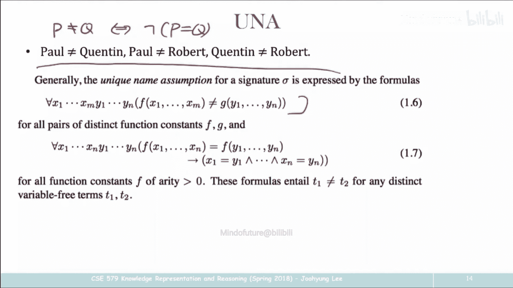

以下是一个用ASP Core 2语言编写的解决N皇后问题的完整程序：

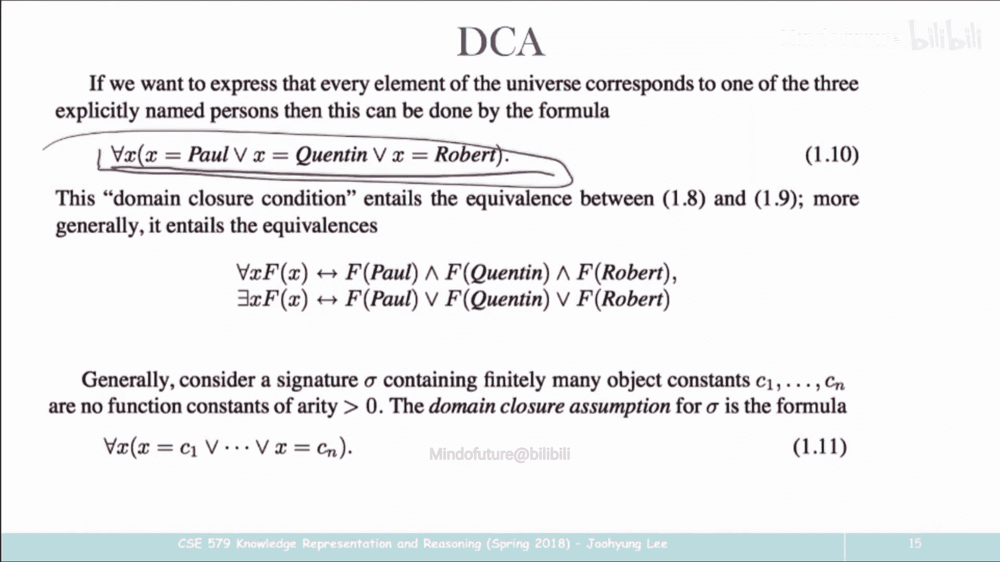

```prolog
% 1. 定义行和列的范围
row(1..n).
col(1..n).

% 2. 每个皇后必须被放在棋盘的某个位置上（生成候选解）
{ queen(I, J) : row(I), col(J) }.

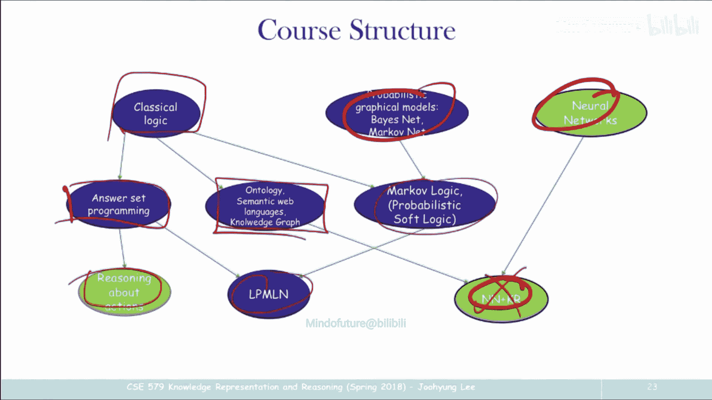

% 3. 每行只能有一个皇后
:- row(I), #count { J : queen(I, J) } != 1.

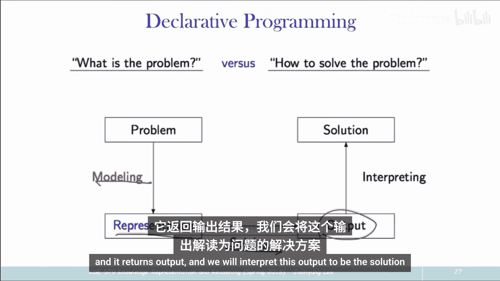

% 4. 每列只能有一个皇后
:- col(J), #count { I : queen(I, J) } != 1.

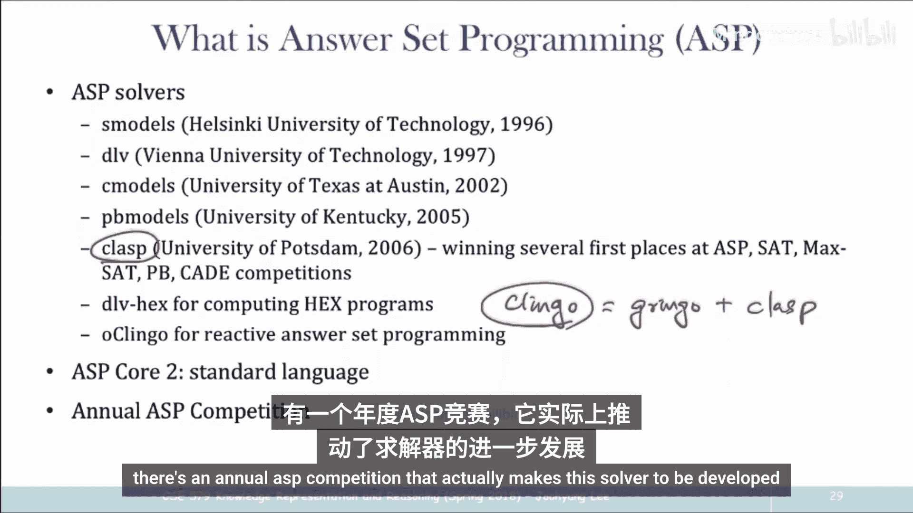

% 5. 每条对角线（主对角线和副对角线）上最多只能有一个皇后
:- queen(I1, J1), queen(I2, J2), I1 < I2, J1 == J2. % 同一列已在规则3处理，此处示例可能省略详细对角线约束，实际需要两条规则。
% 实际需要添加：
:- queen(I1, J1), queen(I2, J2), I1 < I2, abs(I1 - I2) == abs(J1 - J2). % 禁止在同一对角线上
```

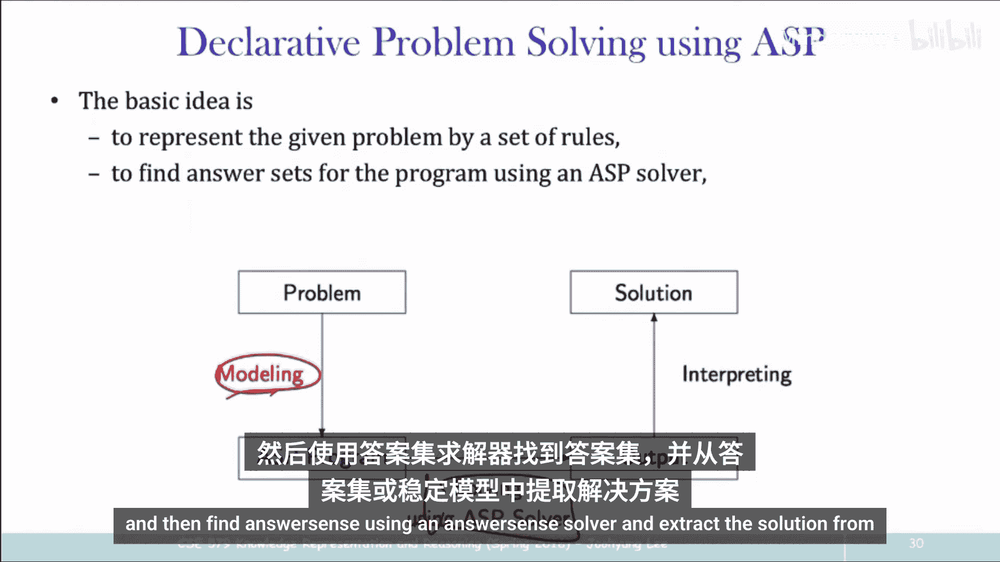

使用命令行 `clingo queens.lp -c n=8` 调用求解器，可以迅速找到8皇后问题的92个解之一。添加 `0` 选项（`clingo queens.lp -c n=8 0`）可以找出所有解。ASP求解器对此类组合搜索问题非常高效。

## 总结 📝

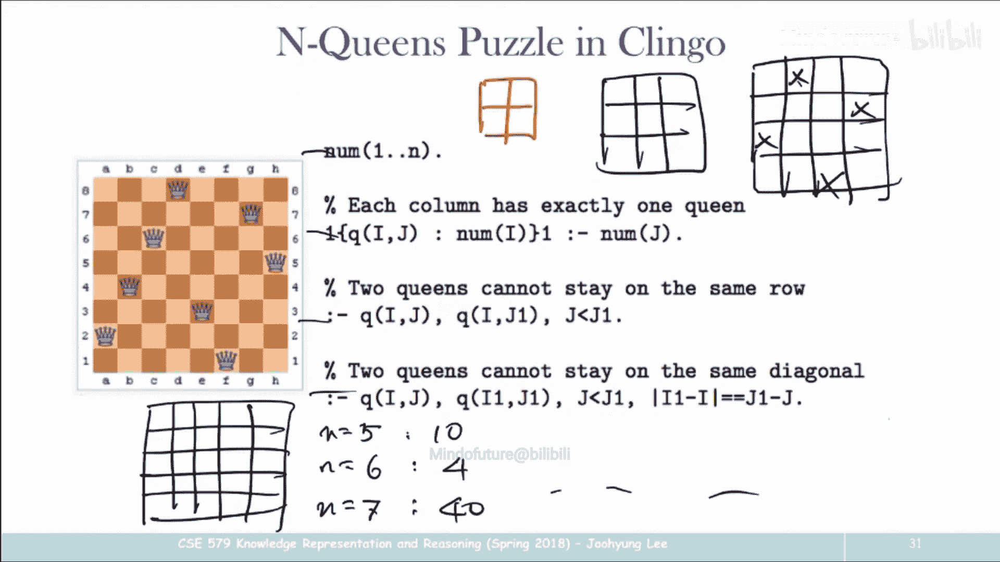

本节课我们一起学习了一阶逻辑语义的完整形式化定义，重点理解了量词求值中通过扩展签名来联系语法与语义的关键技巧。我们认识到一阶逻辑虽然表达能力强，但其核心判定问题是不可判定的，且某些默认假设与常识不符，这限制了其直接用于高效知识推理。

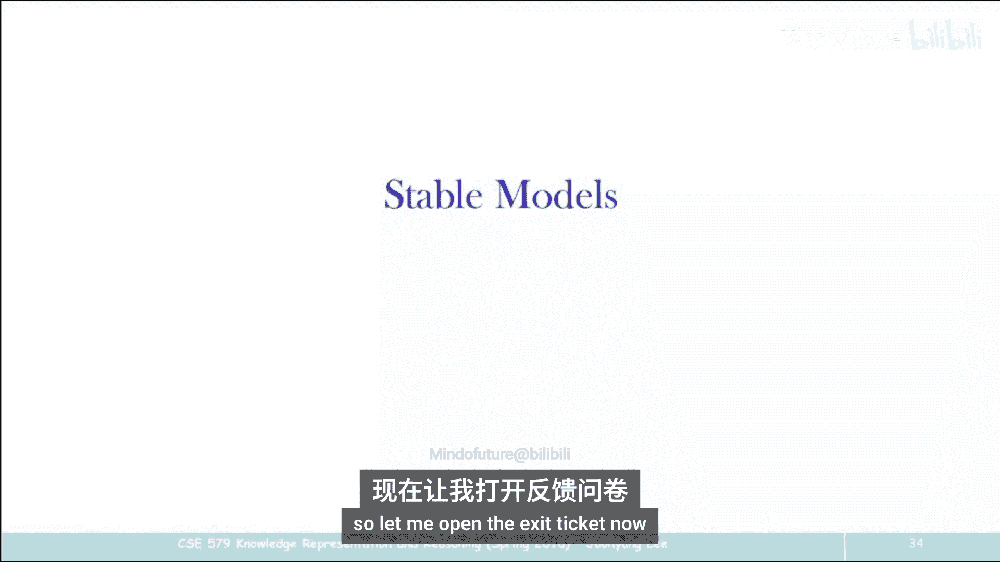

为此，我们引入了答案集编程作为解决方案。ASP基于稳定模型语义，采用声明式范式，允许我们简洁地描述问题约束，并由高效求解器自动计算答案。通过N皇后问题的例子，我们看到了ASP在解决复杂组合问题上的实用性和简洁性。在接下来的课程中，我们将深入探讨稳定模型语义的具体内容。