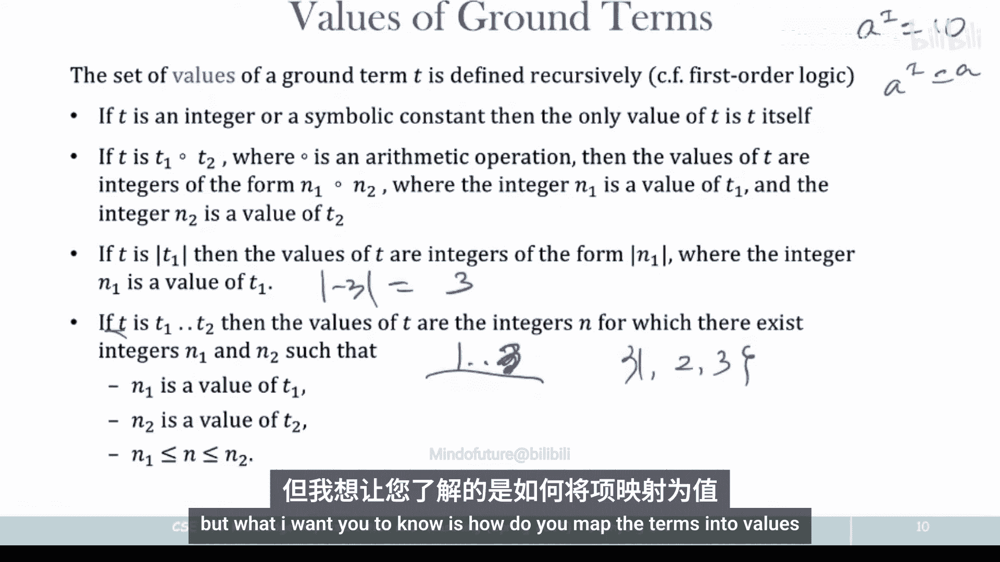
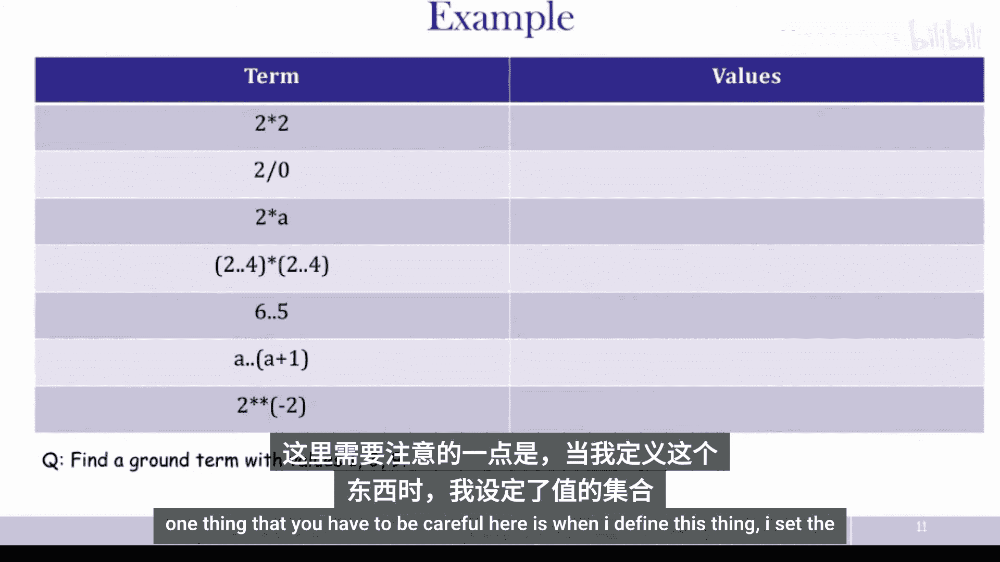
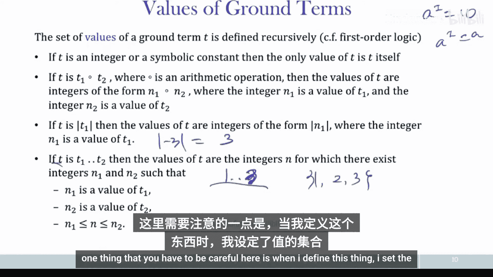
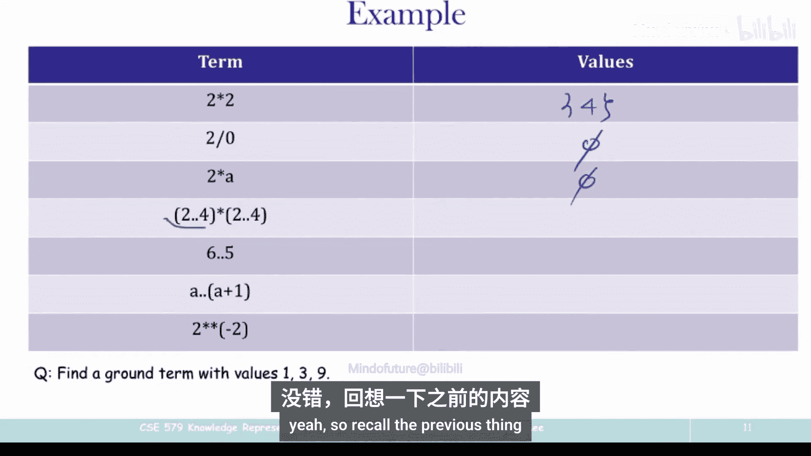
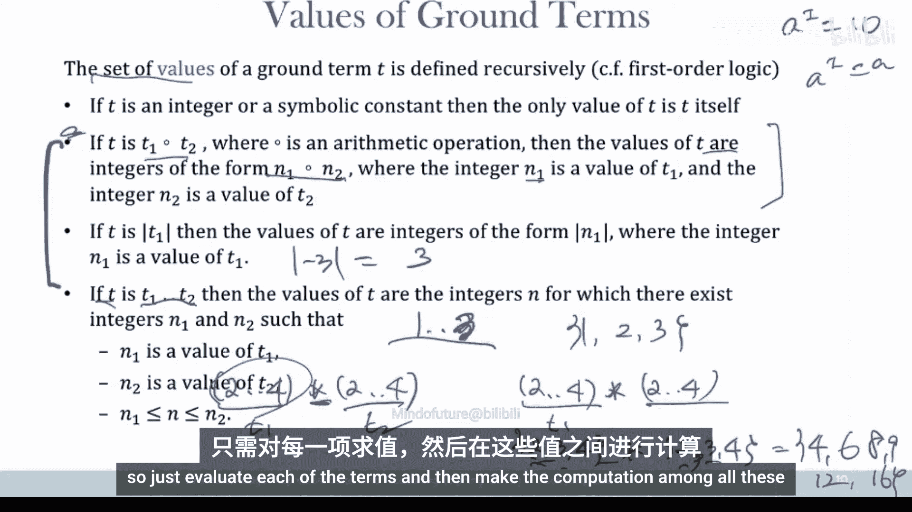
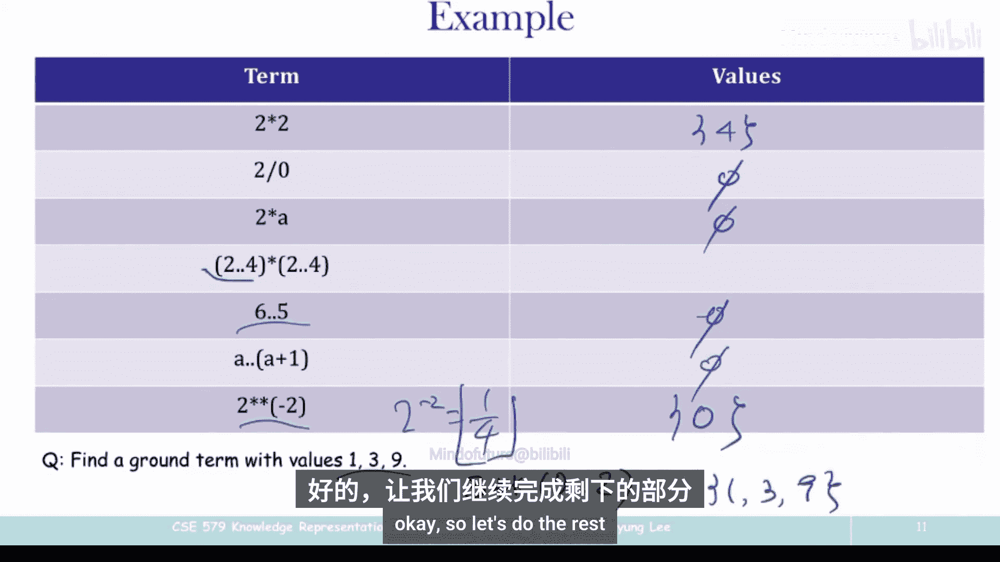
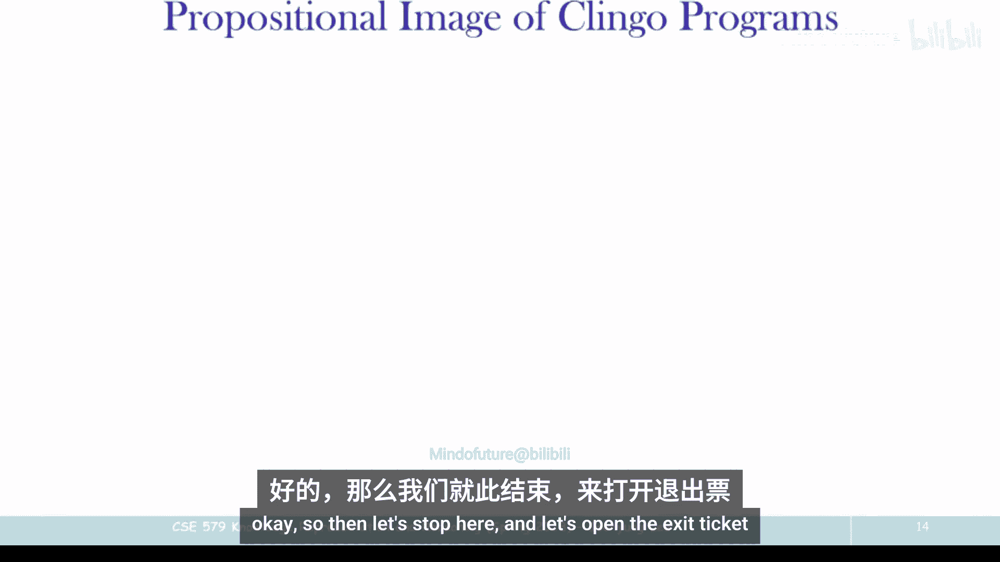

# 005：稳定模型与Plingo语言入门

在本节课中，我们将学习稳定模型语义的基础知识，从简单的命题规则开始，逐步过渡到更复杂的程序，并初步了解用于知识表示的Plingo语言。

## 概述

上一节我们简要介绍了逻辑编程。为了编写完整的逻辑程序，我们需要理解稳定模型的含义。本节我们将学习稳定模型语义，其思路与经典逻辑有相似之处，但也进行了调整以克服经典逻辑遇到的一些困难。我们将重点关注这些异同点。

## 语法：命题规则

定义任何形式语言都需要定义语法和语义。在语法层面，逻辑程序规则是命题逻辑的一个受限版本。

命题逻辑允许连接词的任意嵌套，而我们将使用的规则则更为受限。我们首先考虑命题规则，之后会将其扩展为更通用的形式。

命题规则有两种形式：
1.  **不含蕴涵的命题公式**：即由原子、否定（¬）、永假（⊥）、永真（⊤）、合取（∧）和析取（∨）构成的公式，但不包含蕴涵（→）或等价（↔）符号。例如，`P` 或 `P ∨ Q` 都是命题规则。
2.  **单蕴涵规则**：我们允许每条规则中出现一次蕴涵，并使用一种对人类更自然的“反向”写法：`F if G`。这等同于 `G → F`。其中，`F` 和 `G` 本身不能包含蕴涵符号。

以下是一些例子：
*   `P if (Q ∧ R)` 是一个规则（属于第二种形式）。
*   `(P if Q) if R` 不是一个规则，因为 `F` 部分（即 `P if Q`）包含了蕴涵，违反了第二种形式的条件。
*   `P ∨ ¬Q` 是一个规则（属于第一种形式）。

需要注意的是，在稳定模型语义下，即使两个公式在经典命题逻辑中等价，它们的稳定模型也可能不同。这意味着经典逻辑中的等价变换（如消去蕴涵）可能不保持稳定模型语义下的等价性。

我们将一个**命题程序**定义为一组命题规则的集合。

## 预备知识：最小模型语义

在定义稳定模型语义之前，我们先介绍一个更简单的近似概念：最小模型语义。

首先引入一个约定：将命题逻辑中的解释（真值指派）与一个原子集合等同起来。该集合包含所有被指派为“真”的原子，未出现在集合中的原子则被视为“假”。例如，解释 `{P:假, Q:真}` 等同于集合 `{Q}`。空集 `{}` 则表示所有原子都为假。

**最小模型**的定义如下：解释 `I` 是公式 `F` 的最小模型，当且仅当：
1.  `I` 是 `F` 的一个模型（即满足 `F`）。
2.  不存在 `I` 的真子集 `J`（即 `J ⊂ I`）也是 `F` 的模型。

换句话说，最小模型是以尽可能“小”的方式（令尽可能少的原子为真）满足程序的模型。

**示例**：考虑公式 `P ∨ Q`（签名包含 `P`, `Q`）。
*   模型有：`{P}`, `{Q}`, `{P, Q}`。
*   最小模型是：`{P}` 和 `{Q}`。因为 `{P, Q}` 虽然也是模型，但它不是最小的，因为它的子集 `{P}` 或 `{Q}` 已经是模型了。
*   空集 `{}` 不是模型，因为它不满足 `P ∨ Q`。

可以证明，如果两个公式在命题逻辑中等价，它们也拥有相同的最小模型。但反之则不然：两个公式可能拥有相同的最小模型，但它们的全体模型集合却不同。

## 稳定模型语义（初步）：确定程序

现在，我们为一种特殊的命题规则定义稳定模型语义，这种规则称为**确定程序**。

在规则 `H if B` 中，`H` 称为**头部**，`B` 称为**体部**。确定程序满足以下限制：
*   头部 `H` 是单个原子或原子的合取。
*   体部 `B` 中不包含否定符号。

**示例**：
*   `P.` （头部是原子 `P`，无体部）是确定程序。
*   `R if (P ∧ Q).` （头部是原子 `R`，体部是 `P ∧ Q` 且不含否定）是确定程序。
*   `P ∨ Q.` 不是确定程序，因为头部是析取。
*   `R if ¬P.` 不是确定程序，因为体部包含否定。

确定程序有一个重要性质：**每个确定程序都有唯一的最小模型**。

我们可以通过一个简单的迭代算法来找到这个唯一的最小模型：
1.  初始化集合 `S` 为空集 `{}`。
2.  重复以下过程，直到 `S` 不再变化：
    *   对程序中的每条规则 `H if B`：
        *   如果当前 `S` 满足体部 `B`（即 `B` 中的所有原子都在 `S` 中），则将头部 `H` 中的所有原子加入集合 `S`。
3.  最终得到的 `S` 就是该确定程序的唯一最小模型。

**示例**：对于程序：
```
P.
R if (P ∧ Q).
R if (P ∨ T).
Q if (R ∧ T).
```
应用上述算法：
*   初始 `S = {}`。
*   处理 `P.`，体部为空（恒真），将 `P` 加入 `S`。`S = {P}`。
*   处理 `R if (P ∧ Q).`，体部 `P ∧ Q` 不满足（`Q` 不在 `S` 中），跳过。
*   处理 `R if (P ∨ T).`，体部 `P ∨ T` 满足（`P` 在 `S` 中），将 `R` 加入 `S`。`S = {P, R}`。
*   处理 `Q if (R ∧ T).`，体部 `R ∧ T` 不满足（`T` 不在 `S` 中），跳过。
*   第一轮结束，`S` 变为 `{P, R}`。开始第二轮迭代。
*   处理 `P.`，`P` 已在 `S` 中。
*   处理 `R if (P ∧ Q).`，体部 `P ∧ Q` 仍不满足，跳过。
*   处理 `R if (P ∨ T).`，`R` 已在 `S` 中。
*   处理 `Q if (R ∧ T).`，体部仍不满足，跳过。
*   第二轮结束，`S` 仍为 `{P, R}`？等等，我们需要重新检查所有规则。实际上，在得到 `{P, R}` 后，应重新从头扫描规则：
    *   `P.` 已满足。
    *   `R if (P ∧ Q).`，体部 `P` 真但 `Q` 假，不满足。
    *   `R if (P ∨ T).`，已满足，`R` 已在 `S`。
    *   `Q if (R ∧ T).`，体部 `R` 真但 `T` 假，不满足。
    *   `S` 似乎未变。但让我们仔细检查第二条规则 `R if (P ∧ Q).`，它的头部 `R` 已经在 `S` 中，所以即使体部变为真，也不会添加新元素。然而，我们漏掉了关键点：在 `S = {P, R}` 时，第三条规则 `R if (P ∨ T)` 已经处理过并添加了 `R`。但我们需要检查是否所有规则在 `S` 稳定后都得到满足。实际上，这个程序的最小模型是 `{P, R, Q}`。让我们修正算法流程：
        *   初始 `S={}`
        *   规则1: 添加 `P` -> `S={P}`
        *   规则2: 体部 `(P∧Q)` 假，跳过。
        *   规则3: 体部 `(P∨T)` 真，添加 `R` -> `S={P,R}`
        *   规则4: 体部 `(R∧T)` 假，跳过。
        *   第一轮后 `S={P,R}`。
        *   第二轮，从规则1开始：
            *   规则1: `P` 已在。
            *   规则2: 体部 `(P∧Q)` 仍假（`Q` 不在），跳过。
            *   规则3: 体部 `(P∨T)` 真，`R` 已在。
            *   规则4: 体部 `(R∧T)` 仍假，跳过。
        *   `S` 似乎未变。但这里有个问题：根据程序语义，`P` 为真，根据规则3 `R` 为真。现在看规则2，它要求如果 `P` 和 `Q` 都为真，则 `R` 必须为真。但 `R` 已经为真，所以这条规则自动满足，无论 `Q` 真假。然而，规则4要求如果 `R` 和 `T` 都为真，则 `Q` 必须为真。目前 `T` 为假，所以规则4的体部为假，规则自动满足。因此，`{P, R}` 似乎是一个模型。但它是最小的吗？考虑子集 `{P}`，它不满足规则3（`P∨T` 为真，但头部 `R` 为假），所以 `{P}` 不是模型。因此 `{P, R}` 是最小模型。然而，我们之前认为 `{P, R, Q}` 也是模型，但它不是最小的，因为 `{P, R}` 是它的子集且也是模型。因此，对于这个程序，`{P, R}` 是唯一的最小模型。之前的算法在第二轮后 `S` 未变化，算法终止，结果是 `{P, R}`。这个例子说明了迭代算法的过程。

对于确定程序，我们定义其**稳定模型**就是它的**唯一最小模型**。稳定模型可以理解为智能体基于程序所应持有的“信念集合”，遵循“理性节制原则”：只相信那些被程序强制要求相信的，而不做额外的假设。

## 扩展到正程序

**正程序**是指不包含否定符号的命题程序。显然，每个确定程序都是正程序，但反之则不成立（例如，头部为析取的规则 `P ∨ Q` 是正程序，但不是确定程序）。

对于正程序，稳定模型语义的定义与其最小模型语义一致：**正程序的稳定模型就是它的最小模型**。与确定程序的关键区别在于，正程序不一定有唯一的最小模型（例如 `P ∨ Q` 有两个最小模型 `{P}` 和 `{Q}`），因此一个正程序可能有多个稳定模型。

## 引入Plingo语言

命题逻辑的表示能力有限，原子只能是简单的命题符号。为了进行更丰富的知识表示，我们引入 **Plingo** 语言。它在语法上类似于一阶逻辑，但有一些预定义的结构。

### 项

Plingo中的**项**用于表示对象，定义如下：
*   **整数**（如 `5`, `-12`）是项。
*   **符号常量**（小写字母开头，如 `john`, `paris`）是项。
*   **变量**（大写字母开头，如 `X`, `City`）是项。
*   对项进行**算术运算**（`+`, `-`, `*`, `/`, `\`（整除）, `**`（乘方）, `..`（区间）等）得到的表达式是项。例如 `(2*X+1)`。
*   绝对值函数 `|T|` 是项。
*   **区间项** `T1..T2` 是项，表示从 `T1` 到 `T2`（含）的所有整数。例如 `1..5` 表示 `1,2,3,4,5`。

Plingo语言具有固定的预定义签名（如整数集、算术函数），这与一阶逻辑中任意选择签名不同。这有利于计算。

**接地项**是指不包含变量的项。接地项可以直接计算其**值**：
*   整数和符号常量的值就是其自身。
*   算术表达式的值通过对子项的值进行标准算术运算得到。
*   区间项 `n1..n2` 的值是集合 `{n1, n1+1, ..., n2}`（如果 `n1 ≤ n2`），否则为空集。
*   特别地，项的值可能是一个**集合**（如区间项），而不仅仅是单个整数。

**练习：计算项的值**
*   `2*2`：值 `4`
*   `2/0`：未定义，值视为空集 `{}`
*   `2*a`：`a` 是符号常量，不是整数，算术运算未定义，值 `{}`
*   `(2..4) * (2..4)`：第一个项值 `{2,3,4}`，第二个项值 `{2,3,4}`。乘积是所有可能组合：`{4,6,8,9,12,16}`（集合去重）。
*   `6..5`：空区间，值 `{}`
*   `a..8`：`a` 不是整数，区间无意义，值 `{}`
*   `2 ** (-2)`：`2^(-2) = 1/4`，取其整数部分（地板值）为 `0`。







### 规则与程序



Plingo中的**原子**类似于一阶逻辑的原子，由谓词符号后跟括号内的项列表构成，例如 `friends(john, mary)`。



Plingo**规则**的通用形式是：
```
H1, ..., Hk if B1, ..., Bm.
```
其中 `Hi` 和 `Bj` 可以是原子，也可以是**比较表达式**（如 `T1 < T2`, `T1 != T2` 等）。逗号 `,` 表示合取。头部可以是多个原子的合取（`k>=1`）。如果 `k=1`，就是常见的单头部规则；如果 `m=0`，则省略 `if`，成为事实。

**示例**：
```
warm(C) if city(C), temp(C, T1), temp(austin, T2), T1 > T2.
```
这条规则表示：如果城市 `C` 的温度 `T1` 高于奥斯汀的温度 `T2`，那么 `C` 就是温暖的城市。这里 `C`, `T1`, `T2` 都是变量。



## 总结



本节课我们一起学习了稳定模型语义的基础。我们从命题规则的语法开始，定义了最小模型的概念。接着，我们针对**确定程序**（头部为原子或原子合取、体部不含否定）定义了稳定模型即其唯一最小模型，并给出了一个迭代计算算法。然后，我们将概念扩展到**正程序**（不含否定的程序），其稳定模型就是所有最小模型。最后，我们初步介绍了**Plingo语言**，了解了其项的定义、计算以及规则的基本语法，这为我们用更丰富的语言编写逻辑程序奠定了基础。下一节课，我们将探讨程序中引入否定后带来的复杂性，即“否定即失败”规则。