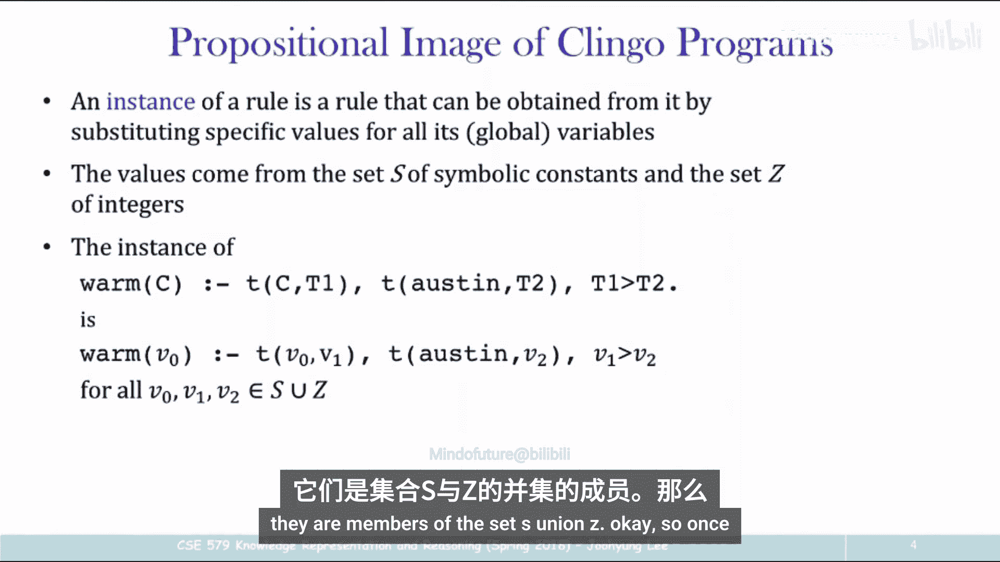
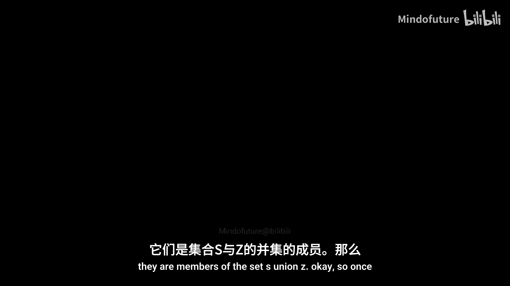
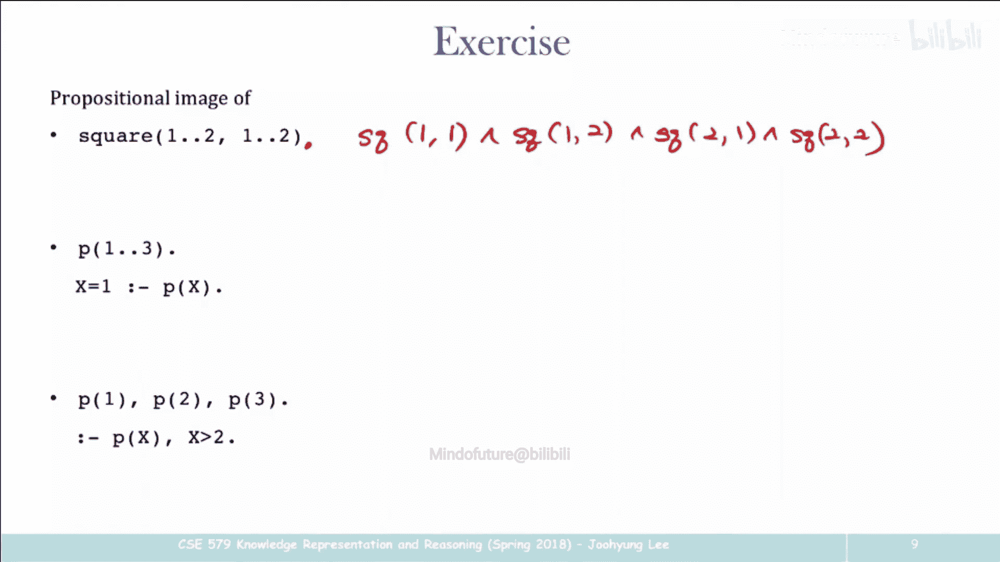
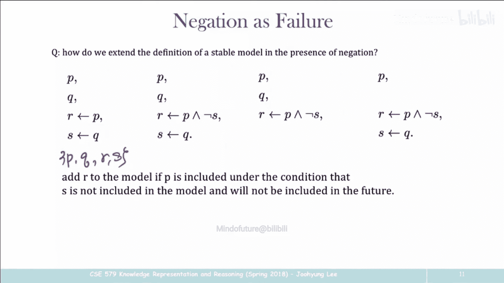
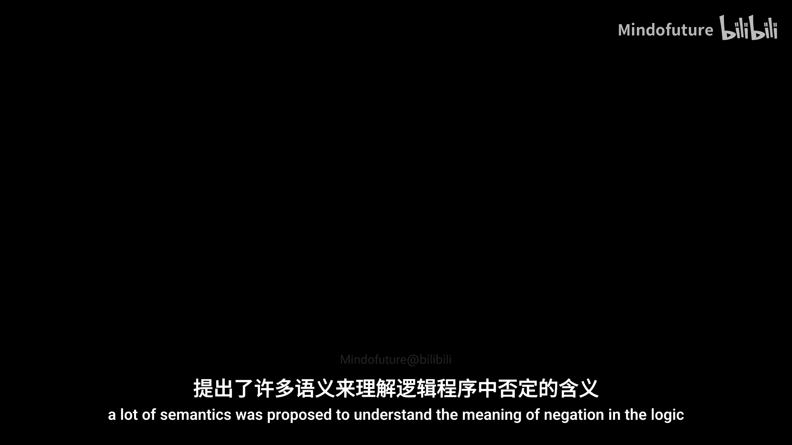
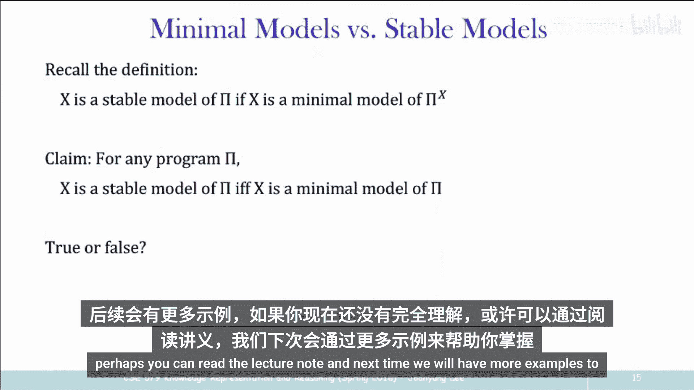

# 006：稳定模型与ASP语法详解

在本节课中，我们将深入学习稳定模型的概念，并探讨一种用于表达逻辑程序的特定语言——ASP（Answer Set Programming）的语法。我们将从简单的正程序开始，逐步引入更复杂的规则和否定，最终理解稳定模型的正式定义。

## 概述：从正程序到一般程序

上一节我们介绍了正程序和确定程序的稳定模型，它们本质上就是程序的最小模型。那么，为什么我们需要引入“稳定模型”这个不同的术语呢？从今天开始，当我们处理比正程序更一般的程序时，这两个概念将变得不同。

## ASP程序语法基础





首先，让我们回顾一下什么是ASP程序。它与一阶逻辑的思想基本相同，但使用了一套略有不同的术语。

### 原子与比较

在ASP术语中，**原子**是最小的、可以赋予真或假含义的基本单位。一个原子由一个符号常量后跟一个项列表构成。例如：`t(austin, 88)`。

我们还允许另一种原子公式：**比较**。比较是两个项之间的关系，例如相等、不等、小于或大于。例如：`T1 > T2`。比较通常在涉及数字时有意义，但技术上也可以比较其他符号（基于其内部编码顺序）。

### 临床规则

ASP规则具有以下形式：
```
H1, ..., Hk :- B1, ..., Bm.
```
或者更常见的形式是单个头部：
```
H :- B1, ..., Bm.
```
这里，`:-` 表示逻辑蕴含（←）。注意，规则中只允许原子和比较，不允许任意的合取、析取或否定嵌套。

一个重要的约定是：**头部中的逗号表示析取（∨），而体部中的逗号表示合取（∧）**。这个约定可能一开始会让人困惑，但一旦习惯，含义是明确的。

**示例规则**：
```
warm(C) :- t(C, T1), t(austin, T2), T1 > T2.
```
这条规则表示：如果城市C的温度T1大于奥斯汀的温度T2，那么城市C是温暖城市。

### 变量、常量与实例化

在ASP中，以大写字母开头的标识符是**变量**（如 `C`, `T1`），小写字母开头的通常是**常量**。变量可以替换为来自两个集合的常量：
*   **S**： 程序中出现的所有符号常量的集合。
*   **Z**： 所有整数的集合。

因此，变量的论域是 **S ∪ Z**。

一条包含变量的规则代表其所有可能的**实例**。实例是通过用论域中的具体值替换变量而得到的规则。例如，对于上面的温暖城市规则，用 `(dallas, 95, 88)` 替换 `(C, T1, T2)` 就得到一个实例。

### 命题映像

我们通过以下步骤理解ASP程序：
1.  **实例化**： 用论域 `S ∪ Z` 中的常量替换所有变量，得到一组**基础规则**（无变量）。
2.  **转换为命题公式**： 将基础规则转换为命题逻辑公式。
    *   体部中的逗号 `,` 转换为合取 `∧`。
    *   头部中的逗号 `,` 转换为析取 `∨`。
    *   `:-` 转换为蕴含 `←`。
    *   `not` 转换为否定 `¬`。
    *   特殊符号 `#false` 和 `#true` 对应命题逻辑的 `⊥` 和 `⊤`。

**示例分析**：
考虑一个简单的“温暖城市”程序：
```
t(austin, 88).
t(dallas, 95).
t(houston, 90).
t(san_antonio, 89).
warm(C) :- t(C, T1), t(austin, T2), T1 > T2.
```
前四条是事实（已基础化）。第五条规则需要实例化。虽然从无限的 `S ∪ Z` 中可以生成无限多个实例，但只有那些能使规则体为真的实例才是重要的。实际上，只有两个实例是相关的：
*   `warm(dallas) :- t(dallas, 95), t(austin, 88), 95 > 88.`
*   `warm(houston) :- t(houston, 90), t(austin, 88), 90 > 88.`
其他替换（如 `t(phoenix, 100)`）会使体部为假，因此对应的规则是空洞成立的（`真 ← 假` 恒为真），可以忽略。这使得我们即使在无限论域下，也通常只处理有限的基础规则。

## 区间符号与比较操作符的语义




ASP提供了一种简洁的区间符号（如 `1..3`），但其在头部和体部中的语义不同，这取决于它出现在哪里。

以下是转换规则：

| 情况 | 位置 | 含义 | 转换为命题公式的逻辑连接词 |
| :--- | :--- | :--- | :--- |
| **区间在原子中** | 头部 | 对所有区间内的值，原子必须成立 | **合取** `∧` |
| | 体部 | 对区间内至少一个值，原子成立 | **析取** `∨` |
| **比较操作符** | 头部 | 对所有左边的值和右边的值，比较关系成立 | **合取** `∧` |
| | 体部 | 存在左边的某个值和右边的某个值，使比较关系成立 | **析取** `∨` |

**示例**：
*   `p(1..2).` （在头部） 转换为 `p(1) ∧ p(2)`。
*   `:- p(1..2).` （在体部） 转换为 `p(1) ∨ p(2)`。
*   `:- 1..2 == 2..3.` （比较在体部） 检查是否存在 `x ∈ {1,2}` 和 `y ∈ {2,3}` 使得 `x == y`。因为 `2 == 2` 成立，所以整个体部为真。
*   `1..2 == 2..3.` （比较在头部） 要求对所有 `x ∈ {1,2}` 和所有 `y ∈ {2,3}`，都有 `x == y`。这不成立，所以该规则头部为假。

## 稳定模型的非正式理解

对于不包含否定（`not`）的**正程序**，稳定模型就是程序的最小模型。但当程序中引入否定时，语义变得更加微妙。这种否定通常被称为“**失败即否定**”，它不同于经典逻辑中的否定。





**非正式原则**：
1.  **相信被强制相信的**： 如果一条规则的体部为真，那么你必须相信其头部。
2.  **最小化信念**： 除非被规则强制，否则不要相信任何东西。如果体部为假，则不要因为该规则而相信其头部。

**示例分析**：
考虑程序：`p. q. s :- q. r :- p, not s.`
*   事实 `p` 和 `q` 必须为真。
*   由于 `q` 为真，规则 `s :- q.` 强制 `s` 为真。
*   现在看规则 `r :- p, not s.`。因为 `s` 已经为真，所以 `not s` 为假，体部 `p ∧ not s` 为假。根据最小化原则，我们**不**需要相信 `r`。
*   因此，稳定模型是 `{p, q, s}`。

考虑另一个程序：`p. r :- p, not s.`
*   事实 `p` 必须为真。
*   `s` 没有出现在任何规则的头部，因此 `s` **永远无法被推导**为真。所以 `not s` 为真。
*   规则 `r :- p, not s.` 的体部 `p ∧ not s` 为真，因此我们必须相信 `r`。
*   因此，稳定模型是 `{p, r}`。

这种非正式理解对许多程序有效，但对于一些涉及循环否定的程序（如 `p :- not q. q :- not p.`），它可能不够清晰。这就需要更形式化的定义。

## 稳定模型的形式化定义

形式化定义基于“**归约**”的概念。给定一个一般逻辑程序 `Π` 和一个候选的原子集合（解释）`X`，我们通过以下步骤判断 `X` 是否是 `Π` 的稳定模型：

1.  **构造归约程序 `Π^X`**：
    *   在程序 `Π` 中，找出所有“**关键部分**”。关键部分是指以 `not` 开头，且不被另一个 `not` 包含的最大子公式。
    *   对于每个关键部分 `not F`：
        *   如果 `X` 满足 `F`（即 `F` 在 `X` 中为真），则将 `not F` 替换为 `#false` (`⊥`)。
        *   如果 `X` 不满足 `F`（即 `F` 在 `X` 中为假），则将 `not F` 替换为 `#true` (`⊤`)。
    *   程序 `Π` 中所有其他部分保持不变。

2.  **检查最小模型**：
    *   得到的 `Π^X` 是一个**正程序**（所有 `not` 已被消除）。
    *   检查 `X` 是否是正程序 `Π^X` 的**最小模型**。
    *   如果是，则 `X` 是原程序 `Π` 的**稳定模型**；否则不是。

**示例**：
程序 `Π`: `p. q. s :- q. r :- p, not s.`
候选解释 `X = {p, q, s}`。
*   关键部分是 `not s`。
*   因为 `s ∈ X` 为真，所以 `not s` 为假。在归约中将其替换为 `⊥`。
*   归约程序 `Π^X` 为：`p. q. s :- q. r :- p, ⊥.` 这等价于 `p. q. s :- q.`
*   `Π^X` 的最小模型正是 `{p, q, s}`，等于 `X`。
*   因此，`X = {p, q, s}` 是 `Π` 的稳定模型。

## 总结

本节课我们一起学习了：
1.  **ASP程序的基本语法**，包括原子、比较、规则，以及变量实例化到命题映像的过程。
2.  **区间符号和比较操作符的特殊语义**，它们根据出现在头部或体部而分别表示全称量化和存在量化。
3.  **稳定模型的非正式直觉**，即“相信被强制相信的，并且最小化信念”。
4.  **稳定模型的形式化定义**，其核心是通过将否定根据候选解释替换为真或假，构造一个归约的正程序，然后检查候选解释是否为该归约程序的最小模型。这个定义为正程序和包含否定的程序提供了统一而精确的语义。



下一节课我们将通过更多练习来巩固对稳定模型语义的理解。