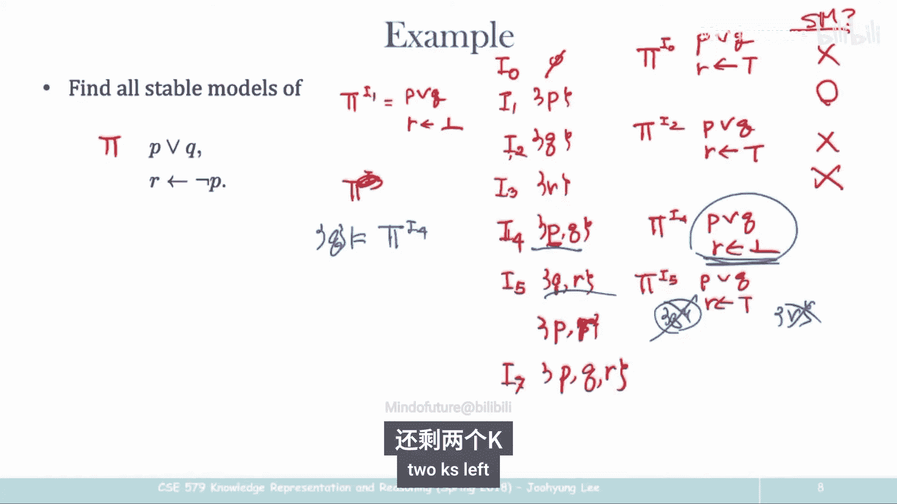
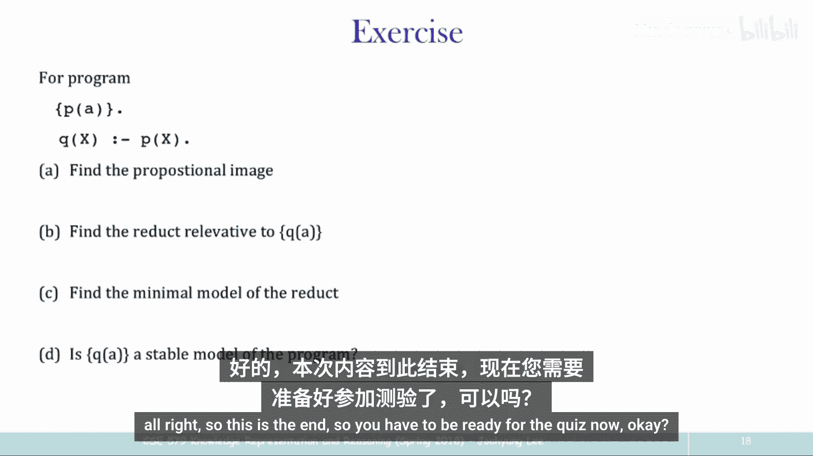

# 007：稳定模型与Klingo编程入门

在本节课中，我们将继续学习稳定模型的定义，并开始介绍如何使用Klingo语言进行逻辑编程。我们将通过一系列练习来巩固对稳定模型概念的理解，并初步了解Klingo程序的基本语法和功能。

## 稳定模型定义回顾

上一节我们介绍了稳定模型的定义，它通过三个步骤来确定一个解释是否是给定逻辑程序的稳定模型。本节中，我们通过更多练习来加深理解。

稳定模型的定义步骤如下：
1.  **识别关键部分**：找出逻辑程序中所有以否定（`not`）开头的最大子公式。
2.  **构造归约**：根据给定的解释 `X`，将每个关键部分替换为 `top`（如果 `X` 满足该部分）或 `bottom`（如果 `X` 不满足该部分），从而得到一个新的程序 `Pi^X`。
3.  **检查最小性**：判断解释 `X` 是否是归约程序 `Pi^X` 的最小模型。如果是，则 `X` 是原程序 `Pi` 的稳定模型。

**公式**：`X` 是 `Pi` 的稳定模型，当且仅当 `X` 是 `Pi^X` 的最小模型。

## 稳定模型判定练习

让我们通过一个具体程序来练习寻找所有稳定模型。考虑以下程序 `Pi`：
```
P or Q.
R if not P.
```
我们假设签名（程序中出现的所有原子命题）仅为 `{P, Q, R}`，因此共有8种可能的解释。

以下是判定过程：

**解释 I0 = {} (空集)**
*   **归约 `Pi^{I0}`**：`not P` 在 `I0` 下为真，故替换为 `top`。归约为：`P or Q.` 和 `R if top.`（等价于 `R.`）
*   **检查**：`I0` 不满足 `P or Q`，因此 `I0` 不是 `Pi^{I0}` 的模型。结论：`I0` 不是稳定模型。

**解释 I1 = {P}**
*   **归约 `Pi^{I1}`**：`not P` 在 `I1` 下为假，故替换为 `bottom`。归约为：`P or Q.` 和 `R if bottom.`（`bottom`蕴含任何命题恒真）
*   **检查**：`I1` 满足归约程序。是否存在比 `I1` 更小的模型也满足归约？尝试 `{}`，但它不满足 `P or Q`。因此 `I1` 是 `Pi^{I1}` 的最小模型。结论：`I1` 是稳定模型。

**解释 I2 = {Q}**
*   **归约 `Pi^{I2}`**：`not P` 在 `I2` 下为真，故替换为 `top`。归约为：`P or Q.` 和 `R if top.`（等价于 `R.`）
*   **检查**：`I2` 不满足 `R`，因此 `I2` 不是 `Pi^{I2}` 的模型。结论：`I2` 不是稳定模型。

**解释 I3 = {P, Q}**
*   **检查**：`I3` 不满足原程序的第一条规则 `P or Q`（因为需要至少一个为真，但这里规则是“或”，`I3`满足它。更正：`I3` 满足 `P or Q`，但我们需要检查其归约）。实际上，由于 `I3` 包含 `P`，其归约与 `I1` 相同。但 `{P}` 是比 `I3` 更小且满足归约的模型，因此 `I3` 不是最小模型。结论：`I3` 不是稳定模型。




**解释 I4 = {R}**
*   **检查**：`I4` 不满足 `P or Q`。结论：`I4` 不是稳定模型。

**解释 I5 = {Q, R}**
*   **归约 `Pi^{I5}`**：`not P` 为真，归约为：`P or Q.` 和 `R.`
*   **检查**：`I5` 满足归约。是否存在更小的模型？`{Q}` 不满足 `R`，`{R}` 不满足 `P or Q`，`{}` 也不满足 `P or Q`。因此 `I5` 是 `Pi^{I5}` 的最小模型。结论：`I5` 是稳定模型。

**解释 I6 = {P, R}**
*   **归约 `Pi^{I6}`**：`not P` 为假，归约为：`P or Q.` 和 `R if bottom.`
*   **检查**：`I6` 满足归约。但 `{P}` 是比 `I6` 更小且满足归约的模型。结论：`I6` 不是稳定模型。

**解释 I7 = {P, Q, R}**
*   **检查**：`I7` 不是最小模型（例如 `{P, R}` 比它小）。结论：`I7` 不是稳定模型。

综上，该程序的稳定模型是 `{P}` 和 `{Q, R}`。

## 关于签名与稳定模型的说明

在寻找稳定模型时，我们通常只考虑出现在程序中的原子命题。如果一个解释包含了程序之外的其他原子命题（例如，签名包含 `{P, Q, R, S}`，而解释是 `{P, Q, S}`），那么它不可能是稳定模型。原因在于，归约过程不会引入新原子，因此可以从解释中移除这些额外的原子（如 `S`），得到一个更小的解释，它同样满足归约程序，从而证明原解释不是最小的。

## 特殊程序分析

现在，我们分析几个只包含单个原子 `P` 的特殊程序，以揭示稳定模型的一些有趣特性。

**程序 1: `P if not P.`**
*   **解释 {}**: 归约为 `P if bottom.`（恒真）。`{}` 是其最小模型。结论：`{}` 是稳定模型。
*   **解释 {P}**: 归约为 `P if top.`（等价于 `P.`）。`{P}` 是其最小模型。结论：`{P}` 是稳定模型。
此程序有两个稳定模型：`{}` 和 `{P}`。注意，其中一个 (`{}`) 是另一个 (`{P}`) 的子集。

**程序 2: `P if P.`**
*   此程序等价于 `P or not P.`（重言式）。其所有解释都是经典模型，但稳定模型是 `{}` 和 `{P}`（分析过程类似程序1）。

这些例子表明，稳定模型语义允许一个稳定模型是另一个稳定模型的真子集。

## 单调逻辑 vs. 非单调逻辑

经典逻辑（命题逻辑、一阶逻辑）是**单调**的。这意味着，如果一个知识库（一组公式）`F` 蕴含某个结论，那么向 `F` 中添加更多公式 `G` 得到的新知识库 `F ∧ G`，其所有模型必然是 `F` 的模型的子集。新知识不会创造新的模型，只会可能排除一些旧的模型。

**公式**：`Models(F ∧ G) ⊆ Models(F)`

稳定模型语义是**非单调**的。考虑以下例子：
*   **程序 F**: `P or Q.` （稳定模型：`{P}`, `{Q}`）
*   **程序 G**: `P if Q. Q if P.`
*   **程序 F ∧ G**: 稳定模型是 `{P, Q}`。

注意，`{P, Q}` 是 `F ∧ G` 的稳定模型，但它不是 `F` 的稳定模型。这表明，向程序中添加规则可以**产生**新的稳定模型，而这些新模型并不是原程序的稳定模型。这与单调逻辑的行为相反。

非单调性在知识表示中非常有用，因为它允许我们处理默认规则和例外。当新信息（例外）加入时，我们可以撤销之前基于默认得出的结论，而不导致整个知识库矛盾。

## Klingo 编程入门 🖥️

现在，我们开始新的主题：使用Klingo进行逻辑编程。Klingo允许我们以声明式的方式编写逻辑程序，并利用稳定模型语义进行推理。

以下是一个用Klingo查找质数的示例程序：

```klngo
composite(N) :- N = 1..5, I = 2..N-1, N%I == 0.
prime(N) :- N = 2..5, not composite(N).
```

**代码解释**：
1.  第一行定义了合数：对于范围1到5中的每个`N`，以及范围2到`N-1`中的每个`I`，如果 `N` 能被 `I` 整除（`N % I == 0`），则 `N` 是合数 (`composite(N)`)。
2.  第二行定义了质数：对于范围2到5中的每个`N`，如果 `N` 不是合数，则 `N` 是质数 (`prime(N)`)。
Klingo处理器会将此程序“实例化”为对应的命题逻辑程序，然后计算其稳定模型。在稳定模型中，`composite(4)` 为真，`prime(2)`, `prime(3)`, `prime(5)` 为真。

## 选择规则

Klingo提供了一种简洁的语法来表达“可选性”，称为选择规则。例如：

```klngo
{p1}.
```
这等价于命题逻辑中的 `p1 or not p1`，表示 `p1` 可以被选择为真或假。该程序有两个稳定模型：`{}` 和 `{p1}`。

我们还可以使用区间符号：
```klngo
{p(1..3)}.
```
这等价于三个独立的选择规则：`{p1}.` `{p2}.` `{p3}.`。该程序有 2^3 = 8 个稳定模型，对应于集合 `{p1, p2, p3}` 的所有可能子集。

## 总结

本节课中我们一起学习了：
1.  通过具体练习，巩固了判定逻辑程序稳定模型的三步法。
2.  理解了稳定模型语义只关注程序中出现的原子。
3.  分析了像 `P if not P` 这样的特殊程序，了解到稳定模型集合可能具有包含关系。
4.  明确了稳定模型语义是一种**非单调逻辑**，这与经典的单调逻辑有根本区别，使其能够更好地处理默认推理和例外。
5.  初步介绍了Klingo逻辑编程语言，包括其基本语法和用于表示可选性的**选择规则**。



掌握稳定模型的定义和性质，是理解并运用Klingo等回答集编程工具进行知识表征和推理的基础。