# 008：ASP编程入门 🚀

在本节课中，我们将学习如何使用Answer Set Programming（ASP）系统，特别是Clingo，来进行知识表征和推理。我们将从基础语法开始，逐步理解如何编写逻辑程序、计算稳定模型，并解决实际问题。

## 概述

上一节我们介绍了稳定模型的理论基础。本节中，我们来看看如何将这些理论付诸实践，即使用Clingo进行编程。我们将学习Clingo的基本语法、如何定义规则、处理算术运算，并理解“安全程序”的概念，以确保程序能被有效求解。

## Clingo基础语法与执行

Clingo程序的核心是计算稳定模型。你需要将问题编码为逻辑程序，然后由Clingo求解器找出对应的稳定模型，这些模型通常就代表了原问题的解。

以下是Clingo支持的基本算术和逻辑符号：

*   **算术运算**：Clingo理解整数。除法 `M/N` 取结果的**地板值**（即小于等于结果的最大整数）。求余使用 `\` 符号，幂运算使用 `**`。
*   **逻辑连接词**：在规则体（body）中，逗号 `,` 表示合取（逻辑与）。在规则头（head）中，逗号表示析取（逻辑或）。否定使用 `not` 表示。
*   **特殊原子**：`#false` 表示永假，`#true` 表示永真。

让我们重温一个简单例子，该程序用于找出比奥斯汀市更温暖的城市。

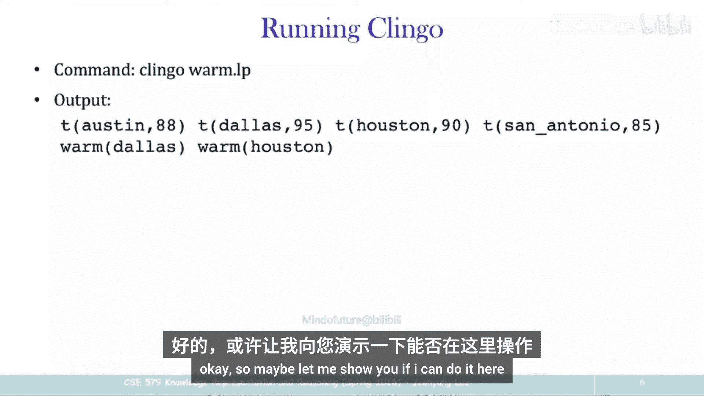

```prolog
% 事实：城市及其温度
temp(austin, 98).
temp(houston, 96).
temp(phoenix, 105).
temp(chicago, 85).

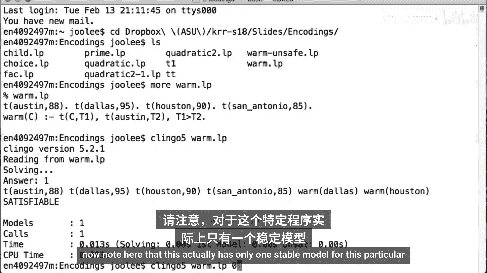

% 规则：如果城市C的温度T1高于奥斯汀的温度T2，则C是温暖城市。
warm(C) :- temp(C, T1), temp(austin, T2), T1 > T2.
```

这个程序包含4个事实和1条规则。规则声明：当城市C的温度T1高于奥斯汀的温度T2时，可以推导出C是温暖的。我们并不描述查找温暖城市的算法，只是声明其定义，由Clingo负责找出解（稳定模型）。

要运行Clingo程序，请在命令行中输入：

```bash
clingo filename.lp
```

Clingo会读取程序，计算并返回所有稳定模型。如果程序有多个稳定模型，可以使用 `clingo filename.lp 0` 来要求返回全部解。

## 安全程序

在编程时，你可能会遇到Clingo报错，提示程序“不安全”。一个程序被称为“安全”的，粗略地说，是要求规则中出现的每个变量，都必须在该规则体的某个**正原子**中出现。

正原子指的是规则体中未被否定符号 `not` 修饰的原子。

以下是一个不安全规则的例子：

```prolog
% 不安全规则：变量T没有出现在任何正原子中
high_temp(T) :- temp(C, T), not temp(C, 95).
```

变量 `T` 出现在 `temp(C, T)` 和 `not temp(C, 95)` 中，但后者因为前面有 `not`，所以不是正原子。因此，`T` 没有出现在正原子中，此规则不安全。

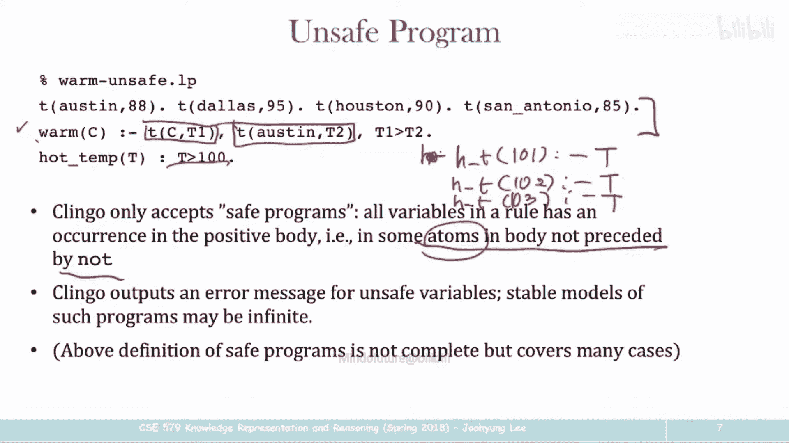

安全性的直观意义在于，它能保证程序在实例化（ grounding ）后只生成有限多条命题规则。不安全的程序可能导致无限多的实例化规则，使得Clingo无法求解。修复方法通常是为变量指定一个有限的范围，例如：

```prolog
% 安全版本：通过添加 `T > 90` 来限定T的范围（注意：比较操作本身不是原子）
% 更好的做法是使用定义域谓词，例如：high_temp(T) :- temp(C, T), not temp(C, 95), T = 1..100.
% 但更常见的修复是确保变量出现在正原子中，例如：
high_temp(T) :- temp(C, T), city(C), not temp(C, 95). % 假设我们定义了city/1谓词
```

## 定义关系与递归

掌握了基础语法后，我们可以定义更复杂的关系，例如家族关系。

以下是定义子女、祖父母、兄弟姐妹和祖先关系的示例程序：

```prolog
% 事实：父母关系
parent(ann, bob).
parent(bob, carol).
parent(bob, dan).

% 规则：子女关系
child(X, Y) :- parent(Y, X).

% 规则：祖父母关系
grandparent(X, Z) :- parent(X, Y), parent(Y, Z).

% 规则：兄弟姐妹关系（需排除自身）
sibling(X, Y) :- parent(P, X), parent(P, Y), X != Y.

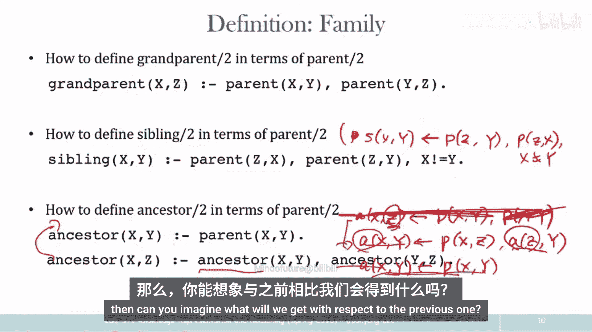

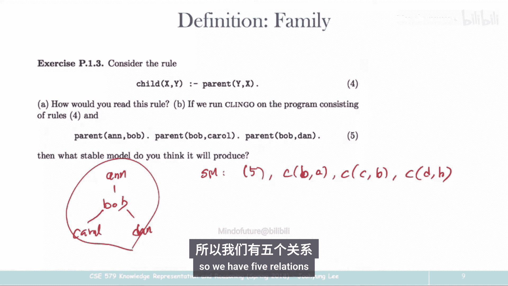

% 规则：祖先关系（递归定义）
ancestor(X, Y) :- parent(X, Y).                 % 基础情况：父母是祖先
ancestor(X, Z) :- parent(X, Y), ancestor(Y, Z). % 递归情况
```

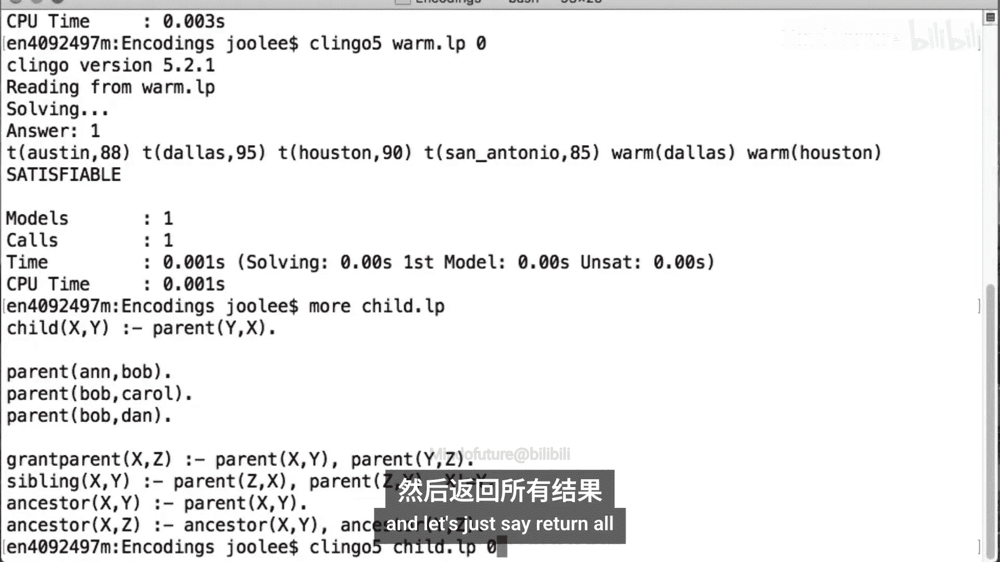

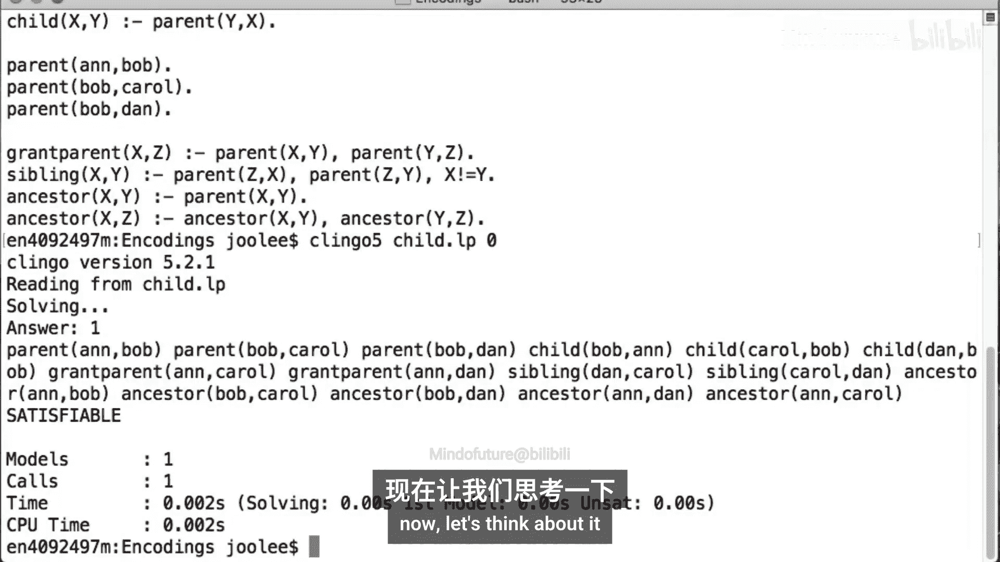

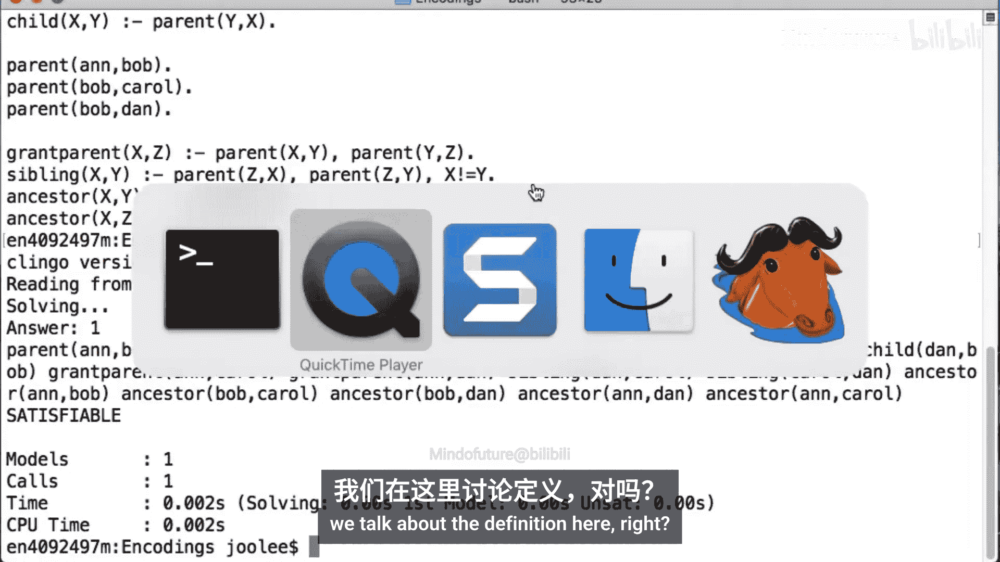

运行此程序，Clingo将计算出所有的子女、祖父母、兄弟姐妹和祖先关系。

## 算术运算与区间

Clingo允许在规则中使用算术比较和运算，并能方便地处理整数区间。

以下程序计算一个二次多项式在n从0到10时的值：

```prolog
% 计算多项式 n^2 + n + 41 在 n=0..10 时的值
quad(N, Val) :- N = 0..10, Val = N**2 + N + 41.
```

我们可以通过命令行参数动态设置系数：

```prolog
% 通用二次多项式 A*N^2 + B*N + C
#const a=1.
#const b=1.
#const c=41.
quad_gen(N, Val) :- N = 0..10, Val = a*(N**2) + b*N + c.
```

或者使用命令行：
```bash
clingo program.lp -c a=1 -c b=1 -c c=41
```

## 经典问题示例：质数与阶乘

最后，我们来看两个经典问题的ASP编码：寻找质数和计算阶乘。

以下是寻找1到N之间质数的程序：

```prolog
% 设置N的值，例如100
#const n=100.
number(1..n).

% 定义合数：如果一个数I可以被1和它本身以外的数J整除，则是合数。
composite(I) :- number(I), number(J), J > 1, J < I, I \ J = 0.

% 定义质数：如果一个数I是数，且不是合数，则是质数。
prime(I) :- number(I), not composite(I).

% 只显示质数
#show prime/1.
```

以下是计算阶乘的程序：

```prolog
% 基础情况：0的阶乘是1
factorial(0, 1).

% 递归情况：(N+1)的阶乘等于N的阶乘乘以(N+1)
factorial(N+1, F * (N+1)) :- factorial(N, F), N >= 0.

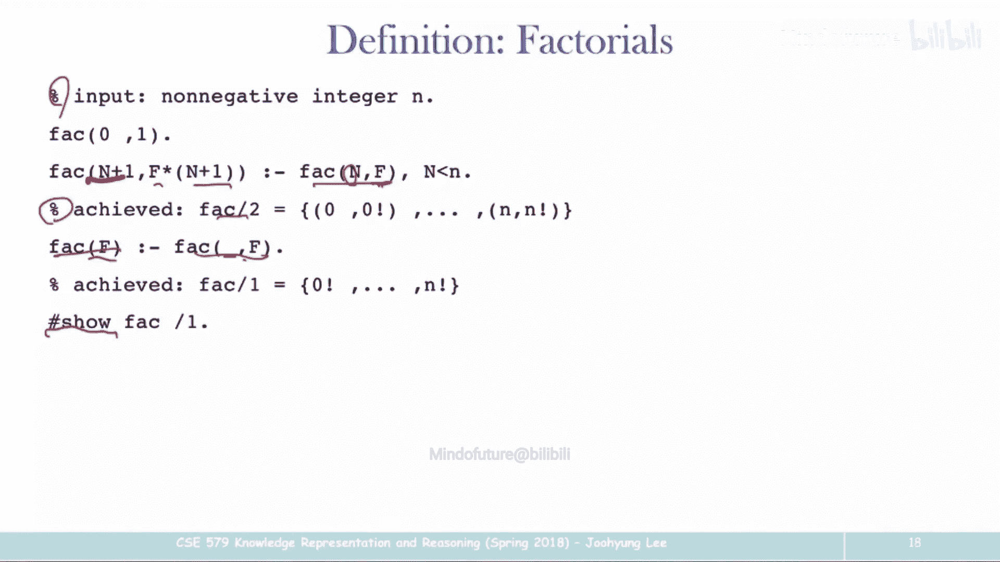

% 投影：只显示一元形式的阶乘结果
fact(N, F) :- factorial(N, F).
#show fact/2.
```

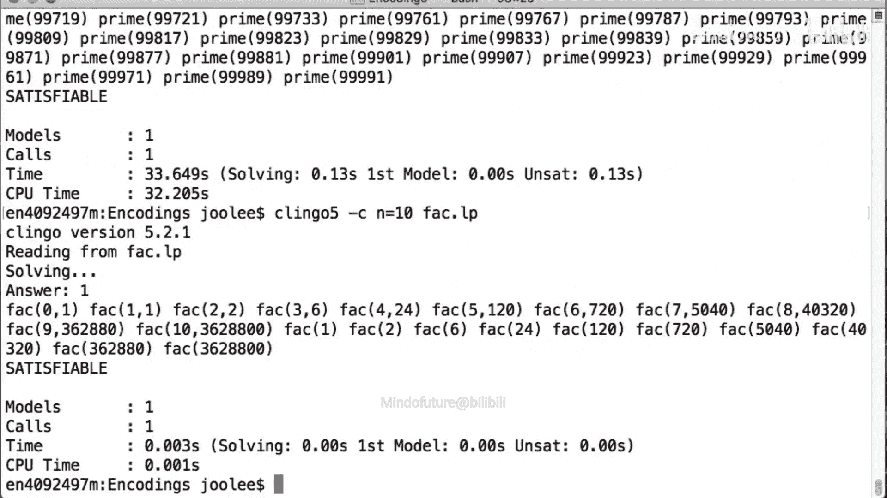

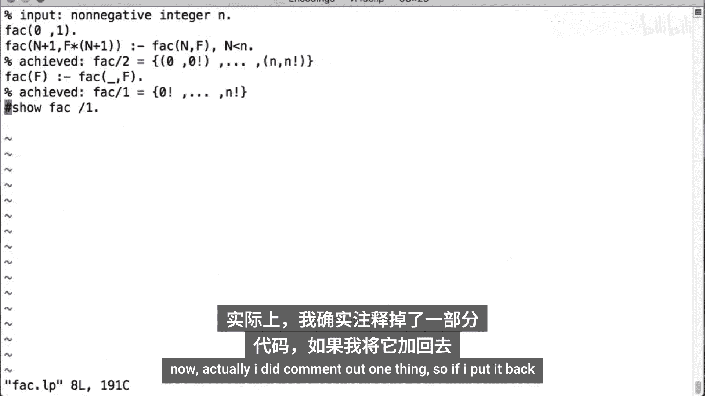

## 总结

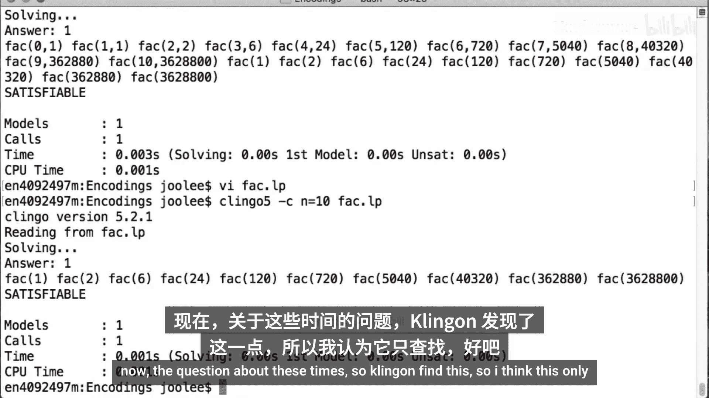

本节课中我们一起学习了ASP编程的核心实践部分。我们从Clingo的基本语法和程序执行开始，理解了如何用逻辑规则表征知识。我们重点探讨了“安全程序”的重要性，它确保了程序的可求解性。接着，我们练习了如何定义各种关系，包括递归定义的祖先关系。最后，我们通过质数判定和阶乘计算这两个例子，展示了ASP解决经典计算问题的能力。记住，ASP的魅力在于其声明式编程范式：你只需描述问题是什么，而无需指定如何求解，Clingo将自动为你寻找答案。